[B0; ] ФЕДЕРАЛЬНОЕ ГОСУДАРСТВЕННОЕ БЮДЖЕТНОЕ УЧРЕЖДЕНИЕ НАУКИ
ФЕДЕРАЛЬНЫЙ НАУЧНО-ИССЛЕДОВАТЕЛЬСКИЙ
СОЦИОЛОГИЧЕСКИЙ ЦЕНТР
РОССИЙСКОЙ АКАДЕМИИ НАУК

[B1; ] УТВЕРЖДАЮ

[B2; ] И. о. директора ФНИСЦ РАН

[B3; ] д. соц. н., проф.

[B4; ] ____________ Ю. А. Зубок

[B5; ] «___» ____________ 2026 г.

[B6; ] ОТЧЁТ
О НАУЧНО-ИССЛЕДОВАТЕЛЬСКОЙ РАБОТЕ

[B7; ] Тема

[B8; Title] ЭКСПЕРТИЗА НАЦИОНАЛЬНОГО ПРОЕКТА
«ЭФФЕКТИВНАЯ И КОНКУРЕНТНАЯ ЭКОНОМИКА»

[B9; ] Москва
2026

[B11; ] СОДЕРЖАНИЕ

[B12; TOCEntry] Основные результаты экспертизы	4

[B13; TOCEntry] 1 Предмет и методические основания экспертизы	9

[B14; TOCEntry] 1.1 Предмет и критерии оценки	9

[B15; TOCEntry] 1.2 Источники и границы доказательств	11

[B16; TOCEntry] 2 Архитектура и механизмы национального проекта	15

[B17; TOCEntry] 2.1 Согласованность семи федеральных направлений	15

[B18; TOCEntry] 2.2 Предпринимательство и переход к более высокой производительности	17

[B19; TOCEntry] 2.3 Производительность предприятий и организаций социальной сферы	18

[B20; TOCEntry] 2.4 Инвестиционная активность и качество капитальных вложений	20

[B21; TOCEntry] 2.5 Финансовый рынок и долгосрочные сбережения	21

[B22; TOCEntry] 2.6 Технологические компании и коммерциализация разработок	23

[B23; TOCEntry] 2.7 Конкуренция и климатическая устойчивость	24

[B24; TOCEntry] 3 Методики показателей и сопоставимость наблюдений	26

[B25; TOCEntry] 3.1 Сопоставимость редакций и времени наблюдения	26

[B26; TOCEntry] 3.2 Доход на работника малого и среднего предприятия	28

[B27; TOCEntry] 3.3 Налоговый показатель и переход предприятий между категориями	30

[B28; TOCEntry] 3.4 Общая производительность и результаты предприятий участников	31

[B29; TOCEntry] 3.5 Производительность в социальной сфере	33

[B30; TOCEntry] 3.6 Инвестиционная активность и результат поддержки	35

[B31; TOCEntry] 3.7 Финансовый рынок и долгосрочные сбережения	37

[B32; TOCEntry] 3.8 Технологические компании и изменение состава наблюдения	39

[B33; TOCEntry] 3.9 Развитие конкуренции	40

[B34; TOCEntry] 3.10 Низкоуглеродное развитие и адаптация	42

[B35; TOCEntry] 4 Статистические результаты и территориальные различия	45

[B36; TOCEntry] 4.1 Общая оценка наблюдаемых результатов	45

[B37; TOCEntry] 4.2 Инвестиционная активность	48

[B38; TOCEntry] 4.3 Малое и среднее предпринимательство	51

[B39; TOCEntry] 4.4 Производительность труда и социальная сфера	53

[B40; TOCEntry] 4.5 Малые технологические компании	55

[B41; TOCEntry] 4.6 Финансовый рынок и сбережения	57

[B42; TOCEntry] 4.7 Территориальная неоднородность	59

[B43; TOCEntry] 4.8 Демографическое и социально-трудовое измерение результатов	63

[B44; TOCEntry] 5 Финансовое обеспечение и экономическая результативность	66

[B45; TOCEntry] 5.1 Финансовая конструкция национального проекта	66

[B46; TOCEntry] 5.2 Распределение между федеральными проектами	68

[B47; TOCEntry] 5.3 Изменение бюджетной структуры в проекте на 2027–2029 годы	72

[B48; TOCEntry] 5.4 Исполнение расходов и сроки возникновения эффекта	74

[B49; TOCEntry] 5.5 Льготное кредитование малого и среднего бизнеса	76

[B50; TOCEntry] 5.6 Гарантии и доступ к финансированию	77

[B51; TOCEntry] 5.7 Инвестиционные механизмы и инфраструктура	79

[B52; TOCEntry] 5.8 Финансирование технологического предпринимательства	81

[B53; TOCEntry] 5.9 Территориальная и социальная результативность расходов	82

[B54; TOCEntry] 5.10 Удельные затраты и сопоставление инструментов	83

[B55; TOCEntry] 5.11 Предложения по совершенствованию финансового мониторинга	85

[B56; TOCEntry] 6 Связи мероприятий с показателями и лингвистическая экспертиза	88

[B57; TOCEntry] 6.1 Единицы анализа и правила сопоставления	88

[B58; TOCEntry] 6.2 Документальные цепочки и прослеживаемость результата	89

[B59; TOCEntry] 6.3 Лексические кандидаты и содержательная проверка	91

[B60; TOCEntry] 6.4 Тематическая специализация и TF–IDF	94

[B61; TOCEntry] 6.5 Межпроектные связи и устойчивость выводов	99

[B62; TOCEntry] 7 Направления совершенствования национального проекта	101

[B63; TOCEntry] 7.1 Согласование показателей и управленческой ответственности	101

[B64; TOCEntry] 7.2 Поддержка предприятий и полнота стоимости результата	102

[B65; TOCEntry] 7.3 Производительность и качество жизни на территориях	103

[B66; TOCEntry] 7.4 Проверка дополнительного эффекта отдельных мер	105

[B67; TOCEntry] 7.5 Последовательность внедрения и межпроектная координация	107

[B68; TOCEntry] Заключение	109

[B69; TOCEntry] Приложение А Реестр статистических показателей	111

[B70; Heading1] Основные результаты экспертизы

[B71; ] Национальный проект «Эффективная и конкурентная экономика» объединяет поддержку предпринимательства, повышение производительности труда, стимулирование инвестиций, развитие финансового рынка, технологических компаний, конкуренции и климатической устойчивости. Его сильная сторона — возможность воздействовать на взаимосвязанные ограничения экономического роста. Главное направление совершенствования состоит в согласовании этих инструментов вокруг проверяемого результата: увеличения реальной добавленной стоимости, расширения возможностей предприятий и повышения благосостояния населения при сохранении качества общественных услуг. Для этого выполнение административных заданий, изменение экономических показателей и дополнительный эффект государственной поддержки необходимо оценивать раздельно. [Сноски 1]

[B72; ] Экспертиза охватывает семь федеральных проектов, представленных в выбранной опубликованной редакции паспорта, и учитывает доступные сведения по состоянию на 28 октября 2026 г. Статистические наблюдения имеют неодинаковые сроки: используются годовые результаты 2025 г., отдельные оперативные данные 2026 г. и более ранние базы сравнения. Наличие показателя в ежемесячной публикации не всегда означает месячную периодичность самого экономического явления. Особенно существенно это для производительности труда и реальных доходов малого и среднего предпринимательства.

[B73; ] В десяти восстановленных годовых сопоставлениях за 2025 г. семь значений выше соответствующего ориентира, два равны ему и одно ниже. Это арифметическая характеристика доступной части показателей выбранной редакции, а не официальный процент выполнения всего проекта. Реальный рост дохода на одного работника субъекта малого и среднего предпринимательства составил 106,8% к базе 2023 г. при ориентире 107,9%. Показатель отражает доход предпринимательского субъекта в расчёте на работника; его нельзя представлять как рост заработной платы каждого занятого. Совпадение нулевого факта с нулевым заданием по созданию системы климатического мониторинга также не означает, что эта система уже создана. [Сноски 2]

[B74; ] Наиболее существенная методическая проблема связана с неодинаковым содержанием слова «производительность». Реальный макроэкономический индекс, номинальная добавленная стоимость на сотрудника предприятия, выработка на отдельном производственном участке и число получателей услуг на работника организации описывают разные процессы. Например, методика оценки достижения предприятиями ежегодного пятипроцентного прироста прямо предусматривает номинальный расчёт. Поэтому выполнение такого задания не доказывает реального прироста на 5%. В социальной сфере увеличение числа обучающихся, посещений или медицинских случаев на работника требует одновременной проверки качества, доступности услуг и нагрузки персонала. [Сноски 3]

[B75; ] Региональные данные показывают, что общероссийский результат не распространяется равномерно на всю территорию. По годовому индексу дохода МСП на работника за 2025 г. доступны 84 региональных значения; медиана составляет 105,4%, а в семи регионах значение ниже 100%. Межквартильный интервал равен 102,775–108,5%. По вовлечению медицинских организаций в проекты производительности медиана региональных значений на сентябрь 2026 г. составляет 25,345%, тогда как по организациям культуры — 1,1765%; у этих направлений различаются календарь и основания учёта. Объединение таких величин в единый рейтинг экономической эффективности региона содержательно неоправданно. [Сноски 4]

[B76; ] Финансовая структура проекта существенно зависит от внебюджетных средств. В выбранном опубликованном паспорте на 2025–2030 гг. предусмотрено 3 673,138 млрд руб., из которых 74,16% отнесено к внебюджетным источникам, 23,14% — к федеральному бюджету и 2,70% — к консолидированным бюджетам субъектов. Эти суммы характеризуют плановое обеспечение, а не произведённые расходы или дополнительный объём инвестиций. На направление инвестиционной активности приходится 78,39% суммы пяти федеральных проектов с численно раскрытым финансированием. Такая концентрация объясняется устройством инвестиционных механизмов и сама по себе не свидетельствует о недостаточном внимании к другим задачам. [Сноски 5]

[B77; ] Сумма пяти раскрытых федеральных проектов отличается от национального итога на 2,0075 млн руб.; разница целиком относится к федеральному бюджету 2026 г. Это небольшая несогласованность открытых представлений, причина которой по опубликованным материалам не установлена. По двум федеральным проектам положительные финансовые суммы в выбранной публикации не раскрыты, поэтому они не приравнены к нулевой стоимости. Сокращение предлагаемого федерального финансирования в 2027 г. требует отдельного объяснения: определяющую роль играет изменение взноса по «Фабрике проектного финансирования», а не одинаковое уменьшение всех инструментов поддержки.

[B78; ] Структурный анализ охватывает 110 карточек результатов и мероприятий, 54 карточки показателей и 337 связей через общую документированную задачу. Последние подтверждают принадлежность к одной логической ветви паспорта, но не устанавливают прямой причинный эффект. В 171 записи раздела влияния результатов адресат не восстанавливается однозначно по анализируемой открытой публикации. Этот вывод характеризует прослеживаемость открытого представления и не доказывает отсутствия связей в ведомственной системе управления. Практическое решение — раскрывать устойчивые идентификаторы показателя и мероприятия, тип связи, временной лаг и проверяемый механизм воздействия. [Сноски 6]

[B79; ] Лингвистический анализ обнаруживает выраженную специализацию на предпринимательстве, производстве, технологиях и финансовых инструментах. Ближайшими по усреднённым текстовым профилям являются «Экономика данных и цифровая трансформация государства», «Молодёжь и дети» и «Международная кооперация и экспорт»; состав этой тройки сохраняется при проверке русским стеммингом. Такие совпадения указывают на темы для межпроектной координации, но не измеряют дублирование расходов и качество политики. Содержательная проверка должна выяснять, передаются ли между проектами предприятия, технологии, квалифицированные работники и результаты поддержки, а не только сходны ли их формулировки.

[B80; ] Предлагаемые изменения сосредоточены на пяти задачах: разграничении номинальных и реальных результатов; прослеживании получателя поддержки во времени; защите качества услуг при росте ресурсоотдачи; раскрытии обязательств и дополнительности финансовых механизмов; территориально дифференцированной оценке. Первые изменения могут быть выполнены через уточнение карточек показателей и регламентов раскрытия, не дожидаясь пересмотра всего национального проекта. Более сложные решения требуют объединения административных данных и последовательной оценки результатов отдельных инструментов.

[B81; Heading1] 1 Предмет и методические основания экспертизы

[B82; Heading2] 1.1 Предмет и критерии оценки

[B83; ] Предмет экспертизы — содержательная состоятельность национального проекта как системы мер экономической политики. Рассматриваются соответствие инструментов заявленным целям, качество измерения результатов, финансовая обеспеченность, территориальная неоднородность и возможность установить вклад государственной поддержки. Устойчивый экономический рост предполагает увеличение производственных возможностей и доходов при приемлемой нагрузке на ресурсы; поэтому количественное расширение участия в мероприятиях оценивается вместе с тем, какие изменения оно создаёт для предприятия, работника, потребителя и территории.

[B84; ] Проект занимает особое положение среди национальных проектов. Часть его инструментов адресована конкретным предприятиям и организациям, а часть изменяет условия функционирования рынков. Поддержка кредита, обучение производственной команды, регистрация технологической компании и изменение конкурентного регулирования имеют разные единицы воздействия. Общая оценка не должна стирать эти различия. Сумма участников и мероприятий полезна для контроля охвата, но не может служить общей мерой результативности экономической политики.

[B85; ] В экспертизе используются четыре последовательно различаемых уровня результата. Первый — фактически предоставленный ресурс или выполненное действие: финансирование, консультация, нормативный акт, созданный сервис. Второй — изменение поведения и возможностей получателя: реализованная инвестиция, внедрённый процесс, выход на рынок, снижение административных затрат. Третий — экономический или социальный результат: добавленная стоимость, реальный доход, качество услуги, устойчивость предприятия. Четвёртый — дополнительное изменение по сравнению с тем, что произошло бы без соответствующей меры. Последний уровень требует специального исследовательского дизайна и не выводится из отчётности о выполнении плана.

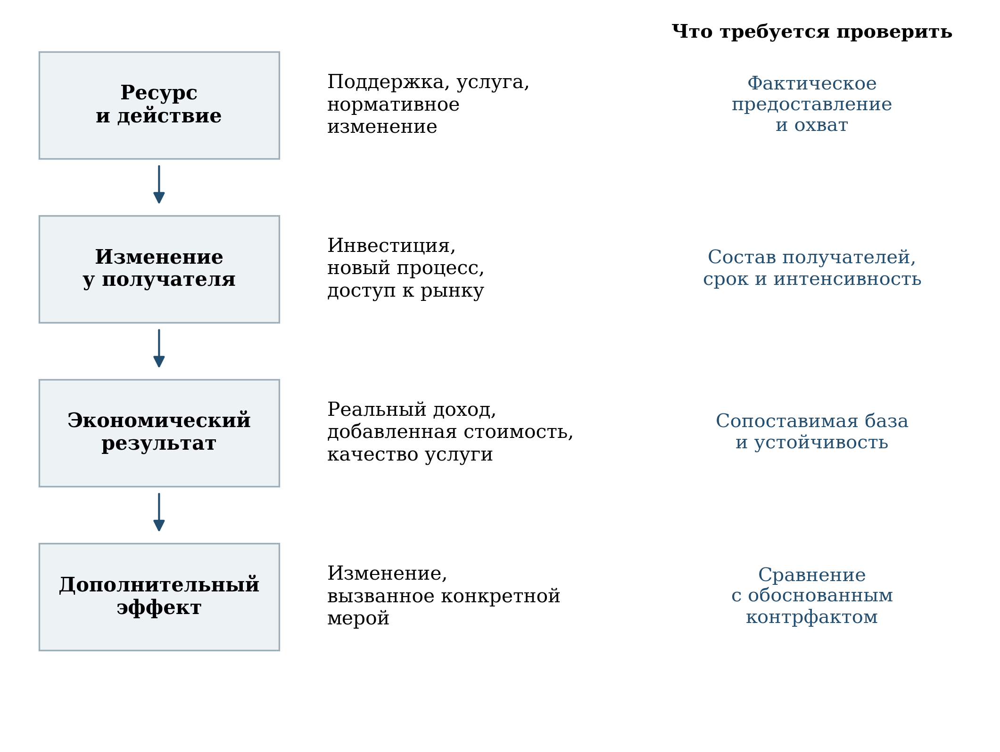

[B87; Caption] Рисунок 1 — Уровни результата и основания их проверки

[B88; SourceNote] Аналитическая схема. Переход между уровнями требует самостоятельных доказательств; расположение блоков не означает автоматически установленную причинную связь.

[B89; ] Оценка релевантности отвечает на вопрос, относится ли мера к установленному ограничению. Оценка согласованности проверяет, не противоречат ли друг другу инструменты и показатели. Оценка результативности сопоставляет ожидаемые и наблюдаемые изменения. Оценка эффективности соотносит эти изменения с полной стоимостью ресурсов. Территориальная справедливость рассматривается как распределение возможностей участия и выгод при различии исходных условий. Устойчивость означает сохранение результата после завершения первоначальной поддержки и его совместимость с долгосрочными кадровыми, финансовыми и климатическими условиями.

[B90; ] Положительная оценка проекта не требует одинакового увеличения каждого показателя в любой момент времени. Инвестиции имеют циклическую динамику, выход компаний на публичный рынок зависит от рыночных условий, а организационные изменения дают результат с лагом. Но такие особенности должны быть заранее отражены в методике, календаре и механизме объяснения отклонений. Иначе временная задержка, изменение состава наблюдаемых единиц и действительное недостижение результата оказываются смешаны в одном числе.

[B91; Heading2] 1.2 Источники и границы доказательств

[B92; ] Нормативную основу составляют документы о национальных целях, действующие методики расчёта показателей, публичные паспорта и сведения о бюджетном обеспечении. Статистическая база включает ЕМИСС, публикации Росстата, ФНС России, Банка России и ведомственные материалы. Для структуры мероприятий и финансовых планов использовано открытое представление паспортов с обозначенной редакцией от 16 октября 2026 г. Оно рассматривается как вторичная публикация сведений о паспортах: наличие версии и даты позволяет обеспечить сопоставимость расчётов, но не заменяет удостоверение действующей редакции уполномоченным органом. [Сноски 7]

[B93; ] Основной статистический массив зафиксирован по состоянию на 15 октября 2026 г.; доступные официальные публикации, обнаруженные к 28 октября 2026 г., используются для содержательной сверки и дополнения. Различаются дата публикации, отчётный период, дата возникновения результата и базовый период. Ведомственное сообщение о числе участников за девять месяцев не подменяет годовой статистический показатель, даже если оба относятся к одной сфере. При пересмотре статистики приоритет имеет явно указанная более поздняя сопоставимая оценка, а не механическое соединение чисел из разных публикаций.

[B94; Caption] Таблица 1 — Источники и допустимые виды выводов

[TABLE 1; B95]
Источник | Что устанавливается | Существенное ограничение
Нормативные акты и методики | Определения, состав учёта, периодичность, правила расчёта | Методика сама по себе не подтверждает достижение результата
Паспорта выбранной редакции | Цели, мероприятия, плановые сроки и финансовые объёмы | План не равен фактическому исполнению; вторичное представление не удостоверяет юридическую актуальность
ЕМИСС и Росстат | Наблюдаемые статистические значения | Проверяются период, база, пересмотры и состав территорий
Ведомственная отчётность | Охват мер, участники и оперативные результаты | Единица учёта может отличаться от официального статистического показателя
Бюджетные документы | Назначения, проектируемые суммы, кассовое исполнение | Не объединяются разные редакции, уровни бюджета, кредиты и расходы
Авторские расчёты | Сопоставления, распределения, структурные и текстовые связи | Не заменяют причинной оценки дополнительного эффекта

[B96; SourceNote] Составлено по результатам сопоставления источников. Срез статистики — 15.10.2026; содержательная сверка официальных публикаций — по 28.10.2026.

[B97; ] Единицами анализа являются статистический код, документальная карточка и экономический объект. В статистическом реестре выделено 49 кодов, тогда как в восьми структурированных паспортах представлены 54 карточки показателей. Эти количества не должны совпадать автоматически: один показатель может присутствовать на нескольких уровнях, формулировки и состав меняются, а наличие карточки не гарантирует опубликованного числового ряда. Полный перечень статистических кодов и статус их наблюдаемости приведены в приложении А.

[B98; ] В анализе плановых траекторий используется разность наблюдаемого значения и цели. Если показатель выражен в процентах, эта разность измеряется в процентных пунктах. Относительный индекс выполнения имеет смысл только при ненулевом знаменателе и содержательно сопоставимых величинах. Для показателей создания системы или принятия нормативного комплекса предпочтительна проверка заданного состояния; деление нуля на нулевую цель не применяется.

[B99; ] (1)

[Формула] Δ = F − T

$$
\Delta=F-T
$$

[B100; ] Здесь F — наблюдаемое значение за соответствующий период, T — цель того же периода и выбранной редакции, Δ — арифметическое отклонение. Знак отклонения интерпретируется с учётом направления показателя. Само по себе превышение цели не объясняет механизм изменения и не удостоверяет достижение конечного общественного результата.

[B101; ] Рост к базовому периоду рассчитывается отдельно от индекса уровня. Например, индекс 106,8% соответствует приросту на 6,8%, а не приросту на 106,8%. При работе с инвестициями дополнительно различаются текущие цены и сопоставимые цены. Для выручки, добавленной стоимости и дохода необходимо указывать применённый дефлятор и правила изменения состава наблюдаемой совокупности.

[B102; ] (2)

[Формула] g = (F/B − 1) × 100%

$$
g=\left(\frac{F}{B}-1\right)\times100\%
$$

[B103; ] В этой записи B — значение в сопоставимом базовом периоде. Формула не применяется к величинам, для которых различаются определения, территориальный охват или единицы измерения. В финансовом разделе арифметика выполняется на едином горизонте 2025–2030 гг. и в одной денежной единице; округление до миллиардов рублей производится после суммирования.

[B104; ] Территориальная часть основана на доступных региональных наблюдениях и не заполняет пропуски условными нулями. Медиана и квартильные границы характеризуют распределение регионов с данными, а не взвешенный общероссийский результат. Корреляции и многомерные группировки могут использоваться для диагностики структуры данных. Они не устанавливают причинных связей и не превращаются в рейтинг качества региональной политики без проверки сопоставимости и устойчивости.

[B105; ] Текстовый анализ дополняет содержательное чтение паспортов. Частоты тематических маркеров, TF–IDF и косинусное сходство применяются для поиска специализации и потенциальных связей. Отдельно рассматриваются документальная принадлежность к задаче, явная адресная связь и лексическая близость. Переход от одной категории к другой без проверки основания недопустим. Методические параметры и результаты проверки устойчивости раскрыты в разделе 6.

[B106; ] Предложения об оценке дополнительного эффекта сформулированы как исследовательские протоколы. Экспертиза не приписывает национальному проекту изменения, которые могли возникнуть под влиянием общеэкономической конъюнктуры, денежно-кредитных условий, налоговых изменений, изменения состава предприятий или других программ. Такое разграничение позволяет сформулировать проверяемые управленческие решения и избежать переоценки как успехов, так и отклонений.

[B107; Heading1] 2 Архитектура и механизмы национального проекта

[B108; Heading2] 2.1 Согласованность семи федеральных направлений

[B109; ] Выбранная структура национального проекта включает семь федеральных проектов. Они соединяют инструменты прямой поддержки предприятий с изменениями институциональной среды. «Малое и среднее предпринимательство и поддержка индивидуальной предпринимательской инициативы» расширяет предпринимательские возможности; «Производительность труда» направлен на организационную и производственную эффективность; «Повышение инвестиционной активности» — на условия и механизмы капиталовложений. «Развитие финансового рынка» обеспечивает каналы привлечения и размещения капитала, «Технологии» — развитие технологических компаний, «Развитие конкуренции» — условия функционирования товарных рынков. «Низкоуглеродное развитие» связывает экономическую деятельность с климатической адаптацией и системой учёта. [Сноски 8]

[B110; Caption] Таблица 2 — Федеральные проекты и проверяемые механизмы экономического результата

[TABLE 2; B111]
Направление | Ожидаемая передача результата | Что требуется проверить
МСП | Доступ к ресурсам и рынкам → устойчивое развитие предприятия | Реальные доходы, занятость, выживаемость и состав получателей
Производи­тельность труда | Изменение процесса → ресурсная экономия → выпуск или качество | Переход от участка к организации, дефлятор, трудозатраты и ограничения качества
Инвестиционная активность | Финансирование и условия → вложения → действующий капитал | Дополнительность, ввод, загрузка и долгосрочные обязательства
Финансовый рынок | Сбережения и размещения → капитал компаний | Чистый приток, первичное финансирование, использование средств и распределение участия
Технологии | Разработка → коммерциализация → устойчивые продажи | Постоянная когорта, первые и повторные заказы, масштабирование
Конкуренция | Правила и контроль → доступ на рынок → выбор и эффективность | Границы рынка, вход независимых участников, условия для потребителей
Низкоуглеродное развитие | Учёт и адаптация → снижение уязвимости и климатического воздействия | Исполнение мер, качество наблюдений, физический результат и дополнительность

[B112; SourceNote] Содержательная интерпретация структуры выбранных паспортов. Стрелка обозначает предполагаемый механизм, который подлежит проверке. [Сноски 9]

[B113; ] Между направлениями существует содержательная последовательность. Предпринимательская команда может получить технологическую поддержку, стать поставщиком крупной компании, привлечь финансирование и расширить производство. Инвестиционный проект может одновременно нуждаться в улучшении административных процедур, подготовке персонала и изменении производственных процессов. Сбережения населения могут формировать долгосрочный капитал, если финансовые посредники обеспечивают его преобразование в производительные вложения. Конкуренция определяет, насколько полученные возможности распространяются на широкий круг участников, а не закрепляются за ограниченным числом получателей.

[B114; ] Эти связи требуют координации на уровне объекта поддержки. Совпадение названий целей в паспортах недостаточно: необходимы совместимые идентификаторы предприятия и инвестиционного проекта, сведения о последовательности мер и их совокупной стоимости. При этом объединение данных не должно означать суммирование одного результата несколько раз. Если один и тот же кредит одновременно связан с гарантией, субсидированием ставки и инвестиционной программой, объём финансирования предприятия остаётся одним потоком, хотя инструментов поддержки несколько.

[B115; ] Внутренняя логика проекта допускает и противоречия. Субсидирование кредита может облегчать инвестиции, но при узком круге получателей усиливать преимущества отдельных компаний. Рост выручки технологического сектора может сопровождаться увеличением импорта комплектующих или зависимостью от одного покупателя. Увеличение количества услуг на работника может повышать доступность, но при недостатке времени на случай снижать качество. Экспертиза поэтому рассматривает не только наличие положительной цепочки, но и условия, при которых она разрывается.

[B116; Heading2] 2.2 Предпринимательство и переход к более высокой производительности

[B117; ] Федеральный проект поддержки МСП объединяет финансовые инструменты, инфраструктуру, услуги и меры, ориентированные на развитие предприятий. Его общеэкономический смысл состоит в том, чтобы облегчить вход, рост и устойчивое функционирование бизнеса. Число зарегистрированных субъектов и объём оказанных услуг характеризуют масштаб среды, однако устойчивый рост реального дохода на работника у действующих предприятий связан с развитием технологий, организации труда, квалификации, спроса и доступа к рынкам. При этом совокупный показатель сектора может изменяться вследствие включения новых и выбытия прежних предприятий даже без улучшения результатов каждой сохраняющейся компании. [Сноски 10]

[B118; ] Связь между поддержкой и доходом неоднородна. Для начинающего предприятия ключевым результатом может быть переход к устойчивым продажам; для действующего — инвестиция, расширение рынка или снижение издержек. Временное сохранение предприятия в неблагоприятной конъюнктуре отличается от ускорения его роста. Поэтому общая категория «получатель поддержки» должна сопровождаться характеристиками стадии развития, отрасли, размера, территории, интенсивности и времени предоставления помощи.

[B119; ] Показатель перехода между категориями МСП полезен для наблюдения за ростом бизнеса, но требует осторожной трактовки. Превышение порога может зависеть от изменения цен, численности, состава группы компаний или правил учёта. Выход из категории среднего бизнеса иногда является успешным развитием, а сокращение числа субъектов в реестре не обязательно означает закрытие. Желательно показывать переходы между категориями, продолжение деятельности и реальные экономические результаты одной и той же когорты предприятий.

[B120; ] Реальный доход на работника не раскрывает распределение выгод между собственником, работниками и потребителями. Рост показателя может происходить вместе с увеличением прибыли и без сопоставимого повышения оплаты труда. Он может отражать сокращение числа работников при неизменном доходе. Для оценки благосостояния целесообразно дополнять официальный показатель динамикой реальной оплаты труда, устойчивостью занятости, выживаемостью предприятий и производительностью, сохраняя различие между этими результатами.

[B121; ] Региональная инфраструктура поддержки должна оцениваться по доступности и дальнейшей траектории получателя. Удовлетворённость услугой указывает на качество взаимодействия, но не заменяет проверку последующих изменений в деятельности предприятия. Для сравнения центров поддержки необходимы различия в составе клиентов и задачах; иначе организация, работающая с наиболее сложными случаями, может выглядеть хуже по простому проценту успешных обращений.

[B122; Heading2] 2.3 Производительность предприятий и организаций социальной сферы

[B123; ] Федеральный проект «Производительность труда» охватывает предприятия базовых несырьевых отраслей и государственные и муниципальные организации социальной сферы. В составе мер присутствуют диагностика, тиражирование практик, отраслевые центры компетенций, обучение и проекты совершенствования процессов. Это позволяет действовать на уровне конкретного рабочего потока, где организационные потери могут быть обнаружены и устранены. [Сноски 11]

[B124; ] Результат производственного проекта следует прослеживать от участка до предприятия. Сокращение времени переналадки, запасов или производственного цикла создаёт экономический эффект только при связи с выпуском, качеством, загрузкой оборудования и спросом. Если высвободившееся время не используется, локальная экономия ещё не означает роста добавленной стоимости. Если ускорение процесса достигается за счёт более высокого брака или переработок, краткосрочное повышение выработки не обеспечивает устойчивого результата.

[B125; ] В социальной сфере физическое число услуг является лишь частью результата. В образовании необходимо учитывать сложность программ, контингент, результаты обучения и доступность поддержки обучающихся. В здравоохранении — состав пациентов, медицинские показания, качество наблюдения, повторные обращения и доступность помощи. В культуре — состав посещений, доступность для разных групп и сохранение разнообразия деятельности. Одинаковое увеличение отношения объёма услуг к численности работников может иметь различный общественный смысл.

[B126; ] (3)

[Формула] P = Q/L, Q – объём услуг, L – трудозатраты

$$
P=\frac{Q}{L}
$$

[B127; ] Представленная формула выражает ресурсоотдачу. Она становится содержательной оценкой производительности услуги, когда объём Q приведён к сопоставимому составу и качеству, а трудозатраты L учитывают фактически затраченное время. Число работников является приближением, поскольку не раскрывает неполную занятость, совместительство, переработки и передачу функций внешним исполнителям.

[B128; ] Для организаций с высокой долей фиксированных затрат рост контингента способен улучшать показатель без изменения процесса. Для малокомплектной школы или учреждения в удалённом поселении, напротив, низкое отношение услуг к персоналу может сопровождаться выполнением необходимой функции доступности. Поэтому оценка должна отделять технологическую эффективность от территориальных обязательств публичной услуги. Применение единого порога без такого разграничения создаёт риск ухудшения положения малонаселённых территорий.

[B129; ] Перевод выявленной экономии в устойчивый результат предполагает заранее установленное использование высвобожденного ресурса: увеличение доступности, сокращение ожидания, улучшение условий труда, повышение качества или обоснованное уменьшение затрат. Выбор между этими вариантами должен быть виден в проекте организации. Автоматическое отождествление повышения производительности с сокращением персонала необоснованно, особенно при кадровом дефиците.

[B130; Heading2] 2.4 Инвестиционная активность и качество капитальных вложений

[B131; ] Инвестиционное направление сочетает механизмы финансирования с улучшением административных процедур и территориальных условий. В паспорте представлены федеральные инвестиционные механизмы, деятельность особых экономических зон, специальные административные районы, оценка инвестиционного климата и сокращение издержек промышленного строительства. Поэтому результат нельзя свести к единому объёму вложений без рассмотрения происхождения средств и завершения объектов. [Сноски 12]

[B132; ] Привлечённое финансирование, освоенные капитальные вложения, ввод объекта и выпуск продукции образуют разные стадии. Объявленная стоимость проекта не равна инвестициям текущего года, подписанное соглашение не означает финансового закрытия, а построенный объект может не выйти на проектную загрузку. Для каждого крупного механизма нужна согласованная последовательность наблюдения с датами прохождения стадий и причинами остановки.

[B133; ] Общеэкономический эффект инвестиций зависит от качества капитала, его использования и связи с другими ресурсами. Строительство без подключения к сетям, доступной рабочей силы и рынков сбыта создаёт риск недозагрузки. Модернизация действующего предприятия может давать высокий эффект при меньшей стоимости, чем новый объект. Сравнение инструментов по валовому объёму инвестиций на рубль бюджетного расхода требует учёта этих различий, срока службы капитала, риска и обязательств государства.

[B134; ] Рост рейтинга инвестиционного климата целесообразно сопоставлять с конкретными процедурами: сроками подключения, получения разрешений, урегулирования земельных вопросов и сопровождения инвестора. Улучшение опросной оценки и сокращение фактического времени прохождения процедуры являются взаимодополняющими свидетельствами. Изменение позиции региона в рейтинге может зависеть от результатов других субъектов, поэтому предпочтительны также абсолютные показатели времени, стоимости и вариации опыта заявителей.

[B135; ] Для оценки дополнительности необходимо установить, реализовалась бы инвестиция без поддержки, в меньшем объёме или позднее. Если поддержан проект, уже имевший устойчивое финансирование и принятое инвестиционное решение, валовой объём вложений не равен стимулированному объёму. В то же время ускорение реализации или снижение риска незавершения также может быть полезным эффектом; его следует измерять отдельно, а не приравнивать ко всей стоимости объекта.

[B136; Heading2] 2.5 Финансовый рынок и долгосрочные сбережения

[B137; ] Развитие финансового рынка направлено на расширение источников капитала и инструментов долгосрочного накопления. В паспорте представлены капитализация рынка акций, публичные размещения, активы небанковских организаций и долгосрочные сбережения граждан. Эти показатели взаимосвязаны, но отражают разные объекты: рыночную оценку существующих компаний, поток нового финансирования, баланс финансовых организаций и структуру имущества домохозяйств. [Сноски 13]

[B138; ] Рост капитализации может происходить вследствие увеличения котировок уже обращающихся акций, появления новых эмитентов или изменения числа бумаг. Только часть этих изменений означает приток средств непосредственно компаниям. Поэтому капитализация относительно ВВП должна сопровождаться данными о первичных размещениях, доле вторичной продажи акций, числе эмитентов и использовании привлечённых ресурсов. Снижение отношения капитализации к ВВП, в свою очередь, может быть связано и с ростом знаменателя.

[B139; ] Доля долгосрочных сбережений характеризует структуру, а не гарантированное повышение финансового благополучия. Она может увеличиться из-за сокращения краткосрочных накоплений. Договор, открытый счёт и счёт с положительным устойчивым остатком имеют разное значение. Для оценки результатов полезны суммы чистого притока, продолжительность удержания средств, реальные доходности после издержек, досрочные выходы и распределение участия по доходным и возрастным группам.

[B140; ] Поддержка долгосрочных продуктов должна соответствовать потребностям граждан в ликвидности. Для домохозяйства с нестабильным доходом высокая доля недоступных до определённого срока средств может ухудшить устойчивость к текущим расходам. Поэтому расширение участия целесообразно оценивать вместе с наличием ликвидного резерва и понятностью условий продукта. Нельзя рассматривать максимизацию одной доли как универсальную рекомендацию для всех семей.

[B141; Heading2] 2.6 Технологические компании и коммерциализация разработок

[B142; ] Федеральный проект «Технологии» включает развитие предпринимательских команд, поддержку технологических компаний, включение их в кооперационные цепочки и подготовку к привлечению капитала. Его логика состоит в переходе от знания и разработки к устойчивому производству и продаже продукта. На каждом этапе действуют собственные ограничения: подтверждение спроса, разработка, испытания, сертификация, первые продажи, масштабирование и доступ к финансированию. [Сноски 14]

[B143; ] Получение статуса малой технологической компании облегчает идентификацию сектора, но не должно становиться самостоятельной заменой технологического результата. Рост числа компаний в реестре изменяет охват наблюдения. Поэтому увеличение совокупной выручки следует разложить на рост действовавшей ранее когорты, включение новых компаний, выход из наблюдаемой совокупности и изменение цен. Без такого разложения ускорение коммерциализации трудно отличить от расширения статистической границы.

[B144; ] Включение в кооперационную цепочку имеет разные формы. Подписанное соглашение о взаимодействии, опытная поставка и регулярные оплаченные заказы отличаются по устойчивости. Официальная методика показателя участия технологических компаний охватывает организации, которые могут участвовать либо участвуют в соответствующих проектах и цепочках; расчётная компонента основана на числе МТК. Поэтому значение этого показателя не является числом компаний с подтверждёнными контрактами и исполненными поставками. Для поддержки доращивания компаний полезны доля повторных заказов, число независимых покупателей, время от завершения разработки до первой выручки и сохранение продаж после завершения гранта. Эти показатели конкретизируют коммерциализацию, не подменяя официальный целевой объём выручки. [Сноски 15]

[B145; ] Университетское предпринимательство требует отдельного анализа. Задачи образовательной программы, исследовательского проекта и коммерческой компании могут пересекаться, но не совпадают. Количество созданных стартапов отражает организационную активность; устойчивость технологий и бизнеса подтверждается последующей траекторией. Поддержка должна позволять прекращение неперспективной разработки на раннем этапе, поэтому доля закрытых проектов сама по себе не является исчерпывающей мерой неудачи портфеля.

[B146; Heading2] 2.7 Конкуренция и климатическая устойчивость

[B147; ] Развитие конкуренции создаёт условия, при которых поддержка предпринимательства и инвестиций приводит к расширению возможностей входа и выбора. Нормативные документы, мониторинг рынков и национальные ценовые индикаторы необходимы для этой работы. Но принятие нормативного комплекса не показывает автоматически, снизились ли барьеры, увеличилось ли число независимых поставщиков и улучшились ли условия для потребителей. Для оценки результата следует переходить от факта принятия документа к изменениям на определённом товарном рынке. [Сноски 16]

[B148; ] Удовлетворённость участников рынка полезна как источник сведений о практическом опыте, но зависит от состава опрошенных и их положения. Доминирующий участник и новый поставщик могут по-разному оценивать одни условия. Раскрытие выборки, долей ответивших, весов и устойчивости анкеты необходимо для сравнения во времени. Опрос следует сопоставлять с показателями входа, выхода, концентрации, времени доступа к инфраструктуре и результатами закупок, когда они соответствуют границам конкретного рынка.

[B149; ] Климатическое направление включает адаптацию, учёт парниковых газов, инфраструктуру углеродного регулирования и мониторинг климатически активных веществ. Эти задачи связаны с экономической устойчивостью, но не могут измеряться одной долей принятых планов. План адаптации создаёт организационную основу; результат возникает при выполнении мер, снижающих уязвимость конкретной территории, отрасли или объекта. [Сноски 17]

[B150; ] Выпуск углеродных единиц, изменение национальных нетто-выбросов и создание системы мониторинга также являются различными событиями. Углеродная единица требует проверки границ проекта, исходного сценария, дополнительности, постоянства и риска переноса выбросов. Сокращение нетто-выбросов может отражать изменения хозяйственной активности и поглощений, а не только результат климатического проекта. Система мониторинга должна оцениваться по охвату, качеству наблюдений и использованию результатов, сохраняя самостоятельность критерия её создания.

[B151; ] Для связи климатической и инвестиционной политики рекомендуется включать оценку физических климатических рисков в жизненный цикл поддерживаемого объекта. Это позволяет заранее учесть расходы на защиту, эксплуатацию и восстановление после опасных событий. Такие решения имеют территориальную специфику: потребность в адаптации зависит от характера объекта и опасности, а не от одинаковой для всех субъектов доли выполненных документов.

[B152; Heading1] 3 Методики показателей и сопоставимость наблюдений

[B153; Heading2] 3.1 Сопоставимость редакций и времени наблюдения

[B154; ] Показатели проекта не образуют неизменного набора методик, утверждённых однократно перед началом реализации. В 2025–2026 годах были обновлены правила расчёта охвата предприятий и организаций социальной сферы, общей производительности труда, показателей финансового рынка и конкуренции. Для оценки результата недостаточно совпадения наименований. Необходимо установить одинаковые единицы измерения, состав учитываемых объектов, период возникновения результата, базовый год и действовавшее определение числителя и знаменателя. В приложениях к отчётности желательно показывать действующую редакцию методики и указывать, какие ретроспективные значения пересчитаны на её основе. [Сноски 18]

[B155; ] Особенно существенно различать экономический период и дату представления информации. Годовые показатели могут отражаться в ежемесячной отчётности без нового расчёта за каждый месяц. Для дохода на работника МСП методика прямо предусматривает повторение годового значения в месячных строках. Для доли предприятий, достигших пятипроцентного прироста производительности, месячная отчётность также сохраняет результат последнего годового расчёта. Это означает, что двенадцать одинаковых месячных наблюдений не являются двенадцатью независимыми измерениями, а резкое изменение между месяцами может обозначать публикацию нового годового результата. [Сноски 19]

[B156; ] Отдельного обращения требуют нулевые и отсутствующие значения. Если годовая методика допускает использование прошлогодних данных при отсутствии новых компонентов, непрерывность ряда может отражать регламент заполнения. Если в показателе с базовым значением 100 появляются нули между содержательно допустимыми оценками, их нельзя автоматически интерпретировать как обнуление производительности или дохода. До разъяснения статуса такие записи не должны участвовать в расчёте тренда, темпа изменения и прогноза. При этом их наличие необходимо сохранять в описании ограничений открытых данных: исключение из аналитического расчёта не означает исправления официальной статистики.

[B157; ] Достижение цели следует устанавливать по одной определённой редакции паспорта. Изменение планового значения после завершения периода способно изменить долю выполнения без изменения фактического результата. Поэтому полезны два параллельных сопоставления: с планом, действовавшим при исполнении, и с планом последней опубликованной редакции. Второе характеризует соответствие актуальному документу, первое — исполнение первоначального обязательства. Смешивать эти оценки в едином проценте выполнения проекта методически неправомерно.

[B158; Caption] Таблица 3 — Методические различия, которые меняют интерпретацию результата

[TABLE 3; B159]
Показатель | Особенность | Последствие для оценки
Доход на работника МСП | Доход хозяйствующего субъекта, база 2023 г., дефлирование | Не является заработной платой; требует проверки состава предприятий и труда
Налоги на работника МСП | Прокси, предшествующий отчётному месяц, налоговые правила | Не заменяет реальный предпринимательский доход
5% прироста на предприятии | Номинальная добавленная стоимость на сотрудника | Не равнозначно 5% реального роста
Производи­тельность экономики | Годовые индексы на базе 2023 г. | Месячные повторы и нули не образуют независимый экономический ряд
Охват социальной сферы | Подтверждение завершения хотя бы одного проекта | Выше простого счёта регистраций, но не подтверждает качество всей услуги
МТК в проектах и кооперации | Методика включает компании, которые могут участвовать | Нужны отдельно подтверждённые контракты и поставки
Капитализация к ВВП | Рыночная стоимость запаса относительно годового потока | Рост не равен сумме нового финансирования компаний
Создана система конкуренции | Комплекс документально установленных условий | Формальное состояние не заменяет результат на товарных рынках

[B160; SourceNote] Сопоставлены определения действующих методик, а не только названия показателей. [Сноски 20]

[B161; Heading2] 3.2 Доход на работника малого и среднего предприятия

[B162; ] Показатель реального роста дохода на одного работника МСП характеризует отношение доходов предпринимательского сектора к числу учитываемых работников относительно 2023 года. Доход определяется по налоговой отчётности юридических лиц и индивидуальных предпринимателей. Следовательно, речь идёт о доходах хозяйствующих субъектов, а не о заработной плате работников, личных доходах предпринимателей или располагаемых ресурсах домохозяйств. Употребление выражения «доходы работников МСП выросли» при описании этого показателя меняет экономический смысл исходной величины. [Сноски 21]

[B163; ] Методика использует число физических лиц, с выплат которым начислены страховые взносы за IV квартал. При работе человека у нескольких работодателей предусмотрен однократный учёт с отнесением к работодателю, начислившему наибольшую сумму выплат. Эта процедура ограничивает двойной счёт работников, но не делает знаменатель эквивалентом среднегодовых затрат труда. Изменение сезонной занятости, продолжительности рабочего времени и организационных форм взаимодействия с исполнителями может воздействовать на показатель иначе, чем на реальную производительность. Поэтому его следует сопоставлять с занятостью, рабочим временем и отраслевой структурой, сохраняя официальное определение.

[B164; ] Дефлирование предпринимательского дохода через индекс потребительских цен позволяет оценить его изменение в единицах общей покупательной способности. Однако ИПЦ не отражает в точности динамику отпускных цен каждой отрасли и затрат на промежуточные ресурсы. Предприятия торговли, промышленности и услуг имеют различные ценовые структуры. Для оценки технологической эффективности необходим дополнительный расчёт реальной добавленной стоимости на единицу труда по сопоставимой группе предприятий. Такой расчёт должен дополнять утверждённый показатель, а не заменять его в оценке выполнения паспорта.

[B165; ] Увеличение отношения дохода к работникам возможно как при расширении дохода, так и при сокращении знаменателя. Поэтому целесообразна трёхкомпонентная публикация: индекс реального дохода, индекс числа учитываемых работников и их итоговое отношение. Дополнительно требуется разложение изменения по непрерывно действующим предприятиям, новым участникам и выбывшим организациям. Оно позволит отделить улучшение результатов существующего бизнеса от изменения состава сектора. Переход выросшего предприятия за пределы категории МСП представляет возможный положительный результат развития, хотя одновременно меняет наблюдаемую совокупность.

[B166; ] Плановое опережение динамики ВВП должно трактоваться через прирост относительно общей базы, а не через механическое умножение самого индекса ВВП на 1,2. При условном увеличении ВВП с 100 до 110 опережение прироста в 1,2 раза соответствует увеличению показателя МСП до 112, а не до 132. Условный пример нужен для разъяснения расчётной логики и не представляет фактической оценки проекта. В конкретном сравнении необходимо использовать утверждённую плановую траекторию и одинаковый базовый период. [Сноски 22]

[B167; Heading2] 3.3 Налоговый показатель и переход предприятий между категориями

[B168; ] Темп роста налогов на одного работника МСП определён как прокси для реального роста дохода. Его назначение состоит в оперативном наблюдении, поскольку полные сведения о предпринимательских доходах поступают позднее. В составе уплаченных налогов предусмотрены исключения; в частности, показатель не включает налог на профессиональный доход и страховые взносы. Кроме того, регламент устанавливает временной сдвиг: значение отчётного месяца принимается равным состоянию на конец предшествующего месяца. [Сноски 23]

[B169; ] Прокси не воспроизводит исходный показатель тождественно. Изменение поступлений зависит от налоговой базы, ставок, режимов налогообложения, сроков уплаты, возвратов и зачётов. Рост налогов может сопровождать расширение бизнеса, но сам по себе не доказывает увеличения реального дохода на работника. Для использования прокси в управлении необходима ежегодная проверка ошибки: насколько предварительная оценка на основе налогов соответствует позднее опубликованному годовому результату. Желательно показывать величину ошибки по секторам и регионам, а при изменении налоговых правил обозначать разрыв сопоставимости.

[B170; ] Показатель доли субъектов МСП, превысивших предельные значения своих категорий, ориентирован на качественный рост бизнеса. Он основан на данных единого реестра МСП и критериях категорий. Однако факт превышения порога не содержит информации об устойчивости нового масштаба деятельности. Также стоимостное увеличение при неизменных физических объёмах может приблизить предприятие к порогу выручки. Поэтому оценку переходов следует дополнять сохранением деятельности, занятости и более высокой категории через один и два года, а также раздельно учитывать превышение порога по численности и по доходу. [Сноски 24]

[B171; ] Для поддержки растущих предприятий особенно полезен когортный анализ получателей. Единицей наблюдения должен быть уникальный хозяйствующий субъект с датами получения различных мер, а результатами — реальная добавленная стоимость, занятость и устойчивость деятельности. Число консультаций, займов и поручительств остаётся необходимой информацией об организации поддержки, но суммирование этих событий не должно выдавать одного получателя за несколько выросших предприятий.

[B172; Heading2] 3.4 Общая производительность и результаты предприятий участников

[B173; ] Макроэкономический индекс производительности труда строится на соотношении динамики физического объёма выпуска и затрат труда. Методология Росстата от 8 мая 2026 года предусматривает расчёты по Российской Федерации, регионам, отраслям и Арктической зоне. При этом из расчёта исключается вменённая добавленная стоимость жилищных услуг собственников жилья, поскольку для неё невозможно содержательно оценить затраты труда. Национальный показатель роста относительно 2023 года объединяет годовые индексы на общей базе. [Сноски 25]

[B174; ] Такой показатель характеризует всю экономику и реагирует на отраслевые сдвиги, загрузку мощностей, технологические изменения, спрос и изменение состава занятости. Эффект адресной работы центров компетенций входит в эту динамику вместе со многими другими факторами. Совпадение улучшения макроиндекса и расширения числа участников не является оценкой вклада проекта. Для неё необходимо сопоставить изменения у получателей и сопоставимых неполучателей с учётом исходного состояния, отрасли, региона и времени начала поддержки.

[B175; ] Принципиальное различие обнаруживается в показателе доли предприятий, достигших ежегодного пятипроцентного прироста производительности. Утверждённая методика прямо предусматривает номинальный расчёт без исключения инфляционной составляющей. Добавленная стоимость складывается из прибыли от основной деятельности, оплаты труда, страховых взносов, включаемых в себестоимость налогов и амортизации; затем соотносится с численностью работников. Это самостоятельная корректно определённая величина, но она не тождественна реальному макроэкономическому индексу. [Сноски 26]

[B176; ] Следовательно, выполнение критерия прироста на 5 процентов не следует описывать как гарантированный реальный прирост на 5 процентов. Для оценки экономического результата необходима параллельная дефлированная серия, а для технологического — физический выпуск годной продукции, трудоёмкость, длительность производственного цикла и доля брака. Снижение времени операции на пилотном участке также нельзя без проверки переносить на производительность всего предприятия. Следует последовательно показать локальное изменение процесса, распространение практики на предприятие и изменение его совокупных результатов.

[B177; ] Охват средних и крупных предприятий рассчитывается для совокупности, соответствующей установленным критериям участия. Методика использует специальные пороги выручки, налоговые условия и ограничения доли иностранного участия; для туризма предусмотрен иной порог выручки. Учитываются также организации, участвовавшие в предшествующем федеральном проекте. Поэтому охват нельзя трактовать как долю всех средних и крупных предприятий, определённых только по стандартным статистическим категориям. Изменение знаменателя и накопленный характер участия должны быть раскрыты одновременно. [Сноски 27]

[B178; Heading2] 3.5 Производительность в социальной сфере

[B179; ] Социальная сфера требует отдельной системы интерпретации. Число обучающихся на работника, количество случаев диспансерного наблюдения на занятую врачебную должность, оборот койки и число посещений учреждений культуры отражают интенсивность использования ресурсов. Увеличение каждого из этих отношений может означать устранение организационных потерь, но может также сопровождать более высокую нагрузку персонала, укрупнение организаций или изменение состава получателей услуг. По одному отношению невозможно различить эти механизмы. Соответствующие показатели присутствуют в структуре федерального проекта, поэтому вопрос состоит в условиях их совместной оценки с качеством и доступностью услуг. [Сноски 28]

[B180; ] В действующей методике охвата социальной сферы имеются требования к подтверждению завершения хотя бы одного проекта повышения производительности. Поэтому представлять этот показатель как простой счёт регистраций некорректно. Регистрация и документальное подтверждение результата образуют более содержательный механизм контроля. Его предел заключается в другом: завершение одного проекта ещё не удостоверяет устойчивость эффекта во всей организации, качество услуги для населения и отсутствие переноса издержек на работников. [Сноски 29]

[B181; ] Поручение Президента от 3 января 2026 года отдельно потребовало включить в отраслевые программы все государственные и муниципальные организации социальной сферы независимо от организационно-правовой формы и ведомственной принадлежности и скорректировать методику охвата. Поэтому уменьшение опубликованной доли между периодами следует проверять через изменение числителя, знаменателя и состава наблюдения. По одному снижению отношения нельзя заключать, что ранее завершённые проекты прекращены или организации исключены из участия. Для накопительного индикатора необходима сверка совокупности объектов и даты пересчёта. [Сноски 30]

[B182; ] Для медицинских организаций рост числа диспансерных наблюдений следует сопровождать долей пациентов, получивших помощь в установленные сроки, завершённостью предусмотренных обследований и показателями результата с учётом риска. Увеличение оборота койки целесообразно оценивать вместе с повторными госпитализациями, безопасностью выписки, доступностью последующего наблюдения и структурой случаев. Эти показатели позволяют отличить улучшение маршрута пациента от сокращения длительности лечения без достаточного обеспечения преемственности помощи.

[B183; ] Для образования рост числа обучающихся на одного работника необходимо разложить на изменения педагогического, административного и вспомогательного персонала. В паспорте уже выделен показатель административного и вспомогательного персонала высшей школы; это содержательно полезное различение. Следующий шаг — установить связь высвобождения административного времени с образовательными результатами, доступностью индивидуальной поддержки и кадровой устойчивостью. Для малокомплектных организаций и удалённых территорий единый норматив увеличения отношения способен противоречить задаче территориальной доступности.

[B184; ] В культуре, спорте и социальном обслуживании необходимо различать число посещений или услуг и число уникальных людей, устойчиво получающих необходимый результат. Повторное обращение может быть частью качественной услуги, но может обозначать и незавершённость предыдущего обращения. При оценке эффективности следует учитывать состав получателей, сложность потребностей и трудоёмкость помощи. Практически это требует небольшого набора обязательных ограничителей качества для каждого отраслевого проекта, а не единого интегрального коэффициента социальной производительности.

[B185; Heading2] 3.6 Инвестиционная активность и результат поддержки

[B186; ] Прирост объёма инвестиций к 2020 году определяется через индекс физического объёма с вычитанием 100 процентов. Поэтому прирост на 60 процентов соответствует индексу 160 процентов относительно базы. Годовая и квартальная оценки имеют различный временной смысл: квартальная методика сопоставляет соответствующие кварталы, а годовая — полные годовые объёмы. Перенос последнего квартального значения на год без дополнительной информации нарушает это различие. [Сноски 31]

[B187; ] Наблюдаемый объём инвестиций характеризует обновление и расширение капитала, но не равнозначен дополнительным инвестициям, вызванным поддержкой. Среди проектов получателей могут находиться инвестиции, которые были бы осуществлены и без конкретного инструмента. Сохранение прежнего проекта при ухудшении условий финансирования также способно представлять положительный эффект, хотя не выражается простым ростом относительно прошлого года. Для каждого механизма требуется заранее определить, какой результат ожидается: ускорение запуска, расширение масштаба, снижение вероятности отказа или появление проекта, который иначе не состоялся бы.

[B188; ] Показатели соглашений, объёмов привлечённых средств и фактически осуществлённых капиталовложений следует разделять. Заключённое соглашение создаёт обязательство, предоставленный кредит обеспечивает финансирование, а ввод объекта формирует производственную возможность. Эти события могут приходиться на разные годы. Для сопоставления инструментов нужна единая последовательность наблюдения от решения о поддержке до ввода мощности, её загрузки, выпуска и занятости. Отдельно следует учитывать замену оборудования, создание новых мощностей и инфраструктурное обеспечение.

[B189; ] Для особых экономических зон и других территориальных механизмов существенен вопрос пространственного перераспределения. Перенос деятельности между регионами может улучшить показатели принимающей территории без равного прироста общенационального результата. Поэтому оценка требует совместного учёта новых и перемещённых мощностей, происхождения рабочих мест и изменения налоговых доходов за вычетом предоставленных льгот. Учитывать следует весь срок действия поддержки и последующее сохранение деятельности, а не только накопленные капитальные затраты резидентов.

[B190; Heading2] 3.7 Финансовый рынок и долгосрочные сбережения

[B191; ] Отношение капитализации фондового рынка к ВВП сопоставляет рыночную стоимость акций на определённую дату с годовым потоком добавленной стоимости. Рост коэффициента возможен за счёт новых размещений, изменения котировок, расширения состава учитываемых эмитентов и динамики знаменателя. Поэтому этот показатель не эквивалентен объёму привлечённых компаниями инвестиционных ресурсов. В методике закреплён охват акций компаний резидентов, обращающихся на российских биржах, и предусмотрены предварительные и окончательные расчёты. [Сноски 32]

[B192; ] При оценке результатов развития рынка необходимо разделять поступление новых средств эмитентам и сделки, в которых средства получает прежний собственник. Оба вида операций могут способствовать ликвидности и расширению круга инвесторов, но только первый непосредственно увеличивает финансирование компании. Полезна публикация объёма размещений с распределением поступлений, отраслевой принадлежностью эмитентов и последующим использованием средств. Число размещений также следует дополнять размером привлечённого капитала и устойчивостью торговли после выхода на рынок.

[B193; ] Методики шести показателей федерального проекта финансового рынка обновлены приказом Минфина России от 30 сентября 2026 года № 282, заменившим приказ от 5 февраля 2025 года № 38. Наличие в информационных перечнях ссылок на прежний акт требует сверки редакций, но само по себе не доказывает ошибочности рассчитанных значений. Для сопоставления до и после изменения необходимо проверить, затронуты ли состав инструментов, источники сведений и сроки их предоставления. [Сноски 33]

[B194; ] Долгосрочные сбережения в национальном показателе определяются составом финансовых продуктов: включаются активы на брокерских счетах, средства в доверительном управлении и паевых фондах, страховые и пенсионные компоненты. Эта классификация не является непосредственным наблюдением фактического срока удержания каждого актива гражданином. Поэтому увеличение доли характеризует структуру сбережений и спрос на соответствующие продукты, но не гарантирует увеличения устойчивости финансового положения каждого домохозяйства. [Сноски 34]

[B195; ] Совокупный объём средств в ПДС, на ИИС и в долевом страховании жизни также представляет запас на конец периода. Он включает пенсионные резервы по договорам ПДС, различные категории активов ИИС и компоненты долевого страхования жизни. Его нельзя описывать как сумму новых взносов граждан за данный год. Для содержательной оценки необходимы раздельные сведения о собственных взносах, государственных доплатах, переносе ранее сформированных средств, инвестиционном результате и изъятиях. Число договоров следует отличать от числа уникальных участников. [Сноски 35]

[B196; ] Дополнительные показатели финансового результата целесообразно строить вокруг реальной доходности после расходов, устойчивости участия и распределения доступа. Средняя величина активов может увеличиваться за счёт относительно узкой группы крупных вкладчиков, поэтому полезны медиана, распределение взносов по группам дохода и доля участников с регулярными собственными взносами. Оценка бюджетного стимулирования должна показывать дополнительное сбережение, а не только перемещение средств между уже существующими финансовыми инструментами.

[B197; Heading2] 3.8 Технологические компании и изменение состава наблюдения

[B198; ] Объём выручки малых технологических компаний рассчитывается как совокупная выручка организаций, имеющих соответствующий статус на конец отчётного периода, нарастающим итогом с начала года. В расчёте используется реестр МТК и сведения о выручке. Следовательно, динамика показателя отражает одновременно изменение результатов компаний и изменение реестрового состава. Включение уже действующего предприятия способно увеличить суммарную выручку без равного прироста производства у ранее наблюдавшихся участников. [Сноски 36]

[B199; ] Это не делает показатель непригодным: расширение охвата технологического бизнеса и его признание в системе поддержки имеют самостоятельное значение. Но оценка семикратного роста выручки требует разложения на действующие в обоих периодах компании, новых участников, исключённые организации и предприятия, утратившие статус вследствие роста. Последняя группа особенно существенна, поскольку успешное увеличение масштаба не должно интерпретироваться как отрицательный результат только из-за выхода за пределы категории.

[B200; ] Для технологического результата недостаточно совокупной выручки. Необходимы доля продаж продукции, связанной с собственными разработками, устойчивость повторных продаж независимым заказчикам, внедрение в производственные цепочки и способность обслуживать продукт после первоначального запуска. При этом не следует включать в качестве обязательного критерия только патенты: технологические компании используют различные формы защиты результатов интеллектуальной деятельности и различные модели коммерциализации. Оценка должна соответствовать отрасли и типу продукта.

[B201; ] Особой проверки требует показатель участия технологических компаний в национальных проектах технологического лидерства и кооперационных цепочках крупных компаний. В приложении 2 к приказу № 17 описаны компании, которые могут участвовать либо участвуют в таких связях, а расчётная компонента основана на числе компаний с соответствующим статусом. Это более широкий объект, чем число исполненных договоров с крупными заказчиками. Поэтому значение показателя не следует пересказывать как количество компаний с доказанными поставками. Для анализа фактической кооперации предлагается отдельно показывать заключённые договоры, первые поставки, повторные заказы и долю выручки от независимых заказчиков. Сам реестровый показатель при этом сохраняет своё назначение учёта потенциальной базы технологического предпринимательства. [Сноски 37]

[B202; ] Рекомендуется вести постоянную аналитическую панель получателей поддержки и отдельно показывать весь действующий реестр. Для каждой когорты целесообразно наблюдать несколько лет после первой поддержки, включая прекратившие деятельность компании. Исключение неудачных проектов из последующей выборки завышает оценку эффективности. Коммерческие результаты должны сопоставляться с длительностью разработки, объёмом частного софинансирования и стадией технологической готовности; иначе проекты с коротким циклом будут систематически выглядеть успешнее долгосрочных разработок.

[B203; Heading2] 3.9 Развитие конкуренции

[B204; ] Показатель создания системы развития конкуренции фиксирует формирование предусмотренной совокупности правовых и организационных условий. В методике ФАС России от 29 сентября 2026 года результат зависит от принятия документов, связанных с методикой оценки, мониторингом, дорожной картой и региональным стандартом. Такой индикатор позволяет контролировать завершение институционального этапа. Он не измеряет интенсивность конкуренции на конкретном товарном рынке и не должен использоваться как доказательство снижения рыночной власти. [Сноски 38]

[B205; ] Рост совокупной удовлетворённости участников рынка также имеет специальный смысл. Методика опирается на оценки респондентов в добыче полезных ископаемых, обрабатывающих производствах и обеспечении электроэнергией, газом и паром. Она учитывает восприятие изменения конкурентной среды и действий органов власти. Поэтому результат нельзя распространять на всех потребителей, весь сектор услуг и совокупность российских товарных рынков. В аналитическом тексте необходимо указывать охватываемые отрасли и различать оценку улучшения среды с абсолютным уровнем удовлетворённости. [Сноски 39]

[B206; ] Опросный показатель полезен как свидетельство опыта участников рынка. Для его интерпретации нужны численность и состав выборки, стабильность вопросов, доля ответивших и правила агрегирования. Улучшение оценок у сохранившихся крупных участников может сосуществовать с затруднением входа новых компаний. Поэтому опрос следует сопоставлять с показателями входа и выхода предприятий, числом независимых поставщиков, переключением покупателей, доступом к инфраструктуре и условиями закупок. Единый коэффициент концентрации также не заменяет анализа границ конкретного рынка.

[B207; ] Расширение перечня товаров, цены на которые используются как национальные индикаторы, характеризует развитие информационной инфраструктуры. Оно ещё не удостоверяет ликвидность соответствующих торгов и репрезентативность цены. Дополнительная оценка должна включать устойчивость объёма сделок, число независимых участников и долю периодов с достаточной базой расчёта. Предлагается связывать создание ценового индикатора с последующим использованием его в реальных контрактах, раскрывая ограничения применимости. [Сноски 40]

[B208; Heading2] 3.10 Низкоуглеродное развитие и адаптация

[B209; ] Климатические показатели необходимо разделять по назначению. Создание национальной системы мониторинга, утверждение программ адаптации, начало их реализации и изменение выбросов представляют разные результаты. Мониторинг формирует информационную основу; адаптация снижает уязвимость к последствиям изменения климата; сокращение выбросов воздействует на причины изменения климата. Эти направления связаны, но не могут подменять друг друга при оценке эффективности расходов.

[B210; ] В паспорте федерального проекта уже предусмотрены показатели нетто-выбросов парниковых газов с учётом поглощения в секторе землепользования и лесного хозяйства, а также выпуска углеродных единиц. Поэтому утверждение, будто климатическое направление ограничено подготовкой документов, не соответствует его полному составу. Методическая задача заключается в согласовании разных масштабов учёта. Нетто-выбросы национального кадастра, подтверждённый результат отдельного климатического проекта и выпущенные в реестре единицы нельзя складывать как независимые сокращения: они могут относиться к пересекающимся процессам. [Сноски 41]

[B211; ] Для климатических проектов следует раскрывать исходный сценарий, дополнительность сокращения или поглощения, срок сохранения эффекта и риск его последующей утраты. При работе с природными поглотителями особенно существенны пожары, изменение землепользования и неопределённость измерений. Рост выпуска единиц свидетельствует о развитии соответствующего механизма, но экологический вывод требует проверки качества лежащего в его основе результата. При межпроектной оценке расходов нужно установить, какие результаты уже включены в национальный кадастр и где требуется предотвращение повторного зачёта.

[B212; ] В методике создания национальной системы мониторинга основанием достижения служит одобрение отчёта о создании системы уполномоченной комиссией. Показатель имеет характер завершения установленного этапа. Для оценки последующего функционирования нужны другие сведения: непрерывность измерений, пространственная полнота, неопределённость оценок и использование данных в управленческих решениях. Предлагать повторно «создать систему» после её принятия не требуется; предмет улучшения состоит в переходе от подтверждения создания к оценке качества работы. [Сноски 42]

[B213; ] Количество утверждённых программ адаптации складывается из федеральных, региональных и корпоративных программ. Счёт документов не отражает одинакового охвата населения, активов и климатических рисков: одна программа может относиться к крупной отрасли, другая — к отдельной организации. Поэтому полезно дополнить количество долей значимых рисков, обеспеченных финансируемыми мероприятиями, и распределением программ по качеству оценки уязвимости. При этом веса должны быть заранее обоснованы, чтобы объединённый показатель не зависел только от административного масштаба субъекта. [Сноски 43]

[B214; ] Методика показателя реализованных программ предусматривает начало расчёта с января 2027 года, а поступление соответствующих результатов — с 2026 года. Для признания программы реализованной предусмотрено наличие одного или более отчётов о выполнении мероприятий. Следовательно, отсутствие полноценного числового ряда до начала предусмотренного расчёта не доказывает невыполнения проекта; вместе с тем учёт отчёта не равнозначен завершению всех мероприятий или доказанному снижению ущерба. Эти особенности должны быть прямо раскрыты в интерпретации данных. [Сноски 44]

[B215; ] Оценивать адаптацию целесообразно по конкретным рискам: устойчивости инфраструктуры к жаре, паводкам, пожарам, изменениям водообеспеченности и другим воздействиям. Для каждого мероприятия следует определить исходную экспозицию, уязвимость, ожидаемое снижение потерь и срок действия эффекта. Сравнение ущерба до и после вмешательства требует учитывать различную интенсивность природных событий. Уменьшение потерь в более спокойный год само по себе не доказывает эффективность адаптации, а сохранение потерь при значительно более сильном событии может сопровождать положительный результат.

[B216; Heading1] 4 Статистические результаты и территориальные различия

[B217; Heading2] 4.1 Общая оценка наблюдаемых результатов

[B218; ] Статистические сведения показывают сочетание расширения охвата отдельных мер с неоднородной динамикой конечных экономических результатов. Наиболее определённо подтверждается увеличение числа организаций, включённых в проекты повышения производительности, развитие инструментов технологического предпринимательства и накопление средств в отдельных финансовых продуктах. Одновременно инвестиции в основной капитал в 2025 году сократились в сопоставимых ценах, а отношение капитализации рынка акций к ВВП оставалось существенно ниже целевого ориентира. Такое сочетание не является противоречием: административный охват, изменение поведения получателей поддержки и состояние всей экономики относятся к разным уровням оценки.

[B219; ] В доступном статистическом реестре выявлены 49 показателей национального и федеральных проектов. Для 30 показателей представлены числовые наблюдения, для семи имеется связь с таблицей без доступных числовых значений, для 12 связь с опубликованной таблицей не установлена. Отсутствие наблюдения в исследованном массиве не означает нулевого результата и не доказывает, что соответствующий орган власти вообще не располагает сведениями. Вместе с тем доступность числовой ячейки сама по себе недостаточна для содержательного анализа: необходимы корректное определение периода, соответствие методике, сопоставимость состава объектов и отсутствие технических заполнителей. [Сноски 45]

[B220; ] Для оценки 2025 года выделены десять годовых наблюдений, которые можно сопоставить с целями выбранных редакций паспортов при сохранении оговорки об их нормативной актуальности. В семи случаях значение выше ориентира, в двух равно ему, в одном ниже. Эти результаты характеризуют только выбранные сопоставления. Они не образуют представительной выборки всех целей проекта, не могут быть превращены в общий процент его выполнения и не доказывают дополнительный эффект мер. Особенно показательно равенство нулевых значений по созданию системы мониторинга климатически активных веществ: выполнение промежуточного нулевого задания означает соблюдение предусмотренного календаря, а не завершённую работу системы.

[B221; ] Верхнеуровневые годовые сопоставления включают охват средних и крупных предприятий базовых несырьевых отраслей инструментами производительности — 24,21% при ориентире 23%; охват организаций социальной сферы — 4,01% при 2,9%; индекс реального дохода на работника МСП — 106,8% к базе 2023 года при ориентире 107,9%; создание национальной системы мониторинга климатически активных веществ — нулевое значение при таком же промежуточном ориентире. Отклонение по доходу МСП составляет минус 1,1 процентного пункта. Его нельзя выражать как снижение заработной платы на 1,1%: показатель отражает другую экономическую величину и сопоставляется с планом, а не с предыдущим годом. [Сноски 46]

[B222; ] По федеральному проекту повышения производительности годовые значения превышают ориентиры для численности обучающихся в вузах на одного работника, на одного работника административного и вспомогательного персонала, охвата организаций социального обслуживания и медико-социальной экспертизы, организаций спорта, а также посещений организаций культуры на работника. Охват вузов равен ориентиру 2,1%. Однако увеличение числа получателей услуг на работника требует проверки качества, доступности и нагрузки. При сокращении персонала соответствующее отношение может увеличиться без роста объёма полезных услуг. Для корректной оценки важны числитель и знаменатель, а также характеристика изменений каждого из них. [Сноски 47]

[B223; Caption] Таблица 4 — Годовые значения показателей за 2025 год и ориентиры выбранных редакций паспортов

[TABLE 4; B224]
Показатель | Ед. | Факт | Цель | Отклонение
Охват предприятий базовых несырьевых отраслей | % | 24,21 | 23,00 | +1,21 п.п.
Охват организаций социальной сферы | % | 4,01 | 2,90 | +1,11 п.п.
Индекс реального дохода на работника МСП | % | 106,80 | 107,90 | −1,10 п.п.
Создание системы мониторинга климатически активных веществ | ед. | 0 | 0 | 0 (равенство)
Обучающиеся на одного работника вуза | чел. | 8,39 | 7,94 | +0,45 чел.
Обучающиеся на работника административного и вспомогательного персонала вуза | чел. | 19,45 | 18,53 | +0,92 чел.
Охват организаций высшего образования | % | 2,10 | 2,10 | 0,00 п.п.
Охват социального обслуживания и медико-социальной экспертизы | % | 6,14 | 5,00 | +1,14 п.п.
Охват организаций спорта | % | 1,20 | 1,00 | +0,20 п.п.
Индекс посещений организаций культуры на работника | % | 157,20 | 109,68 | +47,52 п.п.

[B225; SourceNote] Источники: ЕМИСС и выбранные редакции паспортов. Отклонение рассчитано как факт минус цель. Для процентных показателей указаны процентные пункты. Нулевое значение бинарного результата не интерпретируется как процент выполнения. Сопоставление не является общей оценкой эффективности проекта. [Сноски 48]

[B226; Heading2] 4.2 Инвестиционная активность

[B227; ] По опубликованным Росстатом данным, в 2025 году инвестиции в основной капитал составили 42 640,7 млрд рублей, а индекс физического объёма — 97,7% к предыдущему году. Следовательно, увеличение рублёвой стоимости инвестиций нельзя трактовать как расширение их реального объёма. Для характеристики динамики необходим индекс в сопоставимых ценах; текущие цены позволяют оценивать денежный масштаб и структуру затрат. При переходе между публикациями дополнительно следует учитывать пересмотр оценок. Например, прирост инвестиций за 2024 год в более поздних официальных материалах составляет 8,4%, тогда как в ранних сообщениях фигурировало 7,4%. [Сноски 49]

[B228; ] Накопленный прирост к 2020 году и темп изменения за последний год отвечают на разные вопросы. В оперативной месячной записи проектной статистики за декабрь 2025 года указан прирост к 2020 году на 34,7%. Эта запись не заменяет подтверждённого годового значения и не включена в десять годовых сопоставлений. Одновременно официальный годовой физический объём инвестиций сократился. Оба результата совместимы: предшествующий рост может сохранять уровень существенно выше базового даже при последующем снижении. Поэтому тезис о положительной долгосрочной динамике необходимо сопровождать характеристикой текущей инвестиционной активности. Нельзя представлять отдалённость от базы как доказательство сохранения роста в последнем отчётном периоде. [Сноски 50]

[B229; ] Оперативные сведения за первое полугодие 2026 года указывают на дальнейшее ослабление инвестиционной динамики: объём вложений по полному кругу организаций составил 16 220,6 млрд рублей, индекс к аналогичному полугодию предыдущего года — 90,1%. Эти данные представлены в материалах Аналитического центра Москвы со ссылкой на Росстат. Полугодовой результат нельзя экстраполировать на весь год простым удвоением суммы или переносом темпа. Капитальные вложения имеют выраженную внутригодовую неоднородность, зависят от календаря строительства и крупных закупок оборудования. При анализе проекта показатель служит сигналом риска, а не окончательной оценкой выполнения задания за 2026 год. [Сноски 51]

[B230; ] Для оценки дополнительных инвестиций, вызванных проектом, недостаточно сопоставить общий объём вложений с бюджетом поддержки. Инвестиционные решения зависят от спроса, стоимости заёмных средств, загрузки мощностей, инфраструктуры, сроков поставки оборудования и ожиданий предприятий. Мера поддержки может ускорить уже подготовленный проект, увеличить его масштаб, изменить территорию размещения или предотвратить отказ от него. Это различные виды эффекта, которые требуют разного наблюдения. Сумма всех инвестиций получателя после предоставления поддержки завышает дополнительность, если существенная часть вложений была бы осуществлена без вмешательства.

[B231; ] Предлагается фиксировать для поддерживаемых инвестиционных проектов план до обращения за мерой, дату окончательного решения, фактическое начало работ, ввод мощностей, создание постоянных рабочих мест и достижение запланированной загрузки. Для сопоставимой группы проектов без поддержки следует использовать доступные сведения о размерах бизнеса, отрасли, регионе, кредитной нагрузке и исходной динамике. Если сформировать такую группу невозможно, допустима оценка изменения сроков и масштаба по документированному исходному бизнес-плану, но её следует обозначать как менее надёжную. Ни реестр соглашений, ни объём заявленных инвестиций не заменяют наблюдения за завершёнными объектами и их использованием.

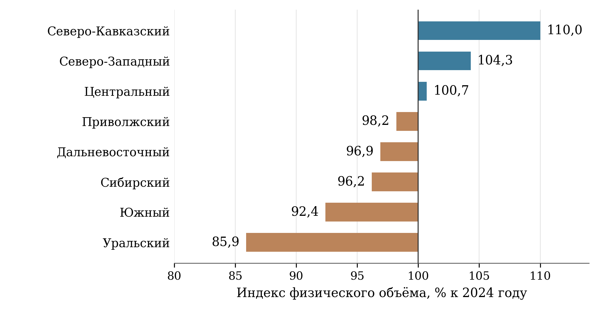

[B233; Caption] Рисунок 2 — Динамика физического объёма инвестиций в основной капитал по федеральным округам в 2025 году

[B234; SourceNote] Источник: Росстат. Индексы в сопоставимых ценах, к 2024 году. Вертикальная линия 100% соответствует отсутствию изменения; денежные объёмы вложений не используются для ранжирования. [Сноски 52]

[B235; Heading2] 4.3 Малое и среднее предпринимательство

[B236; ] ФНС России сообщила, что на 10 июля 2026 года в обновлённом реестре находилось 6,6 млн субъектов МСП — на 222,5 тыс., или на 3,5%, больше, чем на ту же дату 2025 года. Их доля в числе действующих юридических лиц и индивидуальных предпринимателей достигла 81,8%. Обновление основано, в частности, на сведениях о доходах и среднесписочной численности работников за предыдущий год. Поэтому динамика реестра отражает одновременно изменение предпринимательской совокупности и регламент её административного обновления. Для сопоставления следует выбирать одинаковые даты, а изменение июльского значения относительно июня не считать непосредственной оценкой закрытия бизнеса. [Сноски 53]

[B237; ] Рост числа МСП расширяет предпринимательскую базу, однако не позволяет самостоятельно заключить об увеличении добавленной стоимости, реального дохода или устойчивой занятости. В числе субъектов преобладают небольшие организации и индивидуальные предприниматели; изменение общей численности может сопровождаться перераспределением между категориями. Для целей экспертизы требуется разделять создание нового предприятия, переход из другой организационной формы, восстановление сведений после отчётности, переход между размерными категориями и изменение статуса самозанятости. Эти процессы обладают разным экономическим и социальным содержанием.

[B238; ] Годовое значение индекса реального дохода на одного работника МСП за 2025 год в ЕМИСС равно 106,8% к базе 2023 года. В исходной таблице прямо обозначены год и годовая периодичность. Месячные значения этого же показателя не следует рассматривать как независимые оценки каждого месяца: методика предусматривает использование годового значения, а годовая публикация производится с лагом. Соответственно, график из повторяющихся месячных точек создаёт ложное впечатление высокой частоты наблюдения. Для анализа динамики и сопоставления с целью следует использовать годовую серию, а оперативные повторения описывать как последний доступный результат. [Сноски 54]

[B239; ] Увеличение дохода предприятия в расчёте на работника имеет несколько возможных источников: рост спроса, изменение цен и отраслевого состава, совершенствование технологии, сокращение численности работников, передача функций внешним подрядчикам, изменение состава зарегистрированных субъектов. Даже после дефлирования необходимо различать рост внутри сохраняющейся совокупности предприятий и структурные сдвиги. Для общественной оценки существенна связь с оплатой труда, устойчивостью занятости и распределением доходов. Проектный показатель не даёт основания утверждать, что покупательная способность каждого работника увеличилась в той же пропорции.

[B240; ] Обзор Банка России за 2025 год выявляет неоднородность финансовых условий МСП: кредитный портфель сектора увеличился на 1,7%, тогда как выдачи кредитов сократились на 14,9%, а число заёмщиков — на 6,6%. Регулятор отдельно рассматривает реальный малый бизнес и организации, формально относящиеся к МСП, но связанные с крупными группами и строительными проектами. Такая детализация показывает, почему общий портфель кредитования нельзя использовать как единственный индикатор доступности финансирования для типичного небольшого предприятия. [Сноски 55]

[B241; ] В мониторинг поддержки МСП целесообразно включить долю одобренных заявок по размеру бизнеса и региону, медианную полную стоимость привлечения средств, долю впервые получивших финансирование, сохранение деятельности и занятости через один и два года. В финансовых мерах нужно отделять рефинансирование прежнего долга от новых капитальных вложений. Для гарантийных инструментов дополнительность выражается прежде всего в доступе к кредиту при недостаточном залоге, изменении условий и расширении инвестиционного горизонта. Число договоров и суммарная выдача являются необходимой, но недостаточной характеристикой результата.

[B242; Heading2] 4.4 Производительность труда и социальная сфера

[B243; ] Федеральный центр компетенций со ссылкой на Минэкономразвития сообщил, что к концу 2025 года в проекте участвовало более 7,9 тыс. предприятий базовых несырьевых отраслей с совокупной выручкой свыше 20 трлн рублей. Средний рост выработки по реализованным проектам оценён в 58%, продолжительность производственных процессов сократилась более чем на 30%. Эти сведения характеризуют результаты конкретных проектов организации производства. Они не означают увеличение производительности всей российской экономики на 58% и не эквивалентны сопоставимому приросту добавленной стоимости каждого предприятия. [Сноски 56]

[B244; ] Пилотный производственный поток может иметь значительный резерв за счёт устранения ожидания, переналадки и избыточных перемещений. После его улучшения остаётся отдельная задача распространения изменений на остальные участки. Общая выработка предприятия зависит от доли пилотного потока в выпуске, загрузки оборудования, структуры продукции и внешнего спроса. Следовательно, необходима последовательность измерения: результат отдельного процесса, его масштабирование, изменение показателей предприятия, устойчивость эффекта. Сложение процентов улучшения разных потоков экономического смысла не имеет.

[B245; ] В проектной статистике охват средних и крупных предприятий увеличился с 24,21% по итогам 2025 года до 26,7% в сентябре 2026 года. Охват организаций социальной сферы за те же отчётные точки вырос с 4,01 до 9,9%. Однако месячная серия социальной сферы содержит отдельные снижения при заявленном накопительном характере показателя. Они могут быть следствием уточнения перечня организаций, состава совокупности или критериев включения. Без таблицы изменений числителя и знаменателя такие эпизоды нельзя автоматически трактовать как выход участников из проекта. [Сноски 57]

[B246; ] Для макроэкономического показателя роста производительности труда в месячных публикациях выявлены многочисленные нулевые записи. Методика предусматривает годовое измерение; ноль в промежуточной ячейке не является доказательством исчезновения выпуска или полного падения производительности. Такую серию нельзя использовать для оценки тренда, корреляций или построения прогноза без предварительного установления статуса записей. Корректный результат экспертизы в этом случае состоит в признании ограничений наблюдения и обращении к годовой оценке, а не в получении численно точного, но содержательно бессмысленного прогноза. [Сноски 58]

[B247; ] В социальной сфере конечная цель повышения производительности состоит в более доступных и качественных услугах при рациональном использовании труда. Увеличение числа пациентов, обучающихся, посетителей или получателей социальных услуг на работника может отражать улучшение процессов, но также рост нагрузки, сокращение персонала либо изменение регистрации событий. Для образования обязательны сопоставление с результатами обучения, размером групп и нагрузкой преподавателей; для здравоохранения — со сроками ожидания, повторными госпитализациями и результатами лечения; для социальных служб — с удовлетворённой потребностью и непрерывностью сопровождения. Предлагаемые характеристики качества являются дополнительными условиями интерпретации, а не заменой утверждённых показателей.

[B248; ] Особенно осторожного подхода требует оборот койки. Его рост позволяет обслужить больше пациентов при заданном коечном фонде, но причины такого изменения различны: сокращение неоправданного пребывания, изменение тяжести случаев, перераспределение помощи, уменьшение числа коек. Чтобы отличить улучшение процесса от ухудшения доступности, следует одновременно учитывать профиль стационара, среднюю длительность лечения, занятость койки, повторные обращения и исходы. Межрегиональное ранжирование по одному темпу изменения без таких условий смешивает управленческие результаты с различиями структуры медицинской помощи.

[B249; Heading2] 4.5 Малые технологические компании

[B250; ] Статистика выручки МТК публикуется по квартальным отчётным точкам: в IV квартале 2025 года значение составляло 1 251 678,48 млн рублей, в III квартале 2026 года — 1 444 772,16 млн рублей. По методике показатель должен отражать выручку на конец периода нарастающим итогом с начала года; при отсутствии компонентов допускается использование данных предшествующего периода. Поэтому квартальные точки нельзя складывать как независимые продажи. Для интерпретации существенны состав реестра и время формирования бухгалтерских и налоговых данных. Расширение реестра способно увеличить сумму даже без роста выручки каждой уже зарегистрированной компании. Необычно высокое значение первого квартала относительно предыдущего годового итога требует сверки компонентов, но само по себе не устанавливает причину расхождения. [Сноски 59]

[B251; ] Исследование Фонда «Сколково», опубликованное в августе 2026 года, оценивает совокупную выручку изучаемого сегмента за 2025 год примерно в 1,4 трлн рублей. Его результаты полезны для характеристики структуры технологического бизнеса, однако сопоставление с проектной таблицей требует одинаковой даты реестра, состава компаний и периода отчётности. Само расхождение оценок не доказывает ошибки ни одного источника. Исследовательская совокупность и административный показатель могут различаться, а более поздний обзор — включать уточнённую бухгалтерскую отчётность. [Сноски 60]

[B252; ] Территориальная концентрация технологического бизнеса выражена значительно. По материалам «Сколково», на конец 2025 года в Москве было зарегистрировано 2 761 МТК, около 41% совокупности, рассматриваемой исследованием. Такая концентрация допускает несколько объяснений: близость исследовательских организаций, заказчиков, инвесторов и кадров; организационное размещение головных структур; различия доступности институтов поддержки. Регистрация в столице не означает, что вся исследовательская, производственная деятельность и занятость сосредоточены там же. Для пространственной оценки необходимо различать юридический адрес, размещение подразделений, производственных площадок и работников. [Сноски 61]

[B253; ] Корпорация МСП в сентябре 2026 года сообщила о привлечении 21,3 млрд рублей более чем 300 МТК с помощью инструментов Национальной гарантийной системы в 48 регионах. На Москву приходилось 8,1 млрд, Московскую область — 2,6 млрд, Санкт-Петербург — 1,9 млрд, Татарстан — 1,2 млрд рублей. По опубликованным округлённым значениям на четыре названные территории приходится около 64,8% общего объёма. Это показатель концентрации полученного финансирования, а не доля бюджетных расходов и не распределение всех технологических инвестиций страны. [Сноски 62]

[B254; ] Рекомендуется дополнять общий объём выручки динамикой фиксированной когорты компаний, медианой, долей убыточных и прекративших деятельность организаций, коммерческими контрактами вне государственных грантов, продажами новых продуктов и производственной кооперацией. Для оценки поддержки принципиально разделять улучшение результатов исходно сильных компаний и появление дополнительных жизнеспособных технологических решений. Более быстрый рост получателей поддержки по сравнению с остальными не является достаточным доказательством её эффекта: отбор в программы может изначально благоприятствовать более подготовленным предприятиям.

[B255; Heading2] 4.6 Финансовый рынок и сбережения

[B256; ] В опубликованном на сайте Банка России авторском обзоре капитализация рынка акций на конец 2025 года оценивается в 53 трлн рублей, или 25% ВВП. Авторы отдельно отмечают изменение расчётного охвата с 2025 года: исключаются акции эмитентов-нерезидентов и бумаги, обращение которых ограничено судебными решениями. Это обстоятельство необходимо учитывать при сопоставлении длинного ряда. Обзор представляет аналитические оценки его авторов, что следует сохранять в атрибуции. [Сноски 63]

[B257; ] Отношение капитализации к ВВП объединяет рыночную оценку обращающихся акций и объём произведённой добавленной стоимости. На него воздействуют изменение котировок, появление новых эмитентов, прекращение обращения бумаг и динамика номинального ВВП. Рост котировок может приблизить показатель к целевому значению без сопоставимого поступления нового капитала в предприятия. Напротив, снижение доли при росте номинального ВВП не всегда означает абсолютное сокращение рынка. Поэтому оценка финансового проекта должна содержать отдельно капитализацию, денежные поступления эмитентам от размещений, долю первичных выпусков и использование привлечённых средств.

[B258; ] В оперативной месячной записи за декабрь 2025 года проектная статистика показывает долю долгосрочных сбережений 36,7% при годовом ориентире 37,3%; в записи за май 2026 года — 38,2%. Декабрьское наблюдение не удостоверяет итоговый годовой результат, поэтому оно исключено из десяти годовых сопоставлений и не служит основанием для вывода о невыполнении годового задания. Значение за неполный 2026 год также нельзя считать подтверждением годового результата: структура активов меняется под влиянием переоценки, процентных ставок и перераспределения средств. Методологически это характеристика состава сбережений по финансовым продуктам. Она не тождественна доле населения, сформировавшего достаточный резерв, и не измеряет фактический срок удержания каждым человеком своих вложений. [Сноски 64]

[B259; ] Программа долгосрочных сбережений демонстрирует расширение: по итогам 2025 года Банк России приводил 10 млн договоров и 717 млрд рублей привлечённых средств; на 1 августа 2026 года — 13,6 млн договоров и почти 1,2 трлн рублей. В агрегат входят, в том числе, государственное софинансирование и перевод пенсионных накоплений. Поэтому весь прирост нельзя интерпретировать как новые добровольные сбережения из текущего дохода. Число договоров также не является числом уникальных участников. [Сноски 65]

[B260; ] Для оценки общественного результата предлагается наблюдать уникальных участников, возраст и доходные группы, регулярность взносов, сохранение договоров, реальную доходность после комиссий, долю досрочных расторжений и финансовые затруднения домохозяйств. Налоговые стимулы могут быть неодинаково востребованы при разных доходах и формах занятости. Это не аргумент против программы, а основание проверять распределение её выгод. Сравнение по возрасту следует строить с учётом различий горизонта накопления и приближения к периоду выплат, а не трактовать неодинаковые взносы как разную финансовую дисциплину.

[B261; Heading2] 4.7 Территориальная неоднородность

[B262; ] Годовой показатель реального дохода на работника МСП доступен для 84 регионов. Межрегиональная медиана составляет 105,4%, минимальное значение — 83,5%, максимальное — 134,3%. В семи регионах показатель ниже 100%, в 77 — выше. Высокие значения зафиксированы в Адыгее, Магаданской области, Чукотском автономном округе, Удмуртии и Мордовии; низкие — в Ингушетии, Чечне, Республике Алтай, Якутии и Калмыкии. Эти результаты описывают изменение относительно установленной базы, а не абсолютный уровень дохода или качество предпринимательской среды. [Сноски 66]

[B263; ] Медиана регионов не должна подменять общероссийское значение. Она придаёт одинаковый вес территориям с несопоставимой численностью работников и масштабом бизнеса, тогда как национальный показатель строится по предусмотренным методикой агрегатам. Разброс показателей может отражать особенности отраслевой структуры, малую базу, изменения состава субъектов и различия динамики занятости. Поэтому картограмма полезна для выявления направлений дополнительного изучения. Она не является самостоятельным рейтингом эффективности региональных органов управления и не доказывает результативность конкретной меры поддержки.

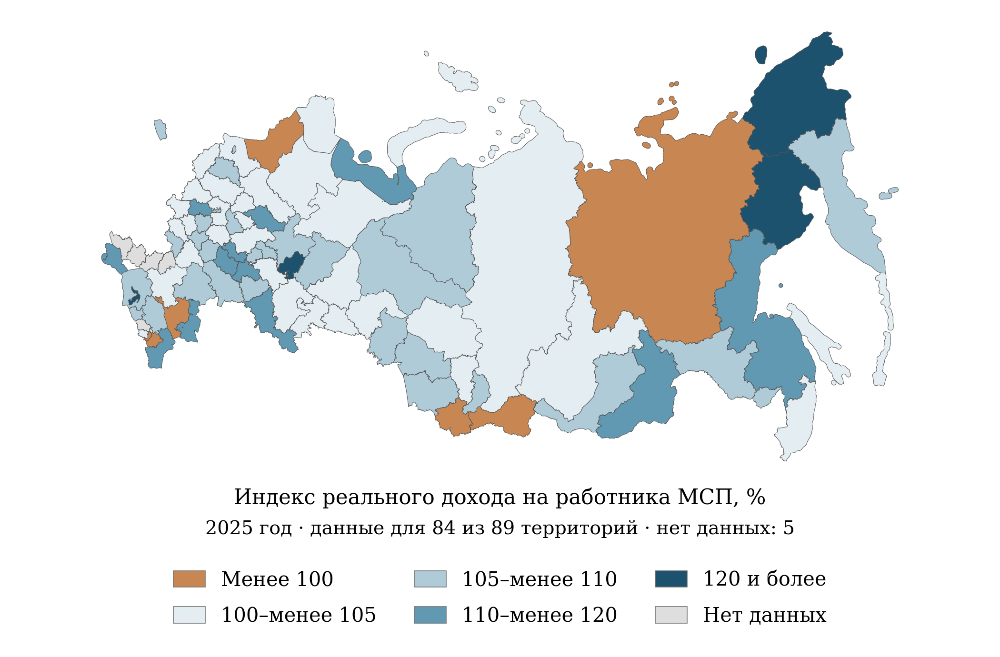

[B265; Caption] Рисунок 3 — Региональные различия индекса реального дохода на работника МСП в 2025 году

[B266; SourceNote] Источник: ЕМИСС; расчёты по годовым значениям. Сопоставлены 84 наблюдения и 89 территорий картографической основы; нет данных для 5 территорий: Донецкая Народная Республика, Запорожская область, Кабардино-Балкарская Республика, Луганская Народная Республика, Херсонская область. Интервалы включают нижнюю границу; правая граница исключена, кроме последнего класса. Индекс не характеризует абсолютный уровень дохода. [Сноски 67]

[B267; ] Инвестиционные различия 2025 года также существенны. Центральный федеральный округ аккумулировал 13 969,1 млрд рублей при индексе физического объёма 100,7%, Северо-Западный — 4 724,4 млрд и 104,3%, Уральский — 4 983,3 млрд и 85,9%, Северо-Кавказский — 1 388,7 млрд и 110,0%. Различия масштаба и темпа исключают универсальное ранжирование по одной величине. Небольшая экономика может иметь высокий прирост за счёт единичного проекта; крупнейший инвестиционный центр — небольшой темп при значительно большем абсолютном вводе капитала. [Сноски 68]

[B268; ] В региональных данных социальной сферы за сентябрь 2026 года наблюдается широкий диапазон. Охват медицинских организаций составляет от 5 до 100% при медиане 25,345% по 88 территориям. Для организаций культуры медиана по 85 регионам равна 1,1765%, а в 21 регионе опубликовано нулевое значение. Различия требуют проверки исходного числа организаций, правил включения и сроков развертывания проектов. Особенно высокий процент в небольшой совокупности может соответствовать меньшему числу учреждений, чем умеренный процент в крупной. [Сноски 69]

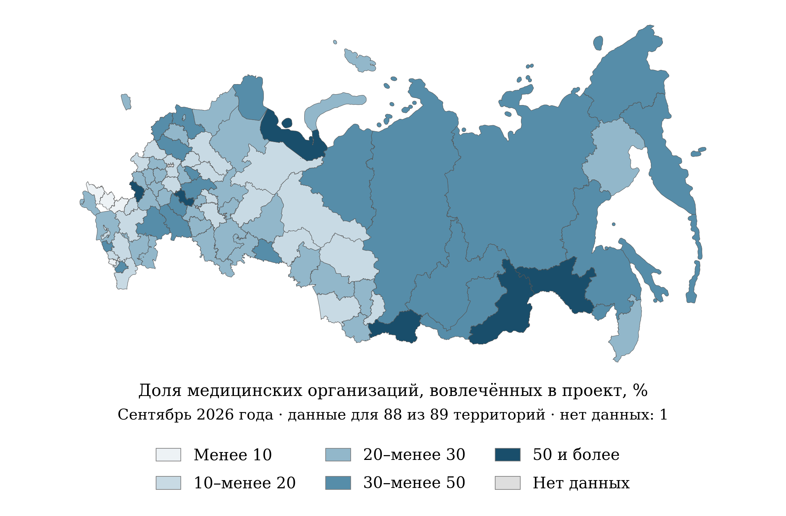

[B270; Caption] Рисунок 4 — Региональный охват медицинских организаций проектами повышения производительности труда в сентябре 2026 года

[B271; SourceNote] Источник: ЕМИСС. Сопоставлены 88 наблюдений и 89 территорий картографической основы; нет данных для 1 территории: Москва. Доля организаций отражает охват, а не клинический результат. Границы классов включаются слева. [Сноски 70]

[B272; ] Темпы изменения оборота койки и диспансерного наблюдения в нескольких территориях значительно отклоняются от основной группы. Такие наблюдения не следует автоматически удалять как ошибки или объявлять лучшими практиками. Необходима проверка исходных абсолютных величин, сопоставимости учреждения и контингента, восстановления отчётности и организационных изменений. При сравнении территорий с изменявшимся статистическим охватом дополнительно требуется единая база. Содержательно корректный вывод ограничивается наличием неоднородности и потребностью в раздельном анализе причин. [Сноски 71]

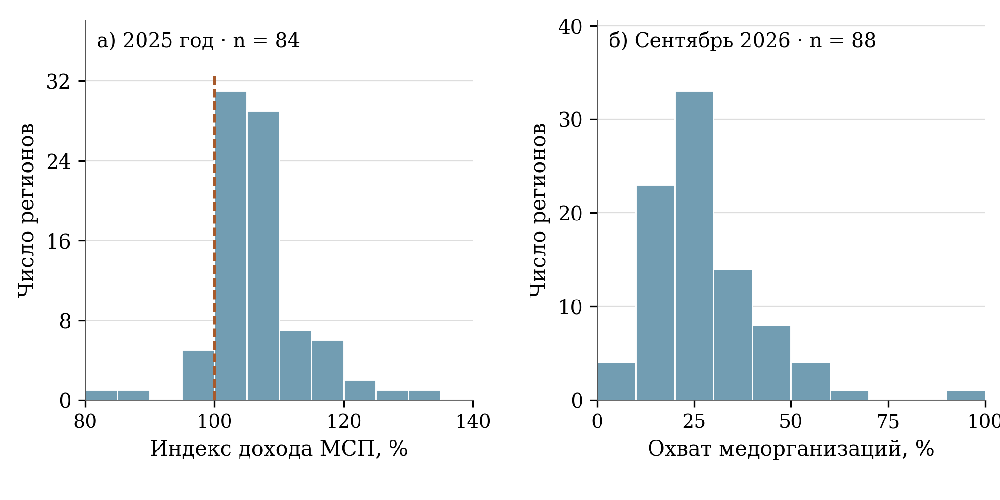

[B274; Caption] Рисунок 5 — Распределения регионов по доходу на работника МСП и охвату медицинских организаций

[B275; SourceNote] Источник: ЕМИСС; расчёты по доступным региональным наблюдениям. Слева — годовой индекс дохода МСП за 2025 год; пунктир отмечает 100%. Справа — охват медицинских организаций в сентябре 2026 года. Каждая территория имеет одинаковый вес; периоды и показатели не объединяются. [Сноски 72]

[B276; Caption] Таблица 5 — Межрегиональный разброс доступных статистических показателей

[TABLE 5; B277]
Показатель | Период | n | Медиана | Q1–Q3
Индекс дохода на работника МСП, % | 2025 год | 84 | 105,40 | 102,78–108,50
Переход МСП в более крупные категории, % | Сентябрь 2026 | 84 | 1,80 | 1,50–2,33
Охват медицинских организаций, % | Сентябрь 2026 | 88 | 25,35 | 18,86–33,25
Индекс диспансерного наблюдения на врачебную должность, % | Сентябрь 2026 | 88 | 105,11 | 101,72–118,90
Индекс оборота койки, % | Сентябрь 2026 | 88 | 105,14 | 102,76–110,75
Охват организаций культуры, % | Январь–сентябрь 2026 | 85 | 1,18 | 0,14–3,07

[B278; SourceNote] Источники: ЕМИСС; расчёты по доступным региональным значениям. n — число территорий; Q1 и Q3 — первый и третий квартили распределения с линейной интерполяцией. Статистики не взвешены численностью населения, работников или организаций и не заменяют общероссийские показатели. [Сноски 73]

[B279; ] Для региональной политики предлагается использовать два взаимодополняющих уровня оценки. Первый характеризует непосредственный доступ предприятий и граждан к мерам: время рассмотрения обращения, стоимость услуги, доля одобрения, расстояние до инфраструктуры, полнота цифрового обслуживания. Второй отражает устойчивый экономический и социальный результат: инвестиции действующих предприятий, добавленную стоимость, сохранение работников, качество услуг и финансовую устойчивость домохозяйств. Отдельное рассмотрение этих уровней позволит выявлять территории, где меры формально доступны, но не приводят к ожидаемому результату, и территории, где результат сдерживается внешними ограничениями.

[B280; Heading2] 4.8 Демографическое и социально-трудовое измерение результатов

[B281; ] Демографическое содержание проекта проявляется через использование труда и распределение результатов между группами населения. Полезно раздельно рассматривать численность населения, участие в рабочей силе, занятость, продолжительность рабочего времени и выпуск на отработанный час. Увеличение экономического результата может достигаться за счёт разных сочетаний этих величин. Если дополнительный выпуск обеспечивается главным образом удлинением рабочего времени, это имеет иные последствия для здоровья и семейной жизни, чем устранение потерь производственного процесса. Наблюдение только за выпуском на среднесписочного работника не позволяет различить эти варианты.

[B282; ] Для мер повышения производительности предлагается оценивать не только условно высвобожденную численность, но и фактическое использование сэкономленного времени. Оно может направляться на рост выпуска, повышение качества, профессиональное обучение либо уменьшение сверхурочной работы. При сокращении работников следует учитывать переход на другие рабочие места, длительность поиска работы и изменение заработка. Эти показатели позволят связывать экономическую эффективность с устойчивостью трудовых траекторий. При этом необходимость такого наблюдения не означает, что проект обязательно ведёт к увольнениям: это разные возможные механизмы, которые требуется различать эмпирически.

[B283; ] Территориальные рынки труда также не совпадают с административными границами субъектов. Предприятие может привлекать работников из соседнего региона, а новая производственная площадка — использовать инфраструктуру нескольких муниципальных образований. Если все эффекты приписать месту регистрации организации, оценка доходов и занятости населения окажется пространственно смещённой. Для крупных проектов целесообразно отдельно фиксировать размещение рабочего места и место постоянного проживания работника, без публикации персональных сведений. Такие данные особенно важны при оценке агломерационных проектов, приграничных муниципалитетов и удалённых производственных площадок.

[B284; ] Развитие предпринимательства требует различать возраст предприятия и возраст предпринимателя. Молодая компания может быть создана опытным специалистом после длительной наёмной занятости, а давно действующий бизнес — перейти к новому поколению собственников. Для поддержки стартующих предприятий полезны показатели выживаемости по году создания и прежнему опыту учредителей; для семейного бизнеса — преемственность управления и сохранение рабочих мест. Простое увеличение количества молодых организаций не свидетельствует об улучшении положения молодёжи. Связь с этой группой населения должна подтверждаться самостоятельными сведениями.

[B285; ] Наконец, оценка сбережений должна учитывать жизненный цикл домохозяйства. Семьи с детьми, люди с неустойчивой занятостью и лица перед выходом на пенсию могут предъявлять разные требования к ликвидности, сроку и риску финансового продукта. Развитие долгосрочных инструментов имеет общественную ценность, когда помогает согласовать текущие потребности и будущие обязательства. Однако увеличение доли неликвидных накоплений не должно автоматически оцениваться положительно, если у участника отсутствует резерв для обычных непредвиденных расходов. Для этого нужны сведения об устойчивости участия и структуре финансовых ресурсов, а не персональные рекомендации о покупке конкретных продуктов.

[B286; Heading1] 5 Финансовое обеспечение и экономическая результативность

[B287; Heading2] 5.1 Финансовая конструкция национального проекта

[B288; ] Главная особенность финансовой конструкции национального проекта «Эффективная и конкурентная экономика» состоит в преобладании внебюджетного финансирования и в высокой концентрации ресурсов на инвестиционных механизмах. В открытом представлении паспорта версии 26.32 за 2025–2030 годы указано 3 673,138 млрд рублей. Из этой суммы на внебюджетные источники приходится 2 724,178 млрд рублей, или 74,16%, на федеральный бюджет — 849,853 млрд рублей, или 23,14%, на строку консолидированных бюджетов субъектов Российской Федерации — 99,108 млрд рублей, или 2,70%. Это структура опубликованного планового обеспечения; она не является структурой уже произведённых расходов. [Сноски 74]

[B289; ] Такое соотношение предполагает, что значительная часть намеченных результатов должна возникать через решения предприятий, банков и институтов развития. Бюджет в этой конструкции оплачивает отдельные услуги и мероприятия, компенсирует стоимость финансирования, поддерживает инфраструктуру и принимает часть рисков. Поэтому оценка проекта по единственной сумме государственных расходов была бы неполной. Одновременно включение внебюджетных средств в общий объём не превращает их в бюджетный ресурс: кредит остаётся обязательством заёмщика, инвестиционные расходы предприятия — его расходами, а государственная гарантия — условным обязательством гаранта.

[B290; ] Термин «внебюджетные источники» также нельзя автоматически заменять словами «частные инвестиции». Для такой замены потребовались бы сведения о конечном собственнике средств, характере обязательств и происхождении фондирования. Внебюджетный финансовый поток может проходить через государственный институт развития или компанию с государственным участием. В экспертном мониторинге следует отдельно показывать юридический источник финансирования и сторону, которая несёт конечный экономический риск. Иначе формально высокий показатель привлечения средств может скрывать существенную зависимость от публичного сектора.

[B291; ] В финансовой оценке предлагается различать четыре величины: размер бюджетного обязательства, фактически произведённую бюджетную выплату, объём финансирования получателя и дополнительный экономический результат. Эти величины отвечают на разные вопросы. Первая показывает потенциальную нагрузку на бюджет, вторая — исполнение, третья — доступ предприятия к ресурсам, четвёртая — изменение, которое обоснованно связывается с мерой поддержки. Движение от одной величины к следующей требует самостоятельной проверки; простое увеличение объёма кредитов ещё не доказывает увеличения производительности или выпуска.

[B292; Caption] Таблица 6 — Плановое финансовое обеспечение национального проекта по источникам в 2025⁠–⁠2030 годах

[TABLE 6; B293]
Год | Федеральный бюджет | Бюджеты субъектов РФ | Внебюджетные источники | Всего
2025 | 235,016 | 7,377 | 735,761 | 978,154
2026 | 180,197 | 20,774 | 590,158 | 791,129
2027 | 136,659 | 27,505 | 586,617 | 750,781
2028 | 116,320 | 22,421 | 411,818 | 550,559
2029 | 91,463 | 10,132 | 309,842 | 411,437
2030 | 90,199 | 10,898 | 89,981 | 191,078
Итого | 849,853 | 99,108 | 2 724,178 | 3 673,138

[B294; SourceNote] Млрд рублей. Наименования и агрегирование источников соответствуют опубликованному паспорту; это плановое обеспечение, а не фактические расходы. [Сноски 75]

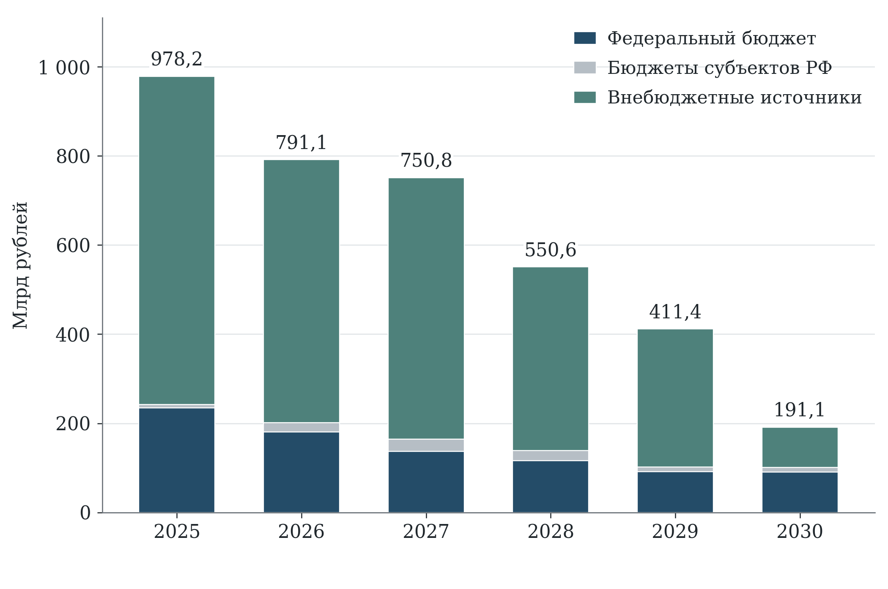

[B296; Caption] Рисунок 6 — Источники планового финансового обеспечения национального проекта в 2025⁠–⁠2030 годах

[B297; SourceNote] Млрд рублей. Показана структура опубликованного паспорта версии 26.32, а не кассовое исполнение. [Сноски 76]

[B298; Heading2] 5.2 Распределение между федеральными проектами

[B299; ] В пяти федеральных проектах с численно раскрытым финансовым обеспечением за 2025–2030 годы крупнейшая сумма приходится на «Повышение инвестиционной активности» — 2 879,282 млрд рублей. Далее следуют поддержка МСП — 386,612 млрд рублей, «Технологии» — 363,886 млрд рублей, «Производительность труда» — 41,899 млрд рублей и «Низкоуглеродное развитие» — 1,458 млрд рублей. Доля инвестиционного направления в сумме этих пяти проектов равна 78,39%; доли МСП и технологий составляют соответственно 10,53 и 9,91%. [Сноски 77]

[B300; ] Такое распределение прежде всего отражает разные типы инструментов. Капиталоёмкие инвестиционные проекты требуют значительных финансовых потоков, тогда как совершенствование регулирования может осуществляться в рамках текущей деятельности органов власти. Поэтому финансовая доля сама по себе не характеризует значимость направления для национальной цели. Нельзя заключать, что конкуренция или финансовый рынок имеют второстепенное значение лишь потому, что по соответствующим паспортам отсутствуют раскрытые положительные суммы. Отсутствие значения отличается от подтверждённого нулевого финансирования. [Сноски 78]

[B301; ] Сумма пяти раскрытых федеральных проектов составляет 3 673,136 млрд рублей и отличается от национального итога на 2,0075 млн рублей. Разность целиком относится к 2026 году и к федеральному источнику. По внебюджетной и региональной строкам, а также по остальным пяти годам числовые значения совпадают. Это небольшая несогласованность опубликованных представлений, а не свидетельство существенного дефицита ресурсов. Для определения её причины необходима сверка утверждённых редакций национального и федеральных паспортов. При этом два проекта без раскрытых положительных сумм не были искусственно приравнены к нулю. [Сноски 79]

[B302; ] Арифметическое совпадение строк не заменяет проверки межбюджетных потоков. В опубликованной структуре могут одновременно фигурировать федеральное финансирование и региональные расходы, в составе которых находятся полученные трансферты. Поэтому представленные доли характеризуют учётную структуру конкретного паспорта. Для расчёта консолидированной стоимости публичной поддержки необходимо отдельно установить, включены ли межбюджетные перечисления в региональные величины и каким образом они исключены при агрегировании. Повторное сложение федеральной строки, трансфертов и расходов получающего бюджета недопустимо.

[B303; ] Концентрация ресурсов на инвестиционном направлении создаёт определённую управленческую зависимость: изменение нескольких крупных проектов или условий их финансирования способно заметно изменить общий бюджетный профиль. Практический ответ состоит в раскрытии крупнейших финансовых обязательств по стадиям реализации, отраслевой принадлежности, срокам ввода и источникам возмещения. Дополнительно требуется показать долю обязательств, по которым государство принимает процентный риск, и долю, связанную с технологическим или коммерческим риском. Эти риски реагируют на разные события и требуют разных резервов.

[B304; Caption] Таблица 7 — Финансовое обеспечение федеральных проектов за 2025⁠–⁠2030 годы

[TABLE 7; B305]
Федеральный проект | Объём, млрд руб. | Доля в раскрытой сумме, %
Малое и среднее предпринимательство и поддержка индивидуальной предпринимательской инициативы | 386,612 | 10,53
Производи­тельность труда | 41,899 | 1,14
Повышение инвестиционной активности | 2 879,282 | 78,39
Низкоуглеродное развитие | 1,458 | 0,04
Развитие финансового рынка | Не раскрыт | Не рассчитывается
Технологии | 363,886 | 9,91
Развитие конкуренции | Не раскрыт | Не рассчитывается
Сумма пяти ФП с раскрытыми значениями | 3 673,136 | 100,00
Итог национального проекта | 3 673,138 | —

[B306; SourceNote] Доли рассчитаны в сумме пяти проектов с раскрытыми положительными значениями. Национальный итог превышает эту сумму на 2,0075 млн рублей; разность относится к федеральному источнику 2026 года. [Сноски 80]

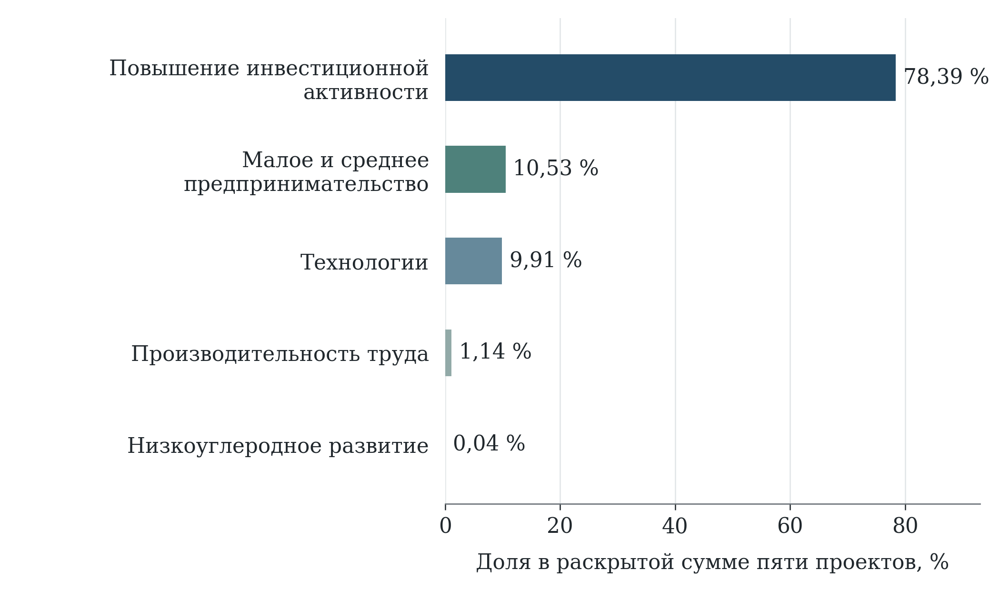

[B308; Caption] Рисунок 7 — Условная структура финансирования пяти федеральных проектов с раскрытыми суммами на 2025⁠–⁠2030 годы

[B309; SourceNote] Знаменатель — сумма пяти проектов с численно раскрытым финансированием. По направлениям развития финансового рынка и конкуренции отсутствие сумм не приравнивается к нулю. [Сноски 81]

[B310; Heading2] 5.3 Изменение бюджетной структуры в проекте на 2027–2029 годы

[B311; ] Пояснительная записка к проекту федерального бюджета на 2027 год и плановый период 2028–2029 годов содержит другой финансовый контур: только федеральные бюджетные ассигнования. В ней указаны 114,0245 млрд рублей на 2027 год, 92,7389 млрд рублей на 2028 год и 72,3578 млрд рублей на 2029 год. Для сравнения приведена сводная бюджетная роспись на 1 сентября 2026 года — 181,0354 млрд рублей. На дату экспертизы величины 2027–2029 годов рассматриваются именно как параметры законопроекта № 615-9, внесённого 30 сентября 2026 года, а не как утверждённые расходы будущих лет. [Сноски 82]

[B312; ] Переход от 181,0354 к 114,0245 млрд рублей означает уменьшение общей федеральной строки на 67,0109 млрд рублей, или на 37,02%. Однако содержательная интерпретация меняется при разложении этой разности. Взнос в ВЭБ.РФ на возмещение расходов по механизму «Фабрика проектного финансирования» уменьшается с 95,6386 до 24,6201 млрд рублей, то есть на 71,0185 млрд рублей. Все остальные строки национального проекта, взятые вместе, увеличиваются с 85,3968 до 89,4044 млрд рублей: прирост составляет 4,0076 млрд рублей, или 4,69%. [Сноски 83]

[B313; ] Следовательно, сводное сокращение не распределено равномерно между направлениями. В проекте бюджета на 2027 год относительно росписи сентября 2026 года ассигнования по МСП увеличиваются с 45,7148 до 48,9353 млрд рублей; по технологиям — с 26,4867 до 26,5281 млрд рублей. Одновременно уменьшаются строки производительности труда, низкоуглеродного развития и инвестиционной активности. При оценке приоритетов требуется учитывать именно такую неоднородность, иначе обобщённый вывод о сокращении поддержки предпринимательства будет вводить читателя в заблуждение. [Сноски 84]

[B314; ] В то же время уменьшение расходов на компенсацию процентного риска ещё не доказывает ни сокращения кредитования в той же пропорции, ни повышения эффективности инструмента. Размер таких расходов связан с объёмом обслуживаемого портфеля, условиями субсидирования, ставками и сроками исполнения обязательств. Для обоснованной оценки необходима декомпозиция на изменение количества поддерживаемых проектов, величины остатка долга, расчётной ставки компенсации и графика выплат. Публикация такой декомпозиции позволила бы отличить завершение прежних обязательств от изменения масштаба новой поддержки.

[B315; ] Для бюджетного планирования целесообразно представлять три согласованных сценария процентной нагрузки: базовый, сценарий более медленного снижения ставки и сценарий задержки ввода инвестиционных объектов. Во втором случае увеличивается стоимость обслуживания, в третьем — удлиняется период до появления операционного дохода. Оба фактора могут усиливать друг друга. Сценарии должны содержать объём допустимых обязательств, срок действия государственной поддержки и источники покрытия дополнительной потребности. Их назначение — обеспечить устойчивость принятых решений, а не автоматически расширять субсидирование при любом ухудшении финансовой модели.

[B316; Caption] Таблица 8 — Федеральные ассигнования по росписи 2026 года и проекту бюджета на 2027⁠–⁠2029 годы

[TABLE 8; B317]
Федеральный проект | 2026
роспись | 2027
проект | 2028
проект | 2029
проект
Малое и среднее предпринимательство и поддержка индивидуальной предпринимательской инициативы | 45,715 | 48,935 | 41,775 | 30,423
Производи­тельность труда | 5,191 | 4,669 | 4,411 | 4,552
Повышение инвестиционной активности | 103,032 | 33,637 | 19,149 | 12,096
Низкоуглеродное развитие | 0,611 | 0,256 | 0,170 | 0,170
Технологии | 26,487 | 26,528 | 27,235 | 25,116
Всего | 181,035 | 114,025 | 92,739 | 72,358

[B318; SourceNote] Млрд рублей. Роспись по состоянию на 1 сентября 2026 года. Величины 2027–2029 годов — предложения законопроекта № 615-9, а не утверждённый бюджет. Округление может приводить к расхождению суммы представленных строк и итога на 0,001 млрд рублей. [Сноски 85]

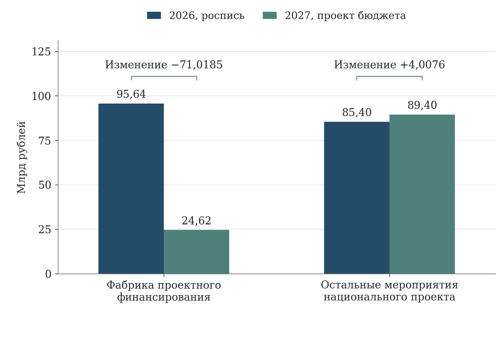

[B320; Caption] Рисунок 8 — Изменение федеральных ассигнований на Фабрику проектного финансирования и остальные мероприятия

[B321; SourceNote] Млрд рублей. 2026 год — сводная бюджетная роспись на 1 сентября 2026 года; 2027 год — проект федерального бюджета. [Сноски 86]

[B322; Heading2] 5.4 Исполнение расходов и сроки возникновения эффекта

[B323; ] По предварительному сообщению Минфина России от 8 октября 2026 года исполнение федеральных расходов по национальному проекту на 1 октября составляло 59,5% годовых назначений. Это показатель кассового исполнения за девять месяцев. Его нельзя применять к общему шестилетнему паспортному объёму или к внебюджетным инвестициям. Также нельзя объявлять разность между 59,5 и 75% «отставанием от календарного плана»: равномерное распределение расходов по месяцам должно быть подтверждено утверждённым кассовым графиком. [Сноски 87]

[B324; ] Для каждой крупной меры требуется сопоставление трёх календарей: принятия обязательств, осуществления выплат и получения результата. По субсидии банку бюджетная выплата может следовать за выдачей кредита; по инфраструктуре — за подтверждением понесённых затрат; по гранту — предшествовать коммерческой реализации разработки. Поэтому одинаковая доля кассового исполнения имеет разный экономический смысл. Для принятия решений полезнее показывать просроченные обязательства, сроки подтверждения расходов и вероятность достижения контрольных результатов, чем ранжировать все меры по единому проценту освоения.

[B325; ] Особого внимания требует завершение календарного года. Высокое итоговое исполнение может достигаться перечислением средств оператору, хотя конечный получатель ещё не реализовал проект. В мониторинге целесообразно разделять деньги, перечисленные из бюджета, средства, предоставленные конечным получателям, подтверждённые расходы получателей и введённые в эксплуатацию объекты. Такая структура позволяет проследить результат, не требуя немедленного экономического эффекта от ещё не завершённых инвестиций.

[B326; ] Для услуг по повышению производительности промежуток между выплатой и результатом обычно отличается от инвестиционного строительства. Оценка должна использовать соответствующие сроки наблюдения. Изменение длительности производственного цикла можно фиксировать после завершения внедрения, а устойчивость прироста добавленной стоимости — после нескольких полных периодов работы. Для социальной сферы необходимо одновременно наблюдать качество и доступность услуг. Ускорение процесса, сопровождаемое ухудшением качества или переносом затрат на граждан, не должно признаваться достаточным основанием для положительной оценки.

[B327; Heading2] 5.5 Льготное кредитование малого и среднего бизнеса

[B328; ] Поддержка кредитования сочетает субсидирование и специальные условия фондирования. Банк России описывает комбинированную инвестиционную программу как соединение бюджетной субсидии с льготным фондированием, а Национальную гарантийную систему — как механизм снижения залоговых ограничений. Эти инструменты воздействуют на разные препятствия: стоимость заёмных средств, доступность банковского ресурса и недостаточность обеспечения. Поэтому их результаты следует измерять раздельно даже при использовании одним предприятием. [Сноски 88]

[B329; ] В июле 2026 года МСП Банк сообщил о новой программе кредитования оборотных средств для приоритетных отраслей с заявленным объёмом 150 млрд рублей. Этот объём характеризует предполагаемое кредитное финансирование, а не бюджетные расходы. Кроме того, оборотный кредит решает задачу поддержания текущей деятельности, тогда как инвестиционный кредит финансирует изменение производственных возможностей. Объединение этих потоков в одной строке без указания назначения затрудняет оценку связи поддержки с ростом производительности. [Сноски 89]

[B330; ] Предлагается дополнить мониторинг кредитных программ показателями финансовой дополнительности. Следует установить, смогло бы предприятие привлечь сопоставимый кредит без поддержки, изменились ли срок, стоимость и объём финансирования, осуществлены ли инвестиции сверх первоначально намеченных. Само заявление получателя о невозможности получить кредит недостаточно: полезны сведения о предложениях банков, отказах, обеспечении и доступных альтернативных условиях. Такая информация должна фиксироваться при рассмотрении заявки, поскольку восстановить её после успешной реализации гораздо труднее.

[B331; ] Отдельный вопрос — экономическая дополнительность. Получение дешёвого кредита может заместить собственные средства или обычный банковский кредит, не увеличив капиталовложения. Для проверки следует сопоставлять фактические инвестиции, выпуск, добавленную стоимость, занятость и заработную плату получателей с сопоставимыми предприятиями, не получившими поддержку. Контрольная группа должна учитывать отрасль, регион, размер, возраст, долговую нагрузку и динамику до участия. Предприятия, не прошедшие формальные критерии программы, не всегда подходят для такого сравнения, поскольку исходно могут иметь иной риск.

[B332; ] Стоимость поддержки необходимо рассчитывать за весь предусмотренный срок субсидирования, включая будущие выплаты по уже выданным кредитам. Деление годовой субсидии на весь объём многолетнего кредитного портфеля создаёт искусственно низкую оценку затрат. Сопоставимый показатель должен связывать одну группу кредитов, один период предоставления и полную приведённую стоимость государственной поддержки. Для оценки бюджетной устойчивости отдельно рассчитывается потенциальное изменение расходов при изменении процентной ставки и задержке погашения.

[B333; Heading2] 5.6 Гарантии и доступ к финансированию

[B334; ] По сообщению Корпорации МСП, в первом полугодии 2026 года предприятия привлекли 108,8 млрд рублей заёмного финансирования с использованием «зонтичных» поручительств; инструментом воспользовались более 17 тысяч предприятий. Эти данные показывают масштаб использования механизма, но не размер понесённых бюджетных затрат. Поручительство покрывает определённую часть кредитного риска; денежная выплата возникает при наступлении предусмотренных условий. [Сноски 90]

[B335; ] Полезность гарантий проявляется прежде всего в доступе предприятий с недостаточным залогом к кредиту. Однако расширение гарантий может сопровождаться изменением поведения банка: часть риска переносится на гаранта, а мотивация к отбору и последующему мониторингу заёмщика может ослабевать. Это основание для проверки конструкции распределения рисков, а не для предположения о заведомой неэффективности. Необходимо сохранять собственный риск кредитора, прозрачные критерии допуска и сопоставимую статистику качества портфеля.

[B336; ] Для мониторинга предлагается публиковать по каждой когорте выдачи число получателей, объём кредитов, сумму гарантируемых обязательств, долю просроченной задолженности, осуществлённые выплаты и последующее взыскание. Наряду с общим уровнем дефолтов следует показывать результат по приоритетным отраслям, регионам и размерам предприятий. Без этого рост охвата может скрывать концентрацию риска в ограниченной группе заёмщиков или банков. Показатели должны рассчитываться с учётом времени, прошедшего после предоставления гарантии: новый портфель нельзя непосредственно сравнивать со зрелым.

[B337; ] Экономическая эффективность гарантий оценивается через дополнительный объём устойчивого финансирования и подтверждённые результаты получателей с учётом ожидаемых потерь. Полная стоимость включает расходы на администрирование, компенсации по гарантиям и стоимость капитала, необходимого для покрытия риска, за вычетом взысканных средств и полученных вознаграждений. Такая оценка позволяет сопоставлять гарантию с прямой субсидией, не создавая ложного впечатления, что первая мера почти бесплатна до момента дефолта.

[B338; ] Важна и совместимость инструментов. Одно предприятие может одновременно использовать поручительство, процентную субсидию, льготный лизинг и региональную поддержку. В отчётности по каждой программе оно правомерно фигурирует как получатель, но при оценке совокупного охвата должно учитываться один раз. Для анализа эффекта следует фиксировать комбинации мер и даты их начала. Без такой связки невозможно определить, какой инструмент обеспечил изменение и не произошло ли повторного возмещения одной и той же статьи затрат.

[B339; Heading2] 5.7 Инвестиционные механизмы и инфраструктура

[B340; ] ВЭБ.РФ характеризует «Фабрику проектного финансирования» как механизм синдицированного кредитования с участием банков и института развития, в котором государственная поддержка способствует финансированию крупных инвестиционных проектов. Масштаб проекта, объём предоставленного кредита, взнос государства и выплата компенсации представляют разные финансовые величины. Их суммирование в качестве единого «эффекта поддержки» означало бы неоднократный учёт одних и тех же экономических процессов. [Сноски 91]

[B341; ] Для инвестиционного направления следует разделять заявленный портфель, подписанные договоры, фактическую выборку средств, выполненные строительно-монтажные работы, введённые мощности и эксплуатационные результаты. Между этими стадиями возможны как временные задержки, так и выбытие проектов. Крупный заявленный портфель является характеристикой потенциальной нагрузки и будущих возможностей; его нельзя представлять как уже созданный капитал. Практически полезен ежегодный переходный баланс портфеля с причинами пересмотра стоимости, сроков и объёма поддержки.

[B342; ] При сравнении проектов необходимо учитывать исходную инфраструктурную обеспеченность. Объект с высокой коммерческой отдачей в крупной агломерации и объект, устраняющий критическое ограничение удалённой территории, не должны оцениваться только по одной норме финансовой доходности. Вместе с тем территориальная значимость не отменяет проверки спроса, альтернативного решения, стоимости жизненного цикла и обязательств по эксплуатации. Публичный участник должен понимать, кто и за счёт каких доходов будет содержать построенную инфраструктуру после завершения первоначальной поддержки.

[B343; ] По соглашениям о защите и поощрении капиталовложений уже предусмотрена проверка фактических затрат. Распоряжением ФНС России от 19 августа 2026 года № ЕД-10-23/328@ утверждён порядок соответствующей проверки в рамках налогового мониторинга. Поэтому рекомендация «ввести контроль расходов участников СЗПК» была бы неточной. Предметом улучшения должна стать связь результатов действующего контроля с оценкой дополнительности инвестиций, окончательной стоимости публичных обязательств и эксплуатационной отдачи созданных объектов. [Сноски 92]

[B344; ] Постановление Правительства Российской Федерации от 15 июня 2026 года № 741 уточнило порядок представления документов и условия налогового вычета при возмещении инфраструктурных затрат в рамках СЗПК. Для финансовой экспертизы это существенно: часть поддержки реализуется через налоговый механизм, поэтому не исчерпывается расходной строкой национального проекта. Сравнение инструментов должно включать как прямые выплаты, так и выпадающие доходы в сопоставимом временном горизонте. [Сноски 93]

[B345; ] Рекомендуется дополнить реестр инвестиционных проектов полями о налоговых льготах, компенсации инфраструктуры, субсидировании процентной ставки, гарантиях и региональных обязательствах. Сводная стоимость рассчитывается на уровне проекта с устранением повторного счёта. Наряду с фактическими инвестициями необходимо показывать введённую мощность, её загрузку, устойчивые рабочие места и уплаченные налоги за вычетом предоставленной поддержки. При этом валовые налоговые поступления получателя не следует целиком объявлять доходом от меры: часть поступлений возникла бы и без неё.

[B346; Heading2] 5.8 Финансирование технологического предпринимательства

[B347; ] Федеральный проект «Технологии» занимает самостоятельное место между поддержкой исследования и финансированием зрелого бизнеса. В его открытом финансовом представлении на 2025–2030 годы указано 363,886 млрд рублей. В проекте федерального бюджета на 2027 год предусмотрено 26,5281 млрд рублей, практически столько же, сколько в росписи сентября 2026 года — 26,4867 млрд рублей. Сходство годовых бюджетных объёмов не означает сохранения одинакового состава инструментов или распределения между стадиями развития компаний. [Сноски 94]

[B348; ] Ранняя технологическая компания может не иметь устойчивой выручки, залога и предсказуемого денежного потока. Применение к ней требований зрелого инвестиционного заёмщика способно отсечь перспективные разработки. С другой стороны, длительное грантовое финансирование без проверки спроса создаёт риск сохранения проектов, которые не переходят к коммерческому применению. Для оценки необходима последовательность решений: подтверждение технической возможности, проверка спроса, первая продажа, повторный заказ и масштабирование. Успех на одной стадии не заменяет результат следующей.

[B349; ] Бюджетная результативность технологического портфеля должна учитывать ожидаемую неуспешность части ранних проектов. Отдельная неудача при соблюдении обоснованной процедуры отбора не является достаточным доказательством неправильного расходования средств. Однако это не освобождает оператора от раскрытия причин прекращения поддержки, возвратов, смены цели и повторного финансирования. Для сопоставимости необходимы когорты по году первого получения поддержки и по исходной стадии разработки. Анализ только сохранившихся успешных компаний завышает оценку результата.

[B350; ] Предлагается рассчитывать переходы между стадиями, время до первой и повторной продажи, привлечённый независимый капитал, долю выручки от новых продуктов и устойчивость компании после окончания помощи. Для мер вывода на фондовый рынок важны не только факт размещения и привлечённая сумма, но и последующее использование средств, раскрытие информации и положение инвесторов. Банк России прямо связывает поддержку МСП с развитием долевого и иных небанковских инструментов; это предполагает согласование государственной поддержки с защитой инвестора и качеством корпоративного управления. [Сноски 95]

[B351; Heading2] 5.9 Территориальная и социальная результативность расходов

[B352; ] Финансовая концентрация в крупных компаниях и инвестиционных территориях может быть экономически объяснима масштабом проектов, но её нельзя автоматически считать оптимальной для пространственного развития. В региональном анализе следует сопоставлять поддержку с инвестиционным потенциалом, числом действующих предприятий, занятостью, отраслевой структурой и исходными ограничениями. Абсолютная сумма на регион полезна для описания распределения, однако для сравнения доступности мер необходимы относительные показатели и сведения об отклонённых заявках.

[B353; ] Место регистрации головной компании и место возникновения результата могут различаться. Для инвестиционных проектов предпочтительно учитывать фактическое размещение объектов и рабочих мест; для кредитования МСП — распределение деятельности заёмщика; для инфраструктуры — территорию пользования услугой. Иначе столичные регионы могут получать в статистике часть финансового результата, который формируется на производственной площадке другого субъекта Федерации. При невозможности распределить сумму географически следует сохранять отдельную категорию, а не назначать её региону формально.

[B354; ] Особое значение имеет связь производительности с социальным результатом. Поддержка реорганизации процессов не должна оцениваться только экономией рабочего времени или численности персонала. Для предприятия необходимо установить, превратилось ли высвобождение ресурсов в рост выпуска, качества, заработной платы или снижение издержек. Для бюджетной организации — сократилось ли время ожидания, расширилась ли доступность услуги и не увеличилась ли неоплачиваемая нагрузка на сотрудников и граждан. Эта система позволяет оценивать финансовую эффективность с учётом назначения деятельности.

[B355; Heading2] 5.10 Удельные затраты и сопоставление инструментов

[B356; ] Предлагаемые показатели удельных затрат должны соответствовать экономической природе результата. Для финансовых сервисов можно рассчитывать затраты на рассмотренную заявку и на получателя, но эти показатели характеризуют организацию программы. Для инвестиционного инструмента содержательно важнее стоимость дополнительного капиталовложения, а для программы производительности — стоимость устойчивого прироста добавленной стоимости. Переход от числа обслуженных предприятий к экономическому результату не сводится к выбору другого знаменателя: требуется установить, какая часть изменения связана с поддержкой.

[B357; ] Отношение общего привлечённого финансирования к бюджетной субсидии допустимо использовать как характеристику финансовой структуры, если обе величины относятся к одним получателям и одному периоду. Однако оно не является причинным мультипликатором. В числителе могут находиться средства, которые предприятие привлекло бы без поддержки, а в знаменателе — лишь первый платёж по многолетнему обязательству. Для корректной оценки необходимо отделить дополнительное финансирование от замещённого и учесть всю будущую стоимость поддержки. При отсутствии такой информации показатель следует называть коэффициентом соотношения потоков, не приписывая ему доказательную силу оценки эффективности.

[B358; ] При анализе рабочих мест следует различать временную занятость на строительстве, постоянные места после ввода объекта, сохранённую занятость и чистый прирост занятости в регионе. Число работников поддержанного предприятия может увеличиться за счёт перехода из других местных компаний. Поэтому бюджетную стоимость одного дополнительного рабочего места нельзя надёжно оценить, разделив субсидию на объявленный штат. Более содержательная оценка учитывает занятость в эквиваленте полного рабочего времени, продолжительность сохранения места, оплату труда и изменение занятости у сопоставимых предприятий. Для проекта с высокой автоматизацией небольшой прирост рабочих мест сам по себе не является отрицательным результатом.

[B359; ] В оценке бюджетной отдачи необходим единый временной горизонт. Налоговые поступления после ввода объекта должны сопоставляться с поддержкой инвестиционной стадии, будущими компенсациями и обязательствами по инфраструктуре. Расходы и доходы разных лет приводятся к одной дате с явно указанной ставкой и проверкой чувствительности результата. При этом нельзя одновременно вычитать полную номинальную гарантию и ожидаемые выплаты по ней: это два разных представления одного риска. Аналогично заём, предоставленный на возвратной основе, отличается от безвозвратного трансферта; возврат основного долга должен учитываться последовательно.

[B360; ] Для технологических проектов портфельная оценка должна включать прекращённые разработки и компании, вышедшие из программы. В противном случае средние показатели получателей будут улучшаться просто вследствие исключения неуспешных наблюдений. Следует сохранять исходный состав когорты, отдельно раскрывать причины её изменения и проверять устойчивость результата к нескольким определениям успеха. Для инвестиционных программ аналогичное правило означает сохранение в анализе отменённых и замороженных проектов, а не только введённых объектов. Такая организация данных делает удельные показатели пригодными для выбора между инструментами и позволяет корректировать программу до завершения национального проекта.

[B361; Heading2] 5.11 Предложения по совершенствованию финансового мониторинга

[B362; ] Первоочередное изменение — согласованный публичный финансовый баланс национального проекта. Он должен содержать одинаковую дату редакции, ежегодные суммы по федеральным проектам, источники, межбюджетные перечисления и пояснение к изменениям. Для двух направлений без раскрытых положительных сумм требуется установить статус: отсутствие отдельного проектного финансирования, финансирование за счёт текущих расходов или неполное опубликование. Достаточно раскрыть этот статус, не создавая искусственных расходов исключительно ради заполнения таблицы.

[B363; ] Второе изменение — выделение обязательств по субсидированию процентного риска. Для «Фабрики» и кредитных программ МСП следует публиковать новую выдачу, остаток поддерживаемого долга, платежи по обязательствам прежних лет и прогноз расходов при альтернативных ставках. Именно такая информация позволит объяснять обнаруженное изменение бюджетной структуры. Декомпозиция должна сопровождать проект бюджета и обновляться при существенном изменении макроэкономических предпосылок.

[B364; ] Третье изменение — единый учёт конечного получателя и инвестиционного проекта. Идентификатор получателя связывает федеральные и региональные меры, а идентификатор проекта — расходы на один объект из нескольких источников. В публикуемой версии допустима агрегация, обеспечивающая защиту охраняемых сведений; внутри системы должна сохраняться возможность устранить повторный счёт и восстановить совокупный объём поддержки. Новая отчётность должна использовать имеющиеся административные сведения, чтобы не дублировать запросы к предприятиям.

[B365; ] Четвёртое изменение — оценка эффекта по когортам. Для каждой основной меры заранее задаются период наблюдения, группа сравнения и результат, ради которого предоставляется поддержка. Для инвестиционного кредитования это дополнительные капиталовложения и устойчивый выпуск; для гарантий — расширение доступа при приемлемой стоимости риска; для технологий — переход к подтверждённому рыночному спросу; для производительности — устойчивое повышение эффективности при сохранении качества. Оценку следует начинать с нескольких наиболее крупных и зрелых инструментов, по которым доступны сопоставимые данные.

[B366; ] Пятое изменение — включение результатов оценки в правила продолжения поддержки. При положительном результате возможно расширение инструмента; при ограниченной дополнительности — изменение критериев получателя, размера субсидии или сочетания мер. Решение об изменении программы должно опираться на экономическую интерпретацию, а не только на выполнение финансового плана. При этом следует отдельно фиксировать случаи, когда мера обеспечивает общественно необходимый результат, не выражающийся непосредственно в прибыли получателя, и указывать способ его оценки.

[B367; ] Финансовая экспертиза таким образом выявляет не общий недостаток ресурсов, а необходимость более точного управления их экономическим назначением. Крупнейший публичный финансовый риск связан с инвестиционными обязательствами и компенсацией стоимости заёмных средств. Главный резерв улучшения оценки — проследить путь от государственной поддержки к дополнительному финансированию, затем к реальной деятельности и устойчивому результату для экономики и населения. Обнаруженная неоднородность бюджетных изменений подтверждает, что решения должны приниматься на уровне конкретных инструментов, а общий итог национального проекта использоваться как сводная характеристика.

[B368; Heading1] 6 Связи мероприятий с показателями и лингвистическая экспертиза

[B369; Heading2] 6.1 Единицы анализа и правила сопоставления

[B370; ] Логическая связанность проекта проверяется по его содержательной структуре: целям, задачам, мероприятиям, непосредственным результатам и показателям. Объектом анализа служит отдельная карточка, а не любое предложение с похожими словами. Для национального проекта выделены 110 карточек результатов федеральных проектов, 54 карточки показателей национального и федерального уровней и их связи с задачами. Карточка «результата» сохраняет документальный статус: само название этого раздела не означает, что экономический эффект уже получен. [Сноски 96]

[B371; ] Текстовая часть использует корпус из 137 документов, включающий паспорта, нормативные публикации и презентационные материалы по рассматриваемой группе национальных проектов. Для сопоставимого профиля «Эффективной и конкурентной экономики» взяты восемь структурированных паспортов: национальный и семь федеральных. В них анализируются уникальные формулировки целей, задач, результатов и показателей. Повторяющиеся реквизиты, числовые финансовые таблицы и технические подписи не включены в лексический знаменатель. Контрольные точки рассматриваются как отдельный тип записи и не смешиваются с результатами.

[B372; ] Тексты приведены к нижнему регистру, буква «ё» унифицирована с «е», нормализованы пробелы и переносы. Основной расчёт использует слова и сочетания из двух слов. Лемматизация не предполагается. Для проверки устойчивости выполнено отдельное сопоставление после русского стемминга — сокращения слов до основы. Эти процедуры различаются: стемминг помогает объединять часть форм слова, но не устанавливает его грамматически правильную начальную форму и не решает проблему многозначности.

[B373; ] Частоты словарных тем рассчитываются на тысячу текстовых слов. Внутри темы повторяющиеся пересечения одного выражения не увеличивают число совпадений, однако одно слово может относиться к разным темам. Поэтому частоты не образуют распределение, сумма которого должна равняться ста процентам. Нулевое значение означает отсутствие выбранного маркера, а не доказанное отсутствие соответствующей деятельности. Словарный результат интерпретируется только после чтения контекста.

[B374; Heading2] 6.2 Документальные цепочки и прослеживаемость результата

[B375; ] В структуре паспортов установлены 110 связей результата с задачей и 337 двухшаговых связей результата с показателем через общую задачу. Например, мероприятие по оптимизации процедур промышленного строительства и показатель его сроков могут быть отнесены к одной задаче улучшения инвестиционного климата. Такое совпадение содержательно полезно: оно показывает, где документ предполагает общую логику действия. Вместе с тем оно не доказывает ни исключительности связи, ни силы влияния, ни фактического достижения результата.

[B376; Caption] Таблица 9 — Различия между слоями связей мероприятий и показателей

[TABLE 9; B377]
Слой связи | Число связей | Что он подтверждает
Результат → документированная задача | 110 | Принадлежность результата к конкретной задаче
Результат → общая задача ← показатель | 337 | Двухшаговую структурную связь внутри паспорта
Прямая адресная связь результата с показателем | 0 | В выбранном открытом представлении адресат не установлен однозначно
Лексические кандидаты при пороге 0,10 | 192 | Сходство формулировок; 87 результатов имеют хотя бы одного кандидата
Записи влияния с неразрешённым адресатом | 171 | Необходимость уточнения адреса и смысла связи в открытой публикации

[B378; SourceNote] Учтены 110 результатов и 54 карточки показателей. Отсутствие восстановленной прямой связи не доказывает отсутствия такой связи в ведомственной системе. Косинусное сходство не интерпретируется как причинный вес. [Сноски 97]

[B379; ] Плотность двудольной сети «результаты — показатели через общую задачу» составляет 0,0567 при знаменателе 110 × 54. Этот коэффициент характеризует структуру извлечённых связей, а не полноту научного обоснования проекта. Его увеличение не всегда желательно: связывание каждого мероприятия со всеми показателями повышает плотность, но уменьшает содержательную определённость ответственности. Для управления важнее, чтобы каждая связь имела конкретный механизм, объект, период и проверяемое основание.

[B380; ] В открытом представлении паспортов обнаружена 171 запись раздела влияния результатов, для которой не удалось однозначно определить целевой показатель. В ряде случаев поле воспроизводит название самого результата вместо адреса показателя. Поэтому такие записи не превращены в прямые рёбра графа и указанные рядом числовые веса не интерпретируются как величина экономического эффекта. Ограничение относится к доступной публикации; установить наличие и качество адресных связей внутри ведомственной информационной системы по нему невозможно.

[B381; ] Практическое улучшение состоит в раскрытии устойчивого идентификатора показателя назначения. Для одной связи необходимо указывать мероприятие, показатель, тип влияния, ожидаемый лаг, территорию, группу получателей и условие, при котором механизм должен сработать. Для сложных инвестиционных мер допустима последовательность нескольких промежуточных показателей. Например, льготное финансирование связано сначала с принятием инвестиционного решения и финансовым закрытием, затем с вводом капитала, загрузкой и реальной добавленной стоимостью.

[B382; ] Сетевые характеристики не должны подменять экономическую оценку. Высокая степень показателя может означать, что с ним связано много инструментов, но не говорит, какой из них обеспечивает основной вклад. Низкая степень может отражать узкую, хорошо определённую задачу. Изолированная карточка требует проверки документа и механизма, а не автоматического вывода о бесполезности меры. Для оценки дополнительного эффекта необходимо наблюдение получателей и подходящая сравнительная траектория.

[B383; Heading2] 6.3 Лексические кандидаты и содержательная проверка

[B384; ] Для поиска возможных связей между результатами и показателями использовано косинусное сходство в представлении TF–IDF. Для одного результата сохранялись не более трёх ближайших показателей того же национального проекта при пороге 0,10. Получены 192 лексических кандидата; 87 из 110 результатов имеют хотя бы одного кандидата, а 23 — не имеют при заданном правиле. Порог ограничивает объём последующей проверки и не является вероятностью истинности связи.

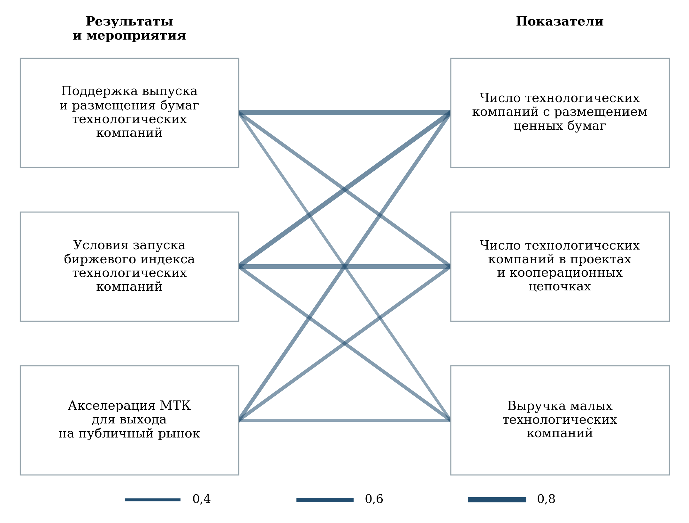

[B386; Caption] Рисунок 9 — Фрагмент взвешенного графа лексических кандидатов для технологического направления

[B387; SourceNote] Толщина ребра соответствует косинусному сходству, а не величине эффекта. Показаны три мероприятия и три показателя, отобранные для содержательной проверки. Все девять связей являются лексическими кандидатами; максимальный коэффициент 0,765, минимальный 0,380. [Сноски 98]

[B388; ] Наиболее высокие коэффициенты часто возникают при буквальном совпадении предмета. Поддержка выпуска и размещения бумаг технологических компаний сопоставляется с числом компаний, осуществивших размещение, с коэффициентом 0,765. Эта пара действительно описывает близкие стадии. Однако для конечной оценки остаются вопросы об объёме привлечённого капитала, его поступлении эмитенту и использовании на развитие. Даже хорошо согласованная пара «мероприятие — непосредственный результат» не исчерпывает экономическую эффективность поддержки.

[B389; ] Показателен другой результат: создание условий для специального биржевого индекса технологических компаний имеет сходство 0,709 с числом компаний, осуществивших размещение. Лексика почти та же, но механизм иной. Индекс повышает видимость сегмента и создаёт инфраструктурную возможность; его запуск не является выпуском новых бумаг. Поэтому автоматическое перенесение силы лексической связи в оценку достижения показателя завышало бы доказательность результата.

[B390; Caption] Таблица 10 — Содержательная проверка лексически близких формулировок

[TABLE 10; B391]
Мероприятие и ближайший показатель | Косинус | Вывод проверки
Поддержка размещения бумаг технологических компаний → число компаний с размещением | 0,765 | Согласованный непосредственный результат; далее проверяются сумма и использование привлечённого капитала
Условия запуска технологического биржевого индекса → число компаний с размещением | 0,709 | Инфраструктурная предпосылка; создание индекса само по себе не означает нового размещения
Просветительская работа для граждан → число публичных размещений компаний | 0,490 | Общая лексика фондового рынка; механизм до размещения косвенный и требует самостоятельных показателей
Развитие реестра выбросов → объём национальных нетто-выбросов | 0,324 | Улучшение учёта не тождественно сокращению физических выбросов
Мониторинг товарных рынков → создана система развития конкуренции | 0,727 | Связь с формальным составом системы содержательна; конечный результат конкуренции оценивается отдельно

[B392; SourceNote] Выводы представляют содержательную экспертизу конкретных пар, отобранных методом TF–IDF. [Сноски 99]

[B393; ] Информационная работа для граждан по инвестированию также имеет сравнительно высокую близость с числом публичных размещений компаний — 0,490. Такая пара требует разделения спроса инвесторов и решений эмитентов. Ближайший текстовый показатель может оказаться недостаточно близким по механизму. Для просвещения более непосредственны понимание условий продукта, осознанность выбора и устойчивость участия; для размещения — готовность компании, требования рынка и стоимость капитала.

[B394; ] В климатическом направлении развитие реестра выбросов сопоставляется с национальным объёмом нетто-выбросов. Информационная инфраструктура создаёт условия для измерения и регулирования, но расширение полноты учёта способно увеличить наблюдаемый объём без увеличения физических выбросов. Следовательно, связь необходимо разделять на улучшение измерения и изменение самого объекта. Аналогично мониторинг конкуренции может входить в формальный критерий создания системы, не удостоверяя улучшения конкурентных условий.

[B395; ] Рекомендован двухэтапный порядок работы с автоматическими сопоставлениями. Сначала они используются для поиска кандидатов и пропусков, затем эксперт устанавливает объект воздействия, последовательность событий и вид доказательства. Принятая связь должна сопровождаться коротким содержательным основанием. Отклонённая пара также полезна: она выявляет формулировки, в которых одинаковые слова обозначают разные стадии экономического процесса.

[B396; Heading2] 6.4 Тематическая специализация и TF–IDF

[B397; ] TF–IDF повышает вес термина, который заметен в определённом документе и относительно редко встречается в остальных документах корпуса. В расчёте использованы логарифмическое преобразование частоты, сглаженная обратная документная частота, словарь до 20 тысяч признаков и нормирование векторов по евклидовой длине. Это одна из форм векторного анализа текстов, которая помогает выделять отличительные формулировки, но не измеряет их общественную важность. [Сноски 100]

[B398; ] (4)

[Формула] wₜd = (1 + ln fₜd) × [1 + ln((N + 1)/(dfₜ + 1))] при fₜd > 0, иначе 0

$$
w_{t,d}=(1+\ln f_{t,d})\left[1+\ln\frac{N+1}{df_t+1}\right]
$$

[B399; ] В формуле f — число появлений термина в документе, N — число документов, df — количество документов, содержащих термин. Вес равен нулю для отсутствующего термина. После расчёта веса нормируются; в итоговом представлении учитываются как отдельные слова, так и сочетания из двух слов. Частотные реквизиты, общие почти для всех документов, ограничены правилом исключения терминов, присутствующих более чем в 98% документов.

[B400; ] (5)

[Формула] cos(d₁, d₂) = (w₁ · w₂)/(‖w₁‖ × ‖w₂‖)

$$
\cos(d_1,d_2)=\frac{w_1\cdot w_2}{\lVert w_1\rVert\lVert w_2\rVert}
$$

[B401; ] Косинусное сходство сравнивает направление двух нормированных текстовых векторов. Коэффициент 0,30 не означает, что документы совпадают по смыслу на 30%. Значение зависит от состава корпуса, очистки, словаря и выбранных признаков. Оно пригодно для относительного сопоставления при фиксированной процедуре и требует проверки устойчивости при изменении обработки текста.

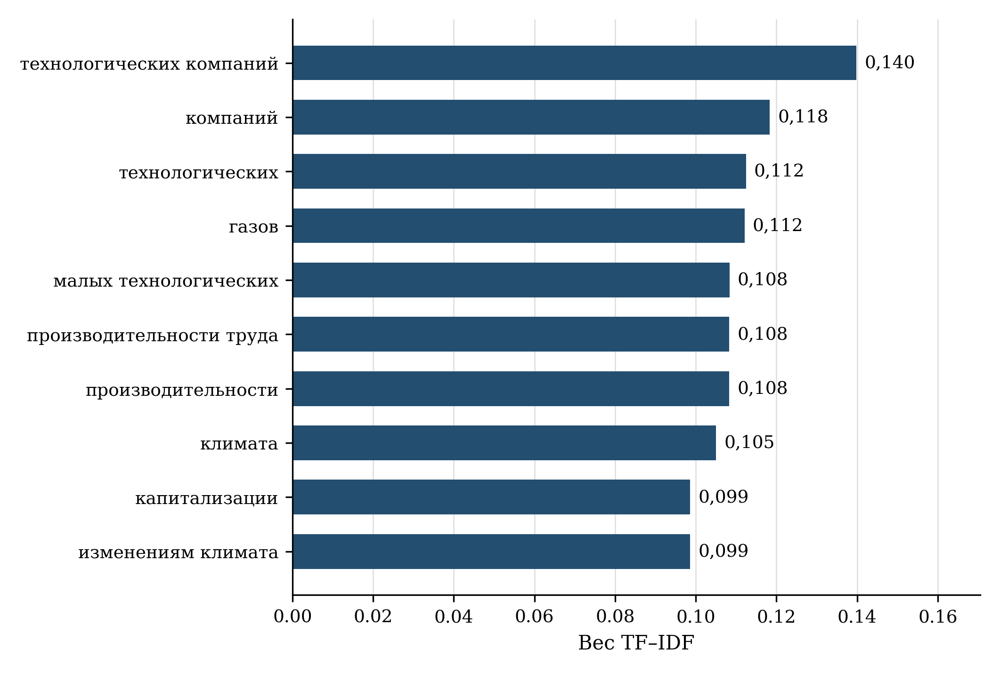

[B403; Caption] Рисунок 10 — Наиболее отличительные слова и словосочетания национального паспорта

[B404; SourceNote] Вес характеризует отличительность формулировки в фиксированном корпусе из 137 документов. Повторяющиеся организационные реквизиты и бюджетные таблицы исключены из текстового профиля. [Сноски 101]

[B405; ] Наиболее отличительные термины национального паспорта связаны с технологическими компаниями, производительностью, капитализацией и климатом. Это соответствует межотраслевой конструкции проекта: он соединяет предприятие, рынок капитала и условия долгосрочной устойчивости. Присутствие климатической лексики среди ведущих терминов не означает, что климатическое направление имеет сопоставимую финансовую долю. Текстовая выраженность и объём финансирования характеризуют разные измерения проекта.

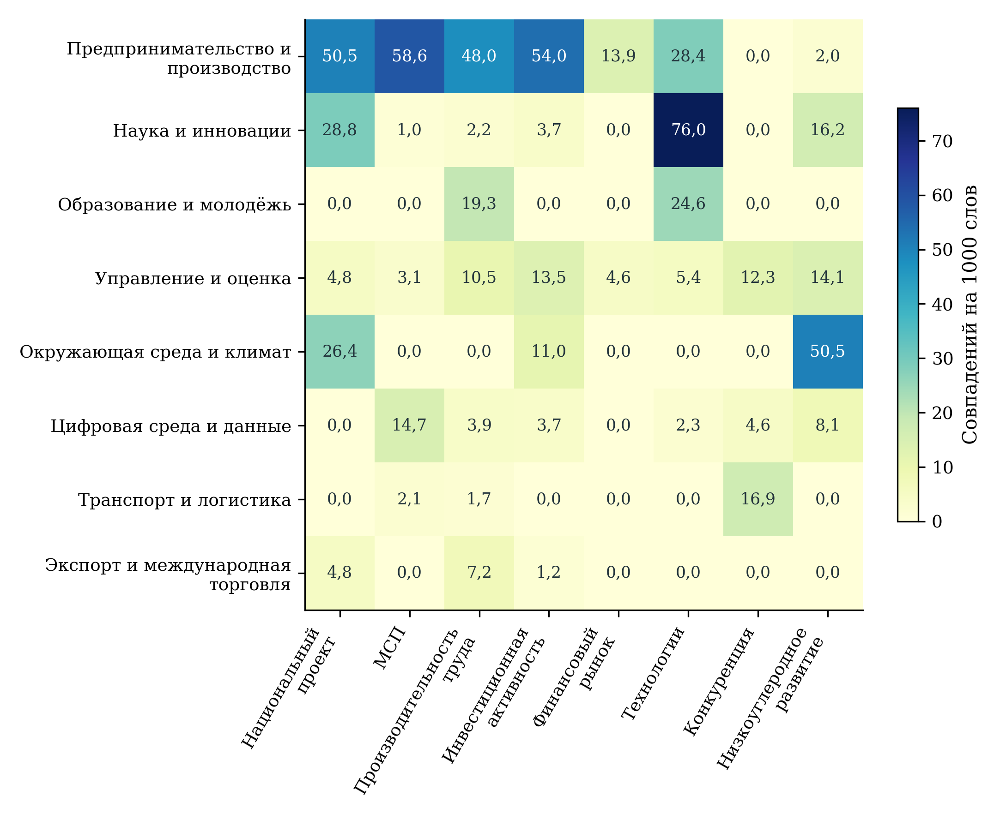

[B407; Caption] Рисунок 11 — Тематическая специализация паспортов по словарным признакам

[B408; SourceNote] Показаны восемь тем с наибольшим числом совпадений в восьми паспортах. Пересечения между темами допустимы; значения не складываются до 100%. Отсутствие словарного совпадения не доказывает отсутствия соответствующего содержания. [Сноски 102]

[B409; ] По средневзвешенной частоте тематических маркеров в восьми паспортах предпринимательство и производство имеют значение 35,971 на тысячу слов, наука и инновации — 17,915, образование и молодёжь — 9,451, управление и оценка — 8,464, окружающая среда и климат — 6,348. Эти величины описывают выбранный словарь и состав текстов. Более низкая частота маркеров занятости не позволяет заключить, что проект не влияет на работников; она указывает на необходимость проверить, как кадровые и социальные последствия раскрыты содержательно.

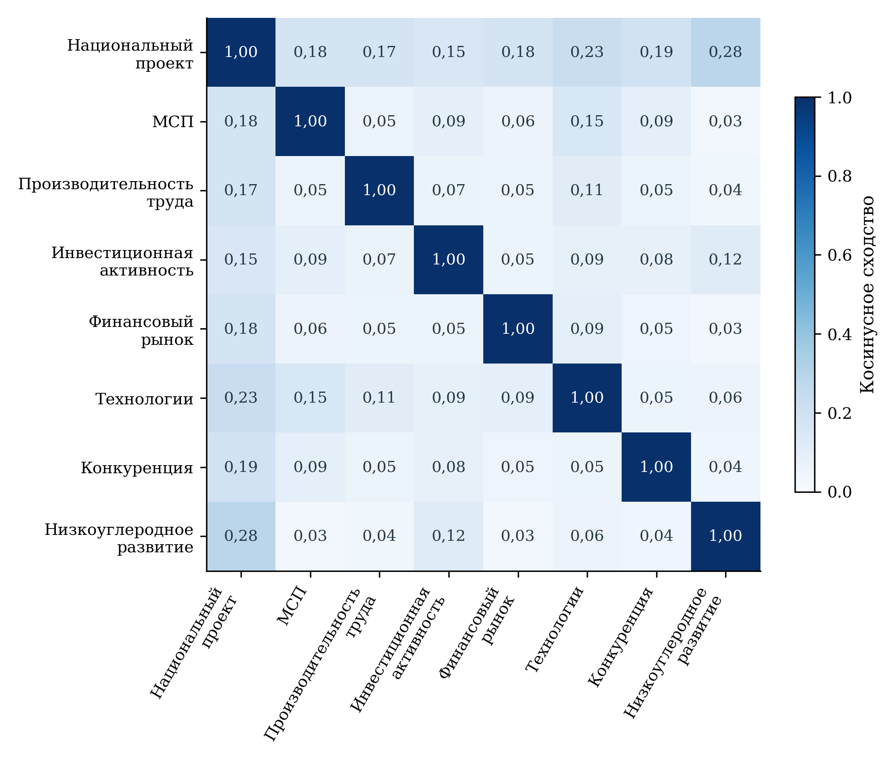

[B411; Caption] Рисунок 12 — Лексическая близость национального и семи федеральных паспортов

[B412; SourceNote] Расчёт по очищенным формулировкам целей, задач, результатов и показателей. TF–IDF с униграммами и биграммами; коэффициенты не являются долями общего смысла или оценкой результативности. [Сноски 103]

[B413; ] Матрица близости восьми паспортов показывает, что общее экономическое направление не превращает их в однородный текст. Специализация отражает разные объекты управления: предприятие, инвестиционную процедуру, финансовый инструмент, товарный рынок и климатическую систему. Различия между профилями полезны при распределении ответственности. Согласованность должна достигаться через адресные переходы между инструментами, а не через искусственное выравнивание словарей и повторение одинаковых целей во всех документах.

[B414; Heading2] 6.5 Межпроектные связи и устойчивость выводов

[B415; ] Для межпроектного анализа усреднялись нормированные профили структурированных паспортов каждого проекта, после чего средний вектор нормировался повторно. Такой подход ограничивает прямое доминирование самого длинного документа. Профиль «Эффективной и конкурентной экономики» сопоставлен с профилями других проектов того же жанра; архивные материалы иной структуры рассматриваются отдельно и не используются для ранжирования на рисунке.

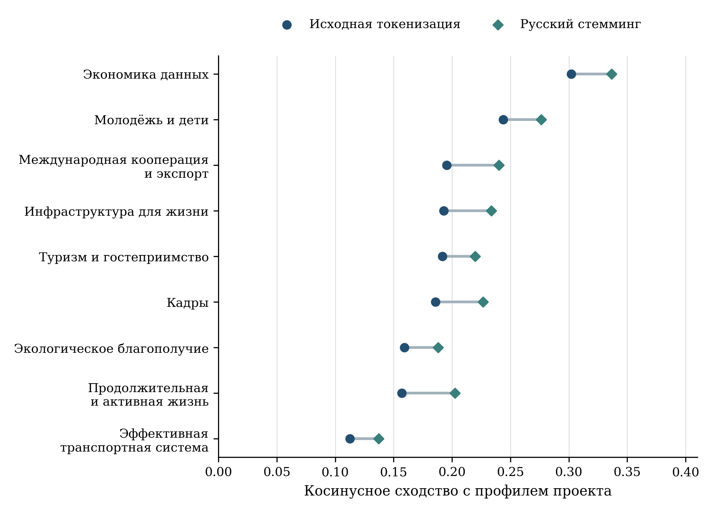

[B417; Caption] Рисунок 13 — Межпроектная лексическая близость и чувствительность к стеммингу

[B418; SourceNote] Сопоставлены средние нормированные профили структурированных паспортов десяти проектов. Архивный профиль «Семьи» исключён из рисунка из-за различия жанра. Стемминг сокращает слова до основы и не равнозначен лемматизации. [Сноски 104]

[B419; ] Наибольшая лексическая близость наблюдается с «Экономикой данных и цифровой трансформацией государства» — 0,3021, «Молодёжью и детьми» — 0,2437 и «Международной кооперацией и экспортом» — 0,1955. Следующие позиции занимают «Инфраструктура для жизни», «Туризм и гостеприимство» и «Кадры». Первые три соседних профиля сохраняются при русском стемминге. Устойчивость этого порядка подтверждает, что результат не определяется только отдельными окончаниями слов, но не превращает лексическую близость в доказательство взаимодействия программ.

[B420; ] Содержательно цифровое направление может дополнять инвестиции и изменение производственных процессов, а образовательное — подготовку кадров и технологическое предпринимательство. Экспортные меры создают возможность масштабирования продаж. Эти связи следует проверять по реальной траектории получателя: какое предприятие перешло от разработки к производству, какое использовало цифровой инструмент, кто получил доступ к внешнему рынку и как изменился его результат. Без такой проверки общая лексика остаётся тематическим сходством.

[B421; ] Межпроектное управление рекомендуется строить вокруг конкретных переходов. Для технологического бизнеса это переход от университетской команды к компании, от прототипа к заказу и от внутреннего рынка к экспорту. Для производительности — связь модернизации процесса с квалификацией персонала и цифровой системой. Для инвестиционного проекта — согласование финансирования с инфраструктурной готовностью территории и доступностью работников. В каждом переходе необходимы ответственная сторона, условие передачи, идентификатор объекта и показатель завершения.

[B422; ] Текстовые методы полезны для выявления неполных формулировок и потенциальных зон координации. Их предел состоит в отсутствии данных о фактическом поведении участников. Поэтому ни высокий TF–IDF, ни плотность графа, ни место в матрице сходства не служат самостоятельным основанием для перераспределения бюджетных средств. Такие решения должны опираться на сочетание содержания меры, финансовой стоимости, наблюдаемых результатов и обоснованной оценки дополнительности.

[B423; Heading1] 7 Направления совершенствования национального проекта

[B424; Heading2] 7.1 Согласование показателей и управленческой ответственности

[B425; ] Приоритетное изменение — единая содержательная карточка показателя, в которой одновременно раскрываются определение, единица, направление изменения, база, экономический период, дата публикации, состав числителя и знаменателя, источник и правила пересмотра. Для годовых показателей с ежемесячным отображением необходимо прямо обозначать перенос последнего годового значения. Для нулевой записи — различать достигнутое нулевое состояние, отсутствие расчёта и техническое заполнение, если такой статус подтверждён владельцем данных.

[B426; ] Для каждого мероприятия рекомендуется закрепить один или несколько адресных показателей с описанием механизма. Это особенно необходимо там, где открытое представление раздела влияния не позволяет восстановить адресата. Указание связи должно объяснять, что именно меняется у получателя, за какой срок и какой факт подтверждает переход. Документальная связь через общую задачу может быть сохранена как более широкий уровень координации, но не заменяет адресного описания.

[B427; ] Отчёт об исполнении должен показывать план, действовавший в начале периода, изменение плана и текущую редакцию. Такой формат позволяет отличить выполнение первоначального обязательства от соответствия пересмотренному ориентиру. Для федеральных проектов с разными методиками нельзя строить общий процент выполнения как среднее частных отношений без утверждённого содержательного основания. В публичном заключении целесообразно показывать число сопоставимых наблюдений, состав ограничений и наиболее существенные отклонения.

[B428; ] Официальные показатели сохраняют функции проектного управления. Предлагаемые дополнительные показатели нужны для проверки экономического и общественного смысла результата. Их задача — раскрыть механизм, который не виден в одном агрегате: изменение состава предприятий, использование высвобождённого времени, качество услуги, чистый приток капитала или устойчивость продаж. Набор должен оставаться достаточно компактным, чтобы его можно было регулярно рассчитывать и использовать при принятии решений.

[B429; Caption] Таблица 11 — Предлагаемые дополнительные показатели результата

[TABLE 11; B430]
Показатель | Определение и период | Назначение
Реальный рост у постоянной когорты МСП | Изменение дефлированного дохода и добавленной стоимости тех же предприятий; ежегодно | Отделить рост действующего бизнеса от изменения состава
Устойчивость после поддержки | Доля получателей, продолжающих деятельность и сохраняющих результат через 12 и 24 месяца | Проверить длительность эффекта
Экономия рабочего времени | Изменение трудозатрат на сопоставимую единицу годной продукции или услуги; часы, по завершении и через год | Отделить реорганизацию от номинального роста
Качество и доступность услуги | Отраслевой набор: ожидание, завершённость, ошибки, повторные обращения; по сопоставимым группам | Исключить улучшение коэффициента за счёт качества
Дополнительные инвестиции | Разность между наблюдаемой траекторией и обоснованным контрфактом; диапазон оценки | Оценить стимулирующий эффект поддержки
Совокупная стоимость поддержки | Субсидии, ожидаемые выплаты по гарантиям, налоговые расходы и обязательства за весь срок | Сопоставить инструменты на общей стоимостной базе
Коммерциализация МТК | Время до первой оплаченной поставки, повторные продажи и число независимых покупателей | Различить статус, разработку и устойчивый рынок
Устойчивое участие в сбережениях | Уникальные вкладчики, чистый приток и сохранение положительного остатка; по доходным и возрастным группам | Оценить реальное участие и распределение выгод
Изменение условий входа на рынок | Сроки, стоимость и доля завершённых процедур новых независимых участников | Связать нормативные меры с конкуренцией
Результативность адаптации | Выполненные меры и снижение ожидаемого ущерба для определённого объекта при сопоставимом риске | Перейти от наличия плана к снижению уязвимости

[B431; SourceNote] Показатели предложены в дополнение к официальной системе. Они требуют утверждения определений и проверки доступности данных; их значения в экспертизе не имитируются.

[B432; Heading2] 7.2 Поддержка предприятий и полнота стоимости результата

[B433; ] Для адресной поддержки МСП и МТК единицей наблюдения следует сделать предприятие с последовательностью полученных мер. По каждой мере необходимо фиксировать дату обращения и решения, критерии отбора, объём ресурса, длительность, отказ или прекращение, а также наличие других инструментов поддержки. Это позволяет оценивать совокупную нагрузку на бюджет и избегать многократного счёта одного получателя в качестве самостоятельного результата.

[B434; ] В мониторинге роста рекомендуется параллельно наблюдать весь текущий реестр и постоянные когорты предприятий. Первый подход характеризует масштаб сектора, второй — изменения у сопоставимых хозяйствующих субъектов. Для новых участников важна траектория выхода на устойчивые продажи; для действующих — прирост реальной добавленной стоимости, сохранение конкурентоспособности и развитие рынков. Следует сохранять информацию о прекративших деятельность предприятиях, иначе оценка будет смещена в пользу выживших.

[B435; ] Финансовая стоимость поддержки должна включать уже принятые обязательства будущих периодов. Субсидия процентной ставки, гарантия, налоговый вычет и инфраструктурные расходы имеют разные сроки и вероятности выплат. Для сопоставления инструментов требуется приведённая стоимость расходов на едином горизонте и раскрытие основных допущений. Объём выданного кредита отражается отдельно: он не является бюджетным расходом и не должен полностью записываться в экономический эффект.

[B436; ] Для инвестиционных механизмов предлагается проводить оценку по стадиям: финансовое закрытие, фактическое вложение, ввод, загрузка, выпуск и устойчивость обслуживания долга. Раскрытие доли проектов, задержанных на каждой стадии, позволяет выбирать корректирующие действия. Если ограничением является разрешительная процедура или подключение, увеличение финансового лимита само по себе может не ускорить результат. Если ограничением является спрос, необходимо пересмотреть предпосылки проекта, а не только срок освоения средств.

[B437; Heading2] 7.3 Производительность и качество жизни на территориях

[B438; ] В социальной сфере каждый проект повышения производительности должен заранее определять, как будет использован высвобождаемый ресурс. Это может быть сокращение ожидания, увеличение времени сложному пациенту или обучающемуся, повышение доступности услуги, снижение переработок либо уменьшение затрат. Выбранный вариант должен сопровождаться измерением до изменения и после него, а затем проверкой сохранения результата. Нельзя оставлять назначение экономии неявным, поскольку тогда один и тот же прирост коэффициента может иметь противоположные последствия для населения.

[B439; ] Предлагается использовать парную оценку: показатель ресурсоотдачи и ограничение качества. Для медицинской организации рост оборота койки дополняется безопасностью выписки и доступностью последующего наблюдения; для образования — результатами обучения и доступностью сопровождения; для культуры и спорта — устойчивым участием населения и доступностью предложения. Конкретные показатели выбираются отраслевым органом с учётом сложности услуг. Универсальный коэффициент, одинаковый для больницы, университета и библиотеки, не обеспечивает содержательной сопоставимости.

[B440; ] Территориальные различия требуют учёта плотности расселения, транспортной доступности, ёмкости рынка труда и возраста населения. Низкая загрузка отдельного учреждения может быть обусловлена обязанностью обеспечить доступ в удалённом поселении. Высокий показатель крупного городского учреждения может отражать масштаб спроса и доступ к специалистам. Поэтому сравнение должно проводиться внутри обоснованных групп, а решения о размещении услуг — учитывать альтернативы для жителей и совокупные затраты времени.

[B441; ] Для предпринимательской поддержки территорией результата является место фактической деятельности, а не только регистрации юридического лица. Инвестиции могут размещаться в нескольких субъектах, сотрудники жить в соседних муниципалитетах, а продажи осуществляться по всей стране. Желательно разделять место получателя средств, расположение производственного объекта и территорию занятости. Это особенно существенно при анализе агломераций и концентрации технологического бизнеса.

[B442; ] Демографическая оценка должна рассматривать участие людей в экономике и качество трудовой жизни. Повышение производительности способно облегчить кадровые ограничения, если экономия времени используется для расширения выпуска или услуг без чрезмерной нагрузки. Одновременно изменение процесса может требовать переобучения и перераспределения функций. Поэтому полезны данные о рабочих часах, оплате, текучести, переходах между рабочими местами и доступности обучения для работников разных возрастов. Эти результаты позволяют оценить социальный смысл экономического роста без подмены его одним объёмом выпуска.

[B443; Heading2] 7.4 Проверка дополнительного эффекта отдельных мер

[B444; ] Для наиболее масштабных инструментов рекомендуется заранее утверждать протокол оценки. В нём определяются объект поддержки, начало воздействия, первичный результат, период наблюдения, допустимая сравнительная группа и правила учёта одновременных мер. Такой протокол связывает управленческий вопрос с доступными данными. Например, для льготного инвестиционного кредита вопрос может состоять в том, увеличилась ли вероятность реализации проекта и его реальный масштаб, а не только в том, сколько средств было выдано.

[B445; ] При поэтапном включении предприятий или организаций возможен анализ изменений у получателей относительно сопоставимых единиц, которые ещё не начали участие. В простейшем двухпериодном случае сравниваются разности результатов до и после воздействия. При неодинаковых датах начала необходимо использовать методы, учитывающие группы времени вступления и неоднородность эффектов; обычное объединение всех участников в одну группу способно исказить оценку. [Сноски 105]

[B446; ] (6)

[Формула] τ = (Ȳ₁,после − Ȳ₁,до) − (Ȳ₀,после − Ȳ₀,до)

$$
\tau=(\overline{Y}_{1,\text{после}}-\overline{Y}_{1,\text{до}})-(\overline{Y}_{0,\text{после}}-\overline{Y}_{0,\text{до}})
$$

[B447; ] В формуле группа 1 получает поддержку, группа 0 служит сравнительной; черта обозначает среднее значение результата. Эта запись описывает принцип оценки, а не рассчитанный в экспертизе эффект. Для причинной интерпретации необходимы обоснование сопоставимости трендов до поддержки, отсутствие заранее возникшего эффекта, проверка изменения состава групп и учёт связанных вмешательств. Наблюдения за один период после начала программы не обеспечивают такой проверки.

[B448; ] Для программ с количественным порогом отбора может быть полезно сравнение предприятий вблизи порога, если правила применяются последовательно и получатели не могут свободно манипулировать критерием. Такой дизайн оценивает локальный эффект для близких к порогу предприятий и не переносится автоматически на весь сектор. Для мероприятий, распределяемых по территориальному графику, целесообразно заранее сохранить основания очередности, поскольку они могут быть связаны с будущими результатами.

[B449; ] Оценка производственных практик должна связывать локальные измерения с отчётностью предприятия. Первичный результат можно определить как изменение трудоёмкости сопоставимой годной продукции; дополнительные — брак, время цикла, реальная добавленная стоимость и условия труда. Для социальных организаций первичный результат формулируется вместе с ограничением качества и доступности. Это предотвращает ситуацию, когда формально успешный проект переносит затраты на другой участок процесса или на получателя услуги.

[B450; ] Для гарантий, грантов и технологической поддержки необходимо наблюдать не только успешные случаи. Оценка портфеля включает прекращённые проекты, отказы, просрочку, взыскание и изменение условий. В технологическом предпринимательстве раннее прекращение слабой разработки может снижать будущие затраты; это отличается от утраты средств после масштабирования неподтверждённой технологии. Поэтому показатели отбора, сопровождения и конечной отдачи должны иметь собственные временные горизонты.

[B451; ] Результаты оценок рекомендуется использовать для изменения условий программ: критериев отбора, сочетания финансовой и нефинансовой помощи, продолжительности сопровождения и требований к промежуточным результатам. Масштабирование оправдано при устойчивом эффекте и приемлемой полной стоимости. Неопределённость должна раскрываться диапазоном оценки и описанием применимости, а не заменяться точным числом без достаточного основания.

[B452; Heading2] 7.5 Последовательность внедрения и межпроектная координация

[B453; ] Изменения целесообразно разделить по сроку и сложности. Уточнение описаний показателей, версий и статуса наблюдения может быть выполнено быстрее, чем объединение ведомственных данных. Пилотная оценка одной меры позволяет проверить качество идентификаторов и измерений до распространения на весь проект. Приоритет следует отдавать инструментам с большим объёмом обязательств, высоким риском двойного счёта и значимыми последствиями для населения.

[B454; Caption] Таблица 12 — Последовательность предлагаемых изменений

[TABLE 12; B455]
Этап | Приоритетное действие | Проверяемый результат
Первые 3 месяца | Закрепить версию, базу, период, знаменатель и статус пересмотра каждого показателя; раскрыть идентификаторы связей | Сопоставимая карточка показателя и адресная цепочка мероприятия
В течение 6 месяцев | Согласовать учёт получателей и полной стоимости инструментов; опубликовать таблицу межбюджетной сверки | Один объект поддержки без двойного счёта результата
В течение 12 месяцев | Ввести парные показатели качества и ресурсоотдачи; провести пилотные оценки когорт поддержки | Наблюдение устойчивого результата и первых оценок дополнительности
Следующий цикл планирования | Корректировать условия и распределение поддержки по результатам оценки; обновлять территориальные модели | Обоснованный выбор инструментов и масштабирования

[B456; SourceNote] Предлагаемый календарь отсчитывается от принятия решения об изменении мониторинга. Он является рекомендацией экспертизы и не представляет утверждённый план органов власти.

[B457; ] Координация с другими национальными проектами должна фиксировать переходы между ответственными сторонами. В технологическом предпринимательстве это связь образования, исследования, коммерциализации, производительности и экспорта. В инвестиционной политике — согласование капитала, кадров и инфраструктуры. В социальной сфере — совместная оценка организационной эффективности с отраслевыми целями здоровья, образования, культуры и поддержки населения. Текстовая близость паспортов помогает найти такие переходы, но регламент должен описывать реальные действия и показатели передачи результата.

[B458; ] Обсуждаемое развитие креативных индустрий требует отдельного согласования статистических границ. При расширении структуры проекта необходимо определить, какие предприятия и виды деятельности включаются, как учитывается интеллектуальная собственность и как изменение состава сектора влияет на выручку. До публикации согласованного паспорта нового направления его цели и расходы не следует механически присоединять к уже сопоставляемому набору семи федеральных проектов. [Сноски 106]

[B459; ] Публичная отчётность может быть организована вокруг короткой последовательности: что было предоставлено, что изменилось у получателя, какова полная стоимость, сохраняется ли результат и насколько обоснован вклад поддержки. Для каждого ответа требуется собственный источник. Такая структура делает оценку понятной исследователю, органу управления и читателю, сохраняя экономическую сложность проекта без сведения её к одному сводному рейтингу.

[B460; Heading1] Заключение

[B461; ] Национальный проект «Эффективная и конкурентная экономика» объединяет инструменты, способные воздействовать на ключевые ограничения развития предприятий и рынков. Его потенциал связан с согласованием предпринимательства, производительности, инвестиций, финансового посредничества, технологий, конкуренции и климатической устойчивости. Опубликованная конструкция предусматривает не только предоставление ресурсов, но и организационные изменения, нормативные механизмы и развитие информационной основы управления.

[B462; ] Проведённая экспертиза выявляет необходимость более строгого разграничения смыслов показателей. Номинальный прирост на предприятии не равнозначен реальному макроэкономическому росту производительности. Доход МСП на работника не является заработной платой. Число услуг на сотрудника требует проверки качества и фактических трудозатрат. Капитализация отражает рыночную оценку, а регистрация технологической компании или возможность её участия в кооперации не заменяет подтверждённые продажи и поставки. Эти различия непосредственно меняют содержание выводов о результатах.

[B463; ] Доступные сопоставления за 2025 г. показывают выполнение или превышение ряда выбранных ориентиров, одновременно сохраняя отставание по реальному доходу МСП на работника. Их охват ограничен сопоставимыми годовыми наблюдениями и выбранными редакциями паспортов. Региональный анализ обнаруживает существенную неоднородность и различный календарь вовлечения социальной сферы. Поэтому общероссийское значение необходимо сопровождать распределением и объяснением состава наблюдения.

[B464; ] Финансовая экспертиза показывает преобладание внебюджетных источников и концентрацию раскрытого финансирования в инвестиционном направлении. Почти полное арифметическое согласование национального итога с пятью численно раскрытыми федеральными проектами не снимает вопроса о полном учёте обязательств и стоимости эффекта. Изменения предлагаемого бюджета следует объяснять по механизмам: общее снижение может быть связано с одной крупной строкой при росте остальных инструментов.

[B465; ] Анализ связей мероприятий с показателями подтверждает необходимость адресного раскрытия механизмов. Общая задача и лексическая близость помогают ориентироваться в структуре, но не доказывают прямого влияния. Для оценки дополнительности нужны наблюдение получателей во времени, полная стоимость поддержки и обоснованная сравнительная траектория. Совершенствование проекта целесообразно направить на эти условия, сохраняя действующие инструменты там, где они обеспечивают проверяемый и устойчивый результат для экономики и населения.

[B466; Heading1] Приложение А Реестр статистических показателей

[B467; ] Реестр объединяет 49 статистических кодов национального и федерального уровней. Он служит основанием для различения содержания показателя, наличия числовых наблюдений и регионального покрытия. Указание доступности относится к конкретному статистическому срезу. Отдельные ведомственные публикации могут содержать дополнительные сведения, рассмотренные в основном тексте; это не изменяет автоматически статус исходной таблицы.

[B468; Caption] Таблица 13 — Реестр статистических показателей и наблюдаемость

[TABLE 13; B469]
Код | Наименование показателя | Статус числовых данных | n
2.14.Э.1 | Рост производи­тельности труда в экономике Российской Федерации по отношению к 2023 году | Числа есть | —
2.14.Э.2 | Доля средних и крупных предприятий базовых несырьевых отраслей экономики, вовлеченных в реализацию проектов, направленных на повышение производи­тельности труда, нарастающим итогом | Числа есть | —
2.14.Э.3 | Доля государственных и муниципальных организаций социальной сферы, вовлеченных в реализацию проектов, направленных на повышение производи­тельности труда, нарастающим итогом | Числа есть | —
2.14.Э.4 | Реальный рост дохода на одного работника субъекта малого и среднего предпринимательства | Числа есть | 84
2.14.Э.5 | Прирост объема инвестиций в основной капитал к 2020 году | Числа есть | —
2.14.Э.6 | Объем выручки малых технологических компаний | Числа есть | —
2.14.Э.7 | Объем капитализации фондового рынка относительно ВВП (Э5) | Числа есть | —
2.14.Э.8 | Доля долгосрочных сбережений граждан в общем объеме их сбережений (Э5) | Числа есть | —
2.14.Э.9 | Утверждены и реализованы программы адаптации к изменениям климата на федеральном, региональном и корпоративном уровнях | Числа есть | —
2.14.Э.10 | Реализованы программы адаптации к изменениям климата на федеральном, региональном и корпоративном уровнях | Таблица не установлена | —
2.14.Э.11 | Создана национальная система мониторинга климатически активных веществ | Числа есть | —
2.14.Э1.1 | Доля субъектов МСП, превысивших предельные значения для определения категорий субъектов МСП (микро-, малые, средние) | Числа есть | 84
2.14.Э1.2 | Уровень удовлетворенности потенциальных и действующих субъектов МСП, осуществляющих деятельность в промышленных (индустриальных) парках, технопарках, бизнес-парках, а также получивших услуги иных организаций инфраструктуры поддержки субъектов МСП | Таблица не установлена | —
2.14.Э1.3 | Темп роста налогов на одного работника субъекта малого и среднего предпринимательства | Числа есть | —
2.14.Э2.1 | Доля предприятий, достигших ежегодного 5%-ного прироста производи­тельности труда на предприятиях-участниках, внедряющих мероприятия по повышению производи­тельности труда под федеральным и региональным управлением | Числа есть | —
2.14.Э2.2 | Увеличение количества граждан, систематически занимающихся физической культурой и спортом, в расчете на одного работника сферы физической культуры и спорта | Числа есть | —
2.14.Э2.3 | Количество обучающихся в профессиональных образовательных организациях в расчете на одного работника организации | Числа есть | —
2.14.Э2.4 | Количество обучающихся в дошкольных образовательных организациях и общеобразовательных организациях в расчете на одного работника организации | Числа есть | —
2.14.Э2.5 | Доля государственных и муниципальных дошкольных образовательных организаций, общеобразовательных организаций, профессиональных образовательных организаций и организаций дополнительного образования детей субъектов Российской Федерации, вовлеченных в реализацию проектов, направленных на повышение производи­тельности труда | Числа есть | —
2.14.Э2.6 | Доля медицинских организаций, вовлеченных в реализацию проектов, направленных на повышение производи­тельности труда | Числа есть | 88
2.14.Э2.7 | Рост случаев проведенного диспансерного наблюдения в расчете на одну занятую должность врача, оказывающего первичную медико-санитарную помощь в амбулаторных условиях | Числа есть | 88
2.14.Э2.8 | Увеличение оборота койки | Числа есть | 88
2.14.Э2.9 | Увеличение количества социальных услуг, предоставленных организацией социального обслуживания, в расчете на одного работника организации социального обслуживания | Таблица не установлена | —
2.14.Э2.10 | Доля организаций социального обслуживания, медико-социальной экспертизы, вовлеченных в реализацию проектов, направленных на повышение производи­тельности труда | Числа есть | —
2.14.Э2.11 | Численность обучающихся на одного работника образовательной организации высшего образования | Числа есть | —
2.14.Э2.12 | Численность обучающихся на одного работника категории административный и вспомогательный персонал образовательной организации высшего образования | Числа есть | —
2.14.Э2.13 | Доля организаций высшего образования, вовлеченных в реализацию проектов, направленных на повышение производи­тельности труда | Числа есть | —
2.14.Э2.14 | Доля государственных и муниципальных организаций культуры, вовлеченных в реализацию проектов, направленных на повышение производи­тельности труда | Числа есть | 85
2.14.Э2.15 | Увеличение количества посещений организаций культуры в расчете на одного работника организации | Числа есть | —
2.14.Э2.16 | Доля государственных и муниципальных организаций сферы физической культуры и спорта, вовлеченных в реализацию проектов, направленных на повышение производи­тельности труда | Числа есть | —
2.14.Э3.1 | Объем привлеченных инвестиций за счет реализации федеральных инвестиционных механизмов | Таблица не установлена | —
2.14.Э3.2 | Рост среднего значения интегрального индекса субъектов Российской Федерации в Национальном рейтинге состояния инвестиционного климата в субъектах Российской Федерации | Таблица не установлена | —
2.14.Э3.3 | Сокращение удельных издержек строительства групп промышленных объектов по отношению к 2020 году | Таблица не установлена | —
2.14.Э3.4 | Сокращение административных барьеров ведения бизнеса за счет реализации механизма "Трансформация делового климата" | Таблица не установлена | —
2.14.Э3.5 | Сокращение сроков строительства групп промышленных объектов по отношению к 2020 году | Таблица не установлена | —
2.14.Э3.6 | Количество участников специальных административных районов | Таблица не установлена | —
2.14.Э3.7 | Объем инвестиций, осуществленных резидентами особых экономических зон | Таблица не установлена | —
2.14.Э5.1 | Доля активов небанковских финансовых организаций к валовому внутреннему продукту | Таблица не установлена | —
2.14.Э5.2 | Количество публичных размещений компаний на российском фондовом рынке | Таблица не установлена | —
2.14.Э5.3 | Объем публичных размещений государственных компаний на российском фондовом рынке | Таблица без чисел | —
2.14.Э5.4 | Совокупный объем средств в программе долгосрочных сбережений, на индивидуальных инвестиционных счетах и в долевом страховании жизни | Таблица без чисел | —
2.14.Э5.5 | Объем публичных размещений акций компаний на российском фондовом рынке | Таблица без чисел | —
2.14.Э5.6 | Доля средств физических лиц в паевых инвестиционных фондах и доверительном управлении в суммарном объеме средств в паевых инвестиционных фондах, доверительном управлении и на брокерском обслуживании | Таблица без чисел | —
2.14.Э6.1 | Количество технологических компаний, в том числе малых технологических компаний, участвующих в национальных проектах по обеспечению технологического лидерства и кооперационных цепочках крупных компаний | Числа есть | —
2.14.Э6.2 | Количество технологических компаний, в том числе малых технологических компаний, осуществивших внебиржевое и биржевое размещение ценных бумаг | Числа есть | —
2.14.Э6.3 | Количество университетских стартапов, получивших статус малой технологической компании | Числа есть | —
2.14.Э7.1 | Создана система развития конкуренции на товарных рынках | Таблица без чисел | —
2.14.Э7.2 | Рост совокупной удовлетворенности участников рынка | Таблица без чисел | —
2.14.Э7.3 | Расширен перечень товаров, используемых для создания национальных ценовых индикаторов | Таблица без чисел | —

[B470; SourceNote] n — число регионов с числовыми наблюдениями в исследованном массиве. Статус относится к проверенному статистическому срезу на 15.10.2026 и не означает отсутствие данных во всех ведомственных источниках. «Числа есть» не является подтверждением пригодности всех наблюдений для динамического анализа. [Сноски 107]

# Сноски и источники

[1] Минэкономразвития России; открытое представление ЕПБС в DataBudget. Паспорт национального проекта «Эффективная и конкурентная экономика». Версия 26.32. 16.10.2026. URL: https://databudget.ru/projects/np/21 (дата обращения: 28.10.2026). Президент Российской Федерации. О национальных целях развития Российской Федерации на период до 2030 года и на перспективу до 2036 года: Указ от 07.05.2024 № 309. URL: https://minobrnauki.gov.ru/open_ministry/gossluzhba/entry/files/Указ%20Президента%20РФ%20от%2007.05.2024%20N%20309%20%20О%20национальных%20целях.pdf (дата обращения: 28.10.2026).

[2] Минэкономразвития России. ЕМИСС. Реальный рост дохода на одного работника субъекта малого и среднего предпринимательства. URL: https://www.fedstat.ru/indicator/62979 (дата обращения: 28.10.2026). Минэкономразвития России; открытое представление ЕПБС в DataBudget. Паспорт национального проекта «Эффективная и конкурентная экономика». Версия 26.32. 16.10.2026. URL: https://databudget.ru/projects/np/21 (дата обращения: 28.10.2026).

[3] Минэкономразвития России. Об утверждении методики расчёта показателя «Доля предприятий, достигших ежегодного 5%-ного прироста производительности труда на предприятиях-участниках, внедряющих мероприятия по повышению производительности труда под федеральным и региональным управлением»: приказ от 18.08.2025 № 529. 18.08.2025. URL: https://base.garant.ru/412649925/ (дата обращения: 28.10.2026).

[4] Минэкономразвития России. ЕМИСС. Реальный рост дохода на одного работника субъекта малого и среднего предпринимательства. URL: https://www.fedstat.ru/indicator/62979 (дата обращения: 28.10.2026). Минздрав России. ЕМИСС. Доля медицинских организаций, вовлеченных в реализацию проектов, направленных на повышение производительности труда. URL: https://www.fedstat.ru/indicator/62962 (дата обращения: 28.10.2026). Минкультуры России. ЕМИСС. Доля государственных и муниципальных организаций культуры, вовлеченных в реализацию проектов, направленных на повышение производительности труда. URL: https://www.fedstat.ru/indicator/62991 (дата обращения: 28.10.2026).

[5] Минэкономразвития России; открытое представление ЕПБС в DataBudget. Паспорт национального проекта «Эффективная и конкурентная экономика». Версия 26.32. 16.10.2026. URL: https://databudget.ru/projects/np/21 (дата обращения: 28.10.2026). Минэкономразвития России; открытое представление ЕПБС в DataBudget. Паспорт федерального проекта «Повышение инвестиционной активности». Версия 26.18. 16.10.2026. URL: https://databudget.ru/projects/fp/313 (дата обращения: 28.10.2026).

[6] Минэкономразвития России; открытое представление ЕПБС в DataBudget. Паспорт национального проекта «Эффективная и конкурентная экономика». Версия 26.32. 16.10.2026. URL: https://databudget.ru/projects/np/21 (дата обращения: 28.10.2026). Минэкономразвития России; открытое представление ЕПБС в DataBudget. Паспорт федерального проекта «Малое и среднее предпринимательство и поддержка индивидуальной предпринимательской инициативы». Версия 26.25. 16.10.2026. URL: https://databudget.ru/projects/fp/312 (дата обращения: 28.10.2026). Минэкономразвития России; открытое представление ЕПБС в DataBudget. Паспорт федерального проекта «Производительность труда». Версия 26.36. 16.10.2026. URL: https://databudget.ru/projects/fp/311 (дата обращения: 28.10.2026). Минэкономразвития России; открытое представление ЕПБС в DataBudget. Паспорт федерального проекта «Повышение инвестиционной активности». Версия 26.18. 16.10.2026. URL: https://databudget.ru/projects/fp/313 (дата обращения: 28.10.2026). Минэкономразвития России; открытое представление ЕПБС в DataBudget. Паспорт федерального проекта «Низкоуглеродное развитие». Версия 26.13. 16.10.2026. URL: https://databudget.ru/projects/fp/298 (дата обращения: 28.10.2026). Минфин России; открытое представление ЕПБС в DataBudget. Паспорт федерального проекта «Развитие финансового рынка». Версия 26.8. 16.10.2026. URL: https://databudget.ru/projects/fp/324 (дата обращения: 28.10.2026). Минэкономразвития России; открытое представление ЕПБС в DataBudget. Паспорт федерального проекта «Технологии». Версия 26.31. 16.10.2026. URL: https://databudget.ru/projects/fp/325 (дата обращения: 28.10.2026). ФАС России; открытое представление ЕПБС в DataBudget. Паспорт федерального проекта «Развитие конкуренции». Версия 26.2. 16.10.2026. URL: https://databudget.ru/projects/fp/326 (дата обращения: 28.10.2026).

[7] Минэкономразвития России; открытое представление ЕПБС в DataBudget. Паспорт национального проекта «Эффективная и конкурентная экономика». Версия 26.32. 16.10.2026. URL: https://databudget.ru/projects/np/21 (дата обращения: 28.10.2026). Росстат. Методики расчёта показателей национального проекта «Эффективная и конкурентная экономика». 2026. URL: https://rosstat.gov.ru/storage/mediabank/NP16_N.htm (дата обращения: 28.10.2026).

[8] Минэкономразвития России; открытое представление ЕПБС в DataBudget. Паспорт национального проекта «Эффективная и конкурентная экономика». Версия 26.32. 16.10.2026. URL: https://databudget.ru/projects/np/21 (дата обращения: 28.10.2026).

[9] Минэкономразвития России; открытое представление ЕПБС в DataBudget. Паспорт национального проекта «Эффективная и конкурентная экономика». Версия 26.32. 16.10.2026. URL: https://databudget.ru/projects/np/21 (дата обращения: 28.10.2026).

[10] Минэкономразвития России; открытое представление ЕПБС в DataBudget. Паспорт федерального проекта «Малое и среднее предпринимательство и поддержка индивидуальной предпринимательской инициативы». Версия 26.25. 16.10.2026. URL: https://databudget.ru/projects/fp/312 (дата обращения: 28.10.2026).

[11] Минэкономразвития России; открытое представление ЕПБС в DataBudget. Паспорт федерального проекта «Производительность труда». Версия 26.36. 16.10.2026. URL: https://databudget.ru/projects/fp/311 (дата обращения: 28.10.2026).

[12] Минэкономразвития России; открытое представление ЕПБС в DataBudget. Паспорт федерального проекта «Повышение инвестиционной активности». Версия 26.18. 16.10.2026. URL: https://databudget.ru/projects/fp/313 (дата обращения: 28.10.2026).

[13] Минфин России; открытое представление ЕПБС в DataBudget. Паспорт федерального проекта «Развитие финансового рынка». Версия 26.8. 16.10.2026. URL: https://databudget.ru/projects/fp/324 (дата обращения: 28.10.2026).

[14] Минэкономразвития России; открытое представление ЕПБС в DataBudget. Паспорт федерального проекта «Технологии». Версия 26.31. 16.10.2026. URL: https://databudget.ru/projects/fp/325 (дата обращения: 28.10.2026).

[15] Минэкономразвития России. Об утверждении отдельных методик расчёта показателей национального проекта «Эффективная и конкурентная экономика» и входящего в его состав федерального проекта «Технологии»: приказ от 16.01.2025 № 17. Приложения № 1 и 2. 16.01.2025. URL: https://rosstat.gov.ru/storage/mediabank/MET_N_160602.pdf (дата обращения: 28.10.2026).

[16] ФАС России; открытое представление ЕПБС в DataBudget. Паспорт федерального проекта «Развитие конкуренции». Версия 26.2. 16.10.2026. URL: https://databudget.ru/projects/fp/326 (дата обращения: 28.10.2026).

[17] Минэкономразвития России; открытое представление ЕПБС в DataBudget. Паспорт федерального проекта «Низкоуглеродное развитие». Версия 26.13. 16.10.2026. URL: https://databudget.ru/projects/fp/298 (дата обращения: 28.10.2026).

[18] Росстат. Методики расчёта показателей национального проекта «Эффективная и конкурентная экономика». 2026. URL: https://rosstat.gov.ru/storage/mediabank/NP16_N.htm (дата обращения: 28.10.2026).

[19] Минэкономразвития России. Об утверждении методики расчёта показателя «Реальный рост дохода на одного работника субъекта малого и среднего предпринимательства» национального проекта «Эффективная и конкурентная экономика»: приказ от 05.11.2024 № 697. 05.11.2024. URL: https://rosstat.gov.ru/storage/mediabank/MET_N_160004.pdf (дата обращения: 28.10.2026). Минэкономразвития России. Об утверждении методики расчёта показателя «Доля предприятий, достигших ежегодного 5%-ного прироста производительности труда на предприятиях-участниках, внедряющих мероприятия по повышению производительности труда под федеральным и региональным управлением»: приказ от 18.08.2025 № 529. 18.08.2025. URL: https://base.garant.ru/412649925/ (дата обращения: 28.10.2026).

[20] Минэкономразвития России. Об утверждении методики расчёта показателя «Реальный рост дохода на одного работника субъекта малого и среднего предпринимательства» национального проекта «Эффективная и конкурентная экономика»: приказ от 05.11.2024 № 697. 05.11.2024. URL: https://rosstat.gov.ru/storage/mediabank/MET_N_160004.pdf (дата обращения: 28.10.2026). Минэкономразвития России. Об утверждении методики расчёта показателя «Доля предприятий, достигших ежегодного 5%-ного прироста производительности труда на предприятиях-участниках, внедряющих мероприятия по повышению производительности труда под федеральным и региональным управлением»: приказ от 18.08.2025 № 529. 18.08.2025. URL: https://base.garant.ru/412649925/ (дата обращения: 28.10.2026). Минэкономразвития России. Об утверждении методики расчёта показателя «Темп роста налогов на одного работника субъекта малого и среднего предпринимательства»: приказ от 16.06.2025 № 395. 16.06.2025. URL: https://rosstat.gov.ru/storage/mediabank/MET_N_160103.pdf (дата обращения: 28.10.2026). Минэкономразвития России. Об утверждении методики расчёта показателя «Рост производительности труда в экономике Российской Федерации по отношению к 2023 году»: приказ от 14.08.2026 № 580. 14.08.2026. URL: https://pravo.ppt.ru/prikaz/minekonomrazvitiya/n-580-351479 (дата обращения: 28.10.2026). Минэкономразвития России. Об утверждении методики расчёта показателя «Доля государственных и муниципальных организаций социальной сферы, вовлечённых в реализацию проектов, направленных на повышение производительности труда»: приказ от 12.02.2026 № 114. 12.02.2026. URL: https://rulaws.ru/acts/Prikaz-Minekonomrazvitiya-Rossii-ot-12.02.2026-N-114/ (дата обращения: 28.10.2026). Минэкономразвития России. Об утверждении отдельных методик расчёта показателей национального проекта «Эффективная и конкурентная экономика» и входящего в его состав федерального проекта «Технологии»: приказ от 16.01.2025 № 17. Приложения № 1 и 2. 16.01.2025. URL: https://rosstat.gov.ru/storage/mediabank/MET_N_160602.pdf (дата обращения: 28.10.2026). ФАС России. Методика расчёта показателя «Создана система развития конкуренции на товарных рынках»: приложение № 1 к приказу от 29.09.2026 № 756/26. 29.09.2026. URL: https://www.consultant.ru/document/cons_doc_LAW_546972/691f4591d76a458bd96a82fb4ea68630717d0014/ (дата обращения: 28.10.2026).

[21] Минэкономразвития России. Об утверждении методики расчёта показателя «Реальный рост дохода на одного работника субъекта малого и среднего предпринимательства» национального проекта «Эффективная и конкурентная экономика»: приказ от 05.11.2024 № 697. 05.11.2024. URL: https://rosstat.gov.ru/storage/mediabank/MET_N_160004.pdf (дата обращения: 28.10.2026).

[22] Правительство Российской Федерации. Методика расчёта планового значения показателя «Темп роста дохода в расчёте на одного работника субъекта малого и среднего предпринимательства»: приложение № 31 к постановлению от 28.01.2025 № 58. 28.01.2025. URL: https://rosstat.gov.ru/storage/mediabank/post_58-28012025.pdf (дата обращения: 28.10.2026).

[23] Минэкономразвития России. Об утверждении методики расчёта показателя «Темп роста налогов на одного работника субъекта малого и среднего предпринимательства»: приказ от 16.06.2025 № 395. 16.06.2025. URL: https://rosstat.gov.ru/storage/mediabank/MET_N_160103.pdf (дата обращения: 28.10.2026).

[24] Минэкономразвития России. Об утверждении методики расчёта показателя «Доля субъектов МСП, превысивших предельные значения для определения категорий субъектов МСП (микро-, малые, средние)»: приказ от 31.10.2024 № 688. 31.10.2024. URL: https://rosstat.gov.ru/storage/mediabank/MET_N_160101.pdf (дата обращения: 28.10.2026).

[25] Росстат. Об утверждении официальной статистической методологии формирования показателя «Индекс производительности труда»: приказ от 08.05.2026 № 235. 08.05.2026. URL: https://rosstat.gov.ru/storage/mediabank/met_235-08052026.pdf (дата обращения: 28.10.2026). Минэкономразвития России. Об утверждении методики расчёта показателя «Рост производительности труда в экономике Российской Федерации по отношению к 2023 году»: приказ от 14.08.2026 № 580. 14.08.2026. URL: https://pravo.ppt.ru/prikaz/minekonomrazvitiya/n-580-351479 (дата обращения: 28.10.2026).

[26] Минэкономразвития России. Об утверждении методики расчёта показателя «Доля предприятий, достигших ежегодного 5%-ного прироста производительности труда на предприятиях-участниках, внедряющих мероприятия по повышению производительности труда под федеральным и региональным управлением»: приказ от 18.08.2025 № 529. 18.08.2025. URL: https://base.garant.ru/412649925/ (дата обращения: 28.10.2026).

[27] Минэкономразвития России. Об утверждении методики расчёта показателя «Доля средних и крупных предприятий базовых несырьевых отраслей экономики, вовлечённых в реализацию проектов, направленных на повышение производительности труда»: приказ от 18.08.2025 № 530. 18.08.2025. URL: https://base.garant.ru/412649917/ (дата обращения: 28.10.2026).

[28] Минэкономразвития России. Паспорт национального проекта «Эффективная и конкурентная экономика». Редакция, опубликованная 16 октября 2026 года, версия 26.32. 16.10.2026. URL: https://databudget.ru/projects/np/21 (дата обращения: 28.10.2026).

[29] Минэкономразвития России. Об утверждении методики расчёта показателя «Доля государственных и муниципальных организаций социальной сферы, вовлечённых в реализацию проектов, направленных на повышение производительности труда»: приказ от 12.02.2026 № 114. 12.02.2026. URL: https://rulaws.ru/acts/Prikaz-Minekonomrazvitiya-Rossii-ot-12.02.2026-N-114/ (дата обращения: 28.10.2026).

[30] Президент Российской Федерации. Перечень поручений по итогам заседания Совета по стратегическому развитию и национальным проектам от 8 декабря 2025 года, утверждённый 03.01.2026 № Пр-21. Пункты 3к и 4б. 03.01.2026. URL: https://www.kremlin.ru/acts/assignments/orders/78991 (дата обращения: 28.10.2026).

[31] Минэкономразвития России. Об утверждении методики расчёта показателя «Прирост объёма инвестиций в основной капитал к 2020 году» национального проекта «Эффективная и конкурентная экономика»: приказ от 22.04.2025 № 263. 22.04.2025. URL: https://rosstat.gov.ru/storage/mediabank/MET_N_160005.pdf (дата обращения: 28.10.2026).

[32] Минфин России. Методика расчёта показателя «Объём капитализации фондового рынка относительно ВВП»: утверждена приказом от 01.04.2025 № 106. 01.04.2025. URL: https://bazanpa.ru/minfin-rossii-prikaz-n106-ot01042025-h6926622/ (дата обращения: 28.10.2026).

[33] Минфин России. О методиках расчёта показателей федерального проекта «Развитие финансового рынка», входящего в состав национального проекта «Эффективная и конкурентная экономика»: приказ от 30.09.2026 № 282. 30.09.2026. URL: https://www.consultant.ru/document/cons_doc_LAW_547062/2ff7a8c72de3994f30496a0ccbb1ddafdaddf518/ (дата обращения: 28.10.2026).

[34] Минфин России. Методика расчёта показателя «Доля долгосрочных сбережений граждан в общем объёме их сбережений»: утверждена приказом от 01.04.2025 № 106. 01.04.2025. URL: https://rosstat.gov.ru/storage/mediabank/MET_5.6.2.pdf (дата обращения: 28.10.2026).

[35] Минфин России. Методика расчёта показателя «Совокупный объём средств в программе долгосрочных сбережений, на индивидуальных инвестиционных счетах и в долевом страховании жизни»: приложение № 4 к приказу от 30.09.2026 № 282. 30.09.2026. URL: https://www.consultant.ru/document/cons_doc_LAW_547062/1a8f1b434ccd13641d1d1323975750804023a155/ (дата обращения: 28.10.2026).

[36] Минэкономразвития России. Об утверждении отдельных методик расчёта показателей национального проекта «Эффективная и конкурентная экономика» и входящего в его состав федерального проекта «Технологии»: приказ от 16.01.2025 № 17. Приложения № 1 и 2. 16.01.2025. URL: https://rosstat.gov.ru/storage/mediabank/MET_N_160602.pdf (дата обращения: 28.10.2026).

[37] Минэкономразвития России. Об утверждении отдельных методик расчёта показателей национального проекта «Эффективная и конкурентная экономика» и входящего в его состав федерального проекта «Технологии»: приказ от 16.01.2025 № 17. Приложения № 1 и 2. 16.01.2025. URL: https://rosstat.gov.ru/storage/mediabank/MET_N_160602.pdf (дата обращения: 28.10.2026).

[38] ФАС России. Методика расчёта показателя «Создана система развития конкуренции на товарных рынках»: приложение № 1 к приказу от 29.09.2026 № 756/26. 29.09.2026. URL: https://www.consultant.ru/document/cons_doc_LAW_546972/691f4591d76a458bd96a82fb4ea68630717d0014/ (дата обращения: 28.10.2026).

[39] ФАС России. Методика расчёта показателя «Рост совокупной удовлетворённости участников рынка условиями функционирования товарных рынков»: приложение № 2 к приказу от 29.09.2026 № 756/26. 29.09.2026. URL: https://www.consultant.ru/document/cons_doc_LAW_546972/94c70ee72a8169c1540b235eb5e6d7dd38e6d8f1/ (дата обращения: 28.10.2026).

[40] ФАС России. Методика расчёта показателя «Расширен перечень товаров, используемых для создания национальных ценовых индикаторов»: приложение № 3 к приказу от 29.09.2026 № 756/26. 29.09.2026. URL: https://legalacts.ru/doc/prikaz-fas-rossii-ot-29092026-n-75626-ob-utverzhdenii/ (дата обращения: 28.10.2026).

[41] Минэкономразвития России. Паспорт национального проекта «Эффективная и конкурентная экономика». Редакция, опубликованная 16 октября 2026 года, версия 26.32. 16.10.2026. URL: https://databudget.ru/projects/np/21 (дата обращения: 28.10.2026).

[42] Минэкономразвития России. Об утверждении методики расчёта показателя «Создана национальная система мониторинга климатически активных веществ»: приказ от 29.08.2025 № 564 в редакции от 21.05.2026. 29.08.2025. URL: https://rulaws.ru/amp/acts/Prikaz-Minekonomrazvitiya-Rossii-ot-29.08.2025-N-564/ (дата обращения: 28.10.2026).

[43] Минэкономразвития России. Об утверждении методики расчёта показателя «Утверждены программы адаптации к изменениям климата на федеральном, региональном и корпоративном уровнях»: приказ от 29.08.2025 № 565 в редакции от 21.05.2026. 29.08.2025. URL: https://rulaws.ru/acts/Prikaz-Minekonomrazvitiya-Rossii-ot-29.08.2025-N-565/ (дата обращения: 28.10.2026).

[44] Минэкономразвития России. Об утверждении методики расчёта показателя «Реализованы программы адаптации к изменениям климата на федеральном, региональном и корпоративном уровнях» национального проекта «Эффективная и конкурентная экономика»: приказ от 29.08.2025 № 566. 29.08.2025. URL: https://sudact.ru/law/prikaz-minekonomrazvitiia-rossii-ot-29082025-n-566/ (дата обращения: 28.10.2026).

[45] Росстат. Методики расчета показателей национального проекта Эффективная и конкурентная экономика. URL: https://rosstat.gov.ru/storage/mediabank/NP16_N.htm (дата обращения: 28.10.2026).

[46] Минэкономразвития России. ЕМИСС. Доля средних и крупных предприятий базовых несырьевых отраслей экономики, вовлеченных в реализацию проектов, направленных на повышение производительности труда, нарастающим итогом. URL: https://www.fedstat.ru/indicator/62710 (дата обращения: 28.10.2026). Минэкономразвития России. ЕМИСС. Доля государственных и муниципальных организаций социальной сферы, вовлеченных в реализацию проектов, направленных на повышение производительности труда, нарастающим итогом. URL: https://www.fedstat.ru/indicator/62711 (дата обращения: 28.10.2026). Минэкономразвития России. ЕМИСС. Реальный рост дохода на одного работника субъекта малого и среднего предпринимательства. URL: https://www.fedstat.ru/indicator/62979 (дата обращения: 28.10.2026). Минэкономразвития России. ЕМИСС. Создана национальная система мониторинга климатически активных веществ. URL: https://www.fedstat.ru/indicator/63089 (дата обращения: 28.10.2026).

[47] Министерство науки и высшего образования Российской Федерации. Численность обучающихся на одного работника образовательной организации высшего образования. ЕМИСС, показатель 63381. URL: https://www.fedstat.ru/indicator/63381 (дата обращения: 28.10.2026). Министерство науки и высшего образования Российской Федерации. Численность обучающихся на одного работника категории административный и вспомогательный персонал образовательных организаций высшего образования. ЕМИСС, показатель 63234. URL: https://www.fedstat.ru/indicator/63234 (дата обращения: 28.10.2026). Министерство науки и высшего образования Российской Федерации. Доля образовательных организаций высшего образования, вовлеченных в реализацию проектов, направленных на повышение производительности труда. ЕМИСС, показатель 63232. URL: https://www.fedstat.ru/indicator/63232 (дата обращения: 28.10.2026). Министерство труда и социальной защиты Российской Федерации. Доля организаций социального обслуживания, медико-социальной экспертизы, вовлеченных в реализацию проектов, направленных на повышение производительности труда. ЕМИСС, показатель 63473. URL: https://www.fedstat.ru/indicator/63473 (дата обращения: 28.10.2026). Министерство спорта Российской Федерации. Доля государственных и муниципальных организаций сферы физической культуры и спорта, вовлеченных в реализацию проектов, направленных на повышение производительности труда. ЕМИСС, показатель 63121. URL: https://www.fedstat.ru/indicator/63121 (дата обращения: 28.10.2026). Министерство культуры Российской Федерации. Увеличение количества посещений организаций культуры в расчете на одного работника организации. ЕМИСС, показатель 62990. URL: https://www.fedstat.ru/indicator/62990 (дата обращения: 28.10.2026).

[48] Минэкономразвития России. ЕМИСС. Доля средних и крупных предприятий базовых несырьевых отраслей экономики, вовлеченных в реализацию проектов, направленных на повышение производительности труда, нарастающим итогом. URL: https://www.fedstat.ru/indicator/62710 (дата обращения: 28.10.2026). Минэкономразвития России. ЕМИСС. Доля государственных и муниципальных организаций социальной сферы, вовлеченных в реализацию проектов, направленных на повышение производительности труда, нарастающим итогом. URL: https://www.fedstat.ru/indicator/62711 (дата обращения: 28.10.2026). Минэкономразвития России. ЕМИСС. Реальный рост дохода на одного работника субъекта малого и среднего предпринимательства. URL: https://www.fedstat.ru/indicator/62979 (дата обращения: 28.10.2026). Минэкономразвития России. ЕМИСС. Создана национальная система мониторинга климатически активных веществ. URL: https://www.fedstat.ru/indicator/63089 (дата обращения: 28.10.2026). Министерство науки и высшего образования Российской Федерации. Численность обучающихся на одного работника образовательной организации высшего образования. ЕМИСС, показатель 63381. URL: https://www.fedstat.ru/indicator/63381 (дата обращения: 28.10.2026). Министерство науки и высшего образования Российской Федерации. Численность обучающихся на одного работника категории административный и вспомогательный персонал образовательных организаций высшего образования. ЕМИСС, показатель 63234. URL: https://www.fedstat.ru/indicator/63234 (дата обращения: 28.10.2026). Министерство науки и высшего образования Российской Федерации. Доля образовательных организаций высшего образования, вовлеченных в реализацию проектов, направленных на повышение производительности труда. ЕМИСС, показатель 63232. URL: https://www.fedstat.ru/indicator/63232 (дата обращения: 28.10.2026). Министерство труда и социальной защиты Российской Федерации. Доля организаций социального обслуживания, медико-социальной экспертизы, вовлеченных в реализацию проектов, направленных на повышение производительности труда. ЕМИСС, показатель 63473. URL: https://www.fedstat.ru/indicator/63473 (дата обращения: 28.10.2026). Министерство спорта Российской Федерации. Доля государственных и муниципальных организаций сферы физической культуры и спорта, вовлеченных в реализацию проектов, направленных на повышение производительности труда. ЕМИСС, показатель 63121. URL: https://www.fedstat.ru/indicator/63121 (дата обращения: 28.10.2026). Министерство культуры Российской Федерации. Увеличение количества посещений организаций культуры в расчете на одного работника организации. ЕМИСС, показатель 62990. URL: https://www.fedstat.ru/indicator/62990 (дата обращения: 28.10.2026).

[49] Росстат. Социально-экономическое положение Центрального федерального округа в 2025 году. 2026. URL: https://rosstat.gov.ru/storage/mediabank/cent_fo_2025.pdf (дата обращения: 28.10.2026). Минэкономразвития России. Сценарные условия функционирования экономики Российской Федерации, основные параметры прогноза социально-экономического развития Российской Федерации на 2027 год и на плановый период 2028 и 2029 годов. 12.05.2026. URL: https://www.garant.ru/products/ipo/prime/doc/414115625/ (дата обращения: 28.10.2026).

[50] Минэкономразвития России. ЕМИСС. Прирост объема инвестиций в основной капитал к 2020 году. URL: https://www.fedstat.ru/indicator/62978 (дата обращения: 28.10.2026).

[51] Аналитический центр Москвы. Инвестиционная активность Москвы: проекты и объем вложений. URL: https://ac.mos.ru/dashboards/key-indicators/425/ (дата обращения: 28.10.2026).

[52] Росстат. Социально-экономическое положение Дальневосточного федерального округа в 2025 году. 2026. URL: https://rosstat.gov.ru/storage/mediabank/dalnevost_fo_2025.pdf (дата обращения: 28.10.2026).

[53] ФНС России. ФНС России обновила реестр МСП. 10.07.2026. URL: https://www.nalog.gov.ru/rn77/news/activities_fts/16636546/ (дата обращения: 28.10.2026).

[54] Минэкономразвития России. ЕМИСС. Реальный рост дохода на одного работника субъекта малого и среднего предпринимательства. URL: https://www.fedstat.ru/indicator/62979 (дата обращения: 28.10.2026). Минэкономразвития России. Об утверждении методики расчета показателя Реальный рост дохода на одного работника субъекта малого и среднего предпринимательства: приказ от 5 ноября 2024 года № 697. 05.11.2024. URL: https://bazanpa.ru/minekonomrazvitiia-rossii-prikaz-n697-ot05112024-h6545856/ (дата обращения: 28.10.2026).

[55] Банк России. Аналитический обзор рынка кредитования субъектов малого и среднего предпринимательства по итогам 2025 года. 2026. URL: https://www.cbr.ru/Collection/Collection/File/62046/inf_material_msp_2025.pdf (дата обращения: 28.10.2026).

[56] Федеральный центр компетенций в сфере производительности труда. Минэкономразвития: по итогам 2025 года выработка на предприятиях в федпроекте Производительность труда выросла на 58%. 24.02.2026. URL: https://xn--b1aedfedwqbdfbnzkf0oe.xn--p1ai/mediacenter/news/minekonomrazvitiya-po-itogam-2025-goda-vyrabotka-na-predpriyatiyah-v-fedproekte-proizvoditelnost-truda-vyrosla-na-58 (дата обращения: 28.10.2026).

[57] Минэкономразвития России. ЕМИСС. Доля средних и крупных предприятий базовых несырьевых отраслей экономики, вовлеченных в реализацию проектов, направленных на повышение производительности труда, нарастающим итогом. URL: https://www.fedstat.ru/indicator/62710 (дата обращения: 28.10.2026). Минэкономразвития России. ЕМИСС. Доля государственных и муниципальных организаций социальной сферы, вовлеченных в реализацию проектов, направленных на повышение производительности труда, нарастающим итогом. URL: https://www.fedstat.ru/indicator/62711 (дата обращения: 28.10.2026).

[58] Минэкономразвития России. ЕМИСС. Рост производительности труда в экономике Российской Федерации по отношению к 2023 году. URL: https://www.fedstat.ru/indicator/62709 (дата обращения: 28.10.2026).

[59] Минэкономразвития России. ЕМИСС. Объем выручки малых технологических компаний. URL: https://www.fedstat.ru/indicator/63088 (дата обращения: 28.10.2026). Минэкономразвития России. Об утверждении методик расчета показателей национального проекта Эффективная и конкурентная экономика и федерального проекта Технологии: приказ от 16 января 2025 года № 17. 16.01.2025. URL: https://bazanpa.ru/minekonomrazvitiia-rossii-prikaz-n17-ot16012025-h6628408/ (дата обращения: 28.10.2026).

[60] Фонд Сколково. Исследование Сколково: вклад МТК в добавленную стоимость высокотеха вырос вдвое за два года. 05.08.2026. URL: https://sk.ru/news/issledovanie-skolkovo-vklad-mtk-v-dobavlennuyu-stoimost-vysokoteha-vyros-vdvoe-za-dva-goda/ (дата обращения: 28.10.2026).

[61] Фонд Сколково. Новые лидеры технологического роста: кто из российских регионов задает темп в развитии МТК. 20.08.2026. URL: https://sk.ru/news/novye-lidery-tehnologicheskogo-rosta-kto-iz-rossijskih-regionov-zadaet-temp-v-razvitii-mtk/ (дата обращения: 28.10.2026).

[62] Корпорация МСП. Свыше 21 млрд рублей привлекли малые технологические компании в 2026 году в рамках Национальной гарантийной системы. 07.09.2026. URL: https://corpmsp.ru/about/press/news/novosti-korporatsii/malye-tekhnologicheskie-kompanii-v-2026-godu-privlekli-svyshe-21-mlrd-rubley-kapitala-s-gospodderzhk/ (дата обращения: 28.10.2026).

[63] Морозов А., Азарина В., Ахметов А., Васютина А., Кузьмина Т., Мухаметов О., Поршаков А., Чернядьев Д. Банк России. Обзор финансовых инструментов за 2025 год. 2026. URL: https://www.cbr.ru/Collection/Collection/File/59743/fi_review_2025.pdf (дата обращения: 28.10.2026).

[64] Минфин России. ЕМИСС. Доля долгосрочных сбережений граждан в общем объеме их сбережений. URL: https://www.fedstat.ru/indicator/63094 (дата обращения: 28.10.2026).

[65] Банк России. Итоги работы Банка России за 2025 год: коротко о главном. 2026. URL: https://www.cbr.ru/StaticHtml/File/187433/kgo_2025.pdf (дата обращения: 28.10.2026). Банк России. Программа долгосрочных сбережений. 07.09.2026. URL: https://www.cbr.ru/rsci/activity_npf/program (дата обращения: 28.10.2026).

[66] Минэкономразвития России. ЕМИСС. Реальный рост дохода на одного работника субъекта малого и среднего предпринимательства. URL: https://www.fedstat.ru/indicator/62979 (дата обращения: 28.10.2026).

[67] Минэкономразвития России. ЕМИСС. Реальный рост дохода на одного работника субъекта малого и среднего предпринимательства. URL: https://www.fedstat.ru/indicator/62979 (дата обращения: 28.10.2026).

[68] Росстат. Социально-экономическое положение Дальневосточного федерального округа в 2025 году. 2026. URL: https://rosstat.gov.ru/storage/mediabank/dalnevost_fo_2025.pdf (дата обращения: 28.10.2026).

[69] Минздрав России. ЕМИСС. Доля медицинских организаций, вовлеченных в реализацию проектов, направленных на повышение производительности труда. URL: https://www.fedstat.ru/indicator/62962 (дата обращения: 28.10.2026). Минкультуры России. ЕМИСС. Доля государственных и муниципальных организаций культуры, вовлеченных в реализацию проектов, направленных на повышение производительности труда. URL: https://www.fedstat.ru/indicator/62991 (дата обращения: 28.10.2026).

[70] Минздрав России. ЕМИСС. Доля медицинских организаций, вовлеченных в реализацию проектов, направленных на повышение производительности труда. URL: https://www.fedstat.ru/indicator/62962 (дата обращения: 28.10.2026).

[71] Минздрав России. ЕМИСС. Увеличение оборота койки и рост случаев проведенного диспансерного наблюдения в расчете на одну занятую должность врача. URL: https://www.fedstat.ru/indicator/62960 (дата обращения: 28.10.2026).

[72] Минэкономразвития России. ЕМИСС. Реальный рост дохода на одного работника субъекта малого и среднего предпринимательства. URL: https://www.fedstat.ru/indicator/62979 (дата обращения: 28.10.2026). Минздрав России. ЕМИСС. Доля медицинских организаций, вовлеченных в реализацию проектов, направленных на повышение производительности труда. URL: https://www.fedstat.ru/indicator/62962 (дата обращения: 28.10.2026).

[73] Минэкономразвития России. ЕМИСС. Реальный рост дохода на одного работника субъекта малого и среднего предпринимательства. URL: https://www.fedstat.ru/indicator/62979 (дата обращения: 28.10.2026). Минздрав России. ЕМИСС. Доля медицинских организаций, вовлеченных в реализацию проектов, направленных на повышение производительности труда. URL: https://www.fedstat.ru/indicator/62962 (дата обращения: 28.10.2026). Минкультуры России. ЕМИСС. Доля государственных и муниципальных организаций культуры, вовлеченных в реализацию проектов, направленных на повышение производительности труда. URL: https://www.fedstat.ru/indicator/62991 (дата обращения: 28.10.2026). Минздрав России. ЕМИСС. Увеличение оборота койки и рост случаев проведенного диспансерного наблюдения в расчете на одну занятую должность врача. URL: https://www.fedstat.ru/indicator/62960 (дата обращения: 28.10.2026). Минэкономразвития России. ЕМИСС. Доля субъектов МСП, превысивших предельные значения для определения категорий субъектов МСП. URL: https://www.fedstat.ru/indicator/62981 (дата обращения: 28.10.2026).

[74] Минэкономразвития России; открытое представление ЕПБС в DataBudget. Паспорт национального проекта «Эффективная и конкурентная экономика». Версия 26.32. 16.10.2026. URL: https://databudget.ru/projects/np/21 (дата обращения: 28.10.2026).

[75] Минэкономразвития России; открытое представление ЕПБС в DataBudget. Паспорт национального проекта «Эффективная и конкурентная экономика». Версия 26.32. 16.10.2026. URL: https://databudget.ru/projects/np/21 (дата обращения: 28.10.2026).

[76] Минэкономразвития России; открытое представление ЕПБС в DataBudget. Паспорт национального проекта «Эффективная и конкурентная экономика». Версия 26.32. 16.10.2026. URL: https://databudget.ru/projects/np/21 (дата обращения: 28.10.2026).

[77] Минэкономразвития России; открытое представление ЕПБС в DataBudget. Паспорт федерального проекта «Повышение инвестиционной активности». Версия 26.18. 16.10.2026. URL: https://databudget.ru/projects/fp/313 (дата обращения: 28.10.2026). Минэкономразвития России; открытое представление ЕПБС в DataBudget. Паспорт федерального проекта «Малое и среднее предпринимательство и поддержка индивидуальной предпринимательской инициативы». Версия 26.25. 16.10.2026. URL: https://databudget.ru/projects/fp/312 (дата обращения: 28.10.2026). Минэкономразвития России; открытое представление ЕПБС в DataBudget. Паспорт федерального проекта «Технологии». Версия 26.31. 16.10.2026. URL: https://databudget.ru/projects/fp/325 (дата обращения: 28.10.2026). Минэкономразвития России; открытое представление ЕПБС в DataBudget. Паспорт федерального проекта «Производительность труда». Версия 26.36. 16.10.2026. URL: https://databudget.ru/projects/fp/311 (дата обращения: 28.10.2026). Минэкономразвития России; открытое представление ЕПБС в DataBudget. Паспорт федерального проекта «Низкоуглеродное развитие». Версия 26.13. 16.10.2026. URL: https://databudget.ru/projects/fp/298 (дата обращения: 28.10.2026).

[78] Минфин России; открытое представление ЕПБС в DataBudget. Паспорт федерального проекта «Развитие финансового рынка». Версия 26.8. 16.10.2026. URL: https://databudget.ru/projects/fp/324 (дата обращения: 28.10.2026). ФАС России; открытое представление ЕПБС в DataBudget. Паспорт федерального проекта «Развитие конкуренции». Версия 26.2. 16.10.2026. URL: https://databudget.ru/projects/fp/326 (дата обращения: 28.10.2026).

[79] Минэкономразвития России; открытое представление ЕПБС в DataBudget. Паспорт национального проекта «Эффективная и конкурентная экономика». Версия 26.32. 16.10.2026. URL: https://databudget.ru/projects/np/21 (дата обращения: 28.10.2026). Минэкономразвития России; открытое представление ЕПБС в DataBudget. Паспорт федерального проекта «Повышение инвестиционной активности». Версия 26.18. 16.10.2026. URL: https://databudget.ru/projects/fp/313 (дата обращения: 28.10.2026). Минэкономразвития России; открытое представление ЕПБС в DataBudget. Паспорт федерального проекта «Малое и среднее предпринимательство и поддержка индивидуальной предпринимательской инициативы». Версия 26.25. 16.10.2026. URL: https://databudget.ru/projects/fp/312 (дата обращения: 28.10.2026). Минэкономразвития России; открытое представление ЕПБС в DataBudget. Паспорт федерального проекта «Технологии». Версия 26.31. 16.10.2026. URL: https://databudget.ru/projects/fp/325 (дата обращения: 28.10.2026). Минэкономразвития России; открытое представление ЕПБС в DataBudget. Паспорт федерального проекта «Производительность труда». Версия 26.36. 16.10.2026. URL: https://databudget.ru/projects/fp/311 (дата обращения: 28.10.2026). Минэкономразвития России; открытое представление ЕПБС в DataBudget. Паспорт федерального проекта «Низкоуглеродное развитие». Версия 26.13. 16.10.2026. URL: https://databudget.ru/projects/fp/298 (дата обращения: 28.10.2026).

[80] Минэкономразвития России; открытое представление ЕПБС в DataBudget. Паспорт национального проекта «Эффективная и конкурентная экономика». Версия 26.32. 16.10.2026. URL: https://databudget.ru/projects/np/21 (дата обращения: 28.10.2026). Минэкономразвития России; открытое представление ЕПБС в DataBudget. Паспорт федерального проекта «Повышение инвестиционной активности». Версия 26.18. 16.10.2026. URL: https://databudget.ru/projects/fp/313 (дата обращения: 28.10.2026). Минэкономразвития России; открытое представление ЕПБС в DataBudget. Паспорт федерального проекта «Малое и среднее предпринимательство и поддержка индивидуальной предпринимательской инициативы». Версия 26.25. 16.10.2026. URL: https://databudget.ru/projects/fp/312 (дата обращения: 28.10.2026). Минэкономразвития России; открытое представление ЕПБС в DataBudget. Паспорт федерального проекта «Технологии». Версия 26.31. 16.10.2026. URL: https://databudget.ru/projects/fp/325 (дата обращения: 28.10.2026). Минэкономразвития России; открытое представление ЕПБС в DataBudget. Паспорт федерального проекта «Производительность труда». Версия 26.36. 16.10.2026. URL: https://databudget.ru/projects/fp/311 (дата обращения: 28.10.2026). Минэкономразвития России; открытое представление ЕПБС в DataBudget. Паспорт федерального проекта «Низкоуглеродное развитие». Версия 26.13. 16.10.2026. URL: https://databudget.ru/projects/fp/298 (дата обращения: 28.10.2026). Минфин России; открытое представление ЕПБС в DataBudget. Паспорт федерального проекта «Развитие финансового рынка». Версия 26.8. 16.10.2026. URL: https://databudget.ru/projects/fp/324 (дата обращения: 28.10.2026). ФАС России; открытое представление ЕПБС в DataBudget. Паспорт федерального проекта «Развитие конкуренции». Версия 26.2. 16.10.2026. URL: https://databudget.ru/projects/fp/326 (дата обращения: 28.10.2026).

[81] Минэкономразвития России; открытое представление ЕПБС в DataBudget. Паспорт федерального проекта «Повышение инвестиционной активности». Версия 26.18. 16.10.2026. URL: https://databudget.ru/projects/fp/313 (дата обращения: 28.10.2026). Минэкономразвития России; открытое представление ЕПБС в DataBudget. Паспорт федерального проекта «Малое и среднее предпринимательство и поддержка индивидуальной предпринимательской инициативы». Версия 26.25. 16.10.2026. URL: https://databudget.ru/projects/fp/312 (дата обращения: 28.10.2026). Минэкономразвития России; открытое представление ЕПБС в DataBudget. Паспорт федерального проекта «Технологии». Версия 26.31. 16.10.2026. URL: https://databudget.ru/projects/fp/325 (дата обращения: 28.10.2026). Минэкономразвития России; открытое представление ЕПБС в DataBudget. Паспорт федерального проекта «Производительность труда». Версия 26.36. 16.10.2026. URL: https://databudget.ru/projects/fp/311 (дата обращения: 28.10.2026). Минэкономразвития России; открытое представление ЕПБС в DataBudget. Паспорт федерального проекта «Низкоуглеродное развитие». Версия 26.13. 16.10.2026. URL: https://databudget.ru/projects/fp/298 (дата обращения: 28.10.2026).

[82] Правительство Российской Федерации. Пояснительная записка к проекту федерального закона № 615-9 «О федеральном бюджете на 2027 год и на плановый период 2028 и 2029 годов». Таблица 4.1.8. 30.09.2026. URL: https://base.garant.ru/411685865/ (дата обращения: 28.10.2026).

[83] Правительство Российской Федерации. Пояснительная записка к проекту федерального закона № 615-9 «О федеральном бюджете на 2027 год и на плановый период 2028 и 2029 годов». Таблица 4.1.8. 30.09.2026. URL: https://base.garant.ru/411685865/ (дата обращения: 28.10.2026).

[84] Правительство Российской Федерации. Пояснительная записка к проекту федерального закона № 615-9 «О федеральном бюджете на 2027 год и на плановый период 2028 и 2029 годов». Таблица 4.1.8. 30.09.2026. URL: https://base.garant.ru/411685865/ (дата обращения: 28.10.2026).

[85] Правительство Российской Федерации. Пояснительная записка к проекту федерального закона № 615-9 «О федеральном бюджете на 2027 год и на плановый период 2028 и 2029 годов». Таблица 4.1.8. 30.09.2026. URL: https://base.garant.ru/411685865/ (дата обращения: 28.10.2026).

[86] Правительство Российской Федерации. Пояснительная записка к проекту федерального закона № 615-9 «О федеральном бюджете на 2027 год и на плановый период 2028 и 2029 годов». Таблица 4.1.8. 30.09.2026. URL: https://base.garant.ru/411685865/ (дата обращения: 28.10.2026).

[87] Минфин России. Исполнение расходов федерального бюджета на реализацию национальных проектов по состоянию на 1 октября 2026 года. 08.10.2026. Предварительные данные; сообщение Минфина России воспроизведено с указанием первоисточника https://minfin.gov.ru/ru/press-center/?id_4=40672. URL: https://finrosa.ru/news-minfin/minfin-40672 (дата обращения: 28.10.2026).

[88] Банк России. Поддержка малого и среднего предпринимательства. 2026. URL: https://www.cbr.ru/develop/msp/ (дата обращения: 28.10.2026).

[89] АО «МСП Банк». До конца 2026 года МСП смогут привлечь по новой программе более 150 млрд рублей по льготной ставке. 16.07.2026. URL: https://mspbank.ru/news/Do-kontsa-2026-goda-MSP-smogut-privlech-po-novoy-programme-bolee-150-mlrd-rubley-po-lgotnoy-stavke/ (дата обращения: 28.10.2026).

[90] АО «Корпорация «МСП». «Зонтичные» поручительства Корпорации МСП помогли бизнесу привлечь более 108 млрд рублей в I полугодии 2026 года. 10.08.2026. URL: https://www.corpmsp.ru/about/press/news/novosti-korporatsii/zontichnye-poruchitelstva-korporatsii-msp-pomogli-biznesu-privlech-bolee-108-mlrd-rubley-v-i-polugod/ (дата обращения: 28.10.2026).

[91] ВЭБ.РФ. Фабрика проектного финансирования. 2026. URL: https://www.veb.ru/biznesu/fabrika-proektnogo-finansirovaniya/ (дата обращения: 28.10.2026).

[92] ФНС России. Распоряжение от 19 августа 2026 года № ЕД-10-23/328@ «Об утверждении Порядка проверки налоговым органом фактических затрат организации, признаваемой налогоплательщиком — участником соглашения о защите и поощрении капиталовложений, по которым Федеральным законом «О защите и поощрении капиталовложений в Российской Федерации» предусмотрено предоставление мер государственной поддержки». 19.08.2026. URL: https://www.nalog.gov.ru/rn77/about_fts/docs/16649085/ (дата обращения: 28.10.2026).

[93] Правительство Российской Федерации. Постановление от 15 июня 2026 года № 741 «О внесении изменений в постановление Правительства Российской Федерации от 31 октября 2025 года № 1709». 15.06.2026. URL: https://base.garant.ru/414437501/ (дата обращения: 28.10.2026).

[94] Минэкономразвития России; открытое представление ЕПБС в DataBudget. Паспорт федерального проекта «Технологии». Версия 26.31. 16.10.2026. URL: https://databudget.ru/projects/fp/325 (дата обращения: 28.10.2026). Правительство Российской Федерации. Пояснительная записка к проекту федерального закона № 615-9 «О федеральном бюджете на 2027 год и на плановый период 2028 и 2029 годов». Таблица 4.1.8. 30.09.2026. URL: https://base.garant.ru/411685865/ (дата обращения: 28.10.2026).

[95] Банк России. Поддержка малого и среднего предпринимательства. 2026. URL: https://www.cbr.ru/develop/msp/ (дата обращения: 28.10.2026).

[96] Минэкономразвития России; открытое представление ЕПБС в DataBudget. Паспорт национального проекта «Эффективная и конкурентная экономика». Версия 26.32. 16.10.2026. URL: https://databudget.ru/projects/np/21 (дата обращения: 28.10.2026). Минэкономразвития России; открытое представление ЕПБС в DataBudget. Паспорт федерального проекта «Малое и среднее предпринимательство и поддержка индивидуальной предпринимательской инициативы». Версия 26.25. 16.10.2026. URL: https://databudget.ru/projects/fp/312 (дата обращения: 28.10.2026). Минэкономразвития России; открытое представление ЕПБС в DataBudget. Паспорт федерального проекта «Производительность труда». Версия 26.36. 16.10.2026. URL: https://databudget.ru/projects/fp/311 (дата обращения: 28.10.2026). Минэкономразвития России; открытое представление ЕПБС в DataBudget. Паспорт федерального проекта «Повышение инвестиционной активности». Версия 26.18. 16.10.2026. URL: https://databudget.ru/projects/fp/313 (дата обращения: 28.10.2026). Минэкономразвития России; открытое представление ЕПБС в DataBudget. Паспорт федерального проекта «Низкоуглеродное развитие». Версия 26.13. 16.10.2026. URL: https://databudget.ru/projects/fp/298 (дата обращения: 28.10.2026). Минфин России; открытое представление ЕПБС в DataBudget. Паспорт федерального проекта «Развитие финансового рынка». Версия 26.8. 16.10.2026. URL: https://databudget.ru/projects/fp/324 (дата обращения: 28.10.2026). Минэкономразвития России; открытое представление ЕПБС в DataBudget. Паспорт федерального проекта «Технологии». Версия 26.31. 16.10.2026. URL: https://databudget.ru/projects/fp/325 (дата обращения: 28.10.2026). ФАС России; открытое представление ЕПБС в DataBudget. Паспорт федерального проекта «Развитие конкуренции». Версия 26.2. 16.10.2026. URL: https://databudget.ru/projects/fp/326 (дата обращения: 28.10.2026).

[97] Минэкономразвития России; открытое представление ЕПБС в DataBudget. Паспорт национального проекта «Эффективная и конкурентная экономика». Версия 26.32. 16.10.2026. URL: https://databudget.ru/projects/np/21 (дата обращения: 28.10.2026). Минэкономразвития России; открытое представление ЕПБС в DataBudget. Паспорт федерального проекта «Малое и среднее предпринимательство и поддержка индивидуальной предпринимательской инициативы». Версия 26.25. 16.10.2026. URL: https://databudget.ru/projects/fp/312 (дата обращения: 28.10.2026). Минэкономразвития России; открытое представление ЕПБС в DataBudget. Паспорт федерального проекта «Производительность труда». Версия 26.36. 16.10.2026. URL: https://databudget.ru/projects/fp/311 (дата обращения: 28.10.2026). Минэкономразвития России; открытое представление ЕПБС в DataBudget. Паспорт федерального проекта «Повышение инвестиционной активности». Версия 26.18. 16.10.2026. URL: https://databudget.ru/projects/fp/313 (дата обращения: 28.10.2026). Минэкономразвития России; открытое представление ЕПБС в DataBudget. Паспорт федерального проекта «Низкоуглеродное развитие». Версия 26.13. 16.10.2026. URL: https://databudget.ru/projects/fp/298 (дата обращения: 28.10.2026). Минфин России; открытое представление ЕПБС в DataBudget. Паспорт федерального проекта «Развитие финансового рынка». Версия 26.8. 16.10.2026. URL: https://databudget.ru/projects/fp/324 (дата обращения: 28.10.2026). Минэкономразвития России; открытое представление ЕПБС в DataBudget. Паспорт федерального проекта «Технологии». Версия 26.31. 16.10.2026. URL: https://databudget.ru/projects/fp/325 (дата обращения: 28.10.2026). ФАС России; открытое представление ЕПБС в DataBudget. Паспорт федерального проекта «Развитие конкуренции». Версия 26.2. 16.10.2026. URL: https://databudget.ru/projects/fp/326 (дата обращения: 28.10.2026).

[98] Минэкономразвития России; открытое представление ЕПБС в DataBudget. Паспорт федерального проекта «Технологии». Версия 26.31. 16.10.2026. URL: https://databudget.ru/projects/fp/325 (дата обращения: 28.10.2026). Salton G., Buckley C. Term-weighting approaches in automatic text retrieval // Information Processing & Management. 1988. Vol. 24, no. 5. P. 513–523. DOI: 10.1016/0306-4573(88)90021-0.

[99] Минэкономразвития России; открытое представление ЕПБС в DataBudget. Паспорт федерального проекта «Низкоуглеродное развитие». Версия 26.13. 16.10.2026. URL: https://databudget.ru/projects/fp/298 (дата обращения: 28.10.2026). Минфин России; открытое представление ЕПБС в DataBudget. Паспорт федерального проекта «Развитие финансового рынка». Версия 26.8. 16.10.2026. URL: https://databudget.ru/projects/fp/324 (дата обращения: 28.10.2026). Минэкономразвития России; открытое представление ЕПБС в DataBudget. Паспорт федерального проекта «Технологии». Версия 26.31. 16.10.2026. URL: https://databudget.ru/projects/fp/325 (дата обращения: 28.10.2026). ФАС России; открытое представление ЕПБС в DataBudget. Паспорт федерального проекта «Развитие конкуренции». Версия 26.2. 16.10.2026. URL: https://databudget.ru/projects/fp/326 (дата обращения: 28.10.2026).

[100] Salton G., Buckley C. Term-weighting approaches in automatic text retrieval // Information Processing & Management. 1988. Vol. 24, no. 5. P. 513–523. DOI: 10.1016/0306-4573(88)90021-0.

[101] Минэкономразвития России; открытое представление ЕПБС в DataBudget. Паспорт национального проекта «Эффективная и конкурентная экономика». Версия 26.32. 16.10.2026. URL: https://databudget.ru/projects/np/21 (дата обращения: 28.10.2026). Salton G., Buckley C. Term-weighting approaches in automatic text retrieval // Information Processing & Management. 1988. Vol. 24, no. 5. P. 513–523. DOI: 10.1016/0306-4573(88)90021-0.

[102] Минэкономразвития России; открытое представление ЕПБС в DataBudget. Паспорт национального проекта «Эффективная и конкурентная экономика». Версия 26.32. 16.10.2026. URL: https://databudget.ru/projects/np/21 (дата обращения: 28.10.2026).

[103] Минэкономразвития России; открытое представление ЕПБС в DataBudget. Паспорт национального проекта «Эффективная и конкурентная экономика». Версия 26.32. 16.10.2026. URL: https://databudget.ru/projects/np/21 (дата обращения: 28.10.2026). Salton G., Buckley C. Term-weighting approaches in automatic text retrieval // Information Processing & Management. 1988. Vol. 24, no. 5. P. 513–523. DOI: 10.1016/0306-4573(88)90021-0.

[104] Salton G., Buckley C. Term-weighting approaches in automatic text retrieval // Information Processing & Management. 1988. Vol. 24, no. 5. P. 513–523. DOI: 10.1016/0306-4573(88)90021-0.

[105] Callaway B., Sant’Anna P. H. C. Difference-in-Differences with multiple time periods // Journal of Econometrics. 2021. Vol. 225, no. 2. P. 200–230. DOI: 10.1016/j.jeconom.2020.12.001.

[106] Президент Российской Федерации. Перечень поручений по итогам заседания Совета по стратегическому развитию и национальным проектам от 8 декабря 2025 года, утверждённый 03.01.2026 № Пр-21. Пункты 3к и 4б. 03.01.2026. URL: https://www.kremlin.ru/acts/assignments/orders/78991 (дата обращения: 28.10.2026). Правительство Российской Федерации. Об утверждении Стратегии развития креативной экономики в Российской Федерации на период до 2036 года: распоряжение от 08.09.2026 № 2431-р. 08.09.2026. URL: https://www.consultant.ru/document/cons_doc_LAW_544291/f62ee45faefd8e2a11d6d88941ac66824f848bc2/ (дата обращения: 28.10.2026).

[107] Росстат. Методики расчёта показателей национального проекта «Эффективная и конкурентная экономика». 2026. URL: https://rosstat.gov.ru/storage/mediabank/NP16_N.htm (дата обращения: 28.10.2026). Единая межведомственная информационно-статистическая система. Показатели национального проекта «Эффективная и конкурентная экономика» и входящих в его состав федеральных проектов. Статистические таблицы, опубликованные по состоянию на 15.10.2026. URL: https://www.fedstat.ru/organizations/ (дата обращения: 28.10.2026).
