[B0; ] ФЕДЕРАЛЬНОЕ ГОСУДАРСТВЕННОЕ БЮДЖЕТНОЕ УЧРЕЖДЕНИЕ НАУКИ
ФЕДЕРАЛЬНЫЙ НАУЧНО-ИССЛЕДОВАТЕЛЬСКИЙ
СОЦИОЛОГИЧЕСКИЙ ЦЕНТР
РОССИЙСКОЙ АКАДЕМИИ НАУК

[B1; ] УТВЕРЖДАЮ

[B2; ] И. о. директора ФНИСЦ РАН

[B3; ] д. соц. н., проф.

[B4; ] ____________ Ю. А. Зубок

[B5; ] «___» ____________ 2026 г.

[B6; ] ОТЧЁТ
О НАУЧНО-ИССЛЕДОВАТЕЛЬСКОЙ РАБОТЕ

[B7; ] Тема

[B8; Title] ЭКСПЕРТИЗА НАЦИОНАЛЬНОГО ПРОЕКТА
«ЭКОНОМИКА ДАННЫХ И ЦИФРОВАЯ ТРАНСФОРМАЦИЯ ГОСУДАРСТВА»

[B9; ] Москва
2026

[B11; ] СОДЕРЖАНИЕ

[B12; TOCEntry] Основные результаты экспертизы	4

[B13; TOCEntry] 1 Предмет экспертизы и система доказательств	7

[B14; TOCEntry] 1.1 Цель, временные границы и единицы анализа	7

[B15; TOCEntry] 1.2 Иерархия источников и правила сопоставления	8

[B16; TOCEntry] 1.3 Критерии общественной и экономической результативности	10

[B17; TOCEntry] 2 Архитектура проекта и механизмы передачи результата	13

[B18; TOCEntry] 2.1 Связанность девяти федеральных направлений	13

[B19; TOCEntry] 2.2 Связь и доступ домохозяйств	14

[B20; TOCEntry] 2.3 Социальные платформы и государственные услуги	15

[B21; TOCEntry] 2.4 Отечественные решения и перспективные разработки	17

[B22; TOCEntry] 2.5 Искусственный интеллект и безопасность	18

[B23; TOCEntry] 2.6 Кадры и государственная статистика	19

[B24; TOCEntry] 3 Методики расчёта и архитектура показателей	21

[B25; TOCEntry] 3.1 Границы системы измерения и актуальность методик	21

[B26; TOCEntry] 3.2 Цифровая зрелость: вклад проекта и структура составного индекса	23

[B27; TOCEntry] 3.3 Доступ к Интернету и различие между возможностью и использованием	25

[B28; TOCEntry] 3.4 Государственные услуги: доступность, обращения и удовлетворённость	26

[B29; TOCEntry] 3.5 Отечественное программное обеспечение и инвестиции	29

[B30; TOCEntry] 3.6 Искусственный интеллект и рынок данных	31

[B31; TOCEntry] 3.7 Доверие и кибербезопасность	33

[B32; TOCEntry] 3.8 Кадровые показатели: обучение и последующее применение навыков	35

[B33; TOCEntry] 3.9 Государственная статистика: автоматизация, качество и нагрузка	36

[B34; TOCEntry] 3.10 Приоритеты повышения проверяемости	38

[B35; TOCEntry] 4 Статистические результаты, региональные различия и цифровое неравенство	40

[B36; TOCEntry] 4.1 Наблюдаемая база и границы оценки результатов	40

[B37; TOCEntry] 4.2 Результаты 2025 года и оперативные публикации 2026 года	42

[B38; TOCEntry] 4.3 Антифрод: допустимый индекс и нерешённая внешняя сверка	50

[B39; TOCEntry] 4.4 Региональная неоднородность качества и технологического перехода	52

[B40; TOCEntry] 4.5 Социальная и демографическая интерпретация	58

[B41; TOCEntry] 4.6 Нули, технологические результаты и управленческие выводы	62

[B42; TOCEntry] 4.7 Устойчивость многомерного описания регионов	64

[B43; TOCEntry] 5 Финансовое обеспечение и стоимость результатов	68

[B44; TOCEntry] 5.1 Периметр финансовой оценки	68

[B45; TOCEntry] 5.2 Масштаб и источники ресурсов	69

[B46; TOCEntry] 5.3 Сопоставимость горизонтов и концентрация расходов	71

[B47; TOCEntry] 5.4 Что меняет проект бюджета на 2027–2029 годы	75

[B48; TOCEntry] 5.5 Кассовое исполнение и качество освоения	79

[B49; TOCEntry] 5.6 Условные источники и устойчивость обязательств	80

[B50; TOCEntry] 5.7 Платформы: стоимость создания и повторная эксплуатация	81

[B51; TOCEntry] 5.8 Социальные платформы и расходы конечного пользователя	83

[B52; TOCEntry] 5.9 Отечественные решения: проверка дополнительности поддержки	85

[B53; TOCEntry] 5.10 Исследования, искусственный интеллект и кадровые расходы	86

[B54; TOCEntry] 5.11 Инфраструктура связи и стоимость фактического подключения	87

[B55; TOCEntry] 5.12 Кибербезопасность и предотвращённые потери	89

[B56; TOCEntry] 5.13 Требования к доказательству финансовой эффективности	90

[B57; TOCEntry] 6 Связи мероприятий, показателей и межпроектных результатов	91

[B58; TOCEntry] 6.1 Документированная структура и адресность влияния	91

[B59; TOCEntry] 6.2 Методика TF–IDF и косинусного сходства	93

[B60; TOCEntry] 6.3 Внутрипроектная специализация и тематические акценты	95

[B61; TOCEntry] 6.4 Проверка лексических кандидатов связи	98

[B62; TOCEntry] 6.5 Межпроектное взаимодействие	101

[B63; TOCEntry] 7 Предложения по повышению доказательности и результативности проекта	104

[B64; TOCEntry] 7.1 Единая карточка показателя и история пересмотров	104

[B65; TOCEntry] 7.2 Наблюдение завершённого процесса и качества	105

[B66; TOCEntry] 7.3 Полная стоимость и финансовая ответственность	107

[B67; TOCEntry] 7.4 Территориальная и социально-демографическая адресность	108

[B68; TOCEntry] 7.5 Дизайн оценки дополнительного эффекта	109

[B69; TOCEntry] 7.6 Последовательность внедрения предложений	111

[B70; TOCEntry] Заключение	113

[B71; TOCEntry] Приложение А. Реестр статистических показателей	115

[B72; Heading1] Основные результаты экспертизы

[B73; ] Национальный проект «Экономика данных и цифровая трансформация государства» объединяет развитие связи, государственных и социальных платформ, отечественных информационных технологий, искусственного интеллекта, кибербезопасности, кадров и государственной статистики. Его принципиальная особенность состоит в зависимости конечного результата от согласованной работы нескольких направлений. Созданная инфраструктура приобретает общественную ценность, когда обеспечивает доступную, надёжную и завершённую услугу, снижает издержки и поддерживает принятие качественных решений. Поэтому экспертиза рассматривает одновременно технические результаты, фактическое использование, качество процессов и экономические последствия. [Сноски 1]

[B74; ] В выбранной редакции представлены девять федеральных проектов. Статистический реестр включает 49 показателей; числовые наблюдения опубликованы по 48. Высокая формальная наблюдаемость сочетается с ограничениями сопоставимости: месячные колонки могут содержать накопленные значения, повторяемую годовую оценку или результат расчёта по меняющемуся перечню объектов. В октябре 2026 года продолжалось изменение методик. Формальное сопоставление плана и факта допустимо только после согласования редакции, периода, базы, знаменателя и статуса значения. [Сноски 2]

[B75; ] Особенно существенны различия между названием показателя и его расчётным смыслом. Показатель предотвращённых мошеннических переводов является индексом к числу предотвращённых попыток за 2024 год; значения выше 100% допустимы. Одновременно опубликованный проектный ряд требует сверки с годовым обзором Банка России. Увеличение числа предотвращённых попыток само по себе не удостоверяет снижение фактических потерь. Оценка удовлетворённости госуслугами также требует учёта состава услуг и порогов числа ответов, а цифровая зрелость — структуры составного индекса. Эти различия непосредственно меняют оценку достижения целей, а не являются второстепенными техническими замечаниями. [Сноски 3]

[B76; ] Плановое финансовое обеспечение национального проекта в выбранном паспорте на 2025–2030 годы составляет 1 212,749 млрд руб. Сумма годовых строк девяти федеральных направлений согласуется с национальным итогом. Однако механическое сложение заголовочных сумм федеральных паспортов даёт завышение: в одном из них присутствует финансовый горизонт после 2030 года. Отдельно рассматриваются бюджетные назначения, проектируемые суммы следующего бюджетного цикла и кассовое исполнение. Их различия не интерпретируются как изменение эффективности без проверки состава расходов и результата. [Сноски 4]

[B77; ] Региональная статистика позволяет описать отдельные стороны административной цифровизации, удовлетворённости услугами и использования отечественного программного обеспечения. Она не образует полного измерения цифрового благополучия населения. Проверка многомерной панели показывает, что автоматические группы регионов чувствительны к начальному состоянию алгоритма, составу признаков и соседнему месяцу. Поэтому в отчёте используются карты отдельных показателей и распределения с явным обозначением пропусков; устойчивый интегральный рейтинг регионов не заявляется. [Сноски 5]

[B78; ] Структурный анализ открытых паспортов выделяет 90 результатов, 60 карточек показателей и 34 задачи. Связь через общую задачу восстановлена для всех результатов, но она существенно шире прямого механизма воздействия. Лексический анализ даёт 150 кандидатов связи для 68 результатов; эти кандидаты прошли выборочную содержательную проверку и не рассматриваются как доказанные причинные отношения. Приоритетное направление совершенствования проекта — переход от учёта наличия систем и выполнения мероприятий к наблюдению завершённых процессов, функционального качества, полной стоимости и дополнительного эффекта. Предложения адресованы системе мониторинга, правилам финансирования и организации независимой оценки. [Сноски 6]

[B79; Heading1] 1 Предмет экспертизы и система доказательств

[B80; Heading2] 1.1 Цель, временные границы и единицы анализа

[B81; ] Цель экспертизы — установить, насколько архитектура национального проекта, его показатели и финансовое обеспечение позволяют проверить достижение заявленной цифровой трансформации. Анализ отвечает на четыре взаимосвязанных вопроса: что именно должно измениться у граждан, организаций и органов власти; как это изменение измеряется; какие ресурсы направлены на соответствующие действия; насколько опубликованные результаты позволяют судить о фактической пользе. Оценка включает как подтверждённые достижения и согласованные элементы, так и конкретные ограничения доказательности.

[B82; ] Проект реализуется в 2025–2030 годах и связан с национальной целью цифровой трансформации государственного и муниципального управления, экономики и социальной сферы. Указ Президента Российской Федерации от 7 мая 2024 года № 309 задаёт ориентиры по доступу к Интернету, отечественному программному обеспечению, цифровым услугам, использованию данных, кадровым механизмам и информационной безопасности. Эти ориентиры относятся к различным объектам: домохозяйствам, организациям, государственным функциям и технологическим системам. Объединение их в одной цели требует содержательной согласованности, но не делает показатели взаимозаменяемыми. [Сноски 7]

[B83; ] Для паспортного анализа зафиксировано открытое представление национального и девяти федеральных проектов, обновлённое 16 октября 2026 года. Национальный паспорт обозначен как версия 26.64. Статистический срез относится к публикациям по состоянию на 15 октября 2026 года; внешняя нормативная и содержательная проверка выполнена по 28 октября 2026 года. Таким образом, дата проверки методик может быть позднее даты извлечения ряда. Если новая редакция меняет определение, прежние значения не получают автоматически статус пересчитанных по новой методике. [Сноски 8]

[B84; ] Единица структурного анализа — карточка цели, задачи, результата или показателя в конкретной редакции паспорта. Единица статистического анализа — наблюдение с определёнными кодом показателя, территорией, периодом, единицей измерения и составом учёта. Единица финансового анализа — сумма на определённом уровне проекта, за определённый год и по установленному источнику. Такое разграничение необходимо, поскольку одна статистическая величина может повторяться в национальном и федеральном паспортах, а один цифровой ресурс — обслуживать несколько направлений. Повторение карточки не создаёт нового общественного результата, а повторение финансовой ссылки не создаёт дополнительного расхода.

[B85; Heading2] 1.2 Иерархия источников и правила сопоставления

[B86; ] Нормативные акты и официальные методики используются для установления смысла показателей. Паспорта фиксируют выбранную плановую конфигурацию. Статистика и ведомственные публикации показывают наблюдаемые значения, а бюджетные документы — финансовые решения и исполнение. Внутри каждого класса проверяются даты, редакции и охват. Совпадение названий является начальным условием сопоставления, но не завершает проверку: необходимы одинаковые числитель, знаменатель, база и период наблюдения.

[B87; Caption] Таблица 1 — Источники и границы доказательности

[TABLE 1; B88]
Источник | Что устанавливается | Ограничение
Национальные цели и методики | Нормативное определение, единица, база, период и правила расчёта | Новое название или редакция не гарантируют сопоставимости прежнего ряда
Паспорта на 16.10.2026 | Состав проекта, плановые значения, мероприятия и финансовое обеспечение | Вторичное открытое представление не удостоверяет юридическую актуальность паспорта
Статистика на 15.10.2026 | Опубликованные национальные и региональные наблюдения | Месячная колонка может содержать годовое повторение, накопленный итог или оперативную оценку
Официальная отчётность | Дополнительная проверка результата и его экономического смысла | Состав операций и момент пересмотра могут отличаться от проектного ряда
Бюджетные документы | Назначения, законопроектные предложения и кассовое исполнение | Разные редакции, горизонты и виды финансовых потоков не суммируются
Авторские расчёты | Распределения, согласованность, лексические связи и устойчивость моделей | Описательная связь не удостоверяет дополнительного причинного эффекта

[B89; SourceNote] Содержательная и нормативная проверка выполнена по состоянию на 28.10.2026.

[B90; ] Открытое представление паспортов в DataBudget позволяет последовательно сопоставлять структуру и годовые строки, однако остаётся вторичным представлением. Обозначение паспорта как действующего на такой странице не заменяет юридической проверки оригинала. Поэтому в отчёте используется формулировка «выбранная редакция», а расхождения с официальными бюджетными документами рассматриваются как предмет сверки. Они не устраняются путём неявного выбора наиболее удобной суммы. [Сноски 9]

[B91; ] При анализе динамики различаются запас, поток за месяц, накопленный итог с начала года и индекс к фиксированной базе. Например, число работающих систем описывает состояние на дату, количество обращений — поток, а отношение накопленных предотвращённых попыток к годовому базовому числу — особую индексную конструкцию. Одинаковая единица «процент» не снимает этих различий. Нули сохраняются как опубликованные значения, но их содержательная интерпретация зависит от календаря реализации и правила расчёта. Пропуск означает отсутствие наблюдаемого числа в выбранном источнике; его нельзя заменять нулём без отдельного основания.

[B92; ] Сопоставление факта с целью производится на одной временной и методической базе. Сентябрьская запись 2026 года не признаётся итогом 2026 года только потому, что она является последней доступной. Вместе с тем месячная разметка таблицы не исключает годового значения: если методика прямо устанавливает декабрь как годовой итог, это правило учитывается. В случаях пересмотра показателя или внешнего расхождения источников указывается конкретная причина, по которой вывод о выполнении цели остаётся условным.

[B93; ] Для региональных величин отдельно проверяются единица территории и состав наблюдаемой совокупности. Медиана региональных процентов характеризует типичную территорию в имеющемся наборе. Она не равна общероссийскому проценту, который обычно требует суммирования соответствующих числителей и знаменателей. Равное взвешивание регионов не воспроизводит распределение граждан, обращений, учреждений или программных продуктов. Поэтому национальные и региональные оценки располагаются рядом только при явном объяснении их разного содержания.

[B94; Heading2] 1.3 Критерии общественной и экономической результативности

[B95; ] В экспертизе различаются четыре уровня: доступ к цифровому ресурсу, его фактическое использование, завершённый результат процесса и общественная либо экономическая польза. Для каждого уровня требуются собственные наблюдения. Возможность подключения к сети не показывает, может ли домохозяйство позволить себе тариф и устройство. Регистрация на платформе не подтверждает регулярной работы. Электронная подача заявления не гарантирует получения результата без дополнительных визитов. Сокращение ведомственного времени обработки не доказывает уменьшения совокупных затрат заявителя и исполнителя.

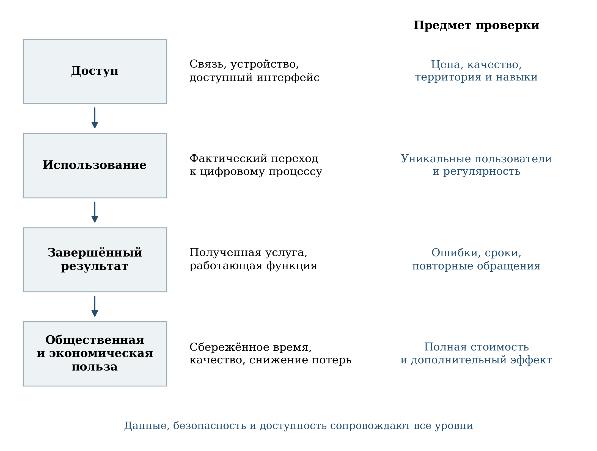

[B97; Caption] Рисунок 1 — Последовательность проверки цифровой трансформации

[B98; SourceNote] Авторская аналитическая схема. Каждый переход требует самостоятельного наблюдения; наличие инфраструктуры не удостоверяет конечный эффект.

[B99; ] Предполагаемый механизм эффекта рассматривается как проверяемая гипотеза. Если типовое решение уменьшает число повторных вводов информации, то ожидаемое снижение трудозатрат должно проявиться в сопоставимом процессе при сохранении качества. Если отечественное программное обеспечение замещает критическую функцию, то проверяются полнота операций, совместимость и сопровождение. Если система защиты предотвращает опасные операции, то вместе с зарегистрированными предотвращениями измеряются фактические потери и ошибочные ограничения добросовестных действий. Такой подход делает результат наблюдаемым для конкретного пользователя.

[B100; ] Экономическая оценка включает полную стоимость жизненного цикла. Расход на создание системы может сопровождаться последующими затратами на перенос данных, обучение, совместную эксплуатацию старого и нового решения, вычислительные мощности и поддержку. Выгода может распределяться между разными участниками: экономия ведомства иногда требует дополнительной работы гражданина или организации. В отчёте не подменяется оценка такой совокупной выгоды объёмом финансирования, количеством закупок либо числом внедрений.

[B101; ] Дополнительный эффект означает изменение, вызванное конкретным действием проекта по сравнению с обоснованной альтернативой. Общая положительная динамика может включать ранее начатые инвестиции, изменение спроса, развитие рынка и другие меры политики. Для выделения вклада нужны данные до и после вмешательства, сопоставимая контрольная ситуация и проверяемые предпосылки. В настоящем отчёте описательные расчёты не выдаются за причинную оценку; предлагаются конкретные схемы её последующей организации.

[B102; Heading1] 2 Архитектура проекта и механизмы передачи результата

[B103; Heading2] 2.1 Связанность девяти федеральных направлений

[B104; ] Архитектура проекта сочетает инфраструктурные, технологические, организационные и кадровые направления. Ц1 создаёт предпосылки связи; Ц2 и Ц4 обеспечивают платформенные процессы в социальной сфере и управлении; Ц3, Ц5 и Ц6 развивают технологические возможности; Ц7 поддерживает защищённость; Ц8 — компетенции; Ц9 — качество статистической информации. Их согласование определяет, превратится ли техническая возможность в устойчивую практику. Наличие всех направлений в структуре является необходимой организационной предпосылкой, но результат зависит от конкретных правил взаимодействия. [Сноски 10]

[B105; Caption] Таблица 2 — Архитектура проекта и механизмы передачи результата

[TABLE 2; B106]
Код и направление | Предполагаемый механизм | Ключевой предмет проверки
Ц1. Инфраструктура доступа к Интернету | Связь и спутниковая инфраструктура → техническая доступность | Цена, фактическая скорость, надёжность и подключение домохозяйств
Ц2. Цифровые платформы в отраслях социальной сферы | Единые сервисы и данные → завершённая отраслевая услуга | Качество процесса, совместимость, охват пользователей
Ц3. Искусственный интеллект | Разработка и внедрение → улучшение конкретной задачи | Внешняя проверка качества, затраты и устойчивость результата
Ц4. Цифровое государственное управление | Платформы и типовые системы → изменение административного процесса | Срок, завершённость и стоимость услуги для граждан и органов власти
Ц5. Отечественные решения | Разработка, внедрение и спрос → работающие критические функции | Полнота замещения, совместимость, сопровождение и конкуренция
Ц6. Прикладные исследования и перспективные разработки | Исследование → прототип → подтверждённое применение | Технические параметры, независимые испытания и последующий заказ
Ц7. Инфраструктура кибербезопасности | Защитные системы → устойчивость и уменьшение потерь | Фактический ущерб, время восстановления и ложные ограничения
Ц8. Кадры для цифровой трансформации | Образование → востребованные компетенции → занятость | Уровень навыков, трудоустройство, удержание и территориальная доступность
Ц9. Государственная статистика | Интеграция данных → качество и своевременность статистики | Полнота, точность, пересмотры и нагрузка на респондента

[B107; SourceNote] Коды используются на рисунках текстового анализа. Таблица представляет содержательную интерпретацию выбранной архитектуры. [Сноски 11]

[B108; ] Для оценки совместного действия полезна единица «завершённый процесс»: получение услуги гражданином, выполнение критической функции организацией, формирование проверенного статистического показателя. Один такой процесс может зависеть от связи, идентификации, обмена данными, платформы, отечественного программного обеспечения и действий сотрудника. Если каждый компонент отчитывается только о собственном вводе, ответственность за итоговую работоспособность остаётся размыта. Поэтому наряду с ответственными за отдельные системы требуется владелец полного процесса с правом согласовывать сроки и устранять межведомственные препятствия.

[B109; ] Обратная сторона связанности — риск двойного счёта. Например, создание платформы, подключение учреждения и обучение работника могут быть тремя самостоятельными мероприятиями, но не тремя независимыми эффектами одной и той же оказанной услуги. Финансовые затраты на общий компонент могут распределяться между пользователями по понятному правилу; конечный результат учитывается один раз с указанием участвующих направлений. Это сохраняет возможность оценивать вклад каждого действия без многократного суммирования общей пользы.

[B110; Heading2] 2.2 Связь и доступ домохозяйств

[B111; ] Федеральный проект Ц1 включает инфраструктуру широкополосного доступа и низкоорбитальную спутниковую группировку. В его результатах выделены наличие средств выведения, создание группировки и запуски аппаратов. Эти этапы образуют технологическую последовательность, однако число созданных или запущенных аппаратов отличается от числа функционирующих аппаратов, а последнее — от фактической доступности услуги для домохозяйства. Поэтому физические результаты должны сопоставляться с вводом в эксплуатацию и условиями обслуживания конечного пользователя. [Сноски 12]

[B112; ] Национальный ориентир по домохозяйствам относится к обеспеченной возможности качественного высокоскоростного широкополосного доступа. Для оценки социальной отдачи целесообразно раскрывать фактическое подключение, устойчивость связи, стоимость тарифа и оборудования, а также возможность использования востребованных услуг. В малых и удалённых населённых пунктах одинаковый формальный охват может сопровождаться разными затратами на обслуживание и разной надёжностью. Наблюдение этих условий позволяет объяснить, почему техническое расширение сети не всегда немедленно меняет поведение населения. [Сноски 13]

[B113; ] Приоритетность подключения следует оценивать совместно с характером потребности. Для школы важны одновременная работа пользователей и доступность учебных ресурсов; для государственного сервиса — надёжное завершение транзакции; для предприятия — непрерывность технологического процесса. Предлагается дополнять усреднённые характеристики связи набором проверок по типовым сценариям и времени высокой нагрузки. Это позволяет выявлять ограничения, которые скрываются за фактом наличия подключения.

[B114; Heading2] 2.3 Социальные платформы и государственные услуги

[B115; ] Ц2 и Ц4 ориентированы на цифровые платформы и изменение процессов. Их взаимодействие должно оцениваться по возможности получения услуги без многократного представления одних и тех же сведений и без разрывов между ведомственными этапами. При этом наличие платформы, подключение учреждения, размещение электронной формы и успешное завершение обращения представляют разные результаты. Объединение их в один показатель затрудняет установление места, где возникает задержка либо отказ. [Сноски 14]

[B116; ] Для массовых услуг наиболее содержательна последовательность от возникновения жизненной ситуации до получения результата. Число электронных заявлений измеряет использование канала. Доля доступных услуг измеряет предложение. Оценка удовлетворённости отражает опыт ответивших пользователей при установленном пороге включения услуги. Каждая величина полезна, но ни одна отдельно не охватывает весь процесс. Изменение перечня услуг, правил включения и состава отвечающих должно сопровождаться пояснением, иначе рост показателя может частично отражать изменение наблюдаемой совокупности.

[B117; ] Проактивность требует особенно точного определения результата. Автоматическое уведомление, предварительное заполнение заявления и предоставление услуги без отдельного заявления обладают разной ценностью. Предлагается показывать, какая часть процесса выполнена автоматически, какие действия остаются за гражданином и сколько ошибочных срабатываний требует исправления. Для жизненных ситуаций с существенными последствиями важны понятные основания решения и доступность исправления неверных сведений. Эти характеристики могут измеряться в рамках контроля качества процесса.

[B118; ] Кадровая платформа органов власти также должна оцениваться по использованию и качеству процедур. Подключение учреждения создаёт возможность работы, но не подтверждает регулярного применения, полноты кадровых данных или улучшения подбора. В качестве дополнительных наблюдений предлагаются время закрытия вакансии, сохранение сотрудника по истечении испытательного периода и результаты независимой оценки профессиональных заданий. Сопоставление проводится внутри сравнимых должностей и территорий, чтобы различия условий найма не выдавались за эффект платформы.

[B119; Heading2] 2.4 Отечественные решения и перспективные разработки

[B120; ] Ц5 сочетает поддержку разработки и внедрения российских решений, первое масштабное применение и развитие технологического предложения. Ц6 охватывает перспективные разработки, в том числе квантовые и телекоммуникационные направления. Между ними существует потенциальная последовательность от исследования до устойчивого спроса, но сроки и критерии результата различаются. Для исследования приемлемым этапом может быть подтверждённый прототип, для внедрения — работающая производственная функция, для тиражирования — повторные оплаченные поставки независимым заказчикам. [Сноски 15]

[B121; ] Функциональное замещение следует проверять по критическим операциям. Формальное наличие отечественного продукта в составе установленного программного обеспечения не показывает, какие задачи остаются в прежней среде, где сохраняются ручные обходные процедуры и насколько совместимы данные. Предлагается составлять перечень критических функций с подтверждением их выполнения на новой платформе, оценкой отказоустойчивости и планом сопровождения. Это позволяет отличить закупку от завершённой миграции и избежать завышения результата при длительной параллельной эксплуатации.

[B122; ] Поддержка спроса должна учитывать возможность конкуренции и последующей смены поставщика. Экономия на первоначальной закупке может сопровождаться высокими расходами на интеграцию и перенос данных в будущем. Поэтому полная стоимость включает совместимость, документацию, доступность квалифицированной поддержки и условия выхода из решения. Оценка этих характеристик не требует предпочтения конкретному поставщику: она задаёт сопоставимые требования к устойчивости государственных и производственных процессов.

[B123; ] Для перспективных разработок предлагается фиксировать проверяемые технические параметры до начала финансируемого этапа. Достижение параметров подтверждается испытаниями, а переход к следующему этапу — наличием конкретной задачи применения. Число разработок и объём инвестиций показывают масштаб активности, но экономический смысл зависит от пригодности результата. Отсутствие немедленной выручки у исследовательского проекта не равнозначно неудаче; одновременно длительный исследовательский горизонт не отменяет необходимости промежуточных критериев качества и решений о продолжении работ.

[B124; Heading2] 2.5 Искусственный интеллект и безопасность

[B125; ] Ц3 связывает развитие искусственного интеллекта с исследованиями, компетенциями и внедрением. Для содержательной оценки необходимо определить конкретную задачу, которую решает система, исходное качество процесса и стоимость достижения результата. Единое число внедрений не позволяет сопоставить помощник при подготовке документа, классификацию обращения и модель, влияющую на существенное для гражданина решение. Поэтому оценка должна строиться вокруг функции, а не вокруг самого факта применения технологии. [Сноски 16]

[B126; ] Предлагается проверять качество на данных, не использованных при настройке системы, и повторять измерение после изменения условий работы. Вместе с точностью учитываются ошибки по различным группам случаев, трудозатраты на проверку человеком и стоимость исправления. Для государственных услуг дополнительным критерием является возможность понять основание результата и исправить ошибочные сведения. Такая организация оценки позволяет установить, действительно ли применение искусственного интеллекта улучшает процесс при полной совокупности затрат.

[B127; ] Ц7 обеспечивает инфраструктуру кибербезопасности и противодействия правонарушениям с использованием информационных технологий. Пропускная способность защитной системы, объём обрабатываемого трафика и число предотвращённых операций характеризуют разные стороны её работы. Их рост может сопровождаться изменением нагрузки и состава угроз. Экспертная оценка должна связывать технические мощности с подтверждёнными потерями, временем восстановления и устойчивостью востребованных сервисов. [Сноски 17]

[B128; ] Защита имеет также пользовательскую сторону. Ограничение подозрительной операции может предотвратить потерю, но ошибочное ограничение создаёт издержки добросовестному пользователю. Поэтому предлагается парное наблюдение результативности защиты и доли ложных ограничений, времени их разрешения и повторных обращений. Это не уменьшает значимости безопасности, а позволяет оценить качество конкретного механизма и выбрать условия его применения.

[B129; Heading2] 2.6 Кадры и государственная статистика

[B130; ] Ц8 формирует кадровые предпосылки цифровой трансформации. Важны не только объём обучения и число участников, но и соответствие компетенций задачам организаций, возможность применения навыков и их сохранение. Для программ разной сложности необходимы разные критерии: базовая цифровая грамотность, профессиональная разработка и исследовательская работа не могут оцениваться одинаковым итоговым тестом. Состав участников и условия входа влияют на результат и должны учитываться при сравнении программ. [Сноски 18]

[B131; ] Территориальная оценка кадрового направления требует различать место обучения, место работы и место проживания. Подготовка специалиста в одном регионе может давать экономический результат в другом; дистанционная работа дополнительно усложняет связь. Поэтому предлагается сопровождать выпускные когорты наблюдением занятости по профилю и мобильности через 12 и 24 месяца. Это позволяет оценивать вклад образования в региональную экономику без автоматического приписывания эффекта месту расположения образовательной организации.

[B132; ] Ц9 имеет особое значение для всего проекта, поскольку качество данных влияет на качество управления. Интеграция административных источников и развитие статистической инфраструктуры могут повышать своевременность и снижать нагрузку на респондентов. Вместе с тем изменение источника требует проверки полноты охвата, сопоставимости определений и истории пересмотров. Сокращение числа запросов к организациям само по себе не доказывает сохранения качества итоговой статистики. [Сноски 19]

[B133; ] Для этого направления предлагается раскрывать полноту охвата, задержку публикации, пересмотры и трудозатраты респондента. При интеграции административных данных проверяется отличие цели регистрации от статистического определения объекта, особенно для редких групп и малых территорий. Качество статистики должно контролироваться столь же последовательно, как скорость её производства.

[B134; Heading1] 3 Методики расчёта и архитектура показателей

[B135; Heading2] 3.1 Границы системы измерения и актуальность методик

[B136; ] Система показателей национального проекта «Экономика данных и цифровая трансформация государства» объединяет разные объекты наблюдения: инфраструктуру, использование программного обеспечения, доступность услуг, образовательные результаты, денежные оценки рынков и административные процессы. Поэтому единая оценка исполнения требует предварительно установить, что именно является единицей счёта, к какому периоду относится значение и какие изменения методики произошли между наблюдениями. В исследуемом статистическом реестре выделено 49 кодов: 12 показателей национального проекта и 37 показателей девяти федеральных проектов. По 48 кодам имеются числовые наблюдения; по показателю количества типовых систем, внедрённых не менее чем в половине субъектов Федерации, отмечена временная недоступность. Наличие числа само по себе ещё не подтверждает наличие окончательного годового результата. [Сноски 20]

[B137; ] Базовым документом служит приказ Минцифры России от 29 ноября 2024 г. № 995. Он неоднократно изменялся: существенные редакции затронули переход на российское ПО, цифровую зрелость, рынок данных, искусственный интеллект и кибербезопасность. Доступный консолидированный текст в правовой базе учитывает изменения по 24 июня 2026 г. Однако официальный указатель Росстата дополнительно содержит приказ от 6 октября 2026 г. № 931 применительно к ряду показателей электронных услуг. Следовательно, дата актуальности правовой базы и дата последнего изменения конкретной методики должны проверяться раздельно. Полное содержание октябрьской поправки в исследовании не восстановлено; июньская редакция не выдаётся за окончательный текст на 28 октября. [Сноски 21]

[B138; ] Вторичное представление паспорта версии 26.64 от 16 октября 2026 г. используется для описания проектной архитектуры и целевых значений. Оно не удостоверяет юридически утверждённую редакцию паспорта. Для нормативных определений приоритет отдан опубликованным методикам ведомств, а для фактических значений — статистическим рядам с указанием периода и источника. Изменение названия показателя, появление его новой версии или отсутствие ряда не считаются доказательствами создания нового федерального проекта. [Сноски 22]

[B139; ] Общая проблема интерпретации состоит в смешении частоты публикации с периодом измерения. Ежемесячная публикация может содержать состояние на конец месяца, итог с начала года, сумму за предыдущие двенадцать месяцев либо повтор последнего годового наблюдения. Ряд методик разрешает использовать компоненты прошлого периода при отсутствии новых данных. Поэтому плато может означать стабильность, перенос старого значения или задержку поступления информации; эти ситуации необходимо различать в метаданных, а не определять по форме линии графика. [Сноски 23]

[B140; ] Отдельного контроля требует единица счёта при тиражировании информационных систем. Количество видов типовых систем, внедрённых не менее чем в половине субъектов Федерации, и количество внедрений этих систем в регионах отвечают на разные вопросы. Один вид может дать много внедрений; множество внедрений может концентрироваться в небольшом числе регионов. Поэтому доступный ряд внедрений нельзя автоматически использовать вместо временно отсутствующего ряда видов систем. Приказ от 24 июня 2026 г. № 572 обозначен в официальном указателе как методика соответствующего прокси-показателя. Его использование требует явной маркировки замещения, отдельного целевого значения и раскрытия распределения внедрений по территориям. [Сноски 24]

[B141; Heading2] 3.2 Цифровая зрелость: вклад проекта и структура составного индекса

[B142; ] После приказа от 29 декабря 2025 г. № 1269 показатель цифровой зрелости национального проекта отражает его вклад в более широкую национальную цель. Формула складывает компоненты государственного управления и социальной сферы и умножает результат на одну треть. Такое нормирование связано с тремя группами вышестоящего показателя: государственным управлением, социальной сферой и ключевыми отраслями экономики. Последняя группа непосредственно в данном показателе национального проекта не учитывается. Подмена проектного индекса общей цифровой зрелостью страны методологически неверна. [Сноски 25]

[B143; ] (1)

[Формула] ЦЗНП = (ЦЗгос + ЦЗсоц)/3

$$
\mathrm{ЦЗ}_{\mathrm{НП}}=\frac{\mathrm{ЦЗ}_{\mathrm{гос}}+\mathrm{ЦЗ}_{\mathrm{соц}}}{3}
$$

[B144; ] Здесь ЦЗНП — показатель национального проекта; ЦЗгос и ЦЗсоц — учитываемые компоненты государственного управления и социальной сферы соответственно.

[B145; ] Компонент государственного управления представляет собой среднее выполнения отдельных индикаторов относительно целевых значений 2030 года. Перевыполнение отдельного целевого значения ограничивается уровнем 100%. Социальный компонент рассчитывается по четырём отраслям через отношение фактической доли организаций, использующих соответствующие платформы, к целевой доле 2030 года. Каждое отношение ограничивается единицей, а итоговое среднее умножается на 40%. При выполнении всех учитываемых целей вычисляемый предел проектного показателя составляет около 46,67%, поскольку сумма 100 и 40 делится на три. Это аналитический вывод из формулы, а не самостоятельно установленный норматив достижения. Формальное указание в общих положениях на неограниченный рост не согласуется с ограничениями алгоритма и требует уточнения разработчиком. [Сноски 26]

[B146; ] Перечень социальных отраслей в этой методике конкретен: общее образование, образование и наука, городская среда и ЖКХ, физическая культура и спорт. Учитываются платформы «Моя школа», «Университеты», «Наука», «Умный город», «Безопасная среда» и «Мой спорт». Наличие здравоохранения в формулировке национальной цели не позволяет включать его в указанную расчётную совокупность. Нельзя также механически продолжать этим рядом прежние оценки цифровой зрелости регионов, построенные по другой методике. [Сноски 27]

[B147; ] Индекс полезен для контроля продвижения к утверждённым ориентирам, но его рост может происходить через расширение использования платформ при неизменном качестве конкретной услуги. Для содержательной оценки следует одновременно публиковать исходные отраслевые доли, целевые знаменатели и фактические признаки использования. Особого контроля требуют организации, зарегистрированные на платформе, но редко выполняющие через неё профильные операции. Предлагается показывать интенсивность использования, долю завершённых операций и сокращение повторного ввода сведений. Сам индекс при этом сохраняется: дополнительные показатели объясняют его изменение и не подменяют утверждённую формулу.

[B148; ] Для управления составным индексом нужна также проверка чувствительности. Следует показывать, насколько итог изменился бы при неизменном составе организаций, при использовании предыдущих целевых значений и при исключении компонентов, сведения по которым перенесены из прошлого периода. Такой расчёт не является альтернативной официальной оценкой: он выявляет вклад изменения измерительной конструкции. Если основной прирост обеспечен пересмотром знаменателя, вывод относится к статистическому охвату; если выросло использование у сопоставимой группы организаций, появляется основание обсуждать распространение практики. Для проверки качества последнего всё равно нужны данные о реально завершённых операциях и нагрузке на сотрудников.

[B149; Heading2] 3.3 Доступ к Интернету и различие между возможностью и использованием

[B150; ] Показатель доступности высокоскоростного широкополосного Интернета оценивает домохозяйства, имеющие возможность доступа, относительно общего количества домохозяйств по последней переписи населения. Существенно, что возможность определяется через покрытие территории населённого пункта сетями UMTS или LTE; при выполнении этого условия учитываются все расположенные в нём домохозяйства. Таким образом, измеряется инфраструктурная предпосылка, а не число действующих подписок, подключённых квартир или пользователей с подтверждённой скоростью соединения. [Сноски 28]

[B151; ] У такого подхода есть практическое достоинство: он позволяет систематически оценивать территориальный охват без индивидуального обследования каждого адреса. Однако применение единого признака ко всему населённому пункту чувствительно к неоднородности покрытия. Возможность связи на открытой территории не тождественна устойчивому сигналу внутри здания, а наличие сети не отражает доступность тарифа для конкретной семьи. Переписной знаменатель также требует согласования с изменением числа домохозяйств и территориальных границ; иначе новая застройка может отражаться в инфраструктурных данных раньше, чем в демографической базе.

[B152; ] Предлагается дополнять официальный показатель адресной выборочной проверкой: измерять скорость и задержку в часы нагрузки, долю времени доступности, внутридомовое покрытие и стоимость минимально достаточного подключения относительно дохода. Для малых населённых пунктов следует отдельно показывать фактических абонентов и домохозяйства, имеющие возможность подключения. Тогда увеличение технического охвата можно сопоставить с реальным использованием и определить, какая проблема остаётся после строительства инфраструктуры: качество сети, цена, оборудование или цифровые навыки. Эти измерения должны использовать сопоставимую выборку адресов и опубликованный протокол тестирования.

[B153; Heading2] 3.4 Государственные услуги: доступность, обращения и удовлетворённость

[B154; ] Показатели электронного государства описывают несколько последовательных стадий. Доля электронно доступных массовых социально значимых услуг относится к видам услуг из утверждённых перечней. Доля обращений через ЕПГУ и региональные порталы относится к операциям. Удовлетворённость рассчитывается по видам услуг, прошедшим определённый порог оценок. Их нельзя объединять в одно утверждение о доле граждан, полностью обслуживаемых государством онлайн. Наличие электронной формы также следует отличать от проактивного предоставления и исполнения непосредственно в момент обращения. [Сноски 29]

[B155; ] В проверенной редакции показатель электронных обращений имеет числитель и знаменатель, накопленные с начала года. В числителе находятся обращения через порталы, в знаменателе — обращения во всех формах, включая личное посещение и МФЦ. При этом обе компоненты ограничены услугами, которые уже соответствовали критерию электронной доступности на первое число отчётного месяца и были тиражированы, когда это необходимо. Это доля электронного канала среди обращений по отобранным доступным услугам, а не доля всех возможных взаимодействий населения с государством. Декабрь охватывает полный календарный год по смыслу накопления; промежуточные месяцы нельзя усреднять как независимые месячные доли. [Сноски 30]

[B156; ] Национальная и региональная методики электронных обращений в проверенном тексте ссылаются на перечень, включающий федеральные и региональные услуги. Поэтому обнаруженное расхождение федерального значения с диапазоном региональных наблюдений нельзя автоматически объяснять только различием перечней. Требуется сверить состав услуг, полноту передачи сведений по каналам и территориальную привязку обращений. Простое среднее региональных долей также не воспроизводит федеральный показатель: для этого необходимы их числители и знаменатели. Октябрьские изменения № 931 требуют отдельной сверки перед продолжением ряда. [Сноски 31]

[B157; ] Показатель удовлетворённости особенно чувствителен к единице счёта. В национальном расчёте учитывается доля видов услуг, средняя оценка которых за отчётный месяц превышает 4,5. Условием включения служит наличие более 200 ненулевых оценок за последние двенадцать месяцев. В региональной методике порог существенно ниже — более одной оценки. Следовательно, высокий региональный результат не означает, что соответствующая доля всех заявителей удовлетворена обслуживанием. Он описывает распределение оценённых видов услуг и зависит от их состава, количества оценок и активности пользователей. [Сноски 32]

[B158; ] Несмотря на формулировку о накоплении в общих положениях, алгоритм удовлетворённости использует месячную среднюю оценку и скользящий двенадцатимесячный критерий допуска. Специальное правило приравнивания декабрьского значения к среднегодовой удовлетворённости в проверенном тексте отсутствует. Корректное обозначение — декабрьское наблюдение. Для оценки качества следует раскрывать количество оценок и обращений по каждому виду услуги, долю завершивших обслуживание пользователей, оставивших отзыв, а также отдельно рассчитывать среднее, взвешенное по обращениям. Нужны сведения об отказах, повторных обращениях и необходимости личного визита. Они позволяют увидеть проблемы сложных услуг, которые теряются при равном весе каждого вида.

[B159; Heading2] 3.5 Отечественное программное обеспечение и инвестиции

[B160; ] Название показателя перехода организаций ключевых отраслей на российское ПО может создавать впечатление бинарного учёта предприятий, полностью завершивших миграцию. Алгоритм устроен иначе. По классам программного обеспечения учитываются организации, у которых российские решения преобладают, а также с весом 0,5 организации, которые используют их без преобладания. Затем выполняется агрегирование с учётом распространённости классов. Одна организация может участвовать в нескольких классах, поэтому результат нельзя трактовать как долю уникальных предприятий, полностью отказавшихся от зарубежного ПО. [Сноски 33]

[B161; ] Первичным источником является годовая форма № 3-информ; используемая совокупность исключает субъекты малого предпринимательства. Информация размещается в следующем году, а для ежемесячного расчёта берётся наиболее актуальный доступный годовой массив. Повторение значения в нескольких месяцах в такой конструкции ожидаемо. Сопоставление с опросами малых компаний или ежемесячной выручкой поставщиков без согласования совокупностей недопустимо. Для оценки технологической самостоятельности предлагается дополнительно публиковать переходы организаций между состояниями «не используют», «используют» и «преобладает» по фиксированным классам ПО. [Сноски 34]

[B162; ] Региональный показатель использования российского ПО государственными органами и подведомственными организациями также является составным. Половина веса относится к информационным системам, половина — к типовым рабочим местам. Для рабочего места сочетание российской системной и офисной среды получает вес 1; только системная среда — 0,8; только офисная — 0,2; отсутствие обеих — 0. Это не доля закупочных расходов, лицензий или органов власти, полностью завершивших переход. Показатель рассчитывается на момент времени; методика прямо приравнивает декабрьское значение годовому. [Сноски 35]

[B163; ] Изменение регионального ряда летом 2025 г. требует сверки состава отчитывающихся организаций и компонентов. Само наличие майского приказа № 486 не доказывает, что именно он вызвал конкретный последующий скачок. Корректная процедура состоит в параллельном пересчёте одного периода по прежней и новой формуле и в раскрытии числа систем и рабочих мест. Дополнительно нужны показатели совместимости, бесперебойности и стоимости сопровождения критических процессов. Они показывают эксплуатационный результат миграции, который процент использования сам по себе не раскрывает.

[B164; ] Инвестиционные показатели также содержат расчётные особенности. Приобретение отечественных ИТ-решений оценивается через реализацию собственных решений ИТ-отрасли; национальный темп роста использует двенадцатимесячное окно и базу 2024 года. Последний месяц при задержке исходных данных оценивается по установленному алгоритму. Компонент перспективных квантовых и телекоммуникационных разработок имеет нулевую базу 2024 года вследствие начала соответствующих мероприятий с января 2025 года. Поэтому полученный темп характеризует конкретный статистический агрегат, а не непосредственно физический объём закупленного оборудования или весь объём капитальных вложений экономики. [Сноски 36]

[B165; Heading2] 3.6 Искусственный интеллект и рынок данных

[B166; ] Индекс зрелости рынка данных объединяет денежный объём соответствующего рынка, число доступных бизнесу видов государственных данных и долю официальных данных, предоставляемых автоматически в машиночитаемом виде. Эти составляющие отражают разные стороны развития: коммерческий оборот, расширение предложения данных и технологию распространения статистики. Сведение их к одному числу удобно для мониторинга, но допускает компенсацию слабого результата одного направления сильным результатом другого. Публикация компонентного профиля необходима для понимания причины изменения индекса. [Сноски 37]

[B167; ] Денежный компонент формируется по перечню компаний — разработчиков ИИ. Для общей системы налогообложения используются квартальные данные о реализации собственной продукции за четыре предшествующих квартала, для упрощённой системы — сведения последнего доступного годового периода. Таким образом, даже одно опубликованное месячное значение может сочетать неодинаковые временные окна. Кроме того, изменение перечня компаний влияет на сумму независимо от роста действующих участников. Следует раскрывать вклад новых включений, исключений и сопоставимой группы компаний, а также проверять соответствие учитываемой выручки целевым продуктам и сервисам. [Сноски 38]

[B168; ] Показатель затрат на внедрение и использование ИИ включает оборудование, программное обеспечение и оплату труда специалистов со страховыми взносами. В редакции декабря 2025 г. расчёт использует четыре предшествующих квартала для оборудования и ПО, двенадцать месяцев для труда, а также поправку на малые организации. Часть оперативных компонентов оценивается из доступной статистики. Его нельзя читать как сумму расходов только за указанный месяц или как полностью наблюдённый итог с начала года. Для аналитики необходимы пометки о расчётных оценках, датах последующей замены исходных данных и доле каждого компонента. [Сноски 39]

[B169; ] Готовность отраслей к внедрению ИИ измеряется индексом из 21 индикатора. Нормирование связано с базовыми значениями 2025 года, веса определены методикой, а один из компонентов отражает экспертную оценку регулирующей политики. Итоговая доля относится к отраслям, превысившим установленный порог готовности, а не к организациям, реально использующим ИИ. Рекомендуется публиковать расстояние каждой отрасли до порога: небольшой сдвиг около границы способен изменить долю высокоготовых отраслей, хотя среднее состояние всей совокупности изменилось мало. [Сноски 40]

[B170; ] Публикации, выпускники, вычислительные мощности и доступные наборы данных образуют разные условия развития ИИ. Их увеличение не следует объединять в показатель коммерческой результативности. Для проектов внедрения предлагается измерять долю решений, перешедших из пилота в регулярное использование, качество на независимой проверочной выборке, частоту ошибок и стоимость достижения заданного результата. Для вычислительной инфраструктуры следует учитывать доступность для внешних пользователей и фактическую загрузку; для данных — регулярность обновления и число устойчивых сценариев использования. Проверенные методики уже предъявляют требования к уникальности видов данных и автоматизированному доступу; рекомендации должны развивать эти требования, а не изображать их отсутствующими. [Сноски 41]

[B171; Heading2] 3.7 Доверие и кибербезопасность

[B172; ] Показатель предотвращённых мошеннических действий имеет принципиально важную особенность: его знаменателем служит число предотвращённых попыток перевода денежных средств без добровольного согласия клиента за весь 2024 год. Числитель — такие же предотвращённые попытки с начала отчётного года. Это индекс к базовому году, хотя в наименовании используется слово «доля». [Сноски 42]

[B173; ] (2)

[Формула] Iₜ = (Kₜ/K₂₀₂₄) × 100%

$$
I_t=\frac{K_t}{K_{2024}}\times100\%
$$

[B174; ] Здесь I_t — значение показателя в процентах; K_t — число предотвращённых попыток с начала отчётного года по конец периода t; K_2024 — число предотвращённых попыток за 2024 год. Значение выше 100% допустимо. Применение автоматического фильтра от 0 до 100 исключило бы корректные по диапазону наблюдения и могло бы сформировать ложное представление об отсутствии новых данных. Декабрьское значение охватывает весь год, поскольку числитель накоплен с начала года. Сам числовой размер базы методика не фиксирует: для воспроизведения нужны исходные данные Банка России и их версия. [Сноски 43]

[B175; ] Рост индекса означает увеличение количества предотвращённых попыток относительно базы. Он может сочетать увеличение активности злоумышленников, улучшение выявления и расширение охвата антифрод-систем. Его нельзя непосредственно переводить ни в рост преступности, ни в долю всех атак, успешно остановленных банками. Содержательное дополнение — фактические потери клиентов, доля возвращённых средств, число пострадавших и частота ошибочных блокировок. При расхождении индекса с отношением опубликованных годовых чисел следует сохранять расхождение до согласования версий, а не исправлять ряд подбором удобного знаменателя.

[B176; ] Среднее время блокировки фишинговых ресурсов также требует чтения алгоритма. Расчёт включает отобранные завершённые случаи и исключает один процент наблюдений с наибольшими временами как выбросы. Это делает среднее устойчивее, но не показывает наиболее длительные случаи и незавершённые обращения. Для управления качеством реагирования предлагается дополнительно публиковать медиану, 95-й и 99-й процентили, число открытых заявок и возраст самой старой незавершённой заявки. Нельзя требовать включить уже предусмотренное время обработки организацией-монитором повторно: рекомендация касается полноты распределения и очереди, а не дублирования компонента. [Сноски 44]

[B177; ] Доля трафика, обрабатываемого АСБИ, мощность обработки и доля протестированных критически важных государственных систем отражают охват и организационную готовность. Они не являются прямой вероятностью предотвращения атаки. Изменения методики трафика приказом от 26 мая 2026 г. № 469 требуют проверки однородности ряда. Дополнительная оценка должна связывать тестирование с устранением выявленных уязвимостей, повторной проверкой и восстановлением после инцидента. Публикация агрегированных сроков устранения и результатов повторных испытаний возможна без раскрытия конкретных уязвимостей защищаемых систем. [Сноски 45]

[B178; Heading2] 3.8 Кадровые показатели: обучение и последующее применение навыков

[B179; ] Кадровые индикаторы фиксируют формально определённые образовательные результаты. Для школьников и студентов СПО учитывается успешное завершение поддерживаемых дополнительных программ; методика определяет минимальную трудоёмкость программы в 144 академических часа. Расчёт включает базовый результат на конец 2024 года и накопление с января 2025 года. Поэтому опубликованное количество нельзя называть числом обученных исключительно в текущем году. Необходимо также различать сертификат отдельного модуля и сертификат освоения всей программы, используемый в определении показателя. [Сноски 46]

[B180; ] Доля выпускников вузов по программам, разработанным или обновлённым при участии ИТ-отрасли, имеет годовую природу. Её знаменателем выступают выпускники бакалавриата и специалитета в сфере ИТ, а не все обучающиеся и не весь кадровый состав отрасли. Для оценки кадрового эффекта целесообразно прослеживать выпускные когорты через шесть и двенадцать месяцев: продолжение обучения, профильную занятость, применение изученных технологий и результаты независимой проверки навыков. Сопоставление должно учитывать исходную подготовку учащихся; иначе преимущества более сильных участников будут ошибочно приписаны исключительно программе. [Сноски 47]

[B181; Heading2] 3.9 Государственная статистика: автоматизация, качество и нагрузка

[B182; ] Показатель машиночитаемого предоставления данных по приказу Росстата от 4 апреля 2025 г. № 169 основан на количестве показателей. Учитываются статистические показатели и показатели национальных целей, проектов и программ с правилами исключения дублирования. Под машиночитаемым предоставлением понимаются данные вместе с метаданными. Следовательно, это не доля байтов, первичных записей или уникальных пользователей. Слабость оценки только через число доступных показателей состоит в одинаковом счётном весе наборов с разной востребованностью и периодичностью. [Сноски 48]

[B183; ] Дополнительная проверка должна охватывать соблюдение сроков публикации, полноту метаданных, стабильность схем, возможность выгрузить предыдущую редакцию и воспроизвести официальный расчёт. Для наиболее используемых рядов нужны автоматические проверки доступности и сопоставления API с визуальным представлением. Именно такие проверки обнаруживают случаи, когда формально доступный набор содержит технические нули, устаревшие значения либо неопубликованную причину пересмотра. Это развитие уже предусмотренного требования к автоматизированному предоставлению, а не создание параллельной витрины ради дополнительного числа подключений.

[B184; ] Методика качества существенно изменена приказом Росстата от 29 января 2026 г. № 38 в связи с введением ГОСТ Р 72297-2025. Новая редакция действует с 1 февраля и применяется начиная с отчётного января 2026 года. Числитель — опубликованные с начала года показатели с паспортами, удовлетворяющими установленному порогу качества; знаменатель — всё количество показателей, запланированных к публикации в информационной системе в отчётном году. При повторной публикации используется последняя версия паспорта. Поэтому индикатор одновременно отражает качество и выполнение годового графика публикации. [Сноски 49]

[B185; ] Январское значение такого показателя закономерно нельзя сравнивать с декабрьским как чистую оценку ухудшения качества данных. Для аналитики необходимы два дополнительных отношения: доля отвечающих стандарту среди уже опубликованных показателей и доля опубликованных от годового плана. Их произведение объясняет структуру основного результата. Сравнение 2025 и 2026 годов требует отдельного указания смены стандарта и методики; пересчёт сопоставимого периода полезнее, чем построение непрерывной линии без отметки структурного разрыва.

[B186; ] Снижение отчётной нагрузки по приказу Росстата от 18 февраля 2025 г. № 67 оценивается относительно 2024 года через количество представлений форм и число полей в них. Этот подход фиксирует уменьшение объёма отчётных элементов, но непосредственно не измеряет рабочие часы респондента. Автоматически заполненное поле и поле, требующее сложного согласования, имеют разную трудоёмкость. Поэтому рекомендуется дополнить индекс повторным обследованием затрат времени на сопоставимых типах организаций, разделив первоначальную настройку обмена данными, регулярное заполнение и исправление ошибок. Уменьшение форм при росте затрат на уточнения иначе останется незаметным. [Сноски 50]

[B187; Heading2] 3.10 Приоритеты повышения проверяемости

[B188; ] Первое необходимое изменение — публикация версионного паспорта каждого ряда: формула, совокупность, знаменатель, период накопления, дата исходных данных, разрешённый перенос прошлых значений и применённая редакция методики. Для переходов между редакциями следует давать параллельный расчёт хотя бы одного общего периода. Особо актуальны октябрьская поправка № 931, новая конструкция цифровой зрелости и изменение методики качества статистических показателей. Наличие поправки не устанавливает само по себе, с какого наблюдения она фактически применена: эту дату обязан раскрывать поставщик ряда.

[B189; ] Второе изменение — типизированные проверки данных. Доли с естественной границей 100%, индексы к базовому году, накопленные количества и моментные состояния требуют разных правил. Для Ц.11 верхняя граница 100% недопустима. Числовой ноль, отсутствие публикации, технический заполнитель и повтор прошлого значения должны иметь разные статусы. Исправление фильтра необходимо сопровождать повторной проверкой всех производных таблиц и графиков, поскольку ошибочно отброшенное наблюдение меняет дату последнего доступного результата.

[B190; ] Практически такая проверка должна формировать протокол исключений, содержащий исходное значение, применённое правило и основание решения. Нельзя незаметно заменять подозрительное значение пропуском, предыдущим числом или самостоятельно рассчитанным аналогом. Для спорных наблюдений целесообразно сохранять две доступные версии: опубликованную и аналитически очищенную, с перечнем различий. Поставщику данных необходимо направлять запрос на пояснение конкретной компоненты или периода. Исправление должно становиться новой версией ряда с датой и причиной, чтобы пользователь мог воспроизвести вывод, сделанный до пересмотра.

[B191; ] Третье изменение — разделение планового достижения, работы механизма и общественного результата. План показывает нормативное обязательство; факт — наблюдение по конкретной методике; механизм — связь мероприятия с промежуточным изменением; причинный эффект требует самостоятельного дизайна оценки. Для доступности Интернета общественный результат раскрывают качество и использование, для электронных услуг — завершённое обслуживание и нагрузка заявителя, для ПО — устойчивость процессов, для ИИ — подтверждённый результат внедрения. Такой подход сохраняет управленческую роль официальных индикаторов и одновременно делает выводы о результативности проекта проверяемыми.

[B192; Heading1] 4 Статистические результаты, региональные различия и цифровое неравенство

[B193; Heading2] 4.1 Наблюдаемая база и границы оценки результатов

[B194; ] К 28 октября 2026 года статистика проекта позволяет описать распространение электронных услуг, состояние технологической инфраструктуры и отдельные изменения в использовании отечественных решений. Она значительно слабее характеризует конечную экономию времени граждан, устойчивость работы сервисов, распределение выгод между социальными группами и вклад проекта в производительность. Поэтому результативность следует рассматривать последовательно: наличие технологии, фактическое использование, качество полученного результата и его общественная ценность. Высокое значение первого показателя не удостоверяет достижение последующих результатов. Это различие особенно существенно для проекта, одновременно включающего инфраструктуру связи, государственные платформы, программное обеспечение, искусственный интеллект и подготовку кадров.

[B195; ] В статистическом перечне представлены 49 кодов показателей, из которых 48 имеют числовые публикации. Для показателя 2.14.Ц4.6 числовая серия отсутствует. В опубликованных таблицах учтено 12 159 записей, включая федеральный, региональный и иные территориальные уровни; все строки маркированы как месячные. Это количество записей, а не число независимых наблюдений: одно значение может повторяться, отражать состояние на дату, нарастающий итог либо перенос ранее доступной компоненты. Региональный разрез существует только у семи показателей. Такая конфигурация достаточна для описательной диагностики, но не для измерения единого регионального эффекта всего национального проекта. [Сноски 51]

[B196; ] Большинство общероссийских рядов охватывает январь 2025 — сентябрь 2026 года; часть технологических и инвестиционных рядов заканчивается августом 2026 года. Двадцать одна месячная колонка не равнозначна двадцати одному самостоятельному измерению годового процесса. Например, доля домохозяйств с технической возможностью широкополосного доступа принимает за весь интервал только два различных значения; ряд перехода организаций ключевых отраслей на российское ПО — три. В этих условиях автоматическая оценка месячного тренда способна преувеличить объём информации, а экстраполяция до 2030 года — замаскировать отсутствие достаточной предыстории. В настоящей оценке прогнозные продолжения не используются как доказательства достижимости целей. [Сноски 52]

[B197; ] Для 2025 года разграничены годовой показатель, прямо определяемый методикой через декабрь, и просто опубликованная декабрьская величина. Последняя может содержательно соответствовать моментному результату, но сама по себе не удостоверяет годовой итог. Цели взяты из выбранной редакции паспорта, опубликованной 16 октября 2026 года. Сопоставление с ней отвечает на вопрос о соответствии факта этой редакции; оно не восстанавливает первоначальные обязательства, действовавшие в начале 2025 года. Общий процент выполнения проекта не рассчитывается: он смешал бы разные единицы, уровни доказательности и версии целей. [Сноски 53]

[B198; Heading2] 4.2 Результаты 2025 года и оперативные публикации 2026 года

[B199; ] По технической возможности широкополосного подключения декабрьское значение 2025 года составляет 93,7% при ориентире 93,7%; в сентябре 2026 года опубликовано то же значение. Равенство не следует переводить в утверждение о подключении 93,7% домохозяйств к платной услуге или о соблюдении требуемой скорости в каждом жилище. В методике учитывается возможность доступа, причём покрытие территории поселения мобильной связью определённых стандартов позволяет отнести к обеспеченным все его домохозяйства. Для оценки пользовательского результата необходимы дополнительные наблюдения фактического подключения, скорости, стабильности и стоимости. [Сноски 54]

[B200; ] Декабрьская цифровая зрелость государственного управления и социальной сферы равна 22,59% при ориентире 20%, то есть разность составляет 2,59 процентного пункта. Индекс зрелости рынка данных — 23,7% против 14,4%, разность 9,3 пункта индекса. В сентябре 2026 года опубликованы соответственно 25,55 и 30,1%. Эти величины отражают движение предусмотренных методикой компонент. Их нельзя читать как долю всей экономики, уже ставшей цифровой, или как оценку прироста благосостояния. Для содержательной интерпретации агрегата требуется показать, какие именно процессы, транзакции и организации изменились. [Сноски 55]

[B201; ] Число массовых социально значимых услуг, оказываемых проактивно либо с результатом в момент обращения, в декабре 2025 года равно 14 и совпадает с ориентиром; к сентябрю 2026 года оно увеличивается до 20. Доля органов власти, подключённых к кадровой платформе, составляет 5,94% в декабре при цели 1%, затем 6,54% в сентябре. Для кадрового показателя декабрь прямо используется как годовое значение. Однако подключение органа власти не тождественно регулярному использованию платформы всеми его работниками, а наличие двадцати проактивных услуг не характеризует охват граждан без информации об их востребованности. [Сноски 56]

[B202; ] По электронной форме массовых социально значимых услуг декабрьская величина достигает 99,02% против ориентира 96%, а сентябрьская составляет 98,88%. По услугам со средней оценкой выше 4,5 опубликовано 58,88% в декабре 2025 года против ориентира 53% и 57,71% в сентябре 2026 года. Следовательно, почти полное представление услуг в электронном виде сосуществует с существенно меньшей долей видов услуг, проходящих порог высокой пользовательской оценки. Последний показатель не является процентом довольных граждан: единицей счёта остаётся вид услуги. Поэтому разность между этими двумя долями не выражает число разочарованных пользователей. [Сноски 57]

[B203; Caption] Таблица 3 — Декабрьские значения 2025 года и ориентиры выбранной редакции паспорта

[TABLE 3; B204]
Показатель и единица | Декабрь 2025 | Ориентир 2025 | Разность | Статус
Возможность широкополосного доступа, % | 93,70 | 93,70 | 0,00 | Декабрьское значение
Цифровая зрелость управления и социальной сферы, % | 22,59 | 20,00 | +2,59 | Декабрьское значение
Индекс зрелости рынка данных, % | 23,70 | 14,40 | +9,30 | Декабрьское значение
Проактивные / мгновенные услуги, ед. | 14 | 14 | 0 | Декабрьское значение
Органы власти на кадровой платформе, % | 5,94 | 1,00 | +4,94 | Годовое по методике
Услуги с оценкой выше 4,5, % | 58,88 | 53,00 | +5,88 | Декабрьское значение
МСЗУ в электронной форме, % | 99,02 | 96,00 | +3,02 | Годовое по методике
Российское ПО в органах власти и госкомпаниях, % | 76,29 | 74,00 | +2,29 | Декабрьское значение
Организации ключевых отраслей на российском ПО, % | 51,10 | 50,00 | +1,10 | Декабрьское значение
Индекс инвестиций в российские ИТ, % | 113,80 | 112,40 | +1,40 | Декабрьское значение
Индекс предотвращённых попыток, 2024 = 100 | 153,70 | 102,00 | +51,70 | Требует сверки
Трафик, обрабатываемый АСБИ, % | 100,00 | 98,00 | +2,00 | Декабрьское значение
Российское ПО в региональных органах власти, % | 68,72 | 63,38 | +5,34 | Годовое по методике

[B205; SourceNote] Разность = опубликованное значение минус ориентир, без расчёта общего процента выполнения. Для долей — процентные пункты; для индексов — пункты индекса; для количества услуг — единицы. Годовое правило «декабрь» подтверждено для кадровой платформы, электронной доступности и регионального ПО. Остальные строки не объявляются удостоверенными годовыми итогами. По антифроду внешняя сверка с обзором Банка России не пройдена. Цели относятся к редакции 16.10.2026, что ограничивает ретроспективную оценку первоначального плана.  Фактические значения приведены по соответствующим статистическим карточкам.  Переход организаций на российское ПО — составная оценка по классам с учётом частичного использования и годовой исходной базой; см. раздел методик. [Сноски 58, 59]

[B206; ] Расширение реального использования портала подтверждается отдельным административным сообщением Минцифры об итогах 2025 года: ежедневная аудитория составляла 14 млн человек, зарегистрированных пользователей было 120 млн, число заказов приблизилось к 900 млн и выросло на 17% за год. Эти показатели относятся соответственно к интенсивности посещения, накопленному реестру пользователей и потоку заказов. Складывать их или делить заказы на население как меру охвата нельзя: один человек может неоднократно обращаться за услугами, а зарегистрированная учётная запись не означает активное использование в отчётном году. [Сноски 60]

[B207; ] К февралю 2026 года официальный ресурс сообщал о 70 федеральных и более 425 региональных жизненных ситуациях, причём в 2025 году появились 36 федеральных и более 340 региональных. В том же сообщении указано среднее сокращение срока получения услуг на 31 день и сокращение числа необходимых документов на 17 единиц, до трёх. Это содержательно более близкие к интересам граждан характеристики, чем число внедрённых систем. Вместе с тем сообщение не раскрывает распределение результатов, веса жизненных ситуаций и сопоставимость прежнего и нового состава услуг. Поэтому его следует использовать как административно заявленный результат, требующий раскрытия расчёта, а не как самостоятельную причинную оценку проекта. [Сноски 61]

[B208; ] По российскому ПО декабрьское значение для совокупности государственных органов и госкомпаний составляет 76,29% при ориентире 74%; августовское значение 2026 года — 81,09%. Для организаций ключевых отраслей соответствующие величины равны 51,1% при ориентире 50% и 52,1% в августе 2026 года. Это агрегированная по классам ПО оценка, учитывающая частичное использование; месячная публикация использует последние доступные годовые сведения. Индекс инвестиций в отечественные ИТ-решения составляет 113,8% в декабре против 112,4%, затем 135,1% в августе. Эти показатели нельзя объединять в один средний показатель импортозамещения: они описывают состав используемого ПО, организационный переход и инвестиционную динамику, то есть разные стороны процесса. [Сноски 62]

[B209; ] Особое место занимает российское ПО региональных органов власти: декабрьское значение 2025 года равно 68,7243%, ориентир — 63,38%, превышение — 5,3443 процентного пункта; в сентябре 2026 года опубликовано 75,64%. Методика прямо устанавливает декабрь как годовое значение. Показатель объединяет с равными весами российское ПО информационных систем и ПО типовой деятельности; во второй компоненте применяются веса конфигураций рабочих мест. Следовательно, это нормативно взвешенная оценка технологического состава, а не доля расходов на закупки, лицензий или сотрудников. Достижение её цели не удостоверяет совместимость приложений, удобство работы и снижение стоимости владения. [Сноски 63]

[B210; ] Внутри опубликованного ряда регионального ПО заметен разрыв между июлем и августом 2025 года: уровень около 80% сменяется уровнем около 62%. Документально установить причину разрыва по имеющимся данным не удалось. Пересмотр состава наблюдаемых систем, изменение методики, обновление компонент или фактическая технологическая перемена остаются альтернативными объяснениями. Приписывать этот эпизод массовому отказу от российского ПО нельзя. График поэтому представляет последовательность опубликованных значений; линия не доказывает непрерывность измеряемого процесса по неизменной методике. [Сноски 64]

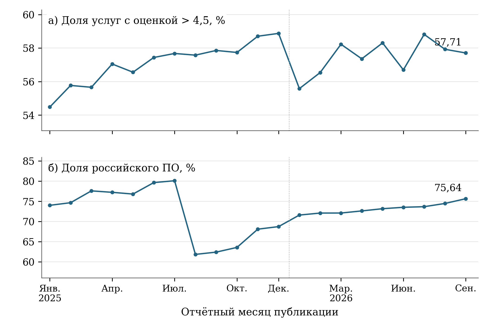

[B212; Caption] Рисунок 2 — Месячные опубликованные значения показателей качества услуг и российского ПО, январь 2025 — сентябрь 2026 года

[B213; SourceNote] Панели показывают общероссийские ряды ЕМИСС в собственных шкалах. Верхняя панель — доля видов услуг, прошедших месячный порог оценки и фильтр по числу анкет; нижняя — состояние состава ПО. Причина разрыва ряда ПО в августе 2025 года не установлена. Соединение точек показывает последовательность опубликованных месячных значений; не предполагает неизменность методики, независимость 21 наблюдения или причинный эффект проекта. [Сноски 65]

[B214; ] Стоимостные показатели расширяют картину, однако требуют собственного экономического прочтения. В декабрьской публикации 2025 года двенадцатимесячный объём инвестиций в приобретение отечественных ИТ-решений составляет 5 098,9 млрд рублей, в августовской публикации 2026 года — 6 052,7 млрд рублей. Затраты организаций на внедрение и использование искусственного интеллекта составляют 282,9 млрд рублей в декабрьской публикации и 414,3 млрд рублей в сентябрьской. Это расчётные объёмы за установленные методиками скользящие периоды, а не расходы отдельного месяца: для ИИ сочетаются четыре предшествующих квартала по оборудованию и ПО и двенадцать месяцев по труду. Величины характеризуют масштаб учитываемых денежных затрат. Без проверки цен, состава приобретений, производительности оборудования и полного календарного охвата их изменение нельзя называть ростом физического объёма внедрения или эффективности. [Сноски 66]

[B215; ] Содержательный результат инвестиционного блока следует проверять через использование приобретённых мощностей и изменение рабочих процессов. Рост затрат может сопровождать расширение числа пользователей, замену прежнего решения, повышение цен или дополнительные расходы интеграции. Ни один из этих механизмов не установлен одним денежным рядом. Для оценки отдачи полезны сопоставимые показатели на пользователя, операцию и организацию с учётом сложности услуг. Снижение стоимости отдельной транзакции при сохранении качества будет более непосредственным свидетельством экономического результата, чем превышение плана расходов, хотя причинная связь с конкретной мерой поддержки всё равно потребует отдельного исследования.

[B216; ] По подготовке школьников и студентов СПО в декабре 2025 года опубликовано 254,308 тыс. получивших сертификат по поддержанным дополнительным программам; это совпадает с ориентиром выбранной редакции. Сентябрьское значение 2026 года составляет 320,019 тыс. Счётчик включает базовое количество на конец 2024 года и последующее накопление; это не число обученных только в 2025 или только в 2026 году.  Указанный счётчик подтверждает масштаб завершения определённых программ, но не равен числу новых работников ИТ-отрасли. Для дальнейшей оценки важны сохранение навыков, продолжение профильного обучения, связь с профессиональным выбором и доступность программ для сельских учащихся. Итоги разных образовательных циклов нельзя автоматически интерпретировать как один и тот же годовой выпуск. [Сноски 67, 68]

[B217; Caption] Таблица 4 — Последние наблюдаемые значения избранных общероссийских показателей в 2026 году

[TABLE 4; B218]
Показатель и единица | Период | Значение | Статус
Возможность широкополосного доступа, % | 09.2026 | 93,70 | Текущее опубликованное
Цифровая зрелость управления и социальной сферы, % | 09.2026 | 25,55 | Текущее опубликованное
Индекс зрелости рынка данных, % | 09.2026 | 30,10 | Текущее опубликованное
Проактивные / мгновенные услуги, ед. | 09.2026 | 20,00 | Текущее опубликованное
Услуги с оценкой выше 4,5, % | 09.2026 | 57,71 | Текущее опубликованное
МСЗУ в электронной форме, % | 09.2026 | 98,88 | Текущее опубликованное
Российское ПО в органах власти и госкомпаниях, % | 08.2026 | 81,09 | Текущее опубликованное
Организации ключевых отраслей на российском ПО, % | 08.2026 | 52,10 | Текущее опубликованное
Индекс инвестиций в российские ИТ, % | 08.2026 | 135,10 | Текущее опубликованное
Российское ПО в региональных органах власти, % | 09.2026 | 75,64 | Текущее опубликованное

[B219; SourceNote] Это доступные оперативные публикации, а не итоги 2026 года. Август и сентябрь не объединены в единую дату. Значения нельзя суммировать по месяцам. Точные источники и исходные ячейки приведены в статистическом реестре и электронной исследовательской базе.  Переход организаций на российское ПО — составная оценка по классам с учётом частичного использования и годовой исходной базой; см. раздел методик. [Сноски 69]

[B220; Heading2] 4.3 Антифрод: допустимый индекс и нерешённая внешняя сверка

[B221; ] Показатель предотвращённых мошеннических действий требует уточнения интерпретации статистического ряда. Несмотря на слово «доля» в названии, его формула представляет число предотвращённых попыток с начала текущего года, делённое на число предотвращённых попыток за весь 2024 год и умноженное на сто. Значения выше 100% допустимы. Применение обычного ограничения доли диапазоном 0–100 исключило бы двенадцать содержательно допустимых наблюдений и искусственно остановило бы ряд в сентябре 2025 года. Увеличение индекса означает увеличение зарегистрированного числа предотвращённых попыток относительно базы; оно не означает долю предотвращения среди всех атак. [Сноски 70]

[B222; ] В исходных ячейках ЕМИСС за декабрь 2025 года находится 153,7 при целевом ориентире 102. Однако обзор Банка России за 2025 год приводит 134,16 млн предотвращённых операций против 72,17 млн в 2024 году. Их отношение составляет 185,89%, что не совпадает с проектной публикацией. Банк России также сообщает о росте объёма операций без добровольного согласия клиентов на 6,4%; в сообщении об итогах года указан объём 29,3 млрд рублей. Поэтому рост счётчика предотвращённых операций нельзя автоматически представлять как сокращение реализованного ущерба. [Сноски 71]

[B223; ] Несогласованность не устраняется самостоятельной заменой одного числа другим. Не установлено, связана ли она с версиями отчётности, временем пересмотра, составом учитываемых попыток или иной особенностью расчёта. Дополнительный вопрос вызывает немонотонность проектного ряда 2026 года: 169,4 в мае, 163,1 в июне и 159,0 в июле, затем 179,8 в сентябре. При накопленной формуле такое движение требует объяснения пересмотров либо компонент. Методически правильный вывод двойной: значения выше ста не являются нарушением допустимого диапазона, но конкретный ряд пока не прошёл внешнюю сверку. В итоговой оценке это ограничение надёжности, а не доказанное выполнение антифрод-задачи. [Сноски 72]

[B224; Heading2] 4.4 Региональная неоднородность качества и технологического перехода

[B225; ] Для карт выбран сентябрь 2026 года — общий последний доступный месяц двух содержательно различающихся региональных показателей. По качеству услуг представлены 85 территорий; наблюдения отсутствуют для ДНР, ЛНР, Запорожской и Херсонской областей. По российскому ПО представлены 88 территорий; отсутствует наблюдение по Москве. Пропуски показаны серым цветом и не заменены нулями. Карты используют территориальную классификацию статистического источника; площадь окрашенной территории не является весом населения или числа пользователей. [Сноски 73]

[B226; ] Доля видов услуг со средней оценкой выше 4,5 варьирует от 32,5% в Карелии до 76,92% в Омской области. Медиана по 85 регионам составляет 57,52%, межквартильный интервал — 52,85–65,57%. Таким образом, центральная половина территорий занимает интервал шириной 12,72 процентного пункта, а полный размах достигает 44,42 пункта. Ниже 50% находятся 13 регионов, на уровне не менее 70% — восемь. Эти распределения информативнее одного общероссийского значения, поскольку показывают, что высокая электронная доступность не устраняет неодинаковость доли видов услуг, проходящих порог высокой оценки. [Сноски 74]

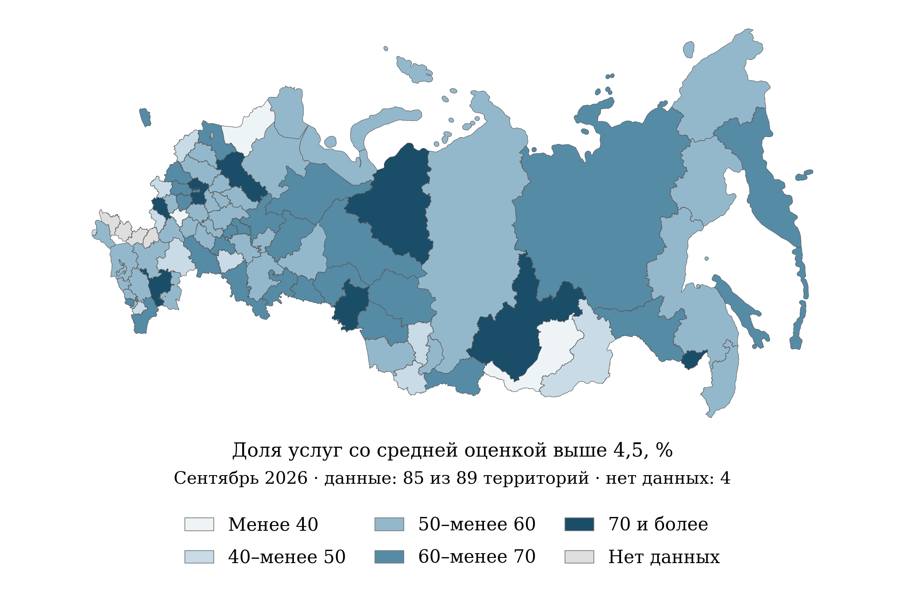

[B228; Caption] Рисунок 3 — Доля государственных услуг и сервисов со средней оценкой выше 4,5 по регионам, сентябрь 2026 года

[B229; SourceNote] Единица наблюдения — вид услуги, а не гражданин. Региональный допуск: более одной ненулевой анкеты за 12 месяцев, включая отчётный; средняя оценка относится к отчётному месяцу. Показаны значения по 85 территориям; данные отсутствуют для Запорожской и Херсонской областей, ДНР и ЛНР. Территории приведены в классификации статистического источника; карта предназначена для сопоставления наблюдений. [Сноски 75]

[B230; ] Среди высоких опубликованных значений также выделяются Ямало-Ненецкий автономный округ — 75%, Московская область — 73,77%, Калмыкия — 73,45% и Курская область — 73,33%. В нижней части распределения находятся Липецкая область — 36,6%, Бурятия — 37,5%, Кемеровская область — 41,35% и Севастополь — 42,86%. Такой набор не образует очевидной шкалы «крупная агломерация — периферия». Для объяснения различий нужны состав услуг, число анкет, возраст пользователей и структура обращений. Положение территории на карте само по себе не позволяет приписать результат качеству регионального управления. [Сноски 76]

[B231; ] Сопоставимость оценок ограничивает и конструкция индикатора. В федеральный расчёт услуга допускается при наличии более 200 ненулевых анкет за последние двенадцать месяцев; в региональный — более одной анкеты. Порог средней оценки выше 4,5 относится к отчётному месяцу. Поэтому общероссийский уровень и региональная медиана имеют разные правила отбора. Данные об объёмах ответов нужны для различения устойчивого результата и колебания малочисленной услуги. Переход средней оценки через порог способен изменить показатель дискретно, хотя изменение пользовательского опыта было небольшим. [Сноски 77]

[B232; ] По российскому ПО региональных органов власти медиана равна 76,84%, а центральная половина наблюдений находится между 64,69 и 88,07%. Минимум составляет 26,32% в Запорожской области; затем следуют Херсонская область — 43,08%, Забайкальский край — 52,62%, Калмыкия — 54,2% и Пензенская область — 54,59%. Максимум 100% опубликован для Ингушетии и Татарстана; близкие к нему значения имеют Сахалинская область — 99,64%, Белгородская область — 97,61% и Кабардино-Балкария — 97,49%. Девять территорий находятся в классе не менее 95%, две — ниже 50%. [Сноски 78]

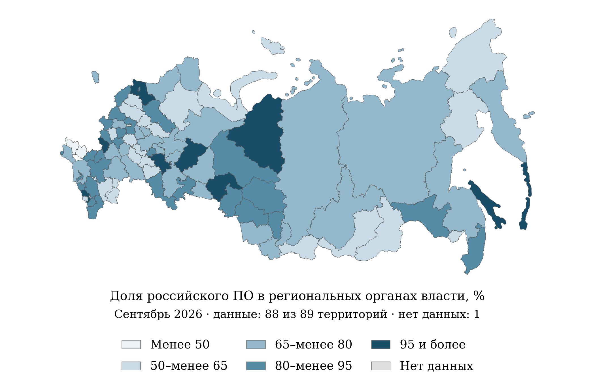

[B234; Caption] Рисунок 4 — Доля российского программного обеспечения в региональных органах власти, сентябрь 2026 года

[B235; SourceNote] Взвешенный методический показатель состава ПО информационных систем и типовой деятельности, состояние на конец месяца. Показаны значения по 88 территориям; наблюдение по Москве отсутствует. Пропуск не заменён нулём. [Сноски 79]

[B236; ] Разброс программного перехода означает неодинаковое состояние учитываемой технологической базы, но пока не объясняет причины. Исходный состав систем, сложность интеграций, сроки замены, организация закупок и доступность сопровождения могут формировать различия; в настоящей базе эти предположения не проверены. Отсутствие Москвы препятствует выводу о полноте охвата всех крупнейших центров. Для региональных управленческих решений полезнее рассматривать дефициты конкретных классов ПО и риски миграции, чем выводить единый рейтинг цифрового развития из нормативно взвешенной доли. Расходы и качество обслуживания должны контролироваться рядом с показателем перехода.

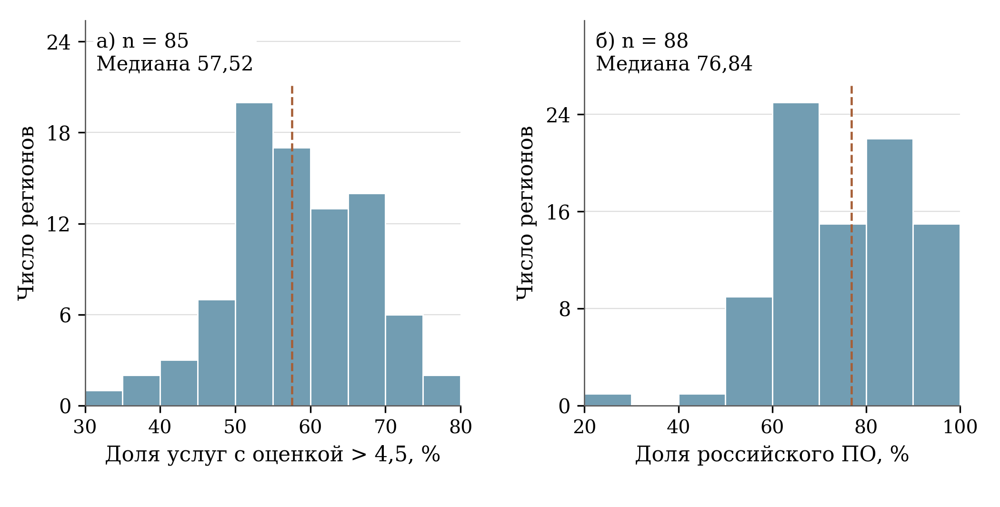

[B238; Caption] Рисунок 5 — Распределения регионов по качеству электронных услуг и российскому ПО, сентябрь 2026 года

[B239; SourceNote] Пунктир — невзвешенная региональная медиана. n — число территорий с наблюдением; ширина интервалов в панелях различается. Общероссийские значения не наложены: их совокупности и правила агрегирования отличаются. [Сноски 80]

[B240; ] Остальные региональные серии демонстрируют ограниченность автоматического ранжирования. По электронной доступности 84 из 85 регионов имеют 100%, Санкт-Петербург — 98,04%; медиана и оба квартиля равны ста. Такой показатель отражает приближение к насыщению, но почти не различает регионы. По электронным обращениям медиана составляет 98,74%, межквартильный интервал — 98,22–99,17%, минимум — 88,05% в Москве. Общероссийское значение той же карточки равно 77,1%, то есть ниже любого из 85 представленных региональных значений. Его нельзя восстановить простым или положительно взвешенным средним только этой панели. [Сноски 81]

[B241; ] Объяснение расхождения исключительно разными федеральным и региональным перечнями услуг документально не подтверждено: прочитанные методики обеих совокупностей ссылаются на перечень, включающий федеральные и региональные услуги. Для сверки необходимы числители и знаменатели, полнота территориального охвата и версии перечня, а не только конечные проценты. До получения компонент национальный уровень не наносится на региональное распределение как сопоставимая опорная линия. Сами региональные данные могут описывать различия внутри опубликованной панели, но не доказывают, что средний гражданин региона чаще пользуется электронными услугами, чем население страны в целом. [Сноски 82]

[B242; ] Количество внедрённых типовых либо региональных информационных систем наблюдается во всех 89 территориях: медиана равна двум, межквартильный интервал — 2–3, максимум — пять, числовые нули опубликованы в восьми регионах. Это счётчик объектов внедрения, не интенсивность использования и не относительная обеспеченность населения. Для школьных зданий с Wi-Fi и видеонаблюдением доступно 63 региона, из которых 51 имеет нулевое значение; остальные 26 территорий отсутствуют. По отечественным планшетам для учителей все 88 доступных региональных значений равны нулю. Пропуск, опубликованный ноль и отсутствие измерительной вариации здесь принципиально различаются. [Сноски 83]

[B243; Caption] Таблица 5 — Региональная наблюдаемость и распределения семи показателей, сентябрь 2026 года

[TABLE 5; B244]
Показатель | n | Медиана | Q1–Q3 | Нулей | Нет данных
Виды услуг с оценкой выше 4,5, % | 85 | 57,52 | 52,85–65,57 | 0 | 4
Российское ПО региональных органов власти, % | 88 | 76,84 | 64,69–88,07 | 0 | 1
Электронные обращения за МСЗУ, % | 85 | 98,74 | 98,22–99,17 | 0 | 4
МСЗУ в электронной форме, % | 85 | 100,00 | 100,00–100,00 | 0 | 4
Внедрённые типовые / региональные ИС, ед. | 89 | 2,00 | 2,00–3,00 | 8 | 0
Школьные здания с Wi-Fi и видеонаблюдением, % | 63 | 0,00 | 0,00–0,00 | 51 | 26
Учителя с отечественными планшетами, % | 88 | 0,00 | 0,00–0,00 | 88 | 1

[B245; SourceNote] Невзвешенные региональные распределения; квартиль рассчитан линейной интерполяцией. n — число наблюдаемых территорий из 89 в географическом справочнике; «нулей» означает число опубликованных числовых нулей и не удостоверяет отсутствие технологии вне правил проектного учёта. Федеральный и региональный пороги анкет для оценки услуг различаются. [Сноски 84]

[B246; Heading2] 4.5 Социальная и демографическая интерпретация

[B247; ] Цифровое неравенство следует анализировать как различие возможностей совершить полезное действие: получить услугу, выполнить учебное задание, найти работу, обратиться за медицинской помощью. Наличие сигнала является необходимой инфраструктурной характеристикой, но не заменяет устройство, финансовую доступность тарифа, навыки и понятный интерфейс. Применительно к сельской местности дополнительно значимы качество связи внутри жилища, устойчивость электроснабжения и расстояние до места очной поддержки. Эти факторы представлены как направления проверки, поскольку проектная региональная панель не содержит их прямых измерений и не позволяет оценить вклад каждого барьера.

[B248; ] Национальный контекст показывает обследование Росстата за 2024 год: Интернет имели 91,7% городских и 85,9% сельских домохозяйств, разрыв — 5,8 процентного пункта. Для широкополосного доступа значения составляют 91,3 и 84,5%, разрыв — 6,8 пункта. Общероссийские доли равны соответственно 90,4 и 89,8%. Это фактическая обеспеченность по обследованию домохозяйств, не проектная техническая возможность подключения. Показатели используются как исходный контекст до первого года реализации проекта. Их нельзя переименовывать в результат 2025 или 2026 года либо прямо вычитать из административного индикатора доступности. [Сноски 85]

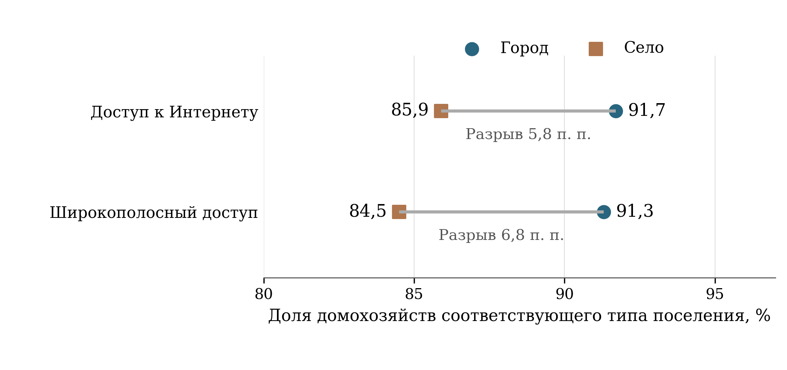

[B250; Caption] Рисунок 6 — Городские и сельские домохозяйства: доступ к Интернету в 2024 году

[B251; SourceNote] Росстат, обследование использования ИКТ, таблица 21.12 ежегодника 2025 года. Это факт 2024 года, используемый как исходный социальный контекст; показатель не совпадает с проектной технической возможностью подключения и не является результатом нацпроекта 2025–2026 годов. [Сноски 86]

[B252; ] Росстат опубликовал отдельный набор итогов обследования использования ИКТ за 2025 год 27 февраля 2026 года. Полные числовые таблицы этого набора не включены в проверенную расчётную базу настоящей экспертизы; поэтому общероссийские возрастные и поселенческие оценки за 2025 год не реконструируются по фрагментам региональных публикаций. Наличие более свежего набора зафиксировано отдельно от фактически использованных значений. Для дальнейшего мониторинга именно этот источник должен обеспечить сопоставимые знаменатели по возрасту, полу и месту проживания; проектная административная панель такой задачи не решает. [Сноски 87]

[B253; ] Официальная региональная публикация Костромастата за 2025 год показывает, почему инфраструктурной интерпретации недостаточно. Доля использовавших Интернет для получения государственных услуг среди получателей таких услуг составила 88,2% против 84,5% в 2024 году. Среди никогда или редко пользовавшихся Интернетом отсутствие потребности либо желания назвали 73,3%, недостаток навыков — 38%, опасения безопасности — 15,1%. Это ответы ограниченной группы респондентов, причём причины могут сочетаться. Их нельзя суммировать до ста или распространять на всю Россию, но они указывают на необходимость сочетать цифровую инфраструктуру с обучением и поддержкой. [Сноски 88]

[B254; ] Возрастная интерпретация требует различать состав пользователей и вероятность использования внутри группы. Например, в инфографике Омскстата за 2025 год жители 60–74 лет составляют 17% активных пользователей Интернета. Это не означает, что только 17% жителей указанного возраста пользуются Интернетом: знаменатель в публикации другой. Для оценки возрастного неравенства нужны число пользователей 60–74 лет и общая численность жителей этого возраста. Аналогичная осторожность необходима для сравнения мужчин и женщин, горожан и сельских жителей: высокая доля группы в аудитории может отражать её численность, а не преимущество в доступе. [Сноски 89]

[B255; ] Демографические границы отдельных проектных индикаторов также ограничивают выводы. Показатель использования цифровых сервисов социальной сферы прямо выделяет граждан 12–60 лет. Следовательно, его улучшение не удостоверяет улучшения доступа людей старше 60 лет — значимой группы получателей медицинских, пенсионных и социальных услуг. В декабре 2025 года опубликовано 4,72%, в сентябре 2026 года — 8,7%; это результат внутри установленной возрастной совокупности. Оценка инклюзивности должна дополнительно охватывать старшие возраста, людей с ограничениями здоровья и пользователей, которым требуется помощь другого человека. [Сноски 90]

[B256; ] Для семей с детьми цифровизация образования должна измеряться не только количеством выданных устройств и оборудованных зданий, но и возможностью регулярного обучения дома и в школе. Нулевой проектный показатель планшетов не удостоверяет отсутствия у всех учителей каких-либо цифровых устройств: он относится к определённому виду отечественной техники и условиям учёта. Аналогично отсутствие строки региона по школьному Wi-Fi нельзя автоматически интерпретировать как отсутствие сети. Приоритетная проверка должна установить целевую совокупность зданий, стадию поставок, акты ввода и дату обновления отчётности. [Сноски 91]

[B257; Heading2] 4.6 Нули, технологические результаты и управленческие выводы

[B258; ] В ряде технологических серий имеются значения, которые нельзя превращать в буквальное описание исчезновения результатов. После 70 кубитов и 7 858 км квантовых сетей в декабре 2025 года сентябрьские публикации 2026 года содержат нули. Численность выпускников программ по искусственному интеллекту после 8 504 человек в декабре также имеет нулевое сентябрьское значение. Без подтверждения календаря учёта, правил ежегодного накопления и статуса публикации такие переходы не доказывают уничтожения процессоров, демонтажа сетей или прекращения подготовки кадров. В аналитическом тексте они остаются вопросами к качеству и смыслу временной разметки. [Сноски 92]

[B259; ] Доля выпускников программ, обновлённых при участии ИТ-отрасли, имеет нулевые значения на всём наблюдаемом интервале; при этом ориентир выбранной редакции на 2025 год также равен нулю. Формальное совпадение 0 и 0 не образует процента выполнения, поскольку отношение не определено. Аналогично нулевые показатели качества статистических данных и снижения отчётной нагрузки не дают основания заключить, что вся государственная статистика некачественна или отчётная нагрузка неизменна во всех формах наблюдения. Они относятся к конкретной проектной конструкции, этапам запуска и установленным стандартам измерения. [Сноски 93]

[B260; ] Приоритет улучшения мониторинга состоит в публикации компонент вместе с итоговым процентом. Для качества электронных услуг нужны числа допущенных видов услуг, анкет и ответивших пользователей; для обращений — электронные и все обращения по одному перечню; для российского ПО — состав информационных систем, рабочие места и классы решений. Это позволит воспроизвести расчёт, определить влияние состава и установить, изменилось ли качество при неизменной структуре. Без компонент высокоточный итоговый процент создаёт впечатление проверяемости, хотя внешнему исследователю доступна только конечная величина.

[B261; ] Следующий приоритет — дополнение показателей внедрения характеристиками завершённого пользовательского действия. Для государственных услуг целесообразно наблюдать долю успешно завершённых обращений, повторные запросы документов, число отказов, медиану и верхние квантили фактического времени. Для связи — измеренную скорость, доступность по времени, стоимость относительно ресурсов домохозяйства и наличие подходящего устройства. Для миграции на российское ПО — работоспособность критических функций, сбои, совместимость, затраты сопровождения и потребность в обучении. Такой набор связывает техническую реализацию с экономией времени и снижением издержек, не подменяя одно другим.

[B262; ] Региональные решения должны учитывать неодинаковые ограничения. Территория с высокой доступностью электронных услуг и низкой долей высоких оценок нуждается прежде всего в разборе пользовательских затруднений и процессов предоставления. Низкий показатель состава российского ПО требует диагностики систем и зависимости от поставщиков; он не объясняется автоматически недостатком компетенций населения. Для сельских и старших возрастных групп следует проверять доступность помощи, устройств и связи. Это условные направления вмешательства, вытекающие из разных типов показателей; конкретный выбор требует локальных компонент и обследований, а не общего ранга региона.

[B263; ] Итоговая научная оценка должна отделять наблюдаемые изменения от их причин. По имеющейся базе можно подтвердить расширение отдельных цифровых сервисов, высокую формальную электронную доступность и значительную региональную неоднородность качества и технологического состава. Нельзя оценить, какая часть изменений произошла бы без нового национального проекта, либо приписать ему все результаты предшествовавших программ и коммерческих инвестиций. Для этого нужны данные до запуска, даты конкретных вмешательств, сопоставимые группы и устойчивые определения результатов. До появления такой основы отчёт обоснованно представляет описательную экспертизу достижений, ограничений измерения и задач следующего этапа мониторинга.

[B264; Heading2] 4.7 Устойчивость многомерного описания регионов

[B265; ] Для дополнительной проверки территориальной структуры рассмотрена панель за сентябрь 2026 года, включающая 85 регионов и пять признаков: долю электронных обращений, электронную доступность массовых услуг, долю услуг с оценкой выше 4,5, использование российского программного обеспечения и количество внедрённых типовых либо собственных региональных информационных систем. Это преимущественно административные характеристики. В панель не входят непосредственно стоимость связи для домохозяйства, цифровые навыки населения и полный набор социальных результатов. Поэтому её компоненты и группы не получают названия интегральной цифровой зрелости региона. [Сноски 94]

[B266; ] Признаки стандартизованы через вычитание среднего и деление на стандартное отклонение. Из 425 ячеек одна содержит заполненный пропуск; это обстоятельство учитывается отдельно от наблюдаемых значений. Первая главная компонента объясняет 27,87% стандартизованной вариации, вторая — 23,52%; вместе — 51,39%. Двухмерное описание сохраняет примерно половину вариации и может служить для обнаружения сочетаний признаков. Оно не воспроизводит всю информацию и не создаёт шкалу общественного благополучия. Знак компоненты условен, а её смысл зависит от нагрузок исходных показателей.

[B267; Caption] Таблица 6 — Проверка устойчивости многомерного описания регионов

[TABLE 6; B268]
Проверка | Результат | Вывод
Базовая панель | 85 регионов, 5 признаков; 1 заполненный пропуск из 425 ячеек | Преимущественно административная цифровизация; не все стороны цифрового благополучия
Две главные компоненты | 51,39% общей стандартизованной вариации | Почти половина вариации остаётся вне двухмерного представления
Семь начальных состояний кластеризации | Допустимое разбиение — 1 из 7; в остальных малая группа из 1 региона | Стабильная типология не установлена
Поочерёдное исключение пяти признаков | Допустимое разбиение — 1 из 5 | ARI = 1 в единственном допустимом случае не доказывает общей устойчивости
Август — сентябрь 2026 г.; 84 общих региона | Разбиение допустимо только в сентябре; перекрытие пространства двух компонент 0,687 | Изменение месяца существенно влияет на геометрию; рейтинг не формируется

[B269; SourceNote] Допустимость кластеров проверялась по минимальному размеру группы; полный протокол и смысл метрик изложены в тексте. Расчёты по данным ЕМИСС. [Сноски 95]

[B270; ] Для кластеризации проверены числа групп от двух до шести. Использован метод k-средних с 20 начальными запусками для каждого варианта; разбиение считается допустимым, если в каждой группе не менее трёх регионов. Среди допустимых вариантов выбирается максимальный силуэт. Базовое разбиение на две группы включает 36 и 49 регионов и имеет силуэт 0,244. Само наличие такого результата недостаточно для вывода о воспроизводимой типологии: необходима проверка чувствительности всей процедуры.

[B271; ] Проверка семи начальных состояний алгоритма дала допустимое разбиение только в одном случае. В остальных при фиксированном числе двух групп возникает группа из одного региона, а варианты с иным числом групп также не проходят установленное ограничение размера. Следовательно, индекс совпадения разбиений ARI, равный единице у единственного допустимого результата, не может служить доказательством устойчивости. Он отражает совпадение оставшегося варианта с базовым, а не успешность семи независимых проверок. Прямой повторный расчёт подтвердил это соотношение.

[B272; ] Поочерёдное исключение каждого из пяти признаков также оставляет допустимое разбиение только в одном случае — при исключении показателя электронной доступности услуг. В этом варианте ARI равен единице. При исключении остальных признаков минимальные группы не удовлетворяют критерию допустимости. Полученный результат показывает зависимость кластерного вывода от состава измерений. Он не доказывает, что исключённый показатель неважен по существу, и не обосновывает его удаление из официального мониторинга.

[B273; ] Временная проверка проведена на 84 общих регионах за август и сентябрь 2026 года, по одинаковым пяти признакам и без заполнения пропусков. В сентябре допустимое разбиение существует, в августе — отсутствует. Перекрытие пространств первых двух главных компонент составляет 0,687, максимальный главный угол — около 39°. Эти величины описывают изменение геометрии данных; они не являются вероятностью ошибки. Различие может отражать как изменение реальных значений, так и особенности обновления статистики и чувствительность метода. Одних кластерных результатов недостаточно, чтобы выбрать объяснение.

[B274; ] Практический вывод состоит в использовании отдельных сопоставимых показателей и прозрачных распределений вместо закрепления неустойчивых групп как рейтинга. Многомерные расчёты полезны для постановки вопросов о необычном профиле и выборе объектов дополнительной проверки. Автоматическая отметка нетипичности не равна неблагополучию региона: она может возникать из-за высокой концентрации учреждений, особенностей состава услуг, малого знаменателя либо ошибки учёта. Перед управленческим решением требуется вернуться к первичным компонентам и условиям формирования наблюдения.

[B275; Heading1] 5 Финансовое обеспечение и стоимость результатов

[B276; Heading2] 5.1 Периметр финансовой оценки

[B277; ] Финансовая оценка национального проекта требует различать четыре объекта: ресурсный план паспорта, федеральные бюджетные ассигнования, кассовое исполнение и полную стоимость предоставляемых цифровых услуг. Эти величины отвечают на разные вопросы. Паспорт объединяет источники и годы реализации; бюджет устанавливает разрешённые расходы соответствующего периода; касса показывает перечисленные средства; экономическая стоимость включает также эксплуатацию, переход между системами и затраты пользователей. Смешение этих объектов способно превратить изменение бюджетной классификации в предполагаемое сокращение проекта, а оплату контракта — в доказательство достигнутой цифровой трансформации.

[B278; ] Для ресурсной структуры использовано опубликованное представление паспорта НП версии 26.64, обновлённое 16 октября 2026 года, и представления девяти федеральных проектов. Это вторичная публикация данных ГИИС «Электронный бюджет»; дата обновления страницы не отождествляется с датой утверждения паспорта. Текущая бюджетная база проверена по правительственной пояснительной записке к законопроекту № 615-9: она содержит сводную роспись на 1 сентября 2026 года и предложения на 2027–2029 годы. Предварительное исполнение взято из сообщения Минфина на 1 октября 2026 года. Выводы относятся к информации, доступной на 28 октября 2026 года. [Сноски 96]

[B279; Heading2] 5.2 Масштаб и источники ресурсов

[B280; ] Сумма годовых строк национального проекта за 2025–2030 годы составляет 1 212,74911229 млрд рублей. Из неё 998,8502794 млрд приходится на федеральный бюджет, 76,88181632 млрд — на строку консолидированных бюджетов субъектов Федерации, 137,01701657 млрд — на внебюджетные источники. Рассчитанные доли равны соответственно 82,36%, 6,34% и 11,30%. Следовательно, устойчивость проектного портфеля прежде всего зависит от федерального бюджетного решения; внебюджетное участие не меняет его преимущественно государственного характера. Все суммы представляют номинальный план, а не подтверждённые платежи или вложения в сопоставимых ценах. [Сноски 97]

[B281; Caption] Таблица 7 — Источники планового финансового обеспечения НП в 2025⁠–⁠2030 годах

[TABLE 7; B282]
Год | Федеральный бюджет | Консолидированные бюджеты субъектов РФ | Внебюджетные источники | Всего
2025 | 150,216 | 2,981 | 20,753 | 173,949
2026 | 156,110 | 5,856 | 19,454 | 181,420
2027 | 159,313 | 16,141 | 18,887 | 194,341
2028 | 175,630 | 17,174 | 25,185 | 217,990
2029 | 172,802 | 17,333 | 26,560 | 216,695
2030 | 184,778 | 17,397 | 26,178 | 228,353
Итого | 998,850 | 76,882 | 137,017 | 1 212,749

[B283; SourceNote] Млрд рублей, номинальные суммы. Паспорт НП версии 26.64; дата обновления представления — 16.10.2026. Агрегирование воспроизводит паспортную классификацию; суммы не интерпретируются как независимо консолидированные расходы всех участников. [Сноски 98]

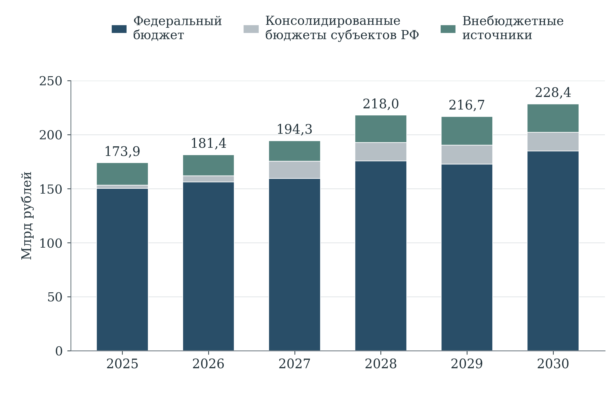

[B285; Caption] Рисунок 7 — Плановое финансовое обеспечение национального проекта по источникам в 2025⁠–⁠2030 годах

[B286; SourceNote] Млрд рублей. Представление паспорта НП версии 26.64, обновлённое 16 октября 2026 года. Показана опубликованная структура источников, а не кассовое исполнение. [Сноски 99]

[B287; ] Годовое обеспечение увеличивается со 173,949 млрд рублей в 2025 году до 228,353 млрд в 2030 году. Особенно заметно расширение региональной строки: с 2,981 до 17,397 млрд рублей. Для оценки нагрузки на субъекты этого недостаточно: необходимо раскрыть собственные региональные средства, федеральные трансферты и обязательства после завершения поставок. Название источника в опубликованном паспорте само по себе не доказывает, что перечисленные потоки уже очищены от межбюджетных перечислений. Поэтому приведённый итог характеризует паспортный ресурсный периметр, но не используется как независимо консолидированная стоимость цифровизации для государства и общества. [Сноски 100]

[B288; ] Аналогичное разграничение требуется для внебюджетной части. Средства государственного предприятия, собственные средства частного разработчика и привлечённый кредит имеют разную экономическую природу. Для проверки дополнительности нужно знать конечного плательщика и источник возврата. Перечисление денег из бюджета институту развития, а затем получателю поддержки не создаёт второго независимого источника. Для кредитного финансирования следует отдельно показывать основной долг, субсидирование процентов, гарантии и фактически реализованные обязательства; суммирование кредитов и бюджетных субсидий в единую величину расходов завысило бы государственную стоимость поддержки.

[B289; Heading2] 5.3 Сопоставимость горизонтов и концентрация расходов

[B290; ] На сопоставимом горизонте 2025–2030 годов крупнейшим направлением является «Цифровое государственное управление»: 507,805 млрд рублей, или 41,87% раскрытой суммы. Далее следуют цифровые платформы социальной сферы — 196,986 млрд и 16,24%, отечественные решения — 149,753 млрд и 12,35%. На эти три направления приходится 70,46%. Такая концентрация означает, что экономический результат всего национального проекта в значительной степени определяется качеством общих платформ, внедрения прикладных систем и их использования организациями, а не только достижениями отдельных исследовательских программ. [Сноски 101]

[B291; ] Остальные раскрытые суммы распределены между кибербезопасностью — 82,568 млрд рублей, инфраструктурой Интернета — 77,402 млрд, искусственным интеллектом — 72,093 млрд, прикладными исследованиями — 66,126 млрд, кадрами — 46,178 млрд и государственной статистикой — 13,839 млрд. Доли характеризуют финансовую структуру, но не общественную значимость: качество статистических данных или защищённость обмена могут определять полезность гораздо более крупных платформ. Поэтому решение о перераспределении средств нельзя выводить только из относительного размера статьи. [Сноски 102]

[B292; ] При сверке выявлена конкретная ошибка, возникающая при механическом использовании заголовков. В «Цифровом государственном управлении» общий заголовочный итог составляет 513,51336917 млрд рублей и включает по 0,9514455 млрд ежегодно в 2031–2036 годах. После исключения этих шести лет остаётся 507,80469617 млрд. Следовательно, сложение всех заголовков ФП завышает сопоставимый итог на 5,708673 млрд рублей: получается 1 218,45778529 млрд вместо 1 212,74911229 млрд. Это различие горизонтов, а не обнаруженное дополнительное финансирование периода 2025–2030 годов. [Сноски 103]

[B293; ] В инфраструктуре Интернета отдельно представлены 2025–2029 годы, но отсутствует годовая строка 2030 года. Отсутствие не заменено нулём. При этом сумма всех опубликованных годовых строк ФП совпадает с национальным итогом каждого года; в 2030 году это сумма восьми раскрытых направлений. Совпадение служит арифметической проверкой представления, но не подтверждает завершение обязательств по Интернету. Для окончательной содержательной сверки требуется документ о составе и переносе соответствующих мероприятий. [Сноски 104]

[B294; ] На уровне отдельных результатов раскрытие менее полно, чем на уровне проектов. В социальных платформах встречаются региональная сумма и подстрока перечислений бюджетам субъектов без отдельной родительской строки федерального бюджета; в прикладных исследованиях федеральное обеспечение некоторых результатов показано лишь для отдельных лет. Поэтому автоматическое сложение всех видимых источников или безусловное исключение всех строк «из них» не обеспечивает универсально правильного результата. В настоящей оценке структура портфеля рассчитана по согласованным годовым агрегатам ФП, а примеры стоимости отдельных результатов ограничены однозначно раскрытыми строками. Неразрешённые различия детального представления не интерпретируются как экономия, недостача или дополнительное обязательство. [Сноски 105]

[B295; Caption] Таблица 8 — Финансовое обеспечение федеральных проектов на сопоставимом горизонте 2025⁠–⁠2030 годов

[TABLE 8; B296]
Федеральный проект | Раскрытая сумма, млрд руб. | Доля в сумме, %
[Ц1] Инфраструктура доступа к информационно-телекоммуникационной сети "Интернет" | 77,402 | 6,38
[Ц2] Цифровые платформы в отраслях социальной сферы | 196,986 | 16,24
[Ц3] Искусственный интеллект | 72,093 | 5,94
[Ц4] Цифровое государственное управление | 507,805 | 41,87
[Ц5] Отечественные решения | 149,753 | 12,35
[Ц6] Прикладные исследования и перспективные разработки | 66,126 | 5,45
[Ц7] Инфраструктура кибербезопасности | 82,568 | 6,81
[Ц8] Кадры для цифровой трансформации | 46,178 | 3,81
[Ц9] Государственная статистика | 13,839 | 1,14
Итого за 2025–2030 годы | 1 212,749 | 100,00

[B297; SourceNote] Суммируются годовые строки 2025–2030. В Ц4 исключены 5,708673 млрд рублей за 2031–2036 годы. В Ц1 сумма относится к раскрытым строкам 2025–2029; отдельное значение 2030 года отсутствует и не заменяется нулём. [Сноски 106]

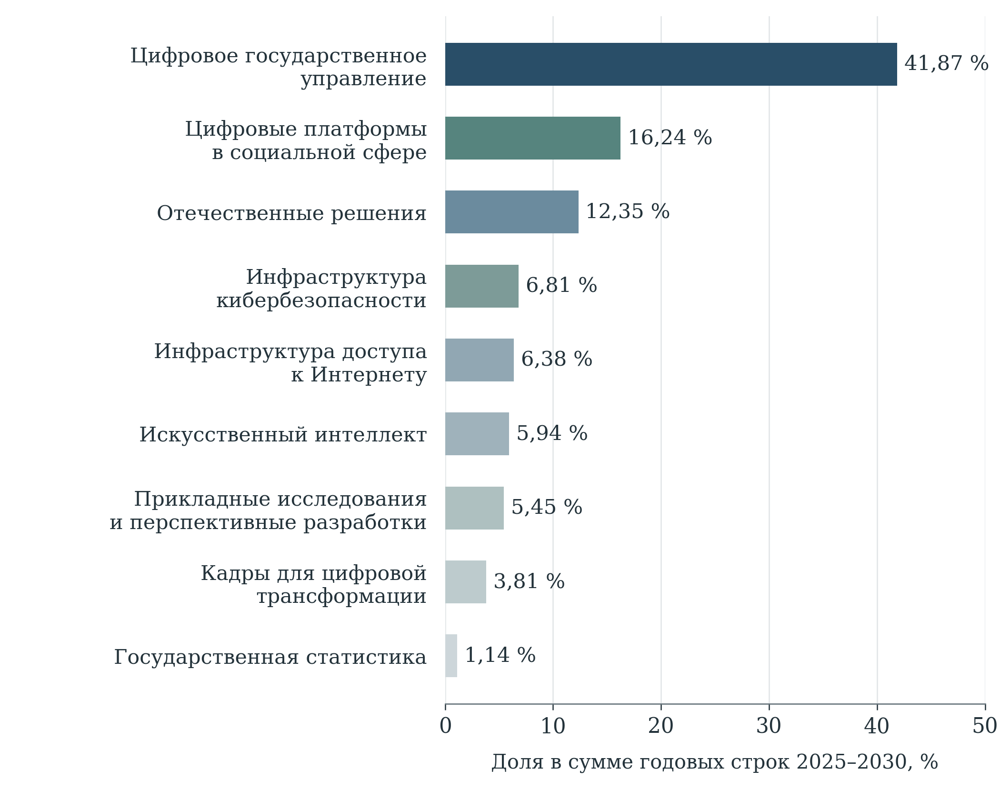

[B299; Caption] Рисунок 8 — Структура раскрытого финансирования федеральных проектов на горизонте 2025⁠–⁠2030 годов

[B300; SourceNote] Доли рассчитаны по годовым строкам одного горизонта. Из суммы «Цифрового государственного управления» исключены 2031–2036 годы; по инфраструктуре Интернета отдельная строка 2030 года не раскрыта. [Сноски 107]

[B301; Heading2] 5.4 Что меняет проект бюджета на 2027–2029 годы

[B302; ] Таблица 4.1.12 правительственной пояснительной записки предусматривает по национальному проекту 169,3527 млрд рублей в росписи 2026 года, 147,0564 млрд в проекте на 2027 год, 163,1413 млрд на 2028 год и 160,4622 млрд на 2029 год. Предлагаемый трёхлетний объём составляет 470,6599 млрд рублей. В данной оценке последние три величины сохраняют статус бюджетных предложений; они не подменяют ни действующие паспортные значения, ни фактические расходы. [Сноски 108]

[B303; ] Сопоставление 2027 года с росписью 2026 года даёт уменьшение на 22,2963 млрд рублей, или 13,17%. Однако разложение показывает иной характер изменения, чем равномерное сокращение направлений. Восемь поимённо представленных федеральных проектов в сумме увеличиваются со 136,4985 до 147,0563 млрд рублей: на 10,5578 млрд, или 7,73%. Одновременно строка «Иные структурные элементы национального проекта» уменьшается с 32,8543 млрд до нуля. Незначительные отличия суммы компонентов от общего итога связаны с округлением исходной таблицы до 0,1 млн рублей. [Сноски 109]

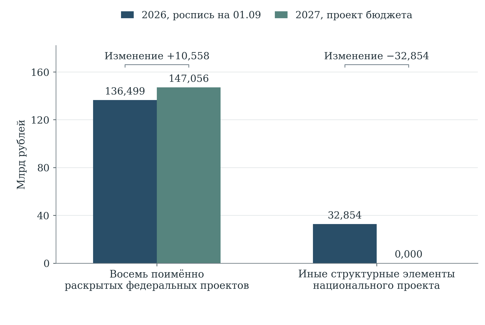

[B305; Caption] Рисунок 9 — Разложение изменения федеральных ассигнований между росписью 2026 года и проектом бюджета на 2027 год

[B306; SourceNote] Млрд рублей. Восемь поимённо раскрытых ФП и строка «Иные структурные элементы» сопоставлены по таблице 4.1.12 пояснительной записки. Отличие суммы строк от опубликованного итога связано с округлением до 0,1 млн рублей. [Сноски 110]

[B307; ] Следовательно, агрегированный отрицательный темп нельзя переносить на каждый ФП. В бюджетной таблице отсутствует отдельная строка инфраструктуры Интернета; это не позволяет приписать ей всю непоимённую сумму 2026 года или объявить прекращение финансирования. Необходим переходный реестр мероприятий с кодами расходов, ответственными распорядителями и основаниями изменения классификации. Иначе сравнение одинаковых названий национального проекта маскирует различия его внутреннего состава. По той же причине не следует объявлять экономией разницу между двумя трёхлетними суммами, если в них входят разные календарные годы.

[B308; ] Есть и несовпадение редакций: федеральная часть паспорта на 2026 год равна 156,1104262 млрд рублей, тогда как роспись в пояснительной записке — 169,3527 млрд; различие составляет 13,2422738 млрд. На 2027 год паспорт содержит 159,3130579 млрд, проект бюджета — 147,0564 млрд. Разность 12,2566579 млрд пока характеризует две разные плановые базы. Назвать её недофинансированием можно только после сопоставления утверждённых обязательств и лимитов по одним мероприятиям, срокам и источникам. [Сноски 111]

[B309; Caption] Таблица 9 — Федеральные ассигнования: роспись 2026 года и проект бюджета на 2027⁠–⁠2029 годы

[TABLE 9; B310]
Направление | 2026
роспись | 2027
проект | 2028
проект | 2029
проект
Ц1. Инфраструктура доступа к Интернету | Не выделен | Не выделен | Не выделен | Не выделен
Ц2. Цифровые платформы в отраслях социальной сферы | 5,518 | 8,496 | 11,867 | 9,607
Ц3. Искусственный интеллект | 9,150 | 8,657 | 12,904 | 13,601
Ц4. Цифровое государственное управление | 80,543 | 85,347 | 86,808 | 84,054
Ц5. Отечественные решения | 6,496 | 7,019 | 12,162 | 12,165
Ц6. Прикладные исследования и перспективные разработки | 4,601 | 4,973 | 5,126 | 4,986
Ц7. Инфраструктура кибербезопасности | 21,824 | 23,967 | 22,419 | 21,732
Ц8. Кадры для цифровой трансформации | 5,545 | 6,120 | 9,137 | 11,499
Ц9. Государственная статистика | 2,820 | 2,476 | 2,228 | 2,331
Иные структурные элементы | 32,854 | 0,000 | 0,000 | 0,000
Зарезервированные ассигнования | 0,000 | 0,000 | 0,489 | 0,487
Всего по национальному проекту | 169,353 | 147,056 | 163,141 | 160,462

[B311; SourceNote] Млрд рублей. Роспись на 01.09.2026; предложения законопроекта № 615-9, внесённого 30.09.2026. «Не выделен» означает отсутствие отдельной строки в таблице, а не нулевое финансирование. Расхождения последних знаков обусловлены округлением. [Сноски 112]

[B312; Heading2] 5.5 Кассовое исполнение и качество освоения

[B313; ] По предварительному сообщению Минфина, на 1 октября 2026 года исполнение федеральных расходов проекта достигло 58,8% плановых назначений. Общая оговорка этого сообщения о соответствии кассовому плану относится к совокупности национальных проектов, поэтому её нельзя автоматически распространить именно на экономику данных. Абсолютный объём кассы здесь не восстанавливается умножением 58,8% на паспортную сумму или сентябрьскую роспись: это означало бы использование знаменателя другой даты и потенциально другого состава. [Сноски 113]

[B314; ] Оценка 58,8% требует проверки графика контрактов, а не только сравнения с прошедшими девятью месяцами года. Если платежи предусмотрены после испытаний и приёмки, неравномерность может соответствовать производственному циклу. Если же закупка задержана, а будущие платежи не обеспечены готовыми результатами, возникает риск переноса мероприятий. Обратная ситуация — аванс перечислен, но система не введена в устойчивую эксплуатацию — даёт высокую кассу при недостаточном общественном результате. Ни один из этих вариантов нельзя установить по одному проценту исполнения.

[B315; ] Для содержательного контроля предлагается сопоставлять на одной дате бюджетные назначения, заключённые обязательства, авансы, принятые этапы и работающие услуги. Каждой существенной оплате должен соответствовать проверяемый объект: принятый модуль, подключённый пользователь, завершённая миграция или поддержание доступности. Ускорение платежей в конце года следует оценивать вместе с дефектами приёмки и стоимостью последующих исправлений. Управленческой целью является надлежащее получение результата в срок, а не максимальный процент перечисления денег независимо от готовности продукта.

[B316; Heading2] 5.6 Условные источники и устойчивость обязательств

[B317; ] Действующий закон о федеральном бюджете на 2026 год предусматривает специальные основания распределения резервов для национального проекта и государственной программы «Информационное общество». Статья 21 связывает отдельные суммы с поступлениями от штрафов, обязательных отчислений операторов связи и интернет-рекламы, а также предоставления радиочастот. Например, соответствующее положение об аукционах радиочастот устанавливает на 2026 год объём до 47,482 млрд рублей. Это условный бюджетный механизм для совместно указанных целей; его нельзя целиком прибавлять к национальному проекту как уже полученный новый ресурс. [Сноски 114]

[B318; ] Экономическое значение этих правил состоит в необходимости различать предусмотренный резерв, фактически поступивший доход, решение о распределении и расходное обязательство. Доход от разового аукциона может обеспечить первоначальный этап инфраструктуры, но не доказывает обеспеченность многолетней эксплуатации. Поступления от штрафов также не должны рассматриваться как стабильный показатель спроса на цифровую услугу. Если эффективность профилактики снижает нарушения, это благоприятный общественный результат, даже когда связанный с ними доход оказывается меньше первоначального ожидания.

[B319; ] Для существенных платформ целесообразно заранее выделить минимальную стоимость непрерывной работы, модернизацию под обязательные требования и расширение функциональности. Первая часть должна иметь устойчивое финансовое обеспечение; решения о дополнительных функциях могут приниматься поэтапно. Такая структура позволяет корректировать развитие при изменении доходов, сохраняя уже предоставляемые гражданам услуги. Она также делает видимыми обязательства, которые переживут шестилетний горизонт национального проекта и потребуют средств следующего бюджетного цикла.

[B320; Heading2] 5.7 Платформы: стоимость создания и повторная эксплуатация

[B321; ] Три однозначно раскрытые строки «Цифрового государственного управления» особенно значимы для оценки стоимости: создание, развитие и эксплуатация государственных и типовых региональных информационных систем — 126,502 млрд рублей; инфраструктура межведомственного взаимодействия — 123,854 млрд; защищённая государственная облачная инфраструктура — 97,341 млрд на 2025–2030 годы. Их совокупность составляет 347,698 млрд рублей. Формулировки объединяют разные стадии жизненного цикла; поэтому всю сумму нельзя интерпретировать ни как создание новых активов, ни как текущую эксплуатацию. [Сноски 115]

[B322; ] Для этих расходов дополнительный результат следует определять относительно существовавшего сервиса. Новая платформа может увеличивать производительность, замещать устаревшее оборудование, обеспечивать выполнение новых требований либо просто сохранять доступность при росте нагрузки. Каждая задача допустима, но требует собственного обоснования стоимости. Если финансирование ежегодно поддерживает работоспособность одной системы, повторный платёж сам по себе не является двойным финансированием. Ошибка возникает, когда поддержание того же актива повторно учитывается как создание нового результата или когда один и тот же компонент оплачивается одновременно в платформенном и ведомственном контрактах.

[B323; ] Распределение затрат должно отражать архитектуру обслуживания. Концепция «ГосТех» в редакции сентября 2025 года различает обеспечение платформы и её базовых сервисов, федеральные прикладные системы и системы субъектов Федерации; для соответствующих расходов предусмотрены разные бюджетные владельцы. Это подтверждает, что стоимость цифровой услуги не исчерпывается одной строкой национального проекта. Для проверки экономии от централизации необходимо включать расходы платформенного оператора, ведомства и региона, а также переходный период параллельной эксплуатации старой системы. [Сноски 116]

[B324; ] Практически полезен реестр компонентов с единым идентификатором, плательщиком, договором и сроком полезного использования. Общие вычислительные и защитные мощности распределяются между услугами по наблюдаемой нагрузке и требованиям доступности; одинаковая ставка на каждый формально подключённый орган может скрывать значительную разницу потребления. Разработка, лицензии, техническая поддержка и вывод старой системы должны быть разделены в смете. Экономию следует признавать после подтверждённого сокращения сопоставимых расходов либо увеличения полезного объёма услуг, а не в момент организационного решения о переносе системы в облако.

[B325; ] Показатель удельной стоимости требует неизменного определения полезной операции. Повторная отправка запроса после сбоя увеличивает нагрузку, но не создаёт второго полезного результата. Аналогично перенос процедуры из одного канала в другой не означает прироста числа оказанных услуг. Сопоставление целесообразно вести по успешно завершённым жизненным ситуациям, сохраняя требования к срокам, доступности и качеству. Для разных лет нужны также поправки на цены и состав функций: рост номинальных расходов при расширении обслуживания не доказывает ухудшение эффективности. Бюджетную экономию, экономию времени граждан и рост качества следует раскрывать раздельно, поскольку они имеют разных получателей и не всегда могут быть сложены без двойного счёта.

[B326; Caption] Таблица 10 — Крупнейшие раскрытые инфраструктурные расходы и результат, необходимый для оценки их эффективности

[TABLE 10; B327]
Направление расходов | План 2025–2030, млрд руб. | Дополнительный результат для оценки
Государственные и типовые региональные информационные системы | 126,502 | Дополнительные завершённые услуги и функции; сокращение повторного ввода данных и ручных операций.
Инфраструктура межведомственного информационно-технологического взаимодействия | 123,854 | Успешные межведомственные обмены с соблюдением сроков; исключённые документы, ранее запрашивавшиеся у граждан.
Защищённая государственная облачная инфраструктура | 97,341 | Полезная нагрузка при заданной доступности; снижение полной стоимости сопоставимой вычислительной услуги.
Автоматизированная система безопасности российского сегмента Интернета | 68,487 | Снижение тяжести инцидентов и времени восстановления при сохранении качества и доступности связи.

[B328; SourceNote] Плановые суммы по однозначно раскрытым строкам финансового обеспечения результатов; содержание правого столбца — предложения автора по оценке, а не установленные паспортом нормативы. Создание, развитие и эксплуатация в этих строках не разделены на самостоятельные стоимостные компоненты. [Сноски 117]

[B329; Heading2] 5.8 Социальные платформы и расходы конечного пользователя

[B330; ] Финансовый план социальных платформ охватывает не только разработку сервисов, но и образовательный контент, оснащение образовательных организаций, защищённый доступ и планшетные компьютеры для учителей. Поэтому его 196,986 млрд рублей нельзя оценивать одной стоимостью разработанной платформы. Результат зависит от совместной готовности оборудования, связи, содержания, обучения и технической поддержки. Поставка устройства без работоспособного сценария использования создаёт актив, но ещё не подтверждает сокращение административной нагрузки или улучшение образовательного процесса. [Сноски 118]

[B331; ] Для инфраструктурных закупок необходима стоимость периода использования, включающая замену неисправных устройств, обновления, управление учётными записями и поддержку в образовательной организации. Для контентных подписок следует сопоставлять расходы с фактической регулярной работой пользователей, а не числом заведённых учётных записей. Разница между подключением и использованием особенно существенна, когда федеральный бюджет оплачивает начало проекта, а повседневное сопровождение становится региональным или муниципальным обязательством.

[B332; ] Предлагаемая оценка дополнительности должна учитывать время учителя и семьи. Сокращение одной бумажной формы не означает экономии, если одновременно возникает необходимость дублирующего ввода в нескольких системах. До внедрения и после него нужно измерять продолжительность типовых операций, число повторных запросов, технические перерывы и обращение за помощью. Сравнение организаций с разными сроками подключения позволяет отделять эффект платформы от общих изменений нагрузки. Денежная оценка высвобождённого времени должна сопровождаться объяснением, превратилось ли оно в бюджетную экономию, повышение качества основной работы или снижение перегрузки.

[B333; Heading2] 5.9 Отечественные решения: проверка дополнительности поддержки

[B334; ] План направления «Отечественные решения» составляет 149,753 млрд рублей. Экономическая задача поддержки состоит в появлении работоспособных продуктов и устойчивого спроса на них; формальное происхождение программного обеспечения само по себе не подтверждает окупаемость затрат на миграцию. При оценке следует учитывать совместимость, доработку производственных процессов, обучение, перенос данных, производительность и последующую зависимость от условий сопровождения конкретного поставщика. Эти расходы способны возникать у заказчика за пределами грантовой сметы. [Сноски 119]

[B335; ] Опубликованные РФРИТ условия отбора предусматривают гранты от 100 млн до 2 млрд рублей, срок проекта от 12 до 48 месяцев и собственное софинансирование: не менее 20% для указанных в условиях проектов в области ИИ или организаций ОПК и не менее 50% для иных участников. Предусмотрены последующая выручка либо тиражирование решения, а также налоговые обязательства участников. Эти требования задают наблюдаемые условия поддержки, но их выполнение не тождественно доказанной общественной дополнительности. [Сноски 120]

[B336; ] Софинансирование снижает риск финансирования полностью невостребованного продукта, однако не показывает, какая часть проекта состоялась бы без гранта. Требование выручки может быть выполнено за счёт переноса уже существующего спроса. Тиражирование на несколько юридических лиц, включая дочерние организации, не обязательно означает проникновение на независимый рынок. Исчисленные налоги также нельзя автоматически считать возвратом гранта: для этого нужно отделить прирост, вызванный поддержкой, от платежей, которые участники внесли бы и без неё. Указанные различия следуют из экономической интерпретации опубликованных условий, а не являются утверждением о нарушении конкретными получателями. [Сноски 121]

[B337; ] Рекомендуется сохранять данные об отклонённых и прошедших отбор заявках, исходной стадии продукта, собственном инвестиционном плане и независимых заказчиках. Сопоставление близких по исходным характеристикам проектов должно оценивать дополнительную разработку, скорость внедрения и коммерческое использование после завершения поддержки. В договорах важны переносимость данных и возможность смены обслуживающей организации: иначе первоначальная субсидия может сопровождаться длительными расходами заказчика, которые не видны в цене внедрения.

[B338; Heading2] 5.10 Исследования, искусственный интеллект и кадровые расходы

[B339; ] Федеральные проекты искусственного интеллекта и прикладных исследований предусматривают соответственно 72,093 и 66,126 млрд рублей. Их нельзя оценивать единым сроком коммерческой окупаемости. Для фундаментально неопределённых технологических направлений бюджет покупает возможность получить новые знания и проверить гипотезы; для внедрения зрелого решения он должен получать измеримое улучшение конкретного процесса. Отнесение обоих типов деятельности к цифровой трансформации не устраняет различий между исследовательским риском и качеством исполнения закупки. [Сноски 122]

[B340; ] Для ИИ полезно разделять подготовку данных, вычисления, разработку модели, внедрение и последующий контроль качества. Снижение трудозатрат оператора следует оценивать вместе с расходами на проверку ошибочных ответов и исправление решений. Демонстрационная точность модели на выбранном наборе данных не является готовой оценкой финансового эффекта в реальной эксплуатации. Для квантовых разработок финансовые этапы целесообразно связывать с независимыми воспроизводимыми испытаниями, а не только с ростом технического параметра или количеством отчётов. Решение продолжать проект должно учитывать новую информацию о достижимости следующего этапа.

[B341; ] Кадровое направление имеет план 46,178 млрд рублей, а государственная статистика — 13,839 млрд. Для обучения значимы завершение программы, подтверждённые навыки и дальнейшее применение компетенций. Стоимость зарегистрированного слушателя и стоимость подготовленного специалиста различаются, особенно при отсеве или повторном участии. Для статистики полезность расходов проявляется в качестве данных, скорости выпуска и снижении нагрузки на респондентов. Небольшая доля этого направления в бюджете не означает низкой отдачи: некачественная исходная информация способна снизить эффективность дорогостоящих систем управления и аналитики. [Сноски 123]

[B342; Heading2] 5.11 Инфраструктура связи и стоимость фактического подключения

[B343; ] В раскрытом плане инфраструктуры Интернета существенны средства выведения для низкоорбитальных аппаратов — 51,413 млрд рублей — и создание геостационарных спутников связи — 20,485 млрд. Эти строки описывают разные элементы инфраструктурной цепочки. Приёмка средства выведения, наличие аппарата на орбите, техническая возможность подключения и регулярное пользование связью представляют последовательные, но самостоятельные результаты. Стоимость первого этапа нельзя непосредственно делить на итоговое число потенциально охваченных домохозяйств и считать полученную величину полной ценой цифровой доступности. [Сноски 124]

[B344; ] Для оценки требуются расходы на наземную инфраструктуру, абонентское оборудование, подключение, эксплуатацию и обновление системы. Если эти затраты возникают у операторов или пользователей, они остаются частью экономической стоимости даже при отсутствии соответствующей строки в национальном проекте. Доходная модель должна показывать, какая часть обслуживания обеспечивается тарифом, а какая предполагает последующую поддержку. Это особенно существенно для решений, обоснованных малой плотностью населения: коммерческая выручка и общественная ценность доступности могут различаться, поэтому бюджетное участие следует оценивать по выбранной социальной задаче.

[B345; ] Сравнение вариантов связи должно учитывать одинаковые требования к скорости, задержке, устойчивости и доступной цене. Более низкая стоимость потенциального охвата не означает преимущество, если фактическое использование ограничено ценой терминала или качеством сервиса. Предлагается отдельно показывать стоимость создания возможности подключения, стоимость дополнительного активного подключения и расходы на поддержание обслуживания в течение сопоставимого периода. Для проверки дополнительности необходима исходная карта доступных альтернатив: расходы на расширение обслуживания уже обеспеченной территории и устранение отсутствия приемлемой связи решают разные задачи и не должны оцениваться одним средним показателем.

[B346; Heading2] 5.12 Кибербезопасность и предотвращённые потери

[B347; ] На инфраструктуру кибербезопасности в паспорте приходится 82,568 млрд рублей; из них раскрытая строка функционирования автоматизированной системы безопасности российского сегмента Интернета составляет 68,487 млрд на 2025–2030 годы. Преобладание поддержания функционирования усиливает значение регулярных обязательств: результат здесь возникает непрерывно и не может проверяться только фактом единовременного ввода объекта. Для финансовой оценки важно установить, какой уровень устойчивости оплачивается и как меняется его стоимость при изменении нагрузки. [Сноски 125]

[B348; ] Предотвращённый ущерб непосредственно не наблюдается. Поэтому число зарегистрированных атак нельзя автоматически умножать на условную стоимость инцидента и объявлять экономией. Усиление мониторинга само по себе способно увеличить наблюдаемое число событий. Обоснованная оценка должна использовать тяжесть подтверждённых инцидентов, продолжительность нарушений, восстановление функций и результаты независимой проверки. Денежные сценарии потерь полезны как инструмент принятия решения при явно раскрытых предположениях, но не как достоверная сумма уже полученного эффекта.

[B349; ] Одновременно требуется учитывать стоимость ограничений для добросовестных пользователей. Снижение доступности сервисов, дополнительные действия для доступа и ложные срабатывания могут создавать затраты для организаций и граждан. Финансовая оптимизация защиты должна рассматривать их вместе с предотвращёнными потерями. Сравнивать следует варианты, обеспечивающие сопоставимый уровень безопасности и качество связи. Экономия на поддержке без учёта вероятности серьёзного отказа столь же некорректна, как признание любых расходов оправданными исключительно их отнесением к безопасности.

[B350; Heading2] 5.13 Требования к доказательству финансовой эффективности

[B351; ] Проведённая сверка подтверждает согласованность национальных и федеральных агрегатов при одинаковом горизонте, но не устанавливает эффективность фактических расходов. Для перехода к такой оценке нужен регулярный реестр «мероприятие — обязательство — платёж — принятый результат — использование». Он должен сохранять версии паспортов и бюджетных назначений, отдельно показывать переносы мероприятий и не выдавать изменение классификации за экономию. Для платформ необходимы затраты всех участников жизненного цикла; для субсидий — собственные вложения получателя и результат сверх реалистичного сценария без поддержки.

[B352; ] Финансовый контроль следует сосредоточить на крупнейших направлениях: общих государственных платформах, социальных сервисах и отечественных решениях. Для них необходимы сопоставимая стоимость работающей услуги, динамика использования и основания дальнейшего финансирования. Исследовательские проекты требуют поэтапной проверки технических результатов. Оценка должна выявлять повторную оплату компонентов, неиспользуемые мощности и поддержку проектов, реализуемых без дополнительного бюджетного участия, сохраняя обоснованные расходы на непрерывную эксплуатацию.

[B353; Heading1] 6 Связи мероприятий, показателей и межпроектных результатов

[B354; Heading2] 6.1 Документированная структура и адресность влияния

[B355; ] Структурный анализ выполнен по десяти паспортам выбранной редакции. В них выделены 90 результатов и мероприятий, 60 карточек показателей, 34 задачи и 10 целей. Карточки показателей не тождественны уникальным статистическим кодам: одна величина может присутствовать на нескольких уровнях, а паспорт может содержать дополнительную или замещающую характеристику. Поэтому число 60 не противоречит наличию 49 показателей в статистическом реестре. Для каждого структурного объекта сохраняется принадлежность к документу и уровню проекта. [Сноски 126]

[B356; ] Восстановлены 90 связей результата с документированной задачей и 60 связей показателя с задачей. Через общую задачу образуются 632 пары «результат — показатель», охватывающие все 90 результатов и 48 карточек показателей. Такая связанность подтверждает организационную принадлежность действий, однако сама по себе не показывает силу или направление влияния. Если задача сформулирована широко, её показатели могут быть связаны со многими мероприятиями лишь через общий предмет управления.

[B357; Caption] Таблица 11 — Слои связи результатов с задачами и показателями

[TABLE 11; B358]
Слой | Объём | Интерпретация
Результат → документированная задача | 90 | Каждый из 90 результатов связан с конкретной задачей
Показатель → документированная задача | 60 | Принадлежность карточки показателя к задаче
Результат → общая задача ← показатель | 632 | Охвачены 90 результатов и 48 карточек показателей
Прямая адресная связь результата с показателем | 0 | Адресат не установлен однозначно в выбранном открытом представлении
Лексические кандидаты, косинус ≥ 0,10 | 150 | 68 результатов и 46 карточек показателей; 22 результата без кандидатов
Опубликованные записи влияния с неразрешённым адресатом | 168 | Нужны устойчивый идентификатор адресата и объяснение веса

[B359; SourceNote] В структурированной модели 90 результатов, 60 карточек показателей и 34 задачи. Отсутствие восстановленных прямых связей не означает их отсутствия в ведомственной системе. [Сноски 127]

[B360; ] В полном пространстве 90 результатов и 60 карточек показателей плотность связей через общую задачу составляет 11,70%. Эта величина описывает структуру конкретного представления; она не является нормативом достаточности связей и не сравнивается напрямую с проектами иной детализации. Увеличение количества карточек, разукрупнение задач или повторение показателя на разных уровнях способно изменить плотность без изменения практического механизма. Поэтому содержательная оценка проводится на уровне отдельных пар и цепочек.

[B361; ] В открытом представлении обнаружены 168 записей влияния с неоднозначно установленным адресатом. Прямых связей результата с уникально распознанной карточкой показателя восстановить не удалось. Это ограничение открытой публикации и её адресности. Оно не доказывает отсутствия связей в ведомственной системе управления. Вместе с тем оно мешает независимой проверке: читатель должен иметь возможность установить, какой именно показатель связан с результатом, в какой редакции, на каком горизонте и что означает опубликованный вес.

[B362; ] Предлагается закрепить постоянные идентификаторы результатов и показателей, явный тип связи и её содержательное обоснование. Различаются непосредственный вклад, обеспечивающее условие, общий ресурс и предполагаемое косвенное воздействие. Если связь сопровождается числом, необходимо раскрывать единицу и правило его получения. Экспертная оценка значимости, доля финансирования и предполагаемая доля вклада имеют разный смысл; они не должны отображаться одинаково без пояснения. Такая публикация делает архитектуру проверяемой без раскрытия технических сведений ограниченного доступа.

[B363; Heading2] 6.2 Методика TF–IDF и косинусного сходства

[B364; ] Текстовое сопоставление используется как инструмент поиска близких формулировок. Оно основано на очищенных профилях целей, задач, результатов и показателей. Из профилей исключены повторяющиеся организационные реквизиты и бюджетные таблицы, чтобы объём финансовых строк либо повторение должностей не определяли сходство. Национальный и девять федеральных паспортов содержат в таких профилях 12 479 слов. Словарь весов построен на фиксированном корпусе из 137 документов, что позволяет сравнивать отличительность терминов на общей основе.

[B365; ] Использованы отдельные слова и пары последовательных слов, не более 20 000 признаков, минимальная частота присутствия в одном документе и исключение признаков, встречающихся более чем в 98% документов. Частота слова преобразуется логарифмически; обратная документная частота сглаживается. До нормирования вес термина определяется следующей формулой. [Сноски 128]

[B366; ] (3)

[Формула] wₜd = (1 + ln fₜd) × [1 + ln((N + 1)/(dfₜ + 1))]

$$
w_{t,d}=(1+\ln f_{t,d})\left[1+\ln\frac{N+1}{df_t+1}\right]
$$

[B367; ] Здесь f — частота термина t в документе d, N — число документов, df — число документов, содержащих термин. Для отсутствующего термина вес равен нулю. После расчёта вектор каждого документа нормируется по евклидовой длине. Поэтому часто встречающееся внутри одного документа, но не повсеместное словосочетание может получить больший вес, чем общая управленческая формула.

[B368; ] (4)

[Формула] cos(d₁, d₂) = (w₁ · w₂)/(‖w₁‖ × ‖w₂‖)

$$
\cos(d_1,d_2)=\frac{w_1\cdot w_2}{\lVert w_1\rVert\lVert w_2\rVert}
$$

[B369; ] Косинусное сходство вычисляется как скалярное произведение векторов, делённое на произведение их длин. В рассматриваемом неотрицательном пространстве близость к единице означает сходную структуру взвешенных терминов. Значение 0,30 не означает совпадение 30% смысла, 30-процентную вероятность связи или вклад одного проекта в другой. Метод не распознаёт автоматически причинность, юридическую эквивалентность и различие между намерением и достигнутым результатом.

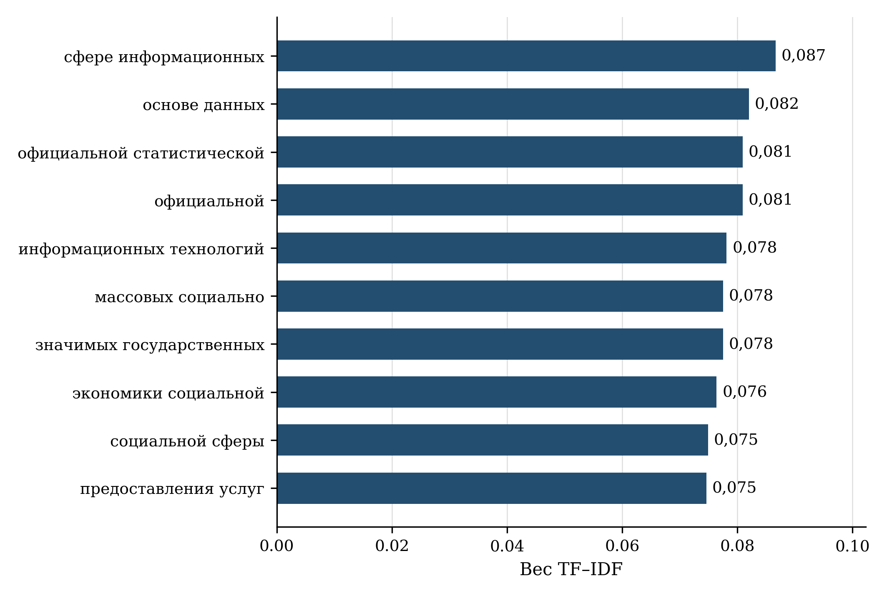

[B371; Caption] Рисунок 10 — Отличительные слова и словосочетания национального паспорта

[B372; SourceNote] Вес рассчитан относительно фиксированного корпуса из 137 документов. Бюджетные таблицы и повторяющиеся организационные реквизиты исключены из текстовых профилей. [Сноски 129]

[B373; ] В национальном паспорте наиболее отличительны сочетания, связанные с информационными технологиями, использованием данных, официальной статистикой и предоставлением массовых социально значимых услуг. Лидирующие веса находятся приблизительно в диапазоне 0,075–0,087. Их близость и наличие частично перекрывающихся сочетаний показывают выраженность соответствующей лексики, но не позволяют ранжировать общественную важность направлений. Например, отдельное слово и содержащая его биграмма могут занимать соседние позиции, не представляя двух самостоятельных целей.

[B374; Heading2] 6.3 Внутрипроектная специализация и тематические акценты

[B375; ] Наибольшее попарное лексическое сходство среди десяти выбранных паспортов наблюдается между национальным проектом и Ц4 «Цифровое государственное управление»: 0,317. Национальный паспорт также близок к Ц7 «Инфраструктура кибербезопасности» — 0,253, Ц2 «Цифровые платформы в отраслях социальной сферы» — 0,211 и Ц5 «Отечественные решения» — 0,205. Меньшая величина для Ц6 «Прикладные исследования и перспективные разработки» — 0,111 — отражает специализированный словарь исследовательского направления и не является оценкой его полезности. [Сноски 130]

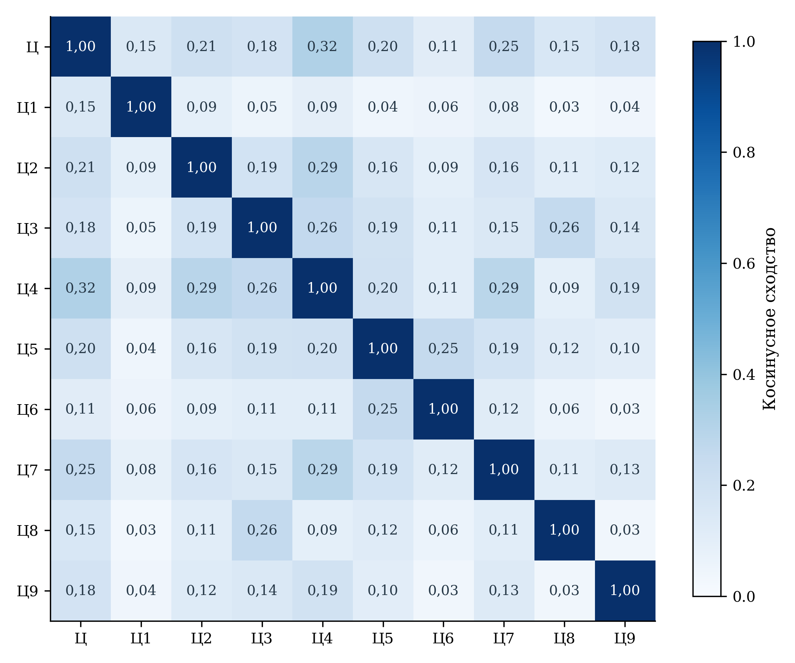

[B377; Caption] Рисунок 11 — Лексическая близость национального и девяти федеральных паспортов

[B378; SourceNote] Коды соответствуют таблице архитектуры проекта; Ц — национальный паспорт. Очищенные формулировки целей, задач, результатов и показателей; униграммы и биграммы TF–IDF. Коэффициент не является долей совпадающего смысла. [Сноски 131]

[B379; ] Матрица обнаруживает одновременно общее управленческое ядро и специализированные технологические направления. Такую конфигурацию следует использовать для постановки вопросов о передаче результата. Для исследовательского направления необходимы явные переходы от технического достижения к применению; для кадрового — от обучения к использованию компетенций; для инфраструктурного — от созданного объекта к доступной услуге. Низкая лексическая близость может объясняться корректной специализацией, а высокая — повторением общих формулировок. Ни один вариант не позволяет обойти содержательную проверку.

[B380; ] Словарный тематический анализ дополняет TF–IDF. В совокупности десяти профилей тема цифровой среды и данных даёт 45,12 совпадения на 1000 слов, управления и оценки — 12,82, науки и инноваций — 10,18, образования и молодёжи — 9,22. Значения рассчитаны через суммарное число совпадений и общий объём профилей, поэтому большие документы имеют больший вклад в общий профиль. На рисунке дополнительно показана нормированная частота внутри каждого паспорта.

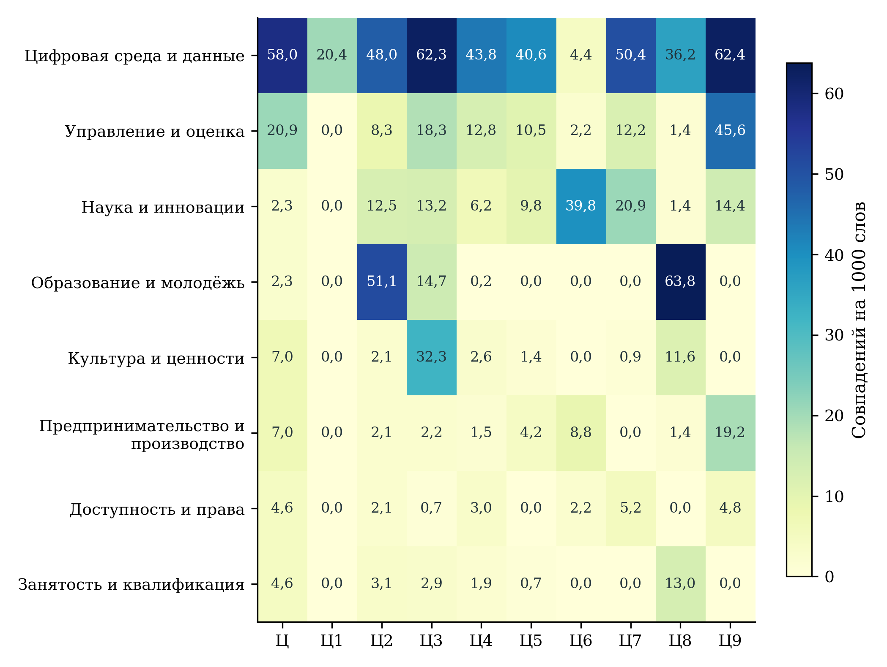

[B382; Caption] Рисунок 12 — Тематические акценты в десяти паспортах проекта

[B383; SourceNote] Восемь тем с наибольшим суммарным числом словарных совпадений. Темы пересекаются; значения не складываются до 100%. Коды направлений раскрыты в таблице архитектуры. [Сноски 132]

[B384; ] Словарные темы пересекаются, а отдельное слово может иметь несколько контекстов. Поэтому частоты не складываются до 100% и не описывают распределение бюджета, трудозатрат либо общественной пользы. Нулевое совпадение означает отсутствие заданного словарного признака в очищенном профиле. Оно не удостоверяет отсутствия соответствующего содержания в полном документе или практике реализации. Особенно осторожно следует читать названия широких тем, объединяющих разнородные термины: они служат навигации по тексту, после которой требуется обращение к конкретной формулировке.

[B385; Heading2] 6.4 Проверка лексических кандидатов связи

[B386; ] Для каждого результата отобрано не более трёх наиболее близких показателей того же национального проекта при косинусном сходстве не ниже 0,10. Получены 150 кандидатов, охватывающих 68 результатов и 46 карточек показателей. У 22 результатов кандидатов выше установленного порога нет. Порог определяет объём последующей экспертной проверки; он не был установлен как граница истинной причинной связи. Отсутствие кандидата может объясняться иной терминологией, сложным косвенным механизмом или особенностями текстового профиля.

[B387; Caption] Таблица 12 — Содержательная проверка лексически близких пар

[TABLE 12; B388]
Результат → показатель | Косинус | Экспертная интерпретация
Наличие средств выведения → число функционирующих спутников | 0,610 | Средство запуска — предпосылка; дополнительно нужны запуск, ввод и работоспособность
Создание низкоорбитальной группировки → число функционирующих спутников | 0,543 | Близость непосредственная, но работающий аппарат отличается от созданного
Функционирование АСБИ → скорость обработки трафика | 0,478 | Пропускная способность не равна предотвращённому ущербу
Развитие государственных и типовых систем → число внедрений | 0,422 | Измеряется организационно-технический результат; качество услуги проверяется отдельно
Безопасная среда разработки → доля функций с запущенными проектами ПО | 0,376 | Межпроектная связь возможна, но запуск проекта ещё не означает безопасного внедрения
Доработка ИТ-решений → инвестиции в квантовые и телекоммуникационные разработки | 0,285 | Сходство общей ИТ-лексики не подтверждает совпадения предмета поддержки

[B389; SourceNote] Пары отобраны по TF–IDF и проверены по смыслу формулировок. Коэффициент служит инструментом поиска; причинный вес не оценивался. [Сноски 133]

[B390; ] Наиболее близкая пара — наличие средств выведения для запуска космических аппаратов и число функционирующих аппаратов низкоорбитальной группировки; косинус равен 0,610. Содержательно это связь обеспечивающего условия с последующим результатом. Для её подтверждения нужны запуск, достижение рабочей орбиты, ввод и функционирование. Пара «создание группировки — число функционирующих аппаратов» имеет коэффициент 0,543 и находится ближе к непосредственному результату, однако также требует различать создание и эксплуатационную готовность. [Сноски 134]

[B391; ] В направлении кибербезопасности функционирование автоматизированной системы обеспечения безопасности близко к скорости обработки трафика: 0,478. Здесь текст хорошо выявляет связь системы с её технической характеристикой. Но последующая связь со снижением ущерба остаётся отдельной гипотезой, зависящей от состава угроз, качества обнаружения и действий после сигнала. В государственном управлении близость развития информационных систем к числу внедрений — 0,422 — подтверждает прежде всего организационно-технический уровень результата. [Сноски 135]

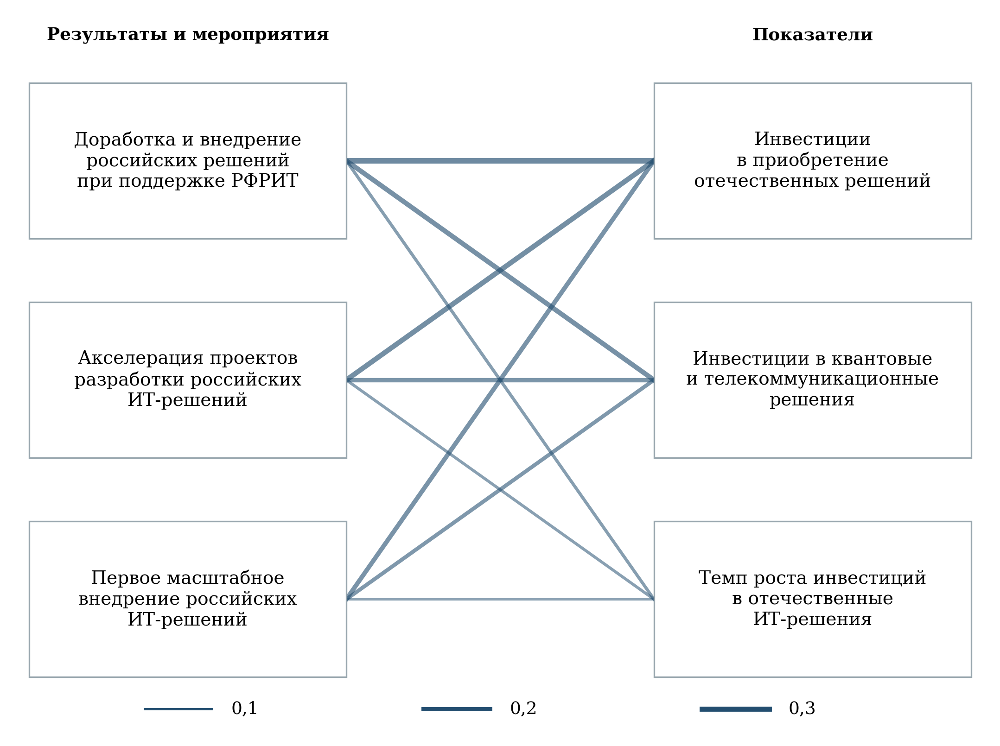

[B393; Caption] Рисунок 13 — Фрагмент графа лексических связей для поддержки отечественных решений

[B394; SourceNote] Девять фактически отобранных связей; косинусное сходство от 0,105 до 0,345. Толщина ребра отражает близость формулировок, а не эффект. Связь с квантовыми и телекоммуникационными разработками требует отдельного содержательного подтверждения. [Сноски 136]

[B395; ] Фрагмент графа для отечественных решений показывает девять фактически отобранных связей между тремя мероприятиями и тремя инвестиционными показателями. Диапазон коэффициентов составляет 0,105⁠–⁠0,345. Общая лексика разработки и внедрения ИТ-решений сближает эти мероприятия даже с показателем инвестиций в квантовые и телекоммуникационные технологии. Такая связь может быть содержательно правильной только при совпадении предмета конкретной поддержки. Само текстовое сходство этого не устанавливает. Граф тем самым полезен и для поиска возможных связей, и для выявления потенциальных ложных соответствий. [Сноски 137]

[B396; Heading2] 6.5 Межпроектное взаимодействие

[B397; ] Межпроектное сопоставление построено по средним нормированным векторам структурированных паспортов каждого проекта с последующим нормированием среднего профиля. Наиболее близки к «Экономике данных» проекты «Эффективная и конкурентная экономика» — 0,302 и «Молодёжь и дети» — 0,300. Далее следуют «Кадры» — 0,205, «Продолжительная и активная жизнь» — 0,201 и «Инфраструктура для жизни» — 0,194. Профиль «Семьи» не включён в сопоставимый рисунок, поскольку представлен документом другого жанра; его коэффициент не используется для ранжирования.

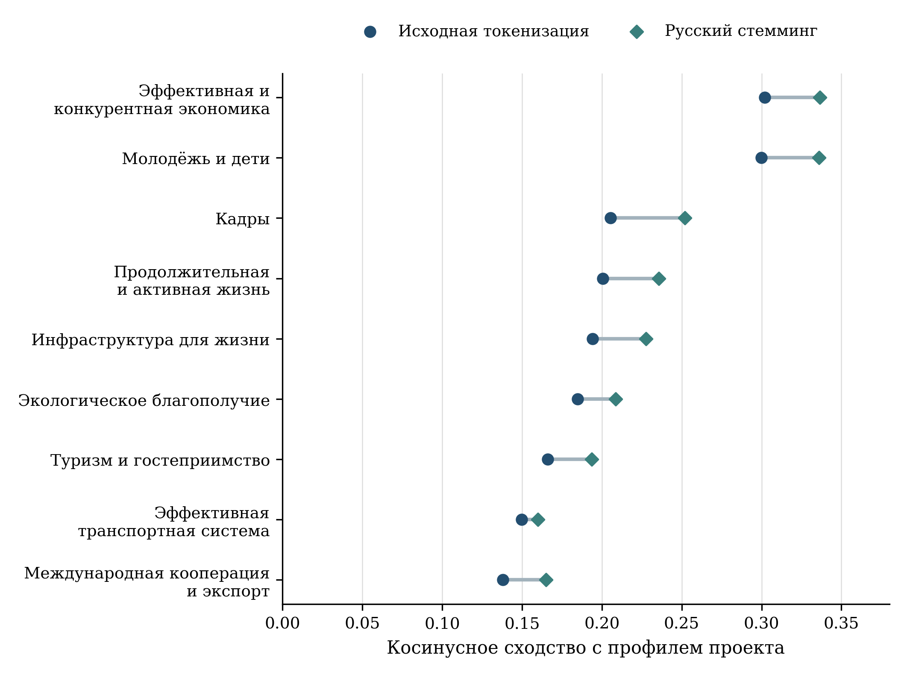

[B399; Caption] Рисунок 14 — Межпроектная лексическая близость и чувствительность к стеммингу

[B400; SourceNote] Сравниваются средние нормированные профили структурированных паспортов. Профиль проекта «Семья» исключён из рисунка из-за различия жанра. Стемминг сокращает слова до основы; величины не измеряют межпроектный экономический эффект. [Сноски 138]

[B401; ] Проверка с русским стеммингом, то есть приведением словоформ к основе, повышает абсолютные коэффициенты. Для «Эффективной и конкурентной экономики» получено 0,337, для «Молодёжи и детей» — 0,336, для «Кадров» — 0,252. Близость первых двух проектов сохраняется, но разность между ними мала и не имеет самостоятельного управленческого смысла. Устойчивым результатом является наличие общего тематического пространства, а не точное место в порядке коэффициентов.

[B402; ] Содержательно межпроектные связи предлагается оформлять через совместные процессы. Для экономического проекта это применение отечественных решений и данных в производстве; для образования — цифровая среда и компетенции; для кадров — обучение и спрос на квалификацию; для здравоохранения — качество цифрового взаимодействия в конкретной услуге. Каждый процесс должен иметь общий результат, разграничение расходов и ответственных, а также правило устранения двойного счёта. Лексический анализ помогает определить направления такой проверки, но согласование ресурсов и эффектов требует самостоятельных административных и статистических данных.

[B403; Heading1] 7 Предложения по повышению доказательности и результативности проекта

[B404; Heading2] 7.1 Единая карточка показателя и история пересмотров

[B405; ] Первоочередное предложение состоит в создании проверяемой карточки каждого показателя. Она должна объединять идентификатор, полное определение, единицу измерения, числитель и знаменатель, базовый период, состав совокупности, правило накопления, периодичность обновления и дату утверждения методики. Отдельно фиксируются дата фактического наблюдения и дата публикации. Такое описание позволяет установить, относится ли последняя месячная запись к новому результату, ранее рассчитанному годовому значению или оперативной оценке.

[B406; ] История пересмотров должна показывать прежнее и новое значения, причину изменения и область применения новой методики. Если меняется перечень услуг или организаций, следует публиковать результат на постоянном и текущем составе либо объяснять невозможность такого сопоставления. Для составных индексов необходимы компоненты, их веса и математический диапазон. Формальная метка «процент» недостаточна для автоматической проверки: доля, индекс к базе и вклад в составной индекс могут иметь разные допустимые границы.

[B407; ] Для выявленных расхождений предлагается вести журнал согласования. В нём фиксируются конкретный ряд, сравниваемая официальная публикация, различие значений и ответственный за уточнение. По показателю предотвращённых попыток требуется согласовать базовый объём 2024 года, состав учитываемых операций и версию сведений за 2025 год. По электронным обращениям — проверить компоненты общероссийского и региональных расчётов. До завершения сверки значения сохраняются с пояснением; их нельзя исправлять по косвенному предположению либо исключать только из-за неудобного результата.

[B408; ] Паспортные цели также нуждаются в истории редакций. Сопоставление факта 2025 года с целью, опубликованной в октябре 2026 года, показывает соответствие выбранной редакции, но не устанавливает автоматически выполнение первоначального обязательства. Для управленческой оценки полезны две линии: первоначальная цель и актуальная цель с датой и основанием изменения. Это позволяет отделить результат реализации от изменения самого планового ориентира.

[B409; Heading2] 7.2 Наблюдение завершённого процесса и качества

[B410; ] Предлагается дополнить официальные показатели небольшим набором измерений, которые связывают ресурс с конечным использованием. Отбор строится по принципу проверяемой передачи результата: связь — подключение и качество; платформа — завершённая услуга; программное обеспечение — выполняемая критическая функция; обучение — применяемый навык; исследование — подтверждённый технический этап. Дополнительные показатели не должны воспроизводить уже имеющуюся отчётность под новым названием.

[B411; Caption] Таблица 13 — Предлагаемые показатели общественного и экономического результата

[TABLE 13; B412]
Направление | Дополнительное измерение | Период и назначение
Доступ к Интернету | Доля подключённых домохозяйств с подтверждёнными скоростью, надёжностью и приемлемыми затратами | Ежегодно; различить техническую возможность и фактический доступ
Социальные платформы | Доля успешно завершённых жизненных ситуаций и число повторных вводов одинаковых сведений | Ежеквартально; проверить целостность услуги
Искусственный интеллект | Изменение качества целевой задачи и полной стоимости при независимой проверке | До внедрения и после, с обоснованным сравнением; проверить результат конкретного применения
Государственные услуги | Срок от возникновения потребности до результата, завершённость, возвраты и ошибки | Ежеквартально; с разбивкой по группам пользователей
Отечественное ПО | Доля критических функций, полностью выполняемых в отечественной среде; время восстановления | Ежеквартально; подтвердить функциональное замещение
Перспективные разработки | Достижение заранее определённых технических параметров и первый независимый оплаченный заказ | По этапам; связать исследования с применением
Кибер­безопасность | Подтверждённые потери на сопоставимый объём операций, восстановление, доля ложных блокировок | Ежеквартально; оценить защиту вместе с издержками для пользователя
Кадры | Навыки по независимому заданию, занятость по профилю, удержание через 12 и 24 месяца | Когортно; отличить выпуск от устойчивого результата
Статистика | Полнота охвата, своевременность, величина пересмотров и трудозатраты респондента | По каждому обследованию; контролировать качество данных

[B413; SourceNote] Это предложения экспертизы, а не утверждённые показатели национального проекта. Значения не имитируются; определения и источники подлежат согласованию.

[B414; ] Для цифровой услуги базовым дополнительным показателем может служить доля успешно завершённых обращений среди начатых. При этом определение начала и завершения фиксируется заранее, а технические повторы одного обращения отделяются от самостоятельных случаев. Отказы по законному основанию и прекращение процесса из-за ошибки интерфейса имеют разный смысл; они раскрываются раздельно.

[B415; ] (5)

[Формула] S = (N успешно завершённых обращений / N начатых обращений) × 100%

$$
S=\frac{N_{\text{успешно завершённых обращений}}}{N_{\text{начатых обращений}}}\times100\%
$$

[B416; ] Показатель S относится к определённой услуге, группе пользователей и периоду. Его рост интерпретируется вместе со сроком, числом повторных действий, долей исправлений и качеством результата. Если цифровой канал используется преимущественно для простых случаев, прямое сравнение со всеми очными обращениями будет смещено. Поэтому сопоставление проводится внутри одинаковых типов жизненных ситуаций и при учёте сложности. Для измерения времени от возникновения потребности потребуется дополнить технические журналы выборочными опросами пользователей.

[B417; ] Для платформенных решений следует отдельно учитывать регулярное использование и отказ от прежнего процесса. Подключённая организация может продолжать основную работу в старой системе и переносить данные только ради отчётности. Проверяемым признаком перехода является доля целевых операций, полностью выполняемых в новой среде, с одновременным сокращением повторного ввода и ручных согласований. Полная миграция не всегда возможна сразу; этапность должна быть отражена в цели и календаре, чтобы временная параллельная работа не выглядела завершённым результатом.

[B418; ] Для искусственного интеллекта предлагается паспорт применения: задача, исходный процесс, данные проверки, допустимые ошибки, порядок участия человека и затраты. Сравнение проводится с реально доступной альтернативой, включая улучшение обычной информационной системы или организационного процесса. Полезность определяется изменением результата при заданном качестве, а не числом обращений к модели. При масштабировании необходимо повторно проверять применимость решения к новой территории и группе пользователей.

[B419; Heading2] 7.3 Полная стоимость и финансовая ответственность

[B420; ] Для сопоставления цифровых решений предлагается учитывать стоимость создания, перехода, эксплуатации и вывода из использования. В стоимость перехода включаются перенос и проверка данных, интеграция, обучение, изменение процесса и период совместной работы старой и новой систем. Эксплуатация охватывает вычислительные ресурсы, лицензии, техническую поддержку, безопасность и обновления. Вывод включает перенос данных и обязательства по хранению, которые могут сохраняться после прекращения активного использования.

[B421; ] (6)

[Формула] C = Cсоздание + Cпереход + Cэксплуатация + Cвывод

$$
C=C_{\text{создание}}+C_{\text{переход}}+C_{\text{эксплуатация}}+C_{\text{вывод}}
$$

[B422; ] Формула задаёт состав учёта, а не готовую оценку окупаемости. Все компоненты должны относиться к одному горизонту и единой ценовой базе. Если сравниваются разновременные денежные потоки, правило дисконтирования и исходные предпосылки раскрываются отдельно. Сопоставлять первоначальную закупочную цену одного решения с многолетней стоимостью другого некорректно. Аналогично нельзя считать экономией сокращение ведомственного расхода, если оно сопровождается неучтённым переносом работы на пользователя.

[B423; ] Для общего компонента, обслуживающего несколько федеральных проектов, требуется единый объект учёта. Распределение затрат между направлениями возможно по прозрачному основанию — например, объёму использования или согласованной мощности, — но общая сумма не должна увеличиваться от числа участников. Для результата применяется то же правило: один завершённый процесс имеет один конечный результат с перечислением обеспечивающих вкладов. Это особенно существенно для облачной инфраструктуры, межведомственного обмена и единых платформ.

[B424; ] В бюджетном мониторинге предлагается публиковать связку «назначение — обязательство — кассовое исполнение — принятый результат — фактическое использование». Стадии не следует сводить к одному проценту. Заключённый контракт может не сопровождаться работающим сервисом, а введённая система — регулярным использованием. Такая связка позволяет установить, вызвана ли задержка закупкой, поставкой, интеграцией, приёмкой либо переходом пользователей, и выбрать соответствующее управленческое действие.

[B425; Heading2] 7.4 Территориальная и социально-демографическая адресность

[B426; ] Территориальную адресность предлагается строить на конкретных барьерах. Для домохозяйств это доступность связи и устройств, цена, навыки и возможность получить помощь. Для организаций — совместимость решений, квалификация работников, расходы на переход и устойчивость обслуживания. Для органов власти — наличие ресурсов эксплуатации и качество исходных данных. Одинаковое значение итогового процента может возникать при разных сочетаниях барьеров, поэтому единый набор мер для всех территорий не всегда обоснован.

[B427; ] Дополнительное наблюдение населения целесообразно организовать по возрасту, типу поселения, уровню образования, материальным условиям и наличию ограничений использования цифрового канала. Анализ должен учитывать пересечения признаков и достаточность выборки. Сравнение только молодых городских пользователей с пожилыми сельскими жителями не позволяет выделить влияние возраста или территории. Предлагаются сопоставимые группы и публикация неопределённости оценок вместо чрезмерно подробной разбивки с малым числом наблюдений.

[B428; ] Сохранение доступного способа получения помощи следует оценивать как характеристику качества трансформации. Цифровое взаимодействие может сокращать затраты части граждан и одновременно создавать новые барьеры для тех, кто не способен самостоятельно пройти процедуру. Для проверки нужны доля обращений с помощью, время ожидания помощи и успешность завершения. Эти показатели позволяют направлять обучение и сопровождение туда, где они действительно меняют доступ к результату.

[B429; ] Для региональной политики предлагается отказаться от автоматического превращения неустойчивых кластеров в основания распределения ресурсов. Сначала выделяются сопоставимые показатели, проверяются знаменатели и охват, затем формулируется объяснение различий. Многомерные модели могут помогать находить похожие ситуации и необычные сочетания, но решение об адресной поддержке должно опираться на подтверждённый барьер и механизм его устранения. Территории с отсутствующим наблюдением требуют отдельной работы с данными, а не помещения в нижнюю группу рейтинга.

[B430; Heading2] 7.5 Дизайн оценки дополнительного эффекта

[B431; ] Для части мероприятий возможно заранее организовать сравнение последовательного внедрения. Если система вводится в нескольких сопоставимых учреждениях в разные сроки, данные до и после внедрения позволяют оценивать изменение относительно учреждений, ещё не перешедших на новую практику. Простейшая логика выражается разностью изменений между группой внедрения и группой сравнения. Метод требует содержательных предпосылок и не превращает любое сопоставление в причинное доказательство. [Сноски 139]

[B432; ] (7)

[Формула] τ = (Ȳ₁,после − Ȳ₁,до) − (Ȳ₀,после − Ȳ₀,до)

$$
\tau=(\overline{Y}_{1,\text{после}}-\overline{Y}_{1,\text{до}})-(\overline{Y}_{0,\text{после}}-\overline{Y}_{0,\text{до}})
$$

[B433; ] В формуле Y — результат сопоставимого процесса, например трудозатраты на успешно завершённое обращение при установленном качестве; индекс 1 обозначает группу внедрения, 0 — группу сравнения. Ключевое условие — обоснованная сопоставимость динамики без вмешательства. При неодновременном внедрении необходимо учитывать время начала и неоднородность эффекта; простое объединение всех ранних и поздних участников может исказить результат. Проверяются предшествующие траектории, изменение состава, сопутствующие меры и влияние на контрольную группу.

[B434; ] Первый предлагаемый пилот — типовая государственная информационная система. Единица анализа — учреждение или однородный процесс. Исходные результаты — длительность, трудозатраты, повторные обращения и ошибки. Дата вмешательства определяется фактическим началом работы, а не подписанием соглашения. Отдельно учитываются обучение, интеграция и переходный период. Для итоговой оценки важны устойчивость результата через несколько месяцев и полная стоимость на завершённую операцию.

[B435; ] Второй пилот — поддержка первого внедрения отечественного программного решения. Единица анализа — сопоставимая организация или производственная функция. Проверяются доля полностью перенесённых операций, простои, стоимость сопровождения и использование прежней среды. Возможная группа сравнения формируется среди организаций со сходной готовностью и сроками, но без вмешательства в тот же период. Если отбор получателей существенно зависит от ненаблюдаемых факторов, вывод ограничивается описательным сравнением и не получает причинной интерпретации.

[B436; ] Третий пилот — кадровая программа. Наблюдаются вступившие в обучение, завершившие его и сопоставимые кандидаты, не начавшие обучение по причинам, которые можно документировать. Результат включает навыки, трудоустройство по профилю и удержание, а не только сертификат. Выбытие участников и отсутствие ответа при последующем опросе раскрываются. Для всех пилотов заранее фиксируются основные результаты, горизонт, правило включения в выборку и условия публикации, чтобы выбор удачного показателя после завершения не определял заключение.

[B437; Heading2] 7.6 Последовательность внедрения предложений

[B438; ] Предлагаемая последовательность начинается с устранения неоднозначностей, которые уже меняют выводы: версии методик, индексные базы, годовой статус значений, финансовый горизонт и адресность связей. Затем добавляются наблюдения использования и качества, учёт полной стоимости и пилотная оценка эффекта. Такой порядок позволяет получать практический результат без одновременной перестройки всей системы отчётности.

[B439; Caption] Таблица 14 — Последовательность предлагаемых изменений мониторинга

[TABLE 14; B440]
Этап | Действие | Проверяемый результат
Первые 3 месяца | Сверить версии методик, базы, периоды, пересмотры и финансовые горизонты; раскрыть адресные идентификаторы | Паспорт каждого показателя и согласованная таблица финансового обеспечения
В течение 6 месяцев | Связать внедрение с фактическим использованием и качеством; ввести учёт полной стоимости | Данные о завершённых процессах и расходах без двойного счёта
В течение 12 месяцев | Провести пилотные оценки дополнительного эффекта и территориальных барьеров | Сопоставимые группы, проверяемые результаты и диапазоны неопределённости
Следующий цикл планирования | Масштабировать проверенные решения и корректировать условия слабых инструментов | Изменение состава поддержки на основе наблюдаемого результата

[B441; SourceNote] Сроки отсчитываются от принятия решения. Таблица не представляет утверждённый ведомственный план.

[B442; ] Ответственность целесообразно распределять между владельцем показателя, владельцем данных, заказчиком цифрового решения и владельцем конечного процесса. У каждого должна быть определена проверяемая обязанность: корректность расчёта, полнота данных, работоспособность решения либо качество услуги. Общий координационный механизм рассматривает расхождения и межведомственные зависимости, но не заменяет конкретного ответственного за исправление. Для независимой оценки публикуется достаточный набор агрегированных сведений и методических пояснений.

[B443; ] Масштабирование предлагается связывать с подтверждённым результатом и условиями его воспроизводимости. Решение, успешно работающее в крупном учреждении с квалифицированной поддержкой, может требовать иной организации в малом муниципалитете. Поэтому вместе с величиной эффекта фиксируются необходимые компетенции, нагрузка, качество данных и расходы эксплуатации. Это позволяет переносить проверенную практику с пониманием условий, при которых она сохраняет полезность.

[B444; Heading1] Заключение

[B445; ] Национальный проект «Экономика данных и цифровая трансформация государства» формирует взаимосвязанную систему инфраструктурных, технологических и организационных действий. Его архитектура охватывает основные предпосылки цифровой трансформации — связь, платформы, отечественные решения, исследования, безопасность, кадры и статистику. Содержательная состоятельность этой конструкции зависит от переходов между этапами: от созданного ресурса к использованию, от использования к завершённому процессу и от процесса к устойчивой общественной и экономической пользе.

[B446; ] Проведённая экспертиза устанавливает, что опубликованная система наблюдений достаточно широка для анализа многих направлений, но не допускает механического объединения всех месячных записей и процентных величин. Существенное значение имеют составные индексы, накопленные значения, меняющиеся перечни и различия между национальным и территориальным расчётом. Исправление смысловой ошибки — например, признание допустимости индекса выше 100% — не отменяет необходимости последующей сверки самого ряда. Достоверность результата обеспечивается последовательной проверкой определения и наблюдения.

[B447; ] Финансовая оценка показывает необходимость строгого разграничения редакций, горизонтов и стадий исполнения. Согласованность национального итога с годовыми строками федеральных проектов является положительным свойством выбранной конфигурации. Одновременно заголовочные суммы с разным временным охватом и непоимённые бюджетные строки могут создавать ошибочное представление о масштабе и динамике поддержки. Экономическая эффективность требует дальнейшего сопоставления полной стоимости с фактическим использованием и качеством, а не только с объёмом закупок или числом внедрений.

[B448; ] Территориальный анализ подтверждает полезность карт и распределений отдельных показателей при явном раскрытии пропусков и состава совокупности. Проверка многомерных моделей не дала основания закреплять устойчивую типологию цифрового благополучия регионов. Такой вывод является содержательным результатом проверки: он предотвращает использование чувствительной алгоритмической конструкции как готового управленческого рейтинга и направляет внимание на конкретные барьеры и условия.

[B449; ] Текстовый и сетевой анализ выявляет общее управленческое ядро проекта, специализированные технологические направления и потенциальные межпроектные связи. Принадлежность к общей задаче и лексическая близость помогают организовать экспертизу, но не заменяют адресного механизма влияния. Приоритет совершенствования состоит в раскрытии таких механизмов, наблюдении завершённых процессов, учёте полной стоимости и организации оценки дополнительного эффекта. Реализация предложений позволит обсуждать цифровую трансформацию через проверяемые изменения условий жизни, работы организаций и качества государственного управления.

[B450; Heading1] Приложение А. Реестр статистических показателей

[B451; ] В реестре приведены все 49 показателей национального проекта и его федеральных направлений, включённых в проверенный статистический перечень. Наименование сохранено по источнику; сокращения в основном тексте используются только после раскрытия содержания. Статус числовой наблюдаемости относится к выбранному срезу и не удостоверяет сопоставимости всех периодов. Число регионов показывает наличие территориальных записей, а не автоматически полный набор пригодных для сравнения наблюдений за каждый месяц.

[B452; Caption] Таблица 15 — Реестр статистических показателей и наблюдаемость

[TABLE 15; B453]
Код | Наименование показателя | Статус | n
2.14.Ц.1 | Доля домохозяйств, которым обеспечена возможность качественного высокоскоростного широкополосного доступа к информационно-телекоммуникационной сети "Интернет» (Ц1) | Числа опубликованы | —
2.14.Ц.2 | Достижение «цифровой зрелости» государственного и муниципального управления и ключевых отраслей социальной сферы, предполагающей автоматизацию большей части транзакций в рамках единых отраслевых цифровых платформ и модели управления на основе данных с учетом ускоренного внедрения технологий обработки больших объемов данных, машинного обучения и искусственного интеллекта | Числа опубликованы | —
2.14.Ц.3 | Индекс зрелости рынка данных | Числа опубликованы | —
2.14.Ц.4 | Количество массовых социально значимых государственных и муниципальных услуг в электронной форме, доступных с использованием единого портала госуслуг, процесс оказания которых обеспечен ведомствами в проактивном режиме либо в момент обращения заявителя (Ц4) | Числа опубликованы | —
2.14.Ц.5 | Доля органов государственной власти и органов местного самоуправления, подключенных к единой цифровой платформе подбора, развития и ротации кадров (Ц4) | Числа опубликованы | —
2.14.Ц.6 | Доля государственных услуг и сервисов, по которым средняя оценка удовлетворенности качеством работы госслужащих и работников организаций социальной сферы по их оказанию в электронном виде с использованием ЕПГУ и (или) РПГУ выше 4,5 (Ц4) | Числа опубликованы | 85
2.14.Ц.7 | Доля массовых социально значимых государственных и муниципальных услуг, предоставляемых в электронной форме (Ц4) | Числа опубликованы | 85
2.14.Ц.8 | Доля российского программного обеспечения, используемого в деятельности государственных органов, государственных корпораций, государственных компаний и хозяйственных обществ, в уставном капитале которых доля участия Российской Федерации в совокупности превышает 50%, а также в их аффилированных юридических лицах (Ц5) | Числа опубликованы | —
2.14.Ц.9 | Доля российских организаций ключевых отраслей экономики, перешедших на использование базового и прикладного российского программного обеспечения в системах, обеспечивающих основные производственные и управленческие процессы (Ц5) | Числа опубликованы | —
2.14.Ц.10 | Темп роста инвестиций в отечественные решения в сфере информационных технологий | Числа опубликованы | —
2.14.Ц.11 | Доля предотвращенных попыток мошеннических действий, совершенных с использованием информационно-телекоммуникационных технологий (по отношению к 2024 году) (Ц7) | Числа опубликованы | —
2.14.Ц.12 | Доля трафика российского сегмента информационно-телекоммуникационной сети «Интернет», ежегодно обрабатываемого автоматизированной системой обеспечения безопасности (АСБИ), с учетом его ежегодного роста (Ц7) | Числа опубликованы | —
2.14.Ц1.1 | Количество функционирующих космических аппаратов низкоорбитальной спутниковой группировки широкополосной передачи данных | Числа опубликованы | —
2.14.Ц2.1 | Доля зданий государственных и муниципальных общеобразовательных организаций и организаций среднего профессионального образования, в которых созданы беспроводные сети стандарта Wi-Fi для обеспечения возможности доступа к информационно-телекоммуникационной сети «Интернет» и обеспечено видеонаблюдение за входными группами | Числа опубликованы | 63
2.14.Ц2.2 | Доля научных организаций, использующих сервисы единой государственной информационной системы учета научно-исследовательских, опытно-конструкторских и технологических работ гражданского назначения и федеральной информационной системы государственной научной аттестации в рамках своей профильной деятельности | Числа опубликованы | —
2.14.Ц2.3 | Доля учителей общеобразовательных организаций, обеспеченных планшетами на базе отечественной мобильной операционной системы для организации защищенного доступа к цифровым образовательным сервисам и цифровому образовательному контенту | Числа опубликованы | 88
2.14.Ц2.4 | Доля граждан от 12 до 60 лет, использующих цифровые сервисы на базе отраслевых платформ в социальной сфере | Числа опубликованы | —
2.14.Ц2.5 | Доля органов государственной власти субъектов Российской Федерации и местного самоуправления, использующих цифровые сервисы на базе отраслевых платформ «Умный город» и «Безопасная среда» | Числа опубликованы | —
2.14.Ц2.6 | Достижение «цифровой зрелости» ключевых отраслей социальной сферы | Числа опубликованы | —
2.14.Ц3.1 | Количество публикаций российских авторов на конференциях в области искусственного интеллекта уровня А* и в журналах первого квартиля «Белого списка» | Числа опубликованы | —
2.14.Ц3.2 | Численность выпускников образовательных организаций, освоивших образовательные программы высшего образования в области искусственного интеллекта и больших данных | Числа опубликованы | —
2.14.Ц3.3 | Объем затрат организаций на внедрение и использование технологий искусственного интеллекта | Числа опубликованы | —
2.14.Ц3.4 | Количество новых видов государственных данных, доступных коммерческим организациям, оказывающим услуги физическим и юридическим лицам | Числа опубликованы | —
2.14.Ц3.5 | Совокупная максимальная мощность всех суперкомпьютеров, которые размещены на территории Российской Федерации | Числа опубликованы | —
2.14.Ц3.6 | Доля приоритетных отраслей экономики с высоким значением индекса готовности к внедрению технологий искусственного интеллекта | Числа опубликованы | —
2.14.Ц3.7 | Объем рынка программного обеспечения по обработке, анализу и предоставлению данных в том числе с использованием искусственного интеллекта, а также продуктов и сервисов на их основе | Числа опубликованы | —
2.14.Ц4.1 | Доля массовых социально значимых государственных и муниципальных услуг, предоставление которых обеспечено за счет внедрения в деятельность органов государственной власти информационных систем, реализованных на базе единой цифровой платформы | Числа опубликованы | —
2.14.Ц4.2 | Доля государственных и муниципальных служащих, использующих единую цифровую платформу подбора, развития и ротации кадров | Числа опубликованы | —
2.14.Ц4.3 | Доля обращений за получением массовых социально значимых государственных и муниципальных услуг в электронном виде с использованием Единого портала государственных и муниципальных услуг (функций) и (или) регионального портала государственных услуг в общем количестве обращений | Числа опубликованы | 85
2.14.Ц4.4 | Количество внедренных типовых информационных систем, реализованных на базе единой цифровой платформы, и (или) собственных региональных ИТ-решений в деятельность исполнительных органов субъектов Российской Федерации и органов местного самоуправления в субъектах Российской Федерации, обеспечивающих оказание государственных услуг онлайн или в проактивном режиме | Числа опубликованы | 89
2.14.Ц4.5 | Достижение «цифровой зрелости» государственного и муниципального управления | Числа опубликованы | —
2.14.Ц4.6 | Количество типовых систем, обеспечивающих деятельность региональных органов исполнительной власти и органов местного самоуправления, внедренных в не менее 50% субъектов и обеспечивающих оказание государственных услуг онлайн или в проактивном режиме, реализованных на базе единой цифровой платформы | Временно недоступны | —
2.14.Ц5.1 | Объем инвестиций в приобретение отечественных решений в сфере информационных технологий | Числа опубликованы | —
2.14.Ц5.2 | Доля российского программного обеспечения, используемого в деятельности органов государственной власти субъектов Российской Федерации | Числа опубликованы | 88
2.14.Ц5.3 | Доля базовых станций российского производства стандартов GSM/LTE/5G в общем объеме ежегодно устанавливаемых базовых станций | Числа опубликованы | —
2.14.Ц5.4 | Доля приоритетных бизнес-функций, по которым при софинансировании государства запущены проекты разработки и (или) доработки и внедрения отечественного программного обеспечения | Числа опубликованы | —
2.14.Ц6.1 | Объем инвестиций в разработку перспективных отечественных решений в сфере информационных технологий (квантовых и телекоммуникационных) | Числа опубликованы | —
2.14.Ц6.2 | Количество кубитов в разработанном отечественном квантовом процессоре на отчетный год | Числа опубликованы | —
2.14.Ц6.3 | Протяженность созданных квантовых сетей для национальной системы защищённых коммуникаций | Числа опубликованы | —
2.14.Ц6.4 | Степень готовности разрабатываемого прототипа квантового процессора | Числа опубликованы | —
2.14.Ц7.1 | Доля финансовых организаций, операторов связи и цифровых платформ, органов исполнительной власти, участвующих в системе противодействия преступлениям, совершаемым с использованием информационно-телекоммуникационных технологий | Числа опубликованы | —
2.14.Ц7.2 | Среднее время блокировки фишинговых и мошеннических ресурсов | Числа опубликованы | —
2.14.Ц7.3 | Скорость обрабатываемого автоматизированной системой обеспечения безопасности трафика российского сегмента информационно-телекоммуникационной сети «Интернет» | Числа опубликованы | —
2.14.Ц7.4 | Доля критически важных государственных информационных систем, ежегодно тестируемых на предмет готовности к отражению компьютерных атак | Числа опубликованы | —
2.14.Ц8.1 | Доля выпускников, обученных по программам, разработанным и (или) актуализированным при участии ИТ-отрасли, в общей численности выпускников программ бакалавриата и специалитета в сфере ИТ | Числа опубликованы | —
2.14.Ц8.2 | Количество школьников 8-11 классов и студентов среднего профессионального образования, получивших сертификат об освоении дополнительной общеобразовательной программы по современным языкам программирования, искусственному интеллекту или робототехнике, реализуемой с использованием мер государственной поддержки | Числа опубликованы | —
2.14.Ц9.1 | Доля официальных данных (включая обезличенные данные), предоставляемых посредством государственной информационной системы «Цифровая аналитическая платформа предоставления статистических данных» (ГИС ЦАП) в автоматизированном режиме в машиночитаемом формате | Числа опубликованы | —
2.14.Ц9.2 | Доля показателей, соответствующих стандарту качества | Числа опубликованы | —
2.14.Ц9.3 | Доля снижения отчетной нагрузки по предоставлению статистической отчетности | Числа опубликованы | —

[B454; SourceNote] n — число территорий с опубликованными записями. Срез на 15.10.2026. Количество регионов относится к наличию записей, а не к сопоставимой полноте каждого месяца. Ц.11 проверен по исходным значениям: механическое исключение значений выше 100% к нему неприменимо. [Сноски 140]

# Сноски и источники

[1] Открытое представление паспортов ЕПБС в DataBudget. Паспорт национального проекта «Экономика данных и цифровая трансформация государства». Версия 26.64. 16.10.2026. Вторичное представление открытого паспорта; выбранная редакция. URL: https://databudget.ru/projects/np/23 (дата обращения: 28.10.2026).

[2] Росстат. Методики расчёта показателей национального проекта «Экономика данных и цифровая трансформация государства». URL: https://rosstat.gov.ru/storage/mediabank/NP14_N.htm (дата обращения: 28.10.2026). Единая межведомственная информационно-статистическая система. Показатели национального проекта «Экономика данных и цифровая трансформация государства» и его федеральных проектов. Статистический срез на 15.10.2026. URL: https://www.fedstat.ru/organizations/ (дата обращения: 28.10.2026).

[3] Росстат. Методики расчёта показателей национального проекта «Экономика данных и цифровая трансформация государства». URL: https://rosstat.gov.ru/storage/mediabank/NP14_N.htm (дата обращения: 28.10.2026). Банк России. Обзор операций, совершённых без добровольного согласия клиентов финансовых организаций. 2025 год. URL: https://www.cbr.ru/analytics/ib/operations_survey/2025/ (дата обращения: 28.10.2026).

[4] Открытое представление паспортов ЕПБС в DataBudget. Паспорт национального проекта «Экономика данных и цифровая трансформация государства». Версия 26.64. 16.10.2026. Вторичное представление открытого паспорта; выбранная редакция. URL: https://databudget.ru/projects/np/23 (дата обращения: 28.10.2026). Открытое представление паспортов ЕПБС в DataBudget. Паспорт федерального проекта «Цифровое государственное управление». Версия 26.68. 16.10.2026. Вторичное представление открытого паспорта; выбранная редакция. URL: https://databudget.ru/projects/fp/340 (дата обращения: 28.10.2026).

[5] Единая межведомственная информационно-статистическая система. Показатели национального проекта «Экономика данных и цифровая трансформация государства» и его федеральных проектов. Статистический срез на 15.10.2026. URL: https://www.fedstat.ru/organizations/ (дата обращения: 28.10.2026).

[6] Открытое представление паспортов ЕПБС в DataBudget. Паспорт национального проекта «Экономика данных и цифровая трансформация государства». Версия 26.64. 16.10.2026. Вторичное представление открытого паспорта; выбранная редакция. URL: https://databudget.ru/projects/np/23 (дата обращения: 28.10.2026).

[7] Президент Российской Федерации. О национальных целях развития Российской Федерации на период до 2030 года и на перспективу до 2036 года: Указ от 07.05.2024 № 309. URL: https://minobrnauki.gov.ru/open_ministry/gossluzhba/entry/files/Указ%20Президента%20РФ%20от%2007.05.2024%20N%20309%20%20О%20национальных%20целях.pdf (дата обращения: 28.10.2026).

[8] Открытое представление паспортов ЕПБС в DataBudget. Паспорт национального проекта «Экономика данных и цифровая трансформация государства». Версия 26.64. 16.10.2026. Вторичное представление открытого паспорта; выбранная редакция. URL: https://databudget.ru/projects/np/23 (дата обращения: 28.10.2026). Росстат. Методики расчёта показателей национального проекта «Экономика данных и цифровая трансформация государства». URL: https://rosstat.gov.ru/storage/mediabank/NP14_N.htm (дата обращения: 28.10.2026).

[9] Открытое представление паспортов ЕПБС в DataBudget. Паспорт национального проекта «Экономика данных и цифровая трансформация государства». Версия 26.64. 16.10.2026. Вторичное представление открытого паспорта; выбранная редакция. URL: https://databudget.ru/projects/np/23 (дата обращения: 28.10.2026).

[10] Открытое представление паспортов ЕПБС в DataBudget. Паспорт национального проекта «Экономика данных и цифровая трансформация государства». Версия 26.64. 16.10.2026. Вторичное представление открытого паспорта; выбранная редакция. URL: https://databudget.ru/projects/np/23 (дата обращения: 28.10.2026).

[11] Открытое представление паспортов ЕПБС в DataBudget. Паспорт национального проекта «Экономика данных и цифровая трансформация государства». Версия 26.64. 16.10.2026. Вторичное представление открытого паспорта; выбранная редакция. URL: https://databudget.ru/projects/np/23 (дата обращения: 28.10.2026).

[12] Открытое представление паспортов ЕПБС в DataBudget. Паспорт федерального проекта «Инфраструктура доступа к информационно-телекоммуникационной сети "Интернет"». Версия 26.11. 16.10.2026. Вторичное представление открытого паспорта; выбранная редакция. URL: https://databudget.ru/projects/fp/337 (дата обращения: 28.10.2026).

[13] Президент Российской Федерации. О национальных целях развития Российской Федерации на период до 2030 года и на перспективу до 2036 года: Указ от 07.05.2024 № 309. URL: https://minobrnauki.gov.ru/open_ministry/gossluzhba/entry/files/Указ%20Президента%20РФ%20от%2007.05.2024%20N%20309%20%20О%20национальных%20целях.pdf (дата обращения: 28.10.2026).

[14] Открытое представление паспортов ЕПБС в DataBudget. Паспорт федерального проекта «Цифровые платформы в отраслях социальной сферы». Версия 26.22. 16.10.2026. Вторичное представление открытого паспорта; выбранная редакция. URL: https://databudget.ru/projects/fp/338 (дата обращения: 28.10.2026). Открытое представление паспортов ЕПБС в DataBudget. Паспорт федерального проекта «Цифровое государственное управление». Версия 26.68. 16.10.2026. Вторичное представление открытого паспорта; выбранная редакция. URL: https://databudget.ru/projects/fp/340 (дата обращения: 28.10.2026).

[15] Открытое представление паспортов ЕПБС в DataBudget. Паспорт федерального проекта «Отечественные решения». Версия 26.18. 16.10.2026. Вторичное представление открытого паспорта; выбранная редакция. URL: https://databudget.ru/projects/fp/341 (дата обращения: 28.10.2026). Открытое представление паспортов ЕПБС в DataBudget. Паспорт федерального проекта «Прикладные исследования и перспективные разработки». Версия 26.19. 16.10.2026. Вторичное представление открытого паспорта; выбранная редакция. URL: https://databudget.ru/projects/fp/343 (дата обращения: 28.10.2026).

[16] Открытое представление паспортов ЕПБС в DataBudget. Паспорт федерального проекта «Искусственный интеллект». Версия 26.15. 16.10.2026. Вторичное представление открытого паспорта; выбранная редакция. URL: https://databudget.ru/projects/fp/339 (дата обращения: 28.10.2026).

[17] Открытое представление паспортов ЕПБС в DataBudget. Паспорт федерального проекта «Инфраструктура кибербезопасности». Версия 26.15. 16.10.2026. Вторичное представление открытого паспорта; выбранная редакция. URL: https://databudget.ru/projects/fp/344 (дата обращения: 28.10.2026).

[18] Открытое представление паспортов ЕПБС в DataBudget. Паспорт федерального проекта «Кадры для цифровой трансформации». Версия 26.9. 16.10.2026. Вторичное представление открытого паспорта; выбранная редакция. URL: https://databudget.ru/projects/fp/342 (дата обращения: 28.10.2026).

[19] Открытое представление паспортов ЕПБС в DataBudget. Паспорт федерального проекта «Государственная статистика». Версия 26.17. 16.10.2026. Вторичное представление открытого паспорта; выбранная редакция. URL: https://databudget.ru/projects/fp/358 (дата обращения: 28.10.2026).

[20] ЕМИСС; субъекты официального статистического учёта. Единая межведомственная информационно-статистическая система. Показатели национального проекта «Экономика данных и цифровая трансформация государства» (пункты 2.14.Ц и 2.14.Ц1–Ц9 Федерального плана статистических работ). срез статистического реестра: октябрь 2026 г. URL: https://www.fedstat.ru/ (дата обращения: 28.10.2026).

[21] Министерство цифрового развития, связи и массовых коммуникаций Российской Федерации. Приказ Минцифры России от 29.11.2024 № 995 «Об утверждении методик расчета показателей национального проекта "Экономика данных и цифровая трансформации государства" и входящих в его состав федеральных проектов». 29.11.2024; консолидированная редакция от 24.06.2026. URL: https://sudact.ru/law/print/prikaz-mintsifry-rossii-ot-29112024-n-995/ (дата обращения: 28.10.2026). Федеральная служба государственной статистики. Методики расчета показателей федерального проекта «Цифровое государственное управление» (национальный проект «Экономика данных и цифровая трансформация государства»). б. д.; проверено 28.10.2026. URL: https://rosstat.gov.ru/storage/mediabank/FP1404_N.htm (дата обращения: 28.10.2026).

[22] NPDataBudget. [Ц] Экономика данных и цифровая трансформация государства. Представление паспорта национального проекта, версия 26.64. 16.10.2026. URL: https://databudget.ru/projects/np/23 (дата обращения: 28.10.2026).

[23] Министерство цифрового развития, связи и массовых коммуникаций Российской Федерации. Приказ Минцифры России от 29.11.2024 № 995 «Об утверждении методик расчета показателей национального проекта "Экономика данных и цифровая трансформации государства" и входящих в его состав федеральных проектов». 29.11.2024; консолидированная редакция от 24.06.2026. URL: https://sudact.ru/law/print/prikaz-mintsifry-rossii-ot-29112024-n-995/ (дата обращения: 28.10.2026).

[24] Федеральная служба государственной статистики. Методики расчета показателей федерального проекта «Цифровое государственное управление» (национальный проект «Экономика данных и цифровая трансформация государства»). б. д.; проверено 28.10.2026. URL: https://rosstat.gov.ru/storage/mediabank/FP1404_N.htm (дата обращения: 28.10.2026).

[25] Министерство цифрового развития, связи и массовых коммуникаций Российской Федерации. Методика расчета показателя «Достижение "цифровой зрелости" государственного и муниципального управления и ключевых отраслей социальной сферы, предполагающей автоматизацию большей части транзакций в рамках единых отраслевых цифровых платформ и модели управления на основе данных с учетом ускоренного внедрения технологий обработки больших объемов данных, машинного обучения и искусственного интеллекта» (приказ Минцифры России № 995, в редакции приказа от 29.12.2025 № 1269). 29.12.2025. URL: https://rosstat.gov.ru/storage/mediabank/MET_N_140011.pdf (дата обращения: 28.10.2026).

[26] Министерство цифрового развития, связи и массовых коммуникаций Российской Федерации. Методика расчета показателя «Достижение "цифровой зрелости" государственного и муниципального управления и ключевых отраслей социальной сферы, предполагающей автоматизацию большей части транзакций в рамках единых отраслевых цифровых платформ и модели управления на основе данных с учетом ускоренного внедрения технологий обработки больших объемов данных, машинного обучения и искусственного интеллекта» (приказ Минцифры России № 995, в редакции приказа от 29.12.2025 № 1269). 29.12.2025. URL: https://rosstat.gov.ru/storage/mediabank/MET_N_140011.pdf (дата обращения: 28.10.2026).

[27] Министерство цифрового развития, связи и массовых коммуникаций Российской Федерации. Методика расчета показателя «Достижение "цифровой зрелости" государственного и муниципального управления и ключевых отраслей социальной сферы, предполагающей автоматизацию большей части транзакций в рамках единых отраслевых цифровых платформ и модели управления на основе данных с учетом ускоренного внедрения технологий обработки больших объемов данных, машинного обучения и искусственного интеллекта» (приказ Минцифры России № 995, в редакции приказа от 29.12.2025 № 1269). 29.12.2025. URL: https://rosstat.gov.ru/storage/mediabank/MET_N_140011.pdf (дата обращения: 28.10.2026).

[28] Министерство цифрового развития, связи и массовых коммуникаций Российской Федерации. Методика расчета показателя «Доля домохозяйств, которым обеспечена возможность качественного высокоскоростного широкополосного доступа к информационно-телекоммуникационной сети "Интернет"». Раздел III. Алгоритм расчета показателя (приложение № 1 к приказу Минцифры России № 995, в редакции приказа от 20.03.2025 № 172). 20.03.2025. URL: https://www.consultant.ru/document/cons_doc_LAW_542847/0eca0cd744efcd97b7f34f4ea634a023f0181955/ (дата обращения: 28.10.2026).

[29] Министерство цифрового развития, связи и массовых коммуникаций Российской Федерации. Приказ Минцифры России от 29.11.2024 № 995 «Об утверждении методик расчета показателей национального проекта "Экономика данных и цифровая трансформации государства" и входящих в его состав федеральных проектов». 29.11.2024; консолидированная редакция от 24.06.2026. URL: https://sudact.ru/law/print/prikaz-mintsifry-rossii-ot-29112024-n-995/ (дата обращения: 28.10.2026). Федеральная служба государственной статистики. Методики расчета показателей федерального проекта «Цифровое государственное управление» (национальный проект «Экономика данных и цифровая трансформация государства»). б. д.; проверено 28.10.2026. URL: https://rosstat.gov.ru/storage/mediabank/FP1404_N.htm (дата обращения: 28.10.2026).

[30] Министерство цифрового развития, связи и массовых коммуникаций Российской Федерации. Методики расчета показателя «Доля обращений за получением массовых социально значимых государственных и муниципальных услуг в электронном виде с использованием Единого портала государственных и муниципальных услуг (функций) и (или) регионального портала государственных услуг в общем количестве обращений» на федеральном и региональном уровнях (приложение № 5 к приказу Минцифры России № 995). 29.11.2024; проверенный текст в редакции от 24.06.2026. URL: https://sudact.ru/law/print/prikaz-mintsifry-rossii-ot-29112024-n-995/ (дата обращения: 28.10.2026).

[31] Федеральная служба государственной статистики. Методики расчета показателей федерального проекта «Цифровое государственное управление» (национальный проект «Экономика данных и цифровая трансформация государства»). б. д.; проверено 28.10.2026. URL: https://rosstat.gov.ru/storage/mediabank/FP1404_N.htm (дата обращения: 28.10.2026). Министерство цифрового развития, связи и массовых коммуникаций Российской Федерации. Методики расчета показателя «Доля обращений за получением массовых социально значимых государственных и муниципальных услуг в электронном виде с использованием Единого портала государственных и муниципальных услуг (функций) и (или) регионального портала государственных услуг в общем количестве обращений» на федеральном и региональном уровнях (приложение № 5 к приказу Минцифры России № 995). 29.11.2024; проверенный текст в редакции от 24.06.2026. URL: https://sudact.ru/law/print/prikaz-mintsifry-rossii-ot-29112024-n-995/ (дата обращения: 28.10.2026).

[32] Министерство цифрового развития, связи и массовых коммуникаций Российской Федерации. Методика расчета показателя «Доля государственных услуг и сервисов, по которым средняя оценка удовлетворенности качеством работы госслужащих и работников организаций социальной сферы по их оказанию в электронном виде с использованием ЕПГУ и (или) РПГУ выше 4,5», федеральный уровень. Раздел III. Алгоритм расчета показателя (приложение № 1 к приказу Минцифры России № 995). 20.03.2025. URL: https://www.consultant.ru/document/cons_doc_LAW_542847/cc61d4d8c2a478d95d923d1e837911164d07b3c0/ (дата обращения: 28.10.2026). Министерство цифрового развития, связи и массовых коммуникаций Российской Федерации. Методика расчета показателя «Доля государственных услуг и сервисов, по которым средняя оценка удовлетворенности качеством работы госслужащих и работников организаций социальной сферы по их оказанию в электронном виде с использованием ЕПГУ и (или) РПГУ выше 4,5», региональный уровень. Раздел III. Алгоритм расчета показателя (приложение № 1 к приказу Минцифры России № 995). 20.03.2025. URL: https://www.consultant.ru/document/cons_doc_LAW_542847/c164b3d3dbbc5e2904b185a65cadd0a89048e960/ (дата обращения: 28.10.2026).

[33] Министерство цифрового развития, связи и массовых коммуникаций Российской Федерации. Методика расчета показателя «Доля российских организаций ключевых отраслей экономики, перешедших на использование базового и прикладного российского программного обеспечения в системах, обеспечивающих основные производственные и управленческие процессы» (приложение № 1 к приказу Минцифры России № 995). 20.03.2025. URL: https://rosstat.gov.ru/storage/mediabank/MET_N_140004.pdf (дата обращения: 28.10.2026).

[34] Министерство цифрового развития, связи и массовых коммуникаций Российской Федерации. Методика расчета показателя «Доля российских организаций ключевых отраслей экономики, перешедших на использование базового и прикладного российского программного обеспечения в системах, обеспечивающих основные производственные и управленческие процессы» (приложение № 1 к приказу Минцифры России № 995). 20.03.2025. URL: https://rosstat.gov.ru/storage/mediabank/MET_N_140004.pdf (дата обращения: 28.10.2026).

[35] Министерство цифрового развития, связи и массовых коммуникаций Российской Федерации. Методика расчета показателя «Доля российского программного обеспечения, используемого в деятельности органов государственной власти субъектов Российской Федерации». Раздел III. Алгоритм расчета показателя (приложение № 6 к приказу Минцифры России № 995). 26.05.2025. URL: https://www.consultant.ru/document/cons_doc_LAW_542847/4629f545ec0b8323c583292240d3119c17ebce47/ (дата обращения: 28.10.2026).

[36] Министерство цифрового развития, связи и массовых коммуникаций Российской Федерации. Методики расчета показателей «Темп роста инвестиций в отечественные решения в сфере информационных технологий» и «Объем инвестиций в приобретение отечественных решений в сфере информационных технологий» (приложения № 1 и № 6 к приказу Минцифры России № 995). 29.11.2024; консолидированная редакция от 24.06.2026. URL: https://sudact.ru/law/print/prikaz-mintsifry-rossii-ot-29112024-n-995/ (дата обращения: 28.10.2026).

[37] Министерство цифрового развития, связи и массовых коммуникаций Российской Федерации. Методики расчета показателей «Индекс зрелости рынка данных» и «Объем рынка программного обеспечения по обработке, анализу и предоставлению данных, в том числе с использованием искусственного интеллекта, а также продуктов и сервисов на их основе» (приказ Минцифры России № 995, в редакции приказа от 29.12.2025 № 1269). 29.12.2025. URL: https://rosstat.gov.ru/storage/mediabank/MET_6.1.5.pdf (дата обращения: 28.10.2026).

[38] Министерство цифрового развития, связи и массовых коммуникаций Российской Федерации. Методики расчета показателей «Индекс зрелости рынка данных» и «Объем рынка программного обеспечения по обработке, анализу и предоставлению данных, в том числе с использованием искусственного интеллекта, а также продуктов и сервисов на их основе» (приказ Минцифры России № 995, в редакции приказа от 29.12.2025 № 1269). 29.12.2025. URL: https://rosstat.gov.ru/storage/mediabank/MET_6.1.5.pdf (дата обращения: 28.10.2026).

[39] Министерство цифрового развития, связи и массовых коммуникаций Российской Федерации. Методика расчета показателя «Объем затрат организаций на внедрение и использование технологий искусственного интеллекта» (приложение № 4 к приказу Минцифры России № 995, в редакции приказа от 24.12.2025 № 1227). 24.12.2025. URL: https://sudact.ru/law/print/prikaz-mintsifry-rossii-ot-29112024-n-995/ (дата обращения: 28.10.2026).

[40] Министерство цифрового развития, связи и массовых коммуникаций Российской Федерации. Методика расчета показателя «Доля приоритетных отраслей экономики с высоким значением индекса готовности к внедрению технологий искусственного интеллекта» (приложение № 4 к приказу Минцифры России № 995, в редакции приказа от 28.11.2025 № 1088). 28.11.2025. URL: https://rosstat.gov.ru/storage/mediabank/FP1403_N.htm (дата обращения: 28.10.2026).

[41] Министерство цифрового развития, связи и массовых коммуникаций Российской Федерации. Приказ Минцифры России от 29.11.2024 № 995 «Об утверждении методик расчета показателей национального проекта "Экономика данных и цифровая трансформации государства" и входящих в его состав федеральных проектов». 29.11.2024; консолидированная редакция от 24.06.2026. URL: https://sudact.ru/law/print/prikaz-mintsifry-rossii-ot-29112024-n-995/ (дата обращения: 28.10.2026). Министерство цифрового развития, связи и массовых коммуникаций Российской Федерации. Методики расчета показателей «Индекс зрелости рынка данных» и «Объем рынка программного обеспечения по обработке, анализу и предоставлению данных, в том числе с использованием искусственного интеллекта, а также продуктов и сервисов на их основе» (приказ Минцифры России № 995, в редакции приказа от 29.12.2025 № 1269). 29.12.2025. URL: https://rosstat.gov.ru/storage/mediabank/MET_6.1.5.pdf (дата обращения: 28.10.2026).

[42] Министерство цифрового развития, связи и массовых коммуникаций Российской Федерации. Методика расчета показателя «Доля предотвращенных попыток мошеннических действий, совершенных с использованием информационно-телекоммуникационных технологий (по отношению к 2024 году)» (приложение № 1 к приказу Минцифры России № 995, в редакции приказа от 20.03.2025 № 172). 20.03.2025. URL: https://rosstat.gov.ru/storage/mediabank/MET_7.10.pdf (дата обращения: 28.10.2026).

[43] Министерство цифрового развития, связи и массовых коммуникаций Российской Федерации. Методика расчета показателя «Доля предотвращенных попыток мошеннических действий, совершенных с использованием информационно-телекоммуникационных технологий (по отношению к 2024 году)» (приложение № 1 к приказу Минцифры России № 995, в редакции приказа от 20.03.2025 № 172). 20.03.2025. URL: https://rosstat.gov.ru/storage/mediabank/MET_7.10.pdf (дата обращения: 28.10.2026).

[44] Министерство цифрового развития, связи и массовых коммуникаций Российской Федерации. Методика расчета показателя «Среднее время блокировки фишинговых и мошеннических ресурсов» (приложение № 8 к приказу Минцифры России № 995). 29.11.2024; консолидированная редакция от 24.06.2026. URL: https://sudact.ru/law/print/prikaz-mintsifry-rossii-ot-29112024-n-995/ (дата обращения: 28.10.2026).

[45] Министерство цифрового развития, связи и массовых коммуникаций Российской Федерации; Федеральная служба государственной статистики. Методики расчета показателей федерального проекта «Инфраструктура кибербезопасности»; методика доли трафика российского сегмента Интернета, обрабатываемого АСБИ (приказ Минцифры России № 995, в редакции приказа от 26.05.2026 № 469). 26.05.2026. URL: https://rosstat.gov.ru/storage/mediabank/FP1407_N.htm (дата обращения: 28.10.2026).

[46] Министерство цифрового развития, связи и массовых коммуникаций Российской Федерации. Методики расчета показателей федерального проекта «Кадры для цифровой трансформации» (приложение № 9 к приказу Минцифры России от 29.11.2024 № 995). 29.11.2024; консолидированная редакция от 24.06.2026. URL: https://sudact.ru/law/print/prikaz-mintsifry-rossii-ot-29112024-n-995/ (дата обращения: 28.10.2026).

[47] Министерство цифрового развития, связи и массовых коммуникаций Российской Федерации. Методики расчета показателей федерального проекта «Кадры для цифровой трансформации» (приложение № 9 к приказу Минцифры России от 29.11.2024 № 995). 29.11.2024; консолидированная редакция от 24.06.2026. URL: https://sudact.ru/law/print/prikaz-mintsifry-rossii-ot-29112024-n-995/ (дата обращения: 28.10.2026).

[48] Федеральная служба государственной статистики. Приказ Росстата от 04.04.2025 № 169 «Об утверждении методики расчета показателя "Доля официальных данных (включая обезличенные данные), предоставляемых посредством ГИС ЦАП в автоматизированном режиме в машиночитаемом формате"». 04.04.2025. URL: https://normativ.kontur.ru/document/1/493574-prikaz-rosstata-ot-04-04-2025-n-169 (дата обращения: 28.10.2026).

[49] Федеральная служба государственной статистики. Приказ Росстата от 29.01.2026 № 38 «О внесении изменений в приказ Росстата от 4 февраля 2025 г. № 43 "Об утверждении методики расчета показателя "Доля показателей, соответствующих стандарту качества"». 29.01.2026. URL: https://rosstat.gov.ru/storage/mediabank/MET_N_140902.pdf (дата обращения: 28.10.2026).

[50] Федеральная служба государственной статистики. Приказ Росстата от 18.02.2025 № 67 «Об утверждении методики расчета показателя "Доля снижения отчетной нагрузки по предоставлению статистической отчетности"». 18.02.2025. URL: https://rosstat.gov.ru/storage/mediabank/MET_N_140903.pdf (дата обращения: 28.10.2026).

[51] ЕМИСС; Минцифры России. Доля государственных услуг и сервисов, по которым средняя оценка удовлетворенности качеством работы госслужащих и работников организаций социальной сферы по их оказанию в электронном виде с использованием ЕПГУ и (или) РПГУ выше 4,5 (Ц4). 2025–2026. URL: https://www.fedstat.ru/indicator/62766 (дата обращения: 28.10.2026). ЕМИСС; Минцифры России. Доля российского программного обеспечения, используемого в деятельности органов государственной власти субъектов Российской Федерации. 2025–2026. URL: https://www.fedstat.ru/indicator/62815 (дата обращения: 28.10.2026). ЕМИСС; Минцифры России. Доля обращений за получением массовых социально значимых государственных и муниципальных услуг в электронном виде с использованием Единого портала государственных и муниципальных услуг (функций) и (или) регионального портала государственных услуг в общем количестве обращений. 2025–2026. URL: https://www.fedstat.ru/indicator/62760 (дата обращения: 28.10.2026). ЕМИСС; Минцифры России. Доля массовых социально значимых государственных и муниципальных услуг, предоставляемых в электронной форме (Ц4). 2025–2026. URL: https://www.fedstat.ru/indicator/62767 (дата обращения: 28.10.2026). ЕМИСС; Минцифры России. Доля зданий государственных и муниципальных общеобразовательных организаций и организаций среднего профессионального образования, в которых созданы беспроводные сети стандарта Wi-Fi для обеспечения возможности доступа к информационно-телекоммуникационной сети «Интернет» и обеспечено видеонаблюдение за входными группами. 2025–2026. URL: https://www.fedstat.ru/indicator/62752 (дата обращения: 28.10.2026). ЕМИСС; Минцифры России. Доля учителей общеобразовательных организаций, обеспеченных планшетами на базе отечественной мобильной операционной системы для организации защищенного доступа к цифровым образовательным сервисам и цифровому образовательному контенту. 2025–2026. URL: https://www.fedstat.ru/indicator/62757 (дата обращения: 28.10.2026). ЕМИСС; Минцифры России. Количество внедренных типовых информационных систем, реализованных на базе единой цифровой платформы, и (или) собственных региональных ИТ-решений в деятельность исполнительных органов субъектов Российской Федерации и органов местного самоуправления в субъектах Российской Федерации, обеспечивающих оказание государственных услуг онлайн или в проактивном режиме. 2025–2026. URL: https://www.fedstat.ru/indicator/62763 (дата обращения: 28.10.2026).

[52] ЕМИСС; Минцифры России. Доля домохозяйств, которым обеспечена возможность качественного высокоскоростного широкополосного доступа к информационно-телекоммуникационной сети "Интернет» (Ц1). 2025–2026. URL: https://www.fedstat.ru/indicator/62803 (дата обращения: 28.10.2026). ЕМИСС; Минцифры России. Доля российских организаций ключевых отраслей экономики, перешедших на использование базового и прикладного российского программного обеспечения в системах, обеспечивающих основные производственные и управленческие процессы (Ц5). 2025–2026. URL: https://www.fedstat.ru/indicator/62816 (дата обращения: 28.10.2026).

[53] Электронный бюджет; публичное отображение databudget.ru. Паспорт национального проекта «Экономика данных и цифровая трансформация государства», версия 26.64. 16.10.2026. URL: https://databudget.ru/projects/np/23 (дата обращения: 28.10.2026).

[54] ЕМИСС; Минцифры России. Доля домохозяйств, которым обеспечена возможность качественного высокоскоростного широкополосного доступа к информационно-телекоммуникационной сети "Интернет» (Ц1). 2025–2026. URL: https://www.fedstat.ru/indicator/62803 (дата обращения: 28.10.2026). Минцифры России. Приказ № 995. Возможность широкополосного доступа домохозяйств: алгоритм расчёта. 29.11.2024; редакция 24.06.2026. URL: https://www.consultant.ru/document/cons_doc_LAW_542847/0eca0cd744efcd97b7f34f4ea634a023f0181955/ (дата обращения: 28.10.2026).

[55] ЕМИСС; Минцифры России. Достижение «цифровой зрелости» государственного и муниципального управления и ключевых отраслей социальной сферы, предполагающей автоматизацию большей части транзакций в рамках единых отраслевых цифровых платформ и модели управления на основе данных с учетом ускоренного внедрения технологий обработки больших объемов данных, машинного обучения и искусственного интеллекта. 2025–2026. URL: https://www.fedstat.ru/indicator/62856 (дата обращения: 28.10.2026). ЕМИСС; Минцифры России. Индекс зрелости рынка данных. 2025–2026. URL: https://www.fedstat.ru/indicator/62811 (дата обращения: 28.10.2026). Электронный бюджет; публичное отображение databudget.ru. Паспорт национального проекта «Экономика данных и цифровая трансформация государства», версия 26.64. 16.10.2026. URL: https://databudget.ru/projects/np/23 (дата обращения: 28.10.2026).

[56] ЕМИСС; Минцифры России. Количество массовых социально значимых государственных и муниципальных услуг в электронной форме, доступных с использованием единого портала госуслуг, процесс оказания которых обеспечен ведомствами в проактивном режиме либо в момент обращения заявителя (Ц4). 2025–2026. URL: https://www.fedstat.ru/indicator/62764 (дата обращения: 28.10.2026). ЕМИСС; Минцифры России. Доля органов государственной власти и органов местного самоуправления, подключенных к единой цифровой платформе подбора, развития и ротации кадров (Ц4). 2025–2026. URL: https://www.fedstat.ru/indicator/62765 (дата обращения: 28.10.2026). Электронный бюджет; публичное отображение databudget.ru. Паспорт национального проекта «Экономика данных и цифровая трансформация государства», версия 26.64. 16.10.2026. URL: https://databudget.ru/projects/np/23 (дата обращения: 28.10.2026). Минцифры России. Приказ Минцифры России от 29.11.2024 № 995: методики расчёта показателей. 29.11.2024; консолидированная редакция 24.06.2026. URL: https://sudact.ru/law/print/prikaz-mintsifry-rossii-ot-29112024-n-995/ (дата обращения: 28.10.2026).

[57] ЕМИСС; Минцифры России. Доля государственных услуг и сервисов, по которым средняя оценка удовлетворенности качеством работы госслужащих и работников организаций социальной сферы по их оказанию в электронном виде с использованием ЕПГУ и (или) РПГУ выше 4,5 (Ц4). 2025–2026. URL: https://www.fedstat.ru/indicator/62766 (дата обращения: 28.10.2026). ЕМИСС; Минцифры России. Доля массовых социально значимых государственных и муниципальных услуг, предоставляемых в электронной форме (Ц4). 2025–2026. URL: https://www.fedstat.ru/indicator/62767 (дата обращения: 28.10.2026). Электронный бюджет; публичное отображение databudget.ru. Паспорт национального проекта «Экономика данных и цифровая трансформация государства», версия 26.64. 16.10.2026. URL: https://databudget.ru/projects/np/23 (дата обращения: 28.10.2026).

[58] Электронный бюджет; публичное отображение databudget.ru. Паспорт национального проекта «Экономика данных и цифровая трансформация государства», версия 26.64. 16.10.2026. URL: https://databudget.ru/projects/np/23 (дата обращения: 28.10.2026). Минцифры России. Приказ Минцифры России от 29.11.2024 № 995: методики расчёта показателей. 29.11.2024; консолидированная редакция 24.06.2026. URL: https://sudact.ru/law/print/prikaz-mintsifry-rossii-ot-29112024-n-995/ (дата обращения: 28.10.2026). Электронный бюджет; публичное отображение databudget.ru. Паспорт ФП «Отечественные решения», версия 26.18. 16.10.2026. URL: https://databudget.ru/projects/fp/341 (дата обращения: 28.10.2026).

[59] Минцифры России. Единая межведомственная информационно-статистическая система. Декабрьские значения 2025 года показателей национального проекта «Экономика данных и цифровая трансформация государства». Статистические таблицы в порядке строк сопоставления: https://www.fedstat.ru/indicator/62803; https://www.fedstat.ru/indicator/62856; https://www.fedstat.ru/indicator/62811; https://www.fedstat.ru/indicator/62764; https://www.fedstat.ru/indicator/62765; https://www.fedstat.ru/indicator/62766; https://www.fedstat.ru/indicator/62767; https://www.fedstat.ru/indicator/62814; https://www.fedstat.ru/indicator/62816; https://www.fedstat.ru/indicator/62857; https://www.fedstat.ru/indicator/62751; https://www.fedstat.ru/indicator/62808; https://www.fedstat.ru/indicator/62815. Статистический срез на 15.10.2026; дата обращения: 28.10.2026.

[60] Объясняем.рф, сведения Минцифры России. Ежедневная аудитория портала «Госуслуги» составила 14 млн человек в 2025 году. 05.01.2026. URL: https://xn--90aivcdt6dxbc.xn--p1ai/articles/news/ezhednevnaya-auditoriya-portala-gosuslugi-sostavila-14-mln-chelovek-v-2025-godu/ (дата обращения: 28.10.2026).

[61] Объясняем.рф. На портале «Госуслуги» работают 70 федеральных и 425 региональных жизненных ситуаций. 17.02.2026. URL: https://xn--90aivcdt6dxbc.xn--p1ai/articles/news/chislo-neobkhodimykh-dlya-obrashcheniya-dokumentov-sokratilos-do-3/ (дата обращения: 28.10.2026).

[62] ЕМИСС; Минцифры России. Доля российского программного обеспечения, используемого в деятельности государственных органов, государственных корпораций, государственных компаний и хозяйственных обществ, в уставном капитале которых доля участия Российской Федерации в совокупности превышает 50%, а также в их аффилированных юридических лицах (Ц5). 2025–2026. URL: https://www.fedstat.ru/indicator/62814 (дата обращения: 28.10.2026). ЕМИСС; Минцифры России. Доля российских организаций ключевых отраслей экономики, перешедших на использование базового и прикладного российского программного обеспечения в системах, обеспечивающих основные производственные и управленческие процессы (Ц5). 2025–2026. URL: https://www.fedstat.ru/indicator/62816 (дата обращения: 28.10.2026). ЕМИСС; Минцифры России. Темп роста инвестиций в отечественные решения в сфере информационных технологий. 2025–2026. URL: https://www.fedstat.ru/indicator/62857 (дата обращения: 28.10.2026). Электронный бюджет; публичное отображение databudget.ru. Паспорт национального проекта «Экономика данных и цифровая трансформация государства», версия 26.64. 16.10.2026. URL: https://databudget.ru/projects/np/23 (дата обращения: 28.10.2026).

[63] ЕМИСС; Минцифры России. Доля российского программного обеспечения, используемого в деятельности органов государственной власти субъектов Российской Федерации. 2025–2026. URL: https://www.fedstat.ru/indicator/62815 (дата обращения: 28.10.2026). Минцифры России. Приказ № 995. Доля российского ПО в органах власти субъектов РФ: алгоритм расчёта. 29.11.2024; редакция 24.06.2026. URL: https://www.consultant.ru/document/cons_doc_LAW_542847/4629f545ec0b8323c583292240d3119c17ebce47/ (дата обращения: 28.10.2026). Электронный бюджет; публичное отображение databudget.ru. Паспорт ФП «Отечественные решения», версия 26.18. 16.10.2026. URL: https://databudget.ru/projects/fp/341 (дата обращения: 28.10.2026).

[64] ЕМИСС; Минцифры России. Доля российского программного обеспечения, используемого в деятельности органов государственной власти субъектов Российской Федерации. 2025–2026. URL: https://www.fedstat.ru/indicator/62815 (дата обращения: 28.10.2026).

[65] ЕМИСС; Минцифры России. Доля государственных услуг и сервисов, по которым средняя оценка удовлетворенности качеством работы госслужащих и работников организаций социальной сферы по их оказанию в электронном виде с использованием ЕПГУ и (или) РПГУ выше 4,5 (Ц4). 2025–2026. URL: https://www.fedstat.ru/indicator/62766 (дата обращения: 28.10.2026). ЕМИСС; Минцифры России. Доля российского программного обеспечения, используемого в деятельности органов государственной власти субъектов Российской Федерации. 2025–2026. URL: https://www.fedstat.ru/indicator/62815 (дата обращения: 28.10.2026).

[66] ЕМИСС; Минцифры России. Объем инвестиций в приобретение отечественных решений в сфере информационных технологий. 2025–2026. URL: https://www.fedstat.ru/indicator/62817 (дата обращения: 28.10.2026). ЕМИСС; Минцифры России. Объем затрат организаций на внедрение и использование технологий искусственного интеллекта. 2025–2026. URL: https://www.fedstat.ru/indicator/62864 (дата обращения: 28.10.2026).

[67] Министерство цифрового развития, связи и массовых коммуникаций Российской Федерации. Методики расчета показателей федерального проекта «Кадры для цифровой трансформации» (приложение № 9 к приказу Минцифры России от 29.11.2024 № 995). 29.11.2024; консолидированная редакция от 24.06.2026. URL: https://sudact.ru/law/print/prikaz-mintsifry-rossii-ot-29112024-n-995/ (дата обращения: 28.10.2026).

[68] ЕМИСС; Минцифры России. Количество школьников 8-11 классов и студентов среднего профессионального образования, получивших сертификат об освоении дополнительной общеобразовательной программы по современным языкам программирования, искусственному интеллекту или робототехнике, реализуемой с использованием мер государственной поддержки. 2025–2026. URL: https://www.fedstat.ru/indicator/62880 (дата обращения: 28.10.2026). Электронный бюджет; публичное отображение databudget.ru. Паспорт ФП «Кадры для цифровой трансформации», версия 26.9. 16.10.2026. URL: https://databudget.ru/projects/fp/342 (дата обращения: 28.10.2026).

[69] ЕМИСС; Минцифры России. Доля государственных услуг и сервисов, по которым средняя оценка удовлетворенности качеством работы госслужащих и работников организаций социальной сферы по их оказанию в электронном виде с использованием ЕПГУ и (или) РПГУ выше 4,5 (Ц4). 2025–2026. URL: https://www.fedstat.ru/indicator/62766 (дата обращения: 28.10.2026). ЕМИСС; Минцифры России. Доля российского программного обеспечения, используемого в деятельности органов государственной власти субъектов Российской Федерации. 2025–2026. URL: https://www.fedstat.ru/indicator/62815 (дата обращения: 28.10.2026). ЕМИСС; Минцифры России. Доля домохозяйств, которым обеспечена возможность качественного высокоскоростного широкополосного доступа к информационно-телекоммуникационной сети "Интернет» (Ц1). 2025–2026. URL: https://www.fedstat.ru/indicator/62803 (дата обращения: 28.10.2026). ЕМИСС; Минцифры России. Достижение «цифровой зрелости» государственного и муниципального управления и ключевых отраслей социальной сферы, предполагающей автоматизацию большей части транзакций в рамках единых отраслевых цифровых платформ и модели управления на основе данных с учетом ускоренного внедрения технологий обработки больших объемов данных, машинного обучения и искусственного интеллекта. 2025–2026. URL: https://www.fedstat.ru/indicator/62856 (дата обращения: 28.10.2026). ЕМИСС; Минцифры России. Индекс зрелости рынка данных. 2025–2026. URL: https://www.fedstat.ru/indicator/62811 (дата обращения: 28.10.2026). ЕМИСС; Минцифры России. Количество массовых социально значимых государственных и муниципальных услуг в электронной форме, доступных с использованием единого портала госуслуг, процесс оказания которых обеспечен ведомствами в проактивном режиме либо в момент обращения заявителя (Ц4). 2025–2026. URL: https://www.fedstat.ru/indicator/62764 (дата обращения: 28.10.2026). ЕМИСС; Минцифры России. Доля российского программного обеспечения, используемого в деятельности государственных органов, государственных корпораций, государственных компаний и хозяйственных обществ, в уставном капитале которых доля участия Российской Федерации в совокупности превышает 50%, а также в их аффилированных юридических лицах (Ц5). 2025–2026. URL: https://www.fedstat.ru/indicator/62814 (дата обращения: 28.10.2026). ЕМИСС; Минцифры России. Доля российских организаций ключевых отраслей экономики, перешедших на использование базового и прикладного российского программного обеспечения в системах, обеспечивающих основные производственные и управленческие процессы (Ц5). 2025–2026. URL: https://www.fedstat.ru/indicator/62816 (дата обращения: 28.10.2026). ЕМИСС; Минцифры России. Темп роста инвестиций в отечественные решения в сфере информационных технологий. 2025–2026. URL: https://www.fedstat.ru/indicator/62857 (дата обращения: 28.10.2026).

[70] ЕМИСС; Минцифры России. Доля предотвращенных попыток мошеннических действий, совершенных с использованием информационно-телекоммуникационных технологий (по отношению к 2024 году) (Ц7). 2025–2026. URL: https://www.fedstat.ru/indicator/62751 (дата обращения: 28.10.2026). Минцифры России. Приказ № 995. Индекс предотвращённых попыток мошеннических действий: алгоритм расчёта. 29.11.2024; редакция 24.06.2026. URL: https://www.consultant.ru/document/cons_doc_LAW_542847/bc55874913165ff7beeaa9df0e0a653f2321665b/ (дата обращения: 28.10.2026).

[71] ЕМИСС; Минцифры России. Доля предотвращенных попыток мошеннических действий, совершенных с использованием информационно-телекоммуникационных технологий (по отношению к 2024 году) (Ц7). 2025–2026. URL: https://www.fedstat.ru/indicator/62751 (дата обращения: 28.10.2026). Электронный бюджет; публичное отображение databudget.ru. Паспорт национального проекта «Экономика данных и цифровая трансформация государства», версия 26.64. 16.10.2026. URL: https://databudget.ru/projects/np/23 (дата обращения: 28.10.2026). Банк России. Обзор операций, совершённых без добровольного согласия клиентов финансовых организаций, 2025. 13.02.2026. URL: https://www.cbr.ru/analytics/ib/operations_survey/2025/ (дата обращения: 28.10.2026). Банк России. Противодействие кибермошенничеству: статистика хищений и обзор атак на финансовые организации. 13.02.2026. URL: https://cbr.ru/press/event/?id=28300 (дата обращения: 28.10.2026).

[72] ЕМИСС; Минцифры России. Доля предотвращенных попыток мошеннических действий, совершенных с использованием информационно-телекоммуникационных технологий (по отношению к 2024 году) (Ц7). 2025–2026. URL: https://www.fedstat.ru/indicator/62751 (дата обращения: 28.10.2026).

[73] ЕМИСС; Минцифры России. Доля государственных услуг и сервисов, по которым средняя оценка удовлетворенности качеством работы госслужащих и работников организаций социальной сферы по их оказанию в электронном виде с использованием ЕПГУ и (или) РПГУ выше 4,5 (Ц4). 2025–2026. URL: https://www.fedstat.ru/indicator/62766 (дата обращения: 28.10.2026). ЕМИСС; Минцифры России. Доля российского программного обеспечения, используемого в деятельности органов государственной власти субъектов Российской Федерации. 2025–2026. URL: https://www.fedstat.ru/indicator/62815 (дата обращения: 28.10.2026).

[74] ЕМИСС; Минцифры России. Доля государственных услуг и сервисов, по которым средняя оценка удовлетворенности качеством работы госслужащих и работников организаций социальной сферы по их оказанию в электронном виде с использованием ЕПГУ и (или) РПГУ выше 4,5 (Ц4). 2025–2026. URL: https://www.fedstat.ru/indicator/62766 (дата обращения: 28.10.2026).

[75] ЕМИСС; Минцифры России. Доля государственных услуг и сервисов, по которым средняя оценка удовлетворенности качеством работы госслужащих и работников организаций социальной сферы по их оказанию в электронном виде с использованием ЕПГУ и (или) РПГУ выше 4,5 (Ц4). 2025–2026. URL: https://www.fedstat.ru/indicator/62766 (дата обращения: 28.10.2026). Минцифры России. Приказ № 995. Высокие оценки услуг: региональный алгоритм. 29.11.2024; редакция 24.06.2026. URL: https://www.consultant.ru/document/cons_doc_LAW_542847/c164b3d3dbbc5e2904b185a65cadd0a89048e960/ (дата обращения: 28.10.2026).

[76] ЕМИСС; Минцифры России. Доля государственных услуг и сервисов, по которым средняя оценка удовлетворенности качеством работы госслужащих и работников организаций социальной сферы по их оказанию в электронном виде с использованием ЕПГУ и (или) РПГУ выше 4,5 (Ц4). 2025–2026. URL: https://www.fedstat.ru/indicator/62766 (дата обращения: 28.10.2026).

[77] Минцифры России. Приказ № 995. Высокие оценки услуг: общероссийский алгоритм. 29.11.2024; редакция 24.06.2026. URL: https://www.consultant.ru/document/cons_doc_LAW_542847/cc61d4d8c2a478d95d923d1e837911164d07b3c0/ (дата обращения: 28.10.2026). Минцифры России. Приказ № 995. Высокие оценки услуг: региональный алгоритм. 29.11.2024; редакция 24.06.2026. URL: https://www.consultant.ru/document/cons_doc_LAW_542847/c164b3d3dbbc5e2904b185a65cadd0a89048e960/ (дата обращения: 28.10.2026).

[78] ЕМИСС; Минцифры России. Доля российского программного обеспечения, используемого в деятельности органов государственной власти субъектов Российской Федерации. 2025–2026. URL: https://www.fedstat.ru/indicator/62815 (дата обращения: 28.10.2026).

[79] ЕМИСС; Минцифры России. Доля российского программного обеспечения, используемого в деятельности органов государственной власти субъектов Российской Федерации. 2025–2026. URL: https://www.fedstat.ru/indicator/62815 (дата обращения: 28.10.2026). Минцифры России. Приказ № 995. Доля российского ПО в органах власти субъектов РФ: алгоритм расчёта. 29.11.2024; редакция 24.06.2026. URL: https://www.consultant.ru/document/cons_doc_LAW_542847/4629f545ec0b8323c583292240d3119c17ebce47/ (дата обращения: 28.10.2026).

[80] ЕМИСС; Минцифры России. Доля государственных услуг и сервисов, по которым средняя оценка удовлетворенности качеством работы госслужащих и работников организаций социальной сферы по их оказанию в электронном виде с использованием ЕПГУ и (или) РПГУ выше 4,5 (Ц4). 2025–2026. URL: https://www.fedstat.ru/indicator/62766 (дата обращения: 28.10.2026). ЕМИСС; Минцифры России. Доля российского программного обеспечения, используемого в деятельности органов государственной власти субъектов Российской Федерации. 2025–2026. URL: https://www.fedstat.ru/indicator/62815 (дата обращения: 28.10.2026).

[81] ЕМИСС; Минцифры России. Доля обращений за получением массовых социально значимых государственных и муниципальных услуг в электронном виде с использованием Единого портала государственных и муниципальных услуг (функций) и (или) регионального портала государственных услуг в общем количестве обращений. 2025–2026. URL: https://www.fedstat.ru/indicator/62760 (дата обращения: 28.10.2026). ЕМИСС; Минцифры России. Доля массовых социально значимых государственных и муниципальных услуг, предоставляемых в электронной форме (Ц4). 2025–2026. URL: https://www.fedstat.ru/indicator/62767 (дата обращения: 28.10.2026).

[82] ЕМИСС; Минцифры России. Доля обращений за получением массовых социально значимых государственных и муниципальных услуг в электронном виде с использованием Единого портала государственных и муниципальных услуг (функций) и (или) регионального портала государственных услуг в общем количестве обращений. 2025–2026. URL: https://www.fedstat.ru/indicator/62760 (дата обращения: 28.10.2026). Минцифры России. Приказ Минцифры России от 29.11.2024 № 995: методики расчёта показателей. 29.11.2024; консолидированная редакция 24.06.2026. URL: https://sudact.ru/law/print/prikaz-mintsifry-rossii-ot-29112024-n-995/ (дата обращения: 28.10.2026).

[83] ЕМИСС; Минцифры России. Доля зданий государственных и муниципальных общеобразовательных организаций и организаций среднего профессионального образования, в которых созданы беспроводные сети стандарта Wi-Fi для обеспечения возможности доступа к информационно-телекоммуникационной сети «Интернет» и обеспечено видеонаблюдение за входными группами. 2025–2026. URL: https://www.fedstat.ru/indicator/62752 (дата обращения: 28.10.2026). ЕМИСС; Минцифры России. Доля учителей общеобразовательных организаций, обеспеченных планшетами на базе отечественной мобильной операционной системы для организации защищенного доступа к цифровым образовательным сервисам и цифровому образовательному контенту. 2025–2026. URL: https://www.fedstat.ru/indicator/62757 (дата обращения: 28.10.2026). ЕМИСС; Минцифры России. Количество внедренных типовых информационных систем, реализованных на базе единой цифровой платформы, и (или) собственных региональных ИТ-решений в деятельность исполнительных органов субъектов Российской Федерации и органов местного самоуправления в субъектах Российской Федерации, обеспечивающих оказание государственных услуг онлайн или в проактивном режиме. 2025–2026. URL: https://www.fedstat.ru/indicator/62763 (дата обращения: 28.10.2026).

[84] ЕМИСС; Минцифры России. Доля государственных услуг и сервисов, по которым средняя оценка удовлетворенности качеством работы госслужащих и работников организаций социальной сферы по их оказанию в электронном виде с использованием ЕПГУ и (или) РПГУ выше 4,5 (Ц4). 2025–2026. URL: https://www.fedstat.ru/indicator/62766 (дата обращения: 28.10.2026). ЕМИСС; Минцифры России. Доля российского программного обеспечения, используемого в деятельности органов государственной власти субъектов Российской Федерации. 2025–2026. URL: https://www.fedstat.ru/indicator/62815 (дата обращения: 28.10.2026). ЕМИСС; Минцифры России. Доля обращений за получением массовых социально значимых государственных и муниципальных услуг в электронном виде с использованием Единого портала государственных и муниципальных услуг (функций) и (или) регионального портала государственных услуг в общем количестве обращений. 2025–2026. URL: https://www.fedstat.ru/indicator/62760 (дата обращения: 28.10.2026). ЕМИСС; Минцифры России. Доля массовых социально значимых государственных и муниципальных услуг, предоставляемых в электронной форме (Ц4). 2025–2026. URL: https://www.fedstat.ru/indicator/62767 (дата обращения: 28.10.2026). ЕМИСС; Минцифры России. Доля зданий государственных и муниципальных общеобразовательных организаций и организаций среднего профессионального образования, в которых созданы беспроводные сети стандарта Wi-Fi для обеспечения возможности доступа к информационно-телекоммуникационной сети «Интернет» и обеспечено видеонаблюдение за входными группами. 2025–2026. URL: https://www.fedstat.ru/indicator/62752 (дата обращения: 28.10.2026). ЕМИСС; Минцифры России. Доля учителей общеобразовательных организаций, обеспеченных планшетами на базе отечественной мобильной операционной системы для организации защищенного доступа к цифровым образовательным сервисам и цифровому образовательному контенту. 2025–2026. URL: https://www.fedstat.ru/indicator/62757 (дата обращения: 28.10.2026). ЕМИСС; Минцифры России. Количество внедренных типовых информационных систем, реализованных на базе единой цифровой платформы, и (или) собственных региональных ИТ-решений в деятельность исполнительных органов субъектов Российской Федерации и органов местного самоуправления в субъектах Российской Федерации, обеспечивающих оказание государственных услуг онлайн или в проактивном режиме. 2025–2026. URL: https://www.fedstat.ru/indicator/62763 (дата обращения: 28.10.2026).

[85] Росстат. Российский статистический ежегодник. 2025. Таблица 21.12: доступ к сети Интернет в домашних хозяйствах. 2025. URL: https://rosstat.gov.ru/storage/mediabank/Ejegodnik_2025.pdf (дата обращения: 28.10.2026).

[86] Росстат. Российский статистический ежегодник. 2025. Таблица 21.12: доступ к сети Интернет в домашних хозяйствах. 2025. URL: https://rosstat.gov.ru/storage/mediabank/Ejegodnik_2025.pdf (дата обращения: 28.10.2026).

[87] Росстат. Использование населением информационных технологий и информационно-телекоммуникационных сетей, 2025 год. 27.02.2026. URL: https://rosstat.gov.ru/opendata/7708234640-IKT-twenty-twenty-five (дата обращения: 28.10.2026).

[88] Костромастат. Использование населением Интернета в 2025 году: региональное сообщение. 2026. URL: https://44.rosstat.gov.ru/folder/21726/document/291222 (дата обращения: 28.10.2026).

[89] Омскстат. О развитии цифровых компетенций населения: итоги 2025 года. 2026. URL: https://55.rosstat.gov.ru/storage/mediabank/ikt_naselenie-info_2025.pdf (дата обращения: 28.10.2026).

[90] ЕМИСС; Минцифры России. Доля граждан от 12 до 60 лет, использующих цифровые сервисы на базе отраслевых платформ в социальной сфере. 2025–2026. URL: https://www.fedstat.ru/indicator/62756 (дата обращения: 28.10.2026).

[91] ЕМИСС; Минцифры России. Доля зданий государственных и муниципальных общеобразовательных организаций и организаций среднего профессионального образования, в которых созданы беспроводные сети стандарта Wi-Fi для обеспечения возможности доступа к информационно-телекоммуникационной сети «Интернет» и обеспечено видеонаблюдение за входными группами. 2025–2026. URL: https://www.fedstat.ru/indicator/62752 (дата обращения: 28.10.2026). ЕМИСС; Минцифры России. Доля учителей общеобразовательных организаций, обеспеченных планшетами на базе отечественной мобильной операционной системы для организации защищенного доступа к цифровым образовательным сервисам и цифровому образовательному контенту. 2025–2026. URL: https://www.fedstat.ru/indicator/62757 (дата обращения: 28.10.2026).

[92] ЕМИСС; Минцифры России. Количество кубитов в разработанном отечественном квантовом процессоре на отчетный год. 2025–2026. URL: https://www.fedstat.ru/indicator/62889 (дата обращения: 28.10.2026). ЕМИСС; Минцифры России. Протяженность созданных квантовых сетей для национальной системы защищённых коммуникаций. 2025–2026. URL: https://www.fedstat.ru/indicator/62830 (дата обращения: 28.10.2026). ЕМИСС; Минцифры России. Численность выпускников образовательных организаций, освоивших образовательные программы высшего образования в области искусственного интеллекта и больших данных. 2025–2026. URL: https://www.fedstat.ru/indicator/62866 (дата обращения: 28.10.2026).

[93] ЕМИСС; Минцифры России. Доля выпускников, обученных по программам, разработанным и (или) актуализированным при участии ИТ-отрасли, в общей численности выпускников программ бакалавриата и специалитета в сфере ИТ. 2025–2026. URL: https://www.fedstat.ru/indicator/62883 (дата обращения: 28.10.2026). ЕМИСС; Росстат. Доля показателей, соответствующих стандарту качества. 2025–2026. URL: https://www.fedstat.ru/indicator/63144 (дата обращения: 28.10.2026). ЕМИСС; Росстат. Доля снижения отчетной нагрузки по предоставлению статистической отчетности. 2025–2026. URL: https://www.fedstat.ru/indicator/63145 (дата обращения: 28.10.2026). Электронный бюджет; публичное отображение databudget.ru. Паспорт ФП «Кадры для цифровой трансформации», версия 26.9. 16.10.2026. URL: https://databudget.ru/projects/fp/342 (дата обращения: 28.10.2026).

[94] Минцифры России. ЕМИСС. Доля обращений за массовыми социально значимыми услугами в электронном виде. Статистический срез на 15.10.2026. URL: https://www.fedstat.ru/indicator/62760 (дата обращения: 28.10.2026). Минцифры России. ЕМИСС. Доля массовых социально значимых государственных и муниципальных услуг, предоставляемых в электронной форме. Статистический срез на 15.10.2026. URL: https://www.fedstat.ru/indicator/62767 (дата обращения: 28.10.2026). Минцифры России. ЕМИСС. Доля услуг и сервисов со средней оценкой удовлетворённости выше 4,5. Статистический срез на 15.10.2026. URL: https://www.fedstat.ru/indicator/62766 (дата обращения: 28.10.2026). Минцифры России. ЕМИСС. Доля российского программного обеспечения в деятельности государственных органов. Статистический срез на 15.10.2026. URL: https://www.fedstat.ru/indicator/62815 (дата обращения: 28.10.2026). Минцифры России. ЕМИСС. Количество внедрённых типовых и собственных региональных информационных систем. Статистический срез на 15.10.2026. URL: https://www.fedstat.ru/indicator/62763 (дата обращения: 28.10.2026).

[95] Единая межведомственная информационно-статистическая система. Показатели национального проекта «Экономика данных и цифровая трансформация государства» и его федеральных проектов. Статистический срез на 15.10.2026. URL: https://www.fedstat.ru/organizations/ (дата обращения: 28.10.2026).

[96] DataBudget; опубликованное представление данных ГИИС «Электронный бюджет». Паспорт национального проекта «Экономика данных и цифровая трансформация государства». Версия 26.64. 16.10.2026. Дата обновления представления — 16.10.2026, 16:35; она не удостоверяет дату утверждения паспорта. Финансовое обеспечение и годовые строки. URL: https://databudget.ru/projects/np/23 (дата обращения: 28.10.2026). Правительство Российской Федерации. Пояснительная записка к проекту федерального закона № 615-9 «О федеральном бюджете на 2027 год и на плановый период 2028 и 2029 годов». 30.09.2026. Таблица 4.1.12: национальный проект «Экономика данных и цифровая трансформация государства». 2026 год — сводная бюджетная роспись на 01.09.2026; 2027–2029 годы — бюджетные предложения. Текст правительственного документа воспроизведён в системе ГАРАНТ. URL: https://base.garant.ru/411685865/ (дата обращения: 28.10.2026). Министерство финансов Российской Федерации. Исполнение расходов федерального бюджета на реализацию национальных проектов по состоянию на 1 октября 2026 года. 08.10.2026. Предварительные данные Минфина России; воспроизведение сообщения со ссылкой на официальный источник. По национальному проекту «Экономика данных и цифровая трансформация государства» — 58,8% плановых бюджетных назначений. URL: https://finrosa.ru/news-minfin/minfin-40672 (дата обращения: 28.10.2026).

[97] DataBudget; опубликованное представление данных ГИИС «Электронный бюджет». Паспорт национального проекта «Экономика данных и цифровая трансформация государства». Версия 26.64. 16.10.2026. Дата обновления представления — 16.10.2026, 16:35; она не удостоверяет дату утверждения паспорта. Финансовое обеспечение и годовые строки. URL: https://databudget.ru/projects/np/23 (дата обращения: 28.10.2026).

[98] DataBudget; опубликованное представление данных ГИИС «Электронный бюджет». Паспорт национального проекта «Экономика данных и цифровая трансформация государства». Версия 26.64. 16.10.2026. Дата обновления представления — 16.10.2026, 16:35; она не удостоверяет дату утверждения паспорта. Финансовое обеспечение и годовые строки. URL: https://databudget.ru/projects/np/23 (дата обращения: 28.10.2026).

[99] DataBudget; опубликованное представление данных ГИИС «Электронный бюджет». Паспорт национального проекта «Экономика данных и цифровая трансформация государства». Версия 26.64. 16.10.2026. Дата обновления представления — 16.10.2026, 16:35; она не удостоверяет дату утверждения паспорта. Финансовое обеспечение и годовые строки. URL: https://databudget.ru/projects/np/23 (дата обращения: 28.10.2026).

[100] DataBudget; опубликованное представление данных ГИИС «Электронный бюджет». Паспорт национального проекта «Экономика данных и цифровая трансформация государства». Версия 26.64. 16.10.2026. Дата обновления представления — 16.10.2026, 16:35; она не удостоверяет дату утверждения паспорта. Финансовое обеспечение и годовые строки. URL: https://databudget.ru/projects/np/23 (дата обращения: 28.10.2026).

[101] DataBudget; опубликованное представление данных ГИИС «Электронный бюджет». 16.10.2026. Дата обновления представления — 16.10.2026, 16:35; она не удостоверяет дату утверждения паспорта. Финансовое обеспечение и годовые строки. Паспорт федерального проекта «Цифровые платформы в отраслях социальной сферы». Версия 26.22. URL: https://databudget.ru/projects/fp/338; Паспорт федерального проекта «Цифровое государственное управление». Версия 26.68. URL: https://databudget.ru/projects/fp/340; Паспорт федерального проекта «Отечественные решения». Версия 26.18. URL: https://databudget.ru/projects/fp/341 (дата обращения ко всем источникам: 28.10.2026).

[102] DataBudget; опубликованное представление данных ГИИС «Электронный бюджет». 16.10.2026. Дата обновления представления — 16.10.2026, 16:35; она не удостоверяет дату утверждения паспорта. Финансовое обеспечение и годовые строки. Паспорт федерального проекта «Инфраструктура доступа к информационно-телекоммуникационной сети "Интернет"». Версия 26.11. URL: https://databudget.ru/projects/fp/337; Паспорт федерального проекта «Искусственный интеллект». Версия 26.15. URL: https://databudget.ru/projects/fp/339; Паспорт федерального проекта «Прикладные исследования и перспективные разработки». Версия 26.19. URL: https://databudget.ru/projects/fp/343; Паспорт федерального проекта «Инфраструктура кибербезопасности». Версия 26.15. URL: https://databudget.ru/projects/fp/344; Паспорт федерального проекта «Кадры для цифровой трансформации». Версия 26.9. URL: https://databudget.ru/projects/fp/342; Паспорт федерального проекта «Государственная статистика». Версия 26.17. URL: https://databudget.ru/projects/fp/358 (дата обращения ко всем источникам: 28.10.2026).

[103] DataBudget; опубликованное представление данных ГИИС «Электронный бюджет». Паспорт федерального проекта «Цифровое государственное управление». Версия 26.68. 16.10.2026. Дата обновления представления — 16.10.2026, 16:35; она не удостоверяет дату утверждения паспорта. Финансовое обеспечение и годовые строки. URL: https://databudget.ru/projects/fp/340 (дата обращения: 28.10.2026).

[104] DataBudget; опубликованное представление данных ГИИС «Электронный бюджет». Паспорт национального проекта «Экономика данных и цифровая трансформация государства». Версия 26.64. 16.10.2026. Дата обновления представления — 16.10.2026, 16:35; она не удостоверяет дату утверждения паспорта. Финансовое обеспечение и годовые строки. URL: https://databudget.ru/projects/np/23 (дата обращения: 28.10.2026). DataBudget; опубликованное представление данных ГИИС «Электронный бюджет». Паспорт федерального проекта «Инфраструктура доступа к информационно-телекоммуникационной сети "Интернет"». Версия 26.11. 16.10.2026. Дата обновления представления — 16.10.2026, 16:35; она не удостоверяет дату утверждения паспорта. Финансовое обеспечение и годовые строки. URL: https://databudget.ru/projects/fp/337 (дата обращения: 28.10.2026).

[105] DataBudget; опубликованное представление данных ГИИС «Электронный бюджет». Паспорт федерального проекта «Цифровые платформы в отраслях социальной сферы». Версия 26.22. 16.10.2026. Дата обновления представления — 16.10.2026, 16:35; она не удостоверяет дату утверждения паспорта. Финансовое обеспечение и годовые строки. URL: https://databudget.ru/projects/fp/338 (дата обращения: 28.10.2026). DataBudget; опубликованное представление данных ГИИС «Электронный бюджет». Паспорт федерального проекта «Прикладные исследования и перспективные разработки». Версия 26.19. 16.10.2026. Дата обновления представления — 16.10.2026, 16:35; она не удостоверяет дату утверждения паспорта. Финансовое обеспечение и годовые строки. URL: https://databudget.ru/projects/fp/343 (дата обращения: 28.10.2026).

[106] DataBudget; опубликованное представление данных ГИИС «Электронный бюджет». 16.10.2026. Дата обновления представления — 16.10.2026, 16:35; она не удостоверяет дату утверждения паспорта. Финансовое обеспечение и годовые строки. Паспорт национального проекта «Экономика данных и цифровая трансформация государства». Версия 26.64. URL: https://databudget.ru/projects/np/23; Паспорт федерального проекта «Инфраструктура доступа к информационно-телекоммуникационной сети "Интернет"». Версия 26.11. URL: https://databudget.ru/projects/fp/337; Паспорт федерального проекта «Цифровые платформы в отраслях социальной сферы». Версия 26.22. URL: https://databudget.ru/projects/fp/338; Паспорт федерального проекта «Искусственный интеллект». Версия 26.15. URL: https://databudget.ru/projects/fp/339; Паспорт федерального проекта «Цифровое государственное управление». Версия 26.68. URL: https://databudget.ru/projects/fp/340; Паспорт федерального проекта «Отечественные решения». Версия 26.18. URL: https://databudget.ru/projects/fp/341; Паспорт федерального проекта «Прикладные исследования и перспективные разработки». Версия 26.19. URL: https://databudget.ru/projects/fp/343; Паспорт федерального проекта «Инфраструктура кибербезопасности». Версия 26.15. URL: https://databudget.ru/projects/fp/344; Паспорт федерального проекта «Кадры для цифровой трансформации». Версия 26.9. URL: https://databudget.ru/projects/fp/342; Паспорт федерального проекта «Государственная статистика». Версия 26.17. URL: https://databudget.ru/projects/fp/358 (дата обращения ко всем источникам: 28.10.2026).

[107] DataBudget; опубликованное представление данных ГИИС «Электронный бюджет». 16.10.2026. Дата обновления представления — 16.10.2026, 16:35; она не удостоверяет дату утверждения паспорта. Финансовое обеспечение и годовые строки. Паспорт национального проекта «Экономика данных и цифровая трансформация государства». Версия 26.64. URL: https://databudget.ru/projects/np/23; Паспорт федерального проекта «Инфраструктура доступа к информационно-телекоммуникационной сети "Интернет"». Версия 26.11. URL: https://databudget.ru/projects/fp/337; Паспорт федерального проекта «Цифровые платформы в отраслях социальной сферы». Версия 26.22. URL: https://databudget.ru/projects/fp/338; Паспорт федерального проекта «Искусственный интеллект». Версия 26.15. URL: https://databudget.ru/projects/fp/339; Паспорт федерального проекта «Цифровое государственное управление». Версия 26.68. URL: https://databudget.ru/projects/fp/340; Паспорт федерального проекта «Отечественные решения». Версия 26.18. URL: https://databudget.ru/projects/fp/341; Паспорт федерального проекта «Прикладные исследования и перспективные разработки». Версия 26.19. URL: https://databudget.ru/projects/fp/343; Паспорт федерального проекта «Инфраструктура кибербезопасности». Версия 26.15. URL: https://databudget.ru/projects/fp/344; Паспорт федерального проекта «Кадры для цифровой трансформации». Версия 26.9. URL: https://databudget.ru/projects/fp/342; Паспорт федерального проекта «Государственная статистика». Версия 26.17. URL: https://databudget.ru/projects/fp/358 (дата обращения ко всем источникам: 28.10.2026).

[108] Правительство Российской Федерации. Пояснительная записка к проекту федерального закона № 615-9 «О федеральном бюджете на 2027 год и на плановый период 2028 и 2029 годов». 30.09.2026. Таблица 4.1.12: национальный проект «Экономика данных и цифровая трансформация государства». 2026 год — сводная бюджетная роспись на 01.09.2026; 2027–2029 годы — бюджетные предложения. Текст правительственного документа воспроизведён в системе ГАРАНТ. URL: https://base.garant.ru/411685865/ (дата обращения: 28.10.2026).

[109] Правительство Российской Федерации. Пояснительная записка к проекту федерального закона № 615-9 «О федеральном бюджете на 2027 год и на плановый период 2028 и 2029 годов». 30.09.2026. Таблица 4.1.12: национальный проект «Экономика данных и цифровая трансформация государства». 2026 год — сводная бюджетная роспись на 01.09.2026; 2027–2029 годы — бюджетные предложения. Текст правительственного документа воспроизведён в системе ГАРАНТ. URL: https://base.garant.ru/411685865/ (дата обращения: 28.10.2026).

[110] Правительство Российской Федерации. Пояснительная записка к проекту федерального закона № 615-9 «О федеральном бюджете на 2027 год и на плановый период 2028 и 2029 годов». 30.09.2026. Таблица 4.1.12: национальный проект «Экономика данных и цифровая трансформация государства». 2026 год — сводная бюджетная роспись на 01.09.2026; 2027–2029 годы — бюджетные предложения. Текст правительственного документа воспроизведён в системе ГАРАНТ. URL: https://base.garant.ru/411685865/ (дата обращения: 28.10.2026).

[111] DataBudget; опубликованное представление данных ГИИС «Электронный бюджет». Паспорт национального проекта «Экономика данных и цифровая трансформация государства». Версия 26.64. 16.10.2026. Дата обновления представления — 16.10.2026, 16:35; она не удостоверяет дату утверждения паспорта. Финансовое обеспечение и годовые строки. URL: https://databudget.ru/projects/np/23 (дата обращения: 28.10.2026). Правительство Российской Федерации. Пояснительная записка к проекту федерального закона № 615-9 «О федеральном бюджете на 2027 год и на плановый период 2028 и 2029 годов». 30.09.2026. Таблица 4.1.12: национальный проект «Экономика данных и цифровая трансформация государства». 2026 год — сводная бюджетная роспись на 01.09.2026; 2027–2029 годы — бюджетные предложения. Текст правительственного документа воспроизведён в системе ГАРАНТ. URL: https://base.garant.ru/411685865/ (дата обращения: 28.10.2026).

[112] Правительство Российской Федерации. Пояснительная записка к проекту федерального закона № 615-9 «О федеральном бюджете на 2027 год и на плановый период 2028 и 2029 годов». 30.09.2026. Таблица 4.1.12: национальный проект «Экономика данных и цифровая трансформация государства». 2026 год — сводная бюджетная роспись на 01.09.2026; 2027–2029 годы — бюджетные предложения. Текст правительственного документа воспроизведён в системе ГАРАНТ. URL: https://base.garant.ru/411685865/ (дата обращения: 28.10.2026).

[113] Министерство финансов Российской Федерации. Исполнение расходов федерального бюджета на реализацию национальных проектов по состоянию на 1 октября 2026 года. 08.10.2026. Предварительные данные Минфина России; воспроизведение сообщения со ссылкой на официальный источник. По национальному проекту «Экономика данных и цифровая трансформация государства» — 58,8% плановых бюджетных назначений. URL: https://finrosa.ru/news-minfin/minfin-40672 (дата обращения: 28.10.2026).

[114] Российская Федерация. Федеральный закон от 28.11.2025 № 426-ФЗ «О федеральном бюджете на 2026 год и на плановый период 2027 и 2028 годов». Статья 21. 28.11.2025; с изменениями от 26.06.2026. Часть 1, в том числе пункты 71–77: условия распределения зарезервированных ассигнований. Актуализированный текст закона воспроизведён в системе КонсультантПлюс. URL: https://www.consultant.ru/document/cons_doc_LAW_520057/fb71ce6d8a3d42101bf7789835222cfad353773c/ (дата обращения: 28.10.2026).

[115] DataBudget; опубликованное представление данных ГИИС «Электронный бюджет». Паспорт федерального проекта «Цифровое государственное управление». Версия 26.68. 16.10.2026. Дата обновления представления — 16.10.2026, 16:35; она не удостоверяет дату утверждения паспорта. Финансовое обеспечение и годовые строки. URL: https://databudget.ru/projects/fp/340 (дата обращения: 28.10.2026).

[116] Правительство Российской Федерации. Распоряжение от 21.10.2022 № 3102-р. Концепция создания и функционирования единой цифровой платформы Российской Федерации «ГосТех». 21.10.2022; редакция от 08.09.2025. Раздел XI «Механизмы и источники финансирования». Текст правительственного акта в редакции распоряжения от 08.09.2025 № 2474-р; воспроизведение в правовой библиотеке «Интернет и право». URL: https://internet-law.ru/documents/dop_documents/66/edina/0/raspo.html (дата обращения: 28.10.2026).

[117] DataBudget; опубликованное представление данных ГИИС «Электронный бюджет». Паспорт федерального проекта «Цифровое государственное управление». Версия 26.68. 16.10.2026. Дата обновления представления — 16.10.2026, 16:35; она не удостоверяет дату утверждения паспорта. Финансовое обеспечение и годовые строки. URL: https://databudget.ru/projects/fp/340 (дата обращения: 28.10.2026). DataBudget; опубликованное представление данных ГИИС «Электронный бюджет». Паспорт федерального проекта «Инфраструктура кибербезопасности». Версия 26.15. 16.10.2026. Дата обновления представления — 16.10.2026, 16:35; она не удостоверяет дату утверждения паспорта. Финансовое обеспечение и годовые строки. URL: https://databudget.ru/projects/fp/344 (дата обращения: 28.10.2026).

[118] DataBudget; опубликованное представление данных ГИИС «Электронный бюджет». Паспорт федерального проекта «Цифровые платформы в отраслях социальной сферы». Версия 26.22. 16.10.2026. Дата обновления представления — 16.10.2026, 16:35; она не удостоверяет дату утверждения паспорта. Финансовое обеспечение и годовые строки. URL: https://databudget.ru/projects/fp/338 (дата обращения: 28.10.2026).

[119] DataBudget; опубликованное представление данных ГИИС «Электронный бюджет». Паспорт федерального проекта «Отечественные решения». Версия 26.18. 16.10.2026. Дата обновления представления — 16.10.2026, 16:35; она не удостоверяет дату утверждения паспорта. Финансовое обеспечение и годовые строки. URL: https://databudget.ru/projects/fp/341 (дата обращения: 28.10.2026).

[120] Российский фонд развития информационных технологий. Отбор получателей грантов на реализацию проектов по доработке и внедрению российских решений в сфере информационных технологий. 2026; актуальные условия на 28.10.2026. Официальные условия отбора РФРИТ; размер и сроки грантов, софинансирование, выручка, тиражирование и налоговые обязательства. На странице размещены вопросы и ответы в редакции от 14.10.2026. URL: https://ozp.rfrit.ru/ (дата обращения: 28.10.2026).

[121] Российский фонд развития информационных технологий. Отбор получателей грантов на реализацию проектов по доработке и внедрению российских решений в сфере информационных технологий. 2026; актуальные условия на 28.10.2026. Официальные условия отбора РФРИТ; размер и сроки грантов, софинансирование, выручка, тиражирование и налоговые обязательства. На странице размещены вопросы и ответы в редакции от 14.10.2026. URL: https://ozp.rfrit.ru/ (дата обращения: 28.10.2026).

[122] DataBudget; опубликованное представление данных ГИИС «Электронный бюджет». Паспорт федерального проекта «Искусственный интеллект». Версия 26.15. 16.10.2026. Дата обновления представления — 16.10.2026, 16:35; она не удостоверяет дату утверждения паспорта. Финансовое обеспечение и годовые строки. URL: https://databudget.ru/projects/fp/339 (дата обращения: 28.10.2026). DataBudget; опубликованное представление данных ГИИС «Электронный бюджет». Паспорт федерального проекта «Прикладные исследования и перспективные разработки». Версия 26.19. 16.10.2026. Дата обновления представления — 16.10.2026, 16:35; она не удостоверяет дату утверждения паспорта. Финансовое обеспечение и годовые строки. URL: https://databudget.ru/projects/fp/343 (дата обращения: 28.10.2026).

[123] DataBudget; опубликованное представление данных ГИИС «Электронный бюджет». Паспорт федерального проекта «Кадры для цифровой трансформации». Версия 26.9. 16.10.2026. Дата обновления представления — 16.10.2026, 16:35; она не удостоверяет дату утверждения паспорта. Финансовое обеспечение и годовые строки. URL: https://databudget.ru/projects/fp/342 (дата обращения: 28.10.2026). DataBudget; опубликованное представление данных ГИИС «Электронный бюджет». Паспорт федерального проекта «Государственная статистика». Версия 26.17. 16.10.2026. Дата обновления представления — 16.10.2026, 16:35; она не удостоверяет дату утверждения паспорта. Финансовое обеспечение и годовые строки. URL: https://databudget.ru/projects/fp/358 (дата обращения: 28.10.2026).

[124] DataBudget; опубликованное представление данных ГИИС «Электронный бюджет». Паспорт федерального проекта «Инфраструктура доступа к информационно-телекоммуникационной сети "Интернет"». Версия 26.11. 16.10.2026. Дата обновления представления — 16.10.2026, 16:35; она не удостоверяет дату утверждения паспорта. Финансовое обеспечение и годовые строки. URL: https://databudget.ru/projects/fp/337 (дата обращения: 28.10.2026).

[125] DataBudget; опубликованное представление данных ГИИС «Электронный бюджет». Паспорт федерального проекта «Инфраструктура кибербезопасности». Версия 26.15. 16.10.2026. Дата обновления представления — 16.10.2026, 16:35; она не удостоверяет дату утверждения паспорта. Финансовое обеспечение и годовые строки. URL: https://databudget.ru/projects/fp/344 (дата обращения: 28.10.2026).

[126] Открытое представление паспортов ЕПБС в DataBudget. Паспорт национального проекта «Экономика данных и цифровая трансформация государства». Версия 26.64. 16.10.2026. Вторичное представление открытого паспорта; выбранная редакция. URL: https://databudget.ru/projects/np/23 (дата обращения: 28.10.2026). Росстат. Методики расчёта показателей национального проекта «Экономика данных и цифровая трансформация государства». URL: https://rosstat.gov.ru/storage/mediabank/NP14_N.htm (дата обращения: 28.10.2026).

[127] Открытое представление паспортов ЕПБС в DataBudget. Паспорт национального проекта «Экономика данных и цифровая трансформация государства». Версия 26.64. 16.10.2026. Вторичное представление открытого паспорта; выбранная редакция. URL: https://databudget.ru/projects/np/23 (дата обращения: 28.10.2026).

[128] Salton G., Buckley C. Term-weighting approaches in automatic text retrieval // Information Processing & Management. 1988. Vol. 24, no. 5. P. 513–523. DOI: 10.1016/0306-4573(88)90021-0. scikit-learn developers. Feature extraction: TF–IDF term weighting. Documentation. URL: https://scikit-learn.org/stable/modules/feature_extraction.html#tfidf-term-weighting (дата обращения: 28.10.2026).

[129] Открытое представление паспортов ЕПБС в DataBudget. Паспорт национального проекта «Экономика данных и цифровая трансформация государства». Версия 26.64. 16.10.2026. Вторичное представление открытого паспорта; выбранная редакция. URL: https://databudget.ru/projects/np/23 (дата обращения: 28.10.2026). Salton G., Buckley C. Term-weighting approaches in automatic text retrieval // Information Processing & Management. 1988. Vol. 24, no. 5. P. 513–523. DOI: 10.1016/0306-4573(88)90021-0.

[130] Открытое представление паспортов ЕПБС в DataBudget. 16.10.2026. Вторичное представление открытого паспорта; выбранная редакция. Паспорт национального проекта «Экономика данных и цифровая трансформация государства». Версия 26.64. URL: https://databudget.ru/projects/np/23; Паспорт федерального проекта «Цифровое государственное управление». Версия 26.68. URL: https://databudget.ru/projects/fp/340; Паспорт федерального проекта «Прикладные исследования и перспективные разработки». Версия 26.19. URL: https://databudget.ru/projects/fp/343 (дата обращения ко всем источникам: 28.10.2026).

[131] Открытое представление паспортов ЕПБС в DataBudget. Паспорт национального проекта «Экономика данных и цифровая трансформация государства». Версия 26.64. 16.10.2026. Вторичное представление открытого паспорта; выбранная редакция. URL: https://databudget.ru/projects/np/23 (дата обращения: 28.10.2026). Salton G., Buckley C. Term-weighting approaches in automatic text retrieval // Information Processing & Management. 1988. Vol. 24, no. 5. P. 513–523. DOI: 10.1016/0306-4573(88)90021-0.

[132] Открытое представление паспортов ЕПБС в DataBudget. Паспорт национального проекта «Экономика данных и цифровая трансформация государства». Версия 26.64. 16.10.2026. Вторичное представление открытого паспорта; выбранная редакция. URL: https://databudget.ru/projects/np/23 (дата обращения: 28.10.2026).

[133] Открытое представление паспортов ЕПБС в DataBudget. 16.10.2026. Вторичное представление открытого паспорта; выбранная редакция. Паспорт федерального проекта «Инфраструктура доступа к информационно-телекоммуникационной сети "Интернет"». Версия 26.11. URL: https://databudget.ru/projects/fp/337; Паспорт федерального проекта «Цифровое государственное управление». Версия 26.68. URL: https://databudget.ru/projects/fp/340; Паспорт федерального проекта «Отечественные решения». Версия 26.18. URL: https://databudget.ru/projects/fp/341; Паспорт федерального проекта «Прикладные исследования и перспективные разработки». Версия 26.19. URL: https://databudget.ru/projects/fp/343; Паспорт федерального проекта «Инфраструктура кибербезопасности». Версия 26.15. URL: https://databudget.ru/projects/fp/344 (дата обращения ко всем источникам: 28.10.2026).

[134] Открытое представление паспортов ЕПБС в DataBudget. Паспорт федерального проекта «Инфраструктура доступа к информационно-телекоммуникационной сети "Интернет"». Версия 26.11. 16.10.2026. Вторичное представление открытого паспорта; выбранная редакция. URL: https://databudget.ru/projects/fp/337 (дата обращения: 28.10.2026).

[135] Открытое представление паспортов ЕПБС в DataBudget. Паспорт федерального проекта «Инфраструктура кибербезопасности». Версия 26.15. 16.10.2026. Вторичное представление открытого паспорта; выбранная редакция. URL: https://databudget.ru/projects/fp/344 (дата обращения: 28.10.2026). Открытое представление паспортов ЕПБС в DataBudget. Паспорт федерального проекта «Цифровое государственное управление». Версия 26.68. 16.10.2026. Вторичное представление открытого паспорта; выбранная редакция. URL: https://databudget.ru/projects/fp/340 (дата обращения: 28.10.2026).

[136] Открытое представление паспортов ЕПБС в DataBudget. Паспорт федерального проекта «Отечественные решения». Версия 26.18. 16.10.2026. Вторичное представление открытого паспорта; выбранная редакция. URL: https://databudget.ru/projects/fp/341 (дата обращения: 28.10.2026). Открытое представление паспортов ЕПБС в DataBudget. Паспорт федерального проекта «Прикладные исследования и перспективные разработки». Версия 26.19. 16.10.2026. Вторичное представление открытого паспорта; выбранная редакция. URL: https://databudget.ru/projects/fp/343 (дата обращения: 28.10.2026). Salton G., Buckley C. Term-weighting approaches in automatic text retrieval // Information Processing & Management. 1988. Vol. 24, no. 5. P. 513–523. DOI: 10.1016/0306-4573(88)90021-0.

[137] Открытое представление паспортов ЕПБС в DataBudget. Паспорт федерального проекта «Отечественные решения». Версия 26.18. 16.10.2026. Вторичное представление открытого паспорта; выбранная редакция. URL: https://databudget.ru/projects/fp/341 (дата обращения: 28.10.2026). Открытое представление паспортов ЕПБС в DataBudget. Паспорт федерального проекта «Прикладные исследования и перспективные разработки». Версия 26.19. 16.10.2026. Вторичное представление открытого паспорта; выбранная редакция. URL: https://databudget.ru/projects/fp/343 (дата обращения: 28.10.2026).

[138] Salton G., Buckley C. Term-weighting approaches in automatic text retrieval // Information Processing & Management. 1988. Vol. 24, no. 5. P. 513–523. DOI: 10.1016/0306-4573(88)90021-0.

[139] Callaway B., Sant’Anna P. H. C. Difference-in-Differences with multiple time periods // Journal of Econometrics. 2021. Vol. 225, no. 2. P. 200–230. DOI: 10.1016/j.jeconom.2020.12.001.

[140] Росстат. Методики расчёта показателей национального проекта «Экономика данных и цифровая трансформация государства». URL: https://rosstat.gov.ru/storage/mediabank/NP14_N.htm (дата обращения: 28.10.2026). Единая межведомственная информационно-статистическая система. Показатели национального проекта «Экономика данных и цифровая трансформация государства» и его федеральных проектов. Статистический срез на 15.10.2026. URL: https://www.fedstat.ru/organizations/ (дата обращения: 28.10.2026).
