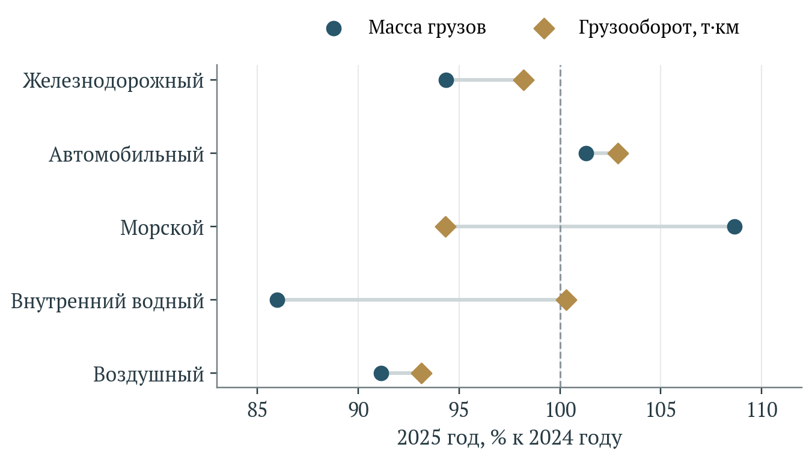
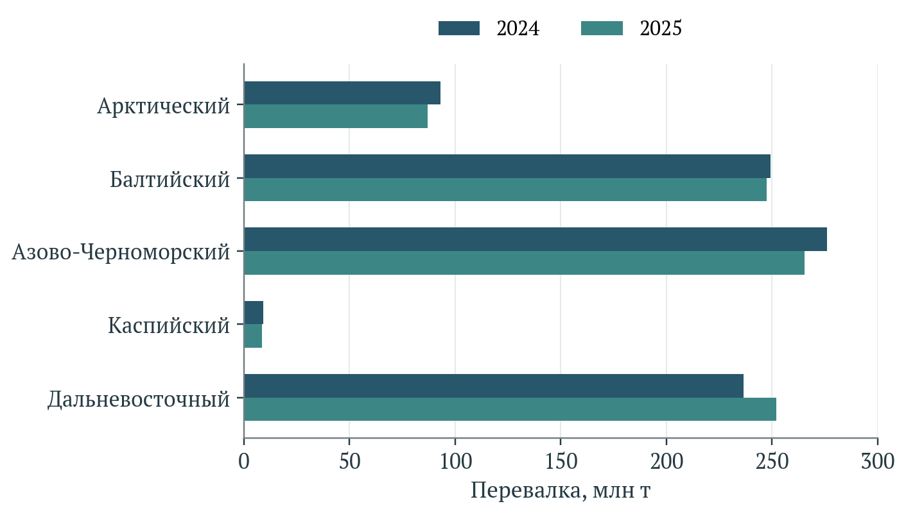
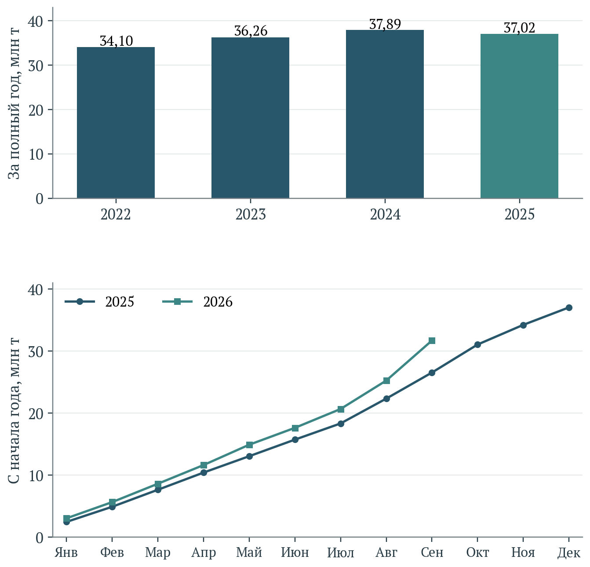
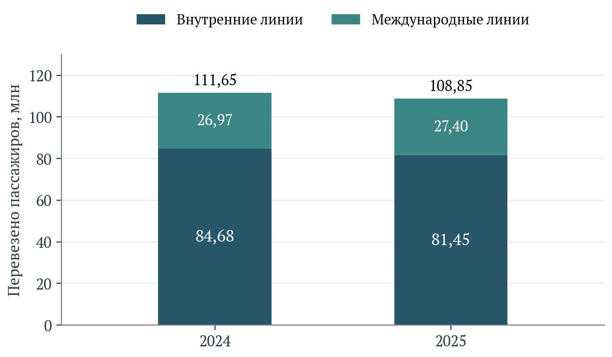
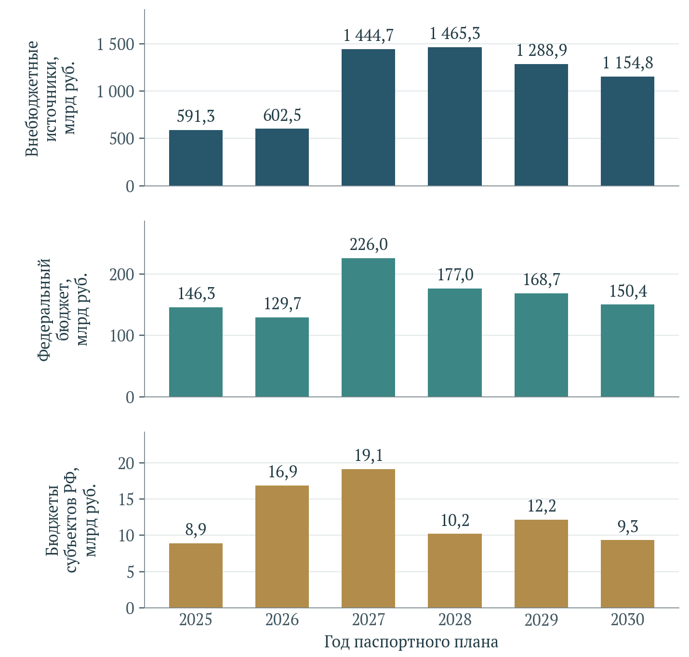
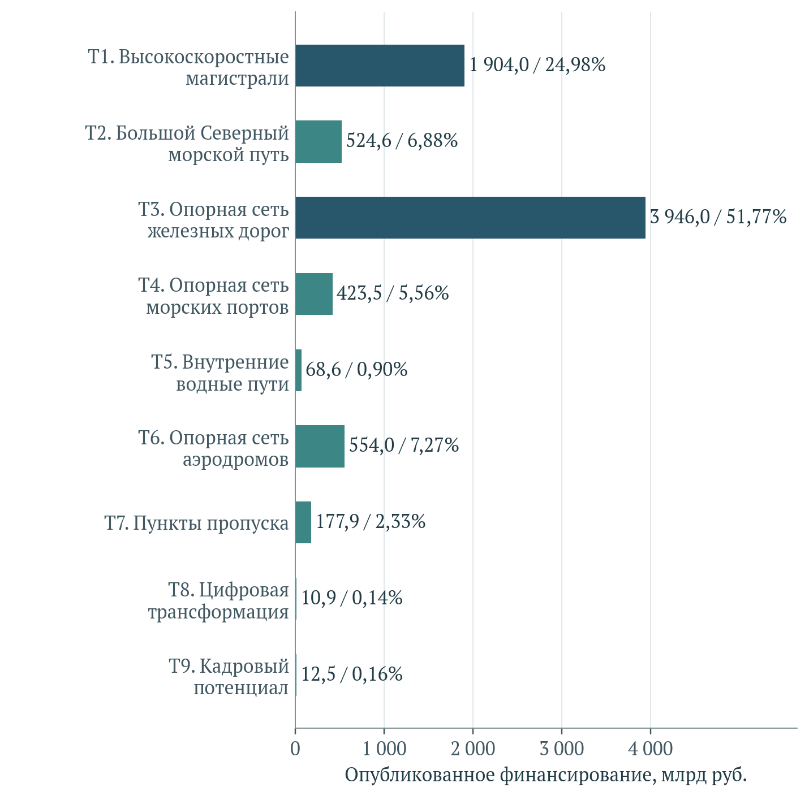
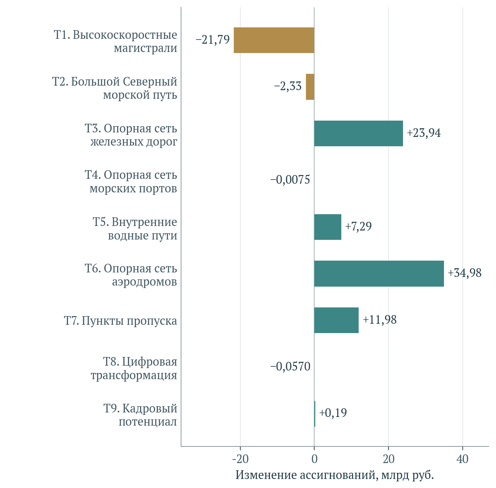
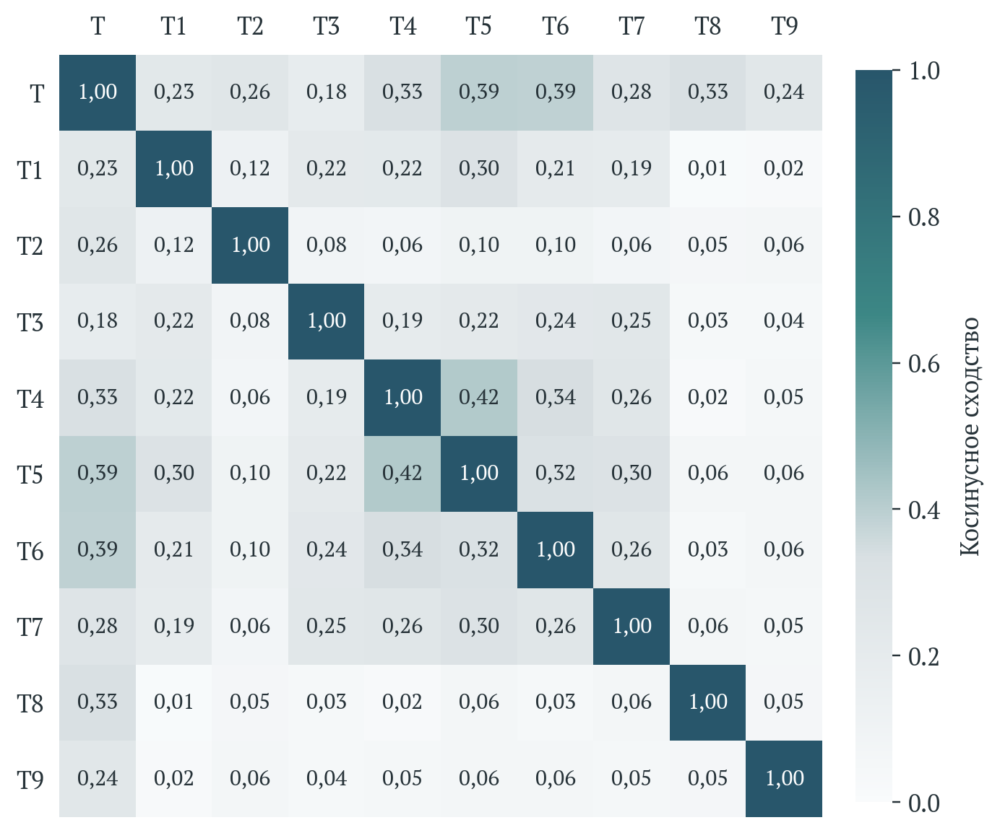
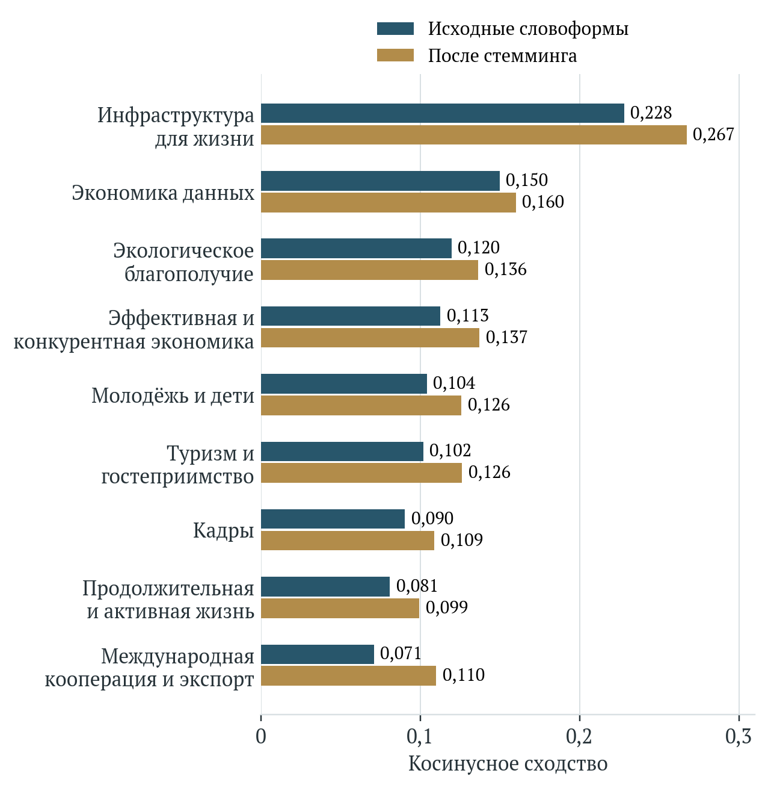

[B0; ] ФЕДЕРАЛЬНОЕ ГОСУДАРСТВЕННОЕ БЮДЖЕТНОЕ УЧРЕЖДЕНИЕ НАУКИ
ФЕДЕРАЛЬНЫЙ НАУЧНО-ИССЛЕДОВАТЕЛЬСКИЙ
СОЦИОЛОГИЧЕСКИЙ ЦЕНТР
РОССИЙСКОЙ АКАДЕМИИ НАУК

[B1; ] УТВЕРЖДАЮ

[B2; ] И. о. директора ФНИСЦ РАН

[B3; ] д. соц. н., проф.

[B4; ] ____________ Ю. А. Зубок

[B5; ] «___» ____________ 2026 г.

[B6; ] ОТЧЁТ
О НАУЧНО-ИССЛЕДОВАТЕЛЬСКОЙ РАБОТЕ

[B7; ] Тема

[B8; Title] ЭКСПЕРТИЗА НАЦИОНАЛЬНОГО ПРОЕКТА
«ЭФФЕКТИВНАЯ ТРАНСПОРТНАЯ СИСТЕМА»

[B9; ] Москва
2026

[B11; ] СОДЕРЖАНИЕ

[B12; TOC1] Основные результаты экспертизы	4

[B13; TOC1] 1 Предмет экспертизы и критерии оценки	8

[B14; TOC2] 1.1 Назначение проекта и границы исследования	8

[B15; TOC2] 1.2 Источники и сопоставимость свидетельств	9

[B16; TOC2] 1.3 Экономические механизмы транспортных изменений	11

[B17; TOC2] 1.4 Доступность сообщения и демографические различия	13

[B18; TOC1] 2 Структура проекта и целевые ориентиры	15

[B19; TOC2] 2.1 Нормативный периметр и структура измерения	15

[B20; TOC2] 2.2 Цели, базовые даты и статус годовых сведений	17

[B21; TOC1] 3 Методики расчёта и содержание показателей	24

[B22; TOC2] 3.1 Агрегированный индекс мощности транспортной сети	24

[B23; TOC2] 3.2 Железнодорожная провозная способность и сопряжение направлений	25

[B24; TOC2] 3.3 Морская и внутренняя водная инфраструктура	26

[B25; TOC2] 3.4 Пассажирское сообщение, аэродромы и пункты пропуска	29

[B26; TOC2] 3.5 Цифровизация и расчёт эффективности инвестиций	32

[B27; TOC2] 3.6 Кадровые результаты и требования к реестру	34

[B28; TOC1] 4 Наблюдаемые результаты и территориальные различия	36

[B29; TOC2] 4.1 Границы наблюдаемого результата	36

[B30; TOC2] 4.2 Сопоставление целей и результатов 2025 года	37

[B31; TOC2] 4.3 Масса грузов и транспортная работа	40

[B32; TOC2] 4.4 Железнодорожные коридоры и унаследованная мощность	42

[B33; TOC2] 4.5 Морские бассейны: ввод мощности и фактическая перевалка	43

[B34; TOC2] 4.6 Севморпуть: годовой результат, транзит и сезонность	45

[B35; TOC2] 4.7 Внутренние водные пути и безопасность сооружений	48

[B36; TOC2] 4.8 Авиация: пропускная способность и выполненные поездки	49

[B37; TOC2] 4.9 Пункты пропуска и сквозная транспортная цепочка	51

[B38; TOC2] 4.10 Доступность для населения и пределы территориальных выводов	52

[B39; TOC2] 4.11 Цифровизация, кадры и обоснованность итоговой оценки	54

[B40; TOC1] 5 Финансовое обеспечение и экономическая обоснованность	57

[B41; TOC2] 5.1 Финансовый масштаб, источники и концентрация	57

[B42; TOC2] 5.2 Консолидация перечислений и внутренняя согласованность	62

[B43; TOC2] 5.3 Федеральный бюджет и изменение плановых редакций	64

[B44; TOC2] 5.4 Исполнение и пределы кассового показателя	67

[B45; TOC2] 5.5 Внебюджетные средства и долгосрочный государственный риск	68

[B46; TOC2] 5.6 Стоимость дополнительного результата и прослеживаемость расходов	70

[B47; TOC1] 6 Связи мероприятий с показателями и согласованность текстов	75

[B48; TOC2] 6.1 Документальные отношения и границы их интерпретации	75

[B49; TOC2] 6.2 Лексическая близость внутри проекта и между проектами	77

[B50; TOC2] 6.3 Содержательная проверка предложенных связей	81

[B51; TOC2] 6.4 Требования к раскрытию межпроектных зависимостей	84

[B52; TOC1] 7 Экспертное заключение и направления совершенствования	85

[B53; TOC2] 7.1 Общая оценка конструкции проекта	85

[B54; TOC2] 7.2 Приоритетные изменения мониторинга	87

[B55; TOC2] 7.3 Оценка последствий для территорий и населения	89

[B56; TOC2] 7.4 Проверка дополнительного эффекта и финансовой устойчивости	90

[B57; TOC1] Список использованных источников	93

[B58; Heading1] Основные результаты экспертизы

[B59; ] Экспертиза национального проекта «Эффективная транспортная система» подготовлена по состоянию открытых источников на 29 октября 2026 года. Исследованы состав девяти федеральных проектов, целевые траектории, действующие методики, доступная статистика, финансовые планы и связи мероприятий с показателями. Основное паспортное сопоставление относится к версии 26.35 с меткой обновления 16 октября 2026 года. Дата обновления вторичного представления сохранена отдельно от даты утверждения документа. [1]

[B60; ] Проект объединяет технически взаимосвязанные направления развития транспорта. При этом система показателей охватывает разные экономические объекты: расчётную мощность, фактические перевозки, минимальное время поездки, документооборот и образовательные результаты. Между ними отсутствует автоматический переход. Введённая мощность становится общественным результатом при наличии спроса, готовности смежных звеньев и доступной для пользователя услуги. Совокупную эффективность проекта нельзя достоверно определить одним средним процентом выполнения разнородных показателей.

[B61; ] Проверка методик выявила существенные ограничения сопоставимости. В выбранном представлении паспорта целевое значение индекса мощности сети на 2030 год составляет 177% относительно базового уровня 2024 года. Индекс цифровой трансформации использует прогноз пяти миллиардов документов 2030 года в знаменателе, поэтому не показывает текущую долю электронных документов. [2]

[B62; ] Новая методика авиационной подвижности фиксирует население на 1 января 2023 года, заменяя прежний меняющийся знаменатель. Месячные показатели обучения по нормативному правилу повторяют годовой результат предыдущего года. Методические изменения требуют сохранения редакций и временной принадлежности каждого наблюдения. [3]

[B63; ] Статистическая основа включает 442 числовых наблюдения по 22 показателям. Региональные разрезы в исследованных таблицах отсутствуют. Последние периоды неодинаковы, повторяющиеся месячные значения могут отражать сохранение технической мощности либо предусмотренное методикой использование сведений предыдущего периода. Для таких рядов число строк не равно числу независимых наблюдений. Региональные рейтинги и прогнозы, основанные на механическом продолжении повторяющихся уровней, не получили бы достаточного эмпирического основания.

[B64; ] По Северному морскому пути в 2025 году перевезено 37,02 млн т при цели выбранной редакции 35,1 млн т. Одновременно результат ниже 37,89 млн т 2024 года. За январь–сентябрь 2026 года опубликовано 31,68 млн т против 26,52 млн т за сопоставимый период 2025 года, увеличение составляет 19,46%. По морским портам в единой редакции бюллетеня Минтранса общая перевалка сократилась с 863,8003 до 860,7673 млн т, при росте Дальневосточного бассейна. Выполнение плана, изменение потока и перераспределение между территориями представляют самостоятельные результаты. [4]

[B65; ] Опубликованный плановый объём финансирования составляет 7 622,134 млрд руб. за 2025–2030 годы. Внебюджетные источники формируют 85,90%, федеральный источник – 13,09%, бюджеты субъектов – 1,00%. На высокоскоростные магистрали и опорную сеть железных дорог приходится 76,75% суммы. В 2027–2030 годах сосредоточено 80,38% плана. Арифметическая согласованность опубликованных строк подтверждена, однако она не удостоверяет договорную обеспеченность всех ресурсов и отсутствие повторного отражения межбюджетных перечислений. [5]

[B66; ] Федеральные бюджетные предложения на 2027–2029 годы составляют 426,2297 млрд руб. Их различие с паспортной федеральной суммой рассматривается как расхождение плановых редакций и статусов. По цифровому проекту 6,382354 млрд руб., или 58,54% опубликованного объёма, не распределены между двумя показанными результатами. Разность характеризует недостаточность публичной детализации и не доказывает утрату средств. Для ВСМ требуется оценка обязательств за пределами окончания федерального проекта в 2028 году, поскольку концессионная конструкция рассчитана на сорок лет. [6]

[B67; ] Структурный анализ десяти паспортов выявил 54 сочетания результата и показателя, связанных общей задачей. Отдельный лексический анализ в корпусе из 137 документов после устранения повторяющихся наименований и применения порога сходства 0,10 предложил 36 сочетаний для содержательной проверки. Географические ложные совпадения и опосредованные связи показывают пределы автоматического анализа. Коэффициенты сходства используются для исследования формулировок и не интерпретируются как величина причинного эффекта.

[B68; ] Главный приоритет дальнейшего развития мониторинга состоит в соединении объекта, финансового обязательства, даты готовности, фактического использования и изменения условий перевозки. Для населения необходимы полное время и стоимость поездки, регулярность сообщения и различия доступности между территориями и социальными группами. Для экономики – согласованная провозная способность маршрута, надёжность доставки и издержки пользователя. Наиболее крупные инвестиции требуют проверки сценариев спроса, стоимости жизненного цикла и распределения долгосрочного риска. Предложенная система рекомендаций позволяет развивать оценку на основе действующих паспортов, сохраняя проверяемость каждого вывода.

[B69; Heading1] 1 Предмет экспертизы и критерии оценки

[B70; Heading2] 1.1 Назначение проекта и границы исследования

[B71; ] Национальный проект «Эффективная транспортная система» объединяет развитие магистральной инфраструктуры, пограничных переходов, цифровых сервисов и отраслевых кадров. В открытом представлении паспорта установлен период с 1 января 2025 г. по 31 декабря 2030 г. Целевая установка связывает расширение Единой опорной транспортной сети с удовлетворением потребностей населения и экономики, включая международные перевозки. Национальный уровень объединяет девять федеральных проектов. Предмет экспертизы составляет обоснованность связи между их мероприятиями, выделяемыми ресурсами и измеряемыми результатами. [7]

[B72; ] Оценка подготовлена по состоянию источников на 29 октября 2026 г. Для паспортных сопоставлений используется версия 26.35, представленная на странице национального проекта с отметкой обновления 16 октября 2026 г. Дата обновления электронной страницы характеризует размещённое представление документа. Даты утверждения и изменения обязательств устанавливаются по соответствующим нормативным и распорядительным актам. Статистические наблюдения, планы, бюджетные предложения и авторские расчёты рассматриваются с сохранением собственных периодов и оснований. [8]

[B73; ] Границы национального проекта имеют существенное значение для содержательной оценки. Дорожное хозяйство и городской общественный транспорт в значительной части относятся к проекту «Инфраструктура для жизни». Производство транспортной техники, обеспечение экспортной грузовой базы, развитие туризма и подготовка работников также охватываются другими программами. Рост пассажиропотока или грузооборота зависит от совместного действия этих направлений. Отнесение всего отраслевого изменения к одному национальному проекту создаёт риск неверной оценки его вклада. Повторное отнесение одного результата нескольким программам ведёт к двойному учёту.

[B74; ] Правительственная дорожная карта увеличения перевозок по международным транспортным коридорам охватывает пять направлений: «Север – Юг», Азово-Черноморское, Северо-Западное, Восточное и Северный морской путь. В официальном сообщении прямо обозначено участие нескольких национальных проектов и необходимость формирования грузовой базы. Поэтому оценка транспортной системы должна учитывать согласованность инфраструктуры, коммерческого спроса и условий пересечения границ. [9]

[B75; ] Для населения предметом оценки выступают достижимые поездки, время и надёжность сообщения, стоимость перемещения и возможность пользоваться транспортом в течение всего года. Для экономики – доступ к рынкам, предсказуемость поставок, транспортные издержки и согласованная пропускная способность маршрутов. Выполнение строительного графика и достижение проектной мощности проверяются самостоятельно. Вывод об общественном результате требует дальнейшего наблюдения за использованием созданных объектов.

[B76; Heading2] 1.2 Источники и сопоставимость свидетельств

[B77; ] Источниковая база объединяет электронные представления паспортов национального и федеральных проектов, действующие методики расчёта показателей, статистические таблицы ЕМИСС, официальные отраслевые отчёты и бюджетные документы. Паспортные сведения используются для восстановления целей, состава мероприятий и планового финансирования. Методики определяют экономический смысл числителя и знаменателя, периодичность, порядок уточнения и допустимые замены отсутствующих сведений. Статистические публикации устанавливают доступный результат за конкретный период. Бюджетные документы задают объём и юридический статус финансовых назначений.

[B78; ] Для каждого сопоставления сохраняются год или накопительный период, единица измерения, редакция цели, дата получения данных и статус оценки. Значение за январь–сентябрь сопоставляется с тем же периодом предыдущего года. Годовая цель проверяется по годовой величине либо по декабрю, когда такой порядок прямо установлен методикой. Повторение уровня в нескольких месячных колонках исследуется с учётом порядка расчёта. Наличие двадцати одной отметки в таблице может сопровождаться лишь несколькими содержательно различными состояниями показателя.

[B79; ] Открытые материалы неодинаково раскрывают документы, статистику и территориальную принадлежность объектов. В исследованном статистическом срезе преобладают общероссийские показатели. Для регионального анализа необходимы дополнительные сведения по маршрутам, портам, аэропортам, участкам железных дорог и пунктам пропуска. Присвоение национального значения всем субъектам Федерации создало бы искусственную пространственную картину. Региональные сопоставления в настоящей экспертизе ограничены географией тех источников, которые непосредственно раскрывают соответствующие объекты или направления.

[B80; ] При расхождении официальных публикаций устанавливается предмет различия: период, ведомственный охват, единица, методика либо пересмотр данных. Выбор одного числа производится при наличии достаточных оснований. В остальных случаях сохраняются обе версии и обозначается предел возможного сопоставления. Подобная процедура особенно существенна для перевозок различными видами транспорта, перевалки в морских портах и показателей авиации. Суммирование пассажиров, тонн и километров допускается только в пределах содержательно определённой метрики.

[B81; ] Лексическое исследование паспортов применяется для проверки согласованности формулировок и поиска связей, требующих содержательного рассмотрения. Отдельно учитываются документальная принадлежность результата задаче, совпадение задачи результата и показателя, а также близость текстов. Количественные характеристики этих отношений раскрыты в главе 6. Причинная оценка предусматривает наблюдение сопоставимых объектов до и после ввода инфраструктуры и отдельное обоснование группы сравнения. [10]

[B82; Heading2] 1.3 Экономические механизмы транспортных изменений

[B83; ] Транспортная инфраструктура влияет на хозяйственную деятельность через изменение стоимости и условий перемещения. Полные издержки включают тариф, время в пути, ожидание, хранение запасов и последствия непредсказуемой доставки. Уменьшение одного компонента может сопровождаться ростом другого. Например, сокращение времени движения по магистрали сохраняет ограниченный эффект при длительном ожидании пограничного оформления или перегрузки. Экономическая оценка должна охватывать путь между отправителем и получателем. Исследования пространственной экономики рассматривают транспортные улучшения через доступ к рынкам, изменение размещения производства и общие равновесные последствия. [11]

[B84] C = P + vT + R

$$
C=P+vT+R
$$

[B85; ] Здесь C обозначает обобщённые издержки одной перевозки, P – денежные платежи, T – время движения и ожидания, v – стоимость единицы времени для рассматриваемого груза или пассажира, R – ожидаемые потери от ненадёжности сообщения. Формула представляет аналитическую схему для организации наблюдений. Денежная оценка времени и ненадёжности требует самостоятельного обоснования применительно к цели поездки, свойствам груза и участникам перевозки. Одинаковый коэффициент для всех пользователей скрыл бы существенные различия.

[B86; ] Сетевой характер транспорта ограничивает полезность изолированной оценки отдельных объектов. Для последовательного маршрута с одной категорией груза, единым временным интервалом и сопоставимыми условиями работы предельный поток задаётся участком с наименьшей пропускной способностью. При наличии альтернативных путей, неодинаковой специализации терминалов и сезонных ограничений необходима более подробная модель распределения потоков.

[B87] Q ≤ minₖ Cₖ

$$
Q\leq\min_k C_k
$$

[B88; ] В приведённом выражении Q представляет допустимый поток по рассматриваемой цепи, C_{k} – эффективную пропускную способность её k-го звена. Увеличение мощности порта повышает возможный объём перевозок при достаточной провозной способности подходов, наличии флота, согласованном расписании и платёжеспособном спросе. Для Северного морского пути дополнительно существенны ледовые условия, ледокольное и аварийно-спасательное обеспечение, специализированный флот и готовность грузообразующих проектов.

[B89; ] Развитие магистралей способно перераспределять хозяйственную активность между территориями. Рост производства около одного узла может частично сопровождаться его сокращением в другом. Исследования рыночной доступности показывают необходимость учитывать прямые и косвенные сетевые связи между территориями. Для национального проекта из такого подхода следует требование различать совокупный дополнительный эффект, изменение географии перевозок и перенос потока между видами транспорта. [12]

[B90; ] При оценке общественной эффективности учитываются эксплуатационные и капитальные расходы, экономия времени, надёжность перевозок, безопасность и внешние воздействия. Дополнительные экономические эффекты требуют отдельного обоснования, чтобы одна и та же выгода не была учтена через экономию транспортных издержек и ещё раз через рост производительности. Международный транспортный форум рассматривает расширение анализа затрат и выгод при сохранении строгой процедуры оценки и учёта неопределённости. [13]

[B91; Heading2] 1.4 Доступность сообщения и демографические различия

[B92; ] Средняя подвижность населения отражает интенсивность пользования определённым видом транспорта. Распределение поездок между людьми может оставаться крайне неоднородным. Часто летающие пассажиры, жители крупных узлов и транзитные перевозки оказывают заметное влияние на средний показатель. Для социальной оценки необходимы сведения о доле населения, имеющей практически доступный маршрут, о регулярности сообщения и о соотношении стоимости поездки с доходами.

[B93; ] Территориальная доступность зависит от пути к станции, аэропорту или порту, расписания, возможности пересадки и полного времени поездки. Высокая скорость магистрального участка помогает пользователю при согласованности всех звеньев маршрута. Для жителей удалённых поселений существенное значение могут иметь частота сообщения, сезонность и надёжность рейса. Возраст, ограниченная мобильность, наличие детей и необходимость сопровождения изменяют приемлемые условия поездки. Обзор исследований доступности К. Гёрса и Б. ван Вее обосновывает совместный учёт транспортных, пространственных, временных и индивидуальных ограничений. [14]

[B94] A(τ) = [Σᵢ Nᵢ I(tᵢ ≤ τ) / Σᵢ Nᵢ] × 100

$$
A(\tau)=\frac{\sum_iN_iI(t_i\leq\tau)}{\sum_iN_i}\times100
$$

[B95; ] Здесь A(τ) – доля жителей, для которых полное время достижения выбранного пункта обслуживания не превышает τ, N_{i} – численность населения территории i, t_{i} – время поездки с учётом подхода и расписания. Индикаторная функция принимает единицу при выполнении условия доступности. Расчёт предполагает заранее определённую цель поездки и порог времени. Для различных возрастных и социальных групп показатель следует рассчитывать отдельно, сохраняя соответствующие численности населения в знаменателе.

[B96; ] Денежную доступность целесообразно оценивать через стоимость стандартной поездки для конкретного состава домохозяйства и располагаемые ресурсы той же группы. Средний тариф на пассажиро-километр характеризует лишь часть условий. Пересадки, расходы на подход к узлу, необходимость ночёвки и отсутствие дешёвого тарифа в подходящее время могут существенно увеличить фактическую стоимость. Соответствующие сведения требуют обследований и данных продаж с корректным обезличиванием.

[B97; ] Для транспортных проектов длительного цикла демографические предпосылки следует проверять по нескольким сценариям. Изменение численности и возрастной структуры населения влияет на спрос, а транспортные улучшения способны менять направления трудовых и образовательных поездок. В сценарии без рассматриваемого мероприятия сохраняются уже принятые инвестиционные решения и ожидаемые изменения экономики. Сценарий с мероприятием отличается конкретным вводом инфраструктуры и связанными изменениями обслуживания. Неопределённость спроса, стоимости строительства и срока ввода раскрывается раздельно. Подобный порядок используется в руководствах по транспортному прогнозированию и оценке неопределённости. [15]

[B98; Heading1] 2 Структура проекта и целевые ориентиры

[B99; Heading2] 2.1 Нормативный периметр и структура измерения

[B100; ] Система показателей национального проекта «Эффективная транспортная система» объединяет техническую мощность инфраструктуры, фактические перевозки, доступную скорость сообщения, цифровой документооборот и подготовку кадров. Между перечисленными объектами отсутствует единая натуральная единица измерения. Экспертная оценка поэтому должна предварительно устанавливать, характеризует ли показатель состояние объекта, поток за период, накопленный результат нескольких лет или расчётную величину, полученную при заданных технических предпосылках. Сведение таких величин к проценту выполнения плана сохраняет смысл только после проверки соответствующей методики и редакции цели. [16]

[B101; ] Выбранное представление паспорта национального проекта имеет версию 26.35 и метку обновления 16 октября 2026 года, 16:35. В нём предусмотрено девять федеральных проектов, пять собственных показателей национального уровня и двадцать карточек показателей федеральных проектов. Авиационная подвижность, перевозки в акватории Северного морского пути и цифровая трансформация грузоперевозок одновременно представлены на двух уровнях. После устранения повторения получаются двадцать два самостоятельных показателя. Каталожные позиции прежних кадровых показателей сохраняются в статистическом реестре, однако наличие их названий не подтверждает включение в выбранную действующую редакцию. [17]

[B102; ] Период национального проекта составляет 2025–2030 годы. Для федерального проекта «Развитие высокоскоростных железнодорожных магистралей» представление устанавливает завершение 31 декабря 2028 года. Дата завершения проектной карточки характеризует организационный горизонт соответствующего проекта и сама по себе не определяет срок эксплуатации инфраструктуры или всех связанных договорных обязательств. Остальные восемь федеральных проектов представлены с окончанием в 2030 году. Публикация DataBudget является вторичным представлением сведений. Метка её обновления и номер версии не заменяют дату и реквизиты решения об утверждении паспорта. Нормативные методики ссылаются на утверждение национального проекта протоколом от 20 декабря 2024 года №12пр. [18]

[B103; Caption] Таблица 1 – Федеральные проекты в выбранном представлении паспорта

[B104; таблица 1]
Код | Полное наименование | Версия | Период
Т1 | Развитие высокоскоростных железнодорожных магистралей [19] | 26.8 | 01.01.2025–31.12.2028
Т2 | Развитие Большого Северного морского пути [20] | 26.34 | 01.01.2025–31.12.2030
Т3 | Развитие опорной сети железных дорог [21] | 26.7 | 01.01.2025–31.12.2030
Т4 | Развитие опорной сети морских портов [22] | 26.7 | 01.01.2025–31.12.2030
Т5 | Развитие опорной сети внутренних водных путей [23] | 26.18 | 01.01.2025–31.12.2030
Т6 | Развитие опорной сети аэродромов [24] | 26.31 | 01.01.2025–31.12.2030
Т7 | Развитие пунктов пропуска через Государственную границу Российской Федерации [25] | 26.12 | 01.01.2025–31.12.2030
Т8 | Цифровая трансформация транспортной отрасли [26] | 26.11 | 01.01.2025–31.12.2030
Т9 | Развитие кадрового потенциала транспортной отрасли [27] | 26.5 | 01.01.2025–31.12.2030

[B105; SourceNote] Примечание. Все даты относятся к выбранному представлению. Дата обновления 16.10.2026 не является датой утверждения. [28]

[B106; ] Официальный указатель Росстата полезен для поиска методик, но обновление его отдельных разделов неодновременно. Национальный раздел продолжает показывать первоначальную методику авиационной подвижности, тогда как раздел аэродромов содержит заменивший её приказ. Для экспертизы требуется сопоставление самого нормативного акта, отменяющего положения и даты начала применения. За 2025–2026 годы проверены замены методик агрегированной мощности, цифровизации грузоперевозок, ГИС ТЭБ, обучения и авиационной подвижности. Совпадение названия показателя до и после такой замены недостаточно для признания временного ряда однородным. [29]

[B107; Heading2] 2.2 Цели, базовые даты и статус годовых сведений

[B108; ] Национальная цель по мощности Единой опорной транспортной сети в выбранной редакции составляет 177 процентов в 2030 году. Для авиационной подвижности предусмотрено 1,08 единицы, для перевозок в акватории Северного морского пути – 109,1 миллиона тонн, для индекса цифровой трансформации – 6,5 процента, для доли обученных – 0,64 процента. Значения описывают плановую траекторию конкретного представления паспорта. Использование ранее опубликованных ориентиров при сопоставлении с этой редакцией создаёт самостоятельную ошибку даже при правильном воспроизведении статистического факта. [30]

[B109; ] Базовая дата в проектной карточке и экономический базис формулы нуждаются в раздельной проверке. Для индекса мощности паспортная метка базового значения указана как 1 января 2024 года. Методика №432 строит соответствующие знаменатели по итогам 2024 года и состоянию инфраструктуры на конец этого года. В реестре следует сохранять обе характеристики с пояснением их назначения. Аналогично нормативное накопление портового прироста начинается с 1 января 2025 года, даже если карточка содержит более раннюю дату нулевого базового значения. [31]

[B110; ] Понятие декабрьского значения имеет несколько различных значений. Для индекса мощности годовой результат приравнивается к последнему месяцу с возможностью уточнения компонентов к 18 апреля следующего года. Для индекса цифровизации также установлено равенство годовому декабрьского значения, предусмотрено последующее уточнение. Для перевозок Северного морского пути декабрь завершает накопление с января, однако административные сообщения проверяются по поступающим позже годовым формам. Для показателей обучения месяцы отражают предыдущий отчётный год. Универсальное правило «декабрь равен результату текущего года» нормативно не подтверждается. [32]

[B111; ] Ряд методик разрешает перенос предыдущего значения при непредставлении компонентов. Горизонтальный участок ряда способен отражать отсутствие нового расчётного основания, сохранение мощности до ввода объекта или установленное запаздывание данных. Нулевые значения также требуют проверки экономического содержания. Нулевой прирост введённой мощности допустим, пропуск целевого значения имеет иной статус. Для каждого наблюдения целесообразно хранить дату состояния, период накопления, дату публикации, стадию уточнения и признак использования прошлых компонентов. Подобная запись позволяет воспроизводить сравнение без произвольного заполнения пропусков. [33]

[B112; Caption] Таблица 2 – Цели показателей национального проекта в выбранной редакции

[B113; таблица 2]
Код | Показатель | Ед. изм. | 2025 | 2026 | 2027 | 2028 | 2029 | 2030
Т.1 | Авиационная подвижность населения Российской Федерации | ед. | 0,75 | 0,77 | 0,79 | 0,87 | 0,97 | 1,08
Т.2 | Рост мощности инфраструктуры Единой опорной транспортной сети | % | 102 | 105 | 118 | 160 | 160 | 177
Т.4 | Индекс цифровой трансформации грузоперевозок | % | 0,2 | 0,35 | 0,65 | 1,25 | 2,85 | 6,5
Т.5 | Объем перевозок грузов в акватории Северного морского пути | млн т | 35,1 | 38,2 | 68,6 | 85,1 | 105,5 | 109,1
Т.6 | Доля обученных на обновленном оборудовании от среднегодовой численности занятых в транспортной отрасли | % | 0,01 | 0,05 | 0,1 | 0,13 | 0,31 | 0,64

[B114; SourceNote] Примечание. Краткие коды сохраняют каталогическую нумерацию. Доли выражены в процентах, авиационная подвижность – в единицах. [34]

[B115; Caption] Таблица 3 – Цели самостоятельных показателей федеральных проектов

[B116; таблица 3]
Код | Показатель | Ед. изм. | 2025 | 2026 | Конечная цель
Т1.1 | Время в пути пассажиров и (или) багажа по маршруту "Москва – Санкт-Петербург" [35] | мин | 227 | 227 | 135 (2028)
Т3.1 | Суммарная провозная способность магистралей Восточного полигона [36] | млн т/год | 180 | 180 | 210 (2030)
Т3.2 | Суммарная провозная способность участков на подходах к морским портам Азово-Черноморского бассейна | млн т/год | 125,1 | 125,1 | 131 (2030)
Т3.3 | Суммарная провозная способность участков на подходах к морским портам Северо-Западного бассейна | млн т/год | 145,6 | 145,6 | 175,6 (2030)
Т3.4 | Провозная способность железнодорожной инфраструктуры Международного транспортного коридора «Север – Юг» | млн т/год | 8 | 10,2 | 20 (2030)
Т4.1 | Прирост мощности опорной сети морских портов на Восточном направлении [37] | млн т | 7 | 37,89 | 117,23 (2030)
Т4.2 | Прирост мощности опорной сети морских портов на Северо-Западном направлении | млн т | 10 | 25,5 | 66,2 (2030)
Т4.3 | Прирост мощности опорной сети морских портов на МТК «Север - Юг» | млн т | 0 | 3,3 | 5,3 (2030)
Т4.4 | Прирост мощности опорной сети морских портов на Азово-Черноморском направлении | млн т | – | 14,3 | 38,6 (2030)
Т5.1 | Обеспеченность прохода судов с осадкой 3,6 м на ЕГС [38] | % | 89,8 | 90,3 | 99 (2030)
Т5.2 | Доля судоходных гидротехнических сооружений, удовлетворяющих требованиям к дальнейшей эксплуатации | % | 94,3 | 94,6 | 94,9 (2030)
Т6.1 | Рост пропускной способности инфраструктуры опорной сети аэродромов | операций/ч | 541 | 543 | 744 (2030)
Т6.2 | Рост расчетного пассажиропотока аэродромов опорной сети [39] | пасс./ч | 104545 | 104967 | 143492 (2030)
Т7.1 | Пропускная способность автомобильных пунктов пропуска (нарастающим итогом) [40] | Тысяча единиц | 6220,8 | 6220,8 | 19642,8 (2030)
Т7.2 | Пропускная способность железнодорожных пунктов пропуска (нарастающим итогом) | млн т/год | 24,2 | 24,2 | 52,7 (2030)
Т8.1 | Индекс роста эффективности бюджетных инвестиций в транспортную инфраструктуру от реализации проектов, получивших заключение об уровне эффективности в ГИС ТЭБ [41] | % | 100 | 100 | 101 (2030)
Т9.2 | Численность обучающихся в период освоения учебных программ, прошедших подготовку на приобретаемых в рамках федерального проекта «Развитие кадрового потенциала транспортной отрасли» тренажерных устройствах и учебных судах [42] | тыс. чел. | 0,2 | 1,77 | 23,21 (2030)

[B117; SourceNote] Примечание. Три повторяющихся показателя НП не включены второй раз. Прочерк – цель 2025 не опубликована, не ноль. Конец Т1 – 2028.

[B118; Caption] Таблица 4 – Методические режимы расчёта и ограничения сопоставления

[B119; таблица 4]
Семейство | Нормативный акт | Период и объект | Контрольное условие
ЕОТС | №432, 10.12.2025 [43] | Конец месяца и года | Декабрь с уточнением до 18 апреля. Веса и база 2024
Железнодорожная сеть | №421, 28.11.2024 [44] | Техническая годовая мощность на дату | Сетевой алгоритм уже учитывает ограничивающие сечения
Морские порты | №384, 30.10.2024 [45] | Приращение с 01.01.2025 | Годовой поток грузов имеет другую семантику
Водные пути и СГТС | №407, 18.11.2024 [46] | Состояние на конец месяца | Протяжённость ЕГС и число декларируемых сооружений
СМП | №1/2316-П,28.11.2024 [47] | Поток с начала каждого года | Годовые формы уточняют оперативные сообщения
ВСМ | №389, 02.11.2024 [48] | Минимальное время за период | Различаются условия поездки до и после запуска ВСМ
Авиация | №386, 28.08.2026 и №388, 01.11.2024 [49] | Перевозки с начала года и мощность на дату | Население 01.01.2023 с августа 2026, расчётные пассажиры в час
Пункты пропуска | №357, 10.10.2024 [50] | Мощность выбранных пунктов на дату | При отсутствии паспортной базы – фактическая мощность 2023
Цифровой документооборот | №317, 09.07.2026 [51] | С начала каждого отчётного года | Деление на прогноз 5 млрд документов 2030
ГИС ТЭБ | №372, 01.11.2025 [52] | Месяц, квартальные компоненты и год | Приведённая работа и инвестиции имеют разные сроки
Обучение | №174, 29.05.2025 [53] | Годовой, месяцы повторяют предыдущий год | Декабрьская месячная строка не удостоверяет годовой итог

[B120; SourceNote] Примечание. Годовой поток, состояние мощности, накопление с начала проекта и запаздывающий кадровый итог различаются по экономическому смыслу.

[B121; Heading1] 3 Методики расчёта и содержание показателей

[B122; Heading2] 3.1 Агрегированный индекс мощности транспортной сети

[B123; ] Приказ Минтранса России от 10 декабря 2025 года №432 заменил приказ от 21 апреля 2025 года №139. Индекс мощности формируется из грузового и пассажирского компонентов с весами 0,72 и 0,28. Внутри грузового компонента железнодорожная инфраструктура получает вес 0,55, морские порты – 0,37, внутренние водные пути – 0,04, автомобильные пункты пропуска – 0,01, железнодорожные пункты пропуска – 0,03. Пассажирский компонент объединяет аэродромы, высокоскоростное железнодорожное сообщение и оба вида пунктов пропуска. Веса закрепляют структуру базового года и не означают равенства экономических эффектов отдельных проектов. [54]

[B124] Mₜ = (0,72 K₍g,t₎ + 0,28 K₍p,t₎) × 100

$$
M_t=(0.72K_{g,t}+0.28K_{p,t})\times100
$$

[B125; ] В формуле M_{t} обозначает индекс мощности периода t, K_{g,t} и K_{p,t} – грузовой и пассажирский компоненты того же периода относительно базового уровня 2024 года.

[B126; ] Для высокоскоростного сообщения используется обратное отношение времени поездки. Сокращение времени повышает соответствующий компонент индекса, хотя непосредственная единица исходного показателя представляет минуты. Для внутренних водных путей учитывается произведение протяжённости ЕГС и доли участков с установленной осадкой. Портовый компонент соединяет базовую мощность с накопленными введёнными приращениями. Показатели пунктов пропуска входят одновременно в грузовой и пассажирский блоки. Следовательно, рост совокупного индекса должен сопровождаться объяснением вклада каждого элемента и связи между повторно используемыми исходными величинами. [55]

[B127; ] Для публичного мониторинга рекомендуется публиковать ежегодную декомпозицию изменения индекса в процентных пунктах с постоянными весами, значениями базовых знаменателей и перечнем пересмотренных компонентов. Декомпозиция позволяет установить, какая часть роста связана с реконструкцией, какая – с ускорением движения, какая – с изменением учётных параметров. Отдельно необходим анализ фактической загрузки введённой мощности в совпадающих границах. Сам агрегированный индекс характеризует потенциал инфраструктуры при нормативных допущениях. Количество доставленных грузов, доступность сообщения и выручка перевозчиков требуют самостоятельных наблюдений. [56]

[B128; Heading2] 3.2 Железнодорожная провозная способность и сопряжение направлений

[B129; ] Приказ Минтранса России от 28 ноября 2024 года №421 содержит четыре методики для Восточного полигона, подходов к портам Азово-Черноморского и Северо-Западного бассейнов, железнодорожной инфраструктуры международного транспортного коридора «Север – Юг». Провозная способность выражается в миллионах тонн в год. Месячное наблюдение характеризует годовую техническую возможность сети в состоянии на соответствующую дату. Сопоставление этого показателя с фактическим грузооборотом в тонно-километрах требует предварительного приведения объектов и единиц. [57]

[B130; ] Методики уже используют сетевое представление железных дорог, направленные связи, характерные сечения и ограничения пропускной способности. Принцип ограничивающего участка включён в расчёт. Для Восточного полигона используются установленные сечения, в том числе участки Новый Ургал – Комсомольск-Сортировочный и Известковая – Волочаевка I. Показатель направления «Север – Юг» опирается на железнодорожное сечение Дербент – Самур. Его граница не охватывает автоматически все морские, автомобильные и зарубежные участки международного коридора. [58]

[B131; ] Сохранение мощности на одном уровне до завершения работ предусмотрено самой логикой показателя. Для Восточного полигона месячные плановые значения связываются с годовым уровнем предыдущего года. Динамика по месяцам поэтому не обязана изображать плавное строительство новой мощности. Уточнение ежегодных данных производится после оперативной публикации, по установленному апрельскому сроку. Сравнивать следует одинаковые стадии оценки и один состав ограничивающих участков. [59]

[B132; ] Практическое развитие мониторинга состоит в раскрытии расчётных предпосылок: массы поездов, ремонтных окон, организации движения, технического состояния и доступности подходов к терминалам. На их основе можно рассчитывать диапазон реализуемой мощности при обычном режиме, длительном ремонте и неблагоприятном сценарии. Совместная публикация технического предела, фактического потока и отказов в согласовании перевозки по одному направлению показывает, где потенциал действительно становится услугой для грузоотправителя. Для международных направлений необходима проверка согласованности с пропускной способностью принимающей стороны.

[B133; Heading2] 3.3 Морская и внутренняя водная инфраструктура

[B134; ] Приказ от 30 октября 2024 года №384 определяет прирост мощности опорной сети морских портов по четырём направлениям. В расчёт входят мощности предусмотренных проектом терминалов на основании документов о вводе, инвестиционных деклараций и иных установленных подтверждений. Методика включает также предусмотренные временные рейдовые перегрузочные комплексы. Накопление начинается 1 января 2025 года. Значение за 2026 год поэтому может включать результаты ввода двух лет. Разность последовательных годовых состояний допустимо рассматривать как новое приращение только после проверки неизменности состава и отсутствия пересмотра прошлых вводов. [60]

[B135; ] Производственная мощность терминала, фактическая перевалка и перевозки морским транспортом относятся к разным операциям. Терминал может иметь резерв мощности при недостаточном железнодорожном подводе, нерегулярном флоте или ограничении внешнего спроса. Для оценки использования инвестиций рекомендуется рассчитывать загрузку отдельно по грузовой специализации и введённым объектам, сопоставляя поток с доступной мощностью того же терминала. Усреднение мощности и перевалки всего бассейна способно скрыть одновременный дефицит одной специализации и избыток другой.

[B136; ] Методика Госкорпорации «Росатом» от 28 ноября 2024 года №1/2316-П применяется с 1 января 2025 года. Объём перевозок в акватории Северного морского пути складывается из каботажных, импортных, экспортных и транзитных грузов. Географическая граница определяется акваторией, установленной Кодексом торгового мореплавания. Название федерального проекта «Развитие Большого Северного морского пути» имеет более широкий программный смысл, поэтому к показателю нельзя автоматически присоединять перевозки всех связанных маршрутов за пределами нормативной акватории. [61]

[B137; ] Месячный показатель формируется нарастающим итогом с начала отчётного года. Административная информация капитанов судов в дальнейшем верифицируется формами №1-СМП и №М-3. Для анализа международной конкурентоспособности следует выделять транзит, экспортное обслуживание арктических проектов и каботаж, поскольку источники спроса и инфраструктурные требования различаются. Срок доставки целесообразно измерять от согласованных начального и конечного событий, дополняя медиану верхним децилем, долей прибытия в обещанное окно и временем ожидания проводки. Сопоставление маршрутов требует одинаковых портов отправления и назначения, сезона, грузовой партии и состава включённых услуг. [62]

[B138; ] Приказ от 18 ноября 2024 года №407 устанавливает две существенно различные доли. Обеспеченность прохода судов с осадкой 3,6 метра представляет отношение протяжённости участков ЕГС с соответствующей гарантированной осадкой к общей протяжённости ЕГС. Географический знаменатель ограничен Единой глубоководной системой европейской части Российской Федерации. Показатель не характеризует все внутренние водные пути страны. Его длиновая природа также не отражает непосредственно число доступных дней навигации, фактическую загрузку судов или массу перевезённых грузов. [63]

[B139; ] Доля судоходных гидротехнических сооружений, удовлетворяющих требованиям к дальнейшей эксплуатации, включает объекты нормального и пониженного уровня безопасности. Знаменатель образуют подлежащие декларированию сооружения. Высокое значение совокупной доли поэтому совместимо с наличием объектов пониженного уровня и необходимостью выполнения мероприятий по повышению безопасности. Изменение числа декларируемых сооружений способно воздействовать на долю независимо от ремонта конкретного объекта. [64]

[B140; ] Для содержательного контроля следует отдельно публиковать числа объектов нормального и пониженного уровня, сроки исполнения предписаний и принадлежность к критическим участкам судоходства. По условиям осадки полезен дополнительный показатель доступных судоходных дней с соблюдением гарантированного габарита, рассчитанный для фиксированных участков. Его можно взвешивать по фактическому грузовому спросу, сохраняя невзвешенный ряд для прозрачности. Разделение последствий гидрологического режима, эксплуатационных ограничений и выполненных инженерных работ позволит обоснованнее выбирать дноуглубление, реконструкцию и режим содержания.

[B141; Heading2] 3.4 Пассажирское сообщение, аэродромы и пункты пропуска

[B142; ] Методика от 2 ноября 2024 года №389 определяет время по маршруту Москва – Санкт-Петербург как минимальное фактическое время поездки подходящего поезда за период. До запуска высокоскоростной магистрали рассматривается предусмотренный методикой поезд без промежуточных остановок, после запуска – высокоскоростной поезд с одной остановкой. Величина включает время движения и предусмотренной остановки. Целевые 135 минут в 2028 году относятся к такой спецификации. Для оценки пассажирского эффекта дополнительно нужны распределение фактического времени, частота удобных отправлений и полное время доступа к пункту назначения. [65]

[B143; ] Приказ от 28 августа 2026 года №386 заменил приложение №1 к приказу №388 от 1 ноября 2024 года. Новая авиационная подвижность определяется отношением всех пассажиров российских авиакомпаний на регулярных и нерегулярных перевозках к постоянному населению Российской Федерации на 1 января 2023 года. В числителе учитываются внутренние и международные перевозки. Статистическая единица перевозки допускает повторные перелёты одного человека и не ограничивает пассажиров только постоянными жителями Российской Федерации. [66]

[B144; ] Первоначальное приложение №1 к приказу №388 в месячной формуле использовало население на 1 января отчётного года. Переход к фиксированной численности 2023 года изменяет знаменатель. Приказ №386 предусматривает применение с месяца утверждения, поэтому его нельзя без отдельного подтверждения распространить на все наблюдения 2025 года. Для непрерывного аналитического ряда необходимо получить сопоставимый пересчёт либо обозначить границу методики. Декабрьская перевозка охватывает календарный год, однако официальный ежегодный результат и стадия его уточнения остаются самостоятельными характеристиками публикации. [67]

[B145; ] Рост авиационной подвижности может сопровождаться неодинаковой доступностью перелётов для территорий и доходных групп. Дополнительный мониторинг должен учитывать минимальную доступную частоту сообщения, долю отмен, цену сопоставимой поездки относительно дохода, сезонные перерывы и доступность пересадок. Разделение уникальных пользователей и частоты их перелётов также позволило бы установить, расширяется ли круг граждан, пользующихся услугой. Подобные измерения дополняют перевозочную статистику и требуют отдельного набора данных.

[B146; ] Приложения №2 и №3 к приказу №388 сохраняют действие после замены авиационной методики. Пропускная способность аэродромов выражается во взлётно-посадочных операциях в час. Расчётный пассажиропоток определяется через техническую способность и заданную вместимость воздушных судов. В методике предусмотрены вместимости 12 мест для ЛМС «Байкал», 68 для Ил-114 и 211 для МС-21. Получаемые пассажиры в час характеризуют расчётную возможность обслуживания. Реальное число пассажиров зависит дополнительно от расписания, используемого флота, загрузки и функционирования терминала. [68]

[B147; ] Показатели пунктов пропуска рассчитываются по приказу от 10 октября 2024 года №357. Автомобильный показатель выражается в тысячах транспортных средств за год, железнодорожный – в миллионах тонн в год. База и вводимые приращения относятся к предусмотренным проектом пунктам. Для железнодорожных пунктов при отсутствии утверждённой паспортной мощности допускается использование фактической пропускной способности по итогам 2023 года. Сопоставление расчётной мощности с подобной базой нуждается в раскрытии её происхождения. [69]

[B148; ] Практическая отдача расширения пунктов определяется совместной работой российских контрольных служб, прилегающей инфраструктуры и соседней стороны. Рекомендуется измерять время от прибытия в организованную очередь до выпуска, раздельно показывая ожидание, контроль и простои по внешним причинам. Доля прохождения в нормативный срок, медиана и верхний дециль характеризуют качество услуги при одной и той же годовой мощности. Открытый состав включённых пунктов необходим для исключения роста агрегата вследствие одного только расширения учётной совокупности.

[B149; Heading2] 3.5 Цифровизация и расчёт эффективности инвестиций

[B150; ] Приказ от 9 июля 2026 года №317 заменил приказ от 9 апреля 2025 года №128. Индекс цифровой трансформации грузоперевозок определяется отношением количества электронных перевозочных документов к фиксированному прогнозу пяти миллиардов документов на 2030 год. Расчёт ведётся с января 2025 года, числитель накапливается заново с начала каждого отчётного года. Значение индекса характеризует продвижение к заданному масштабу электронного документооборота. По нему невозможно непосредственно установить текущую долю электронных документов среди всех фактически оформленных документов или долю перевозимых грузов с цифровым сопровождением. [70]

[B151] Dₜ = Eₜ / (5 × 10⁹) × 100

$$
D_t=\frac{E_t}{5\times10^9}\times100
$$

[B152; ] В формуле D_{t} обозначает индекс цифровой трансформации периода t, E_{t} – число электронных перевозочных документов с начала отчётного года. Знаменатель представляет фиксированный прогноз документооборота на 2030 год.

[B153; ] Дополнительная оценка должна использовать фактический знаменатель сопоставимого документооборота, разделять виды документов и учитывать исправленные версии одного документа. Для связи с экономическим результатом нужны время оформления, доля ошибок, затраты участника и продолжительность межведомственного обмена. Резкий рост опубликованного индекса проверяется по изменению первичного охвата и методики до содержательного объяснения ускоренной цифровизацией. Нормативно предусмотренное приравнивание годового значения декабрьскому не устраняет необходимость такой проверки. [71]

[B154; ] Приказ от 1 ноября 2025 года №372 устанавливает индекс эффективности инвестиций, связанный с ГИС ТЭБ, взамен приказа №378 от 28 октября 2024 года. Формула прибавляет к 100 произведение отношения текущей расчётной эффективности к базовым 0,66 и доли федерального финансирования проектов, отобранных с использованием ГИС, умноженное на 100. Текущая эффективность определяется приростом приведённой транспортной работы относительно предыдущего периода, делённым на инвестиции в основной капитал организаций, не относящихся к субъектам малого предпринимательства. Распределение общего изменения пропорционально доле финансирования является правилом расчёта показателя. Причинный эффект применения ГИС данным правилом отдельно не устанавливается. [72]

[B155] I₍eff,t₎ = 100 + (Iₜ / I₂₀₂₄) × (Q₍project,t₎ / Q₍total,t₎) × 100

$$
I_{\mathrm{eff},t}=100+\frac{I_t}{I_{2024}}\times\frac{Q_{\mathrm{project},t}}{Q_{\mathrm{total},t}}\times100
$$

[B156; ] В формуле I_{eff} обозначает итоговый индекс, I_{t} – расчётную эффективность периода, I_{2024} – базовые 0,66 тонно-километра на рубль. Q_{project} и Q_{total} обозначают соответственно федеральное финансирование отобранных с применением ГИС проектов и общее федеральное финансирование инвестиционных мероприятий национального проекта.

[B157; ] Методика использует разные коэффициенты приведения пассажирооборота к грузообороту для видов транспорта, квартальные инвестиционные сведения и месячные транспортные сведения. Описание инвестиций указывает тысячи рублей, описание эффективности – тонно-километры на рубль. При воспроизведении необходим явный контроль преобразования единиц. Квартальная и годовая обработка инвестиционных компонентов различаются, а окончательные сведения поступают позднее оперативного индекса. Для содержательной оценки рекомендуется публиковать все компоненты, согласованный период сравнения, преобразование цен и инвестиционный лаг. Проверка результата отдельных проектов после ввода позволит сопоставить прогноз ГИС с реализованным потоком и скорректировать параметры модели. [73]

[B158; Heading2] 3.6 Кадровые результаты и требования к реестру

[B159; ] Приказ от 29 мая 2025 года №174 заменил приказ от 28 октября 2024 года №379. Численность подготовленных характеризует обучающихся, посетивших занятия на приобретённых тренажерных устройствах и учебных судах в установленном круге образовательных организаций транспортного комплекса. Значение накапливается с начала реализации проекта и соответствующего предоставления финансирования. Посещение занятий является промежуточным образовательным результатом. Успешное освоение компетенций, выпуск, получение допуска и последующая занятость требуют самостоятельного подтверждения. [74]

[B160; ] Доля обученных использует среднегодовую занятость в установленных видах транспортной деятельности с исключением трубопроводного и космического транспорта. Накопленный учебный результат соотносится с годовым состоянием занятости. Для обоих показателей месячная величина устанавливается равной годовому значению предыдущего отчётного года. Отдельный годовой результат публикуется до конца текущего года и уточняется до 1 марта следующего. Следовательно, отсутствие самостоятельной годовой записи не позволяет автоматически объявить декабрьскую месячную запись итогом обучения за текущий год. [75]

[B161; ] Развитие мониторинга требует связывания обезличенных учебных когорт с фактом освоения программы, независимой оценкой навыков, трудоустройством по транспортной специальности и сохранением занятости через установленный срок. Повторное обучение одного человека должно иметь отдельный признак. Дополнительно полезна обеспеченность конкретных критических профессий в регионах присутствия вводимых объектов. Общая численность обученных не показывает, совпадают ли специальность, место работы и момент выпуска с потребностью новой инфраструктуры.

[B162; ] Единый реестр показателей должен сохранять официальное название, каталожный и нормативный коды, действующую методику, редакцию цели, натуральную единицу, границу совокупности, знаменатель и временную семантику. Фактический ввод мощности, её расчётное использование и наблюдаемый общественный результат целесообразно связывать через конкретный объект или маршрут. При таком устройстве мониторинга выполнение проектных обязательств остаётся проверяемым, а экспертный анализ получает основание оценивать надёжность сообщения, доступность услуг и экономическую отдачу инфраструктуры.

[B163; Heading1] 4 Наблюдаемые результаты и территориальные различия

[B164; Heading2] 4.1 Границы наблюдаемого результата

[B165; ] Опубликованные результаты первого года национального проекта характеризуются сочетанием достигнутых инфраструктурных уровней и неоднородной динамики перевозок. По Севморпути объём 2025 года превысил выбранный плановый ориентир, одновременно оказавшись ниже результата 2024 года. Увеличение мощности портов сопровождалось небольшим сокращением общероссийской перевалки. В авиации снижение числа перевозок сочеталось с более устойчивым пассажирооборотом. Наблюдаемое сочетание требует оценивать ввод объектов, фактическое использование сети и доступность поездок как разные результаты. Из выполнения отдельного показателя мощности логически не следует увеличение всей транспортной работы. [76]

[B166; ] Статистическая основа проектного анализа включает 442 числовых наблюдения по 22 показателям, полученные из опубликованных таблиц ЕМИСС 15 октября 2026 года. Дата получения характеризует доступность информации для экспертизы и не заменяет дату официального выпуска. Отдельные годовые строки в этом массиве отсутствуют. Большинство значений представлены по месяцам, некоторые – нарастающим итогом. Последний доступный период неодинаков: у авиационной подвижности за 2026 год имеется только январь–март, у большинства остальных рядов – сентябрь. Пропуски октября–декабря 2026 года сохранены как отсутствие сведений. Нулевые показатели прироста портовой мощности выделены отдельно и не смешиваются с пропусками. [77]

[B167; ] Региональные разрезы проектных показателей в полученных таблицах отсутствуют. Поэтому ранжирование субъектов, пространственные корреляции и кластерная типология не строятся. Территориальная часть опирается на сопоставимые морские бассейны и документированные результаты отдельных инфраструктурных объектов. Их география различается с административными границами субъектов. Динамика сети РЖД или акватории Севморпути также не может автоматически распределяться между регионами пропорционально населению или протяжённости путей. Пропорциональное распределение создало бы числовую определённость, которой первичные данные не содержат.

[B168; Heading2] 4.2 Сопоставление целей и результатов 2025 года

[B169; ] Сравнение с целями выполнено по выбранным редакциям паспортов 2026 года. Оно показывает расстояние между опубликованным результатом и актуально представленным ориентиром, однако не удостоверяет исполнение первоначально утверждённого плана 2025 года. Для такого заключения дополнительно нужны история изменений паспорта и официальный отчёт об исполнении. Текущие цели доступны во вторичном представлении данных ЕПБС, поэтому в таблице сохранено указание на характер источника. [78]

[B170; ] В конце 2025 года индекс мощности Единой опорной транспортной сети составил 102 при цели 102. По методике № 432 годовое значение соответствует последнему месяцу и подлежит последующей верификации. В опубликованном ряду имеются 103 в октябре–ноябре и 102 в декабре. Снижение агрегированного индекса не доказывает физическую утрату построенной инфраструктуры: без компонентов и истории уточнений его механизм установить невозможно. Дополнительно необходимо согласовать паспортную базовую дату 1 января 2024 года с методическим использованием результатов компонентов за 2024 год. [79]

[B171; ] Декабрьский объём перевозок по Севморпути составил 37,02 млн т против цели 35,1 млн т. Разность равна 1,92 млн т, или 5,47% планового значения. Годовой объём независимо подтверждается отчётом Росатома. Авиационная подвижность опубликована на уровне 0,74 при цели 0,75. При округлении показателя до сотых разность составляет 0,01 единицы. Её нельзя превращать в точное число недополученных пассажиров без неокруглённого числителя, применённого населения и версии расчёта. [80]

[B172; ] Равенство наблюдения и цели у ряда мощностей означает достижение заданного уровня состояния. Оно не обязательно означает ввод мощности именно в 2025 году. У портового направления «Север – Юг» нулевое значение сопоставляется с нулевой целью без расчёта процента выполнения. Для Азово-Черноморского направления цель 2025 года в выбранной таблице отсутствует, поэтому нулевой результат не получает условной нулевой цели. Две кадровые метрики исключены из годового сравнения: приказ № 174 устанавливает использование предыдущего отчётного года в качестве месячного значения. [81]

[B173; Caption] Таблица 5 – Условное сопоставление опубликованных результатов на конец 2025 года с целями выбранной редакции паспортов

[B174; таблица 5]
Показатель | Единица | Цель 2025 | Значение | Разность
Мощность ЕОТС [82] | % к базе | 102 | 102 | 0
Авиационная подвижность [83] | ед. | 0,75 | 0,74 | −0,01
Грузы по Севморпути [84] | млн т | 35,10 | 37,02 | +1,92
Цифровая трансформация [85] | % | 0,20 | 0,39 | +0,19
Восточный полигон [86] | млн т/год | 180,0 | 180,0 | 0,0
Ж/д «Север – Юг» [87] | млн т/год | 8,0 | 10,2 | +2,2
Прирост мощности портов: Восток [88] | млн т | 7,0 | 15,0 | +8,0
Прирост мощности портов: СЗ [89] | млн т | 10,0 | 10,0 | 0,0
Длина ЕГС с осадкой 3,6 м [90] | % | 89,8 | 89,8 | 0,0
Пригодные к эксплуатации СГТС [91] | % | 94,3 | 96,7 | +2,4
Опорные аэродромы [92] | взлётов и посадок/ч | 541 | 541 | 0
Автомобильные пункты пропуска [93] | тыс. ед./год | 6 220,8 | 6 220,8 | 0,0

[B175; SourceNote] Примечание. Значения – декабрь 2025 года. Для потоков с накоплением охвачен календарный год, для инфраструктуры показано состояние на конец года. Стадия уточнения в таблицах не маркирована. Для портов сохранена исходная единица «млн т», которая характеризует введённую годовую мощность с накоплением прироста с 01.01.2025. Разность дана в единицах показателя, для процентов – в процентных или индексных пунктах. Цели взяты из редакций паспортов 2026 года, сопоставление не является официальной оценкой исполнения первоначального плана. Цифровой показатель имеет фиксированный знаменатель: плановый объём документов 2030 года. Кадровые месячные значения относятся к предыдущему отчётному году и не включены.

[B176; Heading2] 4.3 Масса грузов и транспортная работа

[B177; ] Сопоставление полных 2024 и 2025 годов показывает, почему массы грузов недостаточно для характеристики транспортного результата. В бюллетене Минтранса железнодорожный показатель массы отражает погрузку. Для внутреннего водного транспорта учтены суда смешанного плавания. Проценты изменения опубликованы по исходным данным, поэтому их предпочтительно сохранять непосредственно, избегая пересчёта по сильно округлённым уровням. На рисунке массы и тонно-километры приведены к общей базе 2024 года, но их экономический смысл остаётся различным. [94]

[B178] 

[B179; Caption] Рисунок 1 – Изменение массы грузов и грузооборота по видам транспорта в 2025 году

[B180; SourceNote] Примечание. Опубликованные индексы 2025 года к 2024 году. Масса железнодорожных грузов представлена погрузкой. Внутренний водный транспорт включает суда смешанного плавания. Тонно-километры учитывают дальность перевозки. [95]

[B181; ] Морские перевозки демонстрируют рост массы при сокращении грузооборота. У внутренних водных перевозок масса снизилась значительно сильнее транспортной работы. Расхождение динамики совместимо с изменением средней дальности и структуры грузов. Она сама по себе не доказывает изменение производительности судов, качества управления или эффект конкретного объекта. Для проверки этих объяснений нужны сведения о маршрутах, типах грузов, выполненных рейсах, времени оборота и составе флота. Отношение тонно-километров к тоннам допускает содержательную интерпретацию только при одинаковом охвате двух величин.

[B182; ] Погрузка на сети РЖД за январь–сентябрь 2026 года составила 824,4 млн т, что на 0,7% меньше соответствующего периода 2025 года. В сентябре погрузка сократилась на 1,2%, тогда как грузооборот вырос на 3,4%. Оперативные сведения подтверждают актуальность раздельного наблюдения объёма и дальности перевозок. Они не позволяют заключить, что весь год завершится с тем же темпом. Производственная сезонность, структура заявок и выполнение перевозок в последнем квартале остаются неизвестными на дату экспертизы. [96]

[B183; Heading2] 4.4 Железнодорожные коридоры и унаследованная мощность

[B184; ] Восточный полигон представлен уровнем провозной способности 180 млн т в год на протяжении всех доступных месяцев 2025–2026 годов. Минтранс указывает, что этот уровень достигнут в 2024 году. Следовательно, перенос его в начало нового национального проекта характеризует исходную инфраструктурную базу. Он не должен учитываться как дополнительный ввод первого года. Одновременно ведомство сообщает об увеличении экспортных перевозок по БАМу и Транссибу в 2025 году на 6,5%. Показатель экспортного потока имеет более узкий состав, чем общая провозная способность. [97]

[B185; ] Мощность подходов к Азово-Черноморскому бассейну составляет 125,1 млн т в год, к северо-западным портам – 145,6 млн т. На железнодорожном направлении «Север – Юг» опубликовано 10,2 млн т уже с января 2025 года при выбранной цели 2025 года 8 млн т. Поэтому положительная разность 2,2 млн т не измеряет прирост за этот год. Методика № 421 предусматривает сохранение месячного уровня предыдущего года до фактического увеличения мощности. Ровный ряд согласуется с этим порядком и не свидетельствует об отсутствии проектирования, строительства или иных работ. [98]

[B186; ] Загрузка коридора требует деления фактического потока на мощность при одинаковых границах участка, направлениях движения и составе перевозок. Общий обмен с Китаем включает иную совокупность перевозок. Его отношение к 180 млн т Восточного полигона не является корректным коэффициентом использования. Дополнительная мощность на одном участке может не дать соответствующего прироста сквозного потока при ограничениях подходов, терминалов или пограничных операций. Для инвестиционного решения важен наиболее ограниченный участок всей цепочки.

[B187; ] Показатель времени Москва – Санкт-Петербург сохраняет значение 227 минут. Методика использует минимальное время поезда за любой день периода, до ввода высокоскоростной магистрали – безостановочного «Сапсана». Поэтому наблюдение не описывает среднюю поездку пассажира, ожидание отправления и доступ к вокзалу. Строительные работы на будущей магистрали следует оценивать по готовности объектов, пока эксплуатационный эффект нового сообщения ещё не наблюдаем. [99]

[B188; Heading2] 4.5 Морские бассейны: ввод мощности и фактическая перевалка

[B189; ] За 2025 год прирост мощности портов составил 25 млн т при плане 17 млн т. В проектных таблицах восточное направление даёт 15 млн т, северо-западное – 10 млн т. Методика № 384 накапливает ввод с 1 января 2025 года за весь период федерального проекта и включает предусмотренные ею терминалы и временные рейдовые комплексы. Опубликованные 25 млн т восточного направления к сентябрю 2026 года содержат ввод двух календарных лет. Считать их вводом только 2026 года нельзя. [100]

[B190; ] В единой таблице Минтранса перевалка снизилась с 863,8003 до 860,7673 млн т. Дальневосточный бассейн вырос с 236,4934 до 252,0870 млн т, остальные четыре бассейна показали сокращение. Его доля увеличилась с 27,38 до 29,29%, то есть приблизительно на 1,91 процентного пункта. Территориальная перестройка агрегированного потока устанавливается непосредственно по сопоставимым данным. [101]

[B191; Caption] Таблица 6 – Перевалка грузов морскими портами по бассейнам

[B192; таблица 6]
Бассейн | 2024, млн т | 2025, млн т | Изменение, %
Арктический | 92,975 | 87,105 | −6,3
Балтийский | 249,125 | 247,579 | −0,6
Азово-Черноморский | 276,114 | 265,395 | −3,9
Каспийский | 9,093 | 8,601 | −5,4
Дальневосточный | 236,493 | 252,087 | +6,6
Всего | 863,800 | 860,767 | −0,4

[B193; SourceNote] Примечание. Изменение рассчитано по исходным значениям в тысячах тонн, уровни показаны с округлением. Сумма пяти бассейнов совпадает с общероссийским итогом этой редакции. [102]

[B194; ] Интерпретация этого сдвига должна учитывать грузовую специализацию. Изменение товарного состава, экспортных направлений, расстояний доставки и графиков подхода способно перераспределять перевалку независимо от сроков ввода конкретного терминала. Национальный итог может почти не измениться при существенном увеличении нагрузки в одном бассейне. Поэтому планирование подходов, складских площадей и пограничных операций должно учитывать распределение нагрузки, включая сезонные пики и резервирование мощности.

[B195; ] Портовые бассейны полезны для анализа транспортной географии, но не заменяют показатели благосостояния приморских регионов. Тонна перевалки может быть связана с производителем и конечным потребителем из других субъектов. Для оценки локального эффекта необходимы занятость, налоговые поступления, доступность земель и экологическая нагрузка с выделением зоны воздействия. Деление общего портового потока на население приморского субъекта без такого разграничения создаёт трудно интерпретируемый показатель интенсивности.

[B196] 

[B197; Caption] Рисунок 2 – Грузооборот морских портов по бассейнам в 2024–2025 годах

[B198; SourceNote] Примечание. Тонны переваленного груза. Все пять бассейнов представлены в одной редакции бюллетеня Минтранса. Бассейны являются транспортными группировками и не соответствуют федеральным округам. [103]

[B199; Heading2] 4.6 Севморпуть: годовой результат, транзит и сезонность

[B200; ] Годовой ряд Росатома показывает 34,1 млн т в 2022 году, 36,26 млн т в 2023 году, 37,89 млн т в 2024 году и 37,02 млн т в 2025 году. Последнее изменение составляет минус 0,87 млн т, или минус 2,30%. Выполнение цели 2025 года сосуществует со снижением относительно предыдущего года. Различие связано с выбором базы сравнения и не является противоречием данных. Транзит 2025 года оценивается в 3,2 млн т, то есть около 8,64% общего объёма при использовании опубликованных округлений. Общий грузопоток нельзя интерпретировать как исключительно международный транзит. [104]

[B201; ] За январь–сентябрь 2026 года опубликовано 31,68 млн т против 26,52 млн т за те же месяцы 2025 года. Разность составляет 5,16 млн т, темп роста – 19,46%. Сопоставление охватывает одинаковую часть календаря. Оно содержательнее сравнения девяти месяцев с полным предыдущим годом. Достижение годовой цели 38,2 млн т требует информации о последнем квартале, поэтому линейное продолжение текущего темпа не используется как прогноз. [105]

[B202; ] Месячные точки в таблице являются накопленными объёмами. Их соседние разности могут включать уточнения ранее учтённых перевозок. Методика предусматривает последующую сверку административных сведений с отчётностью перевозчиков. По этой причине график показывает накопленные профили, сохраняя границу между оперативным наблюдением и подтверждённым годовым итогом. Рост линии к концу года закономерен для накопления и сам по себе ничего не говорит об ускорении перевозок. [106]

[B203] 

[B204; Caption] Рисунок 3 – Перевозки по Севморпути: годовые результаты и накопленные объёмы 2025–2026 годов

[B205; SourceNote] Примечание. Верхняя панель – годовые итоги одной редакции отчёта Росатома. Нижняя – опубликованные месячные накопленные значения, доступные 15.10.2026. Последний период 2026 года – январь–сентябрь. Поздние месяцы 2026 года отсутствуют. Соседние точки не трактуются как независимые месячные потоки. [107]

[B206; ] Сезонная доступность арктического маршрута требует оценки продолжительности навигационного окна, ледокольного сопровождения, расписания и страховых условий конкретных перевозок. Перенос части поставок между месяцами способен заметно изменить промежуточный темп без сопоставимого изменения годового результата. Для северных территорий отдельный общественный результат связан с надёжностью доставки жизненно необходимых грузов. Общий тоннаж сырьевых потоков не измеряет своевременность завоза в конкретный населённый пункт и величину местных запасов.

[B207; Heading2] 4.7 Внутренние водные пути и безопасность сооружений

[B208; ] На конец 2025 года доля Единой глубоководной системы с гарантированной осадкой 3,6 м равнялась 89,8%, к сентябрю 2026 года – 90,3%. Прибавка составляет 0,5 процентного пункта. В знаменателе используется протяжённость системы. Показатель характеризует долю длины подходящих участков и не описывает долю навигационных дней, рейсов или грузов. Наличие участка с заданной осадкой также не гарантирует сквозное прохождение судна по маршруту, включающему другие ограничения. [108]

[B209; ] Доля судоходных гидротехнических сооружений, пригодных к эксплуатации, опубликована на уровне 96,7% в декабре 2025 года и сентябре 2026 года. Числитель включает сооружения с нормальным и пониженным уровнем безопасности. Следовательно, этот процент нельзя описывать как долю исключительно нормального состояния. Для управления рисками необходимы отдельные сведения о распределении внутри двух категорий, сроках устранения дефектов и последствиях возможного ограничения работы. [109]

[B210; ] Росморречфлот сообщил за 2025 год о 90,6 млн т внутренних водных перевозок, включая около 14,2 млн т северного завоза, и более 12,9 млн перевезённых пассажиров. Приведённые показатели отражают разные функции водного транспорта. Коммерческие грузовые перевозки, доставка снабжения и пассажирское сообщение требуют отдельных критериев общественной эффективности. [110]

[B211; ] Для удалённых поселений малый объём пассажирских поездок может сочетаться с высокой социальной значимостью маршрута. Оценка только через загрузку способна недооценить необходимую резервную способность и обязательность сезонного сообщения. Более содержательна характеристика числа дней доступности, фактически выполненных рейсов, отмен и наличия альтернативного маршрута. В имеющихся проектных таблицах этих сведений нет, поэтому вывод об улучшении доступности конкретных северных территорий пока остаётся непроверенным.

[B212; Heading2] 4.8 Авиация: пропускная способность и выполненные поездки

[B213; ] Российские авиакомпании перевезли в 2025 году 108,85 млн пассажиров, на 2,5% меньше предыдущего года. Внутренние перевозки составили 81,45 млн, международные – 27,40 млн. Пассажирооборот равнялся 284,43 млрд пассажиро-километров против 286,2 млрд годом ранее. Загрузка кресел достигла 89,5%. Аэропорты обслужили 214,66 млн пассажиров, однако эта совокупность операций отличается от числа перевозок авиакомпаний. [111]

[B214] 

[B215; Caption] Рисунок 4 – Структура пассажирских перевозок российских авиакомпаний в 2024–2025 годах

[B216; SourceNote] Примечание. Полные календарные годы. Счёт перевозок допускает повторные поездки одного человека. Международный объём 2024 года рассчитан как разность общего и внутреннего объёмов одной таблицы Минтранса. Показатель относится к российским авиакомпаниям. [112]

[B217; ] Различие динамики поездок и пассажирооборота совместимо с изменением расстояний и географии сообщения. Более высокая загрузка кресел может поддерживать экономику перевозчика, но сама по себе не доказывает расширения предложения или снижения тарифа для пассажира. Количество пассажиров в отраслевой статистике допускает многократные поездки одного человека. Доля населения, хотя бы раз воспользовавшегося самолётом, требует индивидуального учёта или репрезентативного обследования.

[B218; ] Проектная мощность опорных аэродромов выросла с 541 взлёта и посадки в час в декабре 2025 года до 542 к сентябрю 2026 года. Расчётный пассажиропоток соответствующей инфраструктуры увеличился со 104 545 до 104 756 пассажиров в час. Годовые цели 2026 года составляют соответственно 543 и 104 967. Почасовую расчётную мощность нельзя переводить в фактическую годовую перевозку умножением на число часов: реальное использование зависит от расписания, типов воздушных судов и ограничений работы. [113]

[B219; ] За январь–август 2026 года Росавиация опубликовала 70,55 млн пассажиров российских авиакомпаний, из них 52,33 млн на внутренних и 18,22 млн на международных линиях. Международный объём вырос на 1,5% к аналогичному периоду. Восьмимесячный пассажирооборот составил 188,4 млрд пассажиро-километров. Опубликованные сведения характеризуют оперативную отраслевую ситуацию и не заполняют отсутствующие месяцы проектного показателя авиационной подвижности. [114]

[B220; ] Сопоставимость самой подвижности осложнена сменой методики. Месячный расчёт по приказу № 388 использовал население на начало отчётного года, приказ № 386 фиксирует знаменатель на 1 января 2023 года. Смена знаменателя требует согласованного пересчёта перед анализом динамики. Декабрьская величина охватывает год по накопленному числителю, однако её статус уточнения должен сохраняться. Подмена этой величины долей летавших граждан или пассажирооборотом недопустима. [115]

[B221; Heading2] 4.9 Пункты пропуска и сквозная транспортная цепочка

[B222; ] Автомобильная пропускная способность в проектном ряду достигла 6 220,8 тыс. единиц в год к декабрю 2025 года и сохранялась до сентября 2026 года. Железнодорожный показатель равнялся 24,2 млн т в год. Совпадение с плановым уровнем характеризует опубликованную способность инфраструктуры. Оно не устанавливает фактическое число пересечений, равномерность работы смен или продолжительность ожидания. [116]

[B223; ] В октябрьском сообщении Минтранса приведены результаты обустройства шести погранпереходов за девять месяцев 2026 года. На пункте Пограничный способность увеличилась со 144 до 1 300 транспортных средств в сутки, на Краскино – с 88 до 750. Отдельно описано оснащение воздушных пунктов в Елизово, Южно-Сахалинске и Благовещенске. Объектные примеры подтверждают изменения в конкретных узлах, но не образуют единого регионального рейтинга. [117]

[B224; ] Эксперимент с цифровизацией пункта Тагиркент-Казмаляр показал возможность сокращения контрольных операций до десяти минут. Его результат следует ограничивать условиями эксперимента. Полное время пересечения включает очередь, подъезд, ожидание документов и процедуры сопредельной стороны. Для проверки общеэкономического эффекта нужны распределение полного времени, доля нестандартных случаев и устойчивость результата в периоды пикового спроса. Среднее значение без верхних квантилей может скрывать редкие, но дорогие задержки. [118]

[B225; Heading2] 4.10 Доступность для населения и пределы территориальных выводов

[B226; ] За январь–сентябрь 2026 года сеть РЖД перевезла 980,5 млн пассажиров, на 0,3% больше сопоставимого периода. Пригородное сообщение составило 882,6 млн, дальнее – 97,9 млн. Рост первого сегмента и снижение второго подтверждают необходимость разделять транспортные потребности. Регулярные поездки на работу и эпизодические дальние перемещения по-разному связаны с доходами, возрастом и местом жительства. Агрегированное число отправлений не измеряет число людей с улучшившимся доступом. [119]

[B227; ] В докладе Минтранса за 2025 год субсидируемые авиаперевозки представлены 421 маршрутом и 5,5 млн поездок по специальным тарифам. Совокупность относится к отраслевым программам поддержки и не включается автоматически в результаты национального проекта. Для оценки территориального эффекта перечень направлений необходимо дополнить частотой, фактическим выполнением рейсов, количеством доступных льготных мест и календарём продаж. Наличие направления в перечне не гарантирует возможность поездки в нужный день. [120]

[B228; ] Среднегодовой индекс тарифов пассажирского транспорта за 2025 год составил 114,3% к 2024 году. Для вывода об экономической доступности требуется совместная оценка расходов и доходов соответствующих групп. Среднее изменение тарифа не устанавливает нагрузку на малообеспеченную семью, пенсионера, студента или человека с ограниченной мобильностью. Стоимость доступа включает доставку к станции или аэропорту, пересадку, багаж и иногда ночёвку. [121]

[B229; ] Территориальный мониторинг целесообразно строить вокруг возможности совершить необходимую поездку. Для агломерации существенны частота и надёжность ежедневного сообщения. Для удалённой территории важны круглогодичность и наличие альтернативы. Для маломобильного пассажира нужна доступность всей последовательности действий, включая пересадку и сопровождение. Пока сведения о тарифах, расписании, отменах и характеристиках домохозяйств не соединены, демографические различия допустимо формулировать как направления проверки. Числовую оценку их масштаба имеющаяся система проектных результатов не даёт.

[B230; Heading2] 4.11 Цифровизация, кадры и обоснованность итоговой оценки

[B231; ] Цифровой показатель вырос с 0,39% в декабре 2025 года до 1,3% в сентябре 2026 года. По приказу № 317 его знаменатель равен планируемым пяти миллиардам документов 2030 года, числитель – электронным документам текущего года нарастающим итогом. Значения не представляют текущую долю цифровых перевозок. Переход с 0,45% в августе до 1,3% в сентябре 2026 года требует проверки состава электронных документов и истории уточнений, прежде чем объяснять его изменением практики перевозчиков. Для оценки пользовательского результата потребовались бы доля реально охваченных операций, отсутствие повторного бумажного ввода и сокращение времени обработки. [122]

[B232; ] Кадровые значения требуют особенно осторожной датировки. В декабре 2025 года опубликованы 0,01% по доле прошедших подготовку и 0,37 тыс. человек по численности обученных. По приказу № 174 месячный показатель принимает значение предыдущего отчётного года, тогда как годовая публикация и её последующее уточнение предусмотрены отдельно. Поэтому сравнение декабрьских 0,37 тыс. с годовой целью 0,2 тыс. не подтверждает перевыполнение 2025 года. Аналогично нельзя механически считать сентябрьские 1,701 тыс. окончательным результатом 2026 года. [123]

[B233; Caption] Таблица 7 – Доступные результаты 2026 года: период и допустимое сравнение

[B234; таблица 7]
Показатель | Период 2026 | Значение | Сопоставление
Грузы по Севморпути [124] | Январь–сентябрь | 31,68 млн т | +19,46% к тем же месяцам 2025 года
Погрузка на сети РЖД [125] | Январь–сентябрь | 824,4 млн т | −0,7% к тем же месяцам 2025 года
Пассажиры сети РЖД [126] | Январь–сентябрь | 980,5 млн | +0,3% к тем же месяцам 2025 года
Пассажиры российских авиакомпаний [127] | Январь–август | 70,55 млн | На международных линиях 18,22 млн, +1,5%
Прирост мощности портов восточного направления [128] | Конец сентября | 25 млн т | Накоплено с 01.01.2025. Цель конца 2026 года – 37,89
Доля длины ЕГС с осадкой 3,6 м [129] | Конец сентября | 90,3% | +0,5 п. п. к концу 2025 года
Мощность опорных аэродромов [130] | Конец сентября | 542 взлёта и посадки/ч | На 1 выше конца 2025 года. Цель 2026 года – 543

[B235; SourceNote] Примечание. Накопленные потоки сопоставляются с одинаковой частью предшествующего года. У объектов инфраструктуры сравнивается состояние. Промежуточный период не свидетельствует о годовом выполнении или невыполнении цели.

[B236; ] На дату экспертизы доказательно устанавливаются опубликованные уровни инфраструктуры, отдельные вводы и изменения наблюдаемых перевозок. Причинный вклад национального проекта остаётся отдельным исследовательским вопросом. Для его оценки необходимы даты запуска конкретных объектов, сопоставимые участки или маршруты, сведения о спросе и параллельных мерах поддержки. Одновременность ввода и роста перевозок не заменяет такую проверку.

[B237; ] Практический вывод заключается в необходимости вести три направления оценки: готовность инфраструктуры, фактическая транспортная работа и доступность услуги. Каждое направление должно иметь собственные единицы, временную привязку и территориальную совокупность. Тогда превышение мощности можно проверить по загрузке и надёжности, изменение перевозок – по структуре маршрутов, а заявленное улучшение доступности – по условиям реальной поездки. Раздельная оценка позволяет сохранять содержательные достижения проекта и одновременно выявлять участки, где опубликованного результата пока недостаточно для вывода об общественном эффекте.

[B238; Heading1] 5 Финансовое обеспечение и экономическая обоснованность

[B239; Heading2] 5.1 Финансовый масштаб, источники и концентрация

[B240; ] Финансовая модель национального проекта «Эффективная транспортная система» в опубликованном представлении паспорта преимущественно опирается на внебюджетные источники. Арифметический итог составляет 7 622,134 млрд руб. за 2025–2030 годы, однако трактовать всю сумму как бюджетные расходы или подтверждённое частное инвестирование нельзя. Финансовая категория характеризует способ отражения средств в паспорте. Для определения носителя риска дополнительно необходимы сведения о собственнике капитала, кредиторе, получателе, возвратности и государственных обязательствах. Различение указанных признаков существенно для инфраструктурных проектов с участием крупных транспортных организаций и концессионеров. [131]

[B241; ] Расчёты выполнены по представлению паспорта НП версии 26.35 и девяти федеральных проектов с общей меткой обновления 16 октября 2026 года. DataBudget воспроизводит сведения паспортов, но дата обновления страницы не равнозначна дате утверждения документа. Суммы федеральных проектов, годовые строки и источники пересчитаны независимо. Между ними установлено точное арифметическое соответствие до опубликованных сотых долей тысячи рублей. Согласованность агрегатов подтверждает корректность сложения в данной редакции, оставляя открытыми вопросы консолидации перечислений и обязательности будущего финансирования.

[B242; ] Срок национального проекта завершается в 2030 году. Федеральный проект высокоскоростных железнодорожных магистралей Т1 имеет отдельный горизонт 2025–2028. Его полный объём включён в общий шестилетний итог, а отсутствующие строки 2029–2030 не трактуются как наблюдения о нулевых инвестициях во всю сферу высокоскоростного сообщения. Перспектива национальных целей до 2036 года также не продлевает автоматически паспортный финансовый ряд. Расходы на последующую эксплуатацию и долгосрочные договорные обязательства требуют самостоятельного учёта. [132]

[B243; ] Внебюджетные источники составляют 6 547,540 млрд руб., или 85,90% опубликованной суммы. Федеральный источник равен 998,040 млрд руб., или 13,09%, консолидированные бюджеты субъектов Российской Федерации – 76,555 млрд руб., или 1,00%. Все региональные суммы в рассмотренном представлении относятся к развитию аэродромов. Доли характеризуют структуру паспортного агрегата и не измеряют соотношение окончательных расходов государства и частного сектора. Корпоративное финансирование может включать заимствования и ресурсы организаций с государственным участием, а наличие внебюджетной строки само по себе не подтверждает подписанный договор или поступление денег. [133]

[B244; Caption] Таблица 8 – Опубликованный финансовый план национального проекта по источникам, млрд руб.

[B245; таблица 8]
Период | Внебюджетные источники | Федеральный бюджет | Бюджеты субъектов РФ | Арифметический итог
2025 | 591,299 | 146,299 | 8,882 | 746,480
2026 | 602,509 | 129,735 | 16,873 | 749,117
2027 | 1 444,717 | 226,023 | 19,123 | 1 689,863
2028 | 1 465,309 | 176,951 | 10,193 | 1 652,453
2029 | 1 288,940 | 168,673 | 12,157 | 1 469,769
2030 | 1 154,766 | 150,358 | 9,327 | 1 314,451
2025–2030 | 6 547,540 | 998,040 | 76,555 | 7 622,134

[B246; SourceNote] Примечание. Представление паспорта, версия 26.35, метка обновления 16.10.2026. Итог воспроизводит опубликованную сумму источников. Межбюджетные перечисления требуют отдельной консолидации. Округление до 0,001 млрд руб. [134]

[B247; ] Годовые объёмы распределены неравномерно. На 2025 год приходится 746,480 млрд руб., на 2026 год – 749,117 млрд, на 2027 год – 1 689,863 млрд. Затем предусмотрены 1 652,453 млрд в 2028 году, 1 469,769 млрд в 2029 году и 1 314,451 млрд в 2030 году. В последнем четырёхлетии сосредоточено 80,38% суммы. Переход к более высоким объёмам означает зависимость общего плана от мобилизации ресурсов последующих лет. Без информации о договорном обеспечении каждой строки величину нельзя использовать как доказательство уже достигнутой финансовой устойчивости.

[B248] 

[B249; Caption] Рисунок 5 – Годовые планы финансирования по трём источникам

[B250; SourceNote] Примечание. Ряды показаны раздельно, с независимыми масштабами. Подписи – млрд руб. Опубликованная структура не доказывает отсутствие повторного учёта межбюджетных перечислений. Версия 26.35, 16.10.2026. [135]

[B251; ] Наибольший объём относится к опорной сети железных дорог Т3 – 3 946,030 млрд руб. Высокоскоростные магистрали Т1 предусматривают 1 904,050 млрд. Вместе два направления формируют 76,75% итога. Концентрация средств означает, что общая финансовая реализуемость особенно чувствительна к срокам и условиям железнодорожных инвестиций. В представлении Т3 внебюджетная строка возрастает с 0,913 млрд руб. в 2026 году до 751,300 млрд в 2027 году. Перепад является свойством опубликованного плана. Вывод о фактическом обвале или последующем восстановлении инвестиций отрасли из него не следует. [136]

[B252; ] Остальные направления существенно различаются по масштабу и экономической функции. Аэродромы предусматривают 554,002 млрд руб., Большой Северный морской путь – 524,601 млрд, морские порты – 423,477 млрд, пункты пропуска – 177,939 млрд, внутренние водные пути – 68,604 млрд. Кадровое направление составляет 12,528 млрд, цифровое – 10,903 млрд. Малый финансовый вес последних направлений не доказывает низкой значимости. Неподготовленный персонал, отсутствие цифрового взаимодействия или ограниченная пропускная способность границы способны снижать отдачу значительно более капиталоёмкой инфраструктуры. [137]

[B253; Caption] Таблица 9 – Распределение опубликованной суммы между федеральными проектами

[B254; таблица 9]
Федеральный проект | Версия | Период | Млрд руб. | Доля, %
Т1. Высокоскоростные магистрали | 26.8 | 2025–2028 | 1 904,050 | 24,98
Т2. Большой Северный морской путь | 26.34 | 2025–2030 | 524,601 | 6,88
Т3. Опорная сеть железных дорог | 26.7 | 2025–2030 | 3 946,030 | 51,77
Т4. Опорная сеть морских портов | 26.7 | 2025–2030 | 423,477 | 5,56
Т5. Внутренние водные пути | 26.18 | 2025–2030 | 68,604 | 0,90
Т6. Опорная сеть аэродромов | 26.31 | 2025–2030 | 554,002 | 7,27
Т7. Пункты пропуска | 26.12 | 2025–2030 | 177,939 | 2,33
Т8. Цифровая трансформация | 26.11 | 2025–2030 | 10,903 | 0,14
Т9. Кадровый потенциал | 26.5 | 2025–2030 | 12,528 | 0,16
Всего | 26.35 | 2025–2030 | 7 622,134 | 100,00

[B255; SourceNote] Примечание. Расчёт по представлениям паспортов с меткой обновления 16.10.2026. Доли относятся к арифметическому итогу 7 622,134 млрд руб. Для Т1 включён полный срок 2025–2028, выходящие за него годы не дополнены наблюдениями. [138]

[B256] 

[B257; Caption] Рисунок 6 – Распределение опубликованного финансового объёма между девятью федеральными проектами

[B258; SourceNote] Примечание. После суммы в млрд руб. указана доля в арифметическом итоге 7 622,134 млрд руб. Горизонт НП – 2025–2030, горизонт Т1 – 2025–2028. Расчёт по представлениям паспортов с меткой обновления 16.10.2026. [139]

[B259; Heading2] 5.2 Консолидация перечислений и внутренняя согласованность

[B260; ] Совпадение общего итога с суммой источников не устраняет риск повторного отражения одних средств на последовательных этапах финансирования. По аэродромам на 2026 год федеральный источник составляет 13,410365 млрд руб. Его можно воспроизвести через три компонента результатов: 1,257225 млрд для федеральных объектов по концессионным соглашениям, 1,498133 млрд перечислений бюджетам субъектов и 10,655006 млрд для других федеральных аэропортовых комплексов. Одновременно показаны 16,873406 млрд консолидированных региональных бюджетов. Перечисление региону является частью федеральной строки, следовательно, добавлять его к федеральному итогу повторно недопустимо. [140]

[B261; ] Для сложения федерального и регионального источников необходимо установить, входят ли полученные перечисления в представленную величину региональных расходов. Полного методического пояснения состава региональной строки в рассмотренном представлении нет. Поэтому вычет 1,498133 млрд из общего итога 2026 года нельзя выдавать за окончательную консолидацию. За весь период раскрытые перечисления регионам составляют 54,348735 млрд руб. Сумма показывает масштаб требующей сверки статьи, но сама по себе не является установленной величиной завышения общего финансирования. В итоговых таблицах сохранён опубликованный арифметический объём с явным обозначением границы интерпретации.

[B262; ] Внутри того же представления различаются отдельные годовые и помесячные планы. Например, годовая федеральная строка концессионного результата по аэродромам в 2026 году равна 1,257225 млрд руб., тогда как итог его помесячного плана составляет 2,207462 млрд. Для результата по региональным аэропортам перечисления за год равны 1,498133 млрд, а итог помесячного плана – 2,347104 млрд. Расхождение может быть связано с разными моментами обновления или составом показателей. Доступные данные не позволяют выбрать одну причину. Помесячные значения, обозначенные как план, также нельзя использовать в качестве кассового исполнения.

[B263; ] Практический вывод состоит в необходимости сверки на уровне результата, договора и получателя. Для каждого перечисления следует сохранять идентификатор связи с расходом конечного исполнителя. При консолидированном подсчёте ресурс учитывается один раз, а движение между участниками отражается отдельно. Возвратные вложения, бюджетные субсидии и гарантии требуют разных регистров. Номинал гарантии характеризует условное обязательство, погашение долга – финансовый поток, стоимость строительства – затраты на актив. Их механическое сложение даёт экономически неоднородную величину.

[B264; Heading2] 5.3 Федеральный бюджет и изменение плановых редакций

[B265; ] Пояснительная записка к проекту федерального бюджета на 2027–2029 годы предусматривает для НП 185,1390 млрд руб. в 2027 году, 118,8645 млрд в 2028 году и 122,2262 млрд в 2029 году. Трёхлетняя сумма равна 426,2297 млрд руб. Базой сравнения в таблице 4.1.5 служит сводная бюджетная роспись на 1 сентября 2026 года – 130,9412 млрд руб. Следовательно, сравниваются действовавшая на конкретную дату роспись и внесённые бюджетные предложения. Значения не отражают исполнение 2026 года или окончательно утверждённые расходы последующих лет. [141]

[B266; Caption] Таблица 10 – Федеральные ассигнования: роспись 2026 года и проект бюджета на 2027–2029 годы, млрд руб.

[B267; таблица 10]
Федеральный проект | 2026, роспись на 01.09 | 2027, проект | 2028, проект | 2029, проект
Т1. Высокоскоростные магистрали | 23,5483 | 1,7600 | 0,0000 | 0,0000
Т2. Большой Северный морской путь | 52,5879 | 50,2551 | 13,9976 | 36,0460
Т3. Опорная сеть железных дорог | 6,1324 | 30,0707 | 2,2847 | 7,6230
Т4. Опорная сеть морских портов | 2,0345 | 2,0270 | 2,6105 | 4,4043
Т5. Внутренние водные пути | 9,2059 | 16,4919 | 11,9084 | 6,8356
Т6. Опорная сеть аэродромов | 14,4405 | 49,4246 | 48,1178 | 42,3862
Т7. Пункты пропуска | 21,3731 | 33,3550 | 30,8698 | 18,4911
Т8. Цифровая трансформация | 1,5276 | 1,4706 | 5,9740 | 3,1075
Т9. Кадровый потенциал | 0,0908 | 0,2839 | 3,1016 | 3,3325
Всего по опубликованной строке | 130,9412 | 185,1390 | 118,8645 | 122,2262

[B268; SourceNote] Примечание. Таблица 4.1.5 пояснительной записки к законопроекту № 615-9, внесённому 30.09.2026. Нулевые значения воспроизведены из источника. Сумма девяти округлённых строк отличается от опубликованного итога на 0,0002 млрд руб. в 2026 и 2027 годах и на 0,0001 млрд руб. в 2028 году. [142]

[B269; ] Предлагаемый объём 2027 года выше указанной базы на 54,1978 млрд руб., или 41,39%. Основные положительные изменения относятся к аэродромам, железным дорогам и пунктам пропуска. Снижение строки высокоскоростных магистралей имеет другую экономическую природу: в бюджетной таблице направление представлено расходами на оформление и приобретение земельных прав. Динамику такой строки нельзя переносить на совокупную стоимость строительства ВСМ, финансируемого из нескольких источников.

[B270] 

[B271; Caption] Рисунок 7 – Изменение федеральных ассигнований 2027 года к росписи 2026 года по направлениям

[B272; SourceNote] Примечание. Проект бюджета на 2027 год сопоставлен со сводной росписью на 01.09.2026. Общий прирост по итоговой строке – 54,1978 млрд руб. Показаны плановые предложения, их принятие и кассовое исполнение отдельно не предполагаются. [143]

[B273; ] Паспортная федеральная сумма за 2027–2029 годы составляет 571,647341 млрд руб. и превышает бюджетное предложение на 145,417641 млрд. Разность характеризует несогласованность двух опубликованных плановых срезов. Она не устанавливает фактическую нехватку денег, поскольку для такого заключения необходимо сопоставление обязательств, переносов сроков и окончательных бюджетных решений. Корректная аналитическая процедура сохраняет обе редакции и показывает, какие результаты обеспечены ассигнованиями в каждой из них. Сведение разных редакций в один непрерывный финансовый ряд скрыло бы пересмотр приоритетов.

[B274; ] Дополнительное различие масштаба возникает при использовании публичных сообщений о транспортном бюджете. Минтранс 22 октября 2026 года сообщил о 5,641 трлн руб. на 2027–2029 годы в рамках государственной программы «Развитие транспортной системы». Сообщение относится к программе, включающей три национальных проекта и другие мероприятия. Указанная величина не заменяет бюджет рассматриваемого НП. По той же причине отраслевые расходы на пассажирские субсидии или закупку подвижного состава нельзя без адресной сверки присоединять к паспортному итогу. [144]

[B275; Heading2] 5.4 Исполнение и пределы кассового показателя

[B276; ] В сообщении Минфина от 8 октября 2026 года предварительное исполнение федеральных расходов по национальному проекту на 1 октября оценивается в 44,6% плановых назначений. Текст проверен по републикации официального сообщения с указанием исходной ссылки. Оригинальная страница и приложение с абсолютными значениями при проверке были недоступны. Поэтому процент приводится отдельно, без восстановления абсолютной кассы и без детализации исполнения по федеральным проектам. Умножение 44,6% на сентябрьскую роспись или октябрьский паспорт смешало бы разные знаменатели. [145]

[B277; ] Кассовый процент показывает долю оплаченных назначений при конкретном плане, но не долю созданной мощности. Авансирование может увеличить оплату до приёмки объекта. Завершённые работы могут некоторое время ожидать расчёта. Изменение росписи способно повысить процент без дополнительной оплаты. Оценка исполнения должна одновременно учитывать действующие лимиты, заключённые обязательства, оплаченные суммы, принятую стоимость работ и физическую готовность. Для стройки с длительным циклом особенно существенен переходящий объём обязательств, который не виден в одном годовом отношении.

[B278; ] Равномерный календарный норматив также недостаточен для диагностики. Сопоставление девятимесячной кассы с условными 75% года способно обозначить вопрос для проверки, но не доказывает срыв. Сезонность строительства, поставка сложного оборудования и график приёмки формируют иной профиль платежей. Обоснованное заключение требует сравнения с актуальным кассовым планом именно национального проекта, а затем проверки причин отклонения по объектам. Общие сведения о выполнении кассового плана всех национальных проектов не заменяют такой проверки.

[B279; Heading2] 5.5 Внебюджетные средства и долгосрочный государственный риск

[B280; ] Высокая доля внебюджетного источника делает необходимой оценку финансовой конструкции за пределами годовых ассигнований. Для ВСМ распоряжение Правительства № 1397-р в редакции от 24 апреля 2025 года предусматривает сорокалетнюю концессию, бюджетные обязательства концедента и механизм возвратного привлечения средств ФНБ через облигации общим номиналом 300 млрд руб. с купоном 1% годовых. Правовой акт описывает условия финансирования. Для подтверждения фактического размещения и остатка задолженности нужны отдельные данные об операциях. [146]

[B281; ] Экономическая цена такого механизма включает временную стоимость капитала и принятый риск. Возвратность вложения не означает отсутствия государственного участия, а номинал приобретённых облигаций не равен безвозвратной бюджетной субсидии. Льготность следует оценивать через отличие условий от сопоставимого финансирования с учётом срока и кредитного риска. Одновременно нельзя повторно добавлять кредитные поступления к стоимости работ, оплаченных за их счёт. Для общественной оценки капитальные затраты и финансирующие операции должны быть разнесены.

[B282; ] Проверка обеспеченности внебюджетных строк должна различать намерение инвестора, одобренное финансирование, подписанное обязательство и фактическое перечисление. Для кредитной части значимы условия выдачи и доступность средств при ухудшении показателей заёмщика. Для собственных средств необходим источник их формирования, поскольку увеличение корпоративного инвестиционного плана может зависеть от будущей выручки или продажи активов. Простая сумма предварительных намерений нескольких участников не заменяет подтверждения финансового закрытия каждого объекта. В реестре рисков следует сохранять предусмотренный срок поступления, ответственную сторону и последствия задержки для связанных работ.

[B283; ] Решение о дополнительной государственной поддержке целесообразно оценивать по изменению достижимого результата. Если субсидия только замещает средства инвестора при неизменном сроке, объёме и качестве объекта, дополнительность ограничена перераспределением финансовой нагрузки. Поддержка может быть оправдана предотвращением остановки или сохранением общественно значимой услуги, но соответствующее основание должно быть доказано отдельно. Для сравнения вариантов полезен сценарий меньшего бюджетного участия, включая поэтапный ввод и устранение наиболее узкого участка. Проверка позволяет отделить потребность в инфраструктуре от предпочтительного для её владельца способа финансирования.

[B284; ] Условия концессии предусматривают капитальный грант, отдельные компенсационные выплаты и обязательства при определённых обстоятельствах реализации проекта. Финансовое закрытие, о котором Минтранс сообщил в декабре 2024 года, сопровождалось заключением взаимосвязанных соглашений и распределением долгосрочных обязательств участников. Завершение паспортного горизонта Т1 в 2028 году не прекращает действие договорной конструкции. Для оценки нагрузки необходим прогноз платежей и рисков на срок обязательств, включая сценарии задержки ввода, изменения спроса и стоимости эксплуатации. [147]

[B285; ] Аналогичный подход применим к аэродромным концессиям и портовым инвестициям. Существенен вопрос, какие расходы инвестор возвращает через тарифную выручку, какие компенсирует государство и кто несёт последствия недостаточного спроса. В морских коридорах дополнительный риск возникает из взаимозависимости портов, подходов, флота и навигационного обеспечения. Финансирование отдельного звена не гарантирует использование всей созданной мощности. Устойчивость следует проверять для согласованного комплекса инфраструктуры и перевозок, сохраняя разделение затрат между владельцами активов.

[B286; Heading2] 5.6 Стоимость дополнительного результата и прослеживаемость расходов

[B287; ] Суммарный бюджет федерального проекта нельзя автоматически делить на количество введённых объектов. В составе аэродромного направления присутствуют федеральные комплексы, региональные объекты и концессионные проекты с разными границами работ. Средняя стоимость одного аэропорта без состава сооружений смешала бы реконструкцию полосы, перрона и нескольких связанных объектов. Для железнодорожных подходов результат может представлять комплекс технологически связанных участков. Сравнение стоимости таких комплексов требует нормирования по мощности, протяжённости, техническим условиям и объёму предшествующих работ. [148]

[B288; ] Расчёт удельных затрат следует начинать с сопоставления одного набора объектов и соответствующих ему затрат. Изменение пропускной способности оценивается относительно исходного состояния и реалистичного сценария без нового вмешательства. Рост мощности полезно дополнять фактической загрузкой, временем прохождения маршрута и надёжностью перевозок. Если новый терминал переключает существующий грузопоток между соседними портами, прирост его загрузки не равен приросту перевозок всей системы. Для международного коридора требуется исключать повторный учёт одного груза на последовательных участках.

[B289; ] Инфраструктурная эффективность имеет временное измерение. Расходы разных лет необходимо приводить к сопоставимым ценам, а обслуживание, ремонт и замещение оборудования учитывать на согласованном сроке использования. Сценарий низкой загрузки должен показывать, как меняются затраты на единицу фактической перевозки и потребность в поддержке. Отдельное представление коммерческой и общественной оценки позволяет учесть доступность транспорта, экономию времени и безопасность без приписывания всех общественных выгод выручке оператора.

[B290; ] Кадровое направление требует сходной дисциплины. Покупка тренажёра подтверждает обновление учебной базы, но результат для отрасли зависит от часов использования, числа завершивших подготовку и освоенных компетенций. Деление расходов на закупки на общую численность обучающихся может включить людей, не использовавших оборудование, или повторно учесть одного человека в нескольких программах. Оценку стоимости следует связывать с конкретной когортой и интенсивностью обучения, сохраняя отдельно закупочную стоимость и затраты эксплуатации. [149]

[B291; ] В цифровом направлении обнаруживается конкретное ограничение прослеживаемости. Общий финансовый план Т8 составляет 10,902851 млрд руб. Годовые финансовые строки двух опубликованных результатов дают 4,520497 млрд: 2,932193 млрд относятся к созданию, развитию и эксплуатации «ГосЛога», 1,588304 млрд – к информационной кампании. Разность 6,382354 млрд, или 58,54% итога, возникает в 2027 и 2028 годах. В рассмотренном представлении она не разнесена между указанными результатами. Наличие разности не доказывает утрату средств или нарушение, но ограничивает проверку связи каждого рубля с конкретным результатом. [150]

[B292; ] Единица цифрового результата также требует уточнения. Для «ГосЛога» отображается итоговое значение 3 при годовых значениях по единице в 2026, 2027 и 2028 годах. Характеристика охватывает создание, развитие и эксплуатацию платформы и её компонентов. Без отдельного определения единицы деление финансирования на три не даёт стоимости трёх самостоятельных платформ. Полезнее раскрывать создание функциональных компонентов, ежегодное сопровождение, инфраструктурные расходы и фактическое использование сервисов.

[B293; ] В проекте федерального бюджета предусмотрены отдельные зарезервированные ассигнования Т8: 0,1148 млрд руб. в 2027 году, 4,6444 млрд в 2028 году и 2,9000 млрд в 2029 году. Резерв показывает планируемый ресурс, для которого требуется дальнейшая содержательная детализация. Суммы относятся к иной плановой редакции, поэтому не объясняют автоматически установленную паспортную разность. Для проверки необходима таблица перехода от резерва к утверждённым мероприятиям с датой распределения и ожидаемым дополнительным результатом. Само наличие бюджетной строки не подтверждает заключение контракта, поставку функциональности или экономию времени участников перевозки. [151]

[B294; Caption] Таблица 11 – Проверка границ агрегирования и связи расходов с результатами, млрд руб.

[B295; таблица 11]
Сопоставление | Воспроизводимый расчёт | Граница интерпретации
Т6, 2026, версия 26.31 | 13,410365 = 1,257225 + 1,498133 + 10,655006 | Федеральный итог включает 1,498133 млрд перечислений регионам. Региональная строка составляет 16,873406 млрд. Условия её консолидации в представлении не раскрыты.
Т8, 2025–2030, версия 26.11 | 10,902851 − 2,932193 − 1,588304 = 6,382354 | Итог ФП превышает финансовые строки двух показанных результатов на 6,382354 млрд. Разность относится к 2027 и 2028 годам.
НП, федеральный источник, 2027–2029 | Паспорт: 571,647341
Проект бюджета: 426,229700 | Разность −145,417641 млрд характеризует разные плановые редакции. Заключение о фактической нехватке или сокращении кассы из неё не следует.

[B296; SourceNote] Примечание. Для федеральной строки Т6 компоненты показаны по трём результатам. Итоги рассчитаны до округления, поэтому арифметика отображаемых знаков может отличаться на 0,000001 млрд руб. Источники: представления паспортов и проект федерального бюджета. [152]

[B297; ] Для проверки дополнительного результата необходимы сведения о подключённых участниках, завершённых цифровых операциях и времени обработки сопоставимых перевозок. Расходы транспортного проекта следует сверять с затратами общих государственных платформ и информационных систем участников. Единая технологическая основа может снижать стоимость, однако отражение одних функций в нескольких программах создаёт риск повторной оплаты или повторного отнесения эффекта. Проверка требует сопоставления технических заданий, владельцев функций и границ договоров.

[B298; ] Финансовая оценка национального проекта должна завершаться увязкой четырёх уровней: источник средств, действующее обязательство, принятый результат и дополнительная транспортная услуга. Для настоящего среза подтверждены арифметические паспортные агрегаты и отдельная бюджетная редакция. Окончательные выводы об обеспеченности, консолидированной стоимости и общественной отдаче требуют объектной сверки. Приоритетом раскрытия являются железнодорожные инвестиции, перечисления по аэродромам, долгосрочные концессионные обязательства и распределение цифровых расходов между результатами.

[B299; Heading1] 6 Связи мероприятий с показателями и согласованность текстов

[B300; Heading2] 6.1 Документальные отношения и границы их интерпретации

[B301; ] Структура паспорта позволяет установить принадлежность целей, задач, показателей и результатов отдельным федеральным проектам. Для проверки связей сформированы смысловые профили десяти документов: национального проекта и девяти федеральных проектов. В профили включены уникальные формулировки целей, задач, результатов и показателей. Повторяющиеся реквизиты, финансовые строки, значения по годам и контрольные точки исключены, поскольку они могли бы искусственно усиливать сходство документов. Суммарный объём профилей составляет 2 278 слов после нормализации текста. Различие объёма профилей отражает неодинаковую подробность паспортов и учитывается при интерпретации. [153]

[B302; ] В структурированном представлении выделены 10 целей, 27 задач, 30 результатов и 25 вхождений показателей. После объединения совпадающих наименований остаётся 22 наименования показателей. Число вхождений характеризует устройство документов, число уникальных наименований – разнообразие формулировок. Число вхождений и число уникальных наименований не следует смешивать с числом статистических рядов, поскольку одному наименованию могут соответствовать отдельные коды, редакции и территориальные представления.

[B303; Caption] Таблица 12 – Состав документальной сети и основания связей

[B304; таблица 12]
Элемент или отношение | Количество | Смысл для экспертизы
Документы | 10 | Национальный паспорт и девять федеральных паспортов
Цели / задачи / результаты | 10 / 27 / 30 | Узлы извлечённой структуры открытых представлений
Вхождения / уникальные наименования показателей | 25 / 22 | Повтор наименования в разных документах учитывается отдельно
Результат и показатель с общей задачей | 54 сочетания | Структурная связь охватывает все 30 результатов
Однозначно разрешённая прямая связь результата с показателем | 0 | Предел открытого представления и процедуры извлечения
Ссылочные утверждения с неустановленным конечным объектом | 42 | Необходимы идентификаторы и содержательная проверка

[B305; SourceNote] Примечание. Авторский расчёт по смысловым профилям десяти паспортов, представленных с меткой обновления 16.10.2026. Количества характеризуют исследованную публикацию и не описывают полноту внутренних управленческих документов. [154]

[B306; ] Для всех 30 результатов обнаружена хотя бы одна связь с показателем через общую задачу. Всего получено 54 таких сочетания. Основание связи ограничено совместной принадлежностью: результат и показатель ссылаются на одну задачу. Общая задача может охватывать несколько видов деятельности и несколько пространственных направлений. Поэтому каждая из 54 связей требует проверки содержания и времени воздействия. Автоматическое превращение их в причинные зависимости завысило бы доказательную силу паспортной структуры.

[B307; ] В исследованном открытом представлении прямые однозначно разрешённые отношения «результат – показатель» не выделены. Дополнительно зарегистрированы 42 ссылочных утверждения, для которых не удалось однозначно установить конечный объект связи. Подобное состояние характеризует доступную структуру публикации и процедуру извлечения. Из него нельзя заключить, что соответствующие зависимости отсутствуют во внутренних документах управления или не учитываются исполнителями. Для внешней экспертизы существенно другое: открытых идентификаторов и пояснений недостаточно, чтобы полностью восстановить эти зависимости без содержательной интерпретации.

[B308; Heading2] 6.2 Лексическая близость внутри проекта и между проектами

[B309; ] Лексическое сопоставление выполнено методом TF–IDF с косинусной мерой сходства. Для определения весов использован единый корпус из 137 документов. Тексты приведены к нижнему регистру, буква «ё» заменена на «е», повторные пробелы устранены. В признаки включены отдельные слова и сочетания из двух слов. Максимальный словарь составляет 20 000 признаков. Применены логарифмическое преобразование частоты термина, сглаживание обратной документной частоты и нормирование векторов по евклидовой длине. Служебные слова исключены. Параметры минимальной и максимальной документной частоты составляют 1 документ и 0,98 корпуса соответственно. Указанные параметры позволяют повторить расчёт при сохранении текстов и их состава. [155]

[B310] s(x, y) = (x · y) / (‖x‖ ‖y‖)

$$
s(x,y)=\frac{x\cdot y}{\lVert x\rVert\lVert y\rVert}
$$

[B311; ] Здесь x и y обозначают взвешенные векторы двух смысловых профилей. Значение s приближается к единице при совпадении используемой лексики и к нулю при отсутствии общих признаков. Коэффициент не измеряет вклад мероприятия в показатель, долю выполненных обязательств или качество управления. Для текстов различной длины и разной предметной специализации даже содержательно связанные документы могут иметь невысокое значение s.

[B312] 

[B313; Caption] Рисунок 8 – Лексическое сходство национального и федеральных паспортов

[B314; SourceNote] Примечание. Авторский расчёт TF–IDF по единому корпусу из 137 документов. Т – национальный проект, Т1–Т9 – федеральные проекты в порядке таблицы структуры проекта. Диагональ показывает совпадение документа с самим собой. [156]

[B315; ] Наиболее близкими среди разных федеральных проектов оказались развитие опорной сети морских портов и внутренних водных путей: s = 0,416. Национальный паспорт имеет наибольшее сходство с внутренними водными путями, s = 0,393, и аэродромной сетью, s = 0,389. Результаты отражают общий словарь инфраструктуры, опорной сети, реконструкции и мощности. Специализированные формулировки Северного морского пути, кадровой подготовки и цифровых сервисов закономерно расходятся с этим словарём. Само различие терминов не даёт основания считать соответствующее направление недостаточно обоснованным. [157]

[B316; ] Для межпроектного сравнения усреднены нормированные векторы HTML-паспортов внутри каждого национального проекта, затем полученные средние повторно нормированы. Усреднение ограничивает механическое влияние количества документов. Проект «Семья» исключён из этого сопоставления из-за отличающегося жанра доступного материала. Сходство по исходным формам слов проверено дополнительным расчётом с русским алгоритмом Snowball, который сводит родственные словоформы к общей основе. Разница оценок характеризует чувствительность результата к обработке языка.

[B317] 

[B318; Caption] Рисунок 9 – Лексическая близость транспортного проекта к другим национальным проектам

[B319; SourceNote] Примечание. Авторский расчёт по усреднённым нормированным векторам HTML-паспортов. Исходные словоформы сопоставлены со стеммингом Snowball. Название проекта «Экономика данных и цифровая трансформация государства» сокращено для размещения на рисунке. Проект «Семья» исключён из-за различия жанра доступных документов.

[B320; ] Наибольшее сходство получено с «Инфраструктурой для жизни»: 0,228 по исходным словоформам и 0,267 после стемминга. Следует «Экономика данных и цифровая трансформация государства» с оценками 0,150 и 0,160. Положение остальных проектов менее устойчиво. Например, «Экологическое благополучие» имеет оценки 0,120 и 0,136, «Эффективная и конкурентная экономика» – 0,113 и 0,137. Порядок двух последних направлений меняется при языковой нормализации, что исключает содержательное ранжирование по столь небольшому различию.

[B321; ] Особенно показательно сопоставление с проектом «Международная кооперация и экспорт»: 0,071 по исходным формам и 0,110 после стемминга. Лексическая связь сравнительно слабая, хотя правительственная дорожная карта прямо объединяет развитие международных транспортных коридоров с экспортом и формированием грузовой базы. Следовательно, управленческая взаимозависимость может быть сильнее текстового сходства. Экспертная проверка должна опираться на документы о совместных задачах, параметры грузопотоков и согласованность сроков. [158]

[B322; Heading2] 6.3 Содержательная проверка предложенных связей

[B323; ] Для поиска возможных связей каждый результат сопоставлен с показателями проекта. Для результата использованы наименование и характеристика, для показателя – наименование. Веса TF–IDF перенесены из общего корпуса документов без повторного обучения на выбранных парах. Совпадающие наименования показателей предварительно объединены, чтобы повтор одного показателя на национальном и федеральном уровнях не увеличивал число кандидатов. Для результата сохранены не более трёх наиболее близких показателей при минимальном сходстве 0,10. Получено 36 сочетаний, охватывающих 17 результатов и 16 уникальных наименований показателей. Для остальных 13 результатов кандидат не найден. Отсутствие кандидата характеризует ограничения лексического поиска и требует ручного рассмотрения соответствующих мероприятий.

[B324; Caption] Таблица 13 – Чувствительность предложенных связей к порогу лексического сходства

[B325; таблица 13]
Минимальное сходство | Сочетания результата и показателя | Результаты с кандидатом | Результаты без кандидата
0,10 | 36 | 17 | 13
0,15 | 23 | 15 | 15
0,20 | 20 | 13 | 17

[B326; SourceNote] Примечание. Авторский расчёт. Совпадающие наименования показателей предварительно объединены. Для каждого результата оставлено не более трёх кандидатов. Порог служит исследовательским параметром отбора.

[B327; ] При увеличении порога до 0,15 сохраняются 23 сочетания для 15 результатов, при пороге 0,20 – 20 сочетаний для 13 результатов. Сокращение покрытия показывает зависимость количества предложенных связей от исследовательского решения. Ни один из порогов не имеет нормативного значения. Он регулирует объём последующей экспертной проверки. Публикация одной сети без указания этого параметра создавала бы впечатление единственно возможной структуры.

[B328; Caption] Таблица 14 – Примеры содержательной проверки лексически близких формулировок

[B329; таблица 14]
Результат | Предложенный показатель | Сходство | Экспертная интерпретация
Цифровая экосистема Северного морского пути | Объём перевозок по Северному морскому пути | 0,664 | Воздействие опосредовано организацией перевозок. Нужны эксплуатационные показатели сервиса.
Новороссийский транспортный узел | Железнодорожные подходы к портам Азово-Черноморского бассейна | 0,470 | География согласована, требуется проверить участок, мощность и срок ввода.
Тот же Новороссийский узел | Железнодорожные подходы к портам Северо-Западного бассейна | 0,470 | Совпадение терминов не подтверждает географическую связь.
Участок Москва – Алабушево | Время поездки Москва – Санкт-Петербург | 0,423 | Частичный строительный результат действует при готовности всей системы.

[B330; SourceNote] Примечание. Авторский расчёт по формулировкам паспортов. Коэффициенты не являются оценкой причинного воздействия. [159]

[B331; ] Сильнейший пример связан с созданием цифровой экосистемы Северного морского пути и объёмом перевозок по нему: s = 0,664. Общая география и повторение названия обеспечивают высокое сходство. Экономическое воздействие цифровой системы остаётся опосредованным: оно может проходить через планирование рейсов, согласование заявок, снижение ожидания и повышение предсказуемости навигации. Объём груза также зависит от добывающих проектов, флота и внешнего спроса. Для оценки цифрового результата необходимы самостоятельные эксплуатационные показатели сервиса. [160]

[B332; ] Другой пример выявляет географическую ошибку автоматического сопоставления. Развитие Новороссийского транспортного узла одинаково близко к показателям провозной способности железнодорожных подходов к портам Азово-Черноморского и Северо-Западного бассейнов: s = 0,470 в обоих случаях. Общая терминология железнодорожных подходов подавляет различие территории. Непосредственная связь с Азово-Черноморским направлением соответствует географии объекта. Для Северо-Западного направления потребовалось бы отдельное доказательство сетевого воздействия. Лексическое совпадение такого доказательства не предоставляет. [161]

[B333; ] Строительство участка Москва – Алабушево сопоставлено с временем поездки Москва – Санкт-Петербург при s = 0,423. Связь содержательно обоснована как часть строительства ВСМ, однако достижение конечного времени зависит от готовности всей линии, подвижного состава, систем управления и организации движения. Участок сам по себе не производит полный конечный результат. Аналогично расширение морских портов следует связывать с конкретными бассейнами, специализацией терминалов и возможностями подходов. [162]

[B334; Heading2] 6.4 Требования к раскрытию межпроектных зависимостей

[B335; ] Для внешней оценки целесообразно раскрывать последовательность от объекта и даты готовности до доступной мощности, фактического использования и общественного эффекта. Каждое отношение должно иметь идентификаторы результата и показателя, территорию, временной лаг, единицу наблюдения и пояснение механизма. Отдельно следует указывать, является ли связь прямой, обеспечивающей или совместной с другим проектом. Публикация этих сведений позволит проверить вывод без догадок о смысле общей формулировки.

[B336; ] По международным коридорам единый маршрут должен объединять железнодорожные подходы, портовые терминалы, водные пути и пункты пропуска. Одинаковый груз не образует несколько независимых общественных результатов при прохождении последовательных звеньев. Финансовое участие в каждом объекте учитывается раздельно, а изменение доступной провозной способности маршрута определяется совместной готовностью звеньев. Прирост пропускной способности и увеличение фактического потока также сохраняются как разные характеристики.

[B337; ] Лексический анализ полезен при обнаружении повторяющихся формулировок, пропущенных идентификаторов и потенциальных пересечений. Его результаты требуют проверки отраслевой методикой, географией и эксплуатационными данными. В рассматриваемом проекте сочетание структурных связей, расчёта сходства и содержательной проверки позволяет определить, какие отношения уже читаются в паспортах и какие требуют дополнительного публичного раскрытия. Количественные оценки сходства используются как средство проверки текстов и не включаются в итоговую оценку эффективности национального проекта.

[B338; Heading1] 7 Экспертное заключение и направления совершенствования

[B339; Heading2] 7.1 Общая оценка конструкции проекта

[B340; ] Национальный проект «Эффективная транспортная система» охватывает взаимосвязанные направления развития магистральной инфраструктуры, международного сообщения, цифровых средств и отраслевых кадров. Его предмет соответствует сетевой природе транспортных ограничений. Расчёт железнодорожной провозной способности уже учитывает ограничивающие участки, а совокупный индекс мощности объединяет несколько видов инфраструктуры. Содержательное достоинство конструкции состоит в возможности согласовывать ввод объектов разных транспортных звеньев. Для реализации этой возможности необходимы общие маршруты, даты готовности и наблюдение фактического использования. [163]

[B341; ] Доступные данные позволяют подтвердить ряд введённых мощностей и установить динамику отдельных перевозок. По Северному морскому пути результат 2025 года выше цели выбранной редакции паспорта, при этом ниже уровня 2024 года. В 2026 году сопоставимый девятимесячный грузопоток увеличился. По морским портам расширение мощности сочетается с перераспределением фактической перевалки между бассейнами. Полученные результаты показывают необходимость раздельной оценки достижения планового уровня, изменения к предыдущему году и общественного эффекта. [164]

[B342; ] На дату экспертизы публичных сведений недостаточно для обоснованной единой числовой оценки общественной эффективности всего национального проекта. Ограничение связано с отсутствием полного объектного сопоставления расходов, эксплуатационных результатов и условий пользования транспортом. Присвоение суммарного рейтинга потребовало бы произвольно выбрать веса разнородных показателей и принять недоказанные предпосылки об их причинной связи. Экспертное заключение поэтому выражено по отдельным проверяемым основаниям.

[B343; Caption] Таблица 15 – Сводная экспертная оценка по проверяемым основаниям

[B344; таблица 15]
Основание | Установленный результат | Предел заключения
Предмет и состав проекта | Девять взаимосвязанных федеральных направлений | Совместный эффект зависит от согласованности объектов и сроков
Измеримость целей | Методики и цели большинства показателей доступны | Периоды, знаменатели и редакции требуют специального контроля
Технические результаты | Опубликованы уровни мощности и отдельные вводы | Расчётная возможность не определяет фактическую загрузку
Наблюдаемые перевозки | Установлены сопоставимые годовые и частичные изменения | Причинная доля национального проекта не идентифицирована
Финансовый план | Суммы источников, лет и федеральных проектов согласованы | Не установлены полная консолидация и договорная обеспеченность
Социальная доступность | Выделены механизмы и необходимые измерения | Проектные таблицы не дают распределения результата по группам населения
Открытость связей | Общая задача связывает результаты и показатели | Нужны прямые идентификаторы, география и лаг воздействия

[B345; SourceNote] Примечание. Авторская оценка по результатам глав 2–6. Оценки относятся к открытым сведениям на 29.10.2026 и не заменяют официальную оценку исполнения.

[B346; ] Финансовая конструкция обладает высокой концентрацией на двух железнодорожных направлениях и значительной долей ресурсов последующих лет. Внебюджетное обозначение большей части суммы не раскрывает окончательного носителя риска. Для государственных и квазигосударственных инфраструктурных вложений существенны договорные обязательства, долговое обслуживание, гарантии и условия компенсаций. Календарное завершение отдельного федерального проекта также не определяет конец обязательств по созданной инфраструктуре. [165]

[B347; Heading2] 7.2 Приоритетные изменения мониторинга

[B348; ] Ближайшее совершенствование системы оценки целесообразно направить на устранение неоднозначности уже используемых данных. Для каждого показателя следует публиковать действующую формулу, состав совокупности, период накопления, базовую дату, историю изменения методики и дату последнего пересчёта. Смена знаменателя авиационной подвижности требует выделения сопоставимого ряда. Месячные кадровые значения должны сопровождаться указанием года, который они фактически характеризуют. Для цифрового индекса необходимо сохранять явное пояснение о фиксированном прогнозном знаменателе 2030 года. [166]

[B349; ] Второй приоритет составляет связь технической возможности с фактически предоставленной услугой. Для выбранного маршрута следует совместно показывать расчётную мощность, объём перевозок, надёжность и время прохождения. Для портов необходимы одинаковый состав терминалов и грузовая специализация числителя и знаменателя загрузки. Доступную за рассматриваемый период мощность следует определять с учётом дат ввода, выбытия и режима эксплуатации объектов. Для границы – время с момента прибытия в очередь до завершения всех необходимых процедур. Для водных путей – доступные дни навигации при гарантированных габаритах. Для авиации – расписание, отмены, доступные кресла и стоимость завершённой поездки. Указанные измерения сохраняют собственные единицы и дополняют технические показатели.

[B350; ] Финансовое раскрытие должно позволять переходить от источника средств к договору, принятой работе и введённому объекту. Отдельное представление трансфертов предотвращает повторное сложение перечисления и конечного расхода. Для каждого внебюджетного источника полезны стадия привлечения, возвратность и условия государственных обязательств. Цифровые расходы требуют распределения по функциональным результатам и эксплуатации. Сопоставление паспортов и бюджетных редакций следует сопровождать таблицей изменений с объяснением переносов, замены источника и изменения состава работ. [167]

[B351; Caption] Таблица 16 – Приоритетные изменения данных и процедур оценки

[B352; таблица 16]
Направление | Предлагаемое действие | Проверяемый результат | Этап применения
Сопоставимость показателей | Публиковать версии методик, базовые знаменатели и пересчитанные ряды | Одно наблюдение имеет однозначные период, единицу и стадию уточнения | Ближайшее обновление мониторинга
Согласованность маршрута | Связать участки, терминалы и границу общей схемой мощности и готовности | Раскрыто ограничивающее звено и условие его устранения | До утверждения графика ввода
Пользовательский результат | Измерять полное время, стоимость, регулярность и надёжность поездки или доставки | Изменение качества услуги установлено для сопоставимой совокупности | До ввода и после начала эксплуатации
Бюджет и договоры | Связать источники, трансферты, договоры и принятые работы | Ресурс учитывается однократно, известен остаток обязательств | При каждом изменении финансового плана
Цифровые расходы | Распределить стоимость по функциям, сопровождению и эксплуатации | Расход соотнесён с завершённой функцией и её использованием | До распределения резервов и новых контрактов
Кадровое обеспечение | Связать обучение с профессией, проверкой навыка и местом работы | Готовность работников согласована с вводимыми объектами | До ввода и по итогам учебной когорты
Долгосрочный риск | Оценить сценарии спроса, стоимости и государственных выплат | Известна стоимость жизненного цикла и носитель неблагоприятного исхода | До принятия нового обязательства
Дополнительный эффект | Вести сопоставимые объекты до и после ввода с учётом изменения спроса | Отдельно оценены прирост услуги и перераспределение потока | По мере накопления данных об эксплуатации

[B353; SourceNote] Примечание. Авторские предложения. Этапы обозначают рекомендуемую последовательность применения и не являются установленными нормативными сроками.

[B354; ] Предлагаемые направления не требуют немедленной замены всех действующих показателей. Первоначально достаточно обеспечить проверяемое раскрытие компонентов и вести дополнительные измерения по наиболее капиталоёмким либо социально значимым объектам. После накопления сопоставимых данных возможна оценка полезности каждого дополнительного показателя. Перечень следует ограничивать сведениями, которые помогают выбрать инвестицию, выявить ограничение или установить изменение условий пользования транспортом.

[B355; Heading2] 7.3 Оценка последствий для территорий и населения

[B356; ] Территориальный результат транспорта следует определять через изменение достижимых возможностей. Для населения такими возможностями являются поездки к работе, образованию, медицинской помощи, родственникам и месту отдыха. Для предприятий – доступ к поставщикам и покупателям при приемлемых стоимости, сроке и надёжности доставки. Одна и та же инфраструктура может улучшать положение одних территорий и перенаправлять поток из других. Региональные эффекты необходимо рассматривать вместе с изменением всей сети, избегая простого распределения общероссийского результата по административным единицам. [168]

[B357; ] Демографическая оценка требует различать численность поездок и число людей с улучшившимся доступом. Возрастные группы, семьи с детьми, маломобильные граждане и жители удалённых поселений сталкиваются с различными ограничениями. Время подхода, ожидание пересадки и стоимость сопровождения способны иметь сопоставимое значение со временем магистрального участка. Для мониторинга необходимы сочетание маршрутных данных с обследованиями пользователей и расчёт показателей по устойчиво определённым группам населения.

[B358; ] Минимальная территориальная единица анализа должна соответствовать механизму воздействия. Для аэропорта возможна зона доступа наземным транспортом, для станции – населённые пункты с доступными отправлениями, для грузового терминала – производственные и логистические связи. Границы устанавливаются до оценки результата, чтобы их последующее изменение не создавало искусственного улучшения. Существенно сохранять информацию о закрытых маршрутах и группах, утративших доступ: наблюдение только за введёнными объектами создаёт смещение отбора.

[B359; ] Социально необходимый маршрут может иметь низкую коммерческую загрузку. Его оценка должна учитывать стоимость обеспечения минимального стандарта доступности и возможные альтернативы. Для северного завоза особенно важны своевременность доставки, необходимый резерв и последствия срыва. Для высокоскоростного сообщения следует отдельно проверять экономию полного времени поездки, распределение пользователей по доходам и изменение других транспортных предложений. Единого порога загрузки для таких разных задач недостаточно.

[B360; Heading2] 7.4 Проверка дополнительного эффекта и финансовой устойчивости

[B361; ] Причинную оценку целесообразно начинать с ограниченного набора объектов, для которых доступны точные даты ввода и достаточно длительные наблюдения. Для каждого объекта задаются ожидаемый механизм, зона воздействия, временной лаг и основные альтернативные объяснения изменения. Группа сравнения формируется до анализа результата и проверяется по предшествующей динамике. При разновременном вводе объектов требуется метод, учитывающий неодинаковые сроки начала воздействия и возможное различие эффектов между группами. [169]

[B362; ] Оценка должна учитывать перенос перевозок между маршрутами, изменение расстояния, товарного состава и внешнего спроса. Рост потока через модернизированный узел может отражать перераспределение уже существующей работы. Для установления дополнительного общесистемного результата необходима проверка соседних и альтернативных маршрутов. Экономия времени не складывается автоматически с оценкой роста производительности, если обе величины описывают одну выгоду. Общественные эффекты и финансовые поступления исполнителя сохраняются в отдельных расчётах. [170]

[B363; ] Для крупных капитальных объектов рекомендуется единый набор сценариев спроса, стоимости, сроков и эксплуатационной готовности. Сценарии должны сочетать взаимосвязанные изменения: задержка ввода повышает затраты, откладывает поступления и может изменить маршрутный выбор пользователей. Отдельно проверяется устойчивость при ограничении подходов, изменении состава грузов и более медленном привлечении внебюджетных средств. Диапазон результата должен показывать, какие предпосылки определяют вывод об эффективности и какие обязательства сохраняются при неблагоприятном исходе. [171]

[B364; ] Публичное раскрытие результатов такой проверки следует привязывать к решениям о переходе между стадиями проекта. До принятия нового обязательства требуется актуальная оценка спроса и стоимости жизненного цикла. Перед вводом – согласованность готовности смежной инфраструктуры. После начала эксплуатации – сравнение проектного и фактического качества услуги. Последующая корректировка должна объяснять причину расхождения и изменение решения, сохраняя исходные предпосылки для независимой проверки.

[B365; ] Дальнейшее развитие национального проекта целесообразно оценивать по тому, насколько созданная инфраструктура обеспечивает устойчивое сообщение при обоснованной совокупной стоимости. Опубликованные паспорта и методики предоставляют основу для контроля мощностей и мероприятий. Полноценная оценка экономического и социального результата требует их соединения с фактической работой маршрутов, условиями доступа населения и обязательствами всего жизненного цикла.

[B366; Heading1] Список использованных источников

[B367; Bibliography] 1. Callaway B., Sant’Anna P. H. C. Difference-in-Differences with multiple time periods // Journal of Econometrics. 2021. Vol. 225, no. 2. P. 200–230. DOI: 10.1016/j.jeconom.2020.12.001. Режим доступа: https://arxiv.org/abs/1803.09015 (дата обращения: 29.10.2026).

[B368; Bibliography] 2. DataBudget. Национальный проект «Эффективная транспортная система». Представление паспорта, версия 26.35. 16.10.2026. Режим доступа: https://databudget.ru/projects/np/20 (дата обращения: 29.10.2026).

[B369; Bibliography] 3. DataBudget. Федеральный проект «Развитие Большого Северного морского пути». Представление паспорта, версия 26.34. 16.10.2026. Режим доступа: https://databudget.ru/projects/fp/270 (дата обращения: 29.10.2026).

[B370; Bibliography] 4. DataBudget. Федеральный проект «Развитие высокоскоростных железнодорожных магистралей». Представление паспорта, версия 26.8. 16.10.2026. Режим доступа: https://databudget.ru/projects/fp/268 (дата обращения: 29.10.2026).

[B371; Bibliography] 5. DataBudget. Федеральный проект «Развитие кадрового потенциала транспортной отрасли». Представление паспорта, версия 26.5. 16.10.2026. Режим доступа: https://databudget.ru/projects/fp/275 (дата обращения: 29.10.2026).

[B372; Bibliography] 6. DataBudget. Федеральный проект «Развитие опорной сети аэродромов». Представление паспорта, версия 26.31. 16.10.2026. Режим доступа: https://databudget.ru/projects/fp/273 (дата обращения: 29.10.2026).

[B373; Bibliography] 7. DataBudget. Федеральный проект «Развитие опорной сети внутренних водных путей». Представление паспорта, версия 26.18. 16.10.2026. Режим доступа: https://databudget.ru/projects/fp/269 (дата обращения: 29.10.2026).

[B374; Bibliography] 8. DataBudget. Федеральный проект «Развитие опорной сети железных дорог». Представление паспорта, версия 26.7. 16.10.2026. Режим доступа: https://databudget.ru/projects/fp/272 (дата обращения: 29.10.2026).

[B375; Bibliography] 9. DataBudget. Федеральный проект «Развитие опорной сети морских портов». Представление паспорта, версия 26.7. 16.10.2026. Режим доступа: https://databudget.ru/projects/fp/271 (дата обращения: 29.10.2026).

[B376; Bibliography] 10. DataBudget. Федеральный проект «Развитие пунктов пропуска через Государственную границу Российской Федерации». Представление паспорта, версия 26.12. 16.10.2026. Режим доступа: https://databudget.ru/projects/fp/274 (дата обращения: 29.10.2026).

[B377; Bibliography] 11. DataBudget. Федеральный проект «Цифровая трансформация транспортной отрасли». Представление паспорта, версия 26.11. 16.10.2026. Режим доступа: https://databudget.ru/projects/fp/276 (дата обращения: 29.10.2026).

[B378; Bibliography] 12. Department for Transport. TAG unit M4 Forecasting and Uncertainty. Updated 28 May 2026. 28.05.2026. Режим доступа: https://www.gov.uk/government/publications/tag-unit-m4-forecasting-and-uncertainty (дата обращения: 29.10.2026).

[B379; Bibliography] 13. Donaldson D., Hornbeck R. Railroads and American Economic Growth: A Market Access Approach // The Quarterly Journal of Economics. 2016. Vol. 131, no. 2. P. 799–858. DOI: 10.1093/qje/qjw002. Режим доступа: https://academic.oup.com/qje/article-abstract/131/2/799/2606976 (дата обращения: 29.10.2026).

[B380; Bibliography] 14. Geurs K. T., van Wee B. Accessibility evaluation of land-use and transport strategies: review and research directions // Journal of Transport Geography. 2004. Vol. 12, no. 2. P. 127–140. DOI: 10.1016/j.jtrangeo.2003.10.005. Режим доступа: https://www.pbl.nl/en/publications/accessibility-evaluation-of-land-use-and-transport-strategies-review-and-research-directions (дата обращения: 29.10.2026).

[B381; Bibliography] 15. Redding S. J., Turner M. A. Transportation Costs and the Spatial Organization of Economic Activity // Handbook of Regional and Urban Economics. 2015. Vol. 5B. P. 1339–1398. DOI: 10.1016/B978-0-444-59531-7.00020-X. Режим доступа: https://swh.princeton.edu/~reddings/pubpapers/Redding_Turner_Handbook_2015.pdf (дата обращения: 29.10.2026).

[B382; Bibliography] 16. scikit-learn developers. TfidfVectorizer. API documentation. 2026. Режим доступа: https://scikit-learn.org/stable/modules/generated/sklearn.feature_extraction.text.TfidfVectorizer.html (дата обращения: 29.10.2026).

[B383; Bibliography] 17. Veryard D. Quantifying the Socio-Economic Benefits of Transport: Roundtable Summary and Conclusions. International Transport Forum Discussion Papers. No. 2016/06. Paris: OECD Publishing, 2016. 30 p. DOI: 10.1787/5f2b8451-en. Режим доступа: https://www.oecd.org/en/publications/quantifying-the-socio-economic-benefits-of-transport_5f2b8451-en.html (дата обращения: 29.10.2026).

[B384; Bibliography] 18. Госкорпорация «Росатом». Итоги деятельности за 2025 год. Стратегический отчёт. 2026. Режим доступа: https://report.rosatom.ru/go/rosatom/go_rosatom_2025/app/rosatom_2025_1.pdf (дата обращения: 29.10.2026).

[B385; Bibliography] 19. Госкорпорация «Росатом». Приказ от 28.11.2024 №1/2316-П «Об утверждении методики расчета показателя «Объем перевозок грузов в акватории Северного морского пути» федерального проекта «Развитие Большого Северного морского пути» в составе национального проекта «Эффективная транспортная система»». Режим доступа: https://dcvi.tks.ru/document/766067 (дата обращения: 29.10.2026).

[B386; Bibliography] 20. Единая межведомственная информационно-статистическая система. Авиационная подвижность населения Российской Федерации (Т6). Таблица 62832. Режим доступа: https://www.fedstat.ru/indicator/62832 (дата обращения: 29.10.2026).

[B387; Bibliography] 21. Единая межведомственная информационно-статистическая система. Время в пути пассажиров и (или) багажа по маршруту Москва – Санкт-Петербург. Таблица 62850. Режим доступа: https://www.fedstat.ru/indicator/62850 (дата обращения: 29.10.2026).

[B388; Bibliography] 22. Единая межведомственная информационно-статистическая система. Доля обученных на обновленном оборудовании от среднегодовой численности занятых в транспортной отрасли. Таблица 63269. Режим доступа: https://www.fedstat.ru/indicator/63269 (дата обращения: 29.10.2026).

[B389; Bibliography] 23. Единая межведомственная информационно-статистическая система. Доля судоходных гидротехнических сооружений, удовлетворяющих требованиям к дальнейшей эксплуатации. Таблица 62834. Режим доступа: https://www.fedstat.ru/indicator/62834 (дата обращения: 29.10.2026).

[B390; Bibliography] 24. Единая межведомственная информационно-статистическая система. Индекс цифровой трансформации грузоперевозок (Т8). Таблица 62851. Режим доступа: https://www.fedstat.ru/indicator/62851 (дата обращения: 29.10.2026).

[B391; Bibliography] 25. Единая межведомственная информационно-статистическая система. Обеспеченность прохода судов с осадкой 3,6 м на ЕГС. Таблица 62821. Режим доступа: https://www.fedstat.ru/indicator/62821 (дата обращения: 29.10.2026).

[B392; Bibliography] 26. Единая межведомственная информационно-статистическая система. Объем перевозок грузов в акватории Северного морского пути (Т2). Таблица 62820. Режим доступа: https://www.fedstat.ru/indicator/62820 (дата обращения: 29.10.2026).

[B393; Bibliography] 27. Единая межведомственная информационно-статистическая система. Прирост мощности опорной сети морских портов на Азово-Черноморском направлении. Таблица 62822. Режим доступа: https://www.fedstat.ru/indicator/62822 (дата обращения: 29.10.2026).

[B394; Bibliography] 28. Единая межведомственная информационно-статистическая система. Прирост мощности опорной сети морских портов на Восточном направлении. Таблица 62819. Режим доступа: https://www.fedstat.ru/indicator/62819 (дата обращения: 29.10.2026).

[B395; Bibliography] 29. Единая межведомственная информационно-статистическая система. Прирост мощности опорной сети морских портов на МТК «Север – Юг». Таблица 62823. Режим доступа: https://www.fedstat.ru/indicator/62823 (дата обращения: 29.10.2026).

[B396; Bibliography] 30. Единая межведомственная информационно-статистическая система. Прирост мощности опорной сети морских портов на Северо-Западном направлении. Таблица 62824. Режим доступа: https://www.fedstat.ru/indicator/62824 (дата обращения: 29.10.2026).

[B397; Bibliography] 31. Единая межведомственная информационно-статистическая система. Провозная способность железнодорожной инфраструктуры Международного транспортного коридора «Север – Юг». Таблица 62846. Режим доступа: https://www.fedstat.ru/indicator/62846 (дата обращения: 29.10.2026).

[B398; Bibliography] 32. Единая межведомственная информационно-статистическая система. Пропускная способность автомобильных пунктов пропуска (нарастающим итогом). Таблица 62845. Режим доступа: https://www.fedstat.ru/indicator/62845 (дата обращения: 29.10.2026).

[B399; Bibliography] 33. Единая межведомственная информационно-статистическая система. Пропускная способность железнодорожных пунктов пропуска (нарастающим итогом). Таблица 62844. Режим доступа: https://www.fedstat.ru/indicator/62844 (дата обращения: 29.10.2026).

[B400; Bibliography] 34. Единая межведомственная информационно-статистическая система. Рост мощности инфраструктуры Единой опорной транспортной сети. Таблица 62841. Режим доступа: https://www.fedstat.ru/indicator/62841 (дата обращения: 29.10.2026).

[B401; Bibliography] 35. Единая межведомственная информационно-статистическая система. Рост пропускной способности инфраструктуры опорной сети аэродромов. Таблица 62831. Режим доступа: https://www.fedstat.ru/indicator/62831 (дата обращения: 29.10.2026).

[B402; Bibliography] 36. Единая межведомственная информационно-статистическая система. Рост расчетного пассажиропотока аэродромов опорной сети. Таблица 62833. Режим доступа: https://www.fedstat.ru/indicator/62833 (дата обращения: 29.10.2026).

[B403; Bibliography] 37. Единая межведомственная информационно-статистическая система. Суммарная провозная способность магистралей Восточного полигона. Таблица 62849. Режим доступа: https://www.fedstat.ru/indicator/62849 (дата обращения: 29.10.2026).

[B404; Bibliography] 38. Единая межведомственная информационно-статистическая система. Суммарная провозная способность участков на подходах к морским портам Азово-Черноморского бассейна. Таблица 62848. Режим доступа: https://www.fedstat.ru/indicator/62848 (дата обращения: 29.10.2026).

[B405; Bibliography] 39. Единая межведомственная информационно-статистическая система. Суммарная провозная способность участков на подходах к морским портам Северо-Западного бассейна. Таблица 62847. Режим доступа: https://www.fedstat.ru/indicator/62847 (дата обращения: 29.10.2026).

[B406; Bibliography] 40. Единая межведомственная информационно-статистическая система. Численность обучающихся в период освоения учебных программ, прошедших подготовку на приобретаемых в рамках федерального проекта «Развитие кадрового потенциала транспортной отрасли» тренажерных устройствах и учебных судах. Таблица 63268. Режим доступа: https://www.fedstat.ru/indicator/63268 (дата обращения: 29.10.2026).

[B407; Bibliography] 41. Министерство транспорта Российской Федерации. Минтранс представил в Госдуме проект трехлетнего транспортного бюджета объемом более 5,6 трлн рублей. 22.10.2026. Режим доступа: https://www.mintrans.gov.ru/press-center/news/13080 (дата обращения: 29.10.2026).

[B408; Bibliography] 42. Министерство транспорта Российской Федерации. Подписаны документы, обеспечивающие процедуру финансового закрытия проекта ВСМ. 23.12.2024. Режим доступа: https://mintrans.gov.ru/press-center/news/11648 (дата обращения: 29.10.2026).

[B409; Bibliography] 43. Министерство финансов Российской Федерации. Исполнение расходов федерального бюджета на реализацию национальных проектов по состоянию на 1 октября 2026 года. Предварительные данные. Републикация официального сообщения. 08.10.2026. Режим доступа: https://audit-izhevsk.finrosa.ru/news-minfin/minfin-40672 (дата обращения: 29.10.2026).

[B410; Bibliography] 44. Минтранс России. «ЗащитаИнфоТранс» применяет комплексный подход к цифровизации пунктов пропуска. 20.08.2026. Режим доступа: https://www.mintrans.gov.ru/press-center/news/12904 (дата обращения: 29.10.2026).

[B411; Bibliography] 45. Минтранс России. Андрей Никитин провел совещание о развитии пунктов пропуска через госграницу РФ. 16.10.2026. Режим доступа: https://www.mintrans.gov.ru/press-center/news/13059 (дата обращения: 29.10.2026).

[B412; Bibliography] 46. Минтранс России. В 2025 году по сети РЖД перевезено более 1,3 млрд пассажиров. 11.02.2026. Режим доступа: https://mintrans.gov.ru/press-center/news/12425 (дата обращения: 29.10.2026).

[B413; Bibliography] 47. Минтранс России. В Росморречфлоте подвели итоги работы водного транспорта за 2025 год. 19.03.2026. Режим доступа: https://mintrans.gov.ru/eye/press-center/news/12504 (дата обращения: 29.10.2026).

[B414; Bibliography] 48. Минтранс России. Доклад о реализации Транспортной стратегии Российской Федерации до 2030 года с прогнозом на период до 2035 года за 2025 год. 03.06.2026. Режим доступа: https://mintrans.gov.ru/documents/11/15616 (дата обращения: 29.10.2026).

[B415; Bibliography] 49. Минтранс России. Доклад о результатах деятельности Министерства транспорта Российской Федерации за 2025 год, целях и задачах на 2026 год и плановый период до 2028 года. Режим доступа: https://mintrans.gov.ru/file/557797 (дата обращения: 29.10.2026).

[B416; Bibliography] 50. Минтранс России. Приказ от 01.11.2024 № 388 «Об утверждении методик расчета показателей национального проекта «Эффективная транспортная система» и входящего в него федерального проекта «Развитие опорной сети аэродромов»». Режим доступа: https://bazanpa.ru/mintrans-rossii-prikaz-n388-ot01112024-h6630072/ (дата обращения: 29.10.2026).

[B417; Bibliography] 51. Минтранс России. Приказ от 01.11.2024 №388. Приложение №1. Методика расчета показателя «Авиационная подвижность населения Российской Федерации». Первоначальная редакция. Режим доступа: https://base.garant.ru/411340221/53f89421bbdaf741eb2d1ecc4ddb4c33/ (дата обращения: 29.10.2026).

[B418; Bibliography] 52. Минтранс России. Приказ от 01.11.2025 № 372 «Об утверждении методики расчета показателя «Индекс роста эффективности бюджетных инвестиций в транспортную инфраструктуру от реализации проектов, получивших заключение об уровне эффективности в ГИС ТЭБ»». Режим доступа: https://bazanpa.ru/mintrans-rossii-prikaz-n372-ot01112025-h6987095/ (дата обращения: 29.10.2026).

[B419; Bibliography] 53. Минтранс России. Приказ от 02.11.2024 № 389 «Об утверждении методики расчета показателя федерального проекта «Развитие высокоскоростных железнодорожных магистралей» национального проекта «Эффективная транспортная система»». Режим доступа: https://bazanpa.ru/mintrans-rossii-prikaz-n389-ot02112024-h6826812/ (дата обращения: 29.10.2026).

[B420; Bibliography] 54. Минтранс России. Приказ от 09.07.2026 № 317 «Об утверждении методики расчета показателя «Индекс цифровой трансформации грузоперевозок»». Режим доступа: https://bazanpa.ru/mintrans-rossii-prikaz-n317-ot09072026-h7218246/ (дата обращения: 29.10.2026).

[B421; Bibliography] 55. Минтранс России. Приказ от 10.10.2024 № 357 «Об утверждении методик расчета показателей федерального проекта «Развитие пунктов пропуска через Государственную границу Российской Федерации» национального проекта «Эффективная транспортная система»». Режим доступа: https://base.garant.ru/412434260/ (дата обращения: 29.10.2026).

[B422; Bibliography] 56. Минтранс России. Приказ от 10.12.2025 № 432 «Об утверждении методики расчета показателя «Рост мощности инфраструктуры Единой опорной транспортной сети» национального проекта «Эффективная транспортная система»». Режим доступа: https://bazanpa.ru/mintrans-rossii-prikaz-n432-ot10122025-h6989078/ (дата обращения: 29.10.2026).

[B423; Bibliography] 57. Минтранс России. Приказ от 18.11.2024 № 407 «Об утверждении методик расчета показателей федерального проекта «Развитие опорной сети внутренних водных путей» национального проекта «Эффективная транспортная система»». Режим доступа: https://bazanpa.ru/mintrans-rossii-prikaz-n407-ot18112024-h6830478/ (дата обращения: 29.10.2026).

[B424; Bibliography] 58. Минтранс России. Приказ от 28.08.2026 № 386 «Об утверждении методики расчета показателя «Авиационная подвижность населения Российской Федерации» национального проекта «Эффективная транспортная система» и входящего в него федерального проекта «Развитие опорной сети аэродромов»». Режим доступа: https://bazanpa.ru/mintrans-rossii-prikaz-n386-ot28082026-h7240589/ (дата обращения: 29.10.2026).

[B425; Bibliography] 59. Минтранс России. Приказ от 28.11.2024 № 421 «Об утверждении методик расчета показателей федерального проекта «Развитие опорной сети железных дорог» национального проекта «Эффективная транспортная система»». Режим доступа: https://bazanpa.ru/mintrans-rossii-prikaz-n421-ot28112024-h6843696/ (дата обращения: 29.10.2026).

[B426; Bibliography] 60. Минтранс России. Приказ от 29.05.2025 № 174 «Об утверждении методик расчета показателей национального проекта «Эффективная транспортная система» и входящего в него федерального проекта «Развитие кадрового потенциала транспортной отрасли»». Режим доступа: https://bazanpa.ru/mintrans-rossii-prikaz-n174-ot29052025-h6842630/ (дата обращения: 29.10.2026).

[B427; Bibliography] 61. Минтранс России. Приказ от 30.10.2024 № 384 «Об утверждении методик расчета показателей федерального проекта «Развитие опорной сети морских портов» национального проекта «Эффективная транспортная система»». Режим доступа: https://dcvi.tks.ru/document/775400 (дата обращения: 29.10.2026).

[B428; Bibliography] 62. Минтранс России. Транспорт России. Информационно-статистический бюллетень. Январь – декабрь 2025 года. 2026. Режим доступа: https://mintrans.gov.ru/file/557796 (дата обращения: 29.10.2026).

[B429; Bibliography] 63. ОАО «РЖД». Перевозки пассажиров в дальнем следовании на сети РЖД в сентябре выросли на 1,9%. Октябрь 2026 года. Режим доступа: https://t.me/telerzd/8764 (дата обращения: 29.10.2026).

[B430; Bibliography] 64. ОАО «РЖД». Погрузка на сети РЖД в сентябре составила 90,3 млн тонн. 01.10.2026. Режим доступа: https://t.me/telerzd/8760 (дата обращения: 29.10.2026).

[B431; Bibliography] 65. Правительство Российской Федерации. Оперативное совещание с вице-премьерами. Дорожная карта увеличения объёма перевозок по международным транспортным коридорам. 02.03.2026. Режим доступа: https://government.ru/news/57960/ (дата обращения: 29.10.2026).

[B432; Bibliography] 66. Правительство Российской Федерации. Пояснительная записка к проекту федерального закона № 615-9 «О федеральном бюджете на 2027 год и на плановый период 2028 и 2029 годов». Таблица 4.1.5. 30.09.2026. Режим доступа: https://base.garant.ru/411685865/ (дата обращения: 29.10.2026).

[B433; Bibliography] 67. Правительство Российской Федерации. Распоряжение от 5 июня 2024 года № 1397-р о заключении концессионного соглашения по инфраструктуре высокоскоростного железнодорожного транспорта Москва – Санкт-Петербург. Основные условия концессионного соглашения. 05.06.2024, редакция от 24.04.2025. Режим доступа: https://base.garant.ru/409139954/ (дата обращения: 29.10.2026).

[B434; Bibliography] 68. Росавиация. Более 70 млн пассажиров перевезли российские авиакомпании в январе–августе 2026 года. 02.10.2026. Режим доступа: https://favt.gov.ru/novosti-novosti?id=19665&version=print (дата обращения: 29.10.2026).

[B435; Bibliography] 69. Росавиация. Российские авиакомпании перевезли в 2025 году почти 109 млн пассажиров. 30.01.2026. Режим доступа: https://special.favt.gov.ru/novosti-novosti/?id=17763 (дата обращения: 29.10.2026).

[B436; Bibliography] 70. Росстат. Методики расчета показателей национального проекта «Эффективная транспортная система». Режим доступа: https://rosstat.gov.ru/storage/mediabank/NP13_N.htm (дата обращения: 29.10.2026).

[B437; Bibliography] 71. Росстат. Методики расчета показателей федерального проекта «Развитие опорной сети аэродромов». Режим доступа: https://rosstat.gov.ru/storage/mediabank/FP1306_N.htm (дата обращения: 29.10.2026).

[B438; Bibliography] 72. Росстат. Методики расчета показателей федерального проекта «Цифровая трансформация транспортной отрасли». Режим доступа: https://rosstat.gov.ru/storage/mediabank/FP1308_N.htm (дата обращения: 29.10.2026).

[B439; Bibliography] 73. Росстат. Сборник методик расчета показателей национальных проектов. Режим доступа: https://rosstat.gov.ru/storage/mediabank/Sborn_met_NP_N.htm (дата обращения: 29.10.2026).

# Сноски и источники

[1] DataBudget. Эффективная транспортная система. Электронное представление паспорта. Версия 26.35. Метка обновления представления: 16.10.2026 в 16:35. Режим доступа: https://databudget.ru/projects/np/20 (дата обращения: 29.10.2026).

[2] DataBudget. Национальный проект «Эффективная транспортная система». Представление паспорта, версия 26.35. 16.10.2026. Режим доступа: https://databudget.ru/projects/np/20 (дата обращения: 29.10.2026).
Минтранс России. Приказ от 10.12.2025 № 432 «Об утверждении методики расчета показателя «Рост мощности инфраструктуры Единой опорной транспортной сети» национального проекта «Эффективная транспортная система»». Режим доступа: https://bazanpa.ru/mintrans-rossii-prikaz-n432-ot10122025-h6989078/ (дата обращения: 29.10.2026).
Минтранс России. Приказ от 09.07.2026 № 317 «Об утверждении методики расчета показателя «Индекс цифровой трансформации грузоперевозок»». Режим доступа: https://bazanpa.ru/mintrans-rossii-prikaz-n317-ot09072026-h7218246/ (дата обращения: 29.10.2026).

[3] Минтранс России. Приказ от 28.08.2026 № 386 «Об утверждении методики расчета показателя «Авиационная подвижность населения Российской Федерации» национального проекта «Эффективная транспортная система» и входящего в него федерального проекта «Развитие опорной сети аэродромов»». Режим доступа: https://bazanpa.ru/mintrans-rossii-prikaz-n386-ot28082026-h7240589/ (дата обращения: 29.10.2026).
Минтранс России. Приказ от 29.05.2025 № 174 «Об утверждении методик расчета показателей национального проекта «Эффективная транспортная система» и входящего в него федерального проекта «Развитие кадрового потенциала транспортной отрасли»». Режим доступа: https://bazanpa.ru/mintrans-rossii-prikaz-n174-ot29052025-h6842630/ (дата обращения: 29.10.2026).

[4] Госкорпорация «Росатом». Итоги деятельности за 2025 год. Стратегический отчёт. 2026. Режим доступа: https://report.rosatom.ru/go/rosatom/go_rosatom_2025/app/rosatom_2025_1.pdf (дата обращения: 29.10.2026).
Единая межведомственная информационно-статистическая система. Объем перевозок грузов в акватории Северного морского пути (Т2). Таблица 62820. Режим доступа: https://www.fedstat.ru/indicator/62820 (дата обращения: 29.10.2026).
Минтранс России. Транспорт России. Информационно-статистический бюллетень. Январь – декабрь 2025 года. 2026. Режим доступа: https://mintrans.gov.ru/file/557796 (дата обращения: 29.10.2026).

[5] DataBudget. Представление сведений паспорта национального или федерального проекта. Эффективная транспортная система. Версия 26.35. Метка обновления 16.10.2026 в 16:35. Режим доступа: https://databudget.ru/projects/np/20 (дата обращения: 29.10.2026).

[6] Правительство Российской Федерации. Пояснительная записка к проекту федерального закона № 615-9 «О федеральном бюджете на 2027 год и на плановый период 2028 и 2029 годов». Таблица 4.1.5. 30.09.2026. Режим доступа: https://base.garant.ru/411685865/ (дата обращения: 29.10.2026).
DataBudget. Представление сведений паспорта национального или федерального проекта. Федеральный проект "Цифровая трансформация транспортной отрасли". Версия 26.11. Метка обновления 16.10.2026 в 16:35. Режим доступа: https://databudget.ru/projects/fp/276 (дата обращения: 29.10.2026).
Правительство Российской Федерации. Распоряжение от 5 июня 2024 года № 1397-р о заключении концессионного соглашения по инфраструктуре высокоскоростного железнодорожного транспорта Москва – Санкт-Петербург. Основные условия концессионного соглашения. 05.06.2024, редакция от 24.04.2025. Режим доступа: https://base.garant.ru/409139954/ (дата обращения: 29.10.2026).

[7] DataBudget. Эффективная транспортная система. Электронное представление паспорта. Версия 26.35. Метка обновления представления: 16.10.2026 в 16:35. Режим доступа: https://databudget.ru/projects/np/20 (дата обращения: 29.10.2026).

[8] DataBudget. Эффективная транспортная система. Электронное представление паспорта. Версия 26.35. Метка обновления представления: 16.10.2026 в 16:35. Режим доступа: https://databudget.ru/projects/np/20 (дата обращения: 29.10.2026).

[9] Правительство Российской Федерации. Оперативное совещание с вице-премьерами. Дорожная карта увеличения объёма перевозок по международным транспортным коридорам. 02.03.2026. Режим доступа: https://government.ru/news/57960/ (дата обращения: 29.10.2026).

[10] Callaway B., Sant’Anna P. H. C. Difference-in-Differences with multiple time periods // Journal of Econometrics. 2021. Vol. 225, no. 2. P. 200–230. DOI: 10.1016/j.jeconom.2020.12.001. Режим доступа: https://arxiv.org/abs/1803.09015 (дата обращения: 29.10.2026).

[11] Redding S. J., Turner M. A. Transportation Costs and the Spatial Organization of Economic Activity // Handbook of Regional and Urban Economics. 2015. Vol. 5B. P. 1339–1398. DOI: 10.1016/B978-0-444-59531-7.00020-X. Режим доступа: https://swh.princeton.edu/~reddings/pubpapers/Redding_Turner_Handbook_2015.pdf (дата обращения: 29.10.2026).

[12] Donaldson D., Hornbeck R. Railroads and American Economic Growth: A Market Access Approach // The Quarterly Journal of Economics. 2016. Vol. 131, no. 2. P. 799–858. DOI: 10.1093/qje/qjw002. Режим доступа: https://academic.oup.com/qje/article-abstract/131/2/799/2606976 (дата обращения: 29.10.2026).

[13] Veryard D. Quantifying the Socio-Economic Benefits of Transport: Roundtable Summary and Conclusions. International Transport Forum Discussion Papers. No. 2016/06. Paris: OECD Publishing, 2016. 30 p. DOI: 10.1787/5f2b8451-en. Режим доступа: https://www.oecd.org/en/publications/quantifying-the-socio-economic-benefits-of-transport_5f2b8451-en.html (дата обращения: 29.10.2026).

[14] Geurs K. T., van Wee B. Accessibility evaluation of land-use and transport strategies: review and research directions // Journal of Transport Geography. 2004. Vol. 12, no. 2. P. 127–140. DOI: 10.1016/j.jtrangeo.2003.10.005. Режим доступа: https://www.pbl.nl/en/publications/accessibility-evaluation-of-land-use-and-transport-strategies-review-and-research-directions (дата обращения: 29.10.2026).

[15] Department for Transport. TAG unit M4 Forecasting and Uncertainty. Updated 28 May 2026. 28.05.2026. Режим доступа: https://www.gov.uk/government/publications/tag-unit-m4-forecasting-and-uncertainty (дата обращения: 29.10.2026).

[16] Росстат. Сборник методик расчета показателей национальных проектов. Режим доступа: https://rosstat.gov.ru/storage/mediabank/Sborn_met_NP_N.htm (дата обращения: 29.10.2026).

[17] DataBudget. Национальный проект «Эффективная транспортная система». Представление паспорта, версия 26.35. 16.10.2026. Режим доступа: https://databudget.ru/projects/np/20 (дата обращения: 29.10.2026).

[18] DataBudget. Национальный проект «Эффективная транспортная система». Представление паспорта, версия 26.35. 16.10.2026. Режим доступа: https://databudget.ru/projects/np/20 (дата обращения: 29.10.2026).
DataBudget. Федеральный проект «Развитие высокоскоростных железнодорожных магистралей». Представление паспорта, версия 26.8. 16.10.2026. Режим доступа: https://databudget.ru/projects/fp/268 (дата обращения: 29.10.2026).
Минтранс России. Приказ от 10.12.2025 № 432 «Об утверждении методики расчета показателя «Рост мощности инфраструктуры Единой опорной транспортной сети» национального проекта «Эффективная транспортная система»». Режим доступа: https://bazanpa.ru/mintrans-rossii-prikaz-n432-ot10122025-h6989078/ (дата обращения: 29.10.2026).

[19] DataBudget. Федеральный проект «Развитие высокоскоростных железнодорожных магистралей». Представление паспорта, версия 26.8. 16.10.2026. Режим доступа: https://databudget.ru/projects/fp/268 (дата обращения: 29.10.2026).

[20] DataBudget. Федеральный проект «Развитие Большого Северного морского пути». Представление паспорта, версия 26.34. 16.10.2026. Режим доступа: https://databudget.ru/projects/fp/270 (дата обращения: 29.10.2026).

[21] DataBudget. Федеральный проект «Развитие опорной сети железных дорог». Представление паспорта, версия 26.7. 16.10.2026. Режим доступа: https://databudget.ru/projects/fp/272 (дата обращения: 29.10.2026).

[22] DataBudget. Федеральный проект «Развитие опорной сети морских портов». Представление паспорта, версия 26.7. 16.10.2026. Режим доступа: https://databudget.ru/projects/fp/271 (дата обращения: 29.10.2026).

[23] DataBudget. Федеральный проект «Развитие опорной сети внутренних водных путей». Представление паспорта, версия 26.18. 16.10.2026. Режим доступа: https://databudget.ru/projects/fp/269 (дата обращения: 29.10.2026).

[24] DataBudget. Федеральный проект «Развитие опорной сети аэродромов». Представление паспорта, версия 26.31. 16.10.2026. Режим доступа: https://databudget.ru/projects/fp/273 (дата обращения: 29.10.2026).

[25] DataBudget. Федеральный проект «Развитие пунктов пропуска через Государственную границу Российской Федерации». Представление паспорта, версия 26.12. 16.10.2026. Режим доступа: https://databudget.ru/projects/fp/274 (дата обращения: 29.10.2026).

[26] DataBudget. Федеральный проект «Цифровая трансформация транспортной отрасли». Представление паспорта, версия 26.11. 16.10.2026. Режим доступа: https://databudget.ru/projects/fp/276 (дата обращения: 29.10.2026).

[27] DataBudget. Федеральный проект «Развитие кадрового потенциала транспортной отрасли». Представление паспорта, версия 26.5. 16.10.2026. Режим доступа: https://databudget.ru/projects/fp/275 (дата обращения: 29.10.2026).

[28] DataBudget. Национальный проект «Эффективная транспортная система». Представление паспорта, версия 26.35. 16.10.2026. Режим доступа: https://databudget.ru/projects/np/20 (дата обращения: 29.10.2026).

[29] Росстат. Методики расчета показателей федерального проекта «Развитие опорной сети аэродромов». Режим доступа: https://rosstat.gov.ru/storage/mediabank/FP1306_N.htm (дата обращения: 29.10.2026).
Росстат. Методики расчета показателей федерального проекта «Цифровая трансформация транспортной отрасли». Режим доступа: https://rosstat.gov.ru/storage/mediabank/FP1308_N.htm (дата обращения: 29.10.2026).
Росстат. Методики расчета показателей национального проекта «Эффективная транспортная система». Режим доступа: https://rosstat.gov.ru/storage/mediabank/NP13_N.htm (дата обращения: 29.10.2026).

[30] DataBudget. Национальный проект «Эффективная транспортная система». Представление паспорта, версия 26.35. 16.10.2026. Режим доступа: https://databudget.ru/projects/np/20 (дата обращения: 29.10.2026).

[31] DataBudget. Национальный проект «Эффективная транспортная система». Представление паспорта, версия 26.35. 16.10.2026. Режим доступа: https://databudget.ru/projects/np/20 (дата обращения: 29.10.2026).
Минтранс России. Приказ от 10.12.2025 № 432 «Об утверждении методики расчета показателя «Рост мощности инфраструктуры Единой опорной транспортной сети» национального проекта «Эффективная транспортная система»». Режим доступа: https://bazanpa.ru/mintrans-rossii-prikaz-n432-ot10122025-h6989078/ (дата обращения: 29.10.2026).
Минтранс России. Приказ от 30.10.2024 № 384 «Об утверждении методик расчета показателей федерального проекта «Развитие опорной сети морских портов» национального проекта «Эффективная транспортная система»». Режим доступа: https://dcvi.tks.ru/document/775400 (дата обращения: 29.10.2026).

[32] Минтранс России. Приказ от 10.12.2025 № 432 «Об утверждении методики расчета показателя «Рост мощности инфраструктуры Единой опорной транспортной сети» национального проекта «Эффективная транспортная система»». Режим доступа: https://bazanpa.ru/mintrans-rossii-prikaz-n432-ot10122025-h6989078/ (дата обращения: 29.10.2026).
Госкорпорация «Росатом». Приказ от 28.11.2024 №1/2316-П «Об утверждении методики расчета показателя «Объем перевозок грузов в акватории Северного морского пути» федерального проекта «Развитие Большого Северного морского пути» в составе национального проекта «Эффективная транспортная система»». Режим доступа: https://dcvi.tks.ru/document/766067 (дата обращения: 29.10.2026).
Минтранс России. Приказ от 29.05.2025 № 174 «Об утверждении методик расчета показателей национального проекта «Эффективная транспортная система» и входящего в него федерального проекта «Развитие кадрового потенциала транспортной отрасли»». Режим доступа: https://bazanpa.ru/mintrans-rossii-prikaz-n174-ot29052025-h6842630/ (дата обращения: 29.10.2026).

[33] Минтранс России. Приказ от 28.11.2024 № 421 «Об утверждении методик расчета показателей федерального проекта «Развитие опорной сети железных дорог» национального проекта «Эффективная транспортная система»». Режим доступа: https://bazanpa.ru/mintrans-rossii-prikaz-n421-ot28112024-h6843696/ (дата обращения: 29.10.2026).
Минтранс России. Приказ от 30.10.2024 № 384 «Об утверждении методик расчета показателей федерального проекта «Развитие опорной сети морских портов» национального проекта «Эффективная транспортная система»». Режим доступа: https://dcvi.tks.ru/document/775400 (дата обращения: 29.10.2026).
Минтранс России. Приказ от 29.05.2025 № 174 «Об утверждении методик расчета показателей национального проекта «Эффективная транспортная система» и входящего в него федерального проекта «Развитие кадрового потенциала транспортной отрасли»». Режим доступа: https://bazanpa.ru/mintrans-rossii-prikaz-n174-ot29052025-h6842630/ (дата обращения: 29.10.2026).

[34] DataBudget. Национальный проект «Эффективная транспортная система». Представление паспорта, версия 26.35. 16.10.2026. Режим доступа: https://databudget.ru/projects/np/20 (дата обращения: 29.10.2026).

[35] DataBudget. Федеральный проект «Развитие высокоскоростных железнодорожных магистралей». Представление паспорта, версия 26.8. 16.10.2026. Режим доступа: https://databudget.ru/projects/fp/268 (дата обращения: 29.10.2026).

[36] DataBudget. Федеральный проект «Развитие опорной сети железных дорог». Представление паспорта, версия 26.7. 16.10.2026. Режим доступа: https://databudget.ru/projects/fp/272 (дата обращения: 29.10.2026).

[37] DataBudget. Федеральный проект «Развитие опорной сети морских портов». Представление паспорта, версия 26.7. 16.10.2026. Режим доступа: https://databudget.ru/projects/fp/271 (дата обращения: 29.10.2026).

[38] DataBudget. Федеральный проект «Развитие опорной сети внутренних водных путей». Представление паспорта, версия 26.18. 16.10.2026. Режим доступа: https://databudget.ru/projects/fp/269 (дата обращения: 29.10.2026).

[39] DataBudget. Федеральный проект «Развитие опорной сети аэродромов». Представление паспорта, версия 26.31. 16.10.2026. Режим доступа: https://databudget.ru/projects/fp/273 (дата обращения: 29.10.2026).

[40] DataBudget. Федеральный проект «Развитие пунктов пропуска через Государственную границу Российской Федерации». Представление паспорта, версия 26.12. 16.10.2026. Режим доступа: https://databudget.ru/projects/fp/274 (дата обращения: 29.10.2026).

[41] DataBudget. Федеральный проект «Цифровая трансформация транспортной отрасли». Представление паспорта, версия 26.11. 16.10.2026. Режим доступа: https://databudget.ru/projects/fp/276 (дата обращения: 29.10.2026).

[42] DataBudget. Федеральный проект «Развитие кадрового потенциала транспортной отрасли». Представление паспорта, версия 26.5. 16.10.2026. Режим доступа: https://databudget.ru/projects/fp/275 (дата обращения: 29.10.2026).

[43] Минтранс России. Приказ от 10.12.2025 № 432 «Об утверждении методики расчета показателя «Рост мощности инфраструктуры Единой опорной транспортной сети» национального проекта «Эффективная транспортная система»». Режим доступа: https://bazanpa.ru/mintrans-rossii-prikaz-n432-ot10122025-h6989078/ (дата обращения: 29.10.2026).

[44] Минтранс России. Приказ от 28.11.2024 № 421 «Об утверждении методик расчета показателей федерального проекта «Развитие опорной сети железных дорог» национального проекта «Эффективная транспортная система»». Режим доступа: https://bazanpa.ru/mintrans-rossii-prikaz-n421-ot28112024-h6843696/ (дата обращения: 29.10.2026).

[45] Минтранс России. Приказ от 30.10.2024 № 384 «Об утверждении методик расчета показателей федерального проекта «Развитие опорной сети морских портов» национального проекта «Эффективная транспортная система»». Режим доступа: https://dcvi.tks.ru/document/775400 (дата обращения: 29.10.2026).

[46] Минтранс России. Приказ от 18.11.2024 № 407 «Об утверждении методик расчета показателей федерального проекта «Развитие опорной сети внутренних водных путей» национального проекта «Эффективная транспортная система»». Режим доступа: https://bazanpa.ru/mintrans-rossii-prikaz-n407-ot18112024-h6830478/ (дата обращения: 29.10.2026).

[47] Госкорпорация «Росатом». Приказ от 28.11.2024 №1/2316-П «Об утверждении методики расчета показателя «Объем перевозок грузов в акватории Северного морского пути» федерального проекта «Развитие Большого Северного морского пути» в составе национального проекта «Эффективная транспортная система»». Режим доступа: https://dcvi.tks.ru/document/766067 (дата обращения: 29.10.2026).

[48] Минтранс России. Приказ от 02.11.2024 № 389 «Об утверждении методики расчета показателя федерального проекта «Развитие высокоскоростных железнодорожных магистралей» национального проекта «Эффективная транспортная система»». Режим доступа: https://bazanpa.ru/mintrans-rossii-prikaz-n389-ot02112024-h6826812/ (дата обращения: 29.10.2026).

[49] Минтранс России. Приказ от 28.08.2026 № 386 «Об утверждении методики расчета показателя «Авиационная подвижность населения Российской Федерации» национального проекта «Эффективная транспортная система» и входящего в него федерального проекта «Развитие опорной сети аэродромов»». Режим доступа: https://bazanpa.ru/mintrans-rossii-prikaz-n386-ot28082026-h7240589/ (дата обращения: 29.10.2026).
Минтранс России. Приказ от 01.11.2024 № 388 «Об утверждении методик расчета показателей национального проекта «Эффективная транспортная система» и входящего в него федерального проекта «Развитие опорной сети аэродромов»». Режим доступа: https://bazanpa.ru/mintrans-rossii-prikaz-n388-ot01112024-h6630072/ (дата обращения: 29.10.2026).

[50] Минтранс России. Приказ от 10.10.2024 № 357 «Об утверждении методик расчета показателей федерального проекта «Развитие пунктов пропуска через Государственную границу Российской Федерации» национального проекта «Эффективная транспортная система»». Режим доступа: https://base.garant.ru/412434260/ (дата обращения: 29.10.2026).

[51] Минтранс России. Приказ от 09.07.2026 № 317 «Об утверждении методики расчета показателя «Индекс цифровой трансформации грузоперевозок»». Режим доступа: https://bazanpa.ru/mintrans-rossii-prikaz-n317-ot09072026-h7218246/ (дата обращения: 29.10.2026).

[52] Минтранс России. Приказ от 01.11.2025 № 372 «Об утверждении методики расчета показателя «Индекс роста эффективности бюджетных инвестиций в транспортную инфраструктуру от реализации проектов, получивших заключение об уровне эффективности в ГИС ТЭБ»». Режим доступа: https://bazanpa.ru/mintrans-rossii-prikaz-n372-ot01112025-h6987095/ (дата обращения: 29.10.2026).

[53] Минтранс России. Приказ от 29.05.2025 № 174 «Об утверждении методик расчета показателей национального проекта «Эффективная транспортная система» и входящего в него федерального проекта «Развитие кадрового потенциала транспортной отрасли»». Режим доступа: https://bazanpa.ru/mintrans-rossii-prikaz-n174-ot29052025-h6842630/ (дата обращения: 29.10.2026).

[54] Минтранс России. Приказ от 10.12.2025 № 432 «Об утверждении методики расчета показателя «Рост мощности инфраструктуры Единой опорной транспортной сети» национального проекта «Эффективная транспортная система»». Режим доступа: https://bazanpa.ru/mintrans-rossii-prikaz-n432-ot10122025-h6989078/ (дата обращения: 29.10.2026).

[55] Минтранс России. Приказ от 10.12.2025 № 432 «Об утверждении методики расчета показателя «Рост мощности инфраструктуры Единой опорной транспортной сети» национального проекта «Эффективная транспортная система»». Режим доступа: https://bazanpa.ru/mintrans-rossii-prikaz-n432-ot10122025-h6989078/ (дата обращения: 29.10.2026).

[56] Минтранс России. Приказ от 10.12.2025 № 432 «Об утверждении методики расчета показателя «Рост мощности инфраструктуры Единой опорной транспортной сети» национального проекта «Эффективная транспортная система»». Режим доступа: https://bazanpa.ru/mintrans-rossii-prikaz-n432-ot10122025-h6989078/ (дата обращения: 29.10.2026).

[57] Минтранс России. Приказ от 28.11.2024 № 421 «Об утверждении методик расчета показателей федерального проекта «Развитие опорной сети железных дорог» национального проекта «Эффективная транспортная система»». Режим доступа: https://bazanpa.ru/mintrans-rossii-prikaz-n421-ot28112024-h6843696/ (дата обращения: 29.10.2026).

[58] Минтранс России. Приказ от 28.11.2024 № 421 «Об утверждении методик расчета показателей федерального проекта «Развитие опорной сети железных дорог» национального проекта «Эффективная транспортная система»». Режим доступа: https://bazanpa.ru/mintrans-rossii-prikaz-n421-ot28112024-h6843696/ (дата обращения: 29.10.2026).

[59] Минтранс России. Приказ от 28.11.2024 № 421 «Об утверждении методик расчета показателей федерального проекта «Развитие опорной сети железных дорог» национального проекта «Эффективная транспортная система»». Режим доступа: https://bazanpa.ru/mintrans-rossii-prikaz-n421-ot28112024-h6843696/ (дата обращения: 29.10.2026).

[60] Минтранс России. Приказ от 30.10.2024 № 384 «Об утверждении методик расчета показателей федерального проекта «Развитие опорной сети морских портов» национального проекта «Эффективная транспортная система»». Режим доступа: https://dcvi.tks.ru/document/775400 (дата обращения: 29.10.2026).

[61] DataBudget. Федеральный проект «Развитие Большого Северного морского пути». Представление паспорта, версия 26.34. 16.10.2026. Режим доступа: https://databudget.ru/projects/fp/270 (дата обращения: 29.10.2026).
Госкорпорация «Росатом». Приказ от 28.11.2024 №1/2316-П «Об утверждении методики расчета показателя «Объем перевозок грузов в акватории Северного морского пути» федерального проекта «Развитие Большого Северного морского пути» в составе национального проекта «Эффективная транспортная система»». Режим доступа: https://dcvi.tks.ru/document/766067 (дата обращения: 29.10.2026).

[62] Госкорпорация «Росатом». Приказ от 28.11.2024 №1/2316-П «Об утверждении методики расчета показателя «Объем перевозок грузов в акватории Северного морского пути» федерального проекта «Развитие Большого Северного морского пути» в составе национального проекта «Эффективная транспортная система»». Режим доступа: https://dcvi.tks.ru/document/766067 (дата обращения: 29.10.2026).

[63] Минтранс России. Приказ от 18.11.2024 № 407 «Об утверждении методик расчета показателей федерального проекта «Развитие опорной сети внутренних водных путей» национального проекта «Эффективная транспортная система»». Режим доступа: https://bazanpa.ru/mintrans-rossii-prikaz-n407-ot18112024-h6830478/ (дата обращения: 29.10.2026).

[64] Минтранс России. Приказ от 18.11.2024 № 407 «Об утверждении методик расчета показателей федерального проекта «Развитие опорной сети внутренних водных путей» национального проекта «Эффективная транспортная система»». Режим доступа: https://bazanpa.ru/mintrans-rossii-prikaz-n407-ot18112024-h6830478/ (дата обращения: 29.10.2026).

[65] DataBudget. Федеральный проект «Развитие высокоскоростных железнодорожных магистралей». Представление паспорта, версия 26.8. 16.10.2026. Режим доступа: https://databudget.ru/projects/fp/268 (дата обращения: 29.10.2026).
Минтранс России. Приказ от 02.11.2024 № 389 «Об утверждении методики расчета показателя федерального проекта «Развитие высокоскоростных железнодорожных магистралей» национального проекта «Эффективная транспортная система»». Режим доступа: https://bazanpa.ru/mintrans-rossii-prikaz-n389-ot02112024-h6826812/ (дата обращения: 29.10.2026).

[66] Минтранс России. Приказ от 28.08.2026 № 386 «Об утверждении методики расчета показателя «Авиационная подвижность населения Российской Федерации» национального проекта «Эффективная транспортная система» и входящего в него федерального проекта «Развитие опорной сети аэродромов»». Режим доступа: https://bazanpa.ru/mintrans-rossii-prikaz-n386-ot28082026-h7240589/ (дата обращения: 29.10.2026).

[67] Минтранс России. Приказ от 28.08.2026 № 386 «Об утверждении методики расчета показателя «Авиационная подвижность населения Российской Федерации» национального проекта «Эффективная транспортная система» и входящего в него федерального проекта «Развитие опорной сети аэродромов»». Режим доступа: https://bazanpa.ru/mintrans-rossii-prikaz-n386-ot28082026-h7240589/ (дата обращения: 29.10.2026).
Минтранс России. Приказ от 01.11.2024 №388. Приложение №1. Методика расчета показателя «Авиационная подвижность населения Российской Федерации». Первоначальная редакция. Режим доступа: https://base.garant.ru/411340221/53f89421bbdaf741eb2d1ecc4ddb4c33/ (дата обращения: 29.10.2026).

[68] Минтранс России. Приказ от 01.11.2024 № 388 «Об утверждении методик расчета показателей национального проекта «Эффективная транспортная система» и входящего в него федерального проекта «Развитие опорной сети аэродромов»». Режим доступа: https://bazanpa.ru/mintrans-rossii-prikaz-n388-ot01112024-h6630072/ (дата обращения: 29.10.2026).

[69] Минтранс России. Приказ от 10.10.2024 № 357 «Об утверждении методик расчета показателей федерального проекта «Развитие пунктов пропуска через Государственную границу Российской Федерации» национального проекта «Эффективная транспортная система»». Режим доступа: https://base.garant.ru/412434260/ (дата обращения: 29.10.2026).

[70] Минтранс России. Приказ от 09.07.2026 № 317 «Об утверждении методики расчета показателя «Индекс цифровой трансформации грузоперевозок»». Режим доступа: https://bazanpa.ru/mintrans-rossii-prikaz-n317-ot09072026-h7218246/ (дата обращения: 29.10.2026).

[71] Минтранс России. Приказ от 09.07.2026 № 317 «Об утверждении методики расчета показателя «Индекс цифровой трансформации грузоперевозок»». Режим доступа: https://bazanpa.ru/mintrans-rossii-prikaz-n317-ot09072026-h7218246/ (дата обращения: 29.10.2026).

[72] Минтранс России. Приказ от 01.11.2025 № 372 «Об утверждении методики расчета показателя «Индекс роста эффективности бюджетных инвестиций в транспортную инфраструктуру от реализации проектов, получивших заключение об уровне эффективности в ГИС ТЭБ»». Режим доступа: https://bazanpa.ru/mintrans-rossii-prikaz-n372-ot01112025-h6987095/ (дата обращения: 29.10.2026).

[73] Минтранс России. Приказ от 01.11.2025 № 372 «Об утверждении методики расчета показателя «Индекс роста эффективности бюджетных инвестиций в транспортную инфраструктуру от реализации проектов, получивших заключение об уровне эффективности в ГИС ТЭБ»». Режим доступа: https://bazanpa.ru/mintrans-rossii-prikaz-n372-ot01112025-h6987095/ (дата обращения: 29.10.2026).

[74] Минтранс России. Приказ от 29.05.2025 № 174 «Об утверждении методик расчета показателей национального проекта «Эффективная транспортная система» и входящего в него федерального проекта «Развитие кадрового потенциала транспортной отрасли»». Режим доступа: https://bazanpa.ru/mintrans-rossii-prikaz-n174-ot29052025-h6842630/ (дата обращения: 29.10.2026).

[75] Минтранс России. Приказ от 29.05.2025 № 174 «Об утверждении методик расчета показателей национального проекта «Эффективная транспортная система» и входящего в него федерального проекта «Развитие кадрового потенциала транспортной отрасли»». Режим доступа: https://bazanpa.ru/mintrans-rossii-prikaz-n174-ot29052025-h6842630/ (дата обращения: 29.10.2026).

[76] Госкорпорация «Росатом». Итоги деятельности за 2025 год. Стратегический отчёт. 2026. Режим доступа: https://report.rosatom.ru/go/rosatom/go_rosatom_2025/app/rosatom_2025_1.pdf (дата обращения: 29.10.2026).
Минтранс России. В Росморречфлоте подвели итоги работы водного транспорта за 2025 год. 19.03.2026. Режим доступа: https://mintrans.gov.ru/eye/press-center/news/12504 (дата обращения: 29.10.2026).
Росавиация. Российские авиакомпании перевезли в 2025 году почти 109 млн пассажиров. 30.01.2026. Режим доступа: https://special.favt.gov.ru/novosti-novosti/?id=17763 (дата обращения: 29.10.2026).

[77] Единая межведомственная информационно-статистическая система. Авиационная подвижность населения Российской Федерации (Т6). Таблица 62832. Режим доступа: https://www.fedstat.ru/indicator/62832 (дата обращения: 29.10.2026).
Единая межведомственная информационно-статистическая система. Прирост мощности опорной сети морских портов на Восточном направлении. Таблица 62819. Режим доступа: https://www.fedstat.ru/indicator/62819 (дата обращения: 29.10.2026).
Единая межведомственная информационно-статистическая система. Прирост мощности опорной сети морских портов на МТК «Север – Юг». Таблица 62823. Режим доступа: https://www.fedstat.ru/indicator/62823 (дата обращения: 29.10.2026).
Единая межведомственная информационно-статистическая система. Прирост мощности опорной сети морских портов на Азово-Черноморском направлении. Таблица 62822. Режим доступа: https://www.fedstat.ru/indicator/62822 (дата обращения: 29.10.2026).

[78] Минтранс России. Публикация на портале «Госрасходы». [Т] Транспорт. Паспорт проекта. Версия 26.35. Редакция 2026 года. Режим доступа: https://databudget.ru/projects/np/20 (дата обращения: 29.10.2026).

[79] Единая межведомственная информационно-статистическая система. Рост мощности инфраструктуры Единой опорной транспортной сети. Таблица 62841. Режим доступа: https://www.fedstat.ru/indicator/62841 (дата обращения: 29.10.2026).
Минтранс России. Приказ № 432 от 10.12.2025. Методика расчёта показателя роста мощности инфраструктуры Единой опорной транспортной сети. Режим доступа: https://bazanpa.ru/mintrans-rossii-prikaz-n432-ot10122025-h6989078/ (дата обращения: 29.10.2026).

[80] Единая межведомственная информационно-статистическая система. Объем перевозок грузов в акватории Северного морского пути (Т2). Таблица 62820. Режим доступа: https://www.fedstat.ru/indicator/62820 (дата обращения: 29.10.2026).
Минтранс России. Публикация на портале «Госрасходы». [Т2] Большой СМП. Паспорт проекта. Версия 26.34. Редакция 2026 года. Режим доступа: https://databudget.ru/projects/fp/270 (дата обращения: 29.10.2026).
Госкорпорация «Росатом». Итоги деятельности за 2025 год. Стратегический отчёт. 2026. Режим доступа: https://report.rosatom.ru/go/rosatom/go_rosatom_2025/app/rosatom_2025_1.pdf (дата обращения: 29.10.2026).
Единая межведомственная информационно-статистическая система. Авиационная подвижность населения Российской Федерации (Т6). Таблица 62832. Режим доступа: https://www.fedstat.ru/indicator/62832 (дата обращения: 29.10.2026).
Минтранс России. Публикация на портале «Госрасходы». [Т6] Развитие аэродромов. Паспорт проекта. Версия 26.31. Редакция 2026 года. Режим доступа: https://databudget.ru/projects/fp/273 (дата обращения: 29.10.2026).

[81] Единая межведомственная информационно-статистическая система. Прирост мощности опорной сети морских портов на МТК «Север – Юг». Таблица 62823. Режим доступа: https://www.fedstat.ru/indicator/62823 (дата обращения: 29.10.2026).
Единая межведомственная информационно-статистическая система. Прирост мощности опорной сети морских портов на Азово-Черноморском направлении. Таблица 62822. Режим доступа: https://www.fedstat.ru/indicator/62822 (дата обращения: 29.10.2026).
Минтранс России. Публикация на портале «Госрасходы». [Т4] Морские порты. Паспорт проекта. Версия 26.7. Редакция 2026 года. Режим доступа: https://databudget.ru/projects/fp/271 (дата обращения: 29.10.2026).
Минтранс России. Приказ № 174 от 29.05.2025. Методики расчёта кадровых показателей транспортной отрасли. Режим доступа: https://bazanpa.ru/mintrans-rossii-prikaz-n174-ot29052025-h6842630/ (дата обращения: 29.10.2026).

[82] Единая межведомственная информационно-статистическая система. Рост мощности инфраструктуры Единой опорной транспортной сети. Таблица 62841. Режим доступа: https://www.fedstat.ru/indicator/62841 (дата обращения: 29.10.2026).
Минтранс России. Публикация на портале «Госрасходы». [Т] Транспорт. Паспорт проекта. Версия 26.35. Редакция 2026 года. Режим доступа: https://databudget.ru/projects/np/20 (дата обращения: 29.10.2026).

[83] Единая межведомственная информационно-статистическая система. Авиационная подвижность населения Российской Федерации (Т6). Таблица 62832. Режим доступа: https://www.fedstat.ru/indicator/62832 (дата обращения: 29.10.2026).
Минтранс России. Публикация на портале «Госрасходы». [Т6] Развитие аэродромов. Паспорт проекта. Версия 26.31. Редакция 2026 года. Режим доступа: https://databudget.ru/projects/fp/273 (дата обращения: 29.10.2026).

[84] Единая межведомственная информационно-статистическая система. Объем перевозок грузов в акватории Северного морского пути (Т2). Таблица 62820. Режим доступа: https://www.fedstat.ru/indicator/62820 (дата обращения: 29.10.2026).
Минтранс России. Публикация на портале «Госрасходы». [Т2] Большой СМП. Паспорт проекта. Версия 26.34. Редакция 2026 года. Режим доступа: https://databudget.ru/projects/fp/270 (дата обращения: 29.10.2026).

[85] Единая межведомственная информационно-статистическая система. Индекс цифровой трансформации грузоперевозок (Т8). Таблица 62851. Режим доступа: https://www.fedstat.ru/indicator/62851 (дата обращения: 29.10.2026).
Минтранс России. Публикация на портале «Госрасходы». [Т] Транспорт. Паспорт проекта. Версия 26.35. Редакция 2026 года. Режим доступа: https://databudget.ru/projects/np/20 (дата обращения: 29.10.2026).

[86] Единая межведомственная информационно-статистическая система. Суммарная провозная способность магистралей Восточного полигона. Таблица 62849. Режим доступа: https://www.fedstat.ru/indicator/62849 (дата обращения: 29.10.2026).
Минтранс России. Публикация на портале «Госрасходы». [Т3] Развитие железных дорог. Паспорт проекта. Версия 26.7. Редакция 2026 года. Режим доступа: https://databudget.ru/projects/fp/272 (дата обращения: 29.10.2026).

[87] Единая межведомственная информационно-статистическая система. Провозная способность железнодорожной инфраструктуры Международного транспортного коридора «Север – Юг». Таблица 62846. Режим доступа: https://www.fedstat.ru/indicator/62846 (дата обращения: 29.10.2026).
Минтранс России. Публикация на портале «Госрасходы». [Т3] Развитие железных дорог. Паспорт проекта. Версия 26.7. Редакция 2026 года. Режим доступа: https://databudget.ru/projects/fp/272 (дата обращения: 29.10.2026).

[88] Единая межведомственная информационно-статистическая система. Прирост мощности опорной сети морских портов на Восточном направлении. Таблица 62819. Режим доступа: https://www.fedstat.ru/indicator/62819 (дата обращения: 29.10.2026).
Минтранс России. Публикация на портале «Госрасходы». [Т4] Морские порты. Паспорт проекта. Версия 26.7. Редакция 2026 года. Режим доступа: https://databudget.ru/projects/fp/271 (дата обращения: 29.10.2026).

[89] Единая межведомственная информационно-статистическая система. Прирост мощности опорной сети морских портов на Северо-Западном направлении. Таблица 62824. Режим доступа: https://www.fedstat.ru/indicator/62824 (дата обращения: 29.10.2026).
Минтранс России. Публикация на портале «Госрасходы». [Т4] Морские порты. Паспорт проекта. Версия 26.7. Редакция 2026 года. Режим доступа: https://databudget.ru/projects/fp/271 (дата обращения: 29.10.2026).

[90] Единая межведомственная информационно-статистическая система. Обеспеченность прохода судов с осадкой 3,6 м на ЕГС. Таблица 62821. Режим доступа: https://www.fedstat.ru/indicator/62821 (дата обращения: 29.10.2026).
Минтранс России. Публикация на портале «Госрасходы». [Т5] Внутренние водные пути. Паспорт проекта. Версия 26.18. Редакция 2026 года. Режим доступа: https://databudget.ru/projects/fp/269 (дата обращения: 29.10.2026).

[91] Единая межведомственная информационно-статистическая система. Доля судоходных гидротехнических сооружений, удовлетворяющих требованиям к дальнейшей эксплуатации. Таблица 62834. Режим доступа: https://www.fedstat.ru/indicator/62834 (дата обращения: 29.10.2026).
Минтранс России. Публикация на портале «Госрасходы». [Т5] Внутренние водные пути. Паспорт проекта. Версия 26.18. Редакция 2026 года. Режим доступа: https://databudget.ru/projects/fp/269 (дата обращения: 29.10.2026).

[92] Единая межведомственная информационно-статистическая система. Рост пропускной способности инфраструктуры опорной сети аэродромов. Таблица 62831. Режим доступа: https://www.fedstat.ru/indicator/62831 (дата обращения: 29.10.2026).
Минтранс России. Публикация на портале «Госрасходы». [Т6] Развитие аэродромов. Паспорт проекта. Версия 26.31. Редакция 2026 года. Режим доступа: https://databudget.ru/projects/fp/273 (дата обращения: 29.10.2026).

[93] Единая межведомственная информационно-статистическая система. Пропускная способность автомобильных пунктов пропуска (нарастающим итогом). Таблица 62845. Режим доступа: https://www.fedstat.ru/indicator/62845 (дата обращения: 29.10.2026).
Минтранс России. Публикация на портале «Госрасходы». [Т7] Развитие пунктов пропуска. Паспорт проекта. Версия 26.12. Редакция 2026 года. Режим доступа: https://databudget.ru/projects/fp/274 (дата обращения: 29.10.2026).

[94] Минтранс России. Транспорт России. Информационно-статистический бюллетень. Январь – декабрь 2025 года. 2026. Режим доступа: https://mintrans.gov.ru/file/557796 (дата обращения: 29.10.2026).

[95] Минтранс России. Транспорт России. Информационно-статистический бюллетень. Январь – декабрь 2025 года. 2026. Режим доступа: https://mintrans.gov.ru/file/557796 (дата обращения: 29.10.2026).

[96] ОАО «РЖД». Погрузка на сети РЖД в сентябре составила 90,3 млн тонн. 01.10.2026. Режим доступа: https://t.me/telerzd/8760 (дата обращения: 29.10.2026).

[97] Единая межведомственная информационно-статистическая система. Суммарная провозная способность магистралей Восточного полигона. Таблица 62849. Режим доступа: https://www.fedstat.ru/indicator/62849 (дата обращения: 29.10.2026).
Минтранс России. В 2025 году по сети РЖД перевезено более 1,3 млрд пассажиров. 11.02.2026. Режим доступа: https://mintrans.gov.ru/press-center/news/12425 (дата обращения: 29.10.2026).

[98] Единая межведомственная информационно-статистическая система. Суммарная провозная способность участков на подходах к морским портам Азово-Черноморского бассейна. Таблица 62848. Режим доступа: https://www.fedstat.ru/indicator/62848 (дата обращения: 29.10.2026).
Единая межведомственная информационно-статистическая система. Суммарная провозная способность участков на подходах к морским портам Северо-Западного бассейна. Таблица 62847. Режим доступа: https://www.fedstat.ru/indicator/62847 (дата обращения: 29.10.2026).
Единая межведомственная информационно-статистическая система. Провозная способность железнодорожной инфраструктуры Международного транспортного коридора «Север – Юг». Таблица 62846. Режим доступа: https://www.fedstat.ru/indicator/62846 (дата обращения: 29.10.2026).
Минтранс России. Публикация на портале «Госрасходы». [Т3] Развитие железных дорог. Паспорт проекта. Версия 26.7. Редакция 2026 года. Режим доступа: https://databudget.ru/projects/fp/272 (дата обращения: 29.10.2026).
Минтранс России. Приказ № 421 от 28.11.2024. Методики расчёта показателей провозной способности железнодорожной инфраструктуры. Режим доступа: https://bazanpa.ru/mintrans-rossii-prikaz-n421-ot28112024-h6843696/ (дата обращения: 29.10.2026).

[99] Единая межведомственная информационно-статистическая система. Время в пути пассажиров и (или) багажа по маршруту Москва – Санкт-Петербург. Таблица 62850. Режим доступа: https://www.fedstat.ru/indicator/62850 (дата обращения: 29.10.2026).
Минтранс России. Приказ № 389 от 02.11.2024. Методика расчёта показателя времени в пути Москва – Санкт-Петербург. Режим доступа: https://bazanpa.ru/mintrans-rossii-prikaz-n389-ot02112024-h6826812/ (дата обращения: 29.10.2026).

[100] Минтранс России. В Росморречфлоте подвели итоги работы водного транспорта за 2025 год. 19.03.2026. Режим доступа: https://mintrans.gov.ru/eye/press-center/news/12504 (дата обращения: 29.10.2026).
Единая межведомственная информационно-статистическая система. Прирост мощности опорной сети морских портов на Восточном направлении. Таблица 62819. Режим доступа: https://www.fedstat.ru/indicator/62819 (дата обращения: 29.10.2026).
Единая межведомственная информационно-статистическая система. Прирост мощности опорной сети морских портов на Северо-Западном направлении. Таблица 62824. Режим доступа: https://www.fedstat.ru/indicator/62824 (дата обращения: 29.10.2026).
Минтранс России. Приказ № 384 от 30.10.2024. Методики расчёта показателей прироста мощности морских портов. Режим доступа: https://dcvi.tks.ru/document/775400 (дата обращения: 29.10.2026).

[101] Минтранс России. Транспорт России. Информационно-статистический бюллетень. Январь – декабрь 2025 года. 2026. Режим доступа: https://mintrans.gov.ru/file/557796 (дата обращения: 29.10.2026).

[102] Минтранс России. Транспорт России. Информационно-статистический бюллетень. Январь – декабрь 2025 года. 2026. Режим доступа: https://mintrans.gov.ru/file/557796 (дата обращения: 29.10.2026).

[103] Минтранс России. Транспорт России. Информационно-статистический бюллетень. Январь – декабрь 2025 года. 2026. Режим доступа: https://mintrans.gov.ru/file/557796 (дата обращения: 29.10.2026).

[104] Госкорпорация «Росатом». Итоги деятельности за 2025 год. Стратегический отчёт. 2026. Режим доступа: https://report.rosatom.ru/go/rosatom/go_rosatom_2025/app/rosatom_2025_1.pdf (дата обращения: 29.10.2026).

[105] Единая межведомственная информационно-статистическая система. Объем перевозок грузов в акватории Северного морского пути (Т2). Таблица 62820. Режим доступа: https://www.fedstat.ru/indicator/62820 (дата обращения: 29.10.2026).
Минтранс России. Публикация на портале «Госрасходы». [Т2] Большой СМП. Паспорт проекта. Версия 26.34. Редакция 2026 года. Режим доступа: https://databudget.ru/projects/fp/270 (дата обращения: 29.10.2026).

[106] Госкорпорация «Росатом». Приказ № 1/2316-П от 28.11.2024. Методика расчёта объёма перевозок грузов по акватории Северного морского пути. Режим доступа: https://dcvi.tks.ru/document/766067 (дата обращения: 29.10.2026).

[107] Госкорпорация «Росатом». Итоги деятельности за 2025 год. Стратегический отчёт. 2026. Режим доступа: https://report.rosatom.ru/go/rosatom/go_rosatom_2025/app/rosatom_2025_1.pdf (дата обращения: 29.10.2026).
Единая межведомственная информационно-статистическая система. Объем перевозок грузов в акватории Северного морского пути (Т2). Таблица 62820. Режим доступа: https://www.fedstat.ru/indicator/62820 (дата обращения: 29.10.2026).

[108] Единая межведомственная информационно-статистическая система. Обеспеченность прохода судов с осадкой 3,6 м на ЕГС. Таблица 62821. Режим доступа: https://www.fedstat.ru/indicator/62821 (дата обращения: 29.10.2026).
Минтранс России. Приказ № 407 от 18.11.2024. Методики расчёта показателей внутренних водных путей и судоходных гидротехнических сооружений. Режим доступа: https://bazanpa.ru/mintrans-rossii-prikaz-n407-ot18112024-h6830478/ (дата обращения: 29.10.2026).

[109] Единая межведомственная информационно-статистическая система. Доля судоходных гидротехнических сооружений, удовлетворяющих требованиям к дальнейшей эксплуатации. Таблица 62834. Режим доступа: https://www.fedstat.ru/indicator/62834 (дата обращения: 29.10.2026).
Минтранс России. Приказ № 407 от 18.11.2024. Методики расчёта показателей внутренних водных путей и судоходных гидротехнических сооружений. Режим доступа: https://bazanpa.ru/mintrans-rossii-prikaz-n407-ot18112024-h6830478/ (дата обращения: 29.10.2026).

[110] Минтранс России. В Росморречфлоте подвели итоги работы водного транспорта за 2025 год. 19.03.2026. Режим доступа: https://mintrans.gov.ru/eye/press-center/news/12504 (дата обращения: 29.10.2026).

[111] Росавиация. Российские авиакомпании перевезли в 2025 году почти 109 млн пассажиров. 30.01.2026. Режим доступа: https://special.favt.gov.ru/novosti-novosti/?id=17763 (дата обращения: 29.10.2026).

[112] Минтранс России. Доклад о реализации Транспортной стратегии Российской Федерации до 2030 года с прогнозом на период до 2035 года за 2025 год. 03.06.2026. Режим доступа: https://mintrans.gov.ru/documents/11/15616 (дата обращения: 29.10.2026).
Росавиация. Российские авиакомпании перевезли в 2025 году почти 109 млн пассажиров. 30.01.2026. Режим доступа: https://special.favt.gov.ru/novosti-novosti/?id=17763 (дата обращения: 29.10.2026).

[113] Единая межведомственная информационно-статистическая система. Рост пропускной способности инфраструктуры опорной сети аэродромов. Таблица 62831. Режим доступа: https://www.fedstat.ru/indicator/62831 (дата обращения: 29.10.2026).
Единая межведомственная информационно-статистическая система. Рост расчетного пассажиропотока аэродромов опорной сети. Таблица 62833. Режим доступа: https://www.fedstat.ru/indicator/62833 (дата обращения: 29.10.2026).
Минтранс России. Публикация на портале «Госрасходы». [Т6] Развитие аэродромов. Паспорт проекта. Версия 26.31. Редакция 2026 года. Режим доступа: https://databudget.ru/projects/fp/273 (дата обращения: 29.10.2026).

[114] Росавиация. Более 70 млн пассажиров перевезли российские авиакомпании в январе–августе 2026 года. 02.10.2026. Режим доступа: https://favt.gov.ru/novosti-novosti?id=19665&version=print (дата обращения: 29.10.2026).

[115] Минтранс России. Приказ № 388 от 01.11.2024. Методики расчёта показателей федерального проекта «Развитие опорной сети аэродромов». Режим доступа: https://base.garant.ru/411340221/53f89421bbdaf741eb2d1ecc4ddb4c33/ (дата обращения: 29.10.2026).
Минтранс России. Приказ № 386 от 28.08.2026. Методика расчёта авиационной подвижности населения Российской Федерации. Режим доступа: https://bazanpa.ru/mintrans-rossii-prikaz-n386-ot28082026-h7240589/ (дата обращения: 29.10.2026).

[116] Единая межведомственная информационно-статистическая система. Пропускная способность автомобильных пунктов пропуска (нарастающим итогом). Таблица 62845. Режим доступа: https://www.fedstat.ru/indicator/62845 (дата обращения: 29.10.2026).
Единая межведомственная информационно-статистическая система. Пропускная способность железнодорожных пунктов пропуска (нарастающим итогом). Таблица 62844. Режим доступа: https://www.fedstat.ru/indicator/62844 (дата обращения: 29.10.2026).
Минтранс России. Публикация на портале «Госрасходы». [Т7] Развитие пунктов пропуска. Паспорт проекта. Версия 26.12. Редакция 2026 года. Режим доступа: https://databudget.ru/projects/fp/274 (дата обращения: 29.10.2026).
Минтранс России. Приказ № 357 от 10.10.2024. Методики расчёта пропускной способности автомобильных и железнодорожных пунктов пропуска. Режим доступа: https://base.garant.ru/412434260/ (дата обращения: 29.10.2026).

[117] Минтранс России. Андрей Никитин провел совещание о развитии пунктов пропуска через госграницу РФ. 16.10.2026. Режим доступа: https://www.mintrans.gov.ru/press-center/news/13059 (дата обращения: 29.10.2026).

[118] Минтранс России. «ЗащитаИнфоТранс» применяет комплексный подход к цифровизации пунктов пропуска. 20.08.2026. Режим доступа: https://www.mintrans.gov.ru/press-center/news/12904 (дата обращения: 29.10.2026).

[119] ОАО «РЖД». Перевозки пассажиров в дальнем следовании на сети РЖД в сентябре выросли на 1,9%. Октябрь 2026 года. Режим доступа: https://t.me/telerzd/8764 (дата обращения: 29.10.2026).

[120] Минтранс России. Доклад о результатах деятельности Министерства транспорта Российской Федерации за 2025 год, целях и задачах на 2026 год и плановый период до 2028 года. Режим доступа: https://mintrans.gov.ru/file/557797 (дата обращения: 29.10.2026).

[121] Минтранс России. Транспорт России. Информационно-статистический бюллетень. Январь – декабрь 2025 года. 2026. Режим доступа: https://mintrans.gov.ru/file/557796 (дата обращения: 29.10.2026).

[122] Единая межведомственная информационно-статистическая система. Индекс цифровой трансформации грузоперевозок (Т8). Таблица 62851. Режим доступа: https://www.fedstat.ru/indicator/62851 (дата обращения: 29.10.2026).
Минтранс России. Приказ № 317 от 09.07.2026. Методика расчёта показателя «Индекс цифровой трансформации грузоперевозок». Режим доступа: https://bazanpa.ru/mintrans-rossii-prikaz-n317-ot09072026-h7218246/ (дата обращения: 29.10.2026).

[123] Единая межведомственная информационно-статистическая система. Доля обученных на обновленном оборудовании от среднегодовой численности занятых в транспортной отрасли. Таблица 63269. Режим доступа: https://www.fedstat.ru/indicator/63269 (дата обращения: 29.10.2026).
Единая межведомственная информационно-статистическая система. Численность обучающихся в период освоения учебных программ, прошедших подготовку на приобретаемых в рамках федерального проекта «Развитие кадрового потенциала транспортной отрасли» тренажерных устройствах и учебных судах. Таблица 63268. Режим доступа: https://www.fedstat.ru/indicator/63268 (дата обращения: 29.10.2026).
Минтранс России. Приказ № 174 от 29.05.2025. Методики расчёта кадровых показателей транспортной отрасли. Режим доступа: https://bazanpa.ru/mintrans-rossii-prikaz-n174-ot29052025-h6842630/ (дата обращения: 29.10.2026).

[124] Единая межведомственная информационно-статистическая система. Объем перевозок грузов в акватории Северного морского пути (Т2). Таблица 62820. Режим доступа: https://www.fedstat.ru/indicator/62820 (дата обращения: 29.10.2026).

[125] ОАО «РЖД». Погрузка на сети РЖД в сентябре составила 90,3 млн тонн. 01.10.2026. Режим доступа: https://t.me/telerzd/8760 (дата обращения: 29.10.2026).

[126] ОАО «РЖД». Перевозки пассажиров в дальнем следовании на сети РЖД в сентябре выросли на 1,9%. Октябрь 2026 года. Режим доступа: https://t.me/telerzd/8764 (дата обращения: 29.10.2026).

[127] Росавиация. Более 70 млн пассажиров перевезли российские авиакомпании в январе–августе 2026 года. 02.10.2026. Режим доступа: https://favt.gov.ru/novosti-novosti?id=19665&version=print (дата обращения: 29.10.2026).

[128] Единая межведомственная информационно-статистическая система. Прирост мощности опорной сети морских портов на Восточном направлении. Таблица 62819. Режим доступа: https://www.fedstat.ru/indicator/62819 (дата обращения: 29.10.2026).
Минтранс России. Публикация на портале «Госрасходы». [Т4] Морские порты. Паспорт проекта. Версия 26.7. Редакция 2026 года. Режим доступа: https://databudget.ru/projects/fp/271 (дата обращения: 29.10.2026).

[129] Единая межведомственная информационно-статистическая система. Обеспеченность прохода судов с осадкой 3,6 м на ЕГС. Таблица 62821. Режим доступа: https://www.fedstat.ru/indicator/62821 (дата обращения: 29.10.2026).

[130] Единая межведомственная информационно-статистическая система. Рост пропускной способности инфраструктуры опорной сети аэродромов. Таблица 62831. Режим доступа: https://www.fedstat.ru/indicator/62831 (дата обращения: 29.10.2026).
Минтранс России. Публикация на портале «Госрасходы». [Т6] Развитие аэродромов. Паспорт проекта. Версия 26.31. Редакция 2026 года. Режим доступа: https://databudget.ru/projects/fp/273 (дата обращения: 29.10.2026).

[131] DataBudget. Представление сведений паспорта национального или федерального проекта. Эффективная транспортная система. Версия 26.35. Метка обновления 16.10.2026 в 16:35. Режим доступа: https://databudget.ru/projects/np/20 (дата обращения: 29.10.2026).

[132] DataBudget. Представление сведений паспорта национального или федерального проекта. Федеральный проект "Развитие высокоскоростных железнодорожных магистралей". Версия 26.8. Метка обновления 16.10.2026 в 16:35. Режим доступа: https://databudget.ru/projects/fp/268 (дата обращения: 29.10.2026).

[133] DataBudget. Представление сведений паспорта национального или федерального проекта. Эффективная транспортная система. Версия 26.35. Метка обновления 16.10.2026 в 16:35. Режим доступа: https://databudget.ru/projects/np/20 (дата обращения: 29.10.2026).
DataBudget. Представление сведений паспорта национального или федерального проекта. Федеральный проект "Развитие опорной сети аэродромов". Версия 26.31. Метка обновления 16.10.2026 в 16:35. Режим доступа: https://databudget.ru/projects/fp/273 (дата обращения: 29.10.2026).

[134] DataBudget. Представление сведений паспорта национального или федерального проекта. Эффективная транспортная система. Версия 26.35. Метка обновления 16.10.2026 в 16:35. Режим доступа: https://databudget.ru/projects/np/20 (дата обращения: 29.10.2026).

[135] DataBudget. Представление сведений паспорта национального или федерального проекта. Эффективная транспортная система. Версия 26.35. Метка обновления 16.10.2026 в 16:35. Режим доступа: https://databudget.ru/projects/np/20 (дата обращения: 29.10.2026).

[136] DataBudget. Представление сведений паспорта национального или федерального проекта. Федеральный проект "Развитие опорной сети железных дорог". Версия 26.7. Метка обновления 16.10.2026 в 16:35. Режим доступа: https://databudget.ru/projects/fp/272 (дата обращения: 29.10.2026).

[137] DataBudget. Представление сведений паспорта национального или федерального проекта. Федеральный проект "Развитие Большого Северного морского пути". Версия 26.34. Метка обновления 16.10.2026 в 16:35. Режим доступа: https://databudget.ru/projects/fp/270 (дата обращения: 29.10.2026).
DataBudget. Представление сведений паспорта национального или федерального проекта. Федеральный проект "Развитие опорной сети морских портов". Версия 26.7. Метка обновления 16.10.2026 в 16:35. Режим доступа: https://databudget.ru/projects/fp/271 (дата обращения: 29.10.2026).
DataBudget. Представление сведений паспорта национального или федерального проекта. Федеральный проект "Развитие опорной сети внутренних водных путей". Версия 26.18. Метка обновления 16.10.2026 в 16:35. Режим доступа: https://databudget.ru/projects/fp/269 (дата обращения: 29.10.2026).
DataBudget. Представление сведений паспорта национального или федерального проекта. Федеральный проект "Развитие пунктов пропуска через Государственную границу Российской Федерации". Версия 26.12. Метка обновления 16.10.2026 в 16:35. Режим доступа: https://databudget.ru/projects/fp/274 (дата обращения: 29.10.2026).
DataBudget. Представление сведений паспорта национального или федерального проекта. Федеральный проект "Цифровая трансформация транспортной отрасли". Версия 26.11. Метка обновления 16.10.2026 в 16:35. Режим доступа: https://databudget.ru/projects/fp/276 (дата обращения: 29.10.2026).
DataBudget. Представление сведений паспорта национального или федерального проекта. Федеральный проект "Развитие кадрового потенциала транспортной отрасли". Версия 26.5. Метка обновления 16.10.2026 в 16:35. Режим доступа: https://databudget.ru/projects/fp/275 (дата обращения: 29.10.2026).

[138] DataBudget. Представление сведений паспорта национального или федерального проекта. Эффективная транспортная система. Версия 26.35. Метка обновления 16.10.2026 в 16:35. Режим доступа: https://databudget.ru/projects/np/20 (дата обращения: 29.10.2026).

[139] DataBudget. Представление сведений паспорта национального или федерального проекта. Эффективная транспортная система. Версия 26.35. Метка обновления 16.10.2026 в 16:35. Режим доступа: https://databudget.ru/projects/np/20 (дата обращения: 29.10.2026).

[140] DataBudget. Представление сведений паспорта национального или федерального проекта. Федеральный проект "Развитие опорной сети аэродромов". Версия 26.31. Метка обновления 16.10.2026 в 16:35. Режим доступа: https://databudget.ru/projects/fp/273 (дата обращения: 29.10.2026).

[141] Правительство Российской Федерации. Пояснительная записка к проекту федерального закона № 615-9 «О федеральном бюджете на 2027 год и на плановый период 2028 и 2029 годов». Таблица 4.1.5. 30.09.2026. Режим доступа: https://base.garant.ru/411685865/ (дата обращения: 29.10.2026).

[142] Правительство Российской Федерации. Пояснительная записка к проекту федерального закона № 615-9 «О федеральном бюджете на 2027 год и на плановый период 2028 и 2029 годов». Таблица 4.1.5. 30.09.2026. Режим доступа: https://base.garant.ru/411685865/ (дата обращения: 29.10.2026).

[143] Правительство Российской Федерации. Пояснительная записка к проекту федерального закона № 615-9 «О федеральном бюджете на 2027 год и на плановый период 2028 и 2029 годов». Таблица 4.1.5. 30.09.2026. Режим доступа: https://base.garant.ru/411685865/ (дата обращения: 29.10.2026).

[144] Министерство транспорта Российской Федерации. Минтранс представил в Госдуме проект трехлетнего транспортного бюджета объемом более 5,6 трлн рублей. 22.10.2026. Режим доступа: https://www.mintrans.gov.ru/press-center/news/13080 (дата обращения: 29.10.2026).

[145] Министерство финансов Российской Федерации. Исполнение расходов федерального бюджета на реализацию национальных проектов по состоянию на 1 октября 2026 года. Предварительные данные. Републикация официального сообщения. 08.10.2026. Режим доступа: https://audit-izhevsk.finrosa.ru/news-minfin/minfin-40672 (дата обращения: 29.10.2026).

[146] Правительство Российской Федерации. Распоряжение от 5 июня 2024 года № 1397-р о заключении концессионного соглашения по инфраструктуре высокоскоростного железнодорожного транспорта Москва – Санкт-Петербург. Основные условия концессионного соглашения. 05.06.2024, редакция от 24.04.2025. Режим доступа: https://base.garant.ru/409139954/ (дата обращения: 29.10.2026).

[147] Министерство транспорта Российской Федерации. Подписаны документы, обеспечивающие процедуру финансового закрытия проекта ВСМ. 23.12.2024. Режим доступа: https://mintrans.gov.ru/press-center/news/11648 (дата обращения: 29.10.2026).

[148] DataBudget. Представление сведений паспорта национального или федерального проекта. Федеральный проект "Развитие опорной сети аэродромов". Версия 26.31. Метка обновления 16.10.2026 в 16:35. Режим доступа: https://databudget.ru/projects/fp/273 (дата обращения: 29.10.2026).
DataBudget. Представление сведений паспорта национального или федерального проекта. Федеральный проект "Развитие опорной сети железных дорог". Версия 26.7. Метка обновления 16.10.2026 в 16:35. Режим доступа: https://databudget.ru/projects/fp/272 (дата обращения: 29.10.2026).

[149] DataBudget. Представление сведений паспорта национального или федерального проекта. Федеральный проект "Развитие кадрового потенциала транспортной отрасли". Версия 26.5. Метка обновления 16.10.2026 в 16:35. Режим доступа: https://databudget.ru/projects/fp/275 (дата обращения: 29.10.2026).

[150] DataBudget. Представление сведений паспорта национального или федерального проекта. Федеральный проект "Цифровая трансформация транспортной отрасли". Версия 26.11. Метка обновления 16.10.2026 в 16:35. Режим доступа: https://databudget.ru/projects/fp/276 (дата обращения: 29.10.2026).

[151] Правительство Российской Федерации. Пояснительная записка к проекту федерального закона № 615-9 «О федеральном бюджете на 2027 год и на плановый период 2028 и 2029 годов». Таблица 4.1.5. 30.09.2026. Режим доступа: https://base.garant.ru/411685865/ (дата обращения: 29.10.2026).

[152] DataBudget. Представление сведений паспорта национального или федерального проекта. Эффективная транспортная система. Версия 26.35. Метка обновления 16.10.2026 в 16:35. Режим доступа: https://databudget.ru/projects/np/20 (дата обращения: 29.10.2026).
DataBudget. Представление сведений паспорта национального или федерального проекта. Федеральный проект "Развитие опорной сети аэродромов". Версия 26.31. Метка обновления 16.10.2026 в 16:35. Режим доступа: https://databudget.ru/projects/fp/273 (дата обращения: 29.10.2026).
DataBudget. Представление сведений паспорта национального или федерального проекта. Федеральный проект "Цифровая трансформация транспортной отрасли". Версия 26.11. Метка обновления 16.10.2026 в 16:35. Режим доступа: https://databudget.ru/projects/fp/276 (дата обращения: 29.10.2026).
Правительство Российской Федерации. Пояснительная записка к проекту федерального закона № 615-9 «О федеральном бюджете на 2027 год и на плановый период 2028 и 2029 годов». Таблица 4.1.5. 30.09.2026. Режим доступа: https://base.garant.ru/411685865/ (дата обращения: 29.10.2026).

[153] DataBudget. Эффективная транспортная система. Электронное представление паспорта. Версия 26.35. Метка обновления представления: 16.10.2026 в 16:35. Режим доступа: https://databudget.ru/projects/np/20 (дата обращения: 29.10.2026).

[154] DataBudget. Эффективная транспортная система. Электронное представление паспорта. Версия 26.35. Метка обновления представления: 16.10.2026 в 16:35. Режим доступа: https://databudget.ru/projects/np/20 (дата обращения: 29.10.2026).

[155] scikit-learn developers. TfidfVectorizer. API documentation. 2026. Режим доступа: https://scikit-learn.org/stable/modules/generated/sklearn.feature_extraction.text.TfidfVectorizer.html (дата обращения: 29.10.2026).

[156] scikit-learn developers. TfidfVectorizer. API documentation. 2026. Режим доступа: https://scikit-learn.org/stable/modules/generated/sklearn.feature_extraction.text.TfidfVectorizer.html (дата обращения: 29.10.2026).

[157] DataBudget. Федеральный проект "Развитие опорной сети морских портов". Электронное представление паспорта. Версия 26.7. Метка обновления представления: 16.10.2026 в 16:35. Режим доступа: https://databudget.ru/projects/fp/271 (дата обращения: 29.10.2026).
DataBudget. Федеральный проект "Развитие опорной сети внутренних водных путей". Электронное представление паспорта. Версия 26.18. Метка обновления представления: 16.10.2026 в 16:35. Режим доступа: https://databudget.ru/projects/fp/269 (дата обращения: 29.10.2026).
DataBudget. Федеральный проект "Развитие опорной сети аэродромов". Электронное представление паспорта. Версия 26.31. Метка обновления представления: 16.10.2026 в 16:35. Режим доступа: https://databudget.ru/projects/fp/273 (дата обращения: 29.10.2026).

[158] Правительство Российской Федерации. Оперативное совещание с вице-премьерами. Дорожная карта увеличения объёма перевозок по международным транспортным коридорам. 02.03.2026. Режим доступа: https://government.ru/news/57960/ (дата обращения: 29.10.2026).

[159] DataBudget. Федеральный проект "Развитие высокоскоростных железнодорожных магистралей". Электронное представление паспорта. Версия 26.8. Метка обновления представления: 16.10.2026 в 16:35. Режим доступа: https://databudget.ru/projects/fp/268 (дата обращения: 29.10.2026).
DataBudget. Федеральный проект "Развитие Большого Северного морского пути". Электронное представление паспорта. Версия 26.34. Метка обновления представления: 16.10.2026 в 16:35. Режим доступа: https://databudget.ru/projects/fp/270 (дата обращения: 29.10.2026).
DataBudget. Федеральный проект "Развитие опорной сети железных дорог". Электронное представление паспорта. Версия 26.7. Метка обновления представления: 16.10.2026 в 16:35. Режим доступа: https://databudget.ru/projects/fp/272 (дата обращения: 29.10.2026).

[160] DataBudget. Федеральный проект "Развитие Большого Северного морского пути". Электронное представление паспорта. Версия 26.34. Метка обновления представления: 16.10.2026 в 16:35. Режим доступа: https://databudget.ru/projects/fp/270 (дата обращения: 29.10.2026).

[161] DataBudget. Федеральный проект "Развитие опорной сети железных дорог". Электронное представление паспорта. Версия 26.7. Метка обновления представления: 16.10.2026 в 16:35. Режим доступа: https://databudget.ru/projects/fp/272 (дата обращения: 29.10.2026).

[162] DataBudget. Федеральный проект "Развитие высокоскоростных железнодорожных магистралей". Электронное представление паспорта. Версия 26.8. Метка обновления представления: 16.10.2026 в 16:35. Режим доступа: https://databudget.ru/projects/fp/268 (дата обращения: 29.10.2026).
DataBudget. Федеральный проект "Развитие опорной сети морских портов". Электронное представление паспорта. Версия 26.7. Метка обновления представления: 16.10.2026 в 16:35. Режим доступа: https://databudget.ru/projects/fp/271 (дата обращения: 29.10.2026).

[163] Минтранс России. Приказ от 28.11.2024 № 421 «Об утверждении методик расчета показателей федерального проекта «Развитие опорной сети железных дорог» национального проекта «Эффективная транспортная система»». Режим доступа: https://bazanpa.ru/mintrans-rossii-prikaz-n421-ot28112024-h6843696/ (дата обращения: 29.10.2026).
Минтранс России. Приказ от 10.12.2025 № 432 «Об утверждении методики расчета показателя «Рост мощности инфраструктуры Единой опорной транспортной сети» национального проекта «Эффективная транспортная система»». Режим доступа: https://bazanpa.ru/mintrans-rossii-prikaz-n432-ot10122025-h6989078/ (дата обращения: 29.10.2026).

[164] Госкорпорация «Росатом». Итоги деятельности за 2025 год. Стратегический отчёт. 2026. Режим доступа: https://report.rosatom.ru/go/rosatom/go_rosatom_2025/app/rosatom_2025_1.pdf (дата обращения: 29.10.2026).
Единая межведомственная информационно-статистическая система. Объем перевозок грузов в акватории Северного морского пути (Т2). Таблица 62820. Режим доступа: https://www.fedstat.ru/indicator/62820 (дата обращения: 29.10.2026).
Минтранс России. Транспорт России. Информационно-статистический бюллетень. Январь – декабрь 2025 года. 2026. Режим доступа: https://mintrans.gov.ru/file/557796 (дата обращения: 29.10.2026).

[165] DataBudget. Представление сведений паспорта национального или федерального проекта. Эффективная транспортная система. Версия 26.35. Метка обновления 16.10.2026 в 16:35. Режим доступа: https://databudget.ru/projects/np/20 (дата обращения: 29.10.2026).
Правительство Российской Федерации. Распоряжение от 5 июня 2024 года № 1397-р о заключении концессионного соглашения по инфраструктуре высокоскоростного железнодорожного транспорта Москва – Санкт-Петербург. Основные условия концессионного соглашения. 05.06.2024, редакция от 24.04.2025. Режим доступа: https://base.garant.ru/409139954/ (дата обращения: 29.10.2026).

[166] Минтранс России. Приказ от 28.08.2026 № 386 «Об утверждении методики расчета показателя «Авиационная подвижность населения Российской Федерации» национального проекта «Эффективная транспортная система» и входящего в него федерального проекта «Развитие опорной сети аэродромов»». Режим доступа: https://bazanpa.ru/mintrans-rossii-prikaz-n386-ot28082026-h7240589/ (дата обращения: 29.10.2026).
Минтранс России. Приказ от 29.05.2025 № 174 «Об утверждении методик расчета показателей национального проекта «Эффективная транспортная система» и входящего в него федерального проекта «Развитие кадрового потенциала транспортной отрасли»». Режим доступа: https://bazanpa.ru/mintrans-rossii-prikaz-n174-ot29052025-h6842630/ (дата обращения: 29.10.2026).
Минтранс России. Приказ от 09.07.2026 № 317 «Об утверждении методики расчета показателя «Индекс цифровой трансформации грузоперевозок»». Режим доступа: https://bazanpa.ru/mintrans-rossii-prikaz-n317-ot09072026-h7218246/ (дата обращения: 29.10.2026).

[167] DataBudget. Представление сведений паспорта национального или федерального проекта. Федеральный проект "Развитие опорной сети аэродромов". Версия 26.31. Метка обновления 16.10.2026 в 16:35. Режим доступа: https://databudget.ru/projects/fp/273 (дата обращения: 29.10.2026).
DataBudget. Представление сведений паспорта национального или федерального проекта. Федеральный проект "Цифровая трансформация транспортной отрасли". Версия 26.11. Метка обновления 16.10.2026 в 16:35. Режим доступа: https://databudget.ru/projects/fp/276 (дата обращения: 29.10.2026).
Правительство Российской Федерации. Пояснительная записка к проекту федерального закона № 615-9 «О федеральном бюджете на 2027 год и на плановый период 2028 и 2029 годов». Таблица 4.1.5. 30.09.2026. Режим доступа: https://base.garant.ru/411685865/ (дата обращения: 29.10.2026).

[168] Geurs K. T., van Wee B. Accessibility evaluation of land-use and transport strategies: review and research directions // Journal of Transport Geography. 2004. Vol. 12, no. 2. P. 127–140. DOI: 10.1016/j.jtrangeo.2003.10.005. Режим доступа: https://www.pbl.nl/en/publications/accessibility-evaluation-of-land-use-and-transport-strategies-review-and-research-directions (дата обращения: 29.10.2026).
Redding S. J., Turner M. A. Transportation Costs and the Spatial Organization of Economic Activity // Handbook of Regional and Urban Economics. 2015. Vol. 5B. P. 1339–1398. DOI: 10.1016/B978-0-444-59531-7.00020-X. Режим доступа: https://swh.princeton.edu/~reddings/pubpapers/Redding_Turner_Handbook_2015.pdf (дата обращения: 29.10.2026).

[169] Callaway B., Sant’Anna P. H. C. Difference-in-Differences with multiple time periods // Journal of Econometrics. 2021. Vol. 225, no. 2. P. 200–230. DOI: 10.1016/j.jeconom.2020.12.001. Режим доступа: https://arxiv.org/abs/1803.09015 (дата обращения: 29.10.2026).

[170] Donaldson D., Hornbeck R. Railroads and American Economic Growth: A Market Access Approach // The Quarterly Journal of Economics. 2016. Vol. 131, no. 2. P. 799–858. DOI: 10.1093/qje/qjw002. Режим доступа: https://academic.oup.com/qje/article-abstract/131/2/799/2606976 (дата обращения: 29.10.2026).
Veryard D. Quantifying the Socio-Economic Benefits of Transport: Roundtable Summary and Conclusions. International Transport Forum Discussion Papers. No. 2016/06. Paris: OECD Publishing, 2016. 30 p. DOI: 10.1787/5f2b8451-en. Режим доступа: https://www.oecd.org/en/publications/quantifying-the-socio-economic-benefits-of-transport_5f2b8451-en.html (дата обращения: 29.10.2026).

[171] Department for Transport. TAG unit M4 Forecasting and Uncertainty. Updated 28 May 2026. 28.05.2026. Режим доступа: https://www.gov.uk/government/publications/tag-unit-m4-forecasting-and-uncertainty (дата обращения: 29.10.2026).
