[B0; ] ФЕДЕРАЛЬНОЕ ГОСУДАРСТВЕННОЕ БЮДЖЕТНОЕ УЧРЕЖДЕНИЕ НАУКИ
ФЕДЕРАЛЬНЫЙ НАУЧНО-ИССЛЕДОВАТЕЛЬСКИЙ
СОЦИОЛОГИЧЕСКИЙ ЦЕНТР
РОССИЙСКОЙ АКАДЕМИИ НАУК

[B1; ] УТВЕРЖДАЮ

[B2; ] И. о. директора ФНИСЦ РАН

[B3; ] д. соц. н., проф.

[B4; ] ____________ Ю. А. Зубок

[B5; ] «___» ____________ 2026 г.

[B6; ] ОТЧЁТ
О НАУЧНО-ИССЛЕДОВАТЕЛЬСКОЙ РАБОТЕ

[B7; ] Тема

[B8; Title] ЭКСПЕРТИЗА НАЦИОНАЛЬНОГО ПРОЕКТА
«ЭКОЛОГИЧЕСКОЕ БЛАГОПОЛУЧИЕ»

[B9; ] Москва
2026

[B11; ] СОДЕРЖАНИЕ

[B12; TOCEntry] Основные результаты экспертизы	3

[B13; TOCEntry] 1 Предмет и методические основания экспертизы	6

[B14; TOCEntry] 1.1 Предмет экспертизы и критерии экологического результата	6

[B15; TOCEntry] 1.2 Источники и логика доказательств	8

[B16; TOCEntry] 2 Архитектура и механизмы национального проекта	10

[B17; TOCEntry] 2.1 Целевая архитектура и статус открытых сведений	10

[B18; TOCEntry] 2.2 Обращение с отходами и ликвидация накопленного вреда	14

[B19; TOCEntry] 2.3 Качество атмосферного воздуха и восстановление водных объектов	17

[B20; TOCEntry] 2.4 Воспроизводство лесов и сохранение биологического разнообразия	21

[B21; TOCEntry] 3 Статистические результаты и территориальные различия	25

[B22; TOCEntry] 3.1 Сопоставимость статистики и плановых ориентиров	25

[B23; TOCEntry] 3.2 Обработка и захоронение отходов	28

[B24; TOCEntry] 3.3 Изменение выбросов и неоднородность городов	33

[B25; TOCEntry] 3.4 Вода, Байкальская территория и накопленный вред	37

[B26; TOCEntry] 3.5 Восстановление лесов и временная база показателей	40

[B27; TOCEntry] 3.6 Биоразнообразие и посещение охраняемых территорий	43

[B28; TOCEntry] 4 Финансовое обеспечение и бюджетные риски	47

[B29; TOCEntry] 5 Связи мероприятий с показателями и анализ текстов	54

[B30; TOCEntry] 5.1 Методика анализа проектной логики и текстов	54

[B31; TOCEntry] 5.2 Прослеживаемость связей мероприятий и результатов	56

[B32; TOCEntry] 5.3 Тематическая специализация и пределы автоматического сопоставления	61

[B33; TOCEntry] 5.4 Межпроектные связи и лексическая близость	66

[B34; TOCEntry] 5.5 Устойчивость результатов и условия их применения	69

[B35; TOCEntry] 6 Экологические результаты: территория, потоки и устойчивость	72

[B36; TOCEntry] 6.1 Территория воздействия и распределение экологических выгод	72

[B37; TOCEntry] 6.2 Прослеживаемость материальных потоков и устойчивость технологий	74

[B38; TOCEntry] 6.3 Устойчивость восстановления природных систем	76

[B39; TOCEntry] 7 Направления совершенствования национального проекта	78

[B40; TOCEntry] 7.1 Согласование показателей и ответственности за результат	78

[B41; TOCEntry] 7.2 Показатели для проверки экологических изменений	79

[B42; TOCEntry] 7.3 Последовательность внедрения и оценка дополнительного эффекта	81

[B43; TOCEntry] Заключение	83

[B44; Heading1] Основные результаты экспертизы

[B45; ] Национальный проект «Экологическое благополучие» объединяет шесть федеральных направлений и охватывает основные механизмы снижения загрязнения и восстановления природных систем. В его конструкции присутствуют не только строительство и количественные задания, но и экологический мониторинг, оценка воздействия на здоровье, проверка работы очистных сооружений, уход за лесом и природоохранные меры. Основное направление совершенствования – прослеживаемая связь этих механизмов с изменением состояния конкретной территории, условиями жизни населения и устойчивостью экосистем. [Сноски 1]

[B46; ] В 2025 г. общероссийские доли обработки и захоронения твёрдых коммунальных отходов (ТКО) составили соответственно 56,6 и 81,1%. Это последовательные стадии обращения с одной массой, а не взаимоисключающие доли. В десяти из 85 представленных субъектов обе величины достигали не менее 80%; в 54 субъектах захоронение составляло не менее 90%. Следовательно, расширение обработки требует самостоятельной проверки фактического использования выделенного сырья и сокращения остатка, направляемого на захоронение. [Сноски 2]

[B47; ] По воздуху необходимо различать остаточный объём выбросов к базе и величину сокращения. Общероссийские значения 2025 г. – 79,2059% для 12 городов и 93,5968% для 29 территорий – воспроизводятся как средние городских индексов с разными базовыми годами. Они не характеризуют изменение суммарной массы выбросов всех городов и не измеряют непосредственно воздействие на население. Для оценки результата нужны согласованные сведения об источниках, концентрациях, территории и наблюдаемой экспозиции. [Сноски 3]

[B48; ] Показатель лесовосстановления 149,64% за 2025 г. требует чтения вместе с методикой знаменателя и временным лагом. Площадной коэффициент не подтверждает сам по себе восстановление экологических функций леса. Аналогично увеличение посещений охраняемых территорий отражает рекреационную активность и не является универсальным измерителем сохранности природного комплекса. За январь–август 2026 г. учтено 14,7296 млн посещений против 16,2 млн за те же месяцы 2025 г.; причины изменения должны устанавливаться отдельно от самого факта динамики. [Сноски 4]

[B49; ] Плановое финансирование на 2025–2030 гг. в опубликованной редакции составляет 1,519 трлн руб., включая федеральные, региональные и внебюджетные источники. Его следует отличать от бюджетных назначений, предложений и фактических расходов. Финансовая экспертиза выявляет высокую роль посреднических инструментов в обращении с отходами и резервирования будущих ассигнований при ликвидации накопленного вреда. По плану «Генеральной уборки» 76% завершений опасных объектов приходится на 2029–2030 гг. Это основания для проверки готовности проектов, сроков и последующей работы объектов; они не доказывают неисполнения будущего задания. [Сноски 5]

[B50; ] В открытой публикации выявлена 151 запись влияния результатов, по которой нельзя однозначно восстановить показатель назначения. Ограничение относится к доступному представлению сведений. TF-IDF подтверждает устойчивую лексическую близость с «Инфраструктурой для жизни», но обнаруживает и существенный предел автоматического сопоставления: после удаления чисел названия показателей для 12 и 29 городов дают одинаковые векторы. Территориальные совокупности, базовые периоды и механизмы следует сохранять как самостоятельные признаки проектной связи. [Сноски 6]

[B51; ] Приоритетные рекомендации включают согласование редакций показателей и целей, адресуемые связи мероприятий с результатами, подтверждение материальных потоков и эксплуатационных режимов, наблюдение состояния среды после завершения работ и учёт пространственного распределения выгод. Предлагается поэтапная проверка на типовых мероприятиях с использованием действующих информационных систем. Оценку дополнительного эффекта следует планировать до вмешательства, предусматривая сопоставимые территории, сезонность и возможные внешние воздействия.

[B52; Heading1] 1 Предмет и методические основания экспертизы

[B53; Heading2] 1.1 Предмет экспертизы и критерии экологического результата

[B54; ] Экспертиза национального проекта «Экологическое благополучие» оценивает обоснованность его механизмов, согласованность целей и мероприятий, интерпретируемость статистических результатов и условия устойчивого изменения окружающей среды. Адресат рекомендаций – органы управления проектом и его федеральными направлениями. Основной вопрос заключается в том, насколько предусмотренные работы, финансовые инструменты и показатели позволяют установить, какое экологическое воздействие устранено, на какой территории и с каким сохраняющимся результатом.

[B55; ] Предмет проекта включает ликвидацию накопленного вреда, обращение с отходами, охрану воздуха и воды, воспроизводство лесов, сохранение биоразнообразия и развитие экологического туризма. Официальное открытое изложение предусматривает как инфраструктурные, так и природоохранные, нормативные и информационные меры. Поэтому оценка должна охватывать способ их совместного действия. Сам по себе перечень объектов не раскрывает всю конструкцию проекта, а экологическое состояние территории зависит также от хозяйственной деятельности и решений за его пределами. [Сноски 7]

[B56; ] Различаются выполнение установленного задания, экологический результат и дополнительный эффект государственной поддержки. Выполнение задания проверяется по соответствующей редакции плана и методики. Экологический результат устанавливается наблюдением состояния среды, воздействия на население или восстановления экосистем. Дополнительный эффект требует обоснованного сравнения с изменениями, которые могли произойти без рассматриваемого вмешательства. Эти основания отвечают на разные управленческие вопросы и не должны подменять друг друга.

[B57; Caption] Таблица 1 – Уровни оценки результатов экологического проекта

[TABLE 1; B58]
Уровень | Объект проверки | Достаточное основание
Мероприятие | Работы, оборудование, нормативное или финансовое решение | Подтверждение выполнения и соответствия заданию
Экологическое воздействие | Выбросы, сбросы, потоки отходов, причины деградации | Сопоставимое измерение нагрузки и её источников
Состояние среды | Концентрации, состояние водоёма, леса, местообитаний | Наблюдение в определённой зоне и за сопоставимый период
Общественный и природо­охранный результат | Снижение воздействия на жителей, сохранение популяций и функций экосистем | Подтверждение охвата, устойчивости и распределения результата
Дополнитель­ный эффект | Изменение, обусловленное конкретным вмешательством | Обоснованная сравнительная траектория и проверка альтернативных объяснений

[B59; SourceNote] Аналитическая схема экспертизы. Наличие измерителя на одном уровне не подтверждает автоматически результаты остальных уровней.

[B60; ] Экологические результаты неоднородны. Масса отходов, концентрация вещества, площадь лесов и численность редкого вида не складываются в естественную общую единицу. Введение единого балла без согласованных предпочтений и ограничений могло бы скрыть ухудшение одного компонента за улучшением другого. В настоящей экспертизе применяется последовательная оценка направлений и связей между ними. Для сопоставления территорий используются одинаковые определения, временные интервалы и явно указанные совокупности.

[B61; ] Территориальный подход опирается на различение площади экосистем, их состояния и оказываемых ими услуг. Такая структура соответствует логике экосистемного учёта ООН: одинаковая площадь природной территории может сочетаться с различными функциями и качеством. Для управления национальным проектом это означает необходимость связывать объект поддержки с конкретным участком среды и наблюдаемым изменением, а не ограничиваться суммой выполненных работ. [Сноски 8]

[B62; Heading2] 1.2 Источники и логика доказательств

[B63; ] Срез публичных сведений выполнен на 28 октября 2026 г. Использованы официальные нормативные и методические документы, открытое изложение параметров проекта, датированные электронные републикации паспортных сведений, сохранённые официальные статистические выгрузки и бюджетные материалы. Статистические наблюдения относятся к тем периодам, которые указаны при каждом расчёте. Дата обращения к публикации не означает, что все её содержательные блоки обновлены одновременно.

[B64; ] Различаются официальное открытое изложение проекта и внешняя републикация паспортных сведений. Их правовой статус и обнаруженные численные расхождения рассматриваются в разделе 2.1. Более поздняя дата страницы сама по себе не удостоверяет официальную историю корректировок. При сопоставлении источников устанавливаются редакция, определение и период; отсутствие полной истории не восполняется предположением.

[B65; ] Статистический анализ включает проверку единиц, направленности шкалы, базового периода и правил накопления. Для показателя с названием «снижение» отдельно устанавливается, представляет ли число величину сокращения или оставшуюся долю к базе. Месячные записи годового результата не рассматриваются как независимые наблюдения. Общероссийское значение не подменяется невзвешенным средним по субъектам. Пропуски и неопределённые нули сохраняют свой информационный статус.

[B66; ] Карты показывают пространственное распределение наблюдаемого показателя. Площадь закрашенного региона не определяет величину экологической выгоды или численность её получателей. Региональные сопоставления сопровождаются описанием охвата; исключённые территории и несовпадающие периоды не скрываются за общим названием ряда. Для коротких рядов приоритетны описание распределений и проверка плановых ориентиров, а не экстраполяция неустойчивого тренда.

[B67; ] Финансовый анализ разделяет многолетний паспортный план, назначения бюджета, законодательные предложения и кассовое исполнение. Суммы сравниваются в одинаковом временном охвате и по сопоставимым источникам. Взнос, кредитный механизм, строительство и эксплуатационные расходы имеют разные функции. Их наличие оценивается через условия получения экологического результата; арифметическое расхождение публикаций требует сверки, но не является самостоятельным доказательством финансового нарушения.

[B68; ] Анализ текстов сочетает содержательное чтение мероприятий, проверку связей результатов с показателями и формализованное лексическое сравнение. TF-IDF используется для выявления тематических различий и сопряжённости документов. Его результаты проверяются при альтернативной обработке текста и способах объединения паспортов. Сходство формулировок не устанавливает причинную связь, а отсутствие доступного идентификатора назначения характеризует проверяемость открытой публикации.

[B69; ] Сила выводов соответствует основанию. Обнаруженное расхождение определяется как факт о сопоставленных источниках. Возможный неблагоприятный механизм рассматривается как риск, который требует наблюдения. Предлагаемый показатель или порядок отбора является рекомендацией экспертизы. Причинная эффективность проекта не выводится из одного национального итога, корреляции регионов или лексической близости текстов.

[B70; Heading1] 2 Архитектура и механизмы национального проекта

[B71; Heading2] 2.1 Целевая архитектура и статус открытых сведений

[B72; ] Национальный проект «Экологическое благополучие» объединяет меры по снижению загрязнения, обращению с отходами и сохранению природных комплексов. Такая конструкция соответствует неоднородности самой экологической проблемы: источники нагрузки, пути распространения загрязнения и механизмы восстановления различаются. В состав проекта входят шесть федеральных направлений: «Генеральная уборка», «Экономика замкнутого цикла», «Сохранение биологического разнообразия и развитие экологического туризма», «Чистый воздух», «Вода России» и «Сохранение лесов». Открытое ведомственное изложение связывает их с пятью показателями и задачами национальной цели, установленной Указом Президента Российской Федерации № 309. [Сноски 9]

[B73; ] Для оценки необходимы два временных горизонта. К 2030 г. должны быть обеспечены сортировка всего ежегодно образуемого объёма твёрдых коммунальных отходов, захоронение не более половины таких отходов, вовлечение в хозяйственный оборот не менее четверти отходов производства и потребления в качестве вторичных ресурсов и сырья, а также ликвидация не менее 50 опасных объектов накопленного вреда. Снижение вдвое опасных выбросов в загрязнённых городах и объёма неочищенных сточных вод относится к 2036 г. К этому же горизонту относится утилизация и обезвреживание не менее половины общего объёма отходов I и II классов опасности. Поэтому выполнение шестилетнего проекта следует оценивать одновременно по его промежуточным результатам и по достаточности создаваемых предпосылок для более отдалённых целей. [Сноски 10]

[B74; ] Единую цель нельзя свести к сумме введённых объектов. Экологический результат зависит от фактической загрузки установки, состава загрязняющих веществ, расположения источника относительно людей и уязвимых экосистем, а также от сохранения результата после завершения финансирования. Вместе с тем было бы неверно считать проект исключительно строительным. В официальном описании предусмотрены отраслевые и региональные программы применения вторичных ресурсов, квотирование выбросов, верификация нормативной очистки стоков, мониторинг, охрана природных территорий, подготовка кадров и природоохранное просвещение. Эти механизмы создают основу для содержательной оценки; задача экспертизы заключается в проверке того, достаточно ли прослеживается их связь с изменением состояния среды. Основные предметы оценки сопоставлены в таблице 2. [Сноски 11]

[B75; Caption] Таблица 2 – Направления национального проекта и предмет оценки

[TABLE 2; B76]
Код | Федеральный проект | Основной предмет оценки
Ч1 | Генеральная уборка | Устранение опасности накопленного загрязнения
Ч2 | Экономика замкнутого цикла | Обращение с отходами и использование вторичных ресурсов
Ч3 | Сохранение биологического разнообразия и развитие экологического туризма | Состояние популяций и природных комплексов при регулируемом посещении
Ч4 | Чистый воздух | Сокращение опасных выбросов и изменение качества воздуха
Ч5 | Вода России | Снижение загрязнённых сбросов и восстановление водных объектов
Ч6 | Сохранение лесов | Воспроизводство лесов и снижение ущерба от пожаров

[B77; SourceNote] Названия и состав соответствуют открытому ведомственному описанию; предмет оценки сформулирован в ходе экспертизы. [Сноски 12]

[B78; ] Границы достоверности открытых сведений имеют здесь самостоятельное значение. В письме Минприроды России от 7 августа 2025 г. указано, что официальные паспорта относятся к документам ограниченного доступа; внешние копии имеют ознакомительный характер. Само письмо раскрывает основные параметры на 5 августа 2025 г. Электронные представления, опубликованные 16 октября 2026 г., дают более подробные годовые и финансовые таблицы, однако дата размещения не удостоверяет их соответствие действующему официальному паспорту. В настоящей экспертизе они рассматриваются как датированная открытая републикация. Вывод о внутренней структуре утверждённого документа не подменяется свойствами его внешнего отображения. [Сноски 13]

[B79; ] Сопоставление двух открытых изложений показывает как устойчивость целевых ориентиров, так и различия, требующие документального объяснения. В обоих источниках к 2030 г. указаны индекс использования вторичных ресурсов 25%, остаточный уровень опасных выбросов в 29 городах 80% исходного уровня, отношение лесовосстановления к выбытию 112%, 20,6 млн посетителей федеральных особо охраняемых природных территорий и 50 ликвидированных опасных объектов. Различаются отдельные водные параметры и промежуточный календарь ликвидации объектов (таблица 3). Приведённые различия нельзя автоматически объявить официальным изменением цели: для такого заключения необходимы сведения об утверждении соответствующих редакций и основаниях пересчёта. [Сноски 14]

[B80; Caption] Таблица 3 – Различия параметров в двух открытых изложениях проекта

[TABLE 3; B81]
Параметр | Письмо на 05.08.2025 | Републикация от 16.10.2026
Неочищенные сточные воды в 2030 г., млн м³ | 9 215,1 | 7 692,03
Показатель негативного воздействия на центральную экологическую зону Байкала в 2030 г., % | 54,7 | 54,1
Ликвидированные опасные объекты к 2027 г., накопленным итогом, ед. | 8 | 2
Те же объекты к 2030 г., накопленным итогом, ед. | 50 | 50

[B82; SourceNote] Различия источников не являются самостоятельным доказательством официальной корректировки паспорта. Для водных показателей дополнительно требуется согласование методических редакций. [Сноски 15]

[B83; ] Общая организационная конструкция требует согласования федеральных, региональных, муниципальных и корпоративных решений. На одном водосборе сочетаются коммунальные и промышленные сбросы, лесопользование и рекреация; в одном городе – промышленные источники, транспорт и отопление домов. Отраслевая ответственность необходима для исполнения мероприятий, но получатель экологического улучшения находится в конкретном пространстве, границы которого не всегда совпадают с административными. Следовательно, межведомственное согласование должно подтверждаться общей картиной нагрузки и наблюдаемого результата, а не только одновременным выполнением нескольких ведомственных планов.

[B84; ] Для управления полезно различать три вопроса: какие меры предусмотрены, какие действия выполнены и что изменилось в среде. Открытая паспортная информация преимущественно отвечает на первый вопрос; отчётность об исполнении и измерительные сети должны обеспечивать второй и третий. Отсутствие отдельной связи в публичной форме не доказывает отсутствия управленческого решения, однако снижает возможность внешней оценки. Приоритетом совершенствования становится публикация согласованных определений, периодов, территорий и проверяемых результатов в объёме, который не затрагивает сведения ограниченного доступа.

[B85; Heading2] 2.2 Обращение с отходами и ликвидация накопленного вреда

[B86; ] В направлении экономики замкнутого цикла необходимо разграничивать предотвращение образования отходов, их обработку, утилизацию и захоронение. Федеральный закон № 89-ФЗ определяет обработку как подготовительную стадию, которая включает сортировку. Следовательно, передача всей массы коммунальных отходов на обработку не означает возврата всей этой массы в материальное производство. После сортировки остаются фракции, для которых должны быть установлены безопасные и экономически реализуемые дальнейшие маршруты. Увеличение проектной мощности сортировочных комплексов характеризует необходимую инфраструктурную предпосылку, но ещё не доказывает замыкания материального цикла. [Сноски 16]

[B87; ] Указ № 309 сочетает ориентиры по сортировке, захоронению и вторичному использованию. Их совместное применение содержательно обоснованно: один показатель способен ограничивать формальное выполнение другого. Но эти величины имеют различный охват. Первые две относятся к твёрдым коммунальным отходам, тогда как использование вторичных ресурсов охватывает отходы производства и потребления в отраслях экономики. Сопоставлять их как части одного баланса без проверки состава потоков и методики нельзя. В анализе следует отдельно показывать коммунальные, промышленные и иные отходы, а также исключать повторный учёт одной массы на последовательных стадиях обращения. [Сноски 17]

[B88; ] Официальное описание включает создание инфраструктуры, региональные программы перехода к экономике замкнутого цикла и отраслевые программы применения вторичных ресурсов. Наличие этих мер принципиально: устойчивый спрос на полученное сырьё столь же важен, как возможность его выделения. Экспертиза инвестиционного проекта должна прослеживать цепочку от состава поступающего потока до качества товарной фракции, подтверждённого покупателя и фактической поставки. При отсутствии этой связи возможно накопление отсортированных материалов или их последующее размещение. Это риск реализации, а не установленный результат работы конкретного оператора. [Сноски 18]

[B89; ] Для проверки результата рекомендуется раздельно учитывать поступление на объект, массу после сортировки, выпуск вторичного сырья, подтверждённое использование этого сырья и остатки, направленные на захоронение либо обезвреживание. Каждый переход должен иметь период, единицу измерения и идентификатор передающей и принимающей стороны. Объём собранного вторсырья, проектная мощность оборудования и фактическая масса использованного материала отвечают на разные управленческие вопросы. Их объединение в одну величину могло бы создавать видимость достижения цели при неполном прохождении технологической цепочки.

[B90; ] Юридическое содержание утилизации также шире материального рециклинга: закон предусматривает отдельные формы энергетического использования отходов при установленных условиях. Поэтому рост учтённой утилизации сам по себе не показывает, какая доля исходных материалов действительно заменяет первичное сырьё. Для содержательной характеристики экономики замкнутого цикла полезно раскрывать структуру способов утилизации и выход полезного материала. Такое дополнение не отменяет действующую правовую классификацию; оно делает экологический смысл показателя более определённым. [Сноски 19]

[B91; ] Особую задачу образуют отходы I и II классов опасности. Здесь тоннаж без указания класса и способа обращения недостаточен для сравнения экологической пользы. Проект предусматривает меры по оценке фактического соответствия объектов требованиям безопасного обращения и подтверждению объёмов. Их следует связывать с данными о составе поступающих отходов, технологическом результате, обращении со вторичными остатками и конечном размещении. Снижение опасности может происходить без эквивалентного сокращения массы; обратная ситуация также не должна исключаться заранее. Поэтому необходима проверка безопасного завершения маршрута, а не только приёма отходов на установку. [Сноски 20]

[B92; ] Для «Генеральной уборки» исходной единицей является опасный объект накопленного вреда. Законодательство предусматривает выявление, обследование и оценку таких объектов. Это создаёт основание для приоритизации по опасности, а не по удобству завершения работ. Число ликвидированных объектов необходимо для календарного контроля, но один небольшой участок и крупная промышленная площадка не являются экологически равноценными единицами. При сохранении действующего счётного показателя требуется дополнительно показывать исходную опасность, затронутую территорию, пути миграции загрязнения и результат наблюдений после работ. [Сноски 21]

[B93; ] В открытой републикации накопленный итог ликвидации составляет 2 объекта к 2027 г., 12 к 2028 г., 28 к 2029 г. и 50 к 2030 г. Таким образом, на два последних года приходится завершение 38 из 50 объектов, или 76% итогового количества. Это арифметическая характеристика заявленного календаря, не прогноз срыва. Она повышает значение ранних обследований, готовой документации, разрешительных процедур, технологических испытаний и подтверждённых мощностей обращения с извлекаемыми отходами. Проверка подготовки в начале периода информативнее, чем ожидание резкого роста числа завершённых объектов к его концу. [Сноски 22]

[B94; ] Завершение инженерных работ следует дополнять наблюдением за остаточным воздействием. Для разных объектов это могут быть качество подземных и поверхностных вод, состояние почв, пыление, фильтрат или устойчивость защитных сооружений. Показатели выбираются по установленному пути воздействия, а не по единому универсальному перечню. Условиями приёмки и последующего мониторинга должны быть предусмотрены ответственный оператор, срок наблюдений, источник финансирования и действия при отклонениях. При этом достижение проектных критериев ликвидации и восстановление природной территории до фонового состояния могут иметь разные сроки и не должны смешиваться.

[B95; ] Пространственный перенос загрязнения необходимо исключать из положительной оценки. Вывоз отходов с одного объекта является промежуточным результатом, пока не подтверждены законность, безопасность и технологическое завершение обращения на принимающем объекте. Общая логика двух федеральных направлений состоит в прослеживаемости потока: от источника и исходной опасности до конечного использования либо изоляции. Это позволяет оценивать действительное уменьшение воздействия на население и экосистемы, сохраняя различия между коммунальными потоками, промышленными отходами и наследием прошлой деятельности.

[B96; Heading2] 2.3 Качество атмосферного воздуха и восстановление водных объектов

[B97; ] «Чистый воздух» построен вокруг территориально определённых комплексов мер. Официальное описание включает индивидуальные планы снижения выбросов, мероприятия промышленных предприятий, преобразование коммунального и автономного отопления, развитие наблюдений и оценку влияния на здоровье. Это сильная сторона конструкции: набор источников различается между городами, поэтому одинаковый перечень оборудования для всех территорий был бы недостаточным. Вместе с тем межгородское сравнение требует единых правил расчёта и отдельного раскрытия исходного уровня загрязнения. [Сноски 23]

[B98; ] Первая группа из 12 городов и последующая группа из 29 городов не образуют один полностью однородный временной ряд. Закон о квотировании устанавливает для первоначальных территорий срок эксперимента до конца 2026 г.; сроки и этапы для дополнительных территорий определяются отдельно. В опубликованных целях также различаются горизонты и исходные периоды. Поэтому объединённая оценка должна сохранять принадлежность города к соответствующей группе, используемую базу и состав загрязняющих веществ. Нельзя интерпретировать разность двух несопоставимых индексов как ускорение или замедление общей экологической политики. [Сноски 24]

[B99; ] Сокращение выбросов необходимо отличать от улучшения качества воздуха в месте проживания. Первое характеризует давление источников, второе – состояние среды после распространения и преобразования загрязняющих веществ. На концентрации влияют расположение источников, характеристики выброса, погода и пространственное распределение населения. Следовательно, один агрегированный процент снижения выбросов не раскрывает, какие районы города получили наибольшее улучшение. Для проверки общественного результата целесообразно сопоставлять данные об источниках с измерениями концентраций и населением в зонах воздействия, сохраняя различия между веществами.

[B100; ] Выполнение промышленного мероприятия следует подтверждать технологическими параметрами и наблюдениями при сопоставимой производственной нагрузке. Падение выпуска продукции способно уменьшить абсолютную массу выбросов без модернизации, а рост выпуска – частично скрыть улучшение удельных характеристик оборудования. Поэтому абсолютные выбросы и выбросы на единицу сопоставимого выпуска полезно рассматривать совместно, не заменяя установленную цель по опасным веществам показателем производственной эффективности. При сопоставлении городов необходимо также учитывать изменение перечня контролируемых источников и полноту инвентаризации.

[B101; ] Для перевода частных домовладений на более чистое отопление критерием устойчивости является фактическое использование новой системы в отопительный сезон. Подключение и установка оборудования создают возможность, но её реализация зависит от надёжности снабжения, эксплуатационных расходов и технического обслуживания. При выборе мер рекомендуется проверять совместную готовность сетей и домовладений, доступность расходов для получателей поддержки и сохранение результата после первоначального субсидирования. Такая постановка позволяет выявить риск возврата к прежнему топливу до того, как он отразится в городской концентрации загрязнения. [Сноски 25]

[B102; ] Направление «Вода России» соединяет снижение неочищенных сбросов и экологическое оздоровление водных объектов. В открытом ведомственном изложении предусмотрены строительство и реконструкция очистных сооружений, оценка Росприроднадзором нормативной очистки, восстановление гидрографической сети и гидротехнические мероприятия. Следовательно, механизм проверки очистки в проекте уже предусмотрен; предмет совершенствования состоит в его последовательной связи с режимом эксплуатации и состоянием принимающего водного объекта. [Сноски 26]

[B103; ] Объём неочищенных сточных вод является значимым, но неполным измерителем нагрузки. Экологическое последствие зависит также от концентрации и массы отдельных веществ, сезонного водного режима, фонового состояния и способности водного объекта к самоочищению. Снижение объёма сброса не обязательно означает такое же снижение загрязняющей нагрузки. При эксплуатации очистного сооружения необходимо сопоставлять входящий поток, фактическую очистку и характеристики выхода; изменения классификации качества воды следует отделять от изменений её физического состава. Это особенно существенно при пересмотре методики расчёта целевого показателя.

[B104; ] Ведомственное описание предусматривает отбор проектов по объёму очищаемого загрязнённого стока на рубль федерального финансирования. Такой критерий поддерживает экономность, однако требует дополнения экологической значимостью результата. Большой объём относительно мало загрязнённого потока и небольшой объём опасного сброса могут иметь различную приоритетность. Поэтому сравнение допустимо внутри сопоставимых классов задач и должно учитывать принимающий водный объект, требуемую степень очистки, стоимость эксплуатации и достоверность проектного объёма. Универсальное ранжирование только по кубическим метрам на рубль могло бы недооценить сложные, но экологически необходимые мероприятия. [Сноски 27]

[B105; ] Водосбор образует естественную единицу согласования мероприятий. Очистка на одном участке может сочетаться с сохранением нагрузки выше по течению; восстановление русла – с продолжающимся поступлением загрязнённого стока. В проектной оценке требуется устанавливать, какие источники формируют основную нагрузку, какая доля контролируется поддерживаемыми мерами и где должны располагаться пункты наблюдения. Границы ответственности конкретного исполнителя при этом сохраняются, но их результаты сопоставляются в пределах общего водного объекта. Численность населения вблизи оздоровленного водоёма должна трактоваться как охват территории, пока фактическое улучшение условий для этих жителей не подтверждено дополнительными наблюдениями.

[B106; ] Для Байкальской природной территории согласование особенно важно, поскольку мероприятия распределены между обращением с отходами, ликвидацией накопленного вреда, очисткой стоков, охраной природных комплексов и лесным мониторингом. Такое межпроектное сочетание прямо предусмотрено официальным описанием. Его результативность следует оценивать по согласованной картине нагрузки и состояния экосистемы, а не по сумме несопоставимых введённых мощностей. Интегральный показатель негативного воздействия полезен для общего наблюдения, но управленческое решение требует видеть его компоненты, территориальный охват и причины изменения каждого компонента. [Сноски 28]

[B107; Heading2] 2.4 Воспроизводство лесов и сохранение биологического разнообразия

[B108; ] Сохранение лесов предусматривает воспроизводство, противопожарные меры, подготовку семян и посадочного материала, а также уточнение информации о лесных ресурсах. В открытом описании цель сформулирована как превышение площади воспроизводства над площадью выбытия. При этом методика расчёта сопоставляет лесовосстановление и лесоразведение отчётного года с площадью вырубленных и погибших насаждений за год, предшествующий отчётному на два года. Поэтому коэффициент нельзя читать как баланс прироста и выбытия одного календарного года. Он также не характеризует сам по себе состояние возникшего леса: одинаковая площадь может различаться по породному составу, возрасту, приживаемости и защитным функциям. [Сноски 29]

[B109; ] Поэтому количественное выполнение восстановления должно сопровождаться проверкой сохранности и качества на последующих стадиях. В доступном составе показателей присутствует отнесение площадей лесовосстановления к землям, на которых расположены леса; это важное отличие завершённого восстановительного процесса от первоначального выполнения работ. Экспертная рекомендация состоит в согласовании площадей по одной пространственной единице и году начала восстановления, чтобы повторные работы на одном участке не создавали ложного представления о расширении достигнутого результата. Состояние следует оценивать на горизонте, соответствующем биологическим особенностям насаждений, с отдельным указанием причин утраты. [Сноски 30]

[B110; ] Интерпретация отношения восстановления к выбытию требует одновременно видеть абсолютные площади и годы, к которым они относятся. Последствия крупного пожара могут отразиться в знаменателе коэффициента через два года; изменение отношения нельзя автоматически связывать с качеством восстановительных работ текущего года. Кроме того, методика предусматривает условное правило при нулевых площадях рубок и гибели: значение составляет 0%, если восстановления также нет, и 125% при положительной площади восстановления. В последнем случае 125% не является результатом деления двух наблюдаемых площадей. Само наличие такого значения без исходных компонентов не позволяет установить, применено ли условное правило. Для управленческого решения полезны многолетние ряды абсолютных площадей, причины выбытия и наблюдения за восстановленными участками. [Сноски 31]

[B111; ] Противопожарное направление следует рассматривать через готовность предупреждения, обнаружения и реагирования. Приобретённая техника и её доступность в период высокой опасности являются разными результатами. Операционная оценка должна учитывать исправность, экипажи, связь, снабжение, время обнаружения и возможность прибытия. Площадь пожаров за год зависит также от погодных условий и полноты выявления, поэтому её изменение не следует автоматически приписывать обновлению техники. Более содержательная оценка сочетает конечный ущерб с наблюдением за теми действиями, на которые органы управления способны непосредственно влиять.

[B112; ] Биологическое разнообразие и экологический туризм включены в один федеральный проект. Официальное описание предусматривает сохранение популяций приоритетных животных, развитие заповедной системы, охрану от пожаров, ликвидацию свалок, повышение квалификации и просвещение наряду с туристической инфраструктурой. Следовательно, рост посещаемости не является единственным содержанием направления. Его положительная роль возможна при поддержке охраны территории и экологического образования, но экологическая оценка должна сохранять самостоятельность показателей состояния видов и природных комплексов. [Сноски 32]

[B113; ] Количество посетителей характеризует масштаб использования особо охраняемых природных территорий, а доля видов, охваченных мероприятиями, – распространённость природоохранных действий. Ни один из этих показателей сам по себе не подтверждает восстановление популяций. Рекомендуется связывать мероприятия по конкретному виду с исходным состоянием, местом обитания, действующим ограничивающим фактором и наблюдаемой динамикой. При небольшой численности вида краткосрочные колебания особенно трудно интерпретировать; требуется достаточная продолжительность и сопоставимость наблюдений. Наличие мероприятия должно быть отделено от подтверждения биологического результата.

[B114; ] Туристическую нагрузку необходимо оценивать в пространстве и по сезонам. Один годовой поток может распределяться равномерно или концентрироваться на нескольких уязвимых маршрутах. Нормативная основа для ограничения уже существует: постановлением Правительства Российской Федерации № 1811 утверждены правила расчёта предельно допустимой рекреационной ёмкости федеральных особо охраняемых природных территорий и их отдельных частей. Поэтому совершенствование не требует изобретения самого принципа ёмкости; требуется сделать связь расчёта, фактического потока и состояния территории проверяемой при планировании туристической инфраструктуры. [Сноски 33]

[B115; ] При оценке нового маршрута или визит-центра следует учитывать канализацию, обращение с отходами, безопасность, охрану и постоянное обслуживание. Инвестиционный объект способен перераспределять поток и облегчать контроль, однако увеличение пропускной способности без соответствующих природоохранных условий может повысить нагрузку. Обоснование должно показывать, где посещение допустимо, какие ограничения обеспечивают сохранение природного комплекса и по каким наблюдаемым признакам решение будет пересмотрено. Это позволяет согласовать рекреационную функцию с природоохранным назначением территории.

[B116; ] Восстановление лесного участка и популяции редкого вида происходит в разных временных масштабах. Оценку следует строить по последовательности промежуточных и конечных признаков, установленной для конкретной природной системы.

[B117; Heading1] 3 Статистические результаты и территориальные различия

[B118; Heading2] 3.1 Сопоставимость статистики и плановых ориентиров

[B119; ] Количественная оценка основана на 18 рядах официального проектного мониторинга Единой межведомственной информационно-статистической системы (ЕМИСС), охватывающих 2025–2026 годы. Статистический срез зафиксирован 15 октября 2026 года; отчётные периоды различаются по направлениям. Законченные годовые итоги относятся к 2025 году, а последние оперативные наблюдения – преимущественно к августу–сентябрю 2026 года. По сточным водам и Байкальской природной территории доступная последовательность заканчивается февралем 2026 года. Поэтому результаты за неполный год рассматриваются отдельно от годовых, а отсутствие более позднего наблюдения не трактуется как отсутствие природоохранной деятельности. [Сноски 34]

[B120; ] Наиболее содержательная территориальная детализация имеется по обращению с твёрдыми коммунальными отходами – 85 субъектов за 2025 год, по лесовосстановлению – 81 субъект, по выбросам – две самостоятельные группы из 12 и 29 территорий. Федеральные округа и общероссийские итоги исключены из межрегиональных распределений. Наблюдения не дополнены условными значениями; федеральный показатель не присвоен территориям, для которых данные отсутствуют. Медианы и квартили характеризуют распределение субъектов с равным весом каждого; они не показывают долю населения или массу отходов в соответствующем положении. [Сноски 35]

[B121; ] Сопоставление с целями в таблице 4 использует датированную открытую републикацию паспортных сведений от 16 октября 2026 года. Оно характеризует положение относительно опубликованной к этой дате траектории, а не исполнение неизменного первоначального задания. Официальный паспорт относится к документам ограниченного доступа; независимое подтверждение полной идентичности внешней публикации официальной редакции отсутствует. Это ограничение существенно именно для оценки планового отклонения; оно не отменяет самостоятельной описательной ценности статистических результатов. [Сноски 36]

[B122; Caption] Таблица 4 – Годовые результаты 2025 года и ориентиры опубликованной редакции проекта

[TABLE 4; B123]
Показатель | Ориентир 2025 | Результат 2025 | Содержательная интерпретация
Обработка ТКО, % | 53,9 | 56,6 | +2,7 п.п.; охват обработкой
Захоронение ТКО, % | 86,6 | 81,1 | −5,5 п.п.; более низкая доля благоприятна
Выбросы, 12 городов: остаточный индекс, % | 80,3 | 79,2059 | Среднее индексов; база 2017 года
Выбросы, 29 территорий: остаточный индекс, % | 99,5 | 93,5968 | Среднее индексов; база 2020 года
Отношение площадей лесовосстановления к выбытию, % | 100,0 | 149,64 | Работы 2025 года / выбытие 2023 года
Отнесение восстановленных площадей к лесным землям, тыс. га | 1078,0 | 1334,9768 | Накоплено с 1 января 2025 года
Посетители федеральных особо охраняемых природных территорий (ООПТ), млн человек | 17,6 | 22,6 | Учёт посещений; не показатель состояния экосистем
Охват редких видов мероприятиями, % | 27,0 | 27,0 | Охват деятельностью; не прирост численности видов

[B124; SourceNote] Приведены самостоятельные годовые значения ЕМИСС. Для остаточных индексов воздуха меньшее значение соответствует большему учтённому сокращению относительно своей базы. Ориентиры – по открытым паспортным сведениям от 16.10.2026; их статус отличается от первичной официальной статистики. [Сноски 37]

[B125; ] По перечисленным направлениям годовые значения не хуже ориентиров данной редакции. Однако единый процент выполнения национального проекта из них не следует: сопоставляются разные физические процессы, территориальные совокупности и основания счёта. Доля отходов, прошедших обработку, не равна доле возвращённого в производство материала; охват вида мероприятиями не равен восстановлению популяции; посещаемость территории не равна сохранности её экосистем. Содержательная экспертиза должна сохранять эти различия и проверять переход от административно учтённого результата к экологическому состоянию.

[B126; ] Короткий период наблюдения ограничивает статистическую идентификацию. Двенадцать ежемесячных накопленных значений не образуют двенадцати независимых годовых результатов; многие показатели сохраняют прошлое значение до поступления нового подтверждения. Поэтому здесь применяются сопоставление однородных периодов, распределения, картограммы и описательная ранговая связь. Экстраполяция до 2030 года и оценка причинного эффекта национального проекта на таких рядах не имеют достаточного основания.

[B127; Heading2] 3.2 Обработка и захоронение отходов

[B128; ] В 2025 году общероссийская доля обработки ТКО составила 56,6%, доля захоронения – 81,1%. Их сумма, равная 137,7%, не является арифметическим противоречием. Методика захоронения включает как ТКО, так и отходы после их обработки: прохождение сортировки не исключает последующего размещения остатка на полигоне. В результате увеличение обработки описывает необходимое звено инфраструктуры, но само по себе не доказывает соразмерного уменьшения конечного захоронения. [Сноски 38]

[B129; ] Региональное распределение обработки существенно неоднородно (рисунок 1). Медиана составляет 46,4%, нижний квартиль – 13,4%, верхний – 77,6%. В 29 из 85 субъектов показатель ниже 25%; в 11 опубликовано нулевое значение. Четыре субъекта имеют значение 100%. Общероссийский результат 56,6% выше медианы, однако его нельзя объяснять простым усреднением региональных процентов: федеральная доля рассчитывается по совокупным массам, и крупные потоки имеют больший вес. [Сноски 39]

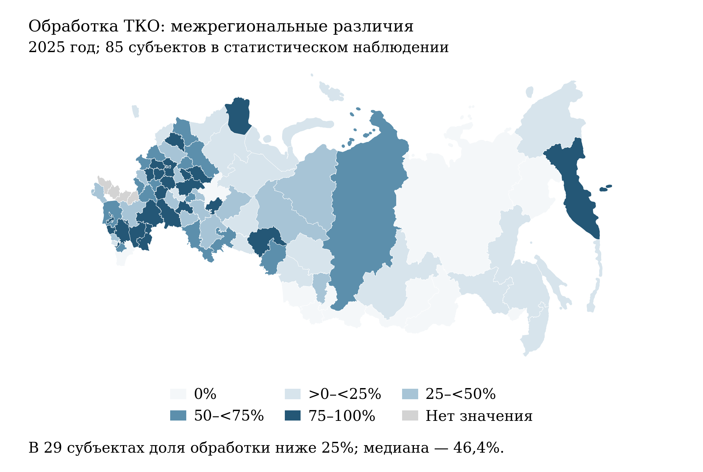

[B131; Caption] Рисунок 1 – Доля обрабатываемых ТКО в общей массе образованных ТКО по субъектам, 2025 год

[B132; SourceNote] Годовые значения; 85 субъектов. Серым обозначено отсутствие сопоставимого наблюдения. Картографическая основа – исследовательский контурный слой; территориальное соответствие установлено по кодам статистического учёта. Границы служат для локализации показателей. [Сноски 40]

[B133; ] По захоронению наблюдается более сильная концентрация в верхней части шкалы (рисунок 2). Медиана равна 93,8%, межквартильный интервал – от 86,3 до 98,3%. В 54 субъектах доля не ниже 90%, в восьми достигает 100%. Эти значения показывают распространённость зависимости от захоронения среди наблюдаемых территорий, хотя не позволяют определить её долю в общероссийской массе без весов по объёму образования отходов. Следовательно, продвижение нескольких крупных систем не является достаточным свидетельством распространения полного цикла обращения с отходами на большинство регионов. [Сноски 41]

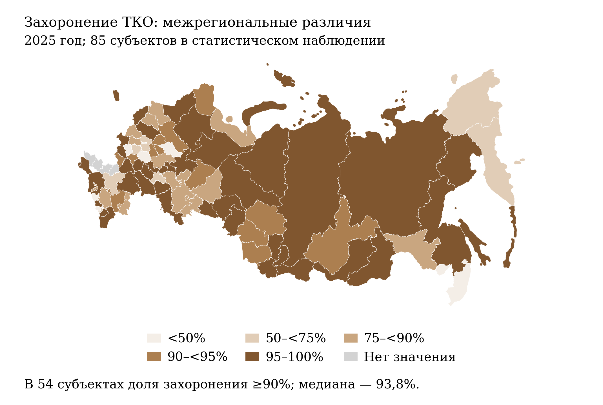

[B135; Caption] Рисунок 2 – Доля захораниваемых ТКО в общей массе образованных ТКО по субъектам, 2025 год

[B136; SourceNote] Годовые значения; 85 субъектов. Серым обозначено отсутствие сопоставимого наблюдения. Картографическая основа – исследовательский контурный слой; территориальное соответствие установлено по кодам статистического учёта. Границы служат для локализации показателей. [Сноски 42]

[B137; ] Совместное распределение двух долей особенно информативно (рисунок 3). В десяти субъектах обработка и захоронение одновременно составляют не менее 80%. К этой группе относятся, в частности, Калужская область – 99,5 и 86,9%, Тамбовская – 92,2 и 97,7%, Волгоградская – 82,9 и 95,3%. Таким образом, высокая доля обработки совместима с сохранением преимущественного захоронения. Это основание для проверки выхода вторичного сырья и судьбы сортировочного остатка, а не для предположения, что конкретное предприятие работает неэффективно: агрегированные доли не раскрывают состав отходов, межрегиональные перевозки и технологическую конфигурацию отдельных объектов. [Сноски 43]

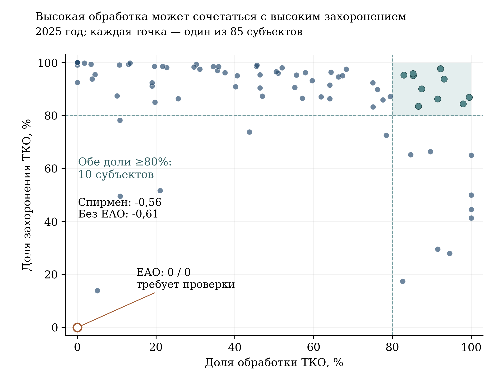

[B139; Caption] Рисунок 3 – Связь региональных долей обработки и захоронения ТКО, 2025 год

[B140; SourceNote] 85 субъектов; веса по массе отходов не применяются. Пунктирные границы 80% выделяют описательную группу, а не норматив. ЕАО – Еврейская автономная область; пара нулевых значений сохранена и отмечена как требующая проверки. Коэффициенты Спирмена не имеют причинной интерпретации. [Сноски 44]

[B141; ] Коэффициент ранговой корреляции Спирмена равен −0,557: более высокая обработка в среднем связана с меньшим захоронением, но связь далека от взаимно однозначной. В Еврейской автономной области опубликована пара 0% / 0%, требующая проверки исходного баланса и статуса нулевых значений. При исключении только этой территории коэффициент составляет −0,606 для 84 субъектов. Направление описательной связи сохраняется. При этом нулевые записи нельзя автоматически интерпретировать как отсутствие отходов или приписывать им недостающие объёмы; первоочередная задача – выяснить основание отчётной записи. [Сноски 45]

[B142; ] Для оценки реального замыкания материальных потоков необходимы согласованные балансы: масса образования, поступление на обработку, извлечение полезных фракций, подтверждённая передача вторичного сырья потребителю, обезвреживание, захоронение и изменение запасов. Межрегиональная передача должна учитываться с обеих сторон, иначе одна территория может выглядеть благополучной вследствие вывоза остатка, а другая – неблагополучной вследствие его приёма. Показатель обработки следует сопровождать выходом пригодного вторичного материала на тонну поступившего потока, с раздельным учётом материалов и иных способов использования.

[B143; ] Оперативные значения на сентябрь 2026 года составляют 57,9% обработки и 80,4% захоронения. Они относятся к отношению накопленных с начала года масс и не являются долями изолированного сентября. Уточнённые годовые результаты 2025 года также отличаются от декабрьских оперативных записей: 56,6 против 56,2% по обработке и 81,1 против 80,6% по захоронению. Прямое продолжение графика декабрьскими и годовыми значениями как равноправными точками смешало бы пересмотр данных с изменением процесса. [Сноски 46]

[B144; ] Два других индикатора отходов требуют самостоятельной интерпретации. Индекс использования вторичных ресурсов и сырья на сентябрь 2026 года равен 14,2%; доля утилизации отходов I и II классов опасности – 18,3%, при годовом результате 2025 года 37,2%. Они относятся к иным совокупностям отходов, поэтому их нельзя складывать с долями ТКО или использовать как взаимозаменяемые оценки. Для первого показателя утверждена методика от 30 декабря 2025 года № 761, для второго – от 5 августа 2026 года № 432. Без раскрытия сопоставимого пересчёта прежних наблюдений различие между годовым и неполным результатом не устанавливает ни величины ухудшения, ни вклада новой методики. [Сноски 47]

[B145; Heading2] 3.3 Изменение выбросов и неоднородность городов

[B146; ] Для анализа воздуха принципиально различать две группы территорий. Показатель 12 городов использует базу 2017 года, показатель 29 территорий – базу 2020 года. Несмотря на слово «снижение» в официальных наименованиях, опубликованные проценты имеют смысл остаточного индекса: 100 минус доля учтённого сокращения выбросов относительно базовой массы. Поэтому 79,2059% не означает сокращения на 79,2059%; более низкий индекс соответствует большему учтённому сокращению. Методики утверждены соответственно приказами Минприроды России от 20 ноября 2025 года № 630 и № 629. [Сноски 48]

[B147; ] За 2025 год итоговый индекс 12 городов равен 79,2059%, а 29 территорий – 93,5968%. Проверка агрегирования показывает, что эти значения с точностью округления воспроизводят простое среднее городских индексов. Каждый город получает одинаковый вес независимо от исходной массы выбросов и численности населения. Это соответствует среднему учтённому сокращению на 20,7941 и 6,4032% относительно баз соответствующих городов. Такие средние не равны проценту сокращения суммарной массы выбросов всех городов или доле снижения воздействия на население. [Сноски 49]

[B148; ] В группе 12 городов остаточные индексы варьируются от 65,8251% в Новокузнецке до 89,1195% в Чите (рисунок 4). Между этими значениями располагаются, в частности, Челябинск – 68,4960%, Норильск – 68,5435%, Череповец – 71,2401%, Красноярск – 86,8271%. Это различия в объёме зачтённых изменений относительно собственных баз, а не рейтинг текущей безопасности воздуха. Город с более низким индексом может сохранять существенную абсолютную нагрузку; город с меньшим относительным сокращением может иметь иную исходную структуру выбросов и экспозицию жителей. [Сноски 50]

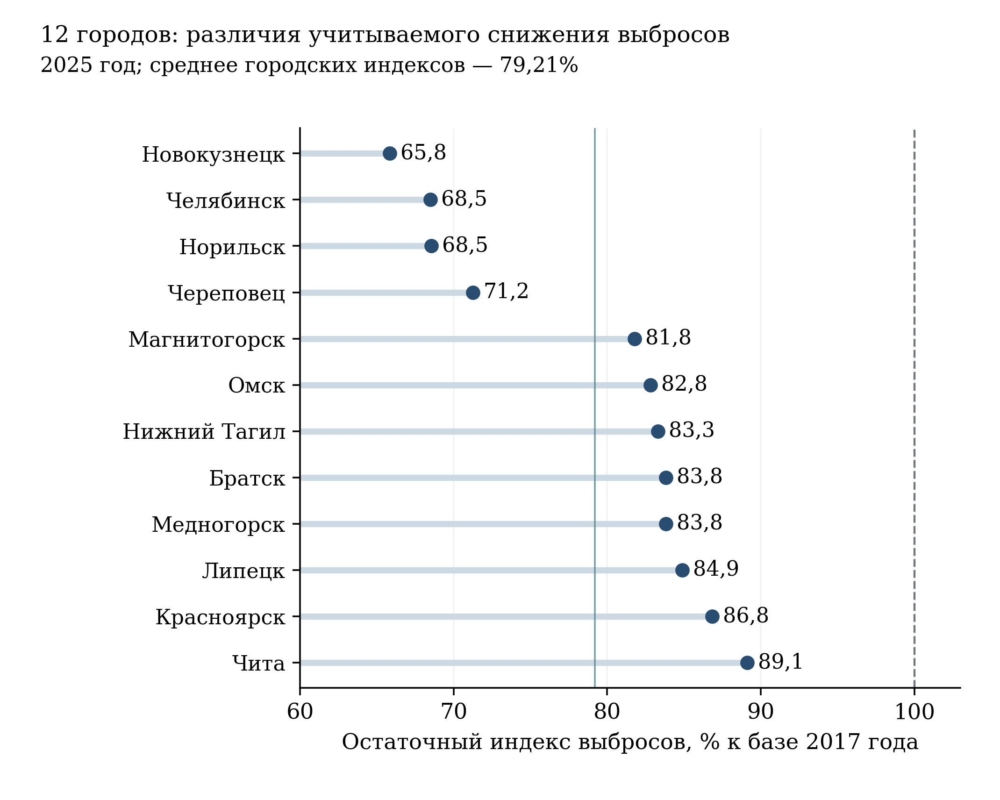

[B150; Caption] Рисунок 4 – Остаточные индексы выбросов в 12 городах – участниках проекта «Чистый воздух», 2025 год

[B151; SourceNote] 100% соответствует базе 2017 года. Тонкая вертикальная линия – простое среднее городских индексов, 79,2059%. Горизонтальная шкала начинается с 60%; показаны положения значений, а не объёмы выбросов в тоннах. Меньший индекс не тождествен меньшей концентрации загрязняющих веществ. [Сноски 51]

[B152; ] Во второй группе в девяти из 29 территорий индекс 2025 года равен 100%. Наибольшее учтённое сокращение отражено для Южно-Сахалинска – индекс 50%, затем Кургана – 68,2670%. При интерпретации крайних значений необходимо учитывать ограничение методики: принимаемое в расчёт сокращение для территории ограничивается половиной базовой массы. Поэтому значение 50% может обозначать достижение порога зачёта, а не точное физическое сокращение ровно наполовину. Значение 100%, в свою очередь, не исключает подготовительных работ, которые ещё не получили статуса завершённого подтверждённого мероприятия. [Сноски 52]

[B153; ] По состоянию на сентябрь 2026 года агрегированные индексы составляют 78,4352% для первой группы и 93,4855% для второй. Их изменение относительно годового результата 2025 года равно соответственно −0,7707 и −0,1113 процентного пункта. Это движение административно подтверждаемого результата, а не измерение сезонного качества атмосферного воздуха. Кроме того, оперативная территориальная детализация в имеющемся ряду представлена субъектами Федерации, тогда как годовая – городами и отдельными муниципальными территориями. Подмена одной совокупности другой создала бы искусственную динамику пространственных различий. [Сноски 53]

[B154; ] Вывод об улучшении условий проживания требует параллельного ряда измерений концентраций приоритетных веществ в местах проживания и пребывания людей. Масса выбросов, их химический состав, высота и расположение источников, метеорологические условия и размещение населения определяют разные стороны воздействия. Практически следует сопоставлять зачтённые мероприятия с временными рядами постов наблюдения, учитывая их перенос, изменение приборов и полноту измерений. Для оценки связи с мероприятиями нужны несколько сопоставимых лет до и после вмешательства и контроль погодных условий; простой график двух проектных лет такого анализа не заменяет.

[B155; ] Показатель населения, качество жизни которого улучшится вследствие сокращения выбросов в 29 территориях, на сентябрь 2026 года равен 516,569 тыс. человек. Его нельзя складывать с численностью благополучателей других экологических направлений без устранения повторного учёта. Для проверки содержательного результата необходимо установить территорию воздействия каждого завершённого мероприятия и изменение экспозиции жителей, а также отделить расчётный охват от наблюдаемого улучшения. Тогда административный индекс и оценка условий жизни смогут взаимно дополнять друг друга. [Сноски 54]

[B156; Heading2] 3.4 Вода, Байкальская территория и накопленный вред

[B157; ] Водное направление имеет наиболее существенное ограничение актуальности статистического среза. Последнее доступное наблюдение по объёму неочищенных сточных вод относится к февралю 2026 года и составляет 9055,31 млн м³. Самостоятельного годового значения 2025 года в данной серии нет: 9196,75 млн м³ опубликовано как декабрьское оперативное наблюдение. Поэтому оно не включено в таблицу законченных годовых результатов. Название показателя также не должно вводить в заблуждение: единицей является объём в миллионах кубических метров, а не процент его сокращения. [Сноски 55]

[B158; ] Методика от 10 апреля 2026 года № 206 определяет результат через базовый объём загрязнённых стоков и подтверждённый объём, доведённый до нормативного качества после строительства либо реконструкции очистных сооружений. Для зачёта требуется лабораторное подтверждение в рамках контрольных мероприятий. Учитываются мероприятия как внутри, так и вне федерального проекта. Поэтому показатель отражает нормативно определённый расчётный остаток базового объёма; его изменение не может без дополнительного разложения быть целиком приписано финансированию национального проекта. [Сноски 56]

[B159; ] Временная последовательность требует согласования оснований счёта. В январе–июне 2025 года опубликовано 10841,34 млн м³, в июле–ноябре – 9318,23 млн м³, в декабре – 9196,75 млн м³. При этом в текущей открытой паспортной карточке базовым значением с датой 1 января 2024 года указано 9318,23 млн м³. Первые наблюдения, указанная база и новая методика не образуют автоматически однородного ряда. Без таблицы пересчёта, состава учитываемых сооружений и раскрытия компонентов нельзя считать весь переход между указанными уровнями фактически достигнутым сокращением загрязнения. [Сноски 57]

[B160; ] Дополнительный показатель комфортных условий проживания вблизи водных объектов достигает 0,9654 млн человек по итогам 2025 года и сохраняет это значение в последнем доступном наблюдении сентября 2026 года. Накопленный социальный охват и объём очищенных стоков отвечают на разные вопросы. Благоустройство или расчистка водного объекта могут улучшать доступность и условия использования берегов, но численность благополучателей не заменяет данные о химическом и биологическом состоянии воды. Сохранение показателя на одном уровне также не свидетельствует о прекращении работ: оно фиксирует отсутствие нового зачтённого прироста в рассматриваемой статистике. [Сноски 58]

[B161; ] По Байкальской природной территории годовой индекс 2025 года равен 91,2%; последнее оперативное наблюдение февраля 2026 года имеет то же значение. Его нельзя переводить в утверждение о сокращении загрязнения озера на 91,2%. Действующая методика от 10 апреля 2026 года № 205 сочетает пять компонентов: площади несанкционированного размещения отходов и накопленного вреда, загрязнённые стоки, ТКО, не обеспеченные мощностями обработки, выбросы в определённых городах и лесовосстановление. Первые три компонента имеют веса по 0,25, воздушный – 0,05, лесной – 0,20. Однако приведённые наблюдения предшествуют утверждению этой методики; её применимость к ним требует подтверждения пересчёта либо преемственности расчёта. Без исходных компонентов нельзя задним числом разложить значение 91,2% на вклад отдельных направлений. [Сноски 59]

[B162; ] Для экологической экспертизы Байкала нужен раздельный анализ пяти компонентов и независимых наблюдений состояния экосистемы. Сокращение площади объекта накопленного вреда, снижение годового объёма стоков и ввод сортировочной мощности не являются физически взаимозаменяемыми результатами. Компенсация неблагоприятного движения одного компонента благоприятным движением другого может улучшить агрегат при сохранении локально критической проблемы. Практическое решение – публиковать вместе со сводным индексом все составляющие, их исходные уровни, территориальную привязку и подтверждающие измерения.

[B163; ] По ликвидации опасных объектов накопленного вреда годовой результат 2025 года составляет один объект; это же накопленное значение сохраняется на сентябрь 2026 года. По удалению затонувшего имущества зафиксировано 14 объектов по итогам 2025 года и 21 на сентябрь 2026 года. Счёт завершённых объектов необходим для контроля обязательств, но не измеряет однородный объём устранённого риска. Различаются загрязняющие вещества, масса опасных материалов, площадь воздействия и число людей в зоне риска. Для содержательного сравнения затраты и результат следует соотносить с характеристиками каждого объекта и последующим контролем территории, а не только с количеством завершённых мероприятий. [Сноски 60]

[B164; Heading2] 3.5 Восстановление лесов и временная база показателей

[B165; ] Общероссийское отношение площади лесовосстановления и лесоразведения к площади вырубленных и погибших насаждений по итогам 2025 года составляет 149,64%. Оно существенно превышает 100%, но его смысл определяется временной конструкцией знаменателя. Методика 2025 года, утверждённая приказом Рослесхоза № 602, использует площадь работ текущего года и площадь вырубленных и погибших насаждений двумя годами ранее; эта конструкция сохранена в приказе № 238 от 17 апреля 2026 года. Следовательно, результат 2025 года сопоставляет работы 2025 года с выбытием 2023 года. Из него не следует ни компенсация всех потерь 2025 года, ни восстановление экологических функций конкретных утраченных лесов. [Сноски 61]

[B166; ] Распределение по 81 субъекту имеет выраженный правый хвост (рисунок 5). Медиана равна 127,16%, нижний квартиль – 104,19%, верхний – 280,02%. В 80 субъектах значение превышает 100%; минимум составляет 77,98% в Республике Алтай, максимум – 4356,6% в Самарской области. Невзвешенное среднее региональных отношений, равное 334,43%, существенно выше общероссийского показателя 149,64%. Это ожидаемое следствие разных способов агрегирования: отношение суммарных площадей не равно простому среднему региональных отношений, особенно при малых знаменателях. [Сноски 62]

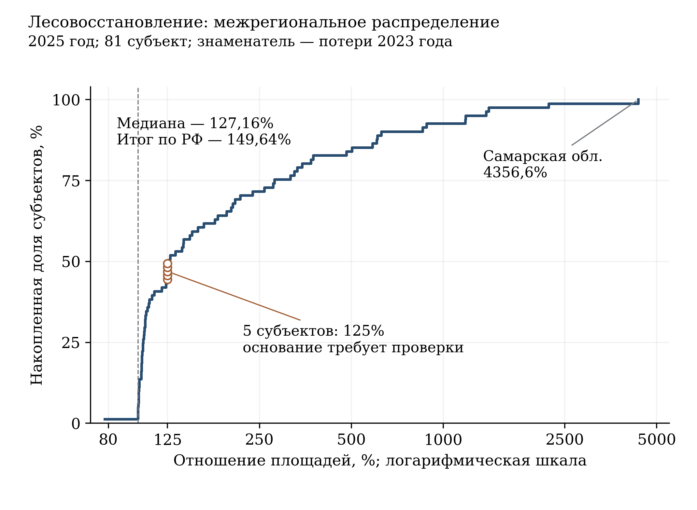

[B168; Caption] Рисунок 5 – Распределение отношения площадей лесовосстановления и выбытия по субъектам, 2025 год

[B169; SourceNote] 81 субъект; ось X логарифмическая. Кривая показывает долю субъектов со значением не выше указанного по оси X. Пять значений 125% выделены как требующие проверки основания: методика допускает условное 125% при нулевом знаменателе, но исходные компоненты для индивидуального подтверждения отсутствуют. Это не рейтинг экологического качества лесов. [Сноски 63]

[B170; ] Отдельного рассмотрения требуют пять региональных значений ровно 125%. Методика предусматривает специальное правило: при нулевой площади вырубленных и погибших насаждений показатель равен нулю, если восстановление также отсутствует, и 125% – если работы проводились. Без исходных площадей невозможно установить, какие из пяти наблюдений возникли по этому правилу, а какие получены обычным делением. Поэтому они сохранены в описательном распределении, но не интерпретируются как доказанное превышение физического баланса на четверть. Аналогично экстремально высокие отношения требуют раскрытия знаменателя, а не автоматического присвоения статуса лучшей практики. [Сноски 64]

[B171; ] Показатель отнесения восстановленных площадей к землям, на которых расположены леса, дополняет объём выполненных работ характеристикой последующей стадии восстановления. Его годовое значение 2025 года равно 1334,9768 тыс. га; к сентябрю 2026 года накопленное значение достигает 1897,7704 тыс. га. Методика устанавливает накопление с 1 января 2025 года. Поэтому прибавка относительно уточнённого результата 2025 года составляет 562,7936 тыс. га; приписывание всего накопленного объёма 2026 году завысило бы его результат более чем втрое. [Сноски 65]

[B172; ] Накопление по двум лесным показателям устроено по-разному. Отношение лесовосстановления в оперативной отчётности считается с начала текущего года, тогда как отнесение площадей к лесным землям продолжается между годами. Дополнительное различие создаёт уточнение годовой отчётности: отношение площадей за 2025 год пересмотрено с декабрьских 147,39 до годовых 149,64%, а отнесённая площадь – с 1240,1037 до 1334,9768 тыс. га. При анализе прироста 2026 года необходимо опираться на уточнённый годовой уровень. Иначе часть статистического пересмотра будет ошибочно принята за новые работы. [Сноски 66]

[B173; ] Для оценки устойчивости восстановленного леса требуются когортные наблюдения: участки определённого года работ должны прослеживаться до приёмки, перевода в лесные земли и последующего состояния. Существенны приживаемость, породный состав, соответствие условиям местообитания, повреждения пожарами и вредителями, сохранность через несколько лет. Простое сопоставление площадей разных лет не устанавливает эту связь. Пространственная привязка утраты и восстановления позволяет отдельно оценить восполнение лесной площади и сохранение функций леса в тех местах, где они были нарушены.

[B174; ] Ряд сокращения площади лесных пожаров требует иной осторожности. В открытой паспортной републикации выполнение прежнего показателя прекращено с 21 мая 2026 года; приказом Рослесхоза от 31 августа 2026 года № 604 отменены приказы, устанавливавшие прежнюю методику. При этом статистическая последовательность в ЕМИСС продолжается до сентября 2026 года. Сохранение ряда в информационной системе не подтверждает сохранения статуса действующего целевого показателя. Поэтому его значения не используются здесь для вывода о выполнении текущего проекта. Оценка пожарной безопасности должна сохраняться через сопоставимые площади и тяжесть последствий пожаров, условия обнаружения и тушения, с явным учётом изменения методики и погодной обстановки. [Сноски 67]

[B175; Heading2] 3.6 Биоразнообразие и посещение охраняемых территорий

[B176; ] Доля редких и находящихся под угрозой исчезновения птиц и млекопитающих, охваченных мероприятиями по восстановлению численности, составляет 27% за 2025 год и остаётся на этом уровне в доступном наблюдении августа 2026 года. Показатель характеризует охват природоохранной деятельностью установленной совокупности объектов животного мира. Он необходим для оценки полноты управленческого внимания, но не измеряет величину прироста популяций, изменение ареала или вероятность исчезновения. Равенство целевого и фактического охвата поэтому подтверждает выполнение задания по охвату, не заменяя оценки биологического результата. [Сноски 68]

[B177; ] Проверка природоохранной результативности должна проводиться на уровне вида и популяции. Для каждого объекта нужны сопоставимые обследования численности и воспроизводства, описание применённых мер, пространственный охват наблюдений и оценка неопределённости. Изменение численности нельзя уверенно связывать с проектом без учёта миграции, доступности местообитаний, смертности и изменения метода учёта. Увеличение числа видов, включённых в мероприятия, может одновременно сопровождаться разной динамикой их состояния, что делает простое усреднение успеха по факту охвата недостаточным.

[B178; ] Посещение федеральных ООПТ по итогам 2025 года составляет 22,6 млн человек, что на 28,4% выше ориентира 17,6 млн в опубликованной редакции. Однако сопоставление одних и тех же восьми месяцев даёт иную характеристику текущей динамики: 16,2 млн в январе–августе 2025 года и 14,7296 млн в январе–августе 2026 года, то есть снижение на 9,08% (рисунок 6). Превышение годовой цели и сокращение к сопоставимому периоду могут существовать одновременно; это разные основания оценки. [Сноски 69]

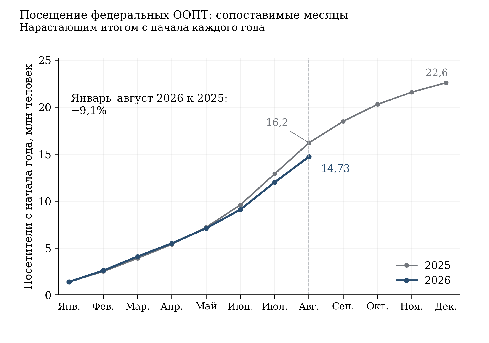

[B180; Caption] Рисунок 6 – Посещение федеральных особо охраняемых природных территорий в 2025–2026 годах

[B181; SourceNote] Накопленные значения с начала каждого календарного года. Для 2026 года доступны январь–август; последующие месяцы не прогнозируются. Годовой итог 2025 года – 22,6 млн человек. Изменение −9,08% рассчитано только для сопоставимых восьмимесячных периодов. [Сноски 70]

[B182; ] Методика суммирует посетителей отдельных ООПТ за отчётные месяцы. Она включает посещение объектов инфраструктуры учреждений и охватывает несколько категорий посетителей; из такого агрегирования не следует число уникальных граждан, посетивших хотя бы одну охраняемую территорию за год. При этом посещаемость измеряет использование территории людьми, а не состояние её природных комплексов. Сокращение потока без данных об ограничениях доступа, погоде и структуре посещений не является доказательством ухудшения работы проекта; увеличение потока без оценки допустимой нагрузки также не является самостоятельным экологическим успехом. [Сноски 71]

[B183; ] Управленчески полезно различать доступность экологического туризма и устойчивость рекреационной нагрузки. Для первой важны возможности посещения, транспортная доступность и качество маршрутов; для второй – нагрузка на конкретные участки и сезоны, нарушения режима охраны, состояние почв и растительности, образование отходов и беспокойство животных. Территориально и сезонно распределённые данные позволяют определить, где расширение инфраструктуры повышает доступность без ухудшения природного состояния, а где требуется регулирование потока.

[B184; ] Доля доступной населению информации по основным направлениям экологического мониторинга выросла с годового значения 26,9% в 2025 году до 76,92% на сентябрь 2026 года. Согласно определению показателя, речь идёт об отношении размещённых в открытом доступе групп наборов данных к их установленному перечню. Это показатель наполнения информационной системы; он не означает, что соответствующая доля жителей получает понятную информацию о рисках в месте проживания. Для проверки общественной полезности нужны полнота территориального покрытия, своевременность обновления, понятность представления и возможность сопоставить данные наблюдений с местными источниками воздействия. [Сноски 72]

[B185; ] Практическая задача – сопоставлять мероприятия и экологические наблюдения на одной территории за согласованные периоды. Это позволит проверить переход от административно учтённого действия к изменению состояния среды.

[B186; Heading1] 4 Финансовое обеспечение и бюджетные риски

[B187; ] Финансовую основу проекта необходимо оценивать на нескольких уровнях. План на весь срок реализации показывает ожидаемый объём ресурсов и их распределение между источниками. Федеральный бюджет и сводная роспись определяют бюджетные назначения соответствующего периода; кассовое исполнение отражает произведённые выплаты. Финансовый инструмент, заключённый контракт, введённый объект и подтверждённое экологическое улучшение представляют последовательные, но различные результаты. Поэтому из суммы планового финансирования нельзя непосредственно вывести ни степень освоения, ни экологическую эффективность.

[B188; ] В открытой републикации от 16 октября 2026 г. общий план на 2025–2030 гг. составляет 1 519,365 млрд руб. Федеральный бюджет обеспечивает 787,268 млрд руб., или 51,82%; консолидированные бюджеты регионов – 399,142 млрд руб., или 26,27%; внебюджетные источники – 332,955 млрд руб., или 21,91%. Почти половина совокупного плана, таким образом, относится к источникам за пределами федерального бюджета. Это не свидетельствует о недостаточности средств, но делает результат зависимым от согласования регионального участия и подтверждения внебюджетных обязательств. Суммы следует воспринимать в пределах статуса открытой публикации, а не как независимо удостоверенный объём утверждённых расходов. Распределение по годам представлено в таблице 5 и на рисунке 7. [Сноски 73]

[B189; Caption] Таблица 5 – План финансирования по источникам в открытой републикации на 2025–2030 годы, млрд руб.

[TABLE 5; B190]
Год | Федеральный бюджет | Бюджеты регионов | Внебюджетные источники | Всего
2025 | 56,2 | 22,4 | 28,8 | 107,4
2026 | 72,4 | 36,7 | 97,3 | 206,4
2027 | 124,9 | 71,7 | 120,7 | 317,3
2028 | 203,2 | 128,9 | 81,3 | 413,5
2029 | 165,2 | 71,1 | 2,4 | 238,7
2030 | 165,4 | 68,3 | 2,4 | 236,1
Всего | 787,3 | 399,1 | 333,0 | 1 519,4

[B191; SourceNote] Млрд руб., текущие цены. Округление до 0,1 млрд руб. может создавать различия при сложении отображённых величин. План не является кассовым исполнением. [Сноски 74]

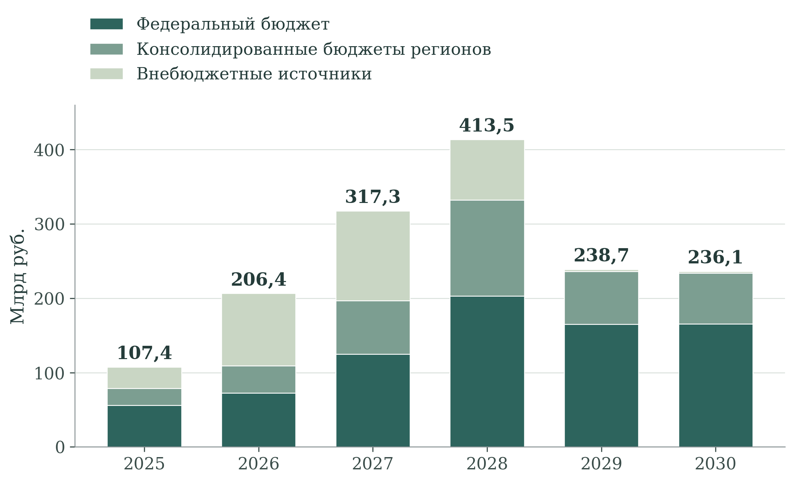

[B193; Caption] Рисунок 7 – Распределение заявленного финансирования по годам и источникам

[B194; SourceNote] Плановые номинальные суммы открытой републикации от 16.10.2026; млрд руб. [Сноски 75]

[B195; ] Профиль финансирования имеет выраженный максимум в 2028 г. – 413,469 млрд руб. Привлечение внебюджетных средств особенно сосредоточено в 2026–2028 гг.: после 81,309 млрд руб. в 2028 г. в публикации указано лишь по 2,407 млрд руб. в 2029 и 2030 гг. Такая форма может отражать последовательность инвестиционных стадий, границы раскрытых обязательств или особенности планирования. Без дополнительных документов она не доказывает ухода инвесторов. Для оценки устойчивости необходимо установить, какие объекты и договоры образуют этот профиль, когда они вводятся и за счёт каких источников обеспечивается последующая эксплуатация. [Сноски 76]

[B196; ] Арифметическая сверка национального и шести федеральных представлений обнаруживает небольшое различие. Их сумма за общий период 2025–2030 гг. ниже национального итога на 0,247812 млрд руб., или 0,0163%; всё расхождение относится к 2025 г. Его величина не меняет общую финансовую картину, но требует объяснения состава и редакций данных. Это несогласованность открытых таблиц, а не доказательство недофинансирования, нецелевого расходования или финансового нарушения. Для оценки исполнения потребовались бы бюджетные и контрактные документы. [Сноски 77]

[B197; ] Отдельный источник – проект федерального бюджета на 2027–2029 гг. В пояснительной записке к законопроекту № 615-9 на национальный проект предложены 84,8015 млрд руб. в 2027 г., 147,0226 млрд руб. в 2028 г. и 126,4460 млрд руб. в 2029 г. Сопоставительная графа 2026 г. – 75,0131 млрд руб. – относится к сводной бюджетной росписи на 1 сентября 2026 г. По состоянию на 28 октября 2026 г. рассматриваемые величины используются как предложения законопроекта; они не являются сведениями о фактических выплатах. В номинальном выражении предложение 2028 г. выше 2027 г. на 73,37%, а предложение 2029 г. ниже 2028 г. на 14,00%. Состав предложения приведён в таблице 6 и на рисунке 8. [Сноски 78]

[B198; Caption] Таблица 6 – Федеральные назначения 2026 года и предложения на 2027–2029 годы, млрд руб.

[TABLE 6; B199]
Федеральный проект | 2026 роспись | 2027 проект | 2028 проект | 2029 проект
Генеральная уборка | 16,267 | 15,938 | 28,931 | 21,438
Экономика замкнутого цикла | 22,737 | 25,849 | 51,117 | 43,483
Биологическое разнообразие и экологический туризм | 4,236 | 5,892 | 9,480 | 9,665
Чистый воздух | 8,085 | 6,670 | 8,758 | 10,886
Вода России | 11,977 | 19,576 | 31,619 | 28,880
Сохранение лесов | 11,710 | 10,876 | 17,117 | 12,094
Всего | 75,013 | 84,802 | 147,023 | 126,446

[B200; SourceNote] Млрд руб. Значения 2026 г. относятся к росписи на 01.09.2026; остальные – к законопроекту № 615-9. Суммы отдельных строк могут отличаться от опубликованного итога из-за округления. Название направления биологического разнообразия сокращено. [Сноски 79]

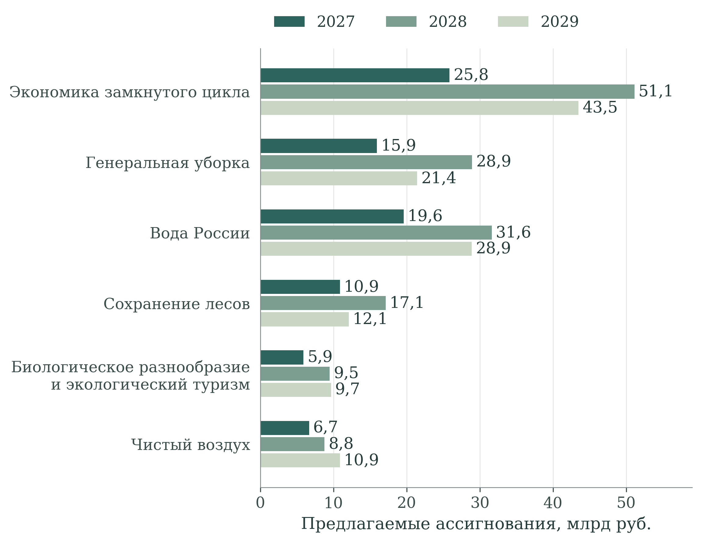

[B202; Caption] Рисунок 8 – Предложения федерального бюджета по направлениям на 2027–2029 годы

[B203; SourceNote] Млрд руб. Показаны суммы законопроекта, а не утверждённые обязательства или исполнение. [Сноски 80]

[B204; ] Федеральные суммы в бюджетном предложении существенно отличаются от соответствующих граф открытой паспортной републикации. Например, для 2027 г. в ней указано 124,891 млрд руб., тогда как законопроект содержит 84,802 млрд руб. Это показывает необходимость согласования планов, но не позволяет автоматически вычислить размер необеспеченных обязательств: источники имеют разный правовой статус, бюджетный цикл и историю подготовки. При принятии управленческих решений должны быть раскрыты действующая версия потребности, принятые бюджетные назначения и последствия их расхождения для конкретного календаря работ. [Сноски 81]

[B205; ] Наиболее крупным федеральным направлением в проекте бюджета является экономика замкнутого цикла. Внутри неё особое значение имеет имущественный взнос Российскому экологическому оператору на организацию выпуска облигаций для финансирования инвестиционных проектов и выплату процентного, или купонного, дохода. На эту строку предложено 18,018 млрд руб. в 2027 г., 42,064 млрд руб. в 2028 г. и 37,376 млрд руб. в 2029 г. Это соответственно 69,70%, 82,29% и 85,95% федеральных сумм данного направления. Такая структура требует прослеживать связь бюджетного инструмента с привлечёнными средствами, отбором объектов, сроками ввода и фактической работой мощностей. Она не означает, что вся названная сумма непосредственно оплачивает строительство либо полностью является только процентными расходами. [Сноски 82]

[B206; ] При использовании облигационного финансирования и имущественных взносов особенно важно исключить двойной счёт. Публичный вклад, привлечённое финансирование и стоимость одного инвестиционного объекта нельзя складывать, если они отражают движение одних и тех же ресурсов. Сопоставление эффективности должно учитывать стоимость инструмента для бюджета и обеспечиваемый им результат, а также риск задержки ввода и недостаточной загрузки. Для предметной оценки необходима связь финансовой операции с определёнными объектами и подтверждёнными материальными потоками, а не только с общей мощностью планируемого портфеля.

[B207; ] В «Генеральной уборке» в составе предложения на 2028 г. зарезервировано 14,286 млрд руб., на 2029 г. – 19,185 млрд руб. Это 49,38% и 89,49% федеральных ассигнований направления соответственно. Резервирование представляет предусмотренный бюджетный механизм и не является само по себе признаком неисполнения. Однако такая доля в сочетании с концентрацией завершений объектов в конце периода повышает значение условий распределения средств: готовности обследований, проектных решений, экспертизы, земельных вопросов и безопасного обращения с извлекаемыми отходами. В мониторинге требуется отдельно показывать зарезервированную сумму, распределение по объектам и заключённые обязательства. [Сноски 83]

[B208; ] В направлении биологического разнообразия на создание и развитие инфраструктуры экологического туризма предложены 3,134 млрд руб. в 2027 г., 6,071 млрд руб. в 2028 г. и 6,195 млрд руб. в 2029 г. Доля этой строки составляет 53,18%, 64,04% и 64,10% федеральных сумм направления. Это делает особенно значимой проверку природоохранных условий туристических инвестиций. При этом строка сохранения и восстановления популяций редких животных – 315,0; 376,2 и 315,0 млн руб. – не исчерпывает все расходы на охрану природы: в проекте отдельно предусмотрены охрана, противопожарные и другие мероприятия. Поэтому соотношение двух строк нельзя представлять как полное соотношение финансирования туризма и сохранения биоразнообразия. [Сноски 84]

[B209; ] В финансовой экспертизе следует также учитывать расходы после завершения капитальных работ. Очистным сооружениям требуются реагенты, энергия, персонал и обслуживание; объектам обращения с отходами – устойчивый поток и сбыт; восстановленным площадкам – мониторинг; охраняемым территориям – постоянная охрана. Источник первоначального вложения не удостоверяет обеспеченность этих расходов. При отборе предлагается подтверждать эксплуатационную модель и стоимость сохранения требуемого экологического результата, сопоставляя варианты на одинаковом горизонте и при одинаковом качестве услуги.

[B210; Heading1] 5 Связи мероприятий с показателями и анализ текстов

[B211; Heading2] 5.1 Методика анализа проектной логики и текстов

[B212; ] Текстовая экспертиза проверяет, насколько описание национального проекта позволяет проследить переход от предусмотренного мероприятия к экологическому результату. Для этого необходимо различать формально обозначенную принадлежность к задаче, сходство используемых слов и содержательно обоснованный механизм изменения среды. Первые два признака помогают находить сопоставимые элементы документации. Только третий задаёт вопрос об условиях получения общественного результата; его фактическая реализация требует самостоятельных наблюдений. Автоматический анализ используется совместно с чтением содержания, поскольку совпадение терминов не заменяет проверки смысла. [Сноски 85]

[B213; ] Сопоставимый корпус включает 98 электронных представлений паспортных сведений: 12 национальных и 86 федеральных документов, относящихся к 12 национальным проектам. Объём корпуса составляет 75 539 токенов, то есть лексических единиц, выделенных по единому правилу. Для экологического проекта исследованы семь документов общим объёмом 6 110 токенов. В их составе национальный уровень представлен 256 токенами, федеральные направления – 5 854. Открытая публикация всех семи документов датирована 16 октября 2026 г.; срез доступных материалов относится к 28 октября 2026 г. Это целевая совокупность для сравнительного исследования, а не сплошное обследование всех национальных проектов. [Сноски 86]

[B214; ] Во всех документах отбираются одинаковые содержательные поля: цель, задачи, названия и характеристики результатов, названия показателей. Повторённый внутри документа фрагмент учитывается один раз. Служебные реквизиты, персональный состав участников, финансовые таблицы и календарные записи исключаются, поскольку они отвечают на иные вопросы и могли бы создавать искусственное сходство. При этом карточки результатов и показателей сохраняются как самостоятельные единицы структурного анализа: устранение повторов текста не означает отождествления показателей разных уровней.

[B215; ] Отдельное значение имеет временной смысл формулировок. Названия паспортных результатов часто строятся как описание завершённого действия: проведены работы, создана система, приобретено оборудование. В плановом документе такая грамматическая форма обозначает ожидаемое конечное состояние, а не сама по себе подтверждает исполнение. Поэтому текстовые упоминания не пересчитываются в число фактически достигнутых результатов. Для такого перехода необходимы отчётный период, статус реализации и подтверждающее наблюдение. Лексическая модель также не различает строительство, начатое до проекта, и новое мероприятие, если их описания одинаковы; временная принадлежность устанавливается отдельно по проектным и отчётным сведениям.

[B216; ] Для лексической модели буквы приведены к нижнему регистру, «ё» заменена на «е», числа исключены. Удалены 120 служебных и общеупотребительных слов. Признаками выступают отдельные слова и пары соседних оставшихся слов; пары не пересекают границы содержательных фрагментов. В базовой спецификации словоформы не объединяются. Вес признака определяется частотой в документе и обратной документной частотой по всему корпусу с логарифмическим сглаживанием: [Сноски 87]

[B217; EquationText] (1)

[Формула] wₜd = (1 + ln fₜd) × [ln((N + 1)/(dfₜ + 1)) + 1] при fₜd > 0, иначе 0

$$
w_{td}=\begin{cases}(1+\ln f_{td})\left[\ln\frac{N+1}{df_t+1}+1\right],&f_{td}>0\\0,&f_{td}=0\end{cases}
$$

[B218; ] Здесь ftd – частота признака t в документе d, dfₜ – число документов с данным признаком, N = 98. Исключены признаки, встречающиеся более чем в 98% документов; редкие признаки сохранены, ограничение размера словаря не применяется. В базовой модели получено 46 519 признаков. Каждый документный вектор нормируется по евклидовой длине. Профиль национального проекта представляет собой среднее его нормированных документных векторов с последующей повторной нормировкой. Это ограничивает влияние объёма отдельных паспортов, но не устраняет зависимости от состава входящих документов.

[B219; EquationText] (2)

[Формула] cos(a, b) = Σₜ aₜbₜ / (√Σₜ aₜ² × √Σₜ bₜ²)

$$
\cos(a,b)=\frac{\sum_t a_tb_t}{\sqrt{\sum_t a_t^2}\sqrt{\sum_t b_t^2}}
$$

[B220; ] Косинусная близость принимает большие значения при совпадении взвешенных текстовых признаков. Коэффициент описывает тексты и не измеряет экологический эффект. Дополнительно применены тематические словари и шесть спецификаций проверки устойчивости. Поскольку корпус сформирован целевым отбором документов, коэффициенты описывают именно эту совокупность; статистические интервалы для случайной выборки национальных проектов не рассчитываются.

[B221; Heading2] 5.2 Прослеживаемость связей мероприятий и результатов

[B222; ] В экологическом блоке выделены 89 карточек результатов и 25 карточек показателей: семь национального и 18 федерального уровня. Все шесть федеральных направлений представлены результатами и показателями, но их число существенно различается. На «Экономику замкнутого цикла» приходится 28 карточек результатов, на «Чистый воздух» – 15, на остальные направления – от 11 до 12 (таблица 7). Количество карточек характеризует детализацию опубликованного описания. Оно не сопоставимо напрямую ни с затратами, ни с общественной значимостью направления.

[B223; Caption] Таблица 7 – Состав материалов для анализа экологического национального проекта

[TABLE 7; B224]
Код | Национальный или федеральный проект | Резуль­таты | Показа­тели | Записи влияния
Ч | Национальный проект | 0 | 7 | 0
Ч1 | Генеральная уборка | 12 | 2 | 12
Ч2 | Экономика замкнутого цикла | 28 | 4 | 60
Ч3 | Сохранение биологического разнообразия и развитие экологического туризма | 11 | 2 | 21
Ч4 | Чистый воздух | 15 | 4 | 35
Ч5 | Вода России | 12 | 3 | 12
Ч6 | Сохранение лесов | 11 | 3 | 11
Всего | 7 электронных представлений | 89 | 25 | 151

[B225; SourceNote] Подсчитаны карточки в доступных электронных представлениях. Одноимённые показатели национального и федерального уровней учитываются отдельно. Ноль в национальной строке относится к отдельным карточкам результатов, а не к отсутствию содержания проекта. [Сноски 88]

[B226; ] В разделах о влиянии результатов обнаружена 151 запись. Во всех случаях отображаемая подпись повторяет название самого результата; точных совпадений этой подписи с названием показателя назначения не обнаружено. На этой основе невозможно восстановить адресную матрицу, в которой у каждого значения влияния известны обе стороны связи. Числа в таком поле нельзя надёжно суммировать как вклад мероприятий в показатели. Вывод относится к доступной публикации и не устанавливает отсутствие связей во внутренних системах. Практическое улучшение открытого представления состоит в указании конкретного показателя назначения вместе с результатом, единицей наблюдения и основанием связи.

[B227; ] Связь через общую задачу даёт другой, более широкий набор соответствий. Внутри шести федеральных направлений возможны 287 пар «результат – показатель»; совпадение задачи сохраняет 157 пар. Для «Генеральной уборки», биоразнообразия и лесов все результаты и показатели соответствующего федерального направления объединены одной задачей. Поэтому принадлежность к задаче здесь вообще не отбирает связи. В замкнутом цикле остаются 44 пары из 112, в чистом воздухе – 18 из 60, в водном направлении – 16 из 36. Такая группировка полезна для навигации, но широкая задача не объясняет, какие мероприятия необходимы для изменения конкретного показателя и каковы условия этого изменения.

[B228; ] Предлагаемая реконструкция механизмов показана на рисунке 9. Между выполненной работой и общественным результатом помещено наблюдаемое промежуточное состояние: остаточное загрязнение, фактическое использование вторичного сырья, концентрации веществ, нагрузка на водоём, устойчивость насаждений или состояние популяций. Эти переходы имеют разную пространственную локализацию и продолжительность. Одно мероприятие может влиять на несколько результатов, а один результат – зависеть от нескольких мероприятий; поэтому универсальное распределение эффекта пропорционально стоимости работ было бы необоснованным.

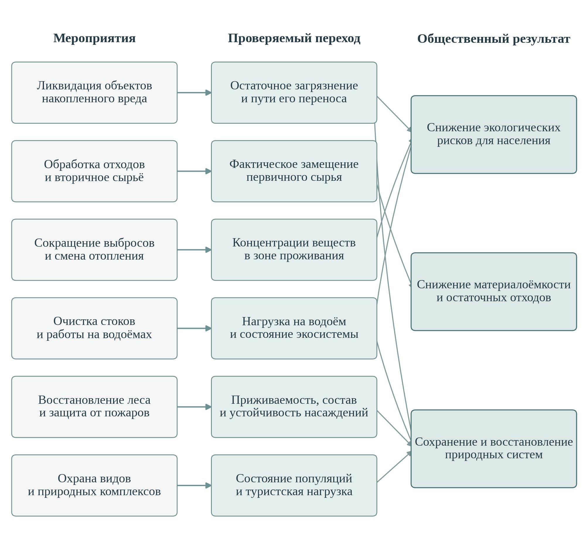

[B230; Caption] Рисунок 9 – Переходы от мероприятий национального проекта к экологическим и общественным результатам

[B231; SourceNote] Экспертная реконструкция механизмов. Стрелки обозначают проверяемые предположения; их наличие и толщина не выражают измеренную силу причинного воздействия. [Сноски 89]

[B232; ] Содержательные элементы такой логики уже предусмотрены. В «Генеральной уборке» имеются обследование объектов накопленного вреда и оценка воздействия на жизнь и здоровье граждан для приоритизации ликвидации. В «Чистом воздухе» предусмотрены оценка влияния снижения выбросов на здоровье населения, модернизация наблюдательной сети, надзорных лабораторий и информационных систем. Это опровергает представление о проекте как о наборе исключительно строительных работ. Вопрос экспертизы заключается в том, можно ли соединить результаты этих обследований с конкретным вмешательством и последующей проверкой изменения риска. [Сноски 90]

[B233; ] В «Воде России» выделены контроль нормативной очистки, инструментальное обследование выполненных водохозяйственных работ и завершение пусконаладочных работ под нагрузкой на очистных сооружениях. Здесь переход от ввода объекта к его работе уже включён в конструкцию проекта. Дальнейшая проверка должна установить, какие периоды эксплуатации охвачены, в каких режимах достигнут норматив и каким образом это отразилось на принимающем водном объекте. Иначе успешный краткий запуск и устойчивое качество очистки могут оказаться неразличимыми в итоговой оценке. [Сноски 91]

[B234; ] Лесное направление также не исчерпывается площадью посадок: предусмотрены уход за лесными культурами, семеноводство, лесопатологический мониторинг и показатель отнесения восстановленных площадей к землям, на которых расположены леса. Совершенствование заключается в согласовании этих наблюдений по участку и возрасту насаждений. В биоразнообразии предусмотрены поддержка популяций, питомников и реабилитации, охрана природных комплексов и туристическая инфраструктура. Их совместная результативность требует проверки того, не сопровождается ли рост посещаемости ухудшением состояния сохраняемых объектов. [Сноски 92]

[B235; ] В биоразнообразии особенно важна согласованность уровней показателей. На национальном уровне в рассматриваемом представлении выделено число посетителей особо охраняемых природных территорий; на федеральном дополнительно учитывается охват редких объектов животного мира мероприятиями по восстановлению численности. Рост посещаемости, расширение охвата мерами и фактическое восстановление популяции являются разными событиями. Первые два могут быть зарегистрированы раньше третьего и не гарантируют его наступления. Экспертиза предлагает рассматривать их как взаимосвязанные, но не взаимозаменяемые основания: выполненная мера, состояние сохраняемого объекта и условия допустимого посещения. Это позволяет обсуждать совместимость туристической и природоохранной целей без заранее заданного вывода об их конфликте. [Сноски 93]

[B236; ] Для каждого существенного перехода рекомендуется кратко фиксировать ожидаемый механизм, территорию воздействия, получателей эффекта, время его появления и внешние условия. В частности, сокращение выбросов требует сопоставления с фоновыми источниками и погодой; результат водоочистки – с составом и режимом поступления стоков; вовлечение сырья – с его фактическим использованием; восстановление леса – с последующим состоянием участка. Такая запись должна дополнять существующие проектные и ведомственные сведения, а не создавать параллельную отчётность без связи с ними.

[B237; Heading2] 5.3 Тематическая специализация и пределы автоматического сопоставления

[B238; ] Словарный анализ выделяет восемь тематических направлений: отходы и вторичные ресурсы, накопленный вред, воздух и выбросы, вода и стоки, леса и пожары, биоразнообразие и охраняемые территории, наблюдения и контроль, население и здоровье. Сопоставляются частоты на 1 000 токенов. В словари включены характерные основы слов и устойчивые сочетания; совпадение внутри каждого словаря подсчитывается однократно. Между словарями пересечения допустимы: одно описание может относиться одновременно к водному объекту, контролю и населению. Поэтому значения не образуют распределение долей, сумма которого должна равняться 100%.

[B239; ] Отраслевая специализация выражена отчётливо. Для «Экономики замкнутого цикла» частота словаря отходов достигает 88,1 совпадения на 1 000 токенов; для «Генеральной уборки» словаря накопленного вреда – 70,7; для «Чистого воздуха» словаря воздуха – 69,3. В водном и лесном направлениях соответствующие частоты составляют 136,6 и 146,0. В биоразнообразии частота профильного словаря равна 63,5. Эти различия показывают предметную специализацию текстов, но не устанавливают достаточность мероприятий по каждому направлению.

[B240; ] Национальное представление соединяет несколько тематик, тогда как федеральные документы раскрывают отдельные механизмы. Такая неоднородность закономерна для проекта с шестью отраслевыми направлениями. Внутри федерального блока наибольшая попарная близость TF-IDF наблюдается между «Генеральной уборкой» и «Водой России» – 0,129. Это соответствует общей лексике накопленного вреда, территорий и водных объектов. Содержательное основание совместной проверки также имеется: ликвидация загрязнённого объекта может влиять на состояние водоёма, если прослеживаются пути переноса загрязнения. Сам коэффициент не подтверждает, что эти пути действительно перекрыты.

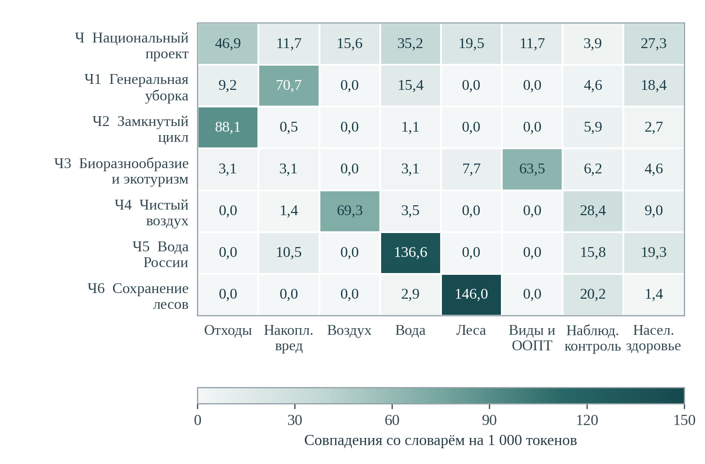

[B242; Caption] Рисунок 10 – Тематическая специализация электронных представлений национального и федеральных проектов

[B243; SourceNote] Частоты восьми словарей на 1 000 токенов; длина текстов нормирована. Словари не являются взаимоисключающими. Нуль означает отсутствие совпадения с выбранными формами слов, а не отсутствие соответствующей деятельности. [Сноски 94]

[B244; ] Наблюдения и контроль наиболее заметны в «Чистом воздухе» – 28,4 совпадения на 1 000 токенов, лесном направлении – 20,2 и водном – 15,8. В первом случае это согласуется с предусмотренными наблюдательной сетью, лабораториями и ФГИС состояния окружающей среды. Однако частота слова «контроль» не характеризует качество измерений, пространственную представительность постов или полноту передачи данных. Аналогично небольшое число слов о населении в техническом описании лесовосстановления не доказывает отсутствия пользы для жителей. Лексический профиль указывает, какие вопросы следует дополнительно раскрыть содержательно.

[B245; ] Границы федеральных проектов не полностью совпадают с границами природных компонентов. Например, в «Чистый воздух» включены общесистемный экологический мониторинг и наблюдения на Байкальской природной территории, охватывающие не только атмосферу. Поэтому название федерального проекта не всегда позволяет определить конечного пользователя создаваемой системы или весь круг экологических результатов. Это существенно и при интерпретации расходов: финансирование общего наблюдения внутри одного направления может обеспечивать несколько задач. Для предметной оценки полезно отдельно показывать собственно природоохранное вмешательство и общую обеспечивающую функцию, сохраняя связь между ними. [Сноски 95]

[B246; ] Для детальной проверки выбран федеральный проект «Чистый воздух»: 15 результатов и четыре показателя дают компактную матрицу из 60 пар (рисунок 11). Результаты включают мероприятия предприятий, теплоснабжение, перевод индивидуального отопления, мониторинг, методическую работу и оценку влияния на здоровье. В матрице цвет показывает косинусную близость текста результата и названия показателя, а точка – принадлежность одной паспортной задаче. Эти признаки намеренно представлены раздельно: совпадение задачи и совпадение слов отвечают на разные вопросы. [Сноски 96]

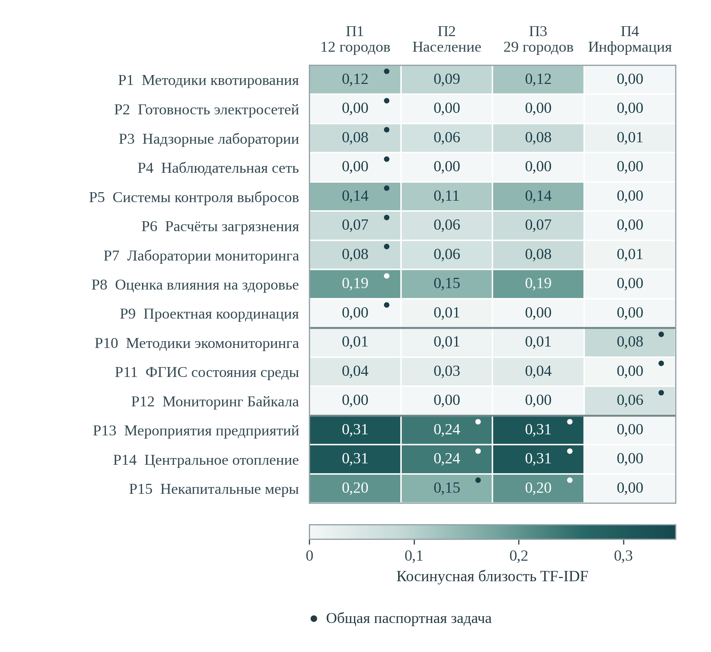

[B248; Caption] Рисунок 11 – Лексическая близость результатов и показателей федерального проекта Чистый воздух

[B249; SourceNote] Подписи сокращены; П1–П4 раскрыты в тексте. Точка обозначает общую задачу. Цвет не доказывает влияние; округление до 0,01 допускает малые положительные значения, показанные как 0,00. Числа исключены из текстовых признаков, поэтому показатели для 12 и 29 городов имеют одинаковые векторы; их территориальные совокупности различаются. [Сноски 97]

[B250; ] П1 обозначает снижение выбросов в 12 городах; П2 – численность населения, качество жизни которого улучшится при сокращении выбросов в 29 городах; П3 – снижение выбросов в 29 городах; П4 – долю доступной населению информации по направлениям экологического мониторинга. Подписи результатов сокращены только для размещения на рисунке. Наблюдаемый диапазон близости невысок: например, мероприятия предприятий дают 0,311 с показателями выбросов, центральное теплоснабжение – 0,308. Эти значения не имеют самостоятельного порога «достаточной» связи и не должны превращаться в баллы результативности.

[B251; ] Показателен установленный предел модели. Названия П1 и П3 различаются прежде всего числом городов. После исключения числовых токенов их текстовые векторы совпадают, поэтому оба столбца матрицы полностью одинаковы. Между тем территориальные совокупности этих показателей различаются, а задача у П1 и П3 в публикации указана разная. Следовательно, даже идеально воспроизводимый лексический расчёт не способен восстановить этот существенный элемент проектной логики. Для адресного сопоставления необходимо отдельно сохранять состав городов, период и базовый уровень, а не выводить их из сходства названий.

[B252; ] Обратный пример – подготовка электросетей для перевода домовладений на электроотопление. Она может иметь небольшую близость к названию показателя выбросов, поскольку описывает обеспечивающую инфраструктуру. Но содержательный механизм понятен: без достаточной мощности сети фактическая смена отопления невозможна. Его проверка требует сведений о подключении, устойчивом использовании нового способа отопления и изменении выбросов. Светлая клетка здесь не является доказательством ненужности мероприятия; она показывает, почему семантический анализ должен сопровождаться реконструкцией условий реализации.

[B253; Heading2] 5.4 Межпроектные связи и лексическая близость

[B254; ] В агрегированном текстовом профиле экологического проекта наибольшие веса имеют слова и сочетания, связанные с окружающей средой, отходами, накопленным вредом, опасными веществами и водными объектами. Значимы также общие для проектной документации слова об объектах, территориях и мероприятиях. Поэтому близость к другим проектам необходимо разбирать по составляющим: она может отражать общую предметную область, общую управленческую инфраструктуру или привычную форму описания работ.

[B255; ] В базовой модели ближайшим из 11 сопоставляемых проектов является «Инфраструктура для жизни» с коэффициентом 0,129; далее следуют «Экономика данных и цифровая трансформация государства» – 0,115, «Молодёжь и дети» – 0,106 и «Эффективная и конкурентная экономика» – 0,098. Значения для «Продолжительной и активной жизни» и «Туризма и гостеприимства» составляют 0,086 и 0,083. Порядок и изменение коэффициентов при объединении словоформ представлены на рисунке 12.

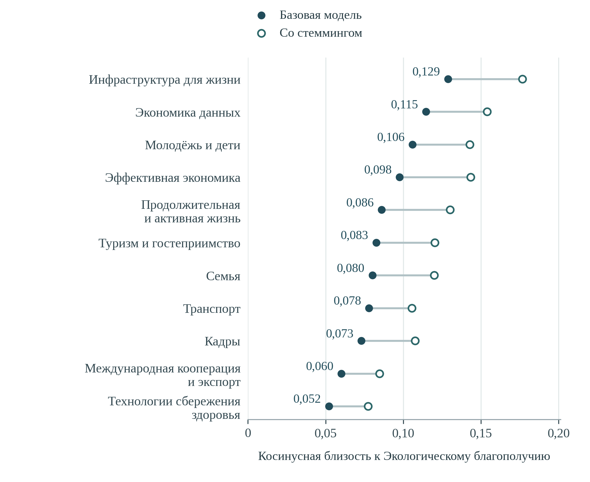

[B257; Caption] Рисунок 12 – Межпроектная лексическая близость экологического национального проекта

[B258; SourceNote] Порядок строк определён базовой моделью; числовые подписи относятся к ней. Стемминг объединяет родственные словоформы. Коэффициенты характеризуют тексты; они не измеряют распределение бюджета, силу координации или результативность. [Сноски 98]

[B259; ] Устойчивое первое место инфраструктурного проекта содержательно объяснимо. Вклад дают слова об объектах, среде, строительстве, территориях и коммунальном хозяйстве. На уровне механизмов существенны сопряжение канализационных сетей с очистными сооружениями, отопительной инфраструктуры со снижением выбросов, застройки с обращением с отходами. Но общая предметная область не доказывает согласованного графика, совпадения зон обслуживания или отсутствия дублирования расходов. Проверять следует конкретные зависимости между объектами и режимами эксплуатации, а не повышать коэффициент текстовой близости как самостоятельную цель.

[B260; ] Положение «Экономики данных» связано как с общей административной лексикой, так и с явно предусмотренными информационными механизмами экологического проекта. В «Чистом воздухе» описаны ФГИС состояния окружающей среды, интеграция с региональными системами, моделирование распространения концентраций, дистанционное зондирование и использование сведений граждан. Это содержательная область межпроектного сопряжения. Оценке подлежат доступность наблюдений для решения экологических задач, совместимость определений и своевременность информации. Само наличие информационной системы и общий словарь данных не подтверждают улучшения качества среды. [Сноски 99]

[B261; ] Высокое положение «Молодёжи и детей» требует более осторожного чтения: среди значимых общих признаков преобладают мероприятия, территории, создание объектов и формулы реализации. Экологическое просвещение действительно включено в проект, однако ранговое соседство не позволяет считать его главным межпроектным механизмом. Аналогично шестое место туристического проекта не означает слабой содержательной связи с экологическим туризмом. В профиль всего национального проекта входят ещё пять федеральных направлений, и специфическое сопряжение может быть размыто при усреднении.

[B262; ] Для управленческой проверки приоритетны конкретные зависимости: между коммунальными сетями и очисткой, информационными системами и наблюдениями, производством и вторичным сырьём, туризмом и допустимой нагрузкой. Выбор этих связей определяется механизмами проекта, а не только лексическим рангом. Их проверка требует согласованных территорий, сроков и ответственных за совместный результат.

[B263; Heading2] 5.5 Устойчивость результатов и условия их применения

[B264; ] Проверка устойчивости разделяет два класса допущений: способ представления языка и способ объединения документов. В первом случае сопоставлены базовая модель, объединение русских словоформ алгоритмом Snowball и использование только отдельных слов без пар. Во втором – среднее всех документных профилей, равный вес национального и совокупного федерального уровня, только федеральные и только национальные документы. Порядок 11 соседних проектов сравнивается с базовым по ранговой корреляции Спирмена. [Сноски 100]

[B265; Caption] Таблица 8 – Устойчивость межпроектного ранжирования к изменению модели

[TABLE 8; B266]
Спецификация | Число
признаков | Ранговая
корреляция | Ближайший проект
Базовая модель | 46 519 | 1,000 | Инфраструктура для жизни
Объединение словоформ | 35 510 | 0,982 | Инфраструктура для жизни
Только отдельные слова | 10 329 | 1,000 | Инфраструктура для жизни
Равный вес двух уровней | 46 519 | 0,636 | Инфраструктура для жизни
Только федеральные документы | 46 519 | 0,991 | Инфраструктура для жизни
Только национальные документы | 46 519 | 0,300 | Инфраструктура для жизни

[B267; SourceNote] Корреляция Спирмена рассчитана для 11 сопоставляемых проектов относительно базового порядка. В вариантах изменения уровня используется тот же словарь, но иной состав агрегируемых профилей. [Сноски 101]

[B268; ] Первое место «Инфраструктуры для жизни» сохраняется во всех шести спецификациях. При стемминге ранговая корреляция составляет 0,982, а при переходе к отдельным словам – 1,000. Следовательно, положение инфраструктурного проекта не определяется случайным выбором окончаний или включением двухсловных сочетаний. При этом абсолютные коэффициенты при стемминге изменяются, поскольку объединяются ранее раздельные признаки. Рост коэффициента в такой модели характеризует язык представления, а не усиление реальной координации.

[B269; ] Иной результат даёт изменение уровня обобщения. Равный вес национального и федерального уровня снижает корреляцию до 0,636. При использовании только федеральных документов она равна 0,991; только национальных – 0,300. В последнем случае на второе место выходит «Транспорт», на третье – «Эффективная и конкурентная экономика». Краткие национальные формулировки концентрируют общие цели и задают другое сопоставление, чем подробные описания реализации. Поэтому агрегированную карту нельзя представлять как единственную неизменную структуру связей.

[B270; ] Для экологического проекта это особенно существенно из-за различий объёма и назначения уровней. Национальный текст содержит 256 токенов, тогда как один федеральный документ замкнутого цикла – 1 851. Нормировка ограничивает механическое преимущество длины, но не делает их содержания взаимозаменяемыми. В базовом среднем каждый из семи документных профилей получает одинаковый вес; в модели равных уровней короткое национальное изложение получает половину веса. Эти два решения соответствуют разным исследовательским вопросам, и расхождение между ними следует раскрывать, а не устранять подбором удобного варианта.

[B271; ] Словари и TF-IDF не учитывают автоматически отрицания, институциональные роли, состав территорий и временные лаги. Для применения к решениям требуется содержательное чтение этих характеристик и связь с наблюдениями реализации.

[B272; ] Все шесть спецификаций используют один корпус. Их согласие показывает устойчивость результата к выбранным преобразованиям, но не устраняет общую зависимость от полноты описаний и административной терминологии. Поэтому внешняя проверка требует сопоставления с конкретными программами мероприятий, наблюдениями реализации и предметным знанием.

[B273; ] Практический вывод состоит в необходимости соединить содержательную логику с адресным наблюдением. У результата должны быть определены показатель назначения, территория, период, ожидаемый переход и способ его проверки. Доступная публикация должна позволять различить расчётную связь, наблюдаемое выполнение и оценённый дополнительный эффект. TF-IDF полезен для поиска неполных описаний, тематических пересечений и мест, требующих экспертного чтения.

[B274; Heading1] 6 Экологические результаты: территория, потоки и устойчивость

[B275; Heading2] 6.1 Территория воздействия и распределение экологических выгод

[B276; ] Единица управления экологическим результатом должна учитывать распространение загрязнения и устройство экосистемы. Место капитальных затрат, источник воздействия и территория получения выгод могут не совпадать. Очистные сооружения действуют в пределах определённой системы водоотведения, тогда как улучшение состояния водоёма распространяется по водосбору. Сокращение выбросов связано с расположением источников, переносом примесей и размещением населения. Граница субъекта Федерации необходима для бюджетной ответственности, но не всегда достаточна для оценки результата.

[B277; ] Предлагается связывать сведения о поддержанном объекте с зоной воздействия, контрольными точками и группами получателей. Для каждого участка следует указывать исходное состояние, приоритетные загрязняющие вещества или свойства экосистемы, ожидаемый механизм изменения и срок наблюдения. Такая связь может формироваться в действующих информационных системах. Самостоятельная новая отчётность не нужна там, где требуемые сведения уже собираются и могут быть согласованы по идентификаторам.

[B278; ] Для воздуха полезно дополнять объём выбросов распределением концентраций в местах проживания. Средневзвешенная по населению концентрация отдельного вещества может рассчитываться следующим образом:

[B279; EquationText] (3)

[Формула] C̅ₚ = Σᵢ NᵢCᵢₚ / Σᵢ Nᵢ

$$
\overline{C}_p=\frac{\sum_i N_i C_{ip}}{\sum_i N_i}
$$

[B280; ] Здесь Nᵢ – численность населения непересекающейся пространственной ячейки i, Cᵢₚ – концентрация вещества p за одинаковый период. Расчёт требует согласованной сетки населения и наблюдений либо проверенной модели концентраций. Он характеризует пространственную оценку воздействия, а не индивидуальную дозу и не автоматически число предотвращённых заболеваний. Наряду со средним необходимы распределение концентраций и характеристика наиболее неблагоприятных участков.

[B281; ] Рекомендации ВОЗ рассматривают качество воздуха через концентрации отдельных загрязняющих веществ и периоды осреднения. Это методическое основание для анализа экспозиции, не замена российским обязательным нормативам. При использовании международных ориентиров их статус следует обозначать отдельно. Смешение нормативной оценки, рекомендованного уровня и расчётного риска делает вывод неоднозначным. [Сноски 102]

[B282; ] В проекте «Чистый воздух» уже предусмотрены информационное обеспечение, моделирование концентраций и оценка влияния сокращения выбросов на здоровье. Следовательно, совершенствование должно конкретизировать условия этой оценки: согласованный набор веществ, территорию и период, связь с мероприятиями, учёт метеорологии и иных источников. Перенос общегородского улучшения на всех жителей в одинаковой степени не обоснован без пространственных данных. [Сноски 103]

[B283; ] Оценка распределения выгод должна охватывать территории с высокой исходной нагрузкой и группы, для которых воздействие длительно или возможности его избежать ограничены. Однако число жителей не может быть единственным критерием природоохранного приоритета. Сохранение редкого вида или экологически значимого участка имеет самостоятельное значение в рамках целей проекта. Для таких мер обоснование строится на состоянии популяций, местообитаний и угроз, а социальные последствия рассматриваются дополнительно.

[B284; Heading2] 6.2 Прослеживаемость материальных потоков и устойчивость технологий

[B285; ] Различие между обработкой, выделением полезных фракций и использованием вторичного сырья требует прослеживаемости одной материальной цепочки. Для поддерживаемого комплекса необходимо согласовать сведения о поступлении, пригодном сырье, передаче потребителю, остатках и запасах. Это позволяет проверять, обеспечивается ли предусмотренное проектом вовлечение ресурсов в производство и не учитывается ли одна масса повторно на последовательных стадиях. [Сноски 104]

[B286; ] Подход расширенной ответственности производителей связывает ответственность за продукцию с её жизненным циклом, включая стадию после потребления. Для экспертизы это означает необходимость оценивать не только сбор средств и создание мощностей, но и стимулы к сокращению труднообрабатываемых материалов и подтверждённому возврату сырья в производство. Конкретное применение такого принципа должно учитывать действующее российское регулирование и различия товарных групп. [Сноски 105]

[B287; ] В финансовых инструментах обращения с отходами промежуточный результат выражается в условиях привлечения средств. Экологическая проверка должна продолжаться до работы поддержанного объекта и движения материала. Объём финансирования, проектная мощность и фактическая загрузка должны сопоставляться по одной группе объектов и по известным срокам запуска. Их простое деление на национальный объём отходов не даёт оценки отдачи конкретного инструмента.

[B288; ] Для водоохранных технологий предусмотренную проектом проверку очистки под нагрузкой целесообразно связывать с наблюдением конкретного водного объекта. Снижение объёма неочищенных стоков, уменьшение массы приоритетного вещества и улучшение состояния водоёма являются различными результатами. Их сопоставление требует данных о составе сброса, водности, иных источниках и принимающей среде. [Сноски 106]

[B289; ] Международный мониторинг ЦУР 6.3.2 также отделяет состояние воды в природных объектах от объёма мероприятий по очистке: он рассматривает долю водных объектов с хорошим качеством воды относительно принятых национальных или субнациональных стандартов. Для национального проекта полезен сам принцип самостоятельного наблюдения принимающей среды. Перенос готового международного показателя без адаптации сети наблюдений и типологии водоёмов не предлагается. [Сноски 107]

[B290; ] Для каждого комплекса водоохранных мероприятий целесообразно выделять водосбор и перечень контролируемых воздействий. Измерения до и после работ должны сопоставляться при учёте сезонности и гидрологических условий. Если несколько проектов одновременно изменяют коммунальную инфраструктуру, промышленный сброс и состояние береговой зоны, их вклад следует анализировать совместно. Двойной учёт одних и тех же жителей как независимо улучшивших условия жизни завышает охват совокупной программы.

[B291; ] Устойчивость очистки зависит от фактической нагрузки, энергоснабжения, квалификации персонала, реагентов, обслуживания и обращения с осадком. Эти условия должны подтверждаться при запуске и проверяться в последующей работе. Контроль единичного приёмочного замера желательно дополнять наблюдением типичных и неблагоприятных режимов. При изменении результата необходимо различать ограничение технологии, недозагрузку, нарушение эксплуатации и внешнее поступление загрязнения.

[B292; Heading2] 6.3 Устойчивость восстановления природных систем

[B293; ] Для проверки предусмотренных проектом ухода и перевода восстановленных площадей в покрытые лесом земли целесообразно наблюдать одни и те же участки по году начала, природным условиям и способу восстановления. Сопоставление должно учитывать возраст насаждений, сохранность целевых пород и повторные нарушения. Отсутствие последующего наблюдения не подтверждает успех восстановления. [Сноски 108]

[B294; ] Научные принципы экологического восстановления связывают оценку с подходящей референсной экосистемой, измеримыми характеристиками и последующим наблюдением. Исходное состояние перед работами и желаемое состояние восстановления имеют разные функции. Для российской практики это предполагает обоснование ориентиров применительно к природной зоне и истории участка, включая изменения условий, а не механическое использование единой модели леса для всех территорий. [Сноски 109]

[B295; ] В сохранении биоразнообразия требуется различать охват мероприятиями и изменение состояния популяций. Поддержка питомника, реабилитация животных, охрана местообитания и экологическое просвещение являются разными механизмами. Их вклад зависит от конкретных ограничений восстановления вида. Наблюдение должно фиксировать выбранную угрозу, предполагаемый путь её уменьшения и показатель состояния, а неопределённость учёта численности должна сохраняться в интерпретации.

[B296; ] Экологический туризм создаёт самостоятельные рекреационные и экономические результаты. Рост посещений не является универсальным показателем сохранности природного комплекса. Для природоохранной оценки необходимы пространственное распределение потока, сезонные пики, состояние маршрутов, воздействие на уязвимые участки и обеспеченность охраны. В одном случае расширение инфраструктуры может упорядочить посещение, в другом – увеличить нагрузку; направление изменения устанавливается наблюдением. [Сноски 110]

[B297; ] В международной рамке сохранения биоразнообразия эффективная охрана связана с состоянием экосистем, их репрезентативностью, связанностью и устойчивыми природоохранными результатами. Это сравнительное методическое основание для оценки качества управления, а не дополнительное обязательное численное задание российскому проекту. Приоритет сохранения чувствительных участков должен быть согласован с режимом допустимого посещения и ресурсами последующего содержания. [Сноски 111]

[B298; Heading1] 7 Направления совершенствования национального проекта

[B299; Heading2] 7.1 Согласование показателей и ответственности за результат

[B300; ] Первоочередная задача – согласовать публично используемые определения и датированные планы. Для каждого показателя необходимы однозначное название, единица, база, состав территории, периодичность и правило пересмотра. При изменении методики следует публиковать пояснение перехода и, где возможно, сопоставимый пересчёт. Когда пересчёт отсутствует, два ряда должны сохранять различимый статус. Это особенно существенно для шкал остатка к базе, составных индексов и меняющихся территориальных когорт.

[B301; ] Доступность информации о результатах может быть обеспечена без раскрытия сведений ограниченного распространения. Полезен согласованный открытый набор целей, методик, фактических значений и объяснений корректировок. Он должен позволять установить, какая редакция использовалась при оценке исполнения. Одновременное существование несогласованных чисел затрудняет внешнюю экспертизу даже при наличии достоверных ведомственных данных.

[B302; ] Связь между результатом и показателем должна включать не только название, но и идентификатор показателя, территорию, механизм и ожидаемый срок изменения. Для одинаково названных показателей по разным группам городов территориальная принадлежность является обязательным условием сопоставления. Лексическое сходство может помогать обнаруживать кандидатов для связи, но итоговое назначение требует содержательной и структурной проверки.

[B303; ] Действующие обследования, оценку опасности и критерии отбора целесообразно связывать с проверяемым исходным состоянием, необратимостью возможного ущерба, ожидаемым изменением и готовностью решения. Проекты, обязательные для устранения непосредственной опасности, следует рассматривать с учётом этой функции; их нельзя исключать только из-за высокой стоимости единицы результата. Для сопоставимых альтернатив полезна оценка затрат на достижение одинакового экологического изменения, включая эксплуатацию и последующее наблюдение.

[B304; ] Финансовая прослеживаемость должна сохраняться на всём пути от решения о поддержке до наблюдаемого результата. Для инфраструктурного объекта это означает связь финансирования, фактической готовности, режима работы и экологических измерений. Для природоохранной территории – связь ресурса, выполненной меры и состояния охраняемого объекта. Резерв будущих ассигнований требует заблаговременного отбора и подготовки, а финансовое посредничество – наблюдения фактических условий и результатов поддержанных проектов.

[B305; ] Отдельного управления требуют зависимости между национальными проектами. Подключение очистных сооружений к коммунальным сетям, использование вторичного сырья в строительстве и сохранение природных территорий при развитии туризма должны иметь согласованные территории и сроки. Совместное присутствие темы в нескольких документах является основанием для такой проверки, но не подтверждает выполненную координацию. Ответственность целесообразно закреплять за конкретным результатом взаимодействия.

[B306; Heading2] 7.2 Показатели для проверки экологических изменений

[B307; ] Дополнение мониторинга следует начинать с использования уже предусмотренных наблюдений и эксплуатационных данных. В таблице 9 предложены направления детализации, которые помогают проверить переход от мероприятия к состоянию среды. Они не заменяют действующие паспортные показатели и не утверждают отсутствие соответствующих сведений во всех ведомственных системах. Для каждого направления сначала требуется сопоставление имеющихся данных и проверка трудоёмкости.

[B308; Caption] Таблица 9 – Предлагаемая детализация наблюдения экологических результатов

[TABLE 9; B309]
Направление | Проверяемое изменение | Единица и условие сопоставления
Накопленный вред | Сохранение достигнутого снижения воздействия после завершения работ | Приоритетные вещества и пути распространения; одни и те же точки и критерии контроля
Замкнутый цикл | Фактическое использование выделенного вторичного сырья и судьба остатка | Масса по виду материала; прослеживаемость партии; отсутствие повторного учёта
Качество воздуха | Изменение концентраций в местах проживания и экспозиции населения | Вещество, период осреднения, пространственная сетка; учёт метеорологии и полноты наблюдения
Водные объекты | Нагрузка по приоритетным веществам и состояние принимающей среды | Масса за период и показатели контрольных створов; сопоставимые водность и сезон
Восстановление лесов | Сохранность и достижение целевых характеристик восстановленного участка | Группа одного года и способа восстановления; наблюдение того же участка
Биоразно­образие и туризм | Состояние целевых популяций и природных комплексов при изменении посещений | Сопоставимый метод учёта, сезон и зона; наблюдение туристической нагрузки отдельно от охвата охраной

[B310; SourceNote] Предложения экспертизы. Численные пороги и периодичность устанавливаются после проверки нормативных требований, природных условий и качества наблюдений.

[B311; ] Минимальный паспорт дополнительного измерения должен указывать управленческий вопрос, единицу наблюдения, расчёт, источник и допустимые пропуски. Для доли необходимы числитель и знаменатель; для изменения – исходное значение и сопоставимый период; для модельной оценки – входные данные, проверка и неопределённость. Публикация только итогового индекса не позволяет определить, связано ли его движение с фактическим состоянием или обновлением состава данных.

[B312; ] Территориальные и социальные различия следует раскрывать на том уровне, на котором принимается решение. Для загрязнения воздуха важна внутригородская неоднородность, для воды – положение по водосбору, для восстановления леса – участок и возрастная группа. Региональная статистика необходима для сопоставления масштаба проблемы, но детализация результата не всегда совпадает с административной иерархией.

[B313; ] Неопределённость должна сопровождать само измерение. Для наблюдаемой концентрации существенны представительность и полнота измерений, для численности вида – обнаруживаемость и метод учёта, для расчётной экспозиции – качество модели и пространственных данных. Отсутствующее значение не следует заменять благоприятным. Изменение сети наблюдения или расширение охвата может обнаружить ранее неучтённую проблему, что не тождественно ухудшению экологической ситуации.

[B314; Heading2] 7.3 Последовательность внедрения и оценка дополнительного эффекта

[B315; ] Реализацию рекомендаций целесообразно организовать в несколько проверяемых этапов. Сначала согласуются определения и версии, затем выбираются типовые мероприятия с доступными наблюдениями, после чего проверяется возможность устойчиво связать затраты, работы и экологическое изменение. Сроки должны учитывать сезонность и длительность процессов. Например, проверка приживаемости насаждений и восстановления популяции не может завершаться в тот же момент, что и административная приёмка работ.

[B316; Caption] Таблица 10 – Последовательность внедрения предложенных изменений

[TABLE 10; B317]
Этап | Основное содержание | Критерий завершения
Согласование сведений | Сверка определений, территорий, датированных целей и методических редакций | Каждое существенное различие объяснено либо обозначено как нерешённое
Пилотная проверка | Выбор мероприятий разных типов; соединение объектов, наблюдений и расходов | Можно восстановить путь от поддержки до проверяемого изменения
Наблюдение после работ | Контроль эксплуатации, устойчивости и пространственного распределения результата | Получены сопоставимые наблюдения за содержательно необходимый период
Корректировка отбора | Использование выявленных ограничений и подтверждённых результатов при следующем решении | Понятно, какое условие изменено и на каком основании

[B318; SourceNote] Рекомендуемые этапы управления. Продолжительность определяется типом вмешательства, сезонностью и сроком экологического отклика.

[B319; ] Для оценки дополнительного эффекта следует по возможности планировать наблюдение до начала вмешательства. Одно измерение до и после на поддержанном участке не отделяет влияние работ от погоды, гидрологии, хозяйственной динамики и общих природных процессов. Экологические схемы сравнения до и после с контрольными участками требуют пространственной и временной повторности. Методическая литература специально указывает на ограничения единственного контрольного участка и необходимость учитывать неоднородность временной динамики. [Сноски 112]

[B320; ] Для водоохранного мероприятия целесообразно сочетать несколько контрольных створов и сопоставимые водные объекты, если их характеристики позволяют такое сравнение. Для лесовосстановления – участки с близкими природными условиями, годом начала и историей нарушений. Для атмосферного воздуха необходимо учитывать метеорологию, изменение выпуска предприятий и воздействия за пределами поддержанных источников. Контрольная территория должна быть обоснована, а не выбрана только потому, что на ней отсутствует запись о финансировании.

[B321; ] Пространственное распространение результата ограничивает независимость сравнений. Участок ниже по течению может получать воздействие от поддержанной территории; соседний район – изменение переносимого загрязнения; охраняемая территория – перераспределённый туристический поток. В таких случаях необходимы изменение схемы сравнения или явный учёт косвенного воздействия. Усреднение нескольких зависимых наблюдений не создаёт независимых подтверждений эффекта.

[B322; ] Организацию такой работы целесообразно закрепить за органами управления национальным и соответствующими федеральными проектами. Ведомства, формирующие официальные показатели, отвечали бы за согласование определений и пересчётов; региональные органы и операторы объектов – за связь работ с эксплуатационными наблюдениями; независимая научная оценка – за проверку сопоставимости и объяснений обнаруженных изменений. Предлагаемое распределение функций должно конкретизироваться в действующих полномочиях и регламентах, без дублирования уже установленной отчётности.

[B323; Heading1] Заключение

[B324; ] Экспертиза национального проекта «Экологическое благополучие» показывает, что объединение шести направлений позволяет рассматривать загрязнение, восстановление природных систем и обеспечивающие механизмы в общей управленческой рамке. Содержательное основание проекта не исчерпывается количеством объектов или площадью работ: в нём предусмотрены меры контроля качества, наблюдения и последующего развития. Для совершенствования решающее значение имеет подтверждение того, как эти элементы совместно изменяют состояние конкретной территории.

[B325; ] Статистические результаты неоднородны по единицам, временному охвату и смыслу. Обработка отходов не равнозначна использованию вторичного сырья; остаточный индекс выбросов не является величиной сокращения; площадь воспроизводственных работ не удостоверяет восстановление функций леса; посещаемость охраняемых территорий не заменяет оценку биоразнообразия. Эти различия необходимо сохранять в управленческой отчётности. Региональные распределения раскрывают ограничения, которые не видны в одном общероссийском числе.

[B326; ] Финансовые риски связаны прежде всего с переходом от планирования и привлечения средств к готовому и устойчиво работающему решению. Существенны отбор проектов для будущих ассигнований, техническая готовность, условия привлечённого финансирования, срок экологического отклика и расходы на сохранение достигнутого состояния. Арифметическая сверка публикаций и разграничение статуса финансовых данных являются необходимыми условиями этой оценки, но сами по себе не устанавливают качество расходования средств.

[B327; ] Анализ проектных связей и текстов показывает предметную специализацию федеральных направлений и значимость взаимодействия с инфраструктурной политикой. Одновременно он выявляет необходимость явных идентификаторов результата, показателя, территории и периода. Лексические методы помогают обнаружить тематические пересечения и неоднозначные формулировки. Для решения о результативности конкретного мероприятия требуются наблюдения его реализации и содержательно обоснованный механизм воздействия.

[B328; ] Основной практический вывод – переход к проверке устойчивого экологического изменения по связанным наблюдениям: исходное состояние, вмешательство, работа технологии или природоохранной меры, состояние среды и сохранение результата. Предложенные дополнения следует сначала согласовать с существующими данными, затем испытать на типовых территориях и использовать для корректировки отбора и мониторинга. Такая последовательность позволяет совершенствовать проект по подтверждённым ограничениям и результатам, сохраняя различие между исполнением задания, экологическим изменением и оценённым дополнительным эффектом.

# Сноски и источники

[1] Министерство природных ресурсов и экологии Российской Федерации. Письмо от 7 августа 2025 г. № 19-50/15014-ОГ о предоставлении паспортов национального проекта «Экологическое благополучие» и федеральных проектов : с приложением сведений по состоянию на 05.08.2025 [Электронный ресурс] // ГАРАНТ. Режим доступа: https:/​/​www.​garant.​ru/​products/​ipo/​prime/​doc/​412600807/​ (дата обращения: 28.10.2026).

[2] Министерство природных ресурсов и экологии Российской Федерации. Доля обрабатываемых твердых коммунальных отходов в общей массе образованных твердых коммунальных отходов : показатель ЕМИСС № 62792 [Электронный ресурс] // Единая межведомственная информационно-статистическая система. – Режим доступа: https:/​/​www.​fedstat.​ru/​indicator/​62792 (дата выгрузки: 15.10.2026); Министерство природных ресурсов и экологии Российской Федерации. Доля захораниваемых твердых коммунальных отходов в общей масе образованных твердых коммунальных отходов : показатель ЕМИСС № 62793 [Электронный ресурс] // Единая межведомственная информационно-статистическая система. – Режим доступа: https:/​/​www.​fedstat.​ru/​indicator/​62793 (дата выгрузки: 15.10.2026).

[3] Министерство природных ресурсов и экологии Российской Федерации. Снижение совокупного объема выбросов опасных загрязняющих веществ в 12 городах-участниках федерального проекта : показатель ЕМИСС № 62862 [Электронный ресурс] // Единая межведомственная информационно-статистическая система. – Режим доступа: https:/​/​www.​fedstat.​ru/​indicator/​62862 (дата выгрузки: 15.10.2026); Министерство природных ресурсов и экологии Российской Федерации. Снижение совокупного объема выбросов опасных загрязняющих веществ в 29 городах-участниках федерального проекта : показатель ЕМИСС № 62863 [Электронный ресурс] // Единая межведомственная информационно-статистическая система. – Режим доступа: https:/​/​www.​fedstat.​ru/​indicator/​62863 (дата выгрузки: 15.10.2026).

[4] Федеральное агентство лесного хозяйства. Отношение площади лесовосстановления и лесоразведения к площади вырубленных и погибших лесных насаждений : показатель ЕМИСС № 62781 [Электронный ресурс] // Единая межведомственная информационно-статистическая система. – Режим доступа: https:/​/​www.​fedstat.​ru/​indicator/​62781 (дата выгрузки: 15.10.2026); Федеральное агентство лесного хозяйства. Об утверждении методики расчёта показателя «Отношение площади лесовосстановления и лесоразведения к площади вырубленных и погибших лесных насаждений» федерального проекта «Сохранение лесов» национального проекта «Экологическое благополучие» : приказ от 27.08.2025 № 602 // Кодификация.РФ. – Текст : электронный. – Режим доступа: https:/​/​rulaws.​ru/​acts/​Prikaz-​Rosleshoza-​ot-​27.​08.​2025-​N-​602/​ (дата обращения: 28.10.2026); Федеральное агентство лесного хозяйства. Об утверждении методики расчёта показателя «Отношение площади лесовосстановления и лесоразведения к площади вырубленных и погибших лесных насаждений» : приказ от 17.04.2026 № 238 // Законы, кодексы и нормативно-правовые акты Российской Федерации. – Текст : электронный. – Режим доступа: https:/​/​legalacts.​ru/​doc/​prikaz-​rosleskhoza-​ot-​17042026-​n-​238-​ob-​utverzhdenii-​metodiki/​ (дата обращения: 28.10.2026); Министерство природных ресурсов и экологии Российской Федерации. Количество посетителей особо охраняемых природных территорий федерального значения : показатель ЕМИСС № 62777 [Электронный ресурс] // Единая межведомственная информационно-статистическая система. – Режим доступа: https:/​/​www.​fedstat.​ru/​indicator/​62777 (дата выгрузки: 15.10.2026).

[5] Экологическое благополучие : национальный проект : электронное представление паспортных сведений, публикация от 16 октября 2026 г., версия 26.72 [Электронный ресурс] // DataBudget. Режим доступа: https:/​/​databudget.​ru/​projects/​np/​25 (дата обращения: 28.10.2026); Генеральная уборка : федеральный проект : электронное представление паспортных сведений, публикация от 16 октября 2026 г., версия 26.32 [Электронный ресурс] // DataBudget. Режим доступа: https:/​/​databudget.​ru/​projects/​fp/​246 (дата обращения: 28.10.2026); Правительство Российской Федерации. Пояснительная записка к проекту федерального закона № 615-9 «О федеральном бюджете на 2027 год и на плановый период 2028 и 2029 годов», внесённому 30 сентября 2026 г. Разд. IV, табл. 4.1.6 // ГАРАНТ. – Текст : электронный. Режим доступа: https:/​/​base.​garant.​ru/​411685865/​ (дата обращения: 28.10.2026).

[6] Экологическое благополучие : национальный проект : электронное представление паспортных сведений, публикация от 16 октября 2026 г., версия 26.72. Режим доступа: https:/​/​databudget.​ru/​projects/​np/​25; Национальные и федеральные проекты : каталог электронных представлений паспортных сведений [Электронный ресурс] // DataBudget. Режим доступа: https:/​/​databudget.​ru/​projects (дата обращения: 28.10.2026).

[7] Министерство природных ресурсов и экологии Российской Федерации. Письмо от 7 августа 2025 г. № 19-50/15014-ОГ о предоставлении паспортов национального проекта «Экологическое благополучие» и федеральных проектов : с приложением сведений по состоянию на 05.08.2025. Режим доступа: https:/​/​www.​garant.​ru/​products/​ipo/​prime/​doc/​412600807/​.

[8] United Nations Statistics Division. Ecosystem Accounting // System of Environmental-Economic Accounting. – Текст : электронный. Режим доступа: https:/​/​seea.​un.​org/​en/​methodology/​ecosystem-​accounting (дата обращения: 28.10.2026).

[9] О национальных целях развития Российской Федерации на период до 2030 года и на перспективу до 2036 года : Указ Президента Российской Федерации от 7 мая 2024 г. № 309. П. 5 // ГАРАНТ. – Текст : электронный. Режим доступа: https:/​/​base.​garant.​ru/​408992634/​ (дата обращения: 28.10.2026); Минприроды России. Письмо № 19-50/15014-ОГ о параметрах национального проекта «Экологическое благополучие». Режим доступа: https:/​/​www.​garant.​ru/​products/​ipo/​prime/​doc/​412600807/​.

[10] Указ Президента Российской Федерации № 309. П. 5. Режим доступа: https:/​/​base.​garant.​ru/​408992634/​.

[11] Минприроды России. Письмо № 19-50/15014-ОГ о параметрах национального проекта «Экологическое благополучие». Режим доступа: https:/​/​www.​garant.​ru/​products/​ipo/​prime/​doc/​412600807/​.

[12] Минприроды России. Письмо № 19-50/15014-ОГ о параметрах национального проекта «Экологическое благополучие». Режим доступа: https:/​/​www.​garant.​ru/​products/​ipo/​prime/​doc/​412600807/​; Экологическое благополучие : национальный проект : открытая републикация паспортных сведений. Режим доступа: https:/​/​databudget.​ru/​projects/​np/​25.

[13] Минприроды России. Письмо № 19-50/15014-ОГ о параметрах национального проекта «Экологическое благополучие». Режим доступа: https:/​/​www.​garant.​ru/​products/​ipo/​prime/​doc/​412600807/​; Экологическое благополучие : национальный проект : открытая републикация паспортных сведений. Режим доступа: https:/​/​databudget.​ru/​projects/​np/​25.

[14] Минприроды России. Письмо № 19-50/15014-ОГ о параметрах национального проекта «Экологическое благополучие». Режим доступа: https:/​/​www.​garant.​ru/​products/​ipo/​prime/​doc/​412600807/​; Экологическое благополучие : национальный проект : открытая републикация паспортных сведений. Режим доступа: https:/​/​databudget.​ru/​projects/​np/​25.

[15] Минприроды России. Письмо № 19-50/15014-ОГ о параметрах национального проекта «Экологическое благополучие». Режим доступа: https:/​/​www.​garant.​ru/​products/​ipo/​prime/​doc/​412600807/​; Экологическое благополучие : национальный проект : открытая републикация паспортных сведений. Режим доступа: https:/​/​databudget.​ru/​projects/​np/​25.

[16] Об отходах производства и потребления : Федеральный закон от 24 июня 1998 г. № 89-ФЗ. Ст. 1, 3 // КонсультантПлюс. – Текст : электронный. Режим доступа: https:/​/​www.​consultant.​ru/​document/​Cons_​doc_​LAW_​19109/​ (дата обращения: 28.10.2026).

[17] Указ Президента Российской Федерации № 309. П. 5. Режим доступа: https:/​/​base.​garant.​ru/​408992634/​; Минприроды России. Письмо № 19-50/15014-ОГ о параметрах национального проекта «Экологическое благополучие». Режим доступа: https:/​/​www.​garant.​ru/​products/​ipo/​prime/​doc/​412600807/​.

[18] Минприроды России. Письмо № 19-50/15014-ОГ о параметрах национального проекта «Экологическое благополучие». Режим доступа: https:/​/​www.​garant.​ru/​products/​ipo/​prime/​doc/​412600807/​; Экономика замкнутого цикла : федеральный проект : открытая републикация паспортных сведений от 16 октября 2026 г., версия 26.38 // DataBudget. – Текст : электронный. Режим доступа: https:/​/​databudget.​ru/​projects/​fp/​255 (дата обращения: 28.10.2026).

[19] Об отходах производства и потребления : Федеральный закон № 89-ФЗ. Ст. 1, 3. Режим доступа: https:/​/​www.​consultant.​ru/​document/​Cons_​doc_​LAW_​19109/​.

[20] Минприроды России. Письмо № 19-50/15014-ОГ о параметрах национального проекта «Экологическое благополучие». Режим доступа: https:/​/​www.​garant.​ru/​products/​ipo/​prime/​doc/​412600807/​; Пояснительная записка к проекту федерального бюджета на 2027–2029 годы. Разд. IV, табл. 4.1.6. Режим доступа: https:/​/​base.​garant.​ru/​411685865/​.

[21] Об охране окружающей среды : Федеральный закон от 10 января 2002 г. № 7-ФЗ : ред. от 4 августа 2026 г. Ст. 80.1 // КонсультантПлюс. – Текст : электронный. Режим доступа: https:/​/​www.​consultant.​ru/​document/​cons_​doc_​LAW_​34823/​fde2e06b819539d5b2a4f077602075edb2571de6/​ (дата обращения: 28.10.2026); Генеральная уборка : федеральный проект : открытая републикация паспортных сведений. Режим доступа: https:/​/​databudget.​ru/​projects/​fp/​246.

[22] Генеральная уборка : федеральный проект : открытая републикация паспортных сведений. Режим доступа: https:/​/​databudget.​ru/​projects/​fp/​246.

[23] Минприроды России. Письмо № 19-50/15014-ОГ о параметрах национального проекта «Экологическое благополучие». Режим доступа: https:/​/​www.​garant.​ru/​products/​ipo/​prime/​doc/​412600807/​; Чистый воздух : федеральный проект : открытая републикация паспортных сведений от 16 октября 2026 г., версия 26.32 // DataBudget. – Текст : электронный. Режим доступа: https:/​/​databudget.​ru/​projects/​fp/​250 (дата обращения: 28.10.2026).

[24] О проведении эксперимента по квотированию выбросов загрязняющих веществ и внесении изменений в отдельные законодательные акты Российской Федерации в части снижения загрязнения атмосферного воздуха : Федеральный закон от 26 июля 2019 г. № 195-ФЗ. Ст. 1 // ГАРАНТ. – Текст : электронный. Режим доступа: https:/​/​base.​garant.​ru/​72330088/​1cafb24d049dcd1e7707a22d98e9858f/​ (дата обращения: 28.10.2026); Минприроды России. Письмо № 19-50/15014-ОГ о параметрах национального проекта «Экологическое благополучие». Режим доступа: https:/​/​www.​garant.​ru/​products/​ipo/​prime/​doc/​412600807/​.

[25] Минприроды России. Письмо № 19-50/15014-ОГ о параметрах национального проекта «Экологическое благополучие». Режим доступа: https:/​/​www.​garant.​ru/​products/​ipo/​prime/​doc/​412600807/​; Чистый воздух : федеральный проект : открытая републикация паспортных сведений. Режим доступа: https:/​/​databudget.​ru/​projects/​fp/​250.

[26] Минприроды России. Письмо № 19-50/15014-ОГ о параметрах национального проекта «Экологическое благополучие». Режим доступа: https:/​/​www.​garant.​ru/​products/​ipo/​prime/​doc/​412600807/​.

[27] Минприроды России. Письмо № 19-50/15014-ОГ о параметрах национального проекта «Экологическое благополучие». Режим доступа: https:/​/​www.​garant.​ru/​products/​ipo/​prime/​doc/​412600807/​.

[28] Минприроды России. Письмо № 19-50/15014-ОГ о параметрах национального проекта «Экологическое благополучие». Режим доступа: https:/​/​www.​garant.​ru/​products/​ipo/​prime/​doc/​412600807/​.

[29] Минприроды России. Письмо № 19-50/15014-ОГ о параметрах национального проекта «Экологическое благополучие». Режим доступа: https:/​/​www.​garant.​ru/​products/​ipo/​prime/​doc/​412600807/​; Рослесхоз. Методика отношения лесовосстановления к выбытию : приказ от 17.04.2026 № 238. Режим доступа: https:/​/​legalacts.​ru/​doc/​prikaz-​rosleskhoza-​ot-​17042026-​n-​238-​ob-​utverzhdenii-​metodiki/​.

[30] Сохранение лесов : федеральный проект : открытая републикация паспортных сведений от 16 октября 2026 г., версия 26.21 // DataBudget. – Текст : электронный. Режим доступа: https:/​/​databudget.​ru/​projects/​fp/​247 (дата обращения: 28.10.2026).

[31] Рослесхоз. Методика отношения лесовосстановления к выбытию : приказ от 17.04.2026 № 238. Режим доступа: https:/​/​legalacts.​ru/​doc/​prikaz-​rosleskhoza-​ot-​17042026-​n-​238-​ob-​utverzhdenii-​metodiki/​.

[32] Минприроды России. Письмо № 19-50/15014-ОГ о параметрах национального проекта «Экологическое благополучие». Режим доступа: https:/​/​www.​garant.​ru/​products/​ipo/​prime/​doc/​412600807/​; Сохранение биологического разнообразия и развитие экологического туризма : федеральный проект : открытая републикация паспортных сведений от 16 октября 2026 г., версия 26.22 // DataBudget. – Текст : электронный. Режим доступа: https:/​/​databudget.​ru/​projects/​fp/​256 (дата обращения: 28.10.2026).

[33] Об утверждении Правил расчета предельно допустимой рекреационной емкости особо охраняемых природных территорий федерального значения при осуществлении туризма : постановление Правительства Российской Федерации от 31 октября 2023 г. № 1811 // ГАРАНТ. – Текст : электронный. Режим доступа: https:/​/​base.​garant.​ru/​407923411/​ (дата обращения: 28.10.2026).

[34] Минприроды России. Посетители федеральных ООПТ : ЕМИСС № 62777. Режим доступа: https:/​/​www.​fedstat.​ru/​indicator/​62777; Министерство природных ресурсов и экологии Российской Федерации. Снижение негативного воздействия на центральную экологическую зону Байкальской природной территории : показатель ЕМИСС № 62854 [Электронный ресурс] // Единая межведомственная информационно-статистическая система. – Режим доступа: https:/​/​www.​fedstat.​ru/​indicator/​62854 (дата выгрузки: 15.10.2026); Министерство природных ресурсов и экологии Российской Федерации. Снижение объема неочищенных сточных вод, сбрасываемых в основные водные объекты : показатель ЕМИСС № 62871 [Электронный ресурс] // Единая межведомственная информационно-статистическая система. – Режим доступа: https:/​/​www.​fedstat.​ru/​indicator/​62871 (дата выгрузки: 15.10.2026).

[35] Рослесхоз. Отношение лесовосстановления к выбытию : ЕМИСС № 62781. Режим доступа: https:/​/​www.​fedstat.​ru/​indicator/​62781; Минприроды России. Обработка ТКО : ЕМИСС № 62792. Режим доступа: https:/​/​www.​fedstat.​ru/​indicator/​62792; Минприроды России. Захоронение ТКО : ЕМИСС № 62793. Режим доступа: https:/​/​www.​fedstat.​ru/​indicator/​62793; Минприроды России. Индекс выбросов в 12 городах : ЕМИСС № 62862. Режим доступа: https:/​/​www.​fedstat.​ru/​indicator/​62862; Минприроды России. Индекс выбросов в 29 территориях : ЕМИСС № 62863. Режим доступа: https:/​/​www.​fedstat.​ru/​indicator/​62863.

[36] Экологическое благополучие : национальный проект : открытая републикация паспортных сведений. Режим доступа: https:/​/​databudget.​ru/​projects/​np/​25; Минприроды России. Письмо № 19-50/15014-ОГ о параметрах национального проекта «Экологическое благополучие». Режим доступа: https:/​/​www.​garant.​ru/​products/​ipo/​prime/​doc/​412600807/​.

[37] Экономика замкнутого цикла : федеральный проект : открытая републикация паспортных сведений. Режим доступа: https:/​/​databudget.​ru/​projects/​fp/​255; Сохранение биологического разнообразия и развитие экологического туризма : федеральный проект : открытая републикация паспортных сведений. Режим доступа: https:/​/​databudget.​ru/​projects/​fp/​256; Чистый воздух : федеральный проект : открытая републикация паспортных сведений. Режим доступа: https:/​/​databudget.​ru/​projects/​fp/​250; Сохранение лесов : федеральный проект : открытая републикация паспортных сведений. Режим доступа: https:/​/​databudget.​ru/​projects/​fp/​247; Минприроды России. Обработка ТКО : ЕМИСС № 62792. Режим доступа: https:/​/​www.​fedstat.​ru/​indicator/​62792; Минприроды России. Захоронение ТКО : ЕМИСС № 62793. Режим доступа: https:/​/​www.​fedstat.​ru/​indicator/​62793; Минприроды России. Индекс выбросов в 12 городах : ЕМИСС № 62862. Режим доступа: https:/​/​www.​fedstat.​ru/​indicator/​62862; Минприроды России. Индекс выбросов в 29 территориях : ЕМИСС № 62863. Режим доступа: https:/​/​www.​fedstat.​ru/​indicator/​62863; Рослесхоз. Отношение лесовосстановления к выбытию : ЕМИСС № 62781. Режим доступа: https:/​/​www.​fedstat.​ru/​indicator/​62781; Федеральное агентство лесного хозяйства. Отнесение площадей лесовосстановления к землям, на которых расположены леса : показатель ЕМИСС № 62782 [Электронный ресурс] // Единая межведомственная информационно-статистическая система. – Режим доступа: https:/​/​www.​fedstat.​ru/​indicator/​62782 (дата выгрузки: 15.10.2026); Минприроды России. Посетители федеральных ООПТ : ЕМИСС № 62777. Режим доступа: https:/​/​www.​fedstat.​ru/​indicator/​62777; Министерство природных ресурсов и экологии Российской Федерации. Доля редких и находящихся под угрозой исчезновения объектов животного мира (птиц и млекопитающих), находящихся под особой охраной, охваченных мероприятиями по восстановлению их численности : показатель ЕМИСС № 62778 [Электронный ресурс] // Единая межведомственная информационно-статистическая система. – Режим доступа: https:/​/​www.​fedstat.​ru/​indicator/​62778 (дата выгрузки: 15.10.2026).

[38] Минприроды России. Обработка ТКО : ЕМИСС № 62792. Режим доступа: https:/​/​www.​fedstat.​ru/​indicator/​62792; Минприроды России. Захоронение ТКО : ЕМИСС № 62793. Режим доступа: https:/​/​www.​fedstat.​ru/​indicator/​62793; Министерство природных ресурсов и экологии Российской Федерации. Об утверждении методики расчёта показателя «Доля обрабатываемых твёрдых коммунальных отходов в общей массе образованных твёрдых коммунальных отходов» федерального проекта «Экономика замкнутого цикла», входящего в состав национального проекта «Экологическое благополучие» : приказ от 29.11.2024 № 691 // КонсультантПлюс. – Текст : электронный. – Режим доступа: https:/​/​www.​consultant.​ru/​document/​cons_​doc_​LAW_​497244/​7b9870463202ac172c364281eb183e5055b8f32e/​ (дата обращения: 28.10.2026); Министерство природных ресурсов и экологии Российской Федерации. Об утверждении методики расчёта показателя «Доля захораниваемых твёрдых коммунальных отходов в общей массе образованных твёрдых коммунальных отходов» федерального проекта «Экономика замкнутого цикла», входящего в состав национального проекта «Экологическое благополучие» : приказ от 29.11.2024 № 690 // Кодификация.РФ. – Текст : электронный. – Режим доступа: https:/​/​rulaws.​ru/​acts/​Prikaz-​Minprirody-​Rossii-​ot-​29.​11.​2024-​N-​690/​ (дата обращения: 28.10.2026).

[39] Минприроды России. Обработка ТКО : ЕМИСС № 62792. Режим доступа: https:/​/​www.​fedstat.​ru/​indicator/​62792; Минприроды России. Методика доли обработки ТКО : приказ от 29.11.2024 № 691. Режим доступа: https:/​/​www.​consultant.​ru/​document/​cons_​doc_​LAW_​497244/​7b9870463202ac172c364281eb183e5055b8f32e/​.

[40] Минприроды России. Обработка ТКО : ЕМИСС № 62792. Режим доступа: https:/​/​www.​fedstat.​ru/​indicator/​62792.

[41] Минприроды России. Захоронение ТКО : ЕМИСС № 62793. Режим доступа: https:/​/​www.​fedstat.​ru/​indicator/​62793.

[42] Минприроды России. Захоронение ТКО : ЕМИСС № 62793. Режим доступа: https:/​/​www.​fedstat.​ru/​indicator/​62793.

[43] Минприроды России. Обработка ТКО : ЕМИСС № 62792. Режим доступа: https:/​/​www.​fedstat.​ru/​indicator/​62792; Минприроды России. Захоронение ТКО : ЕМИСС № 62793. Режим доступа: https:/​/​www.​fedstat.​ru/​indicator/​62793.

[44] Минприроды России. Обработка ТКО : ЕМИСС № 62792. Режим доступа: https:/​/​www.​fedstat.​ru/​indicator/​62792; Минприроды России. Захоронение ТКО : ЕМИСС № 62793. Режим доступа: https:/​/​www.​fedstat.​ru/​indicator/​62793.

[45] Минприроды России. Обработка ТКО : ЕМИСС № 62792. Режим доступа: https:/​/​www.​fedstat.​ru/​indicator/​62792; Минприроды России. Захоронение ТКО : ЕМИСС № 62793. Режим доступа: https:/​/​www.​fedstat.​ru/​indicator/​62793.

[46] Минприроды России. Обработка ТКО : ЕМИСС № 62792. Режим доступа: https:/​/​www.​fedstat.​ru/​indicator/​62792; Минприроды России. Захоронение ТКО : ЕМИСС № 62793. Режим доступа: https:/​/​www.​fedstat.​ru/​indicator/​62793; Минприроды России. Методика доли обработки ТКО : приказ от 29.11.2024 № 691. Режим доступа: https:/​/​www.​consultant.​ru/​document/​cons_​doc_​LAW_​497244/​7b9870463202ac172c364281eb183e5055b8f32e/​; Минприроды России. Методика доли захоронения ТКО : приказ от 29.11.2024 № 690. Режим доступа: https:/​/​rulaws.​ru/​acts/​Prikaz-​Minprirody-​Rossii-​ot-​29.​11.​2024-​N-​690/​.

[47] Министерство природных ресурсов и экологии Российской Федерации. Индекс использования вторичных ресурсов и сырья из отходов в отраслях экономики : показатель ЕМИСС № 62787 [Электронный ресурс] // Единая межведомственная информационно-статистическая система. – Режим доступа: https:/​/​www.​fedstat.​ru/​indicator/​62787 (дата выгрузки: 15.10.2026); Министерство природных ресурсов и экологии Российской Федерации. Доля утилизированных отходов в общем объеме отходов I и II классов опасности : показатель ЕМИСС № 62804 [Электронный ресурс] // Единая межведомственная информационно-статистическая система. – Режим доступа: https:/​/​www.​fedstat.​ru/​indicator/​62804 (дата выгрузки: 15.10.2026); Министерство природных ресурсов и экологии Российской Федерации. Об утверждении методики расчёта показателя «Индекс использования вторичных ресурсов и сырья из отходов в отраслях экономики» : приказ от 30.12.2025 № 761 // КонсультантПлюс. – Текст : электронный. – Режим доступа: https:/​/​www.​consultant.​ru/​document/​cons_​doc_​LAW_​533545/​2ff7a8c72de3994f30496a0ccbb1ddafdaddf518/​ (дата обращения: 28.10.2026); Министерство природных ресурсов и экологии Российской Федерации. Об утверждении методики расчёта показателя «Доля утилизированных отходов в общем объёме отходов I и II классов опасности» федерального проекта «Экономика замкнутого цикла», входящего в состав национального проекта «Экологическое благополучие» : приказ от 05.08.2026 № 432 // ГАРАНТ. – Текст : электронный. – Режим доступа: https:/​/​base.​garant.​ru/​414794215/​ (дата обращения: 28.10.2026).

[48] Министерство природных ресурсов и экологии Российской Федерации. Об утверждении методики расчёта показателя «Снижение совокупного объёма выбросов опасных загрязняющих веществ в 12 городах – участниках федерального проекта» : приказ от 20.11.2025 № 630 // Кодификация.РФ. – Текст : электронный. – Режим доступа: https:/​/​rulaws.​ru/​acts/​Prikaz-​Minprirody-​Rossii-​ot-​20.​11.​2025-​N-​630/​ (дата обращения: 28.10.2026); Министерство природных ресурсов и экологии Российской Федерации. Об утверждении методики расчёта показателя «Снижение совокупного объёма выбросов опасных загрязняющих веществ в 29 городах – участниках федерального проекта» : приказ от 20.11.2025 № 629 // База нормативно-правовых актов. – Текст : электронный. – Режим доступа: https:/​/​bazanpa.​ru/​minprirody-​rossii-​prikaz-​n629-​ot20112025-​h7000681/​ (дата обращения: 28.10.2026).

[49] Минприроды России. Индекс выбросов в 12 городах : ЕМИСС № 62862. Режим доступа: https:/​/​www.​fedstat.​ru/​indicator/​62862; Минприроды России. Индекс выбросов в 29 территориях : ЕМИСС № 62863. Режим доступа: https:/​/​www.​fedstat.​ru/​indicator/​62863; Минприроды России. Методика индекса выбросов 12 городов : приказ от 20.11.2025 № 630. Режим доступа: https:/​/​rulaws.​ru/​acts/​Prikaz-​Minprirody-​Rossii-​ot-​20.​11.​2025-​N-​630/​; Минприроды России. Методика индекса выбросов 29 городов : приказ от 20.11.2025 № 629. Режим доступа: https:/​/​bazanpa.​ru/​minprirody-​rossii-​prikaz-​n629-​ot20112025-​h7000681/​.

[50] Минприроды России. Индекс выбросов в 12 городах : ЕМИСС № 62862. Режим доступа: https:/​/​www.​fedstat.​ru/​indicator/​62862.

[51] Минприроды России. Индекс выбросов в 12 городах : ЕМИСС № 62862. Режим доступа: https:/​/​www.​fedstat.​ru/​indicator/​62862; Минприроды России. Методика индекса выбросов 12 городов : приказ от 20.11.2025 № 630. Режим доступа: https:/​/​rulaws.​ru/​acts/​Prikaz-​Minprirody-​Rossii-​ot-​20.​11.​2025-​N-​630/​.

[52] Минприроды России. Индекс выбросов в 29 территориях : ЕМИСС № 62863. Режим доступа: https:/​/​www.​fedstat.​ru/​indicator/​62863; Минприроды России. Методика индекса выбросов 29 городов : приказ от 20.11.2025 № 629. Режим доступа: https:/​/​bazanpa.​ru/​minprirody-​rossii-​prikaz-​n629-​ot20112025-​h7000681/​.

[53] Минприроды России. Индекс выбросов в 12 городах : ЕМИСС № 62862. Режим доступа: https:/​/​www.​fedstat.​ru/​indicator/​62862; Минприроды России. Индекс выбросов в 29 территориях : ЕМИСС № 62863. Режим доступа: https:/​/​www.​fedstat.​ru/​indicator/​62863.

[54] Министерство природных ресурсов и экологии Российской Федерации. Численность населения, качество жизни которого улучшится в связи с сокращением объема выбросов опасных загрязняющих веществ в 29 городах-участниках федерального проекта : показатель ЕМИСС № 62860 [Электронный ресурс] // Единая межведомственная информационно-статистическая система. – Режим доступа: https:/​/​www.​fedstat.​ru/​indicator/​62860 (дата выгрузки: 15.10.2026).

[55] Минприроды России. Объём неочищенных сточных вод : ЕМИСС № 62871. Режим доступа: https:/​/​www.​fedstat.​ru/​indicator/​62871.

[56] Министерство природных ресурсов и экологии Российской Федерации. Об утверждении методики расчёта показателя «Снижение объёма неочищенных сточных вод, сбрасываемых в основные водные объекты» : приказ от 10.04.2026 № 206 // ГАРАНТ. – Текст : электронный. – Режим доступа: https:/​/​base.​garant.​ru/​414704619/​ (дата обращения: 28.10.2026).

[57] Минприроды России. Объём неочищенных сточных вод : ЕМИСС № 62871. Режим доступа: https:/​/​www.​fedstat.​ru/​indicator/​62871; Вода России : федеральный проект : открытая републикация паспортных сведений от 16 октября 2026 г., версия 26.33 // DataBudget. – Текст : электронный. Режим доступа: https:/​/​databudget.​ru/​projects/​fp/​251 (дата обращения: 28.10.2026); Минприроды России. Методика объёма неочищенных стоков : приказ от 10.04.2026 № 206. Режим доступа: https:/​/​base.​garant.​ru/​414704619/​.

[58] Федеральное агентство водных ресурсов. Численность населения, для которого созданы комфортные условия проживания вблизи водных объектов : показатель ЕМИСС № 62859 [Электронный ресурс] // Единая межведомственная информационно-статистическая система. – Режим доступа: https:/​/​www.​fedstat.​ru/​indicator/​62859 (дата выгрузки: 15.10.2026).

[59] Минприроды России. Индекс воздействия на Байкальскую территорию : ЕМИСС № 62854. Режим доступа: https:/​/​www.​fedstat.​ru/​indicator/​62854; Министерство природных ресурсов и экологии Российской Федерации. Об утверждении методики расчёта показателя «Снижение негативного воздействия на центральную экологическую зону Байкальской природной территории» : приказ от 10.04.2026 № 205 // ГАРАНТ. – Текст : электронный. – Режим доступа: https:/​/​base.​garant.​ru/​414704617/​ (дата обращения: 28.10.2026).

[60] Минприроды России. Количество ликвидированных опасных для населения и окружающей среды объектов накопленного вреда окружающей среде : показатель ЕМИСС № 62786 // ЕМИСС. – Режим доступа: https:/​/​www.​fedstat.​ru/​indicator/​62786 (дата выгрузки: 15.10.2026); Росморречфлот. Количество удаленного затонувшего имущества : показатель ЕМИСС № 62828 // ЕМИСС. – Режим доступа: https:/​/​www.​fedstat.​ru/​indicator/​62828 (дата выгрузки: 15.10.2026).

[61] Рослесхоз. Отношение лесовосстановления к выбытию : ЕМИСС № 62781. Режим доступа: https:/​/​www.​fedstat.​ru/​indicator/​62781; Рослесхоз. Методика отношения лесовосстановления к выбытию : приказ от 27.08.2025 № 602. Режим доступа: https:/​/​rulaws.​ru/​acts/​Prikaz-​Rosleshoza-​ot-​27.​08.​2025-​N-​602/​; Рослесхоз. Методика отношения лесовосстановления к выбытию : приказ от 17.04.2026 № 238. Режим доступа: https:/​/​legalacts.​ru/​doc/​prikaz-​rosleskhoza-​ot-​17042026-​n-​238-​ob-​utverzhdenii-​metodiki/​.

[62] Рослесхоз. Отношение лесовосстановления к выбытию : ЕМИСС № 62781. Режим доступа: https:/​/​www.​fedstat.​ru/​indicator/​62781; Рослесхоз. Методика отношения лесовосстановления к выбытию : приказ от 17.04.2026 № 238. Режим доступа: https:/​/​legalacts.​ru/​doc/​prikaz-​rosleskhoza-​ot-​17042026-​n-​238-​ob-​utverzhdenii-​metodiki/​.

[63] Рослесхоз. Отношение лесовосстановления к выбытию : ЕМИСС № 62781. Режим доступа: https:/​/​www.​fedstat.​ru/​indicator/​62781; Рослесхоз. Методика отношения лесовосстановления к выбытию : приказ от 27.08.2025 № 602. Режим доступа: https:/​/​rulaws.​ru/​acts/​Prikaz-​Rosleshoza-​ot-​27.​08.​2025-​N-​602/​; Рослесхоз. Методика отношения лесовосстановления к выбытию : приказ от 17.04.2026 № 238. Режим доступа: https:/​/​legalacts.​ru/​doc/​prikaz-​rosleskhoza-​ot-​17042026-​n-​238-​ob-​utverzhdenii-​metodiki/​.

[64] Рослесхоз. Отношение лесовосстановления к выбытию : ЕМИСС № 62781. Режим доступа: https:/​/​www.​fedstat.​ru/​indicator/​62781; Рослесхоз. Методика отношения лесовосстановления к выбытию : приказ от 17.04.2026 № 238. Режим доступа: https:/​/​legalacts.​ru/​doc/​prikaz-​rosleskhoza-​ot-​17042026-​n-​238-​ob-​utverzhdenii-​metodiki/​.

[65] Рослесхоз. Отнесение восстановленных площадей к лесным землям : ЕМИСС № 62782. Режим доступа: https:/​/​www.​fedstat.​ru/​indicator/​62782; Федеральное агентство лесного хозяйства. Об утверждении методики расчёта показателя «Отнесение площадей лесовосстановления к землям, на которых расположены леса» федерального проекта «Сохранение лесов» национального проекта «Экологическое благополучие» : приказ от 26.11.2024 № 879 // Кодификация.РФ. – Текст : электронный. – Режим доступа: https:/​/​rulaws.​ru/​acts/​Prikaz-​Rosleshoza-​ot-​26.​11.​2024-​N-​879/​ (дата обращения: 28.10.2026).

[66] Рослесхоз. Отношение лесовосстановления к выбытию : ЕМИСС № 62781. Режим доступа: https:/​/​www.​fedstat.​ru/​indicator/​62781; Рослесхоз. Отнесение восстановленных площадей к лесным землям : ЕМИСС № 62782. Режим доступа: https:/​/​www.​fedstat.​ru/​indicator/​62782.

[67] Федеральное агентство лесного хозяйства. Сокращение площади лесных пожаров на землях лесного фонда по отношению к 2021 году : показатель ЕМИСС № 62779 [Электронный ресурс] // Единая межведомственная информационно-статистическая система. – Режим доступа: https:/​/​www.​fedstat.​ru/​indicator/​62779 (дата выгрузки: 15.10.2026); Сохранение лесов : федеральный проект : открытая републикация паспортных сведений. Режим доступа: https:/​/​databudget.​ru/​projects/​fp/​247; Федеральное агентство лесного хозяйства. О признании утратившими силу приказов Федерального агентства лесного хозяйства от 25 ноября 2024 г. № 858 и от 25 декабря 2024 г. № 1000 : приказ от 31.08.2026 № 604 // ГАРАНТ. – Текст : электронный. – Режим доступа: https:/​/​base.​garant.​ru/​414962788/​ (дата обращения: 28.10.2026).

[68] Минприроды России. Охват редких видов мероприятиями : ЕМИСС № 62778. Режим доступа: https:/​/​www.​fedstat.​ru/​indicator/​62778; Министерство природных ресурсов и экологии Российской Федерации. Об утверждении методики расчёта показателя «Доля редких и находящихся под угрозой исчезновения объектов животного мира (птиц и млекопитающих), находящихся под особой охраной, охваченных мероприятиями по восстановлению их численности» : приказ от 13.11.2025 № 614 // ГАРАНТ. – Текст : электронный. – Режим доступа: https:/​/​www.​garant.​ru/​products/​ipo/​prime/​doc/​413442242/​ (дата обращения: 28.10.2026).

[69] Минприроды России. Посетители федеральных ООПТ : ЕМИСС № 62777. Режим доступа: https:/​/​www.​fedstat.​ru/​indicator/​62777; Сохранение биологического разнообразия и развитие экологического туризма : федеральный проект : открытая републикация паспортных сведений. Режим доступа: https:/​/​databudget.​ru/​projects/​fp/​256.

[70] Минприроды России. Посетители федеральных ООПТ : ЕМИСС № 62777. Режим доступа: https:/​/​www.​fedstat.​ru/​indicator/​62777; Министерство природных ресурсов и экологии Российской Федерации. Об утверждении методики расчёта показателя «Количество посетителей особо охраняемых природных территорий федерального значения» : приказ от 09.04.2025 № 187 // Кодификация.РФ. – Текст : электронный. – Режим доступа: https:/​/​rulaws.​ru/​acts/​Prikaz-​Minprirody-​Rossii-​ot-​09.​04.​2025-​N-​187/​ (дата обращения: 28.10.2026).

[71] Минприроды России. Методика учёта посетителей ООПТ : приказ от 09.04.2025 № 187. Режим доступа: https:/​/​rulaws.​ru/​acts/​Prikaz-​Minprirody-​Rossii-​ot-​09.​04.​2025-​N-​187/​.

[72] Министерство природных ресурсов и экологии Российской Федерации. Доля доступной населению информации по основным направлениям экологического мониторинга : показатель ЕМИСС № 62861 [Электронный ресурс] // Единая межведомственная информационно-статистическая система. – Режим доступа: https:/​/​www.​fedstat.​ru/​indicator/​62861 (дата выгрузки: 15.10.2026).

[73] Экологическое благополучие : национальный проект : открытая републикация паспортных сведений. Режим доступа: https:/​/​databudget.​ru/​projects/​np/​25.

[74] Экологическое благополучие : национальный проект : открытая републикация паспортных сведений. Режим доступа: https:/​/​databudget.​ru/​projects/​np/​25.

[75] Экологическое благополучие : национальный проект : открытая републикация паспортных сведений. Режим доступа: https:/​/​databudget.​ru/​projects/​np/​25.

[76] Экологическое благополучие : национальный проект : открытая републикация паспортных сведений. Режим доступа: https:/​/​databudget.​ru/​projects/​np/​25.

[77] Экологическое благополучие : национальный проект : открытая републикация паспортных сведений. Режим доступа: https:/​/​databudget.​ru/​projects/​np/​25; Генеральная уборка : федеральный проект : открытая републикация паспортных сведений. Режим доступа: https:/​/​databudget.​ru/​projects/​fp/​246; Экономика замкнутого цикла : федеральный проект : открытая републикация паспортных сведений. Режим доступа: https:/​/​databudget.​ru/​projects/​fp/​255; Сохранение биологического разнообразия и развитие экологического туризма : федеральный проект : открытая републикация паспортных сведений. Режим доступа: https:/​/​databudget.​ru/​projects/​fp/​256; Чистый воздух : федеральный проект : открытая републикация паспортных сведений. Режим доступа: https:/​/​databudget.​ru/​projects/​fp/​250; Вода России : федеральный проект : открытая републикация паспортных сведений. Режим доступа: https:/​/​databudget.​ru/​projects/​fp/​251; Сохранение лесов : федеральный проект : открытая републикация паспортных сведений. Режим доступа: https:/​/​databudget.​ru/​projects/​fp/​247.

[78] Пояснительная записка к проекту федерального бюджета на 2027–2029 годы. Разд. IV, табл. 4.1.6. Режим доступа: https:/​/​base.​garant.​ru/​411685865/​.

[79] Пояснительная записка к проекту федерального бюджета на 2027–2029 годы. Разд. IV, табл. 4.1.6. Режим доступа: https:/​/​base.​garant.​ru/​411685865/​.

[80] Пояснительная записка к проекту федерального бюджета на 2027–2029 годы. Разд. IV, табл. 4.1.6. Режим доступа: https:/​/​base.​garant.​ru/​411685865/​.

[81] Экологическое благополучие : национальный проект : открытая републикация паспортных сведений. Режим доступа: https:/​/​databudget.​ru/​projects/​np/​25; Пояснительная записка к проекту федерального бюджета на 2027–2029 годы. Разд. IV, табл. 4.1.6. Режим доступа: https:/​/​base.​garant.​ru/​411685865/​.

[82] Пояснительная записка к проекту федерального бюджета на 2027–2029 годы. Разд. IV, табл. 4.1.6. Режим доступа: https:/​/​base.​garant.​ru/​411685865/​.

[83] Пояснительная записка к проекту федерального бюджета на 2027–2029 годы. Разд. IV, табл. 4.1.6. Режим доступа: https:/​/​base.​garant.​ru/​411685865/​; Генеральная уборка : федеральный проект : открытая републикация паспортных сведений. Режим доступа: https:/​/​databudget.​ru/​projects/​fp/​246.

[84] Пояснительная записка к проекту федерального бюджета на 2027–2029 годы. Разд. IV, табл. 4.1.6. Режим доступа: https:/​/​base.​garant.​ru/​411685865/​.

[85] Grimmer J., Stewart B. M. Text as Data: The Promise and Pitfalls of Automatic Content Analysis Methods for Political Texts // Political Analysis. 2013. Vol. 21, no. 3. P. 267–297. DOI: 10.1093/pan/mps028. Режим доступа: https:/​/​doi.​org/​10.​1093/​pan/​mps028 (дата обращения: 28.10.2026).

[86] Национальные и федеральные проекты : каталог электронных представлений паспортных сведений. Режим доступа: https:/​/​databudget.​ru/​projects; Экологическое благополучие : национальный проект : электронное представление паспортных сведений, публикация от 16 октября 2026 г., версия 26.72. Режим доступа: https:/​/​databudget.​ru/​projects/​np/​25.

[87] Scikit-learn developers. TfidfTransformer [Электронный ресурс] // Scikit-learn documentation. Режим доступа: https:/​/​scikit-​learn.​org/​stable/​modules/​generated/​sklearn.​feature_​extraction.​text.​TfidfTransformer.​html (дата обращения: 28.10.2026).

[88] Экологическое благополучие : национальный проект : электронное представление паспортных сведений, публикация от 16 октября 2026 г., версия 26.72. Режим доступа: https:/​/​databudget.​ru/​projects/​np/​25; Генеральная уборка : федеральный проект : электронное представление паспортных сведений, публикация от 16 октября 2026 г., версия 26.32. Режим доступа: https:/​/​databudget.​ru/​projects/​fp/​246; Экономика замкнутого цикла : федеральный проект : электронное представление паспортных сведений, публикация от 16 октября 2026 г., версия 26.38. Режим доступа: https:/​/​databudget.​ru/​projects/​fp/​255; Сохранение биологического разнообразия и развитие экологического туризма : федеральный проект : электронное представление паспортных сведений, публикация от 16 октября 2026 г., версия 26.22. Режим доступа: https:/​/​databudget.​ru/​projects/​fp/​256; Чистый воздух : федеральный проект : электронное представление паспортных сведений, публикация от 16 октября 2026 г., версия 26.32. Режим доступа: https:/​/​databudget.​ru/​projects/​fp/​250; Вода России : федеральный проект : электронное представление паспортных сведений, публикация от 16 октября 2026 г., версия 26.33. Режим доступа: https:/​/​databudget.​ru/​projects/​fp/​251; Сохранение лесов : федеральный проект : электронное представление паспортных сведений, публикация от 16 октября 2026 г., версия 26.21. Режим доступа: https:/​/​databudget.​ru/​projects/​fp/​247.

[89] Министерство природных ресурсов и экологии Российской Федерации. Письмо от 7 августа 2025 г. № 19-50/15014-ОГ о предоставлении паспортов национального проекта «Экологическое благополучие» и федеральных проектов : с приложением сведений по состоянию на 05.08.2025. Режим доступа: https:/​/​www.​garant.​ru/​products/​ipo/​prime/​doc/​412600807/​; Экологическое благополучие : национальный проект : электронное представление паспортных сведений, публикация от 16 октября 2026 г., версия 26.72. Режим доступа: https:/​/​databudget.​ru/​projects/​np/​25.

[90] Генеральная уборка : федеральный проект : электронное представление паспортных сведений, публикация от 16 октября 2026 г., версия 26.32. Режим доступа: https:/​/​databudget.​ru/​projects/​fp/​246; Чистый воздух : федеральный проект : электронное представление паспортных сведений, публикация от 16 октября 2026 г., версия 26.32. Режим доступа: https:/​/​databudget.​ru/​projects/​fp/​250.

[91] Вода России : федеральный проект : электронное представление паспортных сведений, публикация от 16 октября 2026 г., версия 26.33. Режим доступа: https:/​/​databudget.​ru/​projects/​fp/​251.

[92] Сохранение лесов : федеральный проект : электронное представление паспортных сведений, публикация от 16 октября 2026 г., версия 26.21. Режим доступа: https:/​/​databudget.​ru/​projects/​fp/​247; Сохранение биологического разнообразия и развитие экологического туризма : федеральный проект : электронное представление паспортных сведений, публикация от 16 октября 2026 г., версия 26.22. Режим доступа: https:/​/​databudget.​ru/​projects/​fp/​256.

[93] Экологическое благополучие : национальный проект : электронное представление паспортных сведений, публикация от 16 октября 2026 г., версия 26.72. Режим доступа: https:/​/​databudget.​ru/​projects/​np/​25; Сохранение биологического разнообразия и развитие экологического туризма : федеральный проект : электронное представление паспортных сведений, публикация от 16 октября 2026 г., версия 26.22. Режим доступа: https:/​/​databudget.​ru/​projects/​fp/​256.

[94] Экологическое благополучие : национальный проект : электронное представление паспортных сведений, публикация от 16 октября 2026 г., версия 26.72. Режим доступа: https:/​/​databudget.​ru/​projects/​np/​25; Генеральная уборка : федеральный проект : электронное представление паспортных сведений, публикация от 16 октября 2026 г., версия 26.32. Режим доступа: https:/​/​databudget.​ru/​projects/​fp/​246; Экономика замкнутого цикла : федеральный проект : электронное представление паспортных сведений, публикация от 16 октября 2026 г., версия 26.38. Режим доступа: https:/​/​databudget.​ru/​projects/​fp/​255; Сохранение биологического разнообразия и развитие экологического туризма : федеральный проект : электронное представление паспортных сведений, публикация от 16 октября 2026 г., версия 26.22. Режим доступа: https:/​/​databudget.​ru/​projects/​fp/​256; Чистый воздух : федеральный проект : электронное представление паспортных сведений, публикация от 16 октября 2026 г., версия 26.32. Режим доступа: https:/​/​databudget.​ru/​projects/​fp/​250; Вода России : федеральный проект : электронное представление паспортных сведений, публикация от 16 октября 2026 г., версия 26.33. Режим доступа: https:/​/​databudget.​ru/​projects/​fp/​251; Сохранение лесов : федеральный проект : электронное представление паспортных сведений, публикация от 16 октября 2026 г., версия 26.21. Режим доступа: https:/​/​databudget.​ru/​projects/​fp/​247.

[95] Чистый воздух : федеральный проект : электронное представление паспортных сведений, публикация от 16 октября 2026 г., версия 26.32. Режим доступа: https:/​/​databudget.​ru/​projects/​fp/​250.

[96] Чистый воздух : федеральный проект : электронное представление паспортных сведений, публикация от 16 октября 2026 г., версия 26.32. Режим доступа: https:/​/​databudget.​ru/​projects/​fp/​250.

[97] Чистый воздух : федеральный проект : электронное представление паспортных сведений, публикация от 16 октября 2026 г., версия 26.32. Режим доступа: https:/​/​databudget.​ru/​projects/​fp/​250.

[98] Национальные и федеральные проекты : каталог электронных представлений паспортных сведений. Режим доступа: https:/​/​databudget.​ru/​projects.

[99] Чистый воздух : федеральный проект : электронное представление паспортных сведений, публикация от 16 октября 2026 г., версия 26.32. Режим доступа: https:/​/​databudget.​ru/​projects/​fp/​250.

[100] Snowball. Russian stemming algorithm [Электронный ресурс]. Режим доступа: https:/​/​snowballstem.​org/​algorithms/​russian/​stemmer.​html (дата обращения: 28.10.2026).

[101] Национальные и федеральные проекты : каталог электронных представлений паспортных сведений. Режим доступа: https:/​/​databudget.​ru/​projects.

[102] World Health Organization. WHO global air quality guidelines: particulate matter (PM₂.₅ and PM₁₀), ozone, nitrogen dioxide, sulfur dioxide and carbon monoxide. Geneva : WHO, 2021. ISBN 978-92-4-003422-8. Режим доступа: https:/​/​www.​who.​int/​publications/​i/​item/​9789240034228 (дата обращения: 28.10.2026); World Health Organization. WHO global air quality guidelines : publication overview. 2021. – Текст : электронный. Режим доступа: https:/​/​www.​who.​int/​publications/​b/​59593 (дата обращения: 28.10.2026).

[103] Чистый воздух : федеральный проект : электронное представление паспортных сведений, публикация от 16 октября 2026 г., версия 26.32. Режим доступа: https:/​/​databudget.​ru/​projects/​fp/​250.

[104] Экономика замкнутого цикла : федеральный проект : электронное представление паспортных сведений, публикация от 16 октября 2026 г., версия 26.38. Режим доступа: https:/​/​databudget.​ru/​projects/​fp/​255.

[105] OECD. Extended Producer Responsibility: Basic facts and key principles // OECD Environment Policy Papers. 2024. No. 41. Paris : OECD Publishing. 19 p. DOI: 10.1787/67587b0b-en. Режим доступа: https:/​/​doi.​org/​10.​1787/​67587b0b-​en (дата обращения: 28.10.2026).

[106] Вода России : федеральный проект : электронное представление паспортных сведений, публикация от 16 октября 2026 г., версия 26.33. Режим доступа: https:/​/​databudget.​ru/​projects/​fp/​251.

[107] UN-Water. Progress on Ambient Water Quality – 2024 Update. 25 August 2024. – Текст : электронный. Режим доступа: https:/​/​www.​unwater.​org/​publications/​progress-​ambient-​water-​quality-​2024-​update (дата обращения: 28.10.2026).

[108] Сохранение лесов : федеральный проект : электронное представление паспортных сведений, публикация от 16 октября 2026 г., версия 26.21. Режим доступа: https:/​/​databudget.​ru/​projects/​fp/​247.

[109] Gann G. D., McDonald T., Walder B. et al. International principles and standards for the practice of ecological restoration. Second edition // Restoration Ecology. 2019. Vol. 27, suppl. 1. P. S1–S46. DOI: 10.1111/rec.13035. Режим доступа: https:/​/​doi.​org/​10.​1111/​rec.​13035 (дата обращения: 28.10.2026).

[110] Сохранение биологического разнообразия и развитие экологического туризма : федеральный проект : электронное представление паспортных сведений, публикация от 16 октября 2026 г., версия 26.22. Режим доступа: https:/​/​databudget.​ru/​projects/​fp/​256.

[111] Secretariat of the Convention on Biological Diversity. Target 3. Conserve 30% of Land, Waters and Seas // Kunming-Montreal Global Biodiversity Framework. – Текст : электронный. Режим доступа: https:/​/​www.​cbd.​int/​gbf/​targets/​3 (дата обращения: 28.10.2026).

[112] Underwood A. J. On Beyond BACI: Sampling Designs that Might Reliably Detect Environmental Disturbances // Ecological Applications. 1994. Vol. 4, no. 1. P. 3–15. DOI: 10.2307/1942110. Режим доступа: https:/​/​doi.​org/​10.​2307/​1942110 (дата обращения: 28.10.2026).
