[B0; ] ФЕДЕРАЛЬНОЕ ГОСУДАРСТВЕННОЕ БЮДЖЕТНОЕ УЧРЕЖДЕНИЕ НАУКИ
ФЕДЕРАЛЬНЫЙ НАУЧНО-ИССЛЕДОВАТЕЛЬСКИЙ
СОЦИОЛОГИЧЕСКИЙ ЦЕНТР
РОССИЙСКОЙ АКАДЕМИИ НАУК

[B1; ] УТВЕРЖДАЮ

[B2; ] И. о. директора ФНИСЦ РАН

[B3; ] д. соц. н., проф.

[B4; ] ____________ Ю. А. Зубок

[B5; ] «___» ____________ 2026 г.

[B6; ] ОТЧЁТ
О НАУЧНО-ИССЛЕДОВАТЕЛЬСКОЙ РАБОТЕ

[B7; ] Тема

[B8; Title] ЭКСПЕРТИЗА НАЦИОНАЛЬНОГО ПРОЕКТА
«НОВЫЕ ТЕХНОЛОГИИ СБЕРЕЖЕНИЯ ЗДОРОВЬЯ»

[B9; ] Москва
2026

[B11; ] СОДЕРЖАНИЕ

[B12; ] Основные результаты экспертизы	4

[B13; ] 1 Предмет и методические основания экспертизы	7

[B14; ] 1.1 Предмет экспертизы и критерий общественной результативности	7

[B15; ] 1.2 Источники, методы и границы выводов	8

[B16; ] 2 Архитектура проекта и механизмы федеральных направлений	11

[B17; ] 2.1 Архитектура национального проекта и согласование технологических направлений	11

[B18; ] 2.2 Управление медицинской наукой: качество отбора и работоспособность исследовательской инфраструктуры	13

[B19; ] 2.3 Разработка медицинских изделий, лекарств и платформ: завершённость перехода к применению	16

[B20; ] 2.4 Биомедицинские и когнитивные технологии: переносимость результата между организациями	19

[B21; ] 2.5 Регенеративная и превентивная медицина: клиническая значимость и устойчивость эффекта	21

[B22; ] 2.6 Производство востребованной продукции: устойчивость цепочек и экономическая воспроизводимость	24

[B23; ] 3 Показатели, наблюдаемые результаты и сопоставимость данных	27

[B24; ] 3.1 Статистическая база, границы наблюдения и качество данных	27

[B25; ] 3.2 Содержание показателей: числители, знаменатели и временные окна	31

[B26; ] 3.3 Изменение определения валовой добавленной стоимости и разрыв сопоставимости	36

[B27; ] 3.4 Достигнутые значения и динамика наблюдаемых результатов	39

[B28; ] 3.5 Коммерциализация интеллектуальных прав: динамика и экономическое содержание	47

[B29; ] 3.6 Напряжённость плановых траекторий и условия сравнения с целями	51

[B30; ] 3.7 Официальные сообщения о результатах и их соотношение со статистическими рядами	54

[B31; ] 3.8 Область применимости количественных методов и требования к дальнейшему мониторингу	57

[B32; ] 4 Финансовые приоритеты и условия распределения ресурсов	60

[B34; ] Содержание (продолжение)

[B35; ] 4.1 Финансовая согласованность, резервы и пределы сопоставления бюджетных срезов	60

[B36; ] 5 Связи мероприятий с показателями и структура проектных текстов	67

[B37; ] 5.1 Сопоставимый текстовый корпус и метод количественного анализа	67

[B38; ] 5.2 Связь мероприятий, непосредственных результатов и измеряемых исходов	70

[B39; ] 5.3 Тематическая специализация и содержательные акценты паспортов	76

[B40; ] 5.4 Отличительные формулировки и межпроектная лексическая близость	79

[B41; ] 5.5 Проверка устойчивости и пределы содержательных выводов	84

[B42; ] 6 Доказательность и условия общественной результативности	89

[B43; ] 6.1 Последовательность перехода от разработки к устойчивому применению	89

[B44; ] 6.2 Клиническая доказательность и условия внешней применимости	92

[B45; ] 6.3 Экономическая оценка и доступность финансирования внедрения	94

[B46; ] 6.4 Социальная и территориальная доступность новых технологий	96

[B47; ] 7 Направления совершенствования национального проекта	99

[B48; ] 7.1 Изменения системы управления и отбора приоритетов	99

[B49; ] 7.2 Предлагаемое дополнение системы показателей	100

[B50; ] 7.3 Последовательность внедрения предложений и оценка дополнительного эффекта	102

[B51; ] Заключение	104

[B52; Heading1] Основные результаты экспертизы

[B53; ] Национальный проект «Новые технологии сбережения здоровья» формирует научную и производственную основу обновления здравоохранения. Его конструкция объединяет пять федеральных направлений – от управления медицинской наукой до производства востребованных препаратов и изделий. Такое сочетание создаёт возможность согласовать исследования, клиническую проверку и технологическую независимость. Основной предмет совершенствования связан с обеспечением последовательного перехода между стадиями и с подтверждением общественной пользы получаемых результатов. [Сноски 1]

[B54; ] Содержательный анализ выявляет различия механизмов федеральных проектов. Оснащение клинических баз расширяет исследовательские возможности, разработка продукта создаёт предпосылки допуска к обращению, промышленная поддержка обеспечивает выпуск, а внешнее внедрение характеризует распространение результата. Для каждой стадии нужны собственные критерии успешности. Рост числа разработок, регистраций и производимых наименований нельзя непосредственно преобразовать в оценку улучшения здоровья населения.

[B55; ] Проверка статистической системы выявила существенные изменения определений. Методика прироста валовой добавленной стоимости от 13 октября 2026 г. использует базу 2024 г., сопоставимые цены и сумму производства лекарственных средств и медицинских инструментов и оборудования. Предшествующие определения имели иной отраслевой охват и базовый год. Сохранение одинакового названия показателя не обеспечивает сопоставимость наблюдений. Для оценивания достижения цели требуется согласовать действующую методику, паспортные значения и ретроспективный ряд. [Сноски 2]

[B56; ] Часть оперативных показателей охватывает результаты, возникшие до начала национального проекта. Для отдельных показателей вывода продукции на рынок учитывается текущий и четыре предшествующих календарных года. В показателях коммерциализации используются несколько форм экономического результата, включая операции с правами на интеллектуальную собственность. Поэтому отчётность должна раскрывать временное окно и экономический состав величины. Неполнота такого раскрытия создаёт риск завышенной оценки непосредственного вклада текущей поддержки. [Сноски 3]

[B57; ] Финансовый анализ показывает, что в публичном паспортном срезе на 16 октября 2026 г. распределено 16,213 млрд руб. на 2025–2030 гг. На федеральный проект «Управление медицинской наукой» приходится 31,4% указанной суммы. При этом 67,7% показанного объёма С1 предусмотрено на оснащение клинических баз. Крупнейшую статью нельзя трактовать как преимущественно административные расходы. Существенная часть показанного ресурса предназначена для материального обеспечения клинических исследований. [Сноски 4]

[B58; ] Паспортная сумма не характеризует весь возможный ресурс проекта. В пояснительной записке к проекту бюджета на 2027–2029 гг. предусмотрены значительные резервы. Их доля в предлагаемых ассигнованиях составляет 28,2% в 2027 г., 70,2% в 2028 г. и около 98,0% в 2029 г. Данные относятся к внесённому законопроекту. Они показывают архитектуру будущего распределения, одновременно усиливая значение своевременного отбора направлений и подтверждения долгосрочных обязательств. [Сноски 5]

[B59; ] Лингвистическое сопоставление выполнено на однородном корпусе 98 электронных паспортов двенадцати национальных проектов. Наиболее близким к рассматриваемому проекту оказался проект «Продолжительная и активная жизнь». Его первое место сохраняется при изменении способов обработки и агрегирования текстов. Связь объясняется общей медицинской предметной областью, однако внутри технологического проекта доминируют разработка, клиническое внедрение, управление исследованиями и производство. Показатели лексической близости отражают согласованность словаря, а полнота переходов оценивается отдельным содержательным анализом. [Сноски 6]

[B60; ] Схема совершенствования включает прослеживаемый реестр технологий, когортный учёт прохождения стадий, независимую оценку оснований дальнейшей поддержки и согласование внедрения с источником оплаты полного маршрута пациента. Мониторинг предлагается дополнить внешней воспроизводимостью, сроками переходов, охватом пациентов с показаниями, устойчивостью поставок и стоимостью применения. Отдельное внимание необходимо уделить последствиям смены методик, социальной доступности и сохранению результатов после первоначального внедрения.

[B61; ] Итоговая оценка состоит в признании значимости выбранного научно-технологического направления при необходимости усиления доказательной связи между ресурсами, технологическими результатами и общественными эффектами. На раннем этапе реализации наиболее обоснованны выводы об архитектуре, финансовых приоритетах и качестве измерения. Оценка вклада в клинические исходы требует последующего наблюдения и заранее определённого сравнительного дизайна.

[B62; Heading1] Предмет и методические основания экспертизы

[B63; Heading2] Предмет экспертизы и критерий общественной результативности

[B64; ] Национальный проект «Новые технологии сбережения здоровья» занимает особое место в системе государственной политики. Его предметом служит создание научной, технологической и производственной основы для обновления медицинской помощи. В состав проекта входят управление медицинской наукой, разработка изделий и лекарственных средств, биомедицинские и когнитивные технологии, регенеративная и превентивная медицина, производство востребованной медицинской продукции. Официальное наименование проекта и действующая структура воспроизводятся по опубликованным документам Минздрава России. [Сноски 7]

[B65; ] Экспертиза оценивает, насколько устройство проекта позволяет превращать научный результат в воспроизводимую технологию, а её применение – в дополнительный результат для пациента и общества. Предмет анализа включает согласованность целей, мероприятий и показателей, достаточность доказательств, финансовую обеспеченность последовательных стадий разработки, условия внедрения и распределение выгод между социальными группами и территориями. Достижение технологической независимости рассматривается как самостоятельный общественный результат, повышающий устойчивость снабжения и возможность развития отечественных компетенций.

[B66; ] Проект необходимо разграничивать с национальным проектом «Продолжительная и активная жизнь». Развитие медицинской технологии и организация помощи с её использованием образуют последовательные, но различающиеся объекты управления. Расширение отечественного производства может устранить дефицит, однако фактическая доступность зависит также от закупок, маршрутизации, подготовленности персонала и финансирования лечения. Изменения ожидаемой продолжительности жизни складываются под влиянием широкого круга факторов. Приписывать их отдельному технологическому проекту без специального исследования причинного эффекта методологически необоснованно.

[B67; ] Общественная результативность имеет несколько взаимосвязанных измерений. Научное измерение характеризует получение надёжного нового знания. Технологическое – воспроизводимость разработки и контроль критических компонентов. Производственное – способность выпускать продукцию требуемого качества и масштаба. Клиническое – соотношение пользы и риска в определённой группе пациентов. Социальное – справедливость доступа, нагрузку на семьи, доверие и возможность осознанного выбора. Экономическое – сопоставление дополнительных результатов и совокупных затрат. Сведение перечисленных измерений к единому количеству разработок теряет существенную часть смысла проекта.

[B68; ] В международной методологии оценка технологий здравоохранения охватывает клинические, экономические, организационные, социальные и этические последствия их применения. Всемирная ассамблея здравоохранения связывает такую оценку с решениями о приоритетах, закупках и финансируемой помощи. Для настоящей экспертизы данный подход служит методологическим основанием анализа перехода от разработки к общественной пользе. [Сноски 8]

[B69; Heading2] Источники, методы и границы выводов

[B70; ] Источниковую основу составляют опубликованные паспорта национального и федеральных проектов, методики расчёта показателей, материалы бюджетного планирования, официальные сообщения о реализации и доступные статистические наблюдения. Состояние нормативной и информационной базы фиксируется на 28 октября 2026 г. Для числового наблюдения отдельно указываются отчётный период, единица измерения, способ агрегирования и статус источника. Дата публикации документа не заменяет период, к которому относится показатель.

[B71; ] Анализ включает структурное сопоставление задач, результатов и показателей, содержательную реконструкцию механизмов изменения, оценку финансовых приоритетов, проверку определений статистических величин и лингвистическое сравнение проектных текстов. Динамика оценивается только в пределах сопоставимых единиц и определений. Плановые значения отделены от отчётных, распределённые ассигнования – от резервов, число зарегистрированных продуктов – от числа пациентов, реально получивших помощь. Уточнения состава показателей и базового года рассматриваются как изменения измерительной системы.

[B72; ] Лингвистический анализ используется для выявления тематических приоритетов и лексической близости документов. TF-IDF выделяет термины, характерные для документа по отношению к сопоставимому корпусу. Косинусная близость описывает сходство лексических профилей. Ни одна из этих величин сама по себе не подтверждает достаточность финансирования, причинное влияние мероприятия на здоровье или качество научного исследования. Содержательная оценка требует обращения к механизму действия и условиям его реализации.

[B73; ] Связь мероприятия с показателем проверяется на нескольких уровнях: наличие формально идентифицируемой связи в документе, принадлежность к общей задаче, содержательная правдоподобность механизма и возможность эмпирической проверки. Отсутствие открытой идентификации связи означает ограничение проверяемости. Оно не доказывает, что связь отсутствует в управленческой практике. Вместе с тем общественно значимый проект должен предоставлять достаточную информацию для независимой проверки заявленных результатов.

[B74; ] Короткий период реализации и отсутствие сопоставимой контрольной группы ограничивают причинные выводы. Описательная динамика не позволяет отделить вклад проекта от предшествующих исследований, рыночной конъюнктуры, регулирования и других бюджетных программ. Регрессионная модель с несколькими годовыми наблюдениями создала бы видимость точности. В настоящей работе количественные расчёты используются для анализа структуры, темпов и разрывов мониторинга. Дизайн оценки дополнительного эффекта предложен отдельно как направление последующей работы.

[B75; ] Экспертные предложения имеют аналитический статус. Они не подменяют действующие процедуры регистрации, этической экспертизы, закупок и медицинского применения. Международные методические документы используются для обоснования исследовательских критериев. Их отдельные организационные решения и пороги финансирования не переносятся автоматически в российскую систему.

[B76; Heading1] Архитектура проекта и механизмы федеральных направлений

[B77; Heading2] Архитектура национального проекта и согласование технологических направлений

[B78; ] Национальный проект «Новые технологии сбережения здоровья» формирует инструменты перехода от медицинского исследования к воспроизводимому продукту и его применению. Официальная цель объединяет повышение результативности исследований, внедрение разработок, превентивную медицину, долголетие и технологический суверенитет производства лекарственных препаратов, клеточных продуктов, продуктов тканевой инженерии и медицинских изделий. Ответственность распределена между Минздравом России, Минобрнауки России и Минпромторгом России. Следовательно, предметом экспертизы служит согласованность научного отбора, доказательства свойств продукта, допуска к обращению, производства и доступности для пациента. Завершение исследовательского задания характеризует лишь один из переходов внутри соответствующей системы. [Сноски 9]

[B79; ] В структуре государственной программы «Развитие здравоохранения» выделены пять федеральных проектов. С1 отвечает за управление медицинской наукой, С2 – за разработку медицинских изделий, лекарственных средств и платформ нового поколения, С3 – за биомедицинские и когнитивные технологии, С4 – за регенеративную биомедицину, превентивную медицину и здоровое долголетие, С5 – за производство востребованной продукции. Коды используются далее для компактного обозначения направлений. [Сноски 10]

[B80; ] Функциональная структура имеет два измерения. Первое образует последовательность стадий: отбор проблемы, исследование, регистрация, производство, распространение. Второе задаёт технологические семейства: лекарства, медицинские изделия, клеточные и тканевые продукты, нейротехнологии, биопечать и персонализированные решения. С2–С4 частично пересекаются по типам продуктов, поэтому закрепление тематики за ведомством не должно разрывать её жизненный цикл. При сопоставлении федеральных проектов необходимо различать продукт, производственный процесс и исследовательскую инфраструктуру. Они могут поддерживаться разными исполнителями, хотя относятся к одной разработке. Финансовая сумма каждого проекта сохраняет самостоятельное значение, а завершённость технологического маршрута оценивается совместно.

[B81; Caption] Таблица 1 – Функциональное распределение ответственности пяти федеральных проектов

[TABLE 1; B82]
Код и федеральный проект | Содержание инструмента | Критический переход для экспертной оценки
С1. Управление медицинской наукой | Приоритеты, отбор и сопровождение исследований, учёт результатов, оснащение клинических баз | От выбранной темы к проверяемому исследовательскому и продуктовому маршруту
С2. Технологии разработки медицинских изделий, лекарственных средств и платформ нового поколения | Оригинальные лекарства и изделия, клинические исследования и испытания, генотерапия, программные медицинские изделия | От доказательства свойств разработки к допуску и применению по установленному назначению
С3. Биомедицинские и когнитивные технологии будущего | Нейротехнологии, биопечать, индивидуальные лекарственные препараты, внедрение изделий | От результата в центре-разработчике к воспроизведению в другой организации
С4. Регенеративная биомедицина, технологии превентивной медицины, обеспечивающие активное и здоровое долголетие | Клеточные и тканевые продукты, механизмы старения, возрастные заболевания, превентивные технологии | От лабораторного или промежуточного эффекта к устойчивой функциональной пользе
С5. Развитие производства наиболее востребованных лекарственных препаратов и медицинских изделий | Производство лекарств и изделий, компоненты и сырьё, поддержка малых предприятий | От технологической возможности производства к регулярной поставке востребованной продукции

[B83; ] Примечание. Наименования соответствуют актуальному описанию государственной программы; содержание обобщено по паспортам. Последний столбец содержит экспертные критерии, а не новые утверждённые показатели. [Сноски 11]

[B84; Heading2] Управление медицинской наукой: качество отбора и работоспособность исследовательской инфраструктуры

[B85; ] Федеральный проект С1 соединяет формирование приоритетов, отбор и сопровождение прикладных исследований, учёт применения результатов и материальное оснащение клинических баз. В опубликованном финансовом представлении на клинические базы приходится 3,447 млрд руб. из 5,091 млрд руб. средств С1 за 2025–2030 годы, или 67,7%. Расходы на оснащение указаны для 2025–2026 годов. Крупнейшую финансовую долю проекта поэтому нельзя целиком интерпретировать как содержание управленческого аппарата. Содержательный объект оценки – способность инфраструктуры проводить исследования и испытания в соответствии с потребностями научного портфеля. [Сноски 12]

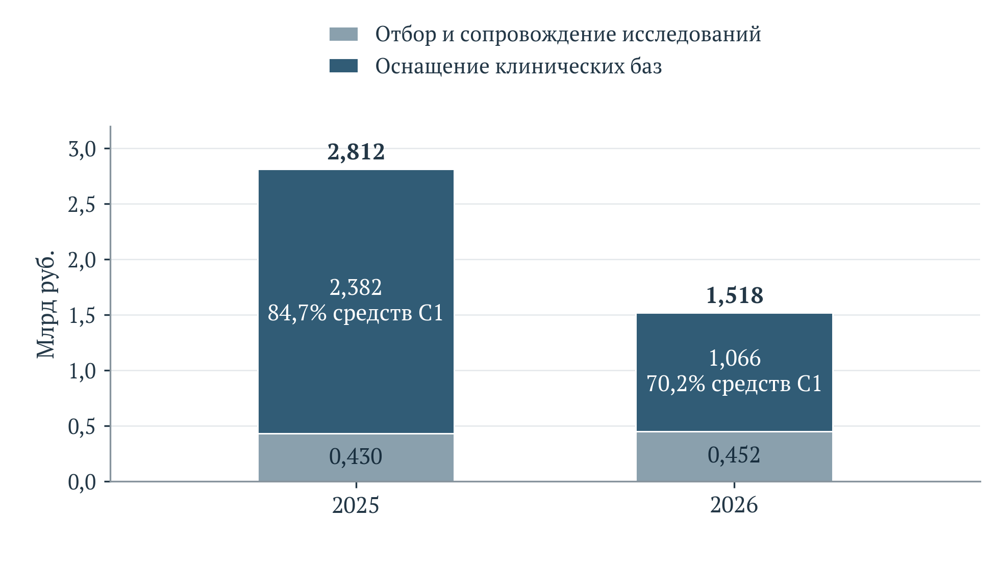

[B87; Caption] Рисунок 1 – Структура опубликованного финансового обеспечения С1 в 2025–2026 годах

[B88; ] Примечание. Номинальные плановые суммы федерального бюджета по результатам паспорта С1, опубликованного 16.10.2026. Проценты показывают долю оснащения клинических баз в средствах С1 соответствующего года. Значения не являются данными кассового исполнения. [Сноски 13]

[B89; ] Приоритеты медицинской науки целесообразно обосновывать сочетанием бремени заболевания, неудовлетворённой потребности, достижимости клинической цели и устойчивости производственной цепочки. Список наиболее распространённых заболеваний сам по себе не формирует портфель исследований. Для одной патологии могут конкурировать профилактический метод, диагностическое устройство, лекарственное воздействие и организационная технология. Сопоставление вариантов требует описания группы пациентов, текущего стандарта помощи, ожидаемого дополнительного эффекта и минимально приемлемой стоимости применения. Отбор без подобных условий создаёт преимущество у тематик с более убедительной заявкой, хотя практическая ценность результатов может оказаться ниже.

[B90; ] Содержание С1 позволяет разграничить решения о приоритетах, сопровождение исследований и создание материальной базы. Выделенные на систему отбора и сопровождения средства составляют 1,644 млрд руб. в опубликованной шестилетней финансовой части; оснащение баз составляет 3,447 млрд руб. Две строки полностью воспроизводят сумму С1. Иные результаты, включая перечни приоритетов и информационную кампанию, представлены без самостоятельных сумм в данном финансовом разделе. Отсутствие отдельной строки не устанавливает отсутствие организационных затрат. Для оценки эффективности необходимо выяснить, какой результат финансируется непосредственно, какой обеспечивается общими расходами организаций, а какой представляет контрольную стадию уже оплаченной деятельности. [Сноски 14]

[B91; ] Оснащение клинической базы оправдывается конкретной нагрузкой. До закупки необходимо связать оборудование с протоколами, доступной популяцией участников, квалификацией персонала и возможностью обслуживать прибор в течение всего периода исследования. После ввода полезно оценивать фактическую доступность мощностей для нескольких команд, сроки ожидания процедур, достаточность расходных материалов и долю исследований, завершённых с пригодным для последующего анализа набором данных. Избыточное дублирование одинакового оборудования и зависимость от единственного поставщика критических расходников представляют разные риски; они требуют отдельных решений. Ни один риск нельзя установить только по общей сумме закупок.

[B92; ] Доклад ФМБА России об итогах 2025 года сообщает о создании и оснащении Центра нейрогенетики и персонифицированной терапии неврологических заболеваний. Подобное сообщение подтверждает организационный и инфраструктурный результат. Последующая оценка должна показать, какие исследования получили доступ к центру, какие этапы разработки завершены и какие организации способны повторить полученные результаты. Присутствие центра в ведомственном отчёте даёт основание включить его в наблюдение за инфраструктурой, однако не измеряет самостоятельный вклад в здоровье населения. [Сноски 15]

[B93; ] Сообщение Правительства от 28 июля 2026 года подтверждает продолжение оснащения и включение пяти новых учреждений в 2026 году. Расширение круга баз увеличивает потенциальную пропускную способность, но создаёт задачу согласования специализаций. Для обоснования распределения оборудования необходимо установить, какие направления С2–С4 обслуживает каждая база и какие исследования невозможно было бы выполнить без дополнительного оснащения. Отдельно важен режим межорганизационного использования: доступность мощностей внешним исследовательским командам способна влиять на результативность больше, чем формальное число включённых учреждений. Указанная зависимость подлежит проверке по загрузке и срокам выполнения работ. [Сноски 16]

[B94; Heading2] Разработка медицинских изделий, лекарств и платформ: завершённость перехода к применению

[B95; ] Федеральный проект С2 предусматривает клинические исследования оригинальных лекарственных препаратов, разработку и испытания оригинальных медицинских изделий, допуск программных изделий с искусственным интеллектом, генотерапевтических препаратов и персонифицированных клеточных продуктов. Образовательное мероприятие связывает научные лаборатории и предприятия со стажировками обучающихся по фармацевтическим и биотехнологическим направлениям. Набор инструментов охватывает продукты с разной доказательной и производственной природой. Суммирование их числа полезно для административного учёта, но для содержательной экспертизы необходимо отдельно рассматривать уровень зрелости и назначение каждого семейства. [Сноски 17]

[B96; ] Сопровождение лекарства следует строить вокруг заранее определённого показания и сравнения с доступной помощью. Для изделия существенны техническая надёжность, точность измерения или воздействия, условия использования и подготовка оператора. У платформы дополнительную ценность составляет возможность многократного применения разработанной технологии к нескольким продуктам. Финансирование платформы поэтому желательно связывать с двумя рядами результатов: работоспособностью общего технологического процесса и характеристиками отдельных продуктов, полученных на его основе. Одна успешная демонстрация не определяет воспроизводимость всей платформы. Одновременно каждый следующий продукт не должен автоматически засчитываться как создание новой независимой технологии.

[B97; ] Правила государственной регистрации медицинских изделий, утверждённые постановлением Правительства Российской Федерации от 30 ноября 2024 года № 1684, задают отдельную процедуру допуска медицинской продукции. В оценочной модели соответствующее решение следует учитывать как самостоятельный рубеж между исследовательской работой и обращением изделия. Подготовка доказательств должна начинаться до окончания разработки: позднее обнаружение отсутствующих испытаний или несопоставимости данных увеличивает число возвратов между стадиями. Для управления национальным проектом полезен показатель длительности такого перехода с распределением причин задержек. Он позволяет отличить объективную сложность доказательства от устранимых недостатков планирования. [Сноски 18]

[B98; ] Детализация финансовой части С2 показывает 2,005 млрд руб. на разработку и клинические испытания оригинальных медицинских изделий и 1,243 млрд руб. на клинические исследования оригинальных лекарств. Доли составляют приблизительно 61,7% и 38,3% средств С2. Программные изделия с искусственным интеллектом, генотерапевтические продукты и стажировки присутствуют среди результатов, однако самостоятельные суммы по ним в данном разделе не показаны. Соотношение отражает структуру опубликованных финансовых назначений. Оно не устанавливает сравнительную стоимость всех цифровых и биологических разработок и не позволяет считать результаты без отдельной суммы бесплатными либо не обеспеченными ресурсами. [Сноски 19]

[B99; ] ФМБА России в сентябре 2026 года относило к С2 клинические испытания системы молекулярной диагностики аллергии, исследования препарата на основе магнитных наночастиц для диагностики и тераностики опухолей, а также работы с регенеративным матриксом. Перечень показывает разнообразие конкретных разработок и различие стадий. Для каждой позиции целесообразно заранее согласовать участника следующего этапа: производителя, держателя регистрационного досье либо медицинскую организацию внедрения. Стажировки могут поддержать необходимую кадровую базу, если участники получают компетенции, связанные с реальными исследовательскими и производственными задачами. Простое количество обученных студентов не характеризует устранение дефицита специалистов. [Сноски 20]

[B100; Heading2] Биомедицинские и когнитивные технологии: переносимость результата между организациями

[B101; ] Содержание С3 включает нейротехнологии для предупреждения и лечения когнитивных и сенсорных нарушений, повышение функциональных возможностей человека, биопечать и индивидуальные лекарственные препараты, в том числе с использованием генетических технологий. Дирекция научно-технических программ выделяет внедрение разработанных медицинских изделий в практику отдельным мероприятием. Следовательно, существенным условием успеха выступает передача технологии за пределы группы, которая её создала. Переход требует стандартизации производственных и клинических процедур, определения требований к принимающей организации и обучения специалистов. [Сноски 21]

[B102; ] В июле 2026 года Правительство сообщило о плане выполнения 31 научного исследования в 15 организациях в рамках С3. По завершении ожидалась разработка пяти лекарственных препаратов, 21 медицинского изделия и пяти медицинских технологий. Продуктовая структура показывает преобладание изделий, однако опубликованные числа относятся к плану и ожидаемому результату. Утверждение о 31 уже завершённой разработке было бы неверным. Для механизма поддержки существенно, насколько сроки регистрации и последующего внедрения согласованы с завершением исследований. Числа исследовательских тем и ожидаемых продуктов совпадают арифметически, но сообщение не устанавливает универсальное соответствие «одна тема – один продукт». [Сноски 22]

[B103; ] Биопечать объединяет оборудование, биоматериал, проектирование конструкции и последующее применение. Надёжность установки не тождественна пригодности изготовленного продукта для определённого клинического назначения. Экспертиза должна прослеживать весь маршрут: свойства исходного материала, воспроизводимость изготовления, контроль качества продукта, его сохранность и результат применения. Если результатом проекта становится оборудование, важно установить, какие процессы оно позволяет выполнять с подтверждёнными характеристиками. Если результатом является лечебная технология, требуются сведения о продукте и процедуре его использования. Раздельный учёт предотвращает многократное представление одной цепочки как нескольких независимых клинических достижений.

[B104; ] Индивидуальный препарат создаёт иной механизм распространения, чем массовый выпуск одинаковой лекарственной формы. Масштабирование может означать увеличение числа организаций, способных воспроизвести процесс изготовления и контроля для конкретного пациента. В таком случае значимы время от получения материала до готового продукта, доля успешно завершённых производственных циклов, доступность сопутствующей диагностики и прослеживаемость каждого применения. Сведение оценки к числу зарегистрированных наименований способно пропустить рост реальной производственной способности либо, напротив, завысить значение единичных демонстраций. Система управления должна заранее определить, какой элемент индивидуализирован, а какой остаётся воспроизводимой платформой.

[B105; ] В апреле 2026 года Дирекция научно-технических программ сообщила о рассмотрении промежуточных результатов первого года С3 и С4. Представленные направления включали нейрореабилитацию, транскраниальную магнитную стимуляцию, диагностику нейродегенеративных заболеваний, персонифицированную онкологическую терапию и восстановление тканей. В сообщении акцентирована подготовка разработок к клиническим исследованиям. Перечисление тематик подтверждает наличие работ в соответствующих направлениях, однако не даёт сопоставимого массива клинических исходов. Для следующего отчётного цикла наиболее полезным дополнением станет обезличенный реестр стадий, протоколов и организаций последующего внедрения, позволяющий проверить движение каждой разработки. [Сноски 23]

[B106; ] В опубликованной финансовой части С3 на нейротехнологии приходится 1,794 млрд руб., на биопечать – 0,686 млрд руб., на индивидуальные препараты – 0,589 млрд руб. За итоговыми суммами стоят различные способы распространения результата. Для нейротехнологического изделия возможна передача серийного оборудования; для биопечати требуется совместимость оборудования, материала и технологического процесса; индивидуальный препарат предполагает воспроизводство специализированного изготовления. Поэтому единую оценку коммерциализации необходимо дополнять различающимися критериями готовности цепочки. Преобладание одного направления по расходам не означает, что оно автоматически даст наибольшее число доступных пациентам решений. [Сноски 24]

[B107; Heading2] Регенеративная и превентивная медицина: клиническая значимость и устойчивость эффекта

[B108; ] Федеральный проект С4 связывает исследования механизмов старения клеток, технологии определения и коррекции биологического возраста, клинические исследования при возрастных заболеваниях, регенеративные решения и превентивные технологии для центров здоровья. В опубликованной редакции присутствуют также финансируемые в 2026 году мониторинг медико-демографических показателей территорий и мероприятия движения «За медицину здорового долголетия» на 30 и 36 млн руб. соответственно. Научные, клинические и информационно-организационные мероприятия требуют различных критериев результата. Охват публичного мероприятия не заменяет доказательства эффективности исследуемой технологии. [Сноски 25]

[B109; ] Разработка маркера старения должна сопровождаться ответом на вопрос о его назначении. Маркер может уточнять прогноз, помогать отбирать участников исследования или изменять решение о профилактике. Для каждого применения требуется своя проверка. Снижение рассчитанного биологического возраста само по себе не позволяет определить число предотвращённых заболеваний, сохранённых лет самостоятельной жизни либо избегнутых ограничений. Между изменением показателя и значимым для человека исходом должна быть установлена соответствующая связь. В экспертизе необходимо сохранять отдельные строки для аналитической точности теста, его прогностической способности и пользы решения, принятого с его помощью.

[B110; ] По сообщению Правительства от 28 июля 2026 года в С4 запланированы 23 научных исследования в 13 организациях. Ожидаемая продуктовая структура включает пять лекарственных препаратов, 11 медицинских изделий и семь медицинских технологий. Доля медицинских технологий в ожидаемом наборе продуктов С4 составляет 30,4%, тогда как в С3 – 16,1%; различие рассчитано из опубликованных количеств лекарств, изделий и технологий. Различие состава портфелей должно учитываться при сопоставлении итогов двух проектов. Прямая оценка «расходы на одну разработку» по общему числу ожидаемых продуктов смешала бы неоднородные результаты и планы разных стадий. Для экономической оценки потребуются сведения о содержании и длительности каждого исследования. [Сноски 26]

[B111; ] Регенеративная технология требует согласования изготовления, качества и клинического применения продукта. Для клеточных и тканевых решений особенно значимы воспроизводимость характеристик, прослеживаемость материала и контроль отдалённых результатов. ФМБА России относило к работам С4 молекулярное картирование изменений скелетных мышц и подготовку клеточного продукта на основе аутологичных хондроцитов для лечения повреждений хрящевой ткани, включая исследования свойств и формирование досье для клинических испытаний. Научная ценность подобных работ связана с устранением конкретной неопределённости на пути к применению. Перечень проведённых процедур нуждается в дополнении выводами о том, какую следующую стадию полученные данные позволяют обосновать. [Сноски 27]

[B112; ] Передача превентивной технологии в центры здоровья предполагает возможность действовать по результатам обследования. Если выявляемый риск не сопровождается доступной и доказательно обоснованной мерой, увеличение диагностики может не улучшить состояние обследованных. Для экспертной оценки полезно связать результат теста с понятным маршрутом дальнейшего наблюдения, вероятностью завершения этого маршрута и изменением поведения либо состояния здоровья. Отдельно следует оценивать нагрузку на специалистов и риск необоснованного расширения обследований. Эффективность зависит от качества всего процесса, а не от количества применённых тест-систем. Критерий масштабирования должен включать устойчивую работу технологии в обычных организационных условиях.

[B113; ] Финансовая детализация С4 позволяет выделить 1,004 млрд руб. на клинические исследования при возрастных заболеваниях, 0,411 млрд руб. на клеточное старение, 0,235 млрд руб. на биологический возраст и 0,133 млрд руб. на превентивную медицину и здоровое питание. Ещё 0,066 млрд руб. приходится на территориальный мониторинг и мероприятия движения здорового долголетия в 2026 году. Следовательно, основная показанная сумма связана с клиническими исследованиями, однако портфель одновременно содержит более раннюю науку и организационные мероприятия. Соответствие финансовой структуры общей цели следует оценивать по передаче результатов между этими уровнями, сохраняя отдельный учёт каждого вида деятельности. [Сноски 28]

[B114; Heading2] Производство востребованной продукции: устойчивость цепочек и экономическая воспроизводимость

[B115; ] Федеральный проект С5 охватывает производство лекарственных препаратов, включая ЖНВЛП и радиофармацевтические средства, организацию выпуска медицинских изделий, обеспечение сырьём и комплектующими, а также поддержку малых предприятий. В финансовой части опубликованного паспорта выделены два направления: 2,610 млрд руб. на организацию производства изделий в 2026–2028 годах и около 0,345 млрд руб. на проекты малых предприятий в 2025–2028 годах. Наличие более широкого перечня результатов при сравнительно узкой явно профинансированной части требует проверки связи с другими инструментами промышленной политики. Публичный финансовый срез сам по себе не раскрывает совокупную стоимость достижения всех производственных целей. [Сноски 29]

[B116; ] Технологическую независимость целесообразно рассматривать на уровне критических звеньев производства. Российская сборка оборудования может сочетаться с зависимостью от детектора, электронного компонента, программного обеспечения, сервисного инструмента или расходного материала. Аналогично наличие выпуска готовой лекарственной формы не описывает самостоятельность синтеза субстанции и обеспечение исходными компонентами. Для каждой приоритетной группы требуется карта зависимостей с оценкой заменяемости, времени восстановления поставки и возможности подтвердить качество после замены. Простое увеличение числа отечественных товарных наименований не показывает, выдержит ли производственная система нарушение поставки наиболее дефицитного компонента.

[B117; ] Экономическое содержание промышленной строки уточняет пояснительная записка к проекту бюджета 2027–2029 годов. В С5 предусмотрены субсидии на создание научно-технического задела по базовым технологиям производства приоритетных электронных компонентов и радиоэлектронной аппаратуры. На 2026 год в приведённой росписи указано 810 млн руб., на 2027 и 2028 годы в законопроекте – по 900 млн руб. Название результата «организовано производство» поэтому нельзя автоматически приравнивать к капитальным вложениям в готовый завод. Предмет поддержки включает технологическую подготовку, а экспертная проверка должна установить, какой производственный процесс стал воспроизводимым благодаря созданному заделу. [Сноски 30]

[B118; ] Малое предприятие и промышленный производитель располагают различными ресурсами для прохождения последующих стадий. Грант позволяет проверить решение и подготовить прототип, но дальнейшее движение может потребовать испытательной инфраструктуры, оборотных средств, системы качества и доступа к производственной площадке. Критерий завершения поддержки желательно связывать с подтверждённой готовностью следующего участника принять результат. Без подобного согласования возникает риск накопления успешных прототипов, которые не выходят в устойчивый выпуск. Оценивать следует фактически заключённые соглашения о технологическом трансфере и производство соответствующего качества, сохраняя разграничение между намерением, договором и работающей цепочкой.

[B119; ] Для радиофармацевтических препаратов производственная доступность должна рассматриваться совместно с территориальной организацией применения. Существенны характеристики конкретного препарата, стабильность изготовления, доступность требуемой диагностики или лечебной инфраструктуры и возможность доставки в установленных условиях. Для персонализированных клеточных продуктов узким местом может стать пропускная способность специализированной площадки. Для массового изделия критичны компонентная база, ремонт и обученный пользователь. Единый агрегированный показатель отечественной доли не позволяет локализовать такие ограничения. Управленческий обзор целесообразно дополнять картой нескольких наиболее критичных продуктовых цепочек с установленными ответственными за устранение каждого ограничения.

[B120; ] Июльское сообщение Правительства среди зарегистрированных изделий называет первый отечественный аппарат для гемодиализа «Сатис», роботизированные реабилитационные комплексы, хирургическую роботизированную систему, диагностическое оборудование, интраокулярные линзы и слуховой аппарат. Разнообразие примеров подчёркивает неоднородность промышленного направления: поставки комплектного аппарата, расходных изделий и программируемого устройства требуют разных сервисных и компонентных цепочек. Для проверки устойчивости С5 полезно выбирать конкретные продуктовые группы и прослеживать регулярность выпуска, качество и обслуживание. Само включение изделия в перечень примеров официального сообщения не раскрывает величину финансирования его разработки из национального проекта. [Сноски 31]

[B121; Heading1] Показатели, наблюдаемые результаты и сопоставимость данных

[B122; Heading2] Статистическая база, границы наблюдения и качество данных

[B123; ] Количественный анализ опирается на показатели проекта с кодом С. Они характеризуют технологические результаты, коммерциализацию и отдельные стороны охвата пациентов. Основные и замещающие, или прокси-показатели, могут описывать пересекающиеся совокупности. Поэтому число карточек показателей не выражает количество независимых эффектов. [Сноски 32]

[B124; ] Доказательная база неоднородна по способу получения. Официальные методики и первичные сообщения Правительства используются для установления содержания показателей и опубликованных результатов. Плановые траектории извлечены из открытой републикации паспортов DataBudget и сверены по конечным ориентирам с публикацией Минздрава. Числовые наблюдения восстановлены из открытой архивной републикации выгрузок ЕМИСС Национальным центром социально-экономических данных. Прямое подтверждение актуального состояния статистической базы на дату обращения оказалось недоступным. Поэтому архивные наблюдения далее не выдаются за текущую выгрузку официального портала. Их доказательная сила ограничена сохранёнными значениями, встроенными методическими пояснениями и датой обновления каждого набора. [Сноски 33]

[B125; ] Четырнадцать доступных статистических публикаций содержат данные только по Российской Федерации. Для большинства месячных рядов последним числовым периодом является август 2026 г., для двух квартальных рядов – IV квартал 2025 г. Даты обновления наборов составляют 20 и 22 января, 8 и 10 сентября 2026 г. Наблюдения сопровождаются названиями показателей, единицами измерения, обозначениями периодов и методическими пояснениями. [Сноски 34]

[B126; ] Полученные четырнадцать публикаций охватывают все шесть карточек показателей национального уровня, пять карточек С1 и три карточки С2. Для семи карточек С3–С5 сопоставимые числовые таблицы в исследованной архивной публикации не восстановлены. Отсюда не следует, что соответствующие ведомства не рассчитывают показатели: установлено ограничение доступной доказательной базы, а не отсутствие административного учёта. Аналогично наличие карточки в каталоге подтверждает существование показателя, но не гарантирует наличие открытого значения за нужный период. Состояние количественного покрытия представлено в таблице 2. [Сноски 35]

[B127; ] Общее число сохранённых числовых ячеек – 191 – существенно переоценивает самостоятельную аналитическую информацию. Многие ячейки представляют повторяющиеся месячные нули в рядах, для которых паспорт устанавливает годовую периодичность. Ещё 42 потенциальные ячейки пусты либо содержат обозначение отсутствующего значения; они не заменялись нулями. Независимое годовое наблюдение обнаружено только для доли успешных исследований за 2025 г. Декабрьские значения остальных годовых показателей сохранены как декабрьские записи. Такой порядок исключает искусственное увеличение числа наблюдений и позволяет отделить изменение результата от особенностей представления отчётности. [Сноски 36]

[B128; Caption] Таблица 2 – Покрытие опубликованных карточек показателей числовыми наблюдениями

[TABLE 2; B129]
Уровень проекта | Карточки / восстановленные публикации | Доступные периоды и ограничения
НП, код С [37] | 6 / 6 | Годовое значение исследований за 2025 г.; кварталы 2025 г.; месячные прокси до августа 2026 г. Версии ВДС требуют согласования.
С1. Управление медицинской наукой [38] | 5 / 5 | Годовые показатели представлены декабрьскими записями 2025 г.; новые прокси – апрель–август 2026 г.
С2. Технологии медицинских разработок [39] | 3 / 3 | Декабрь 2025 г.; охват пациентов и прокси до августа 2026 г.; в охвате отсутствует запись за июнь 2026 г.
С3. Биомедицинские и когнитивные технологии [40] | 2 / 0 | Найдены определения и планы; числовые наблюдения не восстановлены.
С4. Регенеративная и превентивная медицина [41] | 2 / 0 | Найдены определения и планы; числовые наблюдения не восстановлены.
С5. Производство препаратов и изделий [42] | 3 / 0 | Есть методики, плановые значения и отдельные ведомственные сообщения; открытые ряды долей не подтверждены.

[B130; ] Примечание. Число карточек характеризует структуру открытых паспортных публикаций. Основные и прокси-показатели могут описывать пересекающиеся совокупности; складывать их как независимые результаты нельзя. Дата обращения к републикациям – 28.10.2026. [Сноски 43]

[B131; Heading2] Содержание показателей: числители, знаменатели и временные окна

[B132; ] Содержательная интерпретация долей зависит от того, какая совокупность помещена в знаменатель. Национальная доля успешных исследований сопоставляет исследования, завершившиеся разработкой и внедрением учтённых продуктов, с общим количеством исследований, включённых в установленную совокупность проекта. Доля допущенных разработок С2 имеет иной знаменатель – учтённые лекарственные препараты, индивидуальные биомедицинские клеточные продукты и медицинские изделия. Первое отношение характеризует исследования, второе – продукты; одинаковое целевое значение 50% не делает их взаимозаменяемыми. Изменение состава исследовательского портфеля также способно изменить долю при неизменном числе успешных результатов. [Сноски 44]

[B133; ] Методика национальной доли исследований включает определённые разработки, начатые в федеральном проекте «Медицинская наука для человека». Следовательно, наблюдаемый результат 2025–2026 гг. может отражать завершение ранее профинансированного цикла. Эта преемственность обоснованна для управления портфелем, однако приписывание всего эффекта новому национальному проекту потребовало бы информации о сроках и источниках финансирования каждой разработки. Включение объекта в реестр и начало его применения подтверждают прохождение установленной административной стадии. Для вывода о сравнительной клинической эффективности необходимы результаты соответствующих исследований, характеристики контрольной группы, исходы и сроки наблюдения; сводный счётчик допусков этих сведений не содержит. [Сноски 45]

[B134; ] В показателях пациентов различаются как организации, так и основания включения в наблюдение. Методика С2 от 29 декабря 2025 г. сопоставляет количество пациентов, получивших помощь с применением учтённых продуктов, с числом пациентов, получивших специализированную, включая высокотехнологичную, помощь в федеральных медицинских, научных и образовательных организациях с клиниками. Числитель и знаменатель охватывают период с 1 января по конец отчётного месяца или года. С3 ограничивает совокупность организациями, внедрившими новые технологии. С4 использует обращения в организации – участники соответствующего федерального проекта. Поэтому увеличение таких долей не означает идентичного изменения доступности для всего населения России. Для территориального и социального анализа дополнительно нужны численность нуждающихся, маршруты направления, место проживания и фактические условия получения помощи. [Сноски 46]

[B135; ] Индекс технологической независимости представляет отдельный тип измерения. В методике 11 апреля 2025 г. и архивном описании он формируется из нормированных оценок готовности технологий и производства критических компонентов с равным весом двух частей. Это агрегат оценок технологической карты, а не доля проданных российских изделий и не доля пациентов, обеспеченных отечественными препаратами. Усреднение позволяет отслеживать продвижение перечня компонентов, но скрывает критически слабые позиции. Для содержательной проверки индекса необходимы состав технологической карты, правила присвоения уровней и история изменений перечня: исключение трудного компонента способно повысить агрегат без улучшения его фактической готовности. Последнее представляет аналитическую возможность, а не установленный факт изменения состава карты. [Сноски 47]

[B136; Caption] Таблица 3 – Различия измеряемых совокупностей и допустимых выводов

[TABLE 3; B137]
Показатель | Основание расчёта | Граница интерпретации
Успешные исследования НП [48] | Успешно завершённые учтённые исследования / все учтённые исследования | Не отражает вероятность успеха фиксированной когорты без сведений о поступлении и завершении проектов.
Допуск разработок С2 [49] | Допущенные продукты / продукты, учтённые в С2 | Регистрационный допуск не характеризует распространённость использования и величину клинического эффекта.
Охват пациентов С2 [50] | Пациенты с применением учтённых продуктов / пациенты специализированной помощи в федеральных организациях с клиниками; с начала года | Не является долей всех жителей страны и не заменяет оценку удовлетворённой медицинской потребности.
Доступ и применение С3–С4 [51] | Пациенты внедривших технологии организаций либо обратившиеся в организации-участники | Изменение состава организаций и маршрутизации влияет на знаменатель; межпроектное сравнение долей ограничено.
Стратегические лекарства полного цикла | Число МНН с технологической возможностью полного цикла / число МНН утверждённого перечня | Характеризует номенклатуру и технологическую возможность, а не долю упаковок или гарантированную мощность поставок.
Радиофармацевти­ческие препараты | Потребление препаратов локального производства / всё потребление, тыс. упаковок | Допускается локализация со стадии готовой лекарственной формы; это не тождественно полному циклу.
Российские медицинские изделия | Потребление российских изделий / весь рынок, в денежном выражении | Влияют относительные цены и структура ассортимента; доля не измеряет число изделий или охваченных пациентов.

[B138; ] Примечание. МНН – международное непатентованное наименование. Для С2 использована методика 29.12.2025, пункты 6, 8, 10. Количества пациентов по категориям продуктов требуют проверки исключения повторного счёта; открытый агрегат не позволяет восстановить уникальный охват. [Сноски 52]

[B139; ] Особенно существенно различие между номенклатурой лекарств полного цикла, натуральным потреблением радиофармацевтических препаратов и денежной долей российского рынка медицинских изделий. Приказ Минпромторга от 8 апреля 2025 г. № 1684 закрепляет для них разные основания расчёта. Поэтому сопоставление величин 80, 95 и 40% не создаёт содержательного рейтинга суверенитета трёх отраслей. Высокая доля позиций лекарственного перечня может сосуществовать с ограниченной мощностью выпуска отдельных востребованных препаратов, а изменение денежной доли изделий – отражать сдвиг цен или ассортимента. Эти обстоятельства обозначают дополнительные вопросы проверки; доступные агрегаты не устанавливают их фактическое наличие. [Сноски 53]

[B140; ] Название показателя также не всегда раскрывает его временную конструкцию. Методики двух прокси С1, утверждённые 3 апреля 2026 г., включают продукты текущего и четырёх предшествующих лет. Для наблюдений 2026 г. используется окно 2022–2026 гг., хотя название говорит о выводе на рынок в течение календарного года. Медицинское изделие считается выведенным на рынок по факту установленного допуска; для лекарств учитываются регистрация и предусмотренные разрешения, а также определённые изменения показаний. Поэтому выпуск, регистрация, коммерческие продажи и появление продукта именно благодаря новому проекту требуют разных доказательств. Временное окно объясняет инерционность показателей и запрещает складывать последовательные годовые значения как непересекающиеся когорты. [Сноски 54]

[B141; Heading2] Изменение определения валовой добавленной стоимости и разрыв сопоставимости

[B142; ] Наиболее выраженная проблема межвременной сопоставимости обнаружена у показателя прироста валовой добавленной стоимости отрасли здравоохранения. Его неизменное краткое название скрывает изменение объекта измерения. Первоначальная методика 13 декабря 2024 г. использовала деятельность в области здравоохранения, относимую к ОКВЭД 2, код 86. Апрельские редакции 2025 г. перешли к производству лекарственных средств и материалов по ОКВЭД 2, код 21 и сопоставлению с 2023 г. В методике 13 октября 2026 г. установлены база 2024 г. и сумма видов деятельности 21 и 32.5, то есть фармацевтического производства и производства медицинских инструментов и оборудования. История определений представлена в таблице 4. [Сноски 55]

[B143; Caption] Таблица 4 – Эволюция определения показателя прироста ВДС

[TABLE 4; B144]
Редакция методики | Охват и база сравнения | Цены, периодичность и сроки
13.12.2024 [56] | ОКВЭД 2, код 86: деятельность в области здравоохранения; сравнение отчётного и предыдущего периода | Среднегодовые цены предыдущего периода; квартальные оценки на 50–56-й рабочий день, годовые – не позднее первой декады апреля.
14.04.2025 [57] | ОКВЭД 2, код 21: производство лекарственных средств и медицинских материалов; базовый 2023 г. | Сопоставимые цены; квартальная и годовая периодичность; расчёт после публикации оценок ВВП.
16.04.2025 [58] | ОКВЭД 2, код 21; базовый 2023 г.; цепное накопление индексов физического объёма | Годовая и квартальная периодичность; после публикации Росстатом оценок ВВП.
13.10.2026 [59] | Сумма ОКВЭД 2, код 21 и 32.5: добавлено производство медицинских инструментов и оборудования; базовый 2024 г. | Сопоставимые цены; годовая периодичность; после публикации годовых оценок ВВП, не позднее 18 апреля следующего года.

[B145; ] Примечание. Ранние редакции описывают историю показателя. Для оценки по состоянию на 28.10.2026 необходимо учитывать методику 13.10.2026. Наличие прежнего названия или идентификатора само по себе не обеспечивает сопоставимость.

[B146; ] Изменение отраслевого охвата не является техническим переименованием. Медицинские услуги, фармацевтическое производство и производство медицинского оборудования имеют различную структуру выпуска и промежуточных затрат. Ряды могут двигаться в разных направлениях даже при неизменном качестве лечения. Новая формула сохраняет измерение в сопоставимых ценах, поэтому её нельзя объяснять номинальным увеличением выручки вследствие инфляции. Однако добавление производства оборудования меняет веса отраслей в агрегате, а перенос базы с 2023 на 2024 г. меняет величину накопленного прироста. Для корректного сравнения нужен пересчитанный ряд в одной методологии. [Сноски 60]

[B147; ] Восстановленная квартальная публикация ЕМИСС содержит 17,7% за I квартал 2025 г., 12,6% за II квартал, отсутствие значения за III квартал и 16,6% за IV квартал. При этом встроенное описание уже ссылается на 2024 г., сохраняя квартальную периодичность, тогда как доступная апрельская методика использует 2023 г., а октябрьская 2026 г. предусматривает годовой расчёт. Такое сочетание метаданных не позволяет уверенно отнести числовые значения к одной опубликованной редакции. В экспертизе они учитываются как свидетельство наличия квартальной публикации, но не используются для вычисления достигнутой части цели 70%, среднегодового темпа или прогноза 2030 г. Пропущенный квартал не интерполируется. [Сноски 61]

[B148; ] Согласование требует проверки и календаря публикации. Федеральный план статистических работ для позиции 2.14.С.4 содержит годовой срок 1 марта и квартальный срок на 50–56-й рабочий день после периода; методика 13 октября 2026 г. связывает итоговый годовой расчёт с публикацией оценок ВВП и предельным сроком 18 апреля. Нельзя автоматически считать более раннюю запись окончательным значением по новой формуле. Для воспроизводимого мониторинга необходимы дата расчёта, версия методики и признак предварительного либо уточнённого результата. Их согласование должно предшествовать любому заключению о выполнении годового плана. [Сноски 62]

[B149; ] Аналитически полезное решение состоит в сохранении двух историй: утверждённых целей и статистических пересчётов. Если новая методика сопровождается официальным пересчётом 2024–2025 гг., сравнение проводится по пересчитанной совокупности, а прежние значения сохраняются как исторически опубликованные. Если пересчёта нет, линия динамики разрывается в момент изменения определения. Изменение самой целевой базы также должно быть явно отражено в паспорте. Без такой процедуры одинаковая отметка 70% может обозначать разные объёмы реального увеличения производства, и арифметически точное отношение факта к плану создаст содержательно неверный вывод.

[B150; Heading2] Достигнутые значения и динамика наблюдаемых результатов

[B151; ] Наиболее определённое сравнение с планом доступно для доли исследований, закончившихся успешной разработкой и внедрением. Отдельная годовая запись за 2025 г. равна 4,55% при опубликованном плане 1,5%. Абсолютное превышение составляет 3,05 процентного пункта, отношение факта к плану – 303,3%. Это расчёт по одной годовой доле, а не интегральная оценка всего национального проекта. Он показывает достижение данного контрольного ориентира в пределах опубликованного определения, но не устанавливает причинный вклад финансирования 2025 г., устойчивость результата или эффективность каждого продукта. [Сноски 63]

[B152; ] В том же наборе декабрьская запись равна нулю. Подмена годового значения декабрём дала бы противоположное заключение о выполнении плана. Источник сам обозначает показатель как годовой; повторяющиеся месячные нули не содержат достаточного основания для вывода о прекращении исследований или отсутствии успешных разработок. Противоречие трактуется как ограничение формы публикации и требует уточнения у владельца данных. Таблица 5 поэтому сохраняет тип каждого наблюдения. В остальных строках, где отдельная годовая запись отсутствует, декабрьские сведения не объявляются окончательным годовым результатом. [Сноски 64]

[B153; Caption] Таблица 5 – Годовой результат и декабрьские наблюдения за 2025 год

[TABLE 5; B154]
Показатель | Период | Значение | Статус сопоставления
Успешные исследования НП [65] | Год 2025 | 4,55% | План 1,5%; +3,05 п.п.; отдельное годовое значение.
Учёт и мониторинг исследований С1 [66] | Декабрь 2025 | 100% | Годовой показатель, опубликованный в месячной ячейке; план 2025 г. – 50%.
Лекарства на 5 млрд руб. исследований [67] | Декабрь 2025 | 0,96 ед. | Нормированный результат; план 0,83; отдельное годовое значение не найдено.
Медизделия на 1 млрд руб. исследований [68] | Декабрь 2025 | 0,73 | Единица в архиве обозначена как процент; требуется устранение противоречия с содержанием показателя.
Доля допущенных разработок С2 [69] | Декабрь 2025 | 10% | Годовой показатель в месячной ячейке; план 2025 г. – 1,5%; итоговую частоту необходимо подтвердить.

[B155; ] Примечание. Архивная републикация официальных данных ЕМИСС; текущая версия оригинала непосредственно не подтверждена. Расчёт 303,3% приведён только для сопоставимого годового наблюдения. Декабрьские, квартальные и годовые строки не объединяются в общий процент выполнения. Плановые значения – по опубликованным паспортам национального проекта, С1 и С2. [Сноски 70]

[B156; ] Месячный прокси числа допущенных разработок национального проекта показывает увеличение с 3 в декабре 2025 г. до 7 в августе 2026 г., то есть на 4 единицы. При сопоставлении августа двух лет показатель увеличился с 2 до 7. Методика 6 мая 2026 г. подтверждает месячный счёт нарастающим итогом с 2025 г.; семь – накопленное число, а не семь новых допусков в августе. Методика включает также установленные исследования предшествующего федерального проекта и исключает отдельное мероприятие по программам с искусственным интеллектом. Равенство национального значения и значения прокси С2 в последних наблюдениях не позволяет складывать их: статистические совокупности могут пересекаться. Для точного разграничения нужен пообъектный перечень с идентификаторами регистрационных записей. [Сноски 71, 72, 73]

[B157; ] Доля пациентов С2 в доступной последовательности 2026 г. увеличивается с 0,03% в апреле до 0,24% в июле–августе, или на 0,21 процентного пункта. Восстановленная публикация не содержит июньской строки, поэтому промежуток на рисунке 2 оставлен без соединяющей линии. Небольшая доля может отражать раннюю стадию распространения технологий и широкий знаменатель, однако установить вклад каждого фактора без числителей и знаменателей невозможно. Повторение 0,24% в двух месяцах также не доказывает отсутствия новых пациентов: одновременно могут изменяться обе составляющие отношения. Оперативные значения и различия периодов учёта представлены в таблице 6. [Сноски 74]

[B158; Caption] Таблица 6 – Оперативные показатели технологических результатов и охвата пациентов

[TABLE 6; B159]
Показатель | Период | Значение | Статус сопоставления
Охват пациентов С2 [75] | Декабрь 2025 / август 2026 | 0,26 / 0,24% | Разные календарные периоды; значения не характеризуют межгодовое снижение охвата.
Технологическая независимость [76] | IV квартал 2025 | 42% | Квартальная оценка; отдельная годовая запись не найдена.
Допущенные разработки НП [77] | Декабрь 2025 / август 2026 | 3 / 7 ед. | Накопленный итог проекта; увеличение на 4 разработки.
Прокси С1: лекарства / медизделия [78] | Август 2026 | 21 / 105 ед. | Методика учитывает 2022–2026 гг.; не является числом разработок только 2026 г.

[B160; ] Примечание. Доля пациентов накапливается с начала календарного года; число допущенных разработок НП – с 2025 г. Прокси С1 относится к пятилетнему окну. Строки различаются периодами, единицами измерения и учитываемыми совокупностями.

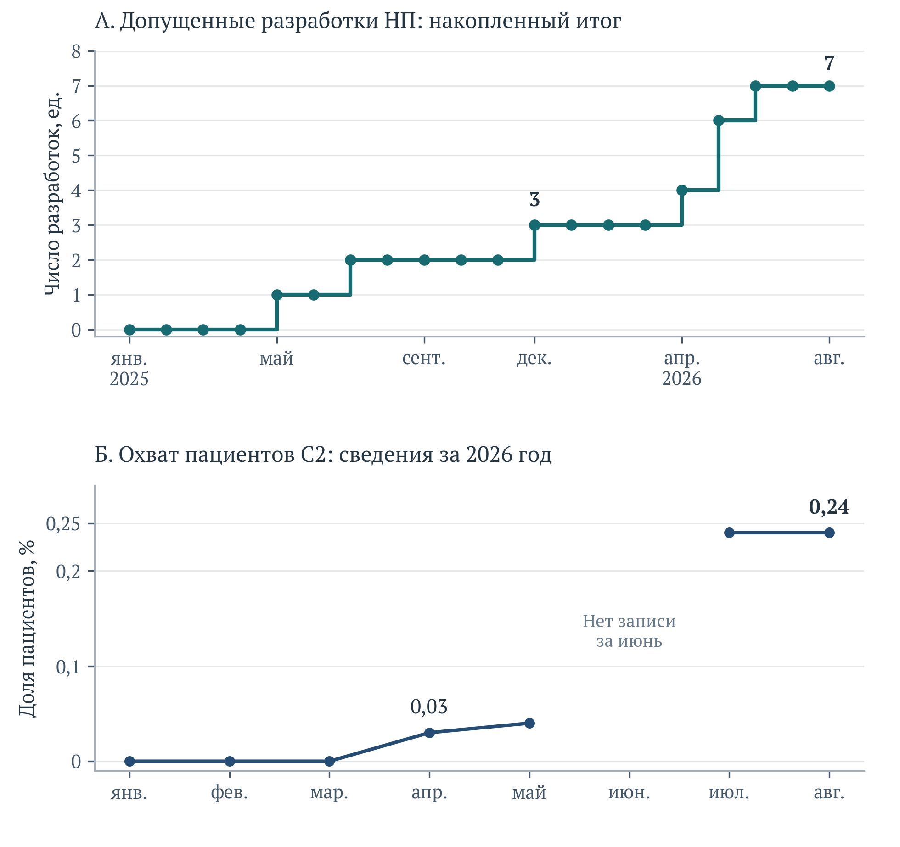

[B162; Caption] Рисунок 2 – Динамика допущенных разработок НП и охвата пациентов С2

[B163; ] Примечание. Верхняя панель – накопленное с 2025 г. число разработок; нижняя – доля пациентов с накоплением обеих частей отношения с начала 2026 г. Совокупности и единицы различаются. Отсутствующая июньская запись не заменена нулём и не интерполирована. Источник – архивная републикация ЕМИСС. [Сноски 79]

[B164; ] Новые прокси С1 позволяют наблюдать административное продвижение продуктового портфеля с апреля 2026 г. Число учитываемых лекарственных препаратов увеличивается с 19 до 21, а медицинских изделий – с 82 до 105 к августу. Абсолютное изменение составляет соответственно 2 и 23 единицы. Эти величины относятся к пятилетнему окну 2022–2026 гг.; их нельзя сопоставлять с годовым числом регистраций всех производителей или интерпретировать как выпуск, созданный исключительно за средства национального проекта. Рост ряда может отражать допуск очередного продукта либо уточнение учёта ранее разработанных продуктов. Разделение этих механизмов требует регистрационных дат и истории включения в расчёт. [Сноски 80]

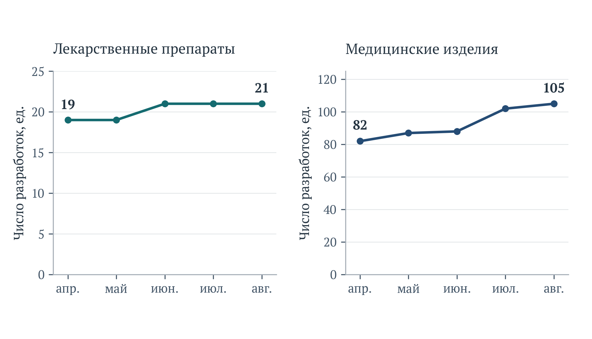

[B166; Caption] Рисунок 3 – Прокси вывода разработок на рынок в С1: наблюдения 2026 года при пятилетнем окне учёта

[B167; ] Примечание. Методики 03.04.2026 включают текущий и четыре предшествующих года, поэтому для 2026 г. учитывается период 2022–2026 гг. Название лекарственного показателя включает также предусмотренные методикой индивидуальные клеточные и биотехнологические продукты. Две панели имеют разные шкалы; показатели не складываются. [Сноски 81]

[B168; ] Показатели выпуска на определённый объём финансирования требуют отдельного прочтения. Значения 0,96 лекарственного препарата на 5 млрд руб. и 0,73 медицинского изделия на 1 млрд руб. не выражают среднюю фактическую стоимость завершённого продукта: расходы и регистрационный результат могут относиться к разным стадиям многолетних исследований. Кроме того, у второго ряда архив обозначает единицу как процент, что противоречит его содержательному названию и плановой карточке. До устранения этого расхождения показатель нельзя включать в единый индекс ресурсной эффективности. Доля исследований с организованным мониторингом, в свою очередь, характеризует полноту управленческого наблюдения, а не коммерческий или клинический успех. [Сноски 82]

[B169; Heading2] Коммерциализация интеллектуальных прав: динамика и экономическое содержание

[B170; ] Денежный показатель коммерциализации имеет более широкое содержание, чем выручка от продажи готовой продукции. Методика 17 апреля 2025 г. учитывает поступления по договорам использования и отчуждения интеллектуальных прав, дивиденды от соответствующих инновационных предприятий, денежную оценку прав, внесённых в капитал, и положительный результат определённых операций с долями или акциями. Следовательно, агрегат объединяет денежные поступления и оценочные величины. Его рост может свидетельствовать об активизации передачи технологий, но без разложения компонентов не позволяет определить, какая часть результата обеспечена устойчивыми продажами, повторяющимися лицензионными платежами или разовыми имущественными операциями. [Сноски 83]

[B171; ] Внутри календарного года показатель рассчитывается накопительно с января по отчётный месяц. Формулировка «не нарастающим итогом» в открытой паспортной карточке требует согласования с временным уровнем представления. Для месячного анализа применяется прямо установленное методикой накопление внутри года; значения разных лет сохраняются раздельно. Суммирование всех месячных значений привело бы к повторному учёту одних и тех же поступлений. В восстановленном ряду 2025 г. первое содержательное наблюдение относится к маю: 235,88 млн руб.; к августу опубликовано 272,80 млн руб., к декабрю – 357,28 млн руб. Нули января–апреля при указанном в паспорте начале действия с мая 2025 г. не используются как подтверждение фактического отсутствия коммерциализации до запуска наблюдения. [Сноски 84]

[B172; ] За 2026 г. опубликованная накопленная величина увеличивается с 0,89 млн руб. в январе до 51,32 млн руб. в августе. Сопоставление августа двух лет даёт разность −221,48 млн руб., или −81,2%. Расчёт выполнен по одинаковому календарному срезу и одному статистическому идентификатору, однако его экономическая трактовка остаётся условной до проверки состава учреждений и денежных компонентов. Значительное отличие не доказывает сокращения научного потенциала либо провала внедрения: имущественные оценки и разовые сделки способны существенно менять временной профиль. Для объяснения необходимы детализация договоров и раздельные сведения о денежных поступлениях и оценке прав. [Сноски 85]

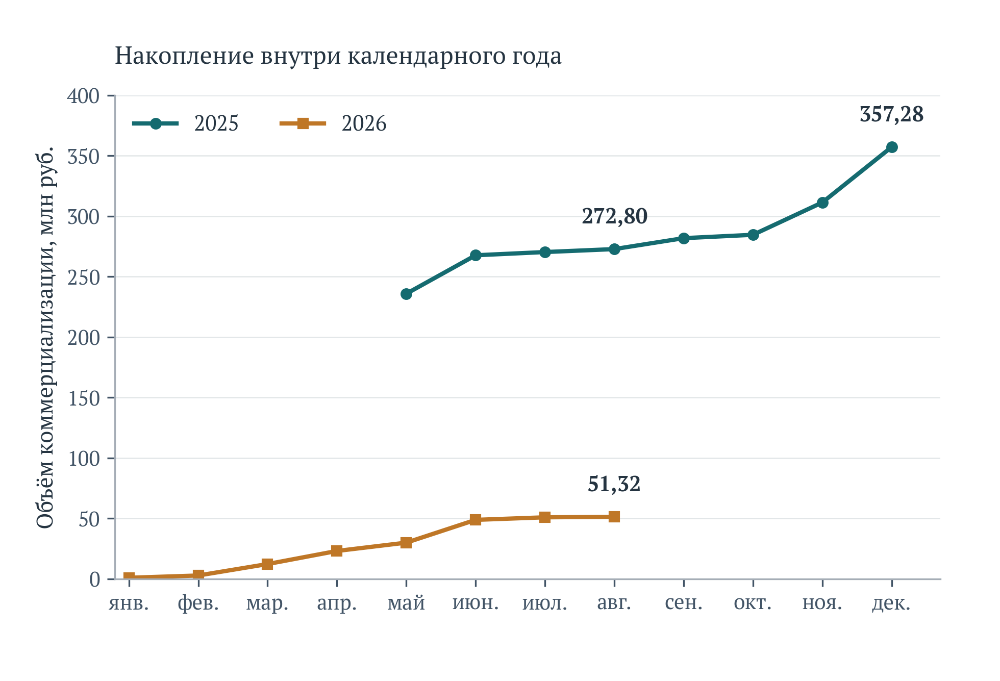

[B174; Caption] Рисунок 4 – Опубликованный объём коммерциализации интеллектуальных прав внутри 2025 и 2026 годов

[B175; ] Примечание. Значения накоплены с начала соответствующего календарного года; месячные точки нельзя суммировать. Для 2025 г. линия начинается в мае, указанном как начало действия статистического показателя. В составе агрегата есть денежная оценка прав и операции с капиталом, поэтому название «выручка от продаж» к нему неприменимо. [Сноски 86]

[B176; ] Согласование денежного прокси с показателем прироста к 2023 г. выявляет дополнительную неопределённость. В декабрьской ячейке прироста опубликовано 249,59%, а в денежном прокси – 357,28 млн руб. При механическом использовании базовых 91 млн руб. из паспортной карточки отношение 357,28 к 91 дало бы прирост 292,62%, а не 249,59%. Этот контрольный расчёт не доказывает арифметическую ошибку ведомства: числитель, базовая оценка, охват учреждений или редакция данных могли различаться. Он показывает, что пересчёт одного показателя из другого не воспроизводится по доступным агрегатам. Значения не исправляются исследователем и не подставляются взаимно без раскрытия компонентов. [Сноски 87]

[B177; ] Для последующей экспертизы предпочтительна проверка движения отдельных видов экономической отдачи. Повторяющиеся лицензионные платежи следует отделять от продажи исключительного права, дивидендов, оценки неденежного вклада и результата продажи доли. Так можно различить расширение использования технологии и единовременное изменение стоимости актива. При оценке устойчивости дополнительно нужны концентрация поступлений по учреждениям, число действующих договоров, число повторных плательщиков и сопоставимость базового года. Эти характеристики предлагаются как развитие мониторинга; их значения в проведённом анализе не рассчитывались из-за отсутствия соответствующей открытой детализации.

[B178; Heading2] Напряжённость плановых траекторий и условия сравнения с целями

[B179; ] Семь ориентиров 2030 г., опубликованных Минздравом 8 августа 2025 г., сохраняют содержательное соответствие конечным значениям открытых паспортных карточек: 40% российского рынка медицинских изделий, 70% прироста ВДС, 95% локального потребления радиофармацевтических препаратов, 80% номенклатуры стратегических лекарств полного цикла, 80% технологической независимости, 50% успешных исследований и 30% прироста коммерциализации к 2023 г. При этом три производственных показателя размещены в С5, а национальная карточка дополнена двумя прокси. Такое перераспределение уровней представления не должно трактоваться как исчезновение производственных целей. Совпадение конечного числа также не устраняет обнаруженного изменения методики ВДС. [Сноски 88]

[B180; ] Плановая траектория доли российских медицинских изделий повышается с 31,4% в 2025 г. до 40% в 2030 г., то есть на 8,6 процентного пункта. Для стратегических лекарств полного цикла предусмотрен рост с 73,5 до 80%, или на 6,5 пункта, а для радиофармацевтических препаратов – с 91,3 до 95%, или на 3,7 пункта. Эти изменения относятся к планам, а не к доказанной динамике производства. В карточке С5 план 2025 г. по двум лекарственным долям ниже указанного базового значения: соответственно 73,5 против 75,3% и 91,3 против 91,7%. Без истории пересмотра перечня и базы это расхождение нельзя объявлять фактическим снижением суверенитета. [Сноски 89]

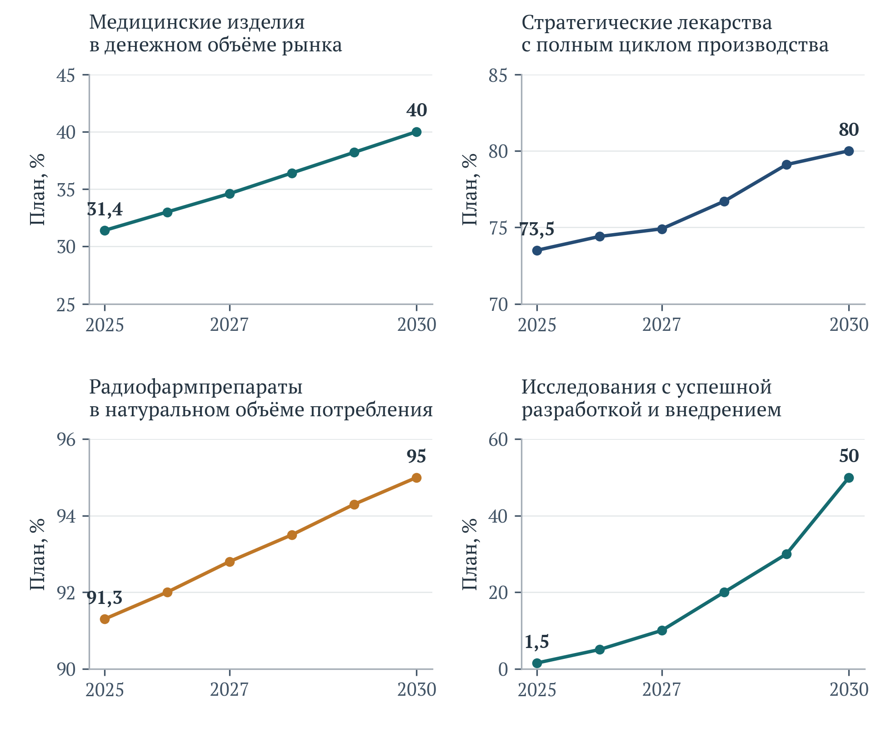

[B182; Caption] Рисунок 5 – Плановые траектории отдельных показателей национального проекта на 2025–2030 годы

[B183; ] Примечание. Показаны планы из открытых паспортных публикаций, а не фактические значения. Шкалы панелей различаются. Знаменатели – денежный объём рынка, номенклатура перечня, натуральное потребление и число учтённых исследований – содержательно неодинаковы. Соединение плановых точек не является прогнозом. [Сноски 90]

[B184; ] Доля успешных исследований должна увеличиться с плановых 1,5% в 2025 г. до 50% в 2030 г. Прирост последнего года составляет 20 процентных пунктов – с 30 до 50%, что соответствует 41,2% всего запланированного изменения между 2025 и 2030 гг. Такая концентрация результата к завершению периода согласуется с длительностью разработки и внедрения, но создаёт зависимость итоговой оценки от созревания нескольких когорт исследований. Она повышает значение промежуточных сведений о стадиях, времени перехода между ними и выбытии проектов. Превышение низкого начального плана само по себе не подтверждает достижимость значительно более высокого конечного значения. [Сноски 91]

[B185; ] Для С3 и С4 планы внедрения в иные организации появляются преимущественно в поздней части периода. У С3 доли внедрённых технологий и пролеченных с их применением граждан достигают 30% к 2030 г.; у С4 доля внедрения также достигает 30%, а доступ среди обратившихся в организации-участники – 50%. Пустая плановая ячейка 2026 г. в открытой карточке не заменяется нулём. Ранние нулевые контрольные значения и отсутствие значения имеют разный смысл: первое может быть утверждённым этапом графика, второе означает отсутствие опубликованного плана в данной ячейке. Для независимого контроля требуется календарь первых клинических испытаний, допусков и начала внешнего внедрения. [Сноски 92]

[B186; ] Прогноз достижения 2030 г. не может быть получен простым продолжением двух лет оперативной статистики. Счётчики продуктов увеличиваются дискретно; доли зависят от меняющегося портфеля; поступления от интеллектуальных прав чувствительны к разовым сделкам; показатели ВДС изменили определение. При таких условиях линейная экстраполяция создаст видимость точности. Обоснованная перспективная оценка должна опираться на состав портфеля и сценарии прохождения стадий с явными допущениями о сроках и вероятностях. В настоящем анализе сценарные вероятности не задавались и числовой прогноз 2030 г. не строился, поскольку исходные проектные данные для его проверки отсутствуют.

[B187; Heading2] Официальные сообщения о результатах и их соотношение со статистическими рядами

[B188; ] Сообщения Правительства дополняют статистические таблицы сведениями о конкретных стадиях реализации. На заседании проектного комитета 27 марта 2026 г. были подведены итоги 2025 г. и заявлено выполнение показателей и кассовое исполнение на уровне 100%. В том же сообщении названы восемь созданных клинических баз, 14 лекарственных препаратов и 23 медицинских изделия, проходящих исследования и испытания, а также организация производства 992 ранее не производившихся в России медицинских изделий и 345 лекарственных препаратов. Эти числа описывают различные совокупности. Часть относится к инфраструктуре, часть – к исследовательскому портфелю, часть – к производству. Их нельзя суммировать в единый счётчик инноваций. [Сноски 93]

[B189; ] По итогам I квартала 2026 г. сообщение 18 мая фиксирует увеличение числа клинических баз с 8 до 13. Здесь совпадение объекта и явно указанная исходная величина позволяют вычислить увеличение на 5 баз, или 62,5%. Расширение инфраструктуры создаёт условия для исследований, но число баз не характеризует их загрузку, число участников испытаний и качество доказательств. Для проверки фактической мощности потребовались бы сведения о персонале, числе активных протоколов, наборе пациентов и соблюдении сроков. Поэтому выполненный расчёт относится к инфраструктурному масштабу, а не к увеличению клинической эффективности на 62,5%. [Сноски 94]

[B190; Caption] Таблица 7 – Количественные сведения из официальных сообщений о реализации проекта

[TABLE 7; B191]
Период и сообщение | Опубликованные сведения | Что измерено и что остаётся неизвестным
Итоги 2025 г.; 27.03.2026 | 8 клинических баз; 14 препаратов и 23 изделия проходят исследования и испытания | Инфраструктура и портфель на стадии испытаний; внедрение исследуемых продуктов заявлено с 2027 г.
Итоги 2025 г.; 27.03.2026 | Производство 992 ранее не производившихся в России изделий и 345 препаратов; среди препаратов 25 наименований ЖНВЛП | Производственная номенклатура; сообщение не раскрывает полный реестр, объёмы поставок и сопоставимый знаменатель рынка.
I квартал 2026 г.; 18.05.2026 | Клинические базы: 8→13 | Сопоставимое увеличение на 5 баз; мощность и загрузка не следуют из количества.
I квартал 2026 г.; 18.05.2026 | 32 зарегистрированных наименования ЖНВЛП, ранее не производившихся в стране; 9 препаратов в разработке, из них 3 названы первыми в классе | Регистрация и исследовательский портфель; группы могут различаться по охвату и стадии.
I квартал 2026 г.; 18.05.2026 | Выпускаемая российская линейка изделий – 1214, включая 52 программы с ИИ | Номенклатура изделий; сопоставимость с 992 позициями сообщения за 2025 г. отдельно не установлена.
I–II кварталы 2026 г.; 28.07.2026 | Зарегистрированы и запущены в производство 10 наименований ЖНВЛП, ранее не производившихся в России | Совместное выполнение двух стадий. Число не сопоставимо с 32 регистрациями I квартала.
2025 г. – II квартал 2026 г.; 28.07.2026 | Зарегистрировано более 1,5 тыс. медицинских изделий | Регистрационная совокупность за полтора года; не равна номенклатуре выпуска. Связь каждой позиции с финансированием проекта не раскрыта.

[B192; ] Примечание. ЖНВЛП – жизненно необходимые и важнейшие лекарственные препараты; ИИ – искусственный интеллект. Представлены селективные официальные сообщения, не заменяющие полные статистические ряды. Стадии регистрации, исследования, производства и клинического внедрения сохранены раздельно. [Сноски 95]

[B193; ] Число 1214 выпускаемых изделий в сообщении за I квартал 2026 г. нельзя автоматически вычитать из 992 изделий, по которым сообщалось об организации ранее отсутствовавшего производства по итогам 2025 г. Формулировки охвата различаются: расширенная линейка может включать ранее освоенные позиции, а порядок подсчёта вариантов изделий не раскрыт. По той же причине 14 препаратов, проходящих испытания в годовом обзоре, и 9 препаратов, находящихся в разработке в квартальном сообщении, не образуют ряд сокращения портфеля. Для динамического сопоставления необходимы совпадающие критерии отбора и идентификаторы объектов. [Сноски 96]

[B194; ] Более позднее сообщение Правительства от 28 июля 2026 г. подводит итоги второго квартала и вновь сообщает о достижении показателей на уровне 100%. За первое полугодие названы десять наименований жизненно необходимых и важнейших препаратов, которые одновременно зарегистрированы и запущены в производство; за период от начала 2025 г. до конца второго квартала 2026 г. – более 1,5 тыс. зарегистрированных медицинских изделий. Первая величина требует выполнения двух стадий, тогда как сообщение за первый квартал называло 32 регистрации. Поэтому десять вместо 32 не означает отрицательной динамики. Вторая величина относится к регистрации за полтора года, а не к числу выпускаемых изделий в одном квартале. Без пообъектного сопоставления эти сообщения характеризуют разные стороны продвижения производства. Опубликованная оценка достижения всех показателей отражает ведомственный мониторинг; она не заменяет раскрытие числителей, знаменателей и версий фактических значений, необходимое для независимого воспроизведения результата. [Сноски 97]

[B195; ] Сопоставление информационных слоёв полезно именно при сохранении их различий. Статистический прокси национального проекта охватывает ограниченный учтённый портфель и даёт семь допущенных разработок к августу 2026 г.; официальные обзоры производственного суверенитета называют сотни позиций. Разница масштаба не является доказательством противоречия: широкая производственная номенклатура и специально включённые в проект научные разработки имеют разные границы. Проверяемая связь между ними возникает только через реестр продукта, финансирование, этап исследования, регистрационный статус и последующее производство. Без такого соединения вывод о том, какая доля промышленного результата обеспечена новой медицинской наукой, остаётся открытым. [Сноски 98]

[B196; Heading2] Область применимости количественных методов и требования к дальнейшему мониторингу

[B197; ] Реально выполненные расчёты ограничены описательной статистикой сопоставимых периодов, проверкой годовой доли относительно плана, изменением накопленных счётчиков, сравнением одноимённых денежных наблюдений и анализом плановых траекторий. Региональные картограммы, пространственная автокорреляция, анализ главных компонент и кластеризация не применялись. Восстановленные ряды содержат одну территорию, неодинаковые единицы и разные временные конструкции. Составление регионального рейтинга по месту расположения нескольких известных организаций означало бы подмену фактической доступности технологической инфраструктурой; необходимые территориальные данные о получателях помощи в исследованной базе отсутствуют. [Сноски 99]

[B198; ] Наличие нескольких месяцев не создаёт достаточной основы для надёжной модели временного ряда. Для нормированных годовых показателей месячные нули не являются самостоятельными реализациями процесса; для нарастающего счётчика соседние значения механически зависимы; для коммерциализации возможны крупные разовые операции. Корреляция таких последовательностей способна возникнуть из общего календарного накопления, а не из содержательной связи. Поэтому вычисление тесноты связи между расходами, допусками и денежным результатом без согласования периодов и временных лагов было бы методологически слабым. Причинная оценка дополнительно потребовала бы сопоставимой группы либо иного дизайна, позволяющего отделить влияние проекта от ранее начатых исследований и общих отраслевых изменений.

[B199; ] Развитие доказательной базы следует начинать с раскрытия компонентов, а не с усложнения агрегированного индекса. Для каждого исследовательского проекта нужны даты начала и завершения стадий, связь с источниками финансирования, идентификаторы результатов интеллектуальной деятельности и регистрационных записей, сведения о внешнем внедрении. Для пациентских долей необходимы отдельно числители и знаменатели с описанием организаций и правилами исключения повторного счёта. Для технологической независимости требуется версия технологической карты; для коммерциализации – состав денежных и неденежных компонентов; для ВДС – пересчитанная история в действующем отраслевом охвате. Эти сведения позволят проверять переходы между звеньями результата и одновременно уменьшат риск двойного учёта. [Сноски 100]

[B200; ] Организация мониторинга должна сохранять отдельно дату периода, дату расчёта, дату публикации, редакцию методики и статус значения. При переносе данных прошлого периода, предусмотренном рядом методик при непоступлении новых компонентов, внешне неизменная линия не означает отсутствия изменений в исследуемой системе. Для предварительных, уточнённых и восстановленных архивных значений необходимы разные обозначения. Такой подход позволяет сформулировать защищаемый вывод уже на ранней стадии: проект демонстрирует зарегистрированное продвижение учтённых разработок и расширение инфраструктуры, однако степень распространения клинического эффекта, устойчивость экономической отдачи и вклад именно нового финансирования ещё требуют более детального наблюдения. [Сноски 101]

[B201; Heading1] Финансовые приоритеты и условия распределения ресурсов

[B202; Heading2] Финансовая согласованность, резервы и пределы сопоставления бюджетных срезов

[B203; ] Финансовую оценку необходимо проводить по нескольким различающимся основаниям: опубликованной редакции паспорта, параметрам бюджетного планирования и документам об исполнении. Суммы относятся к номинальным рублям соответствующих лет. Пересмотр росписи, распределение резерва и изменение редакции паспорта способны менять величину отдельных строк без равного изменения общего ресурса. Поэтому сопоставление требует одновременно фиксировать дату документа, состав расходов, период и правовой статус значения. Смешение будущего плана с кассовым исполнением создаёт ложное представление об освоении средств и готовности результатов.

[B204; ] Электронное представление паспорта НП на DataBudget от 16 октября 2026 года содержит 16,2134424 млрд руб. за 2025–2030 годы. Арифметическая сверка пяти федеральных проектов воспроизводит общую сумму и каждое годовое значение без расхождений на исходной точности. Весь показанный объём отнесён к федеральному бюджету. Подобная внутренняя согласованность подтверждает корректность суммирования опубликованных строк, однако не доказывает полноту финансового контура до 2030 года. В частности, для 2029–2030 годов представлены лишь по 92,2 млн руб. С1; отсутствие сумм по остальным направлениям следует интерпретировать как отсутствие соответствующих записей в данном срезе. [Сноски 102]

[B205; Caption] Таблица 8 – Опубликованное финансовое обеспечение федеральных проектов, млрд руб.

[TABLE 8; B206]
ФП | 2025 | 2026 | 2027 | 2028 | 2029 | 2030 | Всего | Доля, %
С1 | 2,812 | 1,518 | 0,485 | 0,092 | 0,092 | 0,092 | 5,091 | 31,4
С2 | 0,977 | 1,110 | 0,873 | 0,288 | – | – | 3,249 | 20,0
С3 | 0,684 | 0,948 | 1,130 | 0,308 | – | – | 3,070 | 18,9
С4 | 0,318 | 0,690 | 0,625 | 0,215 | – | – | 1,849 | 11,4
С5 | 0,050 | 0,905 | 1,000 | 1,000 | – | – | 2,955 | 18,2
Итого | 4,840 | 5,171 | 4,113 | 1,904 | 0,092 | 0,092 | 16,213 | 100,0

[B207; ] Примечание. Источник – электронные представления паспортов, опубликованные 16.10.2026. С1–С5 расшифрованы в таблице архитектуры. Суммы округлены до 0,001 млрд руб.; доли рассчитаны по неокруглённым значениям. Знак «–» означает отсутствие годовой суммы в представлении. Значения не являются полной оценкой будущего бюджета и не характеризуют кассовое исполнение. [Сноски 103]

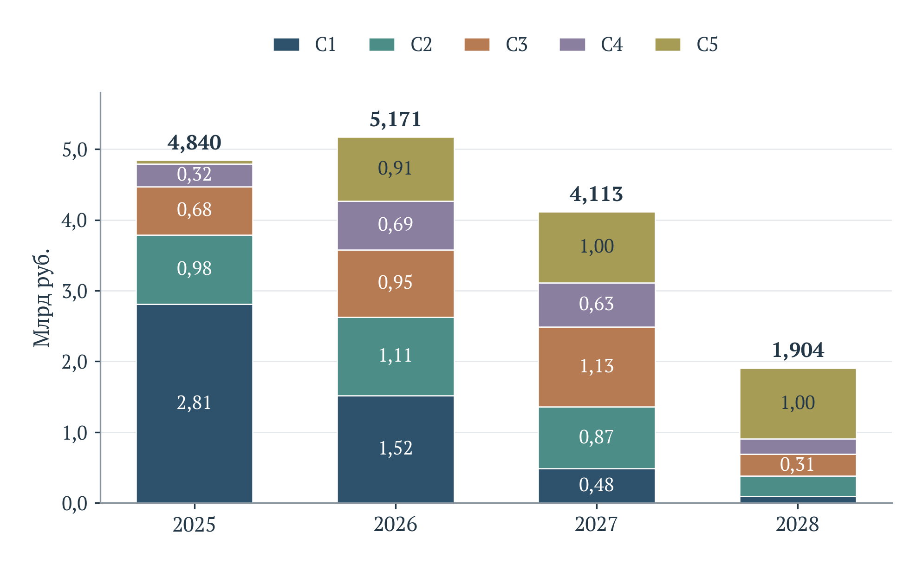

[B209; Caption] Рисунок 6 – Распределённые в публичном представлении паспортов средства по федеральным проектам

[B210; ] Примечание. Срез 16.10.2026, федеральный бюджет, номинальные плановые суммы. Показаны 2025–2028 годы, для которых опубликованы суммы всех пяти ФП. Подписи внутри сегментов округлены; малые сегменты не подписаны. График характеризует структуру опубликованных распределений, а не полный ресурс национального проекта. [Сноски 104]

[B211; ] Наибольшую долю показанного шестилетнего объёма составляет С1 – 31,4%; далее следуют С2 – 20,0%, С3 – 18,9%, С5 – 18,2% и С4 – 11,4%. Интерпретация структуры зависит от экономического содержания расходов. В С1 сосредоточено оснащение клинических баз, тогда как С2 финансирует исследования лекарств и испытания изделий, С3 – специализированные биомедицинские разработки, С4 – несколько разных исследовательских и организационных направлений. Поэтому ранжирование проектов по сумме не устанавливает их приоритетность для здоровья и не позволяет сравнить результативность без учёта стадий. Значительная ранняя стоимость инфраструктуры может обслуживать разработки нескольких последующих лет. [Сноски 105]

[B212; ] Наличие резервной части подтверждается документами федерального бюджетного планирования. Брошюра Минфина России к бюджету 2025–2027 годов отдельно представляла резервные средства национального проекта. Пояснительная записка к проекту бюджета 2026–2028 годов предусматривала 2,0351; 3,0019 и 5,5337 млрд руб. по строке реализации отдельных мероприятий федеральных проектов и поясняла их резервное назначение. Следовательно, малые значения непосредственно закреплённых за проектами средств в конце планового периода не могут без дополнительной сверки трактоваться как прекращение поддержки научных направлений. [Сноски 106]

[B213; ] В пояснительной записке к внесённому 30 сентября 2026 года проекту бюджета на 2027–2029 годы на национальный проект предусмотрено 5,7317; 6,4951 и 5,7282 млрд руб. Из них зарезервировано соответственно 1,6166; 4,5598 и 5,6136 млрд руб. Доля резерва возрастает с 28,2% до 70,2% и 98,0%. Документ указывает предполагаемые направления использования: разработку изделий и лекарств, оснащение клинических баз. Финансовые параметры законопроекта отражают предложение о будущих ассигнованиях; они не являются сведениями о состоявшемся расходовании и не должны представляться как уже принятый бюджет на весь период. [Сноски 107]

[B214; Caption] Таблица 9 – Параметры национального проекта в пояснительной записке к проекту бюджета 2027–2029 годов, млн руб.

[TABLE 9; B215]
Показатель | 2026: роспись | 2027: проект | 2028: проект | 2029: проект
Общий объём | 5 171,1 | 5 731,7 | 6 495,1 | 5 728,2
С1 | 1 517,5 | 484,9 | 61,4 | 64,5
С2 | 1 110,3 | 880,0 | 349,9 | 10,1
С3 | 947,8 | 1 129,7 | 308,5 | 40,0
С4 | 690,0 | 625,4 | 215,5 | 0,0
С5 | 905,4 | 994,9 | 1 000,0 | 0,0
Зарезервировано | 0,0 | 1 616,6 | 4 559,8 | 5 613,6
Доля резерва, % | 0,0 | 28,2 | 70,2 | 98,0

[B216; ] Примечание. Таблица 4.1.15 официального бюджетного документа прочитана в правовой републикации ГАРАНТ. 2026 год – сводная бюджетная роспись на 01.09.2026; 2027–2029 годы – законопроект № 615-9. Различие суммы округлённых строк и итога в 2026–2027 годах не превышает возможной погрешности округления до 0,1 млн руб. Доли рассчитаны авторами. [Сноски 108]

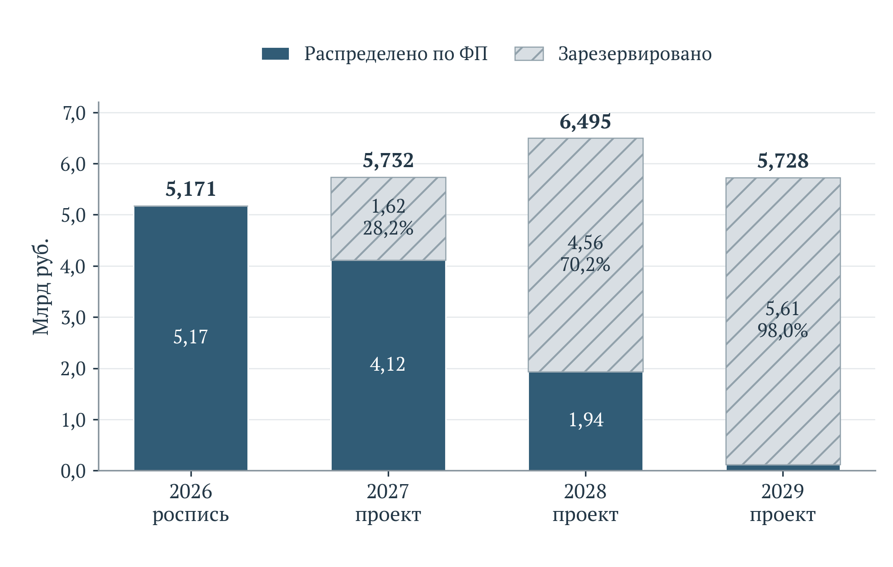

[B218; Caption] Рисунок 7 – Распределённая и зарезервированная части финансового обеспечения национального проекта

[B219; ] Примечание. 2026 год – роспись на 01.09.2026; 2027–2029 годы – проектные ассигнования по таблице 4.1.15 пояснительной записки. Распределённая часть рассчитана как разность общего объёма и резерва. Проценты показывают долю резерва. [Сноски 109]

[B220; ] Разница между паспортным срезом и бюджетным законопроектом в 2027 году составляет 1 618,2377 млн руб. Она близка к резерву 1 616,6 млн руб., но не совпадает с ним: остаточное различие равно 1,6377 млн руб. Для 2028 года соответствующие значения составляют 4 590,7721; 4 559,8 и 30,9721 млн руб. Резерв объясняет основную числовую часть расхождения, однако полное документальное согласование потребовало бы сверки редакций и направлений расходов. Приписывать весь остаток одной причине без такой сверки нельзя. Тем более расхождение не является оценкой недофинансирования, потерь или нецелевого использования средств. [Сноски 110]

[B221; ] Рост резервной доли меняет предмет управленческого контроля. Существенным становится срок превращения общего ассигнования в конкретное обязательство по исследованию, испытанию или оснащению. Для продолжительных работ позднее распределение может осложнить согласование протоколов, закупок и производственных заказов, даже если общий объём впоследствии будет достаточным. Подобный риск требует наблюдения за датами распределения, принятия обязательств и прохождения стадий; он не доказывается одним наличием резерва. Резерв способен обеспечить гибкость портфеля при появлении новых доказательств. Условием полезной гибкости является прозрачная процедура выбора разработок и сохранение финансовой непрерывности для уже обоснованных этапов.

[B222; ] По представленным источникам нельзя вычислить надёжную полную стоимость всех целей национального проекта до 2030 года. Для такого расчёта потребовались бы согласованные по редакциям паспортные расходы, нераспределённые резервы, иные государственные инструменты, собственные вложения организаций и последующие затраты на применение технологий. Простое сложение доступных сумм разных лет и документов создаёт риск двойного счёта. Корректный итог финансовой экспертизы состоит в подтверждении внутренней арифметической согласованности опубликованной части, выявлении существенной резервной составляющей и определении сведений, необходимых для перехода к оценке полной ресурсной обеспеченности.

[B223; Heading1] Связи мероприятий с показателями и структура проектных текстов

[B224; Heading2] Сопоставимый текстовый корпус и метод количественного анализа

[B225; ] Для количественного сопоставления сформирован корпус из 98 электронных паспортов по 12 национальным проектам. В него входят национальный паспорт каждого проекта и представленные вместе с ним федеральные паспорта. Совокупный объём отобранного содержательного текста составляет 75 539 токенов. Для «Новых технологий сбережения здоровья» анализируются шесть документов общим объёмом 2 571 токен: от 284 токенов национального паспорта до 581 токена С4. Сравниваемые проекты представлены пятью–тринадцатью документами, поэтому длина отдельной публикации и число документов рассматриваются как разные источники аналитической чувствительности. [Сноски 111]

[B226; ] Основной расчёт ограничен одним жанром источника. Содержательные поля электронного паспорта сопоставляются с такими же полями другого электронного паспорта. Презентации, нормативные методики и полные документы со значительным объёмом финансовых таблиц не включаются в общий словарь. Подобное ограничение уменьшает влияние различий издательской формы: иначе многократное повторение годовых строк, должностей и контрольных точек могло бы определять близость сильнее формулировок целей. Совпадение жанра, однако, не устраняет различий ведомственного языка, подробности характеристик и полноты публикации. [Сноски 112]

[B227; ] Из каждого документа извлечены цель, задачи, названия и характеристики результатов, названия показателей. Самостоятельные служебные сведения об исполнителях, бюджетные таблицы, календарные планы и контрольные точки исключены. Дословно совпадающие фрагменты внутри документа учитываются один раз после приведения регистра и пробелов к единому виду. Содержательно близкие, но различающиеся формулировки сохраняются: их объединение потребовало бы отдельного экспертного решения. Например, сокращение «мед.» и полная форма «медицинских» остаются разными признаками в базовой модели.

[B228; ] Документальный срез неоднороден по времени публикации: 95 паспортов имеют отметку 16 октября 2026 года, два федеральных паспорта проекта «Молодёжь и дети» – 18 июня, один паспорт проекта «Семья» – 19 августа. Все шесть анализируемых паспортов технологий здоровья относятся к редакциям от 16 октября. Сравнение тем самым характеризует доступный срез формулировок, а не синхронно утверждённый комплект документов. Содержательные различия между проектами могут частично отражать различия времени обновления. Даты и редакции сохранены для каждого документа, что позволяет повторить расчёт на тех же источниках или обновить его после появления новых редакций. [Сноски 113]

[B229; ] Токен определяется как буквенная последовательность русского или латинского алфавита длиной не менее двух символов с возможным внутренним дефисом. Регистр унифицирован, буква «ё» приведена к «е»; числовые значения и даты не образуют словарных признаков. В знаменателях тематических частот учитываются все такие токены до удаления стоп-слов. Для TF-IDF применяется единый список из 120 служебных и общеадминистративных слов. Словарь включает отдельные слова и пары соседних оставшихся слов. Пары формируются внутри содержательного фрагмента, поэтому конец одного поля не соединяется с началом другого. Удаление стоп-слов означает, что биграмма не обязательно представляет дословно соседствующее словосочетание исходного текста.

[B230; ] Вес TF-IDF сочетает частоту признака внутри документа и его различительную способность в общем корпусе. Частота преобразована логарифмически, чтобы многократное повторение одной формулировки не увеличивало её влияние пропорционально числу повторов. Обратная документная частота сглажена добавлением единицы к числителю и знаменателю. Используется единая оценка IDF по всем 98 документам; отдельный словарь для каждого проекта сделал бы значения несопоставимыми. Признак сохраняется при наличии хотя бы в одном документе и распространённости не более чем в 98% документов; ограничение максимального числа признаков не вводится. Итоговый словарь содержит 46 519 признаков. [Сноски 114]

[B231; ] (1)

[Формула] wₜd = (1 + ln tfₜd) × [1 + ln((N + 1)/(dfₜ + 1))], tfₜd > 0; иначе wₜd = 0

$$
w_{td}=(1+\ln tf_{td})\left[1+\ln\frac{N+1}{df_t+1}\right],\quad tf_{td}>0
$$

[B232; ] Вес определён для термина, встречающегося в документе: tfₜd > 0. При отсутствии термина wₜd = 0. N – число документов; dfₜ – число документов с термином; tfₜd – частота термина t в документе d.

[B233; ] (2)

[Формула] v_d = w_d / ‖w_d‖₂

$$
v_d=\frac{w_d}{\lVert w_d\rVert_2}
$$

[B234; ] Ненулевой вектор весов документа нормируется по евклидовой длине.

[B235; ] (3)

[Формула] cos(d, e) = (v_d · v_e) / (‖v_d‖ × ‖v_e‖)

$$
\cos(d,e)=\frac{v_d\cdot v_e}{\lVert v_d\rVert\lVert v_e\rVert}
$$

[B236; ] Для векторов единичной длины косинусная близость совпадает со скалярным произведением. Значение характеризует лексическое сходство текстов.

[B237; ] Нормировка каждого вектора по евклидовой длине ограничивает механическое преимущество длинных паспортов. Проектный профиль представляет среднее нормированных векторов его документов с повторной нормировкой. Поэтому длинный федеральный паспорт не получает большего прямого веса только из-за объёма текста. Вместе с тем равенство весов документов не тождественно равенству весов управленческих уровней: национальный паспорт в проекте с большим числом ФП занимает меньшую долю среднего. Для проверки этого решения отдельно рассчитан вариант, где национальный уровень и совокупность федеральных документов получают по половине веса.

[B238; ] Косинусная близость описывает сходство распределения лексических признаков. Значение 0,18 не означает совпадения 18% мероприятий, бюджета или целей, а разница коэффициентов не имеет непосредственного содержательного масштаба общественного эффекта. Анализ выполняется по целенаправленно отобранному набору документов; доверительные интервалы случайной выборки здесь не строятся. Надёжность интерпретации оценивается через проверку источников, контекстное чтение и чувствительность к разумным изменениям модели. Такой подход соответствует требованию проверять автоматизированный анализ применительно к конкретной исследовательской задаче. [Сноски 115]

[B239; Heading2] Связь мероприятий, непосредственных результатов и измеряемых исходов

[B240; ] В исследуемых редакциях содержатся 28 карточек результатов пяти федеральных проектов, 15 карточек федеральных показателей и 6 карточек показателей национального уровня. Наибольшее число результатов имеют С4 и С5 – по семь; С1 и С2 включают по пять, С3 – четыре. Карточка представляет опубликованную формулировку, а не отдельную статистически независимую переменную. Повторение показателя на разных уровнях, наличие прокси-показателей и различие их знаменателей ограничивают содержательность простого суммирования. Для анализа связей сохранены принадлежность к проекту, название результата, его характеристика и название показателя; совпадение административного раздела само по себе не трактуется как воздействие.

[B241; Caption] Таблица 10 – Содержательный объём и единицы наблюдения в паспортах анализируемого проекта

[TABLE 10; B242]
Паспорт | Редакция | Токены | Карточки результатов | Карточки показателей | Записи весов
НП | 26.20 | 284 | 0 | 6 | 0
С1 | 26.8 | 491 | 5 | 5 | 25
С2 | 26.11 | 508 | 5 | 3 | 15
С3 | 26.11 | 300 | 4 | 2 | 8
С4 | 26.13 | 581 | 7 | 2 | 12
С5 | 26.8 | 407 | 7 | 3 | 9
Всего | – | 2 571 | 28 | 21 | 69

[B243; ] Примечание. Состояние электронных редакций – 16.10.2026. Национальный паспорт и паспорта ФП образуют разные уровни наблюдения: 21 карточка не означает 21 независимый показатель. Записи весов подсчитаны как опубликованные записи; соответствие каждой записи конкретному показателю не установлено. [Сноски 116]

[B244; ] Инфраструктурные мероприятия С1 воздействуют на результат через подготовленность клинических баз, качество отбора и сопровождения исследований. Поэтому непосредственная связь с числом выведенных на рынок продуктов требует наблюдения за промежуточными стадиями. Аналогично стажировки в С2 создают кадровые предпосылки разработок, однако их результат проявляется с временным лагом. Его величина по текстам паспортов не оценивается.

[B245; ] В С3 и С4 развитие продукта связывается с внешним внедрением и доступом пациентов. Совместное наблюдение обеих сторон позволяет различать локальную успешную разработку и распространение применения. Для С5 соответствующая связь проходит через фактический выпуск и обеспечение спроса: регистрация позиции и изменение доли отечественного рынка характеризуют разные стадии. Схема на рисунке 8 объединяет эти механизмы без присвоения им недоказанных количественных весов.

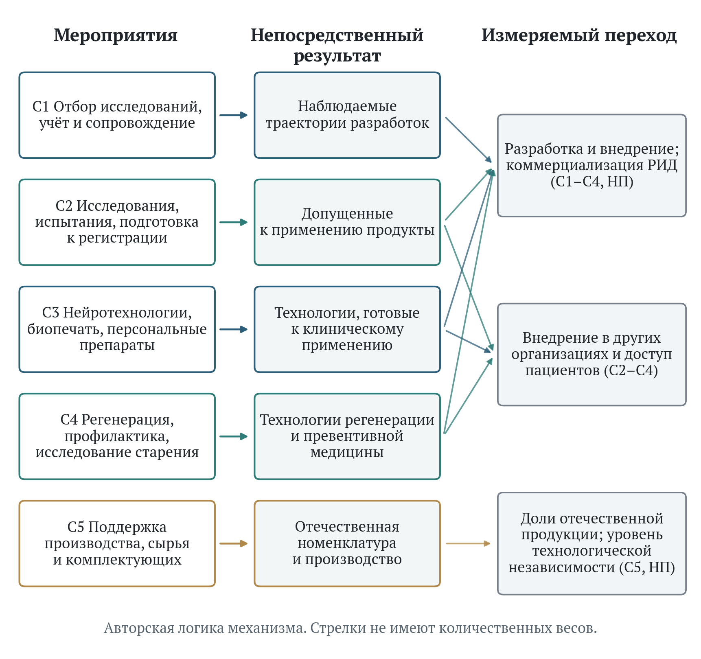

[B247; Caption] Рисунок 8 – Логика перехода от мероприятий к непосредственно измеряемым результатам

[B248; ] Примечание. Схема построена по содержательным формулировкам паспортов. Направление стрелки выражает проверяемую авторскую гипотезу механизма; причинный эффект и паспортный вес не оцениваются. РИД – результаты интеллектуальной деятельности. Изменение здоровья населения находится за пределами непосредственно показанного измерения. [Сноски 117]

[B249; ] На схеме направления связей заданы авторской реконструкцией механизма по содержанию паспортов. Основанием для стрелки служит наличие содержательного перехода между действием, непосредственно создаваемым объектом и областью измерения показателя. Схема не присваивает мероприятиям процентов влияния. Для доказательства причинного эффекта потребовались бы наблюдения о сроках начала и завершения разработок, индивидуальная идентификация продукта, сведения о его внедрении и подходящий способ отделить действие поддержки от прочих факторов. Предложенная реконструкция позволяет сформулировать проверяемые вопросы о каждом переходе и установить, какие сведения нужны для их разрешения.

[B250; ] В электронных редакциях федеральных паспортов присутствуют 69 численных записей, обозначенных как влияние результата на показатель. Публикуемая структура позволяет прочитать число и результат, но не позволяет однозначно идентифицировать адресуемый показатель: сопровождающая запись формулировка повторяет название самого результата. Поэтому по этим записям не восстанавливается взвешенная матрица влияния. Объединение результатов и показателей по общей задаче дало бы 83 пары – все допустимые сочетания внутри соответствующих федеральных проектов. Подобное полное заполнение отражало бы общую административную принадлежность, а не 83 независимо подтверждённых механизма. Ограничение относится к доступной форме публикации и не доказывает отсутствия более подробных связей в оригинальных документах. [Сноски 118]

[B251; ] Дополнительная семантическая оценка рассчитана для всех 83 внутрипроектных сочетаний результатов и показателей. Она используется как средство поиска формулировок, заслуживающих содержательной проверки. Примеры ниже отобраны по одному из каждого ФП; таблица не претендует на представление официального распределения ответственности. Низкое численное сходство не исключает реальной связи, поскольку длинная характеристика мероприятия и краткое название показателя могут описывать разные стадии одного процесса.

[B252; Caption] Таблица 11 – Содержательно интерпретируемые пары результатов и показателей

[TABLE 11; B253]
ФП | Результат: сокращённая формулировка | Показатель: сокращённая формулировка | Косинус
С1 | Отбор и сопровождение прикладных исследований | Доля исследований с учётом и мониторингом применения | 0,114
С2 | Клинические исследования оригинальных препаратов | Количество разработанных и допущенных к применению продуктов | 0,080
С3 | Нейротехнологии для предупреждения и лечения когнитивных нарушений | Доля граждан, пролеченных с применением новых технологий | 0,037
С4 | Технологии превентивной медицины и здорового питания | Доля технологий, внедрённых в других медицинских организациях | 0,150
С5 | Регистрация и организация производства радиофармацевтических средств | Доля радиофармацевтических препаратов российского производства | 0,162

[B254; ] Примечание. Выбрано по одной содержательно интерпретируемой паре из каждого ФП. Косинус рассчитан по названию и характеристике результата и названию показателя в общем словаре TF-IDF. Значения являются авторскими оценками лексического сходства; они не подтверждают официальную связь и не измеряют силу воздействия. [Сноски 119]

[B255; ] Особенно показателен С5: сходство результата о радиофармацевтических средствах с профильным показателем составляет 0,162, однако результат о регистрации лекарственных препаратов вообще получает почти такое же значение – 0,161. Общая медицинская и производственная лексика оказывается сильнее различия между узким и широким предметом работы. В С4 высокая близость мероприятий регионального движения к показателю внедрения также объясняется повторением выражений о здоровом долголетии и не подтверждает прямого эффекта массового мероприятия на внедрение технологии. Следовательно, семантический порог не должен превращаться в автоматическое правило причинного связывания.

[B256; Heading2] Тематическая специализация и содержательные акценты паспортов

[B257; ] Тематический анализ дополняет TF-IDF, поскольку заранее заданные содержательные категории отвечают на иной вопрос: какие участки механизма чаще представлены в каждом паспорте. Использованы восемь словарей: наука и разработка, клиническое внедрение, производство, профилактика и долголетие, управление и учёт, доступ и получатели, цифровые технологии, нейро- и когнитивные технологии. Словари основаны на явных основах слов и ограниченном наборе словосочетаний. Частота выражается числом совпадений на 1000 токенов соответствующего документа. Пересечение категорий допускается: клиническое исследование одновременно относится к научной работе и клиническому переходу.

[B258; ] Контекстная проверка предотвращает наиболее очевидные смешения. Выражение о работах гражданского назначения не учитывается как обращение к гражданам; когнитивная тематика не объявляется цифровой только из-за соседства с технологической лексикой. Для производственного направления учитываются также формулировки о выпуске и произведённой продукции, а для учёта – формы «учтены» и «учтённых». Всего по шести паспортам выявлено 333 словарных совпадения в 48 комбинациях «документ – тема». Частоты описывают присутствие языковых признаков, а не число реализованных технологий, получателей помощи или выполненных исследований. Контекстное чтение проведено одним исследовательским исполнителем; независимое межэкспертное согласие кодирования не измерялось. [Сноски 120]

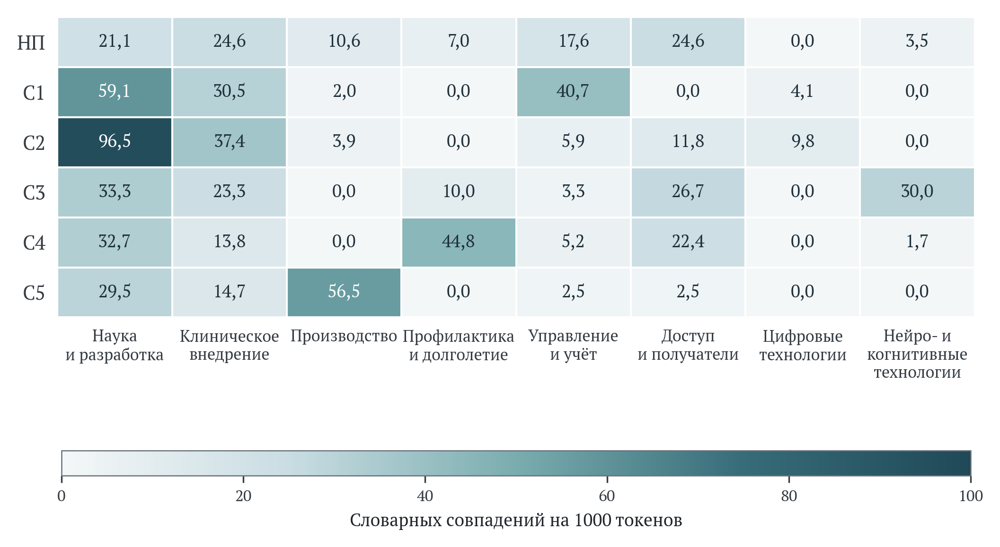

[B260; Caption] Рисунок 9 – Тематические профили национального и пяти федеральных паспортов

[B261; ] Примечание. Токены – буквенные последовательности содержательных полей. Совпадения по темам могут пересекаться; значения не суммируются до 100%. Ноль означает отсутствие заданных словарных признаков, а не отсутствие направления работы. Сокращения С1–С5 соответствуют федеральным проектам. [Сноски 121]

[B262; ] С2 наиболее насыщен научной лексикой: 49 совпадений, или 96,5 на 1000 токенов. Клиническое внедрение составляет 37,4, цифровые технологии – 9,8. Соотношение отражает подробные описания поддержки исследований, испытаний и регистрации, включая программные медицинские изделия с искусственным интеллектом. Высокая частота научных формулировок не означает, что преимущественная часть ресурсов обязательно расходуется на исследования: тематический показатель не содержит финансовой информации. Производственная частота С2 невелика – 3,9; соответствующие упоминания связаны с предприятиями, на которых предусмотрены стажировки, и характеризуют окружение кадрового мероприятия. [Сноски 122]

[B263; ] С1 отличается управлением и учётом – 40,7 совпадения на 1000 токенов, при научной частоте 59,1. Контекст включает отбор, сопровождение разработок, мониторинг и информационные системы, что согласуется с инфраструктурной ролью этого федерального проекта. Нулевая частота категории доступа и получателей после исключения гражданского назначения не свидетельствует о социальной незначимости С1. В выбранных содержательных полях конечный пациент представлен опосредованно через разработку и внедрение. Подобная удалённость от получателя повышает значение прозрачной связи между управленческими действиями и движением конкретного продукта. [Сноски 123]

[B264; ] С3 характеризуется нейро- и когнитивной тематикой – 30,0 на 1000 токенов, а также упоминаниями доступа и получателей – 26,7. С4 выделяется профилактикой и долголетием: 26 совпадений в 581 токене, или 44,8 на 1000. Научные частоты С3 и С4 близки – 33,3 и 32,7, однако предметные акценты различаются. Упоминание когнитивной тематики в С4 возникает в общей формулировке задачи и не превращает весь паспорт в нейротехнологический проект. Интерпретация ячейки требует возвращения к конкретному контексту, особенно когда её значение образовано единственным совпадением. [Сноски 124]

[B265; ] С5 имеет наиболее выраженный производственный профиль – 23 совпадения, или 56,5 на 1000 токенов. Научная частота составляет 29,5, клиническое внедрение – 14,7. Соединение производственных и регистрационных формулировок показывает, что промышленное направление включает разработку и подготовку продукта к применению. Одновременно относительно слабая представленность пациентской лексики требует отдельной проверки того, насколько расширение отечественной номенклатуры превращается в доступность востребованной продукции. Частота слов не позволяет определить достаточность ассортимента или устойчивость снабжения. [Сноски 125]

[B266; ] Национальный паспорт имеет более краткий и обобщённый профиль: клиническое внедрение и доступ представлены по 24,6 совпадения на 1000 токенов, наука – 21,1, управление и учёт – 17,6. Различия с федеральными документами соответствуют переходу от агрегированных ожиданий к конкретным действиям. При объёме 284 токена одно дополнительное совпадение изменяет частоту примерно на 3,5 единицы на 1000; у С4 соответствующий шаг составляет около 1,7. Поэтому десятичные доли в матрице служат прозрачному представлению расчёта и не означают столь же высокой точности содержательной интерпретации. [Сноски 126]

[B267; Heading2] Отличительные формулировки и межпроектная лексическая близость

[B268; ] Совокупный профиль проекта ожидаемо формируется вокруг лекарственных препаратов и медицинских изделий. Наибольшие веса имеют словоформы «лекарственных» – 0,138, «изделий» – 0,138, сочетания «медицинских изделий» – 0,136 и «лекарственных препаратов» – 0,128. Преобладание продуктовой лексики согласуется с механизмом доведения исследований до применяемых технологий. Веса не устанавливают очередность финансирования отдельных направлений: употребляемость термина и его редкость в других паспортах отвечают на лингвистический вопрос. Дополнительную роль играет повторение одного понятия в нескольких падежных формах. [Сноски 127]

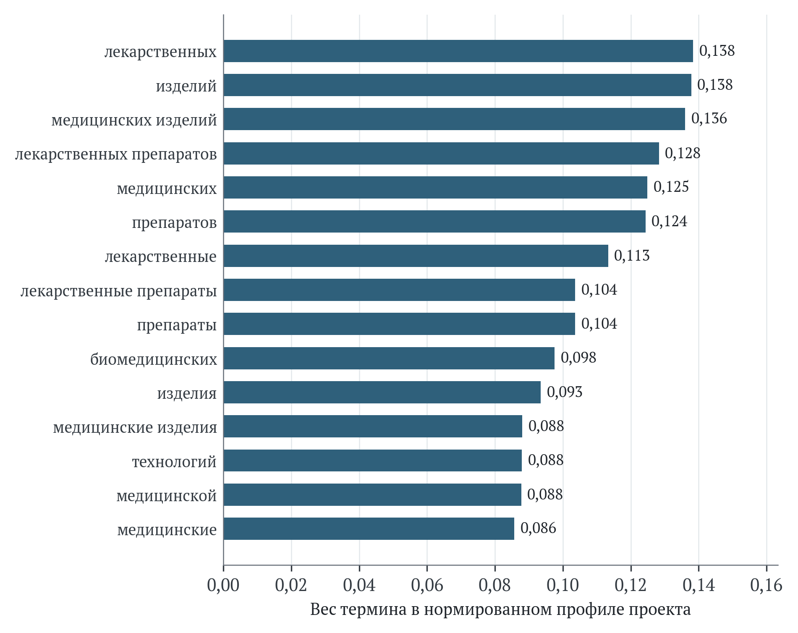

[B270; Caption] Рисунок 10 – Ведущие термины совокупного текстового профиля проекта

[B271; ] Примечание. Профиль – среднее шести нормированных векторов НП и ФП с повторной нормировкой L2. Общий словарь содержит 46 519 униграмм и биграмм, рассчитанных по 98 однотипным электронным паспортам. Словоформы сохранены; их объединение проверено отдельным расчётом. Вес не является частотой слова, долей бюджета или социальной значимостью задачи. [Сноски 128]

[B272; ] Для отдельного национального паспорта ведущими признаками становятся также сокращения «БМКП» (биомедицинские клеточные продукты) и «мед.», поскольку они концентрируются в немногих документах. Высокий вес сокращения не следует трактовать как самостоятельный содержательный приоритет. Совокупный профиль шести паспортов частично сглаживает подобную особенность, сохраняя терминологию разных направлений. Проверка со стеммингом дополнительно объединяет изменяемые формы слов, однако не раскрывает все аббревиатуры и не разрешает многозначность. Результат поэтому сопоставляется с тематическим кодированием и чтением полных характеристик мероприятий.

[B273; ] Внутри национального проекта наибольшая близость наблюдается между национальным паспортом и С1 – 0,267, затем между национальным паспортом и С2 – 0,225. Среди пар федеральных паспортов выделяются С1–С2 с коэффициентом 0,181 и С3–С4 с коэффициентом 0,162. Первая пара связана языком исследований, медицинских разработок, допуска и сопровождения; вторая – формулировками о новых биомедицинских технологиях, клиническом применении и доступе граждан. Подобная группировка отражает два содержательных контура: общий путь создания медицинского продукта и специализированные направления его применения. [Сноски 129]

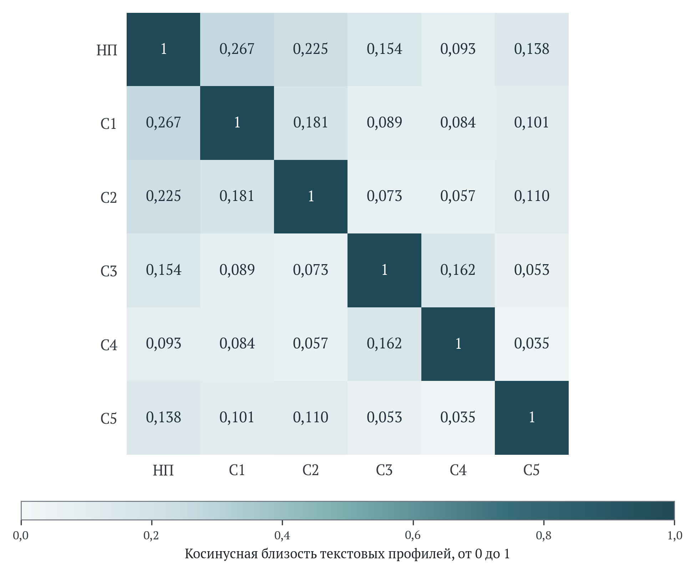

[B275; Caption] Рисунок 11 – Лексическая близость документов внутри национального проекта

[B276; ] Примечание. Базовый TF-IDF, униграммы и биграммы, нормировка L2. Диагональ показывает сравнение документа с самим собой. Низкая близость может отражать функциональную специализацию; коэффициент не измеряет качество координации, общую долю содержания или фактическое влияние проектов друг на друга. [Сноски 130]

[B277; ] Наименьшая близость федеральных документов наблюдается между С4 и С5 – 0,035. Производство и сырьевое обеспечение описаны иначе, чем старение, регенерация и профилактика. Низкое сходство совместимо с дополняющими функциями и само по себе не является свидетельством организационного разрыва. Содержательный вопрос заключается в наличии перехода от результатов С3 и С4 к масштабируемому производству и применению, а не в необходимости унифицировать их словарь. Доказательства такого перехода следует искать в связанных карточках разработок, регистрационных решениях, договорах передачи прав и данных о внедрении. [Сноски 131]

[B278; ] Для межпроектного сопоставления каждый национальный проект представлен средним профилем всех включённых в него паспортов. Ближайшим к технологиям здоровья является проект «Продолжительная и активная жизнь»: базовый косинус составляет 0,176. Далее следуют «Экономика данных и цифровая трансформация государства» – 0,108, «Эффективная и конкурентная экономика» – 0,0898 и «Молодёжь и дети» – 0,0894. Разница между третьим и четвёртым значениями составляет менее 0,0005 и не поддерживает сильного вывода об их содержательной иерархии. «Семья» занимает следующее место с коэффициентом 0,071. [Сноски 132]

[B279; ] Разложение косинуса на вклады отдельных признаков уточняет природу близости. Для «Продолжительной и активной жизни» ведущими являются формы слова «медицинский», сочетание «медицинской помощи» и терминология здравоохранения. Близость к «Экономике данных» поддерживают технологии, искусственный интеллект и применение новых решений. В профиле «Молодёжи и детей» существенна научная и организационная лексика, тогда как связь с конкурентной экономикой включает разработку, препараты и технологические решения. Общие слова создают основание для поиска зон сопряжения, но не устанавливают совместное финансирование, наличие единого исполнителя или реализованный межпроектный эффект.

[B280; ] Более слабая близость «Семьи» по сравнению с общим медицинским проектом объяснима широтой её содержательного состава: рядом с охраной материнства, детства и старшим поколением представлены социальные и культурные направления. Проектный средний профиль учитывает их все. Следовательно, слабый общий коэффициент не исключает тесного тематического совпадения отдельного федерального проекта. Аналогично невысокий результат «Кадров» не отменяет кадрового характера стажировок в С2. Для управленческого решения, относящегося к определённой функции, необходимо сопоставление соответствующих документов и мероприятий, а не механическое использование общего рейтинга.

[B281; Heading2] Проверка устойчивости и пределы содержательных выводов

[B282; ] Чувствительность проверена изменением морфологической обработки, состава признаков и способа агрегирования документов. Русский стемминг Snowball сокращает словарь до 35 509 признаков против 46 519 в базовом варианте. При сохранении только униграмм остаются 10 329 признаков. Сопоставляемый набор из 98 документов во всех вариантах одинаков; различие результатов не связано с добавлением иных источников. Стемминг объединяет некоторые грамматические формы по усечённой основе и не является полной лемматизацией или экспертным сведением синонимов. [Сноски 133]

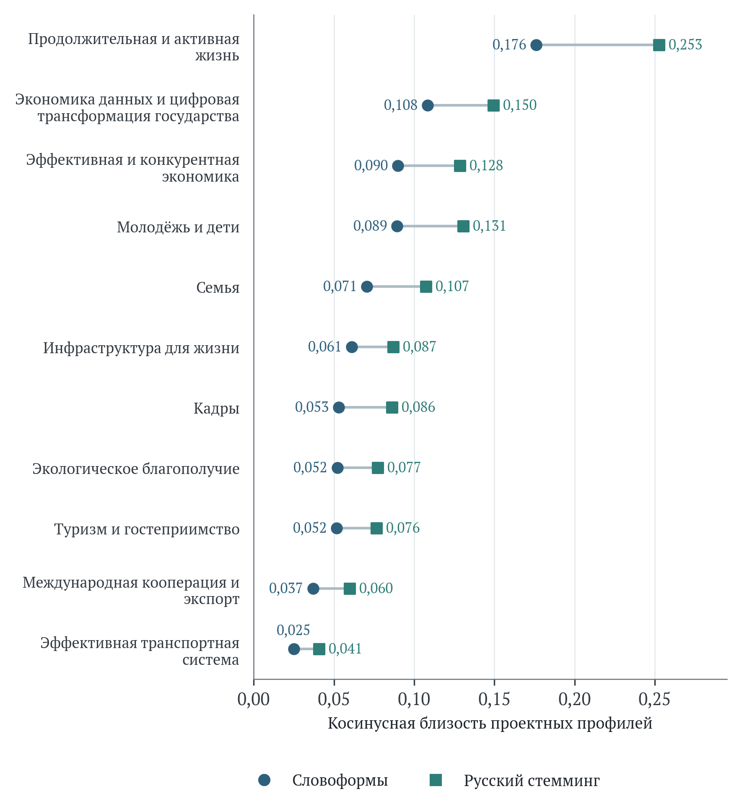

[B284; Caption] Рисунок 12 – Межпроектная близость и чувствительность к обработке словоформ

[B285; ] Примечание. Для всех 12 проектов использован один жанр источника и единое правило формирования профиля. Каждый паспорт получает одинаковый вес внутри своего проекта. После русского стемминга первые два места сохраняются; «Молодёжь и дети» и «Эффективная и конкурентная экономика» меняются местами. Сопоставление характеризует формулировки паспортов, а не измеренные межведомственные эффекты. [Сноски 134]

[B286; ] После стемминга близость к «Продолжительной и активной жизни» увеличивается с 0,176 до 0,253, к «Экономике данных» – с 0,108 до 0,150. Рост сам по себе ожидаем: объединение словоформ повышает число общих признаков. Первые два места сохраняются. «Молодёжь и дети» с коэффициентом 0,131 опережает конкурентную экономику с коэффициентом 0,128, меняя порядок почти равных базовых значений. Корреляция рангов по всем 11 сопоставлениям составляет 0,991. Высокая общая согласованность сочетается с локальной неустойчивостью и требует различать устойчивую группу ближайших проектов и точный порядок внутри соседней группы.

[B287; ] Переход к одним униграммам также сохраняет два ближайших проекта и ставит «Молодёжь и дети» на третье место. Близость к общему медицинскому проекту возрастает до 0,289, а к экономике данных – до 0,200. Увеличение показывает, насколько дополнительное требование совпадения пар слов делает базовую модель более строгой. Сопоставлять абсолютные коэффициенты разных вариантов как одну измерительную шкалу некорректно; основное внимание уделяется сохранению выводов и мест, а не величине прироста косинуса.

[B288; Caption] Таблица 12 – Устойчивость ранжирования 11 сопоставляемых национальных проектов

[TABLE 12; B289]
Вариант расчёта | ρ Спирмена | Первые три проекта
Словоформы; униграммы и биграммы | 1,000 | Продолжительная и активная жизнь; Экономика данных; Эффективная и конкурентная экономика
Русский стемминг | 0,991 | Продолжительная и активная жизнь; Экономика данных; Молодёжь и дети
Только униграммы | 0,982 | Продолжительная и активная жизнь; Экономика данных; Молодёжь и дети
Равный вес уровня НП и совокупности ФП | 0,973 | Продолжительная и активная жизнь; Экономика данных; Эффективная и конкурентная экономика
Профиль только по федеральным паспортам | 0,964 | Продолжительная и активная жизнь; Экономика данных; Молодёжь и дети
Профиль только по национальным паспортам | 0,755 | Продолжительная и активная жизнь; Инфраструктура для жизни; Экономика данных

[B290; ] Примечание. Корреляция рангов рассчитана относительно базового варианта по всем 11 другим проектам. Варианты агрегирования используют общий базовый словарь и IDF по 98 документам; при стемминге и переходе к униграммам словарь пересчитывается по тому же набору документов. Проверка характеризует чувствительность аналитического решения, а не статистическую неопределённость случайной выборки. [Сноски 135]

[B291; ] При равном весе национального уровня и совокупности федеральных паспортов первые три проекта остаются прежними, а корреляция рангов с базовым вариантом составляет 0,973. Близость к «Продолжительной и активной жизни» снижается до 0,140, к «Экономике данных» – до 0,082. Снижение означает, что значительная часть общего языка обнаруживается в более конкретных федеральных формулировках. Исключение национальных паспортов только из агрегирования профилей даёт корреляцию 0,964 и вновь сохраняет первые два места. В обоих случаях используется первоначально оценённый общий словарь, поэтому проверяется именно решение о весах документов.

[B292; ] Наиболее заметная перестановка возникает при формировании профилей только из национальных паспортов. Корреляция рангов снижается до 0,755; после общего медицинского проекта следует «Инфраструктура для жизни», а экономика данных занимает третье место. Сам коэффициент для «Продолжительной и активной жизни» уменьшается до 0,032. Краткие национальные формулировки, сокращения и общие слова о гражданах и средствах оказываются недостаточным основанием для детального сопоставления механизмов. Полученный результат обосновывает включение федеральных документов в основную модель и одновременно предупреждает о зависимости выводов от выбранного управленческого уровня.

[B293; ] Устойчивым выводом выступает близость технологий здоровья к общему медицинскому направлению и, при учёте федерального содержания, к экономике данных. Порядок конкурентной экономики и «Молодёжи и детей» чувствителен к обработке словоформ. Слабые коэффициенты удалённых проектов преимущественно отражают отсутствие общего специализированного языка, однако отдельные точки сопряжения могут быть скрыты агрегированием. Метод позволяет приоритизировать последующее изучение документальных связей, но не ранжирует национальные проекты по результативности и не доказывает дублирования расходов.

[B294; ] Содержательное улучшение проектного управления связано с возможностью проследить один и тот же объект через исследования, испытания, допуск, производство и применение. Для этого полезна единая идентификация разработки, указание стадии готовности, основания перехода между стадиями и связанного показателя с точным знаменателем. Совместимость такой информации между С1–С5 позволила бы проверять авторскую логическую схему наблюдаемыми данными. Пока текстовая экспертиза подтверждает функциональную специализацию федеральных проектов и выявляет направления сопряжения, а вопрос фактической эффективности требует отдельного анализа результатов разработок, внедрения и использования технологий пациентами.

[B295; Heading1] Доказательность и условия общественной результативности

[B296; Heading2] Последовательность перехода от разработки к устойчивому применению

[B297; ] Основной объект управления целесообразно определять как технологию с конкретным назначением, целевой группой и стадией готовности. Одна научная тема может породить несколько продуктов, один продукт – несколько показаний, а одно регистрационное удостоверение – охватывать неоднородную номенклатуру. Без устойчивого идентификатора технологии возникает риск двойного счёта результатов и утраты связи между государственными затратами и последующим применением.

[B298; ] Для каждой поддерживаемой технологии предлагается единая прослеживаемая последовательность: обоснование потребности, подтверждение технической осуществимости, исследование безопасности и клинических результатов, установление возможности производства и допуска к обращению, оценка условий внедрения, наблюдение за применением. Стадии могут частично пересекаться во времени. Решение о переходе должно опираться на заранее определённые основания и содержать возможность доработки либо прекращения финансирования.

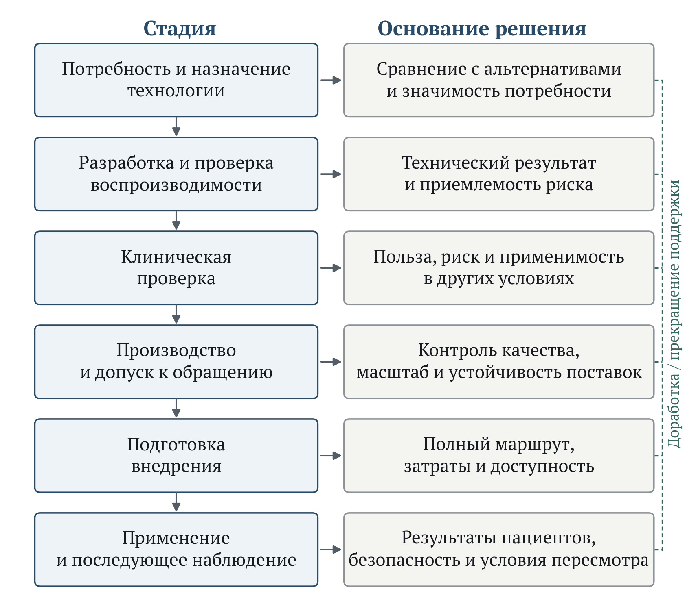

[B300; Caption] Рисунок 13 – Рекомендуемая система решений на протяжении жизненного цикла технологии

[B301; ] Примечание. Авторская схема. Узлы обозначают решения, требующие подтверждающих сведений. Возврат на доработку и прекращение поддержки являются допустимыми исходами научно-технологического отбора.

[B302; ] Научный риск предполагает возможность отрицательного результата. Требование почти безусловной успешности исследований может стимулировать отбор заведомо простых тем, изменение состава знаменателя и позднее включение разработок в отчётность. Поэтому оценку завершённой разработки следует дополнять характеристикой исходного риска, качества протокола, своевременности выявления бесперспективного направления и сохранения полученного знания. Обоснованное прекращение исследования уменьшает потери последующих стадий.

[B303; ] Когортный подход позволяет прослеживать судьбу технологий, включённых в проект в одном периоде. Для когорты фиксируются исходная стадия, дата включения, объём поддержки, переходы между стадиями, прекращение работ и причины решений. Доля перехода рассчитывается среди технологий, для которых к моменту наблюдения истёк заранее установленный срок завершения соответствующей стадии. Прекращённые разработки сохраняются в исходной когорте с указанием причины прекращения. Простое отношение числа регистраций текущего года к числу текущих разработок смешивает разные поколения исследований и может искажать результат.

[B304; ] Время до регистрации, производства и первого внешнего внедрения имеет самостоятельное значение. Медианное время перехода следует сопровождать долей технологий, остающихся под наблюдением, и распределением причин задержки. Для ещё не завершённых разработок срок нельзя считать равным нулю. При накоплении достаточных данных возможен анализ времени до события с учётом цензурирования и конкурирующих исходов. Раннее прекращение, завершение без внедрения и успешный переход должны различаться.

[B305; Caption] Таблица 13 – Предлагаемые основания решений о продолжении поддержки технологии

[TABLE 13; B306]
Решение | Необходимые сведения | Основание для пересмотра
Начать разработку | Описание неудовлетворённой потребности, существующих альтернатив, ожидаемого результата и критических зависимостей | Отсутствие значимой потребности либо воспроизведение доступного решения без самостоятельного общественного эффекта
Перейти к клинической проверке | Воспроизводимость технического результата, обоснование безопасности и протокол исследования | Неустранённая неопределённость, делающая применение преждевременным
Поддержать внедрение | Достаточные для назначения технологии клинические данные, производственная готовность, стоимость полного маршрута и подготовленность организаций | Отсутствие подтверждения заявленной клинической, технологической или иной общественной пользы либо невозможность устойчивого обеспечения
Расширить применение | Результаты внешнего применения, сведения о безопасности, доступности и нагрузке на бюджет | Ухудшение пользы и риска, неравенство доступа, систематические перебои или неприемлемые затраты

[B307; ] Примечание. Предлагаемая аналитическая рамка. Конкретные требования зависят от вида технологии и действующих правил допуска к обращению.

[B308; Heading2] Клиническая доказательность и условия внешней применимости

[B309; ] Клиническая оценка начинается с постановки конкретного вопроса: для какой группы пациентов, по сравнению с какой доступной альтернативой, по какому исходу и за какой период ожидается улучшение. Необходимы описание вмешательства, предварительное определение основного исхода и правила учёта изменения терапии, прекращения лечения и потерь наблюдения. Международное руководство ICH E9(R1) связывает содержание оцениваемого эффекта с дизайном исследования и анализом чувствительности. [Сноски 136]

[B310; ] Для технологий, претендующих на изменение клинической практики, предпочтительна проспективная сравнительная проверка. Возможность рандомизации рассматривается с учётом предмета исследования и этических условий. При использовании наблюдательных данных необходимо заранее определить источники смещения: выбор пациентов, тяжесть заболевания, опыт центра, доступность альтернатив и изменение лечения во времени. Статистическая корректировка не компенсирует автоматически отсутствие информации о существенных различиях между группами.

[B311; ] Промежуточный биологический или технический показатель может ускорять разработку, однако связь с клинически значимым исходом требует самостоятельного обоснования. Высокая точность распознавания изображения не равнозначна улучшению маршрута пациента. Изменение лабораторного маркера не гарантирует изменения самочувствия, функционального состояния или риска тяжёлого события. В проектной отчётности целесообразно указывать, какой уровень результата подтверждён и какой остаётся гипотезой.

[B312; ] Публичная научная отчётность должна позволять проверить набор участников, фактическое выполнение вмешательства, отклонения от протокола, нежелательные явления и полноту наблюдения. CONSORT 2025 предлагает обновлённые требования к представлению рандомизированных исследований. Достаточность описания облегчает критическую оценку, но сама по себе не гарантирует отсутствие систематической ошибки. [Сноски 137]

[B313; ] Для цифровых медицинских решений важны взаимодействие специалиста с системой, частота отклонения рекомендаций, нагрузка на рабочий процесс и возможность изменения результата при переносе в другую организацию. Ранняя проверка в реальной клинической среде должна предшествовать крупному масштабированию. DECIDE-AI выделяет человеческие факторы, контекст применения и воспроизводимость описания в самостоятельные компоненты оценки систем поддержки решений. [Сноски 138]

[B314; ] Региональная проверка особенно существенна для алгоритмов, обучение которых основано на данных нескольких крупных центров. Отличия оборудования, структуры заболеваний и порядка обследования способны менять качество результата. Для каждого существенного обновления необходимо сохранять версию модели, назначение, условия тестирования и порядок наблюдения за ошибками. Организациям следует заранее определить полномочия врача, порядок обжалования результата и действия при недоступности системы. Этическое управление медицинским искусственным интеллектом должно обеспечивать защиту интересов человека и ответственность за применение технологии. [Сноски 139]

[B315; ] Для регенеративных и персонализированных решений принципиальны воспроизводимость технологического процесса, связь партии с конкретным применением, прослеживаемость биоматериала и длительность наблюдения. Количество проведённых вмешательств характеризует объём практики. Оценка эффективности требует сопоставления исходов в надлежащим образом определённых группах, а оценка безопасности – систематического наблюдения с учётом возможных отсроченных событий.

[B316; ] Независимое внешнее применение следует трактовать как отдельную стадию. Передача технологии в другую организацию позволяет оценить зависимость результата от команды разработчика. Для федерального проекта полезно учитывать долю внедрений, сопровождающихся внешней проверкой, соблюдением протокола и подтверждением условий применения. Ответственность за научную достоверность и ответственность за управление портфелем целесообразно распределить между различными процедурами.

[B317; Heading2] Экономическая оценка и доступность финансирования внедрения

[B318; ] Экономическая оценка технологии должна сопоставлять дополнительные расходы и дополнительные результаты по отношению к реально доступной альтернативе. Производственная себестоимость и цена закупки составляют лишь часть затрат. В расчёт включаются обследование, введение или установка, обучение специалистов, расходные материалы, обслуживание, наблюдение и лечение осложнений. Перспектива анализа определяет, учитываются ли расходы системы здравоохранения, семьи и потери времени пациента.

[B319; ] (4)

[Формула] ICER = (C₁ − C₀) / (E₁ − E₀)

$$
ICER=\frac{C_1-C_0}{E_1-E_0}
$$

[B320; ] C₁ и C₀ – совокупные затраты при новой технологии и альтернативе; E₁ и E₀ – сопоставимые клинические результаты. ICER характеризует дополнительные затраты на единицу дополнительного результата при ненулевой разности эффектов.

[B321; ] При отрицательной разности эффектов смысл отношения меняется, поэтому экономическое заключение должно начинаться с отдельного рассмотрения затрат и исходов. Для сравнения вмешательств необходимы согласованные горизонт, единицы результата и правила дисконтирования. Длительный ожидаемый эффект технологии нельзя полностью переносить за пределы наблюдения без проверки правдоподобных сценариев. Отдельно оцениваются неопределённость клинического эффекта, его сохранение, повторное применение и будущая стоимость сопровождения.

[B322; ] CHEERS 2022 устанавливает требования к прозрачному изложению экономических оценок, включая контекст решения, методы, результаты и распределительные последствия. Руководство предназначено для полноты научной отчётности и не является балльной шкалой качества исследования. Анализ влияния на бюджет требует самостоятельной модели численности получателей, темпа внедрения и финансовых ограничений. [Сноски 140]

[B323; ] (5)

[Формула] ΔBₜ = Nₜ × (c₁ₜ − c₀ₜ) + Fₜ

$$
\Delta B_t=N_t(c_{1t}-c_{0t})+F_t
$$

[B324; ] ΔBₜ – изменение годовой потребности в финансировании; Nₜ – число пациентов, получающих новую технологию; c₁ₜ и c₀ₜ – сопоставимые затраты полного маршрута на пациента; Fₜ – дополнительные фиксированные затраты внедрения. Формула задаёт упрощённую структуру оценки при одной вытесняемой альтернативе.

[B325; ] Влияние на бюджет может оказаться значительным даже при благоприятном соотношении затрат и результата. Для технологии, рассчитанной на широкий контингент, определяющими становятся скорость расширения охвата и стоимость сопровождающей инфраструктуры. Для индивидуального дорогостоящего вмешательства существенны распределение расходов между годами и неопределённость длительного эффекта. Методология бюджетного воздействия рассматривает доступную популяцию, текущую практику, изменение использования и особенности бюджета принимающей решение организации. [Сноски 141]

[B326; ] В национальном проекте целесообразно предусмотреть согласование трёх финансовых решений: поддержки разработки, подготовки производства и оплаты применения. Положительное решение на ранней стадии не означает обязательства неограниченного финансирования последующего использования. Вместе с тем отсутствие заранее определённого механизма оплаты создаёт риск завершения исследований без реального внедрения. Для перспективной технологии следует до масштабирования установить источник расходов на полный маршрут пациента и условия пересмотра решения.

[B327; ] Для средств производства, медицинского оборудования и программного обеспечения важно учитывать стоимость жизненного цикла. Низкая цена первоначальной поставки может сочетаться с дорогими расходными материалами, сервисом или недоступностью обновления. В анализе технологической независимости требуется оценивать устойчивость критических комплектующих, наличие ремонтной компетенции и возможность продолжения эксплуатации. Финансовая поддержка локализации обоснованнее при измеримом сокращении конкретной уязвимости снабжения.

[B328; ] Экономическая модель каждого решения должна представлять диапазон результатов при изменении ключевых предпосылок. Исходные значения следует подтверждать наблюдениями, а экспертные предположения выделять. При недостатке сведений оправдано ограниченное внедрение с заранее установленным сроком повторной оценки. Численное значение приемлемой стоимости дополнительного результата требует отдельного институционального решения с учётом российских бюджетных возможностей и общественных приоритетов.

[B329; Heading2] Социальная и территориальная доступность новых технологий

[B330; ] Концентрация исследований в ведущих центрах объяснима необходимостью оборудования и научных компетенций. Социальная результативность возникает при наличии работающего маршрута между местом проживания пациента и организацией, применяющей технологию. Для оценки проекта необходимо различать географию разработки, географию производства и географию доступа. Количество учреждений, участвующих в исследовании, не характеризует равномерность получения помощи населением.

[B331; ] Территориальную потребность целесообразно оценивать через численность пациентов с соответствующими показаниями, возможность диагностики, срок направления, транспортные и сопутствующие расходы. Расчёт только на постоянное население может создавать ошибочную картину при межрегиональной маршрутизации. Наличие технологии в федеральном центре не означает доступность для всех направленных пациентов. Утрата пациента между установлением показания и фактическим лечением должна фиксироваться как самостоятельный результат организации помощи.

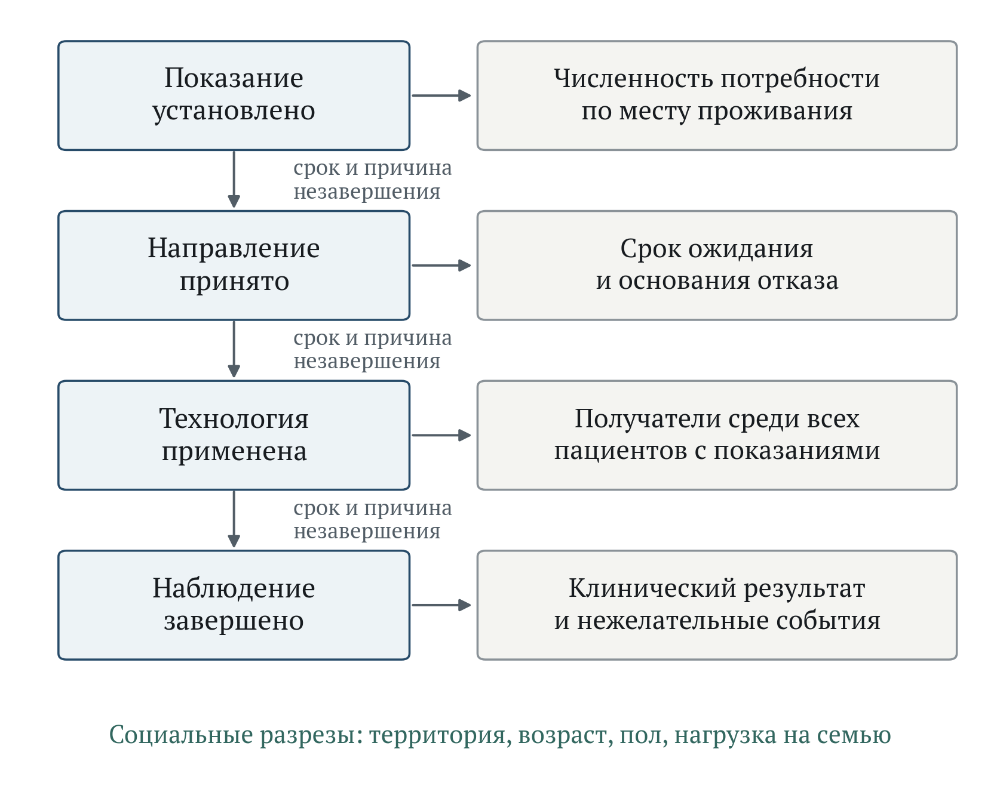

[B333; Caption] Рисунок 14 – Предлагаемая схема наблюдения за доступностью технологии для пациента

[B334; ] Примечание. Авторская схема. Для каждого перехода учитываются число пациентов, срок ожидания и причина незавершения. В знаменателях сохраняется исходный контингент пациентов с установленной потребностью.

[B335; ] Для мониторинга доступности предлагается рассчитывать долю пациентов, получивших технологию среди всех лиц с подтверждёнными показаниями в определённой территории и периоде. Показатель необходимо сопровождать числителем, знаменателем и правилами включения. Дополнительный разрез – распределение по возрасту, полу, месту проживания и социальному положению при допустимости обработки соответствующих сведений. Устойчивый рост охвата предпочтителен при одновременном сокращении необъяснённых различий между группами.

[B336; ] Отдельного наблюдения требуют затраты семьи: поездки, проживание, сопровождение и потеря рабочего времени. Финансовая доступность лечения по установленному механизму оплаты может сочетаться с высокой косвенной нагрузкой. Вмешательство следует оценивать с учётом завершения маршрута, соблюдения последующего наблюдения и субъективно значимых результатов. Участие пациентов в определении исходов помогает избежать ситуации, когда удобный для отчётности показатель слабо отражает повседневное качество жизни.

[B337; ] Региональные различия следует изучать на согласованных данных о пациентах и маршрутах. Карта числа зарегистрированных изделий по местонахождению производителя отвечала бы на вопрос о промышленной концентрации. Карта размещения исследовательских центров характеризовала бы научную инфраструктуру. Для вывода о неравенстве медицинского доступа нужен другой массив. Включение несопоставимых географических рядов в единый рейтинг национального проекта затруднило бы содержательную интерпретацию.

[B338; ] Предлагаемый межрегиональный механизм должен связывать федеральный центр компетенций, регионального координатора и медицинскую организацию, ведущую пациента. Предмет соглашения включает критерии направления, обследование до поездки, сроки принятия решения, передачу сведений и последующее наблюдение. Оценка такого механизма проводится по доле завершённых маршрутов и клиническим исходам, а также по изменению нагрузки на пациента и его семью.

[B339; Heading1] Направления совершенствования национального проекта

[B340; Heading2] Изменения системы управления и отбора приоритетов

[B341; ] Совершенствование проекта целесообразно начать с единого реестра технологических результатов. Запись должна связывать научную тему, разработчика, продукт или метод, назначение, стадию готовности, поддержку и последующее применение. Существующие ведомственные системы могут сохранять свою функциональную специализацию. Согласованный идентификатор и минимальный набор общих полей позволят проследить переходы между ними и устранить многократное включение одного результата в совокупные показатели.

[B342; ] Приоритет разработки рекомендуется определять по неудовлетворённой медицинской потребности, ожидаемой дополнительной пользе, зависимости от критических поставок, научной осуществимости и условиям внедрения. Все критерии следует раскрывать раздельно. Интегральный балл допустим только после обсуждения весов и проверки устойчивости ранжирования. Для небольшого числа разнородных направлений прозрачное мотивированное решение обычно информативнее механического рейтинга.

[B343; ] Для поддержки независимой оценки необходимо определить процедуру рассмотрения конфликтов интересов, правила включения внешних специалистов и порядок публикации оснований решения. Разработчик представляет доказательства и отвечает на замечания. Решение о продолжении поддержки должно отражать подтверждённые результаты, остаточную неопределённость и требования следующей стадии. Институционализация оценки технологий предполагает связь аналитической процедуры с реальными решениями о приоритетах и финансировании. [Сноски 142]

[B344; ] Результативность управления следует оценивать по качеству прохождения стадий, своевременности решений и полноте последующего наблюдения. Для обоснованно прекращённых тем необходимо фиксировать причины решения, сохранённые научные результаты и последующее использование высвобожденных ресурсов. Научная неопределённость должна быть отражена в правилах финансирования и оценке работы участников.

[B345; ] Для координации федеральных направлений нужен согласованный план переходов. Руководитель разработки, организация клинической проверки, производитель и предполагаемый пользователь должны иметь совместимое понимание конечного продукта. Условия передачи результата, доступ к данным, обучение и сопровождение целесообразно определять до завершения исследования. Публичная часть плана должна позволять установить, кто отвечает за каждый переход и какие сведения подтверждают его завершение.

[B346; ] Пересмотр паспортных показателей рекомендуется сопровождать таблицей соответствия прежних и новых определений. Она должна показывать, изменились ли объект, базовый год, цены, периодичность и состав источников. При возможности необходим ретроспективный пересчёт. Если пересчёт невозможен, временной ряд начинается заново с явной отметкой о разрыве. Изменение целевого значения вслед за изменением методики требует содержательного обоснования, позволяющего отделить статистическое уточнение от изменения амбиции проекта.

[B347; Heading2] Предлагаемое дополнение системы показателей

[B348; ] Дополнительный мониторинг должен заполнять промежуток между завершением разработки и результатом для пациента. Предлагаемые показатели в таблице 14 предназначены для управления портфелем и внедрением. Их целевые значения следует устанавливать после формирования исходной базы, оценки длительности стадий и распределения технологий по риску. Произвольный единый норматив для лекарственного препарата, диагностического изделия и программного обеспечения создавал бы несопоставимые стимулы.

[B349; Caption] Таблица 14 – Предлагаемые показатели перехода от разработки к общественному результату

[TABLE 14; B350]
Показатель | Определение и знаменатель | Обязательное уточнение
Переход на следующую стадию | Число технологий когорты, завершивших стадию, к числу технологий той же когорты, для которых истёк заранее установленный срок её завершения | Год включения, исходная стадия, причины прекращения и незавершённости; прекратившие работы сохраняются в знаменателе
Время перехода | Время от фиксированного начала стадии до документированного решения о её завершении | Распределение сроков и число продолжающихся наблюдений; учёт цензурирования
Подтверждённое внешнее применение | Внедрения с проверкой результата вне команды разработчика к числу внешних внедрений, подлежащих оценке | Состав организаций, версия технологии, условия переноса и полнота наблюдения
Охват при установленной потребности | Пациенты, получившие технологию, к числу пациентов с подтверждёнными показаниями в согласованной территории и периоде | Место проживания, возраст, пол, сроки ожидания и причины отказа
Полнота наблюдения за безопасностью | Пациенты с завершённым предусмотренным наблюдением к числу пациентов, для которых срок такого наблюдения наступил | Нежелательные события приводятся отдельно; низкая частота сообщений не признаётся доказательством безопасности
Устойчивость обеспечения | Дни необеспеченной потребности и случаи нарушения поставки по перечню критических продуктов и компонентов | Потребность, доступные альтернативы, причины перебоя и длительность восстановления
Стоимость полного маршрута | Затраты на диагностику, применение, сопровождение и осложнения в сопоставимой когорте пациентов | Источник оплаты, тяжесть состояния, горизонт, расходы семьи и клинический результат

[B351; ] Примечание. Авторские предложения. Показатели требуют утверждения определений и проверки качества исходных сведений. Целевые значения настоящей экспертизой не подменяются произвольными нормативами.

[B352; ] Результаты целесообразно представлять совместно с абсолютными числителями и знаменателями. Для малых групп допустимы широкие интервалы неопределённости и описательная интерпретация. Ранжирование организаций по нестабильным процентам создаёт риск ошибочных управленческих решений. Предпочтительны проверка причин отклонения, сопоставление условий и наблюдение за изменением в одной и той же когорте.

[B353; Heading2] Последовательность внедрения предложений и оценка дополнительного эффекта

[B354; ] Предложения целесообразно реализовать поэтапно. Начальный этап направлен на согласование понятий и восстановление наблюдаемости уже поддерживаемых технологий. Следующий этап – на проверку правил перехода между стадиями в ограниченном числе направлений. Расширение следует проводить после оценки нагрузки на участников, полноты сведений и способности системы выявлять причины задержек. Сроки в таблице 15 отсчитываются от принятия решения о внедрении предложений и имеют рекомендательный характер.

[B355; Caption] Таблица 15 – Предлагаемая последовательность совершенствования управления проектом

[TABLE 15; B356]
Этап и срок | Содержание решения | Рекомендуемый участник | Проверяемый результат
Подготовка,
0⁠–⁠3 месяца | Согласовать реестр технологий, определения показателей и перечень методологических разрывов | Минздрав России совместно с ответственными за федеральные проекты | У каждой действующей технологии установлены идентификатор, стадия и ответственная организация
Проверка,
3⁠–⁠6 месяцев | Опробовать переходы между стадиями, внешнюю оценку и учёт маршрутов пациентов | Ответственные за федеральные проекты, научные и медицинские организации | Документированы решения, сроки переходов, причины задержек и требуемые доработки
Расширение,
6⁠–⁠12 месяцев | Связать результаты исследований с производством, условиями внедрения и источниками оплаты | Минздрав России, Минобрнауки России, Минпромторг России и участники финансирования помощи | Для внедряемых технологий раскрыты условия применения, финансирования и последующего наблюдения
Повторная оценка,
12⁠–⁠24 месяца | Сопоставить результаты когорт, доступность и стоимость полного маршрута | Координатор проекта с независимой экспертной оценкой | Определены основания продолжения, расширения, изменения или прекращения поддержки

[B357; ] Примечание. Распределение участников является рекомендацией экспертизы. Оно требует согласования в рамках действующих полномочий.

[B358; ] Для оценки дополнительного эффекта следует заранее выбирать единицу анализа. На уровне технологии исследуется влияние поддержки на достижение следующей стадии, время перехода и внешнее внедрение. На уровне медицинской организации – изменение качества и доступности помощи после внедрения. На уровне пациента – дополнительный клинический результат и нагрузка. Объединение всех трёх уровней в одном коэффициенте без явной модели затрудняет интерпретацию.

[B359; ] Для исследований государственной поддержки полезно сохранять сведения обо всех заявках и основаниях отбора, включая неподдержанные. Если процедура использует формализованный порог, при достаточной численности возможно изучение разработок вблизи него. При поэтапном внедрении могут сопоставляться организации с различным сроком начала применения с проверкой исходной динамики. Выбор метода должен следовать реальным правилам отбора и доступным данным. Название статистического подхода не устраняет смещение, возникающее из-за целенаправленного выбора наиболее подготовленных участников.

[B360; ] Для пилотного внедрения целесообразно заранее определить основной результат, продолжительность наблюдения, правила включения и план анализа. Помимо среднего эффекта оценивается неоднородность по условиям применения. Заранее установленные критерии остановки позволяют избежать расширения неэффективной или небезопасной практики. Публикация отрицательных и неопределённых результатов повышает ценность вложений в исследования и уменьшает повторение бесперспективных решений.

[B361; ] Контрольный результат реформирования мониторинга состоит в возможности ответить на несколько содержательных вопросов: какая потребность обосновала поддержку, какой дополнительный результат получен, сколько времени и ресурсов потребовал переход, кто получил доступ и на каком основании принято решение о дальнейшем финансировании. При такой организации отчётность становится частью управления научной неопределённостью и общественными результатами проекта.

[B362; Heading1] Заключение

[B363; ] Национальный проект «Новые технологии сбережения здоровья» имеет стратегически обоснованный предмет: создание собственных компетенций и технологических решений, способных обеспечить устойчивое обновление медицинской помощи. Пять федеральных направлений охватывают научное управление, разработку, передовые биомедицинские подходы, превентивную медицину и производство. Для достижения заявленного результата требуется согласованное управление переходами между этими направлениями.

[B364; ] Экспертиза показывает, что финансовая и организационная конструкция проекта содержит значимые предпосылки развития. Существенные средства направлены на клиническую инфраструктуру, поддерживаются исследования и расширение производственных возможностей. Одновременно высокая доля резервов в проекте бюджета на 2027–2029 гг. означает, что будущая структура поддержки в значительной степени зависит от решений об отборе и распределении. Существенный управленческий риск связан с несогласованностью сроков исследования, подготовки производства и финансирования внедрения.

[B365; ] Система показателей требует укрепления сопоставимости и содержательной определённости. Методологические изменения валовой добавленной стоимости, различия годовых и оперативных значений, скользящие временные окна и неодинаковые знаменатели ограничивают непосредственное сравнение результатов. Исправление этих ограничений предполагает раскрытие определений и публикацию согласованных рядов. Рост формального показателя должен быть объясним через конкретные изменения в объектах наблюдения.

[B366; ] Контент-анализ подтверждает выраженную ориентацию текстов на исследования, разработку и производство. Близость к проекту «Продолжительная и активная жизнь» показывает естественную предметную сопряжённость, но не подтверждает автоматически наличие работающего механизма внедрения. Ответственность за переход от технологического продукта к медицинскому применению должна быть определена на уровне организаций, финансирования и наблюдаемого результата пациента.

[B367; ] Наиболее существенное направление совершенствования – организация прослеживаемого жизненного цикла каждой поддержанной технологии. Оценка потребности, клинической доказательности, производственной устойчивости, экономических условий и доступа образует единую последовательность решений. Возможность прекращения бесперспективного исследования и пересмотра ранее принятого решения должна рассматриваться как необходимое условие ответственного управления научным риском.

[B368; ] Предложенная система изменений позволяет оценивать проект по качеству создаваемых технологий и условиям их устойчивого применения. Ожидаемый результат совершенствования связан с сокращением необоснованных задержек, повышением прозрачности распределения ресурсов, воспроизводимости клинических результатов и доступности полезных решений для пациентов. Подтверждение указанных эффектов требует наблюдения за сопоставимыми когортами и независимой оценки на заранее установленных основаниях.

# Сноски и источники

[1] Министерство здравоохранения Российской Федерации. Государственная программа Российской Федерации «Развитие здравоохранения» : опубликовано 02.06.2014; обновлено 22.06.2026. Режим доступа: https://minzdrav.gov.ru/ministry/programms/health/info (дата обращения: 28.10.2026).

[2] Министерство здравоохранения Российской Федерации. Методика расчёта показателя «Темп прироста валовой добавленной стоимости отрасли здравоохранения» : утв. 13.10.2026 [Электронный ресурс]. – П. 3,6,8,10–12. – Открытая републикация текста документа. – Режим доступа: https://www.consultant.ru/document/cons_doc_LAW_547308/ (дата обращения: 28.10.2026).

[3] Министерство здравоохранения Российской Федерации. Методика расчёта показателя «Количество лекарственных препаратов, разработанных и выведенных на рынок в течение календарного года» : утв. 03.04.2026 [Электронный ресурс]. – П. 2–3,6,8,10–12. – Открытая републикация текста документа. – Режим доступа: https://bazanpa.ru/minzdrav-rossii-metodika-ot03042026-h7122741/ (дата обращения: 28.10.2026).
Министерство здравоохранения Российской Федерации. Методика расчёта показателя «Объем средств, полученных в результате коммерциализации прав на результаты интеллектуальной деятельности (РИД), созданных государственными учреждениями в интересах здравоохранения» : утв. 17.04.2025 [Электронный ресурс]. – П. 3,6–12. – Открытая републикация текста документа. – Режим доступа: https://bazanpa.ru/minzdrav-rossii-metodika-ot17042025-h6841458/ (дата обращения: 28.10.2026).

[4] DataBudget. Национальный проект «Новые технологии сбережения здоровья» : электронное представление паспорта : версия 26.20; публикация 16.10.2026. Режим доступа: https://databudget.ru/projects/np/33 (дата обращения: 28.10.2026).
DataBudget. Федеральный проект «Управление медицинской наукой» : электронное представление паспорта : версия 26.8; публикация 16.10.2026. Режим доступа: https://databudget.ru/projects/fp/306 (дата обращения: 28.10.2026).

[5] Правительство Российской Федерации. Пояснительная записка к проекту федерального закона № 615-9 «О федеральном бюджете на 2027 год и на плановый период 2028 и 2029 годов». Таблица 4.1.15 : документ внесённого 30.09.2026 законопроекта; электронная републикация в системе ГАРАНТ. Режим доступа: https://base.garant.ru/411685865/ (дата обращения: 28.10.2026).

[6] Паспорта национальных и федеральных проектов [Электронный ресурс] // DataBudget. – Электронные редакции, опубликованные 18.06.2026, 19.08.2026 и 16.10.2026; сопоставимый корпус из 98 паспортов по 12 национальным проектам. – Режим доступа: https://databudget.ru/projects (дата обращения: 28.10.2026).

[7] Министерство здравоохранения Российской Федерации. Государственная программа Российской Федерации «Развитие здравоохранения» [Электронный ресурс]. – Обновлено 22.06.2026. – Режим доступа: https://minzdrav.gov.ru/ministry/programms/health/info (дата обращения: 28.10.2026).

[8] World Health Assembly. Health intervention and technology assessment in support of universal health coverage : resolution WHA67.23, 24 May 2014 [Электронный ресурс]. – Geneva : World Health Organization, 2014. – Режим доступа: https://apps.who.int/gb/ebwha/pdf_files/WHA67/A67_R23-en.pdf (дата обращения: 28.10.2026).

[9] Правительство Российской Федерации. Национальный проект «Новые технологии сбережения здоровья» : презентация. Дата публикации не указана. Режим доступа: http://static.government.ru/media/files/y1MiaSCK0ZemUxEJd79Z8vq9LOqw4rEx.pdf (дата обращения: 28.10.2026).

[10] Министерство здравоохранения Российской Федерации. Государственная программа Российской Федерации «Развитие здравоохранения» : опубликовано 02.06.2014; обновлено 22.06.2026. Режим доступа: https://minzdrav.gov.ru/ministry/programms/health/info (дата обращения: 28.10.2026).

[11] Министерство здравоохранения Российской Федерации. Государственная программа Российской Федерации «Развитие здравоохранения» : опубликовано 02.06.2014; обновлено 22.06.2026. Режим доступа: https://minzdrav.gov.ru/ministry/programms/health/info (дата обращения: 28.10.2026).
DataBudget. Федеральный проект «Управление медицинской наукой» : электронное представление паспорта : версия 26.8; публикация 16.10.2026. Режим доступа: https://databudget.ru/projects/fp/306 (дата обращения: 28.10.2026).
DataBudget. Федеральный проект «Технологии разработки медицинских изделий, лекарственных средств и платформ нового поколения» : электронное представление паспорта : версия 26.11; публикация 16.10.2026. Режим доступа: https://databudget.ru/projects/fp/316 (дата обращения: 28.10.2026).
DataBudget. Федеральный проект «Биомедицинские и когнитивные технологии будущего» : электронное представление паспорта : версия 26.11; публикация 16.10.2026. Режим доступа: https://databudget.ru/projects/fp/317 (дата обращения: 28.10.2026).
DataBudget. Федеральный проект «Регенеративная биомедицина, технологии превентивной медицины, обеспечивающие активное и здоровое долголетие» : электронное представление паспорта : версия 26.13; публикация 16.10.2026. Режим доступа: https://databudget.ru/projects/fp/318 (дата обращения: 28.10.2026).
DataBudget. Федеральный проект «Развитие производства наиболее востребованных лекарственных препаратов и медицинских изделий» : электронное представление паспорта : версия 26.8; публикация 16.10.2026. Режим доступа: https://databudget.ru/projects/fp/307 (дата обращения: 28.10.2026).

[12] DataBudget. Федеральный проект «Управление медицинской наукой» : электронное представление паспорта : версия 26.8; публикация 16.10.2026. Режим доступа: https://databudget.ru/projects/fp/306 (дата обращения: 28.10.2026).

[13] DataBudget. Федеральный проект «Управление медицинской наукой» : электронное представление паспорта : версия 26.8; публикация 16.10.2026. Режим доступа: https://databudget.ru/projects/fp/306 (дата обращения: 28.10.2026).

[14] DataBudget. Федеральный проект «Управление медицинской наукой» : электронное представление паспорта : версия 26.8; публикация 16.10.2026. Режим доступа: https://databudget.ru/projects/fp/306 (дата обращения: 28.10.2026).

[15] Скворцова В. И.; Федеральное медико-биологическое агентство. Доклад руководителя ФМБА России Вероники Игоревны Скворцовой на расширенном заседании коллегии ФМБА России «Об итогах работы Федерального медико-биологического агентства России в 2025 году и задачах на 2026 год» : 17.04.2026. Режим доступа: https://fmba.gov.ru/press-tsentr/novosti/detail/?ELEMENT_ID=85282 (дата обращения: 28.10.2026).

[16] Правительство Российской Федерации. Татьяна Голикова провела совещание по национальному проекту «Новые технологии сбережения здоровья» : сообщение от 28.07.2026. Режим доступа: http://government.ru/news/59445/ (дата обращения: 28.10.2026).

[17] DataBudget. Федеральный проект «Технологии разработки медицинских изделий, лекарственных средств и платформ нового поколения» : электронное представление паспорта : версия 26.11; публикация 16.10.2026. Режим доступа: https://databudget.ru/projects/fp/316 (дата обращения: 28.10.2026).

[18] Правительство Российской Федерации. Об утверждении Правил государственной регистрации медицинских изделий : постановление от 30.11.2024 № 1684 : 30.11.2024; официальная публикация на сайте Росздравнадзора. Режим доступа: https://roszdravnadzor.gov.ru/i/upload/images/2025/2/27/1740670889.74686-1-817046.pdf (дата обращения: 28.10.2026).

[19] DataBudget. Федеральный проект «Технологии разработки медицинских изделий, лекарственных средств и платформ нового поколения» : электронное представление паспорта : версия 26.11; публикация 16.10.2026. Режим доступа: https://databudget.ru/projects/fp/316 (дата обращения: 28.10.2026).

[20] Федеральное медико-биологическое агентство. Технологический суверенитет: от промышленных инноваций к биобезопасности : событие 09.09.2026; опубликовано 10.09.2026. Режим доступа: https://fmba.gov.ru/press-tsentr/novosti/detail/?ELEMENT_ID=88038 (дата обращения: 28.10.2026).

[21] Дирекция научно-технических программ. Федеральный проект «Биомедицинские и когнитивные технологии будущего» национального проекта «Новые технологии сбережения здоровья». Дата публикации не указана. Режим доступа: https://www.fcntp.ru/programs-and-projects/biomed/detail/ (дата обращения: 28.10.2026).

[22] Правительство Российской Федерации. Татьяна Голикова провела совещание по национальному проекту «Новые технологии сбережения здоровья» : сообщение от 28.07.2026. Режим доступа: http://government.ru/news/59445/ (дата обращения: 28.10.2026).

[23] Дирекция научно-технических программ. Будущее медицины: подведены итоги первого года реализации федеральных проектов : 03.04.2026. Режим доступа: https://fcntp.ru/programmy-i-proekty/ntp-rsh/agricultural-news/?ELEMENT_ID=384 (дата обращения: 28.10.2026).

[24] DataBudget. Федеральный проект «Биомедицинские и когнитивные технологии будущего» : электронное представление паспорта : версия 26.11; публикация 16.10.2026. Режим доступа: https://databudget.ru/projects/fp/317 (дата обращения: 28.10.2026).

[25] DataBudget. Федеральный проект «Регенеративная биомедицина, технологии превентивной медицины, обеспечивающие активное и здоровое долголетие» : электронное представление паспорта : версия 26.13; публикация 16.10.2026. Режим доступа: https://databudget.ru/projects/fp/318 (дата обращения: 28.10.2026).

[26] Правительство Российской Федерации. Татьяна Голикова провела совещание по национальному проекту «Новые технологии сбережения здоровья» : сообщение от 28.07.2026. Режим доступа: http://government.ru/news/59445/ (дата обращения: 28.10.2026).

[27] Федеральное медико-биологическое агентство. Технологический суверенитет: от промышленных инноваций к биобезопасности : событие 09.09.2026; опубликовано 10.09.2026. Режим доступа: https://fmba.gov.ru/press-tsentr/novosti/detail/?ELEMENT_ID=88038 (дата обращения: 28.10.2026).

[28] DataBudget. Федеральный проект «Регенеративная биомедицина, технологии превентивной медицины, обеспечивающие активное и здоровое долголетие» : электронное представление паспорта : версия 26.13; публикация 16.10.2026. Режим доступа: https://databudget.ru/projects/fp/318 (дата обращения: 28.10.2026).

[29] DataBudget. Федеральный проект «Развитие производства наиболее востребованных лекарственных препаратов и медицинских изделий» : электронное представление паспорта : версия 26.8; публикация 16.10.2026. Режим доступа: https://databudget.ru/projects/fp/307 (дата обращения: 28.10.2026).

[30] Правительство Российской Федерации. Пояснительная записка к проекту федерального закона № 615-9 «О федеральном бюджете на 2027 год и на плановый период 2028 и 2029 годов». Таблица 4.1.15 : документ внесённого 30.09.2026 законопроекта; электронная републикация в системе ГАРАНТ. Режим доступа: https://base.garant.ru/411685865/ (дата обращения: 28.10.2026).
DataBudget. Федеральный проект «Развитие производства наиболее востребованных лекарственных препаратов и медицинских изделий» : электронное представление паспорта : версия 26.8; публикация 16.10.2026. Режим доступа: https://databudget.ru/projects/fp/307 (дата обращения: 28.10.2026).

[31] Правительство Российской Федерации. Татьяна Голикова провела совещание по национальному проекту «Новые технологии сбережения здоровья» : сообщение от 28.07.2026. Режим доступа: http://government.ru/news/59445/ (дата обращения: 28.10.2026).

[32] Единая межведомственная информационно-статистическая система. Реестр показателей ЕМИСС : разделы 2.14.С, 2.14.С 1–2.14.С 5 [Электронный ресурс]. – Режим доступа: https://fedstat.ru/organizations/ (официальная публикация сохранена 15.10.2026; проверка сохранённого реестра: 28.10.2026).

[33] Министерство здравоохранения Российской Федерации. Доля всех исследований, осуществляемых в рамках национального проекта, закончившихся успешной разработкой и внедрением новых лекарственных препаратов, медицинских изделий, биомедицинских клеточных продуктов (БМКП), продуктов тканевой инженерии, медицинских технологий : показатель ЕМИСС № 62986 [Электронный ресурс]. – Последнее обновление данных 08.09.2026. – Архивная републикация: Национальный центр социально-экономических данных. – Режим доступа: https://fedstat.ru/indicator/62986; архивная публикация: https://repository.nsedc.ru/dataset/emiss_62986 (дата обращения к архивной публикации: 28.10.2026).
Министерство здравоохранения Российской Федерации. Объем средств, полученных в результате коммерциализации прав на результаты интеллектуальной деятельности (РИД), созданных государственными учреждениями в интересах здравоохранения (П 04228-С) : показатель ЕМИСС № 63132 [Электронный ресурс]. – Последнее обновление данных 10.09.2026. – Архивная републикация: Национальный центр социально-экономических данных. – Режим доступа: https://fedstat.ru/indicator/63132; архивная публикация: https://repository.nsedc.ru/dataset/emiss_63132 (дата обращения к архивной публикации: 28.10.2026).

[34] Министерство здравоохранения Российской Федерации. Темп прироста валовой добавленной стоимости отрасли здравоохранения : показатель ЕМИСС № 63059 [Электронный ресурс]. – Последнее обновление данных 22.01.2026. – Архивная републикация: Национальный центр социально-экономических данных. – Режим доступа: https://fedstat.ru/indicator/63059; архивная публикация: https://repository.nsedc.ru/dataset/emiss_63059 (дата обращения к архивной публикации: 28.10.2026).
Министерство здравоохранения Российской Федерации. Достигнутый уровень технологической независимости в сфере здравоохранения : показатель ЕМИСС № 63062 [Электронный ресурс]. – Последнее обновление данных 20.01.2026. – Архивная републикация: Национальный центр социально-экономических данных. – Режим доступа: https://fedstat.ru/indicator/63062; архивная публикация: https://repository.nsedc.ru/dataset/emiss_63062 (дата обращения к архивной публикации: 28.10.2026).
Министерство здравоохранения Российской Федерации. Количество разработанных в рамках национального проекта и допущенных к применению новых лекарственных препаратов, медицинских изделий и биомедицинских клеточных продуктов (БМКП) : показатель ЕМИСС № 63130 [Электронный ресурс]. – Последнее обновление данных 08.09.2026. – Архивная републикация: Национальный центр социально-экономических данных. – Режим доступа: https://fedstat.ru/indicator/63130; архивная публикация: https://repository.nsedc.ru/dataset/emiss_63130 (дата обращения к архивной публикации: 28.10.2026).
Министерство здравоохранения Российской Федерации. Объем средств, полученных в результате коммерциализации прав на результаты интеллектуальной деятельности (РИД), созданных государственными учреждениями в интересах здравоохранения (П 04228-С) : показатель ЕМИСС № 63132 [Электронный ресурс]. – Последнее обновление данных 10.09.2026. – Архивная републикация: Национальный центр социально-экономических данных. – Режим доступа: https://fedstat.ru/indicator/63132; архивная публикация: https://repository.nsedc.ru/dataset/emiss_63132 (дата обращения к архивной публикации: 28.10.2026).

[35] Единая межведомственная информационно-статистическая система. Реестр показателей ЕМИСС : разделы 2.14.С, 2.14.С 1–2.14.С 5 [Электронный ресурс]. – Режим доступа: https://fedstat.ru/organizations/ (официальная публикация сохранена 15.10.2026; проверка сохранённого реестра: 28.10.2026).

[36] Министерство здравоохранения Российской Федерации. Доля исследований и разработок в интересах медицины и здравоохранения, по которым организован учет и мониторинг их дальнейшего применения : показатель ЕМИСС № 62928 [Электронный ресурс]. – Последнее обновление данных 08.09.2026. – Архивная републикация: Национальный центр социально-экономических данных. – Режим доступа: https://fedstat.ru/indicator/62928; архивная публикация: https://repository.nsedc.ru/dataset/emiss_62928 (дата обращения к архивной публикации: 28.10.2026).
Министерство здравоохранения Российской Федерации. Доля учтенных в рамках федерального проекта допущенных к применению лекарственных препаратов, высокотехнологичных медицинских изделий, медицинских технологий : показатель ЕМИСС № 62929 [Электронный ресурс]. – Последнее обновление данных 08.09.2026. – Архивная републикация: Национальный центр социально-экономических данных. – Режим доступа: https://fedstat.ru/indicator/62929; архивная публикация: https://repository.nsedc.ru/dataset/emiss_62929 (дата обращения к архивной публикации: 28.10.2026).
Министерство здравоохранения Российской Федерации. Количество лекарственных препаратов, разработанных и выведенных на рынок на каждые 5 млрд рублей, направленных на финансирование прикладных научных исследований : показатель ЕМИСС № 62984 [Электронный ресурс]. – Последнее обновление данных 08.09.2026. – Архивная републикация: Национальный центр социально-экономических данных. – Режим доступа: https://fedstat.ru/indicator/62984; архивная публикация: https://repository.nsedc.ru/dataset/emiss_62984 (дата обращения к архивной публикации: 28.10.2026).
Министерство здравоохранения Российской Федерации. Количество медицинских изделий, разработанных и выведенных на рынок на каждый 1 млрд рублей, направленных на финансирование прикладных научных исследований : показатель ЕМИСС № 62985 [Электронный ресурс]. – Последнее обновление данных 08.09.2026. – Архивная републикация: Национальный центр социально-экономических данных. – Режим доступа: https://fedstat.ru/indicator/62985; архивная публикация: https://repository.nsedc.ru/dataset/emiss_62985 (дата обращения к архивной публикации: 28.10.2026).
Министерство здравоохранения Российской Федерации. Доля всех исследований, осуществляемых в рамках национального проекта, закончившихся успешной разработкой и внедрением новых лекарственных препаратов, медицинских изделий, биомедицинских клеточных продуктов (БМКП), продуктов тканевой инженерии, медицинских технологий : показатель ЕМИСС № 62986 [Электронный ресурс]. – Последнее обновление данных 08.09.2026. – Архивная републикация: Национальный центр социально-экономических данных. – Режим доступа: https://fedstat.ru/indicator/62986; архивная публикация: https://repository.nsedc.ru/dataset/emiss_62986 (дата обращения к архивной публикации: 28.10.2026).
Министерство здравоохранения Российской Федерации. Уровень прироста объема средств, полученных в результате коммерциализации прав на результаты интеллектуальной деятельности (РИД), созданных государственными учреждениями в интересах здравоохранения, относительно уровня базового значения (уровень 2023 г.) : показатель ЕМИСС № 62987 [Электронный ресурс]. – Последнее обновление данных 08.09.2026. – Архивная републикация: Национальный центр социально-экономических данных. – Режим доступа: https://fedstat.ru/indicator/62987; архивная публикация: https://repository.nsedc.ru/dataset/emiss_62987 (дата обращения к архивной публикации: 28.10.2026).

[37] DataBudget. Паспорт национального проекта «Новые технологии сбережения здоровья» : открытая републикация, раздел «Показатели» [Электронный ресурс]. – Бюджетный цикл 2026–2028; плановые значения 2025–2030 годов. – Режим доступа: https://databudget.ru/projects/np/33 (дата обращения: 28.10.2026).

[38] DataBudget. Паспорт федерального проекта «Управление медицинской наукой» : открытая републикация, раздел «Показатели» [Электронный ресурс]. – Бюджетный цикл 2026–2028; плановые значения 2025–2030 годов. – Режим доступа: https://databudget.ru/projects/fp/306 (дата обращения: 28.10.2026).

[39] DataBudget. Паспорт федерального проекта «Технологии разработки медицинских изделий, лекарственных средств и платформ нового поколения» : открытая републикация, раздел «Показатели» [Электронный ресурс]. – Бюджетный цикл 2026–2028; плановые значения 2025–2030 годов. – Режим доступа: https://databudget.ru/projects/fp/316 (дата обращения: 28.10.2026).

[40] DataBudget. Паспорт федерального проекта «Биомедицинские и когнитивные технологии будущего» : открытая републикация, раздел «Показатели» [Электронный ресурс]. – Бюджетный цикл 2026–2028; плановые значения 2025–2030 годов. – Режим доступа: https://databudget.ru/projects/fp/317 (дата обращения: 28.10.2026).

[41] DataBudget. Паспорт федерального проекта «Регенеративная биомедицина, технологии превентивной медицины, обеспечивающие активное и здоровое долголетие» : открытая републикация, раздел «Показатели» [Электронный ресурс]. – Бюджетный цикл 2026–2028; плановые значения 2025–2030 годов. – Режим доступа: https://databudget.ru/projects/fp/318 (дата обращения: 28.10.2026).

[42] DataBudget. Паспорт федерального проекта «Развитие производства наиболее востребованных лекарственных препаратов и медицинских изделий» : открытая републикация, раздел «Показатели» [Электронный ресурс]. – Бюджетный цикл 2026–2028; плановые значения 2025–2030 годов. – Режим доступа: https://databudget.ru/projects/fp/307 (дата обращения: 28.10.2026).

[43] Единая межведомственная информационно-статистическая система. Реестр показателей ЕМИСС : разделы 2.14.С, 2.14.С 1–2.14.С 5 [Электронный ресурс]. – Режим доступа: https://fedstat.ru/organizations/ (официальная публикация сохранена 15.10.2026; проверка сохранённого реестра: 28.10.2026).

[44] Министерство здравоохранения Российской Федерации. Методика расчёта показателя «Доля всех исследований, осуществляемых в рамках национального проекта, закончившихся успешной разработкой и внедрением новых лекарственных препаратов, медицинских изделий, биомедицинских клеточных продуктов (БМКП), продуктов тканевой инженерии и медицинских технологий» : утв. 10.04.2025 [Электронный ресурс]. – П. 2–3,10–12. – Открытая републикация текста документа. – Режим доступа: https://base.garant.ru/412264616/ (дата обращения: 28.10.2026).
Министерство здравоохранения Российской Федерации. Методика расчёта показателя «Доля учтенных в рамках федерального проекта допущенных к применению лекарственных препаратов, высокотехнологичных медицинских изделий, медицинских технологий» : утв. 23.12.2025 [Электронный ресурс]. – П. 3,5–12. – Открытая републикация текста документа. – Режим доступа: https://base.garant.ru/414259823/ (дата обращения: 28.10.2026).

[45] Министерство здравоохранения Российской Федерации. Методика расчёта показателя «Доля всех исследований, осуществляемых в рамках национального проекта, закончившихся успешной разработкой и внедрением новых лекарственных препаратов, медицинских изделий, биомедицинских клеточных продуктов (БМКП), продуктов тканевой инженерии и медицинских технологий» : утв. 10.04.2025 [Электронный ресурс]. – П. 2–3,10–12. – Открытая републикация текста документа. – Режим доступа: https://base.garant.ru/412264616/ (дата обращения: 28.10.2026).
Министерство здравоохранения Российской Федерации. Методика расчёта показателя «Доля учтенных в рамках федерального проекта допущенных к применению лекарственных препаратов, высокотехнологичных медицинских изделий, медицинских технологий» : утв. 23.12.2025 [Электронный ресурс]. – П. 3,5–12. – Открытая републикация текста документа. – Режим доступа: https://base.garant.ru/414259823/ (дата обращения: 28.10.2026).

[46] Министерство здравоохранения Российской Федерации. Методика расчёта показателя «Доля пациентов, которым будет оказана медицинская помощь с применением новых лекарственных препаратов, медицинских изделий, биомедицинских клеточных продуктов, учтенных в рамках проекта» : утв. 29.12.2025 [Электронный ресурс]. – П. 2–3,6–11. – Открытая републикация текста документа. – Режим доступа: https://base.garant.ru/414976002/ (дата обращения: 28.10.2026).
Министерство здравоохранения Российской Федерации. Доля пациентов, которым будет оказана медицинская помощь  с применением новых лекарственных препаратов, медицинских изделий, биомедицинских клеточных продуктов, учтенных в рамках проекта : показатель ЕМИСС № 62988 [Электронный ресурс]. – Последнее обновление данных 10.09.2026. – Архивная републикация: Национальный центр социально-экономических данных. – Режим доступа: https://fedstat.ru/indicator/62988; архивная публикация: https://repository.nsedc.ru/dataset/emiss_62988 (дата обращения к архивной публикации: 28.10.2026).
Федеральная служба государственной статистики. Методики расчёта показателей федерального проекта «Биомедицинские и когнитивные технологии будущего» [Электронный ресурс]. – распоряжение от 28.05.2025 № 175-р, приложения 1 и 3; редакция 30.03.2026 № 141-р. – Режим доступа: https://rosstat.gov.ru/storage/mediabank/FP1203_N.htm (дата обращения: 28.10.2026).
Федеральная служба государственной статистики. Методики расчёта показателей федерального проекта «Регенеративная биомедицина, технологии превентивной медицины, обеспечение активного и здорового долголетия» [Электронный ресурс]. – распоряжение от 28.05.2025 № 175-р, приложения 2 и 4. – Режим доступа: https://rosstat.gov.ru/storage/mediabank/FP1204_N.htm (дата обращения: 28.10.2026).

[47] Министерство здравоохранения Российской Федерации. Методика расчёта показателя «Достигнутый уровень технологической независимости в сфере здравоохранения» : утв. 11.04.2025 [Электронный ресурс]. – П. 3,6–12. – Открытая републикация текста документа. – Режим доступа: https://bazanpa.ru/minzdrav-rossii-metodika-ot11042025-h6763215/ (дата обращения: 28.10.2026).
Министерство здравоохранения Российской Федерации. Достигнутый уровень технологической независимости в сфере здравоохранения : показатель ЕМИСС № 63062 [Электронный ресурс]. – Последнее обновление данных 20.01.2026. – Архивная републикация: Национальный центр социально-экономических данных. – Режим доступа: https://fedstat.ru/indicator/63062; архивная публикация: https://repository.nsedc.ru/dataset/emiss_63062 (дата обращения к архивной публикации: 28.10.2026).

[48] Министерство здравоохранения Российской Федерации. Методика расчёта показателя «Доля всех исследований, осуществляемых в рамках национального проекта, закончившихся успешной разработкой и внедрением новых лекарственных препаратов, медицинских изделий, биомедицинских клеточных продуктов (БМКП), продуктов тканевой инженерии и медицинских технологий» : утв. 10.04.2025 [Электронный ресурс]. – П. 2–3,10–12. – Открытая републикация текста документа. – Режим доступа: https://base.garant.ru/412264616/ (дата обращения: 28.10.2026).

[49] Министерство здравоохранения Российской Федерации. Методика расчёта показателя «Доля учтенных в рамках федерального проекта допущенных к применению лекарственных препаратов, высокотехнологичных медицинских изделий, медицинских технологий» : утв. 23.12.2025 [Электронный ресурс]. – П. 3,5–12. – Открытая републикация текста документа. – Режим доступа: https://base.garant.ru/414259823/ (дата обращения: 28.10.2026).

[50] Министерство здравоохранения Российской Федерации. Методика расчёта показателя «Доля пациентов, которым будет оказана медицинская помощь с применением новых лекарственных препаратов, медицинских изделий, биомедицинских клеточных продуктов, учтенных в рамках проекта» : утв. 29.12.2025 [Электронный ресурс]. – П. 2–3,6–11. – Открытая републикация текста документа. – Режим доступа: https://base.garant.ru/414976002/ (дата обращения: 28.10.2026).

[51] Федеральная служба государственной статистики. Методики расчёта показателей федерального проекта «Биомедицинские и когнитивные технологии будущего» [Электронный ресурс]. – распоряжение от 28.05.2025 № 175-р, приложения 1 и 3; редакция 30.03.2026 № 141-р. – Режим доступа: https://rosstat.gov.ru/storage/mediabank/FP1203_N.htm (дата обращения: 28.10.2026).
Федеральная служба государственной статистики. Методики расчёта показателей федерального проекта «Регенеративная биомедицина, технологии превентивной медицины, обеспечение активного и здорового долголетия» [Электронный ресурс]. – распоряжение от 28.05.2025 № 175-р, приложения 2 и 4. – Режим доступа: https://rosstat.gov.ru/storage/mediabank/FP1204_N.htm (дата обращения: 28.10.2026).

[52] Министерство промышленности и торговли Российской Федерации. Об утверждении методик расчёта показателей федерального проекта «Развитие производства наиболее востребованных препаратов и медицинских изделий», входящего в состав национального проекта «Новые технологии сбережения здоровья» : приказ от 08.04.2025 № 1684 [Электронный ресурс]. – Приложения 1–3, пункты 3,6,8,10–12. – Режим доступа: https://rosstat.gov.ru/storage/mediabank/MET_N_120002.pdf; открытая републикация: https://bazanpa.ru/minpromtorg-rossii-prikaz-n1684-ot08042025-h6926145/ (дата обращения: 28.10.2026).

[53] Министерство промышленности и торговли Российской Федерации. Об утверждении методик расчёта показателей федерального проекта «Развитие производства наиболее востребованных препаратов и медицинских изделий», входящего в состав национального проекта «Новые технологии сбережения здоровья» : приказ от 08.04.2025 № 1684 [Электронный ресурс]. – Приложения 1–3, пункты 3,6,8,10–12. – Режим доступа: https://rosstat.gov.ru/storage/mediabank/MET_N_120002.pdf; открытая републикация: https://bazanpa.ru/minpromtorg-rossii-prikaz-n1684-ot08042025-h6926145/ (дата обращения: 28.10.2026).

[54] Министерство здравоохранения Российской Федерации. Методика расчёта показателя «Количество лекарственных препаратов, разработанных и выведенных на рынок в течение календарного года» : утв. 03.04.2026 [Электронный ресурс]. – П. 2–3,6,8,10–12. – Открытая републикация текста документа. – Режим доступа: https://bazanpa.ru/minzdrav-rossii-metodika-ot03042026-h7122741/ (дата обращения: 28.10.2026).
Министерство здравоохранения Российской Федерации. Методика расчёта показателя «Количество медицинских изделий, разработанных и выведенных на рынок в течение календарного года» : утв. 03.04.2026 [Электронный ресурс]. – П. 2–3,6,8,10–12. – Открытая републикация текста документа. – Режим доступа: https://base.garant.ru/414269826/ (дата обращения: 28.10.2026).

[55] Министерство здравоохранения Российской Федерации. Методика расчёта показателя «Темп прироста валовой добавленной стоимости отрасли здравоохранения» : утв. 13.12.2024 [Электронный ресурс]. – П. 6,8,10–11. – Режим доступа: https://rosstat.gov.ru/storage/mediabank/MET_N_120001.pdf; открытая републикация: https://pravo.ppt.ru/metodika/312004 (дата обращения: 28.10.2026).
Министерство здравоохранения Российской Федерации. Методика расчёта показателя «Темп прироста валовой добавленной стоимости отрасли здравоохранения» : утв. 14.04.2025 [Электронный ресурс]. – П. 3,6–12. – Открытая републикация текста документа. – Режим доступа: https://pravo.ppt.ru/metodika/314405 (дата обращения: 28.10.2026).
Министерство здравоохранения Российской Федерации. Методика расчёта показателя «Темп прироста валовой добавленной стоимости отрасли здравоохранения» : утв. 16.04.2025 [Электронный ресурс]. – П. 3,6–12. – Режим доступа: https://rosstat.gov.ru/storage/mediabank/MET_N_120001_3.pdf (дата обращения: 28.10.2026).
Министерство здравоохранения Российской Федерации. Методика расчёта показателя «Темп прироста валовой добавленной стоимости отрасли здравоохранения» : утв. 13.10.2026 [Электронный ресурс]. – П. 3,6,8,10–12. – Открытая републикация текста документа. – Режим доступа: https://www.consultant.ru/document/cons_doc_LAW_547308/ (дата обращения: 28.10.2026).

[56] Министерство здравоохранения Российской Федерации. Методика расчёта показателя «Темп прироста валовой добавленной стоимости отрасли здравоохранения» : утв. 13.12.2024 [Электронный ресурс]. – П. 6,8,10–11. – Режим доступа: https://rosstat.gov.ru/storage/mediabank/MET_N_120001.pdf; открытая републикация: https://pravo.ppt.ru/metodika/312004 (дата обращения: 28.10.2026).

[57] Министерство здравоохранения Российской Федерации. Методика расчёта показателя «Темп прироста валовой добавленной стоимости отрасли здравоохранения» : утв. 14.04.2025 [Электронный ресурс]. – П. 3,6–12. – Открытая републикация текста документа. – Режим доступа: https://pravo.ppt.ru/metodika/314405 (дата обращения: 28.10.2026).

[58] Министерство здравоохранения Российской Федерации. Методика расчёта показателя «Темп прироста валовой добавленной стоимости отрасли здравоохранения» : утв. 16.04.2025 [Электронный ресурс]. – П. 3,6–12. – Режим доступа: https://rosstat.gov.ru/storage/mediabank/MET_N_120001_3.pdf (дата обращения: 28.10.2026).

[59] Министерство здравоохранения Российской Федерации. Методика расчёта показателя «Темп прироста валовой добавленной стоимости отрасли здравоохранения» : утв. 13.10.2026 [Электронный ресурс]. – П. 3,6,8,10–12. – Открытая републикация текста документа. – Режим доступа: https://www.consultant.ru/document/cons_doc_LAW_547308/ (дата обращения: 28.10.2026).

[60] Министерство здравоохранения Российской Федерации. Методика расчёта показателя «Темп прироста валовой добавленной стоимости отрасли здравоохранения» : утв. 13.10.2026 [Электронный ресурс]. – П. 3,6,8,10–12. – Открытая републикация текста документа. – Режим доступа: https://www.consultant.ru/document/cons_doc_LAW_547308/ (дата обращения: 28.10.2026).

[61] Министерство здравоохранения Российской Федерации. Темп прироста валовой добавленной стоимости отрасли здравоохранения : показатель ЕМИСС № 63059 [Электронный ресурс]. – Последнее обновление данных 22.01.2026. – Архивная републикация: Национальный центр социально-экономических данных. – Режим доступа: https://fedstat.ru/indicator/63059; архивная публикация: https://repository.nsedc.ru/dataset/emiss_63059 (дата обращения к архивной публикации: 28.10.2026).
Министерство здравоохранения Российской Федерации. Методика расчёта показателя «Темп прироста валовой добавленной стоимости отрасли здравоохранения» : утв. 16.04.2025 [Электронный ресурс]. – П. 3,6–12. – Режим доступа: https://rosstat.gov.ru/storage/mediabank/MET_N_120001_3.pdf (дата обращения: 28.10.2026).
Министерство здравоохранения Российской Федерации. Методика расчёта показателя «Темп прироста валовой добавленной стоимости отрасли здравоохранения» : утв. 13.10.2026 [Электронный ресурс]. – П. 3,6,8,10–12. – Открытая републикация текста документа. – Режим доступа: https://www.consultant.ru/document/cons_doc_LAW_547308/ (дата обращения: 28.10.2026).

[62] Правительство Российской Федерации. Федеральный план статистических работ : утв. распоряжением от 06.05.2008 № 671-р, действующая публикация [Электронный ресурс]. – Раздел 2.14.С, позиции 1–6; позиции 5–6 введены распоряжением от 13.01.2026 № 7-р. – Режим доступа: https://www.consultant.ru/document/cons_doc_LAW_111344/ba481f396a2a2e38e6eb08c790ae840bdab26106/ (дата обращения: 28.10.2026).
Министерство здравоохранения Российской Федерации. Методика расчёта показателя «Темп прироста валовой добавленной стоимости отрасли здравоохранения» : утв. 13.10.2026 [Электронный ресурс]. – П. 3,6,8,10–12. – Открытая републикация текста документа. – Режим доступа: https://www.consultant.ru/document/cons_doc_LAW_547308/ (дата обращения: 28.10.2026).

[63] Министерство здравоохранения Российской Федерации. Доля всех исследований, осуществляемых в рамках национального проекта, закончившихся успешной разработкой и внедрением новых лекарственных препаратов, медицинских изделий, биомедицинских клеточных продуктов (БМКП), продуктов тканевой инженерии, медицинских технологий : показатель ЕМИСС № 62986 [Электронный ресурс]. – Последнее обновление данных 08.09.2026. – Архивная републикация: Национальный центр социально-экономических данных. – Режим доступа: https://fedstat.ru/indicator/62986; архивная публикация: https://repository.nsedc.ru/dataset/emiss_62986 (дата обращения к архивной публикации: 28.10.2026).
DataBudget. Паспорт национального проекта «Новые технологии сбережения здоровья» : открытая републикация, раздел «Показатели» [Электронный ресурс]. – Бюджетный цикл 2026–2028; плановые значения 2025–2030 годов. – Режим доступа: https://databudget.ru/projects/np/33 (дата обращения: 28.10.2026).

[64] Министерство здравоохранения Российской Федерации. Доля всех исследований, осуществляемых в рамках национального проекта, закончившихся успешной разработкой и внедрением новых лекарственных препаратов, медицинских изделий, биомедицинских клеточных продуктов (БМКП), продуктов тканевой инженерии, медицинских технологий : показатель ЕМИСС № 62986 [Электронный ресурс]. – Последнее обновление данных 08.09.2026. – Архивная републикация: Национальный центр социально-экономических данных. – Режим доступа: https://fedstat.ru/indicator/62986; архивная публикация: https://repository.nsedc.ru/dataset/emiss_62986 (дата обращения к архивной публикации: 28.10.2026).
Министерство здравоохранения Российской Федерации. Доля исследований и разработок в интересах медицины и здравоохранения, по которым организован учет и мониторинг их дальнейшего применения : показатель ЕМИСС № 62928 [Электронный ресурс]. – Последнее обновление данных 08.09.2026. – Архивная републикация: Национальный центр социально-экономических данных. – Режим доступа: https://fedstat.ru/indicator/62928; архивная публикация: https://repository.nsedc.ru/dataset/emiss_62928 (дата обращения к архивной публикации: 28.10.2026).
Министерство здравоохранения Российской Федерации. Доля учтенных в рамках федерального проекта допущенных к применению лекарственных препаратов, высокотехнологичных медицинских изделий, медицинских технологий : показатель ЕМИСС № 62929 [Электронный ресурс]. – Последнее обновление данных 08.09.2026. – Архивная републикация: Национальный центр социально-экономических данных. – Режим доступа: https://fedstat.ru/indicator/62929; архивная публикация: https://repository.nsedc.ru/dataset/emiss_62929 (дата обращения к архивной публикации: 28.10.2026).

[65] Министерство здравоохранения Российской Федерации. Доля всех исследований, осуществляемых в рамках национального проекта, закончившихся успешной разработкой и внедрением новых лекарственных препаратов, медицинских изделий, биомедицинских клеточных продуктов (БМКП), продуктов тканевой инженерии, медицинских технологий : показатель ЕМИСС № 62986 [Электронный ресурс]. – Последнее обновление данных 08.09.2026. – Архивная републикация: Национальный центр социально-экономических данных. – Режим доступа: https://fedstat.ru/indicator/62986; архивная публикация: https://repository.nsedc.ru/dataset/emiss_62986 (дата обращения к архивной публикации: 28.10.2026).

[66] Министерство здравоохранения Российской Федерации. Доля исследований и разработок в интересах медицины и здравоохранения, по которым организован учет и мониторинг их дальнейшего применения : показатель ЕМИСС № 62928 [Электронный ресурс]. – Последнее обновление данных 08.09.2026. – Архивная републикация: Национальный центр социально-экономических данных. – Режим доступа: https://fedstat.ru/indicator/62928; архивная публикация: https://repository.nsedc.ru/dataset/emiss_62928 (дата обращения к архивной публикации: 28.10.2026).

[67] Министерство здравоохранения Российской Федерации. Количество лекарственных препаратов, разработанных и выведенных на рынок на каждые 5 млрд рублей, направленных на финансирование прикладных научных исследований : показатель ЕМИСС № 62984 [Электронный ресурс]. – Последнее обновление данных 08.09.2026. – Архивная републикация: Национальный центр социально-экономических данных. – Режим доступа: https://fedstat.ru/indicator/62984; архивная публикация: https://repository.nsedc.ru/dataset/emiss_62984 (дата обращения к архивной публикации: 28.10.2026).

[68] Министерство здравоохранения Российской Федерации. Количество медицинских изделий, разработанных и выведенных на рынок на каждый 1 млрд рублей, направленных на финансирование прикладных научных исследований : показатель ЕМИСС № 62985 [Электронный ресурс]. – Последнее обновление данных 08.09.2026. – Архивная републикация: Национальный центр социально-экономических данных. – Режим доступа: https://fedstat.ru/indicator/62985; архивная публикация: https://repository.nsedc.ru/dataset/emiss_62985 (дата обращения к архивной публикации: 28.10.2026).

[69] Министерство здравоохранения Российской Федерации. Доля учтенных в рамках федерального проекта допущенных к применению лекарственных препаратов, высокотехнологичных медицинских изделий, медицинских технологий : показатель ЕМИСС № 62929 [Электронный ресурс]. – Последнее обновление данных 08.09.2026. – Архивная републикация: Национальный центр социально-экономических данных. – Режим доступа: https://fedstat.ru/indicator/62929; архивная публикация: https://repository.nsedc.ru/dataset/emiss_62929 (дата обращения к архивной публикации: 28.10.2026).

[70] DataBudget. Паспорт национального проекта «Новые технологии сбережения здоровья» : открытая републикация, раздел «Показатели» [Электронный ресурс]. – Бюджетный цикл 2026–2028; плановые значения 2025–2030 годов. – Режим доступа: https://databudget.ru/projects/np/33 (дата обращения: 28.10.2026).
DataBudget. Паспорт федерального проекта «Управление медицинской наукой» : открытая републикация, раздел «Показатели» [Электронный ресурс]. – Бюджетный цикл 2026–2028; плановые значения 2025–2030 годов. – Режим доступа: https://databudget.ru/projects/fp/306 (дата обращения: 28.10.2026).
DataBudget. Паспорт федерального проекта «Технологии разработки медицинских изделий, лекарственных средств и платформ нового поколения» : открытая републикация, раздел «Показатели» [Электронный ресурс]. – Бюджетный цикл 2026–2028; плановые значения 2025–2030 годов. – Режим доступа: https://databudget.ru/projects/fp/316 (дата обращения: 28.10.2026).

[71] Министерство здравоохранения Российской Федерации. Количество разработанных в рамках национального проекта и допущенных к применению новых лекарственных препаратов, медицинских изделий и биомедицинских клеточных продуктов (БМКП) : показатель ЕМИСС № 63130 [Электронный ресурс]. – Последнее обновление данных 08.09.2026. – Архивная републикация: Национальный центр социально-экономических данных. – Режим доступа: https://fedstat.ru/indicator/63130; архивная публикация: https://repository.nsedc.ru/dataset/emiss_63130 (дата обращения к архивной публикации: 28.10.2026).

[72] Министерство здравоохранения Российской Федерации. Методика расчёта показателя «Количество разработанных в рамках национального проекта и допущенных к применению новых лекарственных препаратов, медицинских изделий, биомедицинских клеточных продуктов (БМКП)» : утв. 06.05.2026 [Электронный ресурс]. – Пункты 3, 6, 8, 10–12. – Открытая републикация текста документа. – Режим доступа: https://bazanpa.ru/minzdrav-rossii-metodika-ot06052026-h7232225/ (дата обращения: 28.10.2026).

[73] Министерство здравоохранения Российской Федерации. Количество разработанных в рамках федерального проекта и допущенных к применению новых лекарственных препаратов, медицинских изделий и биомедицинских клеточных продуктов : показатель ЕМИСС № 63445 [Электронный ресурс]. – Последнее обновление данных 08.09.2026. – Архивная републикация: Национальный центр социально-экономических данных. – Режим доступа: https://fedstat.ru/indicator/63445; архивная публикация: https://repository.nsedc.ru/dataset/emiss_63445 (дата обращения к архивной публикации: 28.10.2026).

[74] Министерство здравоохранения Российской Федерации. Доля пациентов, которым будет оказана медицинская помощь  с применением новых лекарственных препаратов, медицинских изделий, биомедицинских клеточных продуктов, учтенных в рамках проекта : показатель ЕМИСС № 62988 [Электронный ресурс]. – Последнее обновление данных 10.09.2026. – Архивная републикация: Национальный центр социально-экономических данных. – Режим доступа: https://fedstat.ru/indicator/62988; архивная публикация: https://repository.nsedc.ru/dataset/emiss_62988 (дата обращения к архивной публикации: 28.10.2026).

[75] Министерство здравоохранения Российской Федерации. Доля пациентов, которым будет оказана медицинская помощь  с применением новых лекарственных препаратов, медицинских изделий, биомедицинских клеточных продуктов, учтенных в рамках проекта : показатель ЕМИСС № 62988 [Электронный ресурс]. – Последнее обновление данных 10.09.2026. – Архивная републикация: Национальный центр социально-экономических данных. – Режим доступа: https://fedstat.ru/indicator/62988; архивная публикация: https://repository.nsedc.ru/dataset/emiss_62988 (дата обращения к архивной публикации: 28.10.2026).

[76] Министерство здравоохранения Российской Федерации. Достигнутый уровень технологической независимости в сфере здравоохранения : показатель ЕМИСС № 63062 [Электронный ресурс]. – Последнее обновление данных 20.01.2026. – Архивная републикация: Национальный центр социально-экономических данных. – Режим доступа: https://fedstat.ru/indicator/63062; архивная публикация: https://repository.nsedc.ru/dataset/emiss_63062 (дата обращения к архивной публикации: 28.10.2026).

[77] Министерство здравоохранения Российской Федерации. Количество разработанных в рамках национального проекта и допущенных к применению новых лекарственных препаратов, медицинских изделий и биомедицинских клеточных продуктов (БМКП) : показатель ЕМИСС № 63130 [Электронный ресурс]. – Последнее обновление данных 08.09.2026. – Архивная републикация: Национальный центр социально-экономических данных. – Режим доступа: https://fedstat.ru/indicator/63130; архивная публикация: https://repository.nsedc.ru/dataset/emiss_63130 (дата обращения к архивной публикации: 28.10.2026).

[78] Министерство здравоохранения Российской Федерации. Количество лекарственных препаратов, разработанных и выведенных на рынок в течение календарного года : показатель ЕМИСС № 63447 [Электронный ресурс]. – Последнее обновление данных 08.09.2026. – Архивная републикация: Национальный центр социально-экономических данных. – Режим доступа: https://fedstat.ru/indicator/63447; архивная публикация: https://repository.nsedc.ru/dataset/emiss_63447 (дата обращения к архивной публикации: 28.10.2026).
Министерство здравоохранения Российской Федерации. Количество медицинских изделий, разработанных и выведенных на рынок в течение календарного года : показатель ЕМИСС № 63446 [Электронный ресурс]. – Последнее обновление данных 08.09.2026. – Архивная републикация: Национальный центр социально-экономических данных. – Режим доступа: https://fedstat.ru/indicator/63446; архивная публикация: https://repository.nsedc.ru/dataset/emiss_63446 (дата обращения к архивной публикации: 28.10.2026).

[79] Министерство здравоохранения Российской Федерации. Количество разработанных в рамках национального проекта и допущенных к применению новых лекарственных препаратов, медицинских изделий и биомедицинских клеточных продуктов (БМКП) : показатель ЕМИСС № 63130 [Электронный ресурс]. – Последнее обновление данных 08.09.2026. – Архивная републикация: Национальный центр социально-экономических данных. – Режим доступа: https://fedstat.ru/indicator/63130; архивная публикация: https://repository.nsedc.ru/dataset/emiss_63130 (дата обращения к архивной публикации: 28.10.2026).
Министерство здравоохранения Российской Федерации. Доля пациентов, которым будет оказана медицинская помощь  с применением новых лекарственных препаратов, медицинских изделий, биомедицинских клеточных продуктов, учтенных в рамках проекта : показатель ЕМИСС № 62988 [Электронный ресурс]. – Последнее обновление данных 10.09.2026. – Архивная републикация: Национальный центр социально-экономических данных. – Режим доступа: https://fedstat.ru/indicator/62988; архивная публикация: https://repository.nsedc.ru/dataset/emiss_62988 (дата обращения к архивной публикации: 28.10.2026).
Министерство здравоохранения Российской Федерации. Методика расчёта показателя «Доля пациентов, которым будет оказана медицинская помощь с применением новых лекарственных препаратов, медицинских изделий, биомедицинских клеточных продуктов, учтенных в рамках проекта» : утв. 29.12.2025 [Электронный ресурс]. – П. 2–3,6–11. – Открытая републикация текста документа. – Режим доступа: https://base.garant.ru/414976002/ (дата обращения: 28.10.2026).
Министерство здравоохранения Российской Федерации. Методика расчёта показателя «Количество разработанных в рамках национального проекта и допущенных к применению новых лекарственных препаратов, медицинских изделий, биомедицинских клеточных продуктов (БМКП)» : утв. 06.05.2026 [Электронный ресурс]. – Пункты 3, 6, 8, 10–12. – Открытая републикация текста документа. – Режим доступа: https://bazanpa.ru/minzdrav-rossii-metodika-ot06052026-h7232225/ (дата обращения: 28.10.2026).

[80] Министерство здравоохранения Российской Федерации. Количество медицинских изделий, разработанных и выведенных на рынок в течение календарного года : показатель ЕМИСС № 63446 [Электронный ресурс]. – Последнее обновление данных 08.09.2026. – Архивная републикация: Национальный центр социально-экономических данных. – Режим доступа: https://fedstat.ru/indicator/63446; архивная публикация: https://repository.nsedc.ru/dataset/emiss_63446 (дата обращения к архивной публикации: 28.10.2026).
Министерство здравоохранения Российской Федерации. Количество лекарственных препаратов, разработанных и выведенных на рынок в течение календарного года : показатель ЕМИСС № 63447 [Электронный ресурс]. – Последнее обновление данных 08.09.2026. – Архивная републикация: Национальный центр социально-экономических данных. – Режим доступа: https://fedstat.ru/indicator/63447; архивная публикация: https://repository.nsedc.ru/dataset/emiss_63447 (дата обращения к архивной публикации: 28.10.2026).
Министерство здравоохранения Российской Федерации. Методика расчёта показателя «Количество лекарственных препаратов, разработанных и выведенных на рынок в течение календарного года» : утв. 03.04.2026 [Электронный ресурс]. – П. 2–3,6,8,10–12. – Открытая републикация текста документа. – Режим доступа: https://bazanpa.ru/minzdrav-rossii-metodika-ot03042026-h7122741/ (дата обращения: 28.10.2026).
Министерство здравоохранения Российской Федерации. Методика расчёта показателя «Количество медицинских изделий, разработанных и выведенных на рынок в течение календарного года» : утв. 03.04.2026 [Электронный ресурс]. – П. 2–3,6,8,10–12. – Открытая републикация текста документа. – Режим доступа: https://base.garant.ru/414269826/ (дата обращения: 28.10.2026).

[81] Министерство здравоохранения Российской Федерации. Количество медицинских изделий, разработанных и выведенных на рынок в течение календарного года : показатель ЕМИСС № 63446 [Электронный ресурс]. – Последнее обновление данных 08.09.2026. – Архивная републикация: Национальный центр социально-экономических данных. – Режим доступа: https://fedstat.ru/indicator/63446; архивная публикация: https://repository.nsedc.ru/dataset/emiss_63446 (дата обращения к архивной публикации: 28.10.2026).
Министерство здравоохранения Российской Федерации. Количество лекарственных препаратов, разработанных и выведенных на рынок в течение календарного года : показатель ЕМИСС № 63447 [Электронный ресурс]. – Последнее обновление данных 08.09.2026. – Архивная републикация: Национальный центр социально-экономических данных. – Режим доступа: https://fedstat.ru/indicator/63447; архивная публикация: https://repository.nsedc.ru/dataset/emiss_63447 (дата обращения к архивной публикации: 28.10.2026).
Министерство здравоохранения Российской Федерации. Методика расчёта показателя «Количество лекарственных препаратов, разработанных и выведенных на рынок в течение календарного года» : утв. 03.04.2026 [Электронный ресурс]. – П. 2–3,6,8,10–12. – Открытая републикация текста документа. – Режим доступа: https://bazanpa.ru/minzdrav-rossii-metodika-ot03042026-h7122741/ (дата обращения: 28.10.2026).
Министерство здравоохранения Российской Федерации. Методика расчёта показателя «Количество медицинских изделий, разработанных и выведенных на рынок в течение календарного года» : утв. 03.04.2026 [Электронный ресурс]. – П. 2–3,6,8,10–12. – Открытая републикация текста документа. – Режим доступа: https://base.garant.ru/414269826/ (дата обращения: 28.10.2026).

[82] Министерство здравоохранения Российской Федерации. Количество лекарственных препаратов, разработанных и выведенных на рынок на каждые 5 млрд рублей, направленных на финансирование прикладных научных исследований : показатель ЕМИСС № 62984 [Электронный ресурс]. – Последнее обновление данных 08.09.2026. – Архивная републикация: Национальный центр социально-экономических данных. – Режим доступа: https://fedstat.ru/indicator/62984; архивная публикация: https://repository.nsedc.ru/dataset/emiss_62984 (дата обращения к архивной публикации: 28.10.2026).
Министерство здравоохранения Российской Федерации. Количество медицинских изделий, разработанных и выведенных на рынок на каждый 1 млрд рублей, направленных на финансирование прикладных научных исследований : показатель ЕМИСС № 62985 [Электронный ресурс]. – Последнее обновление данных 08.09.2026. – Архивная републикация: Национальный центр социально-экономических данных. – Режим доступа: https://fedstat.ru/indicator/62985; архивная публикация: https://repository.nsedc.ru/dataset/emiss_62985 (дата обращения к архивной публикации: 28.10.2026).
Министерство здравоохранения Российской Федерации. Доля исследований и разработок в интересах медицины и здравоохранения, по которым организован учет и мониторинг их дальнейшего применения : показатель ЕМИСС № 62928 [Электронный ресурс]. – Последнее обновление данных 08.09.2026. – Архивная републикация: Национальный центр социально-экономических данных. – Режим доступа: https://fedstat.ru/indicator/62928; архивная публикация: https://repository.nsedc.ru/dataset/emiss_62928 (дата обращения к архивной публикации: 28.10.2026).
DataBudget. Паспорт федерального проекта «Управление медицинской наукой» : открытая републикация, раздел «Показатели» [Электронный ресурс]. – Бюджетный цикл 2026–2028; плановые значения 2025–2030 годов. – Режим доступа: https://databudget.ru/projects/fp/306 (дата обращения: 28.10.2026).

[83] Министерство здравоохранения Российской Федерации. Методика расчёта показателя «Объем средств, полученных в результате коммерциализации прав на результаты интеллектуальной деятельности (РИД), созданных государственными учреждениями в интересах здравоохранения» : утв. 17.04.2025 [Электронный ресурс]. – П. 3,6–12. – Открытая републикация текста документа. – Режим доступа: https://bazanpa.ru/minzdrav-rossii-metodika-ot17042025-h6841458/ (дата обращения: 28.10.2026).

[84] DataBudget. Паспорт национального проекта «Новые технологии сбережения здоровья» : открытая републикация, раздел «Показатели» [Электронный ресурс]. – Бюджетный цикл 2026–2028; плановые значения 2025–2030 годов. – Режим доступа: https://databudget.ru/projects/np/33 (дата обращения: 28.10.2026).
Министерство здравоохранения Российской Федерации. Методика расчёта показателя «Объем средств, полученных в результате коммерциализации прав на результаты интеллектуальной деятельности (РИД), созданных государственными учреждениями в интересах здравоохранения» : утв. 17.04.2025 [Электронный ресурс]. – П. 3,6–12. – Открытая републикация текста документа. – Режим доступа: https://bazanpa.ru/minzdrav-rossii-metodika-ot17042025-h6841458/ (дата обращения: 28.10.2026).
Министерство здравоохранения Российской Федерации. Объем средств, полученных в результате коммерциализации прав на результаты интеллектуальной деятельности (РИД), созданных государственными учреждениями в интересах здравоохранения (П 04228-С) : показатель ЕМИСС № 63132 [Электронный ресурс]. – Последнее обновление данных 10.09.2026. – Архивная републикация: Национальный центр социально-экономических данных. – Режим доступа: https://fedstat.ru/indicator/63132; архивная публикация: https://repository.nsedc.ru/dataset/emiss_63132 (дата обращения к архивной публикации: 28.10.2026).

[85] Министерство здравоохранения Российской Федерации. Объем средств, полученных в результате коммерциализации прав на результаты интеллектуальной деятельности (РИД), созданных государственными учреждениями в интересах здравоохранения (П 04228-С) : показатель ЕМИСС № 63132 [Электронный ресурс]. – Последнее обновление данных 10.09.2026. – Архивная републикация: Национальный центр социально-экономических данных. – Режим доступа: https://fedstat.ru/indicator/63132; архивная публикация: https://repository.nsedc.ru/dataset/emiss_63132 (дата обращения к архивной публикации: 28.10.2026).
Министерство здравоохранения Российской Федерации. Методика расчёта показателя «Объем средств, полученных в результате коммерциализации прав на результаты интеллектуальной деятельности (РИД), созданных государственными учреждениями в интересах здравоохранения» : утв. 17.04.2025 [Электронный ресурс]. – П. 3,6–12. – Открытая републикация текста документа. – Режим доступа: https://bazanpa.ru/minzdrav-rossii-metodika-ot17042025-h6841458/ (дата обращения: 28.10.2026).

[86] Министерство здравоохранения Российской Федерации. Объем средств, полученных в результате коммерциализации прав на результаты интеллектуальной деятельности (РИД), созданных государственными учреждениями в интересах здравоохранения (П 04228-С) : показатель ЕМИСС № 63132 [Электронный ресурс]. – Последнее обновление данных 10.09.2026. – Архивная републикация: Национальный центр социально-экономических данных. – Режим доступа: https://fedstat.ru/indicator/63132; архивная публикация: https://repository.nsedc.ru/dataset/emiss_63132 (дата обращения к архивной публикации: 28.10.2026).
Министерство здравоохранения Российской Федерации. Методика расчёта показателя «Объем средств, полученных в результате коммерциализации прав на результаты интеллектуальной деятельности (РИД), созданных государственными учреждениями в интересах здравоохранения» : утв. 17.04.2025 [Электронный ресурс]. – П. 3,6–12. – Открытая републикация текста документа. – Режим доступа: https://bazanpa.ru/minzdrav-rossii-metodika-ot17042025-h6841458/ (дата обращения: 28.10.2026).

[87] Министерство здравоохранения Российской Федерации. Уровень прироста объема средств, полученных в результате коммерциализации прав на результаты интеллектуальной деятельности (РИД), созданных государственными учреждениями в интересах здравоохранения, относительно уровня базового значения (уровень 2023 г.) : показатель ЕМИСС № 62987 [Электронный ресурс]. – Последнее обновление данных 08.09.2026. – Архивная републикация: Национальный центр социально-экономических данных. – Режим доступа: https://fedstat.ru/indicator/62987; архивная публикация: https://repository.nsedc.ru/dataset/emiss_62987 (дата обращения к архивной публикации: 28.10.2026).
Министерство здравоохранения Российской Федерации. Объем средств, полученных в результате коммерциализации прав на результаты интеллектуальной деятельности (РИД), созданных государственными учреждениями в интересах здравоохранения (П 04228-С) : показатель ЕМИСС № 63132 [Электронный ресурс]. – Последнее обновление данных 10.09.2026. – Архивная републикация: Национальный центр социально-экономических данных. – Режим доступа: https://fedstat.ru/indicator/63132; архивная публикация: https://repository.nsedc.ru/dataset/emiss_63132 (дата обращения к архивной публикации: 28.10.2026).
DataBudget. Паспорт национального проекта «Новые технологии сбережения здоровья» : открытая републикация, раздел «Показатели» [Электронный ресурс]. – Бюджетный цикл 2026–2028; плановые значения 2025–2030 годов. – Режим доступа: https://databudget.ru/projects/np/33 (дата обращения: 28.10.2026).
Министерство здравоохранения Российской Федерации. Методика расчёта показателя «Уровень прироста объема средств, полученных в результате коммерциализации прав на результаты интеллектуальной деятельности (РИД), созданных государственными учреждениями в интересах здравоохранения, относительно уровня базового значения (уровень 2023 г.)» : утв. 10.04.2025 [Электронный ресурс]. – П. 3,10–12. – Открытая републикация текста документа. – Режим доступа: https://base.garant.ru/412264614/ (дата обращения: 28.10.2026).

[88] Министерство здравоохранения Российской Федерации. Структура и ключевые мероприятия национального проекта «Новые технологии сбережения здоровья» [Электронный ресурс]. – Опубликовано 08.08.2025; раздел «Основные показатели национального проекта». – Режим доступа: https://minzdrav.gov.ru/poleznye-resursy/natsionalnye-proekty-rossii-prodolzhitelnaya-i-aktivnaya-zhizn-novye-tehnologii-sberezheniya-zdorovya/struktura-i-klyuchevye-meropriyatiya-natsionalnogo-proekta-novye-tehnologii-sberezheniya-zdorovya (дата обращения: 28.10.2026).
DataBudget. Паспорт национального проекта «Новые технологии сбережения здоровья» : открытая републикация, раздел «Показатели» [Электронный ресурс]. – Бюджетный цикл 2026–2028; плановые значения 2025–2030 годов. – Режим доступа: https://databudget.ru/projects/np/33 (дата обращения: 28.10.2026).
DataBudget. Паспорт федерального проекта «Развитие производства наиболее востребованных лекарственных препаратов и медицинских изделий» : открытая републикация, раздел «Показатели» [Электронный ресурс]. – Бюджетный цикл 2026–2028; плановые значения 2025–2030 годов. – Режим доступа: https://databudget.ru/projects/fp/307 (дата обращения: 28.10.2026).

[89] DataBudget. Паспорт федерального проекта «Развитие производства наиболее востребованных лекарственных препаратов и медицинских изделий» : открытая републикация, раздел «Показатели» [Электронный ресурс]. – Бюджетный цикл 2026–2028; плановые значения 2025–2030 годов. – Режим доступа: https://databudget.ru/projects/fp/307 (дата обращения: 28.10.2026).

[90] DataBudget. Паспорт национального проекта «Новые технологии сбережения здоровья» : открытая републикация, раздел «Показатели» [Электронный ресурс]. – Бюджетный цикл 2026–2028; плановые значения 2025–2030 годов. – Режим доступа: https://databudget.ru/projects/np/33 (дата обращения: 28.10.2026).
DataBudget. Паспорт федерального проекта «Развитие производства наиболее востребованных лекарственных препаратов и медицинских изделий» : открытая републикация, раздел «Показатели» [Электронный ресурс]. – Бюджетный цикл 2026–2028; плановые значения 2025–2030 годов. – Режим доступа: https://databudget.ru/projects/fp/307 (дата обращения: 28.10.2026).
Министерство промышленности и торговли Российской Федерации. Об утверждении методик расчёта показателей федерального проекта «Развитие производства наиболее востребованных препаратов и медицинских изделий», входящего в состав национального проекта «Новые технологии сбережения здоровья» : приказ от 08.04.2025 № 1684 [Электронный ресурс]. – Приложения 1–3, пункты 3,6,8,10–12. – Режим доступа: https://rosstat.gov.ru/storage/mediabank/MET_N_120002.pdf; открытая републикация: https://bazanpa.ru/minpromtorg-rossii-prikaz-n1684-ot08042025-h6926145/ (дата обращения: 28.10.2026).

[91] DataBudget. Паспорт национального проекта «Новые технологии сбережения здоровья» : открытая републикация, раздел «Показатели» [Электронный ресурс]. – Бюджетный цикл 2026–2028; плановые значения 2025–2030 годов. – Режим доступа: https://databudget.ru/projects/np/33 (дата обращения: 28.10.2026).

[92] DataBudget. Паспорт федерального проекта «Биомедицинские и когнитивные технологии будущего» : открытая републикация, раздел «Показатели» [Электронный ресурс]. – Бюджетный цикл 2026–2028; плановые значения 2025–2030 годов. – Режим доступа: https://databudget.ru/projects/fp/317 (дата обращения: 28.10.2026).
DataBudget. Паспорт федерального проекта «Регенеративная биомедицина, технологии превентивной медицины, обеспечивающие активное и здоровое долголетие» : открытая републикация, раздел «Показатели» [Электронный ресурс]. – Бюджетный цикл 2026–2028; плановые значения 2025–2030 годов. – Режим доступа: https://databudget.ru/projects/fp/318 (дата обращения: 28.10.2026).

[93] Правительство Российской Федерации. Татьяна Голикова провела совещание по национальному проекту «Новые технологии сбережения здоровья» : сообщение от 27.03.2026 [Электронный ресурс]. – Режим доступа: http://government.ru/news/58193/ (дата обращения: 28.10.2026).

[94] Правительство Российской Федерации. Татьяна Голикова провела совещание по национальному проекту «Новые технологии сбережения здоровья» : сообщение от 18.05.2026 [Электронный ресурс]. – Режим доступа: http://government.ru/news/58763/ (дата обращения: 28.10.2026).

[95] Правительство Российской Федерации. Татьяна Голикова провела совещание по национальному проекту «Новые технологии сбережения здоровья» : сообщение от 27.03.2026 [Электронный ресурс]. – Режим доступа: http://government.ru/news/58193/ (дата обращения: 28.10.2026).
Правительство Российской Федерации. Татьяна Голикова провела совещание по национальному проекту «Новые технологии сбережения здоровья» : сообщение от 18.05.2026 [Электронный ресурс]. – Режим доступа: http://government.ru/news/58763/ (дата обращения: 28.10.2026).
Правительство Российской Федерации. Татьяна Голикова провела совещание по национальному проекту «Новые технологии сбережения здоровья» : сообщение от 28.07.2026 [Электронный ресурс]. – Режим доступа: http://government.ru/news/59445/ (дата обращения: 28.10.2026).

[96] Правительство Российской Федерации. Татьяна Голикова провела совещание по национальному проекту «Новые технологии сбережения здоровья» : сообщение от 27.03.2026 [Электронный ресурс]. – Режим доступа: http://government.ru/news/58193/ (дата обращения: 28.10.2026).
Правительство Российской Федерации. Татьяна Голикова провела совещание по национальному проекту «Новые технологии сбережения здоровья» : сообщение от 18.05.2026 [Электронный ресурс]. – Режим доступа: http://government.ru/news/58763/ (дата обращения: 28.10.2026).

[97] Правительство Российской Федерации. Татьяна Голикова провела совещание по национальному проекту «Новые технологии сбережения здоровья» : сообщение от 28.07.2026 [Электронный ресурс]. – Режим доступа: http://government.ru/news/59445/ (дата обращения: 28.10.2026).
Правительство Российской Федерации. Татьяна Голикова провела совещание по национальному проекту «Новые технологии сбережения здоровья» : сообщение от 18.05.2026 [Электронный ресурс]. – Режим доступа: http://government.ru/news/58763/ (дата обращения: 28.10.2026).

[98] Министерство здравоохранения Российской Федерации. Количество разработанных в рамках национального проекта и допущенных к применению новых лекарственных препаратов, медицинских изделий и биомедицинских клеточных продуктов (БМКП) : показатель ЕМИСС № 63130 [Электронный ресурс]. – Последнее обновление данных 08.09.2026. – Архивная републикация: Национальный центр социально-экономических данных. – Режим доступа: https://fedstat.ru/indicator/63130; архивная публикация: https://repository.nsedc.ru/dataset/emiss_63130 (дата обращения к архивной публикации: 28.10.2026).
Правительство Российской Федерации. Татьяна Голикова провела совещание по национальному проекту «Новые технологии сбережения здоровья» : сообщение от 27.03.2026 [Электронный ресурс]. – Режим доступа: http://government.ru/news/58193/ (дата обращения: 28.10.2026).
Правительство Российской Федерации. Татьяна Голикова провела совещание по национальному проекту «Новые технологии сбережения здоровья» : сообщение от 18.05.2026 [Электронный ресурс]. – Режим доступа: http://government.ru/news/58763/ (дата обращения: 28.10.2026).

[99] Министерство здравоохранения Российской Федерации. Доля пациентов, которым будет оказана медицинская помощь  с применением новых лекарственных препаратов, медицинских изделий, биомедицинских клеточных продуктов, учтенных в рамках проекта : показатель ЕМИСС № 62988 [Электронный ресурс]. – Последнее обновление данных 10.09.2026. – Архивная републикация: Национальный центр социально-экономических данных. – Режим доступа: https://fedstat.ru/indicator/62988; архивная публикация: https://repository.nsedc.ru/dataset/emiss_62988 (дата обращения к архивной публикации: 28.10.2026).
Министерство здравоохранения Российской Федерации. Количество разработанных в рамках национального проекта и допущенных к применению новых лекарственных препаратов, медицинских изделий и биомедицинских клеточных продуктов (БМКП) : показатель ЕМИСС № 63130 [Электронный ресурс]. – Последнее обновление данных 08.09.2026. – Архивная републикация: Национальный центр социально-экономических данных. – Режим доступа: https://fedstat.ru/indicator/63130; архивная публикация: https://repository.nsedc.ru/dataset/emiss_63130 (дата обращения к архивной публикации: 28.10.2026).
Министерство здравоохранения Российской Федерации. Количество медицинских изделий, разработанных и выведенных на рынок в течение календарного года : показатель ЕМИСС № 63446 [Электронный ресурс]. – Последнее обновление данных 08.09.2026. – Архивная републикация: Национальный центр социально-экономических данных. – Режим доступа: https://fedstat.ru/indicator/63446; архивная публикация: https://repository.nsedc.ru/dataset/emiss_63446 (дата обращения к архивной публикации: 28.10.2026).

[100] Министерство здравоохранения Российской Федерации. Методика расчёта показателя «Доля всех исследований, осуществляемых в рамках национального проекта, закончившихся успешной разработкой и внедрением новых лекарственных препаратов, медицинских изделий, биомедицинских клеточных продуктов (БМКП), продуктов тканевой инженерии и медицинских технологий» : утв. 10.04.2025 [Электронный ресурс]. – П. 2–3,10–12. – Открытая републикация текста документа. – Режим доступа: https://base.garant.ru/412264616/ (дата обращения: 28.10.2026).
Министерство здравоохранения Российской Федерации. Методика расчёта показателя «Доля учтенных в рамках федерального проекта допущенных к применению лекарственных препаратов, высокотехнологичных медицинских изделий, медицинских технологий» : утв. 23.12.2025 [Электронный ресурс]. – П. 3,5–12. – Открытая републикация текста документа. – Режим доступа: https://base.garant.ru/414259823/ (дата обращения: 28.10.2026).
Министерство здравоохранения Российской Федерации. Методика расчёта показателя «Объем средств, полученных в результате коммерциализации прав на результаты интеллектуальной деятельности (РИД), созданных государственными учреждениями в интересах здравоохранения» : утв. 17.04.2025 [Электронный ресурс]. – П. 3,6–12. – Открытая републикация текста документа. – Режим доступа: https://bazanpa.ru/minzdrav-rossii-metodika-ot17042025-h6841458/ (дата обращения: 28.10.2026).
Министерство здравоохранения Российской Федерации. Методика расчёта показателя «Темп прироста валовой добавленной стоимости отрасли здравоохранения» : утв. 13.10.2026 [Электронный ресурс]. – П. 3,6,8,10–12. – Открытая републикация текста документа. – Режим доступа: https://www.consultant.ru/document/cons_doc_LAW_547308/ (дата обращения: 28.10.2026).

[101] Министерство здравоохранения Российской Федерации. Методика расчёта показателя «Доля учтенных в рамках федерального проекта допущенных к применению лекарственных препаратов, высокотехнологичных медицинских изделий, медицинских технологий» : утв. 23.12.2025 [Электронный ресурс]. – П. 3,5–12. – Открытая републикация текста документа. – Режим доступа: https://base.garant.ru/414259823/ (дата обращения: 28.10.2026).
Министерство здравоохранения Российской Федерации. Методика расчёта показателя «Количество лекарственных препаратов, разработанных и выведенных на рынок в течение календарного года» : утв. 03.04.2026 [Электронный ресурс]. – П. 2–3,6,8,10–12. – Открытая републикация текста документа. – Режим доступа: https://bazanpa.ru/minzdrav-rossii-metodika-ot03042026-h7122741/ (дата обращения: 28.10.2026).
Правительство Российской Федерации. Татьяна Голикова провела совещание по национальному проекту «Новые технологии сбережения здоровья» : сообщение от 18.05.2026 [Электронный ресурс]. – Режим доступа: http://government.ru/news/58763/ (дата обращения: 28.10.2026).

[102] DataBudget. Национальный проект «Новые технологии сбережения здоровья» : электронное представление паспорта : версия 26.20; публикация 16.10.2026. Режим доступа: https://databudget.ru/projects/np/33 (дата обращения: 28.10.2026).

[103] DataBudget. Федеральный проект «Управление медицинской наукой» : электронное представление паспорта : версия 26.8; публикация 16.10.2026. Режим доступа: https://databudget.ru/projects/fp/306 (дата обращения: 28.10.2026).
DataBudget. Федеральный проект «Технологии разработки медицинских изделий, лекарственных средств и платформ нового поколения» : электронное представление паспорта : версия 26.11; публикация 16.10.2026. Режим доступа: https://databudget.ru/projects/fp/316 (дата обращения: 28.10.2026).
DataBudget. Федеральный проект «Биомедицинские и когнитивные технологии будущего» : электронное представление паспорта : версия 26.11; публикация 16.10.2026. Режим доступа: https://databudget.ru/projects/fp/317 (дата обращения: 28.10.2026).
DataBudget. Федеральный проект «Регенеративная биомедицина, технологии превентивной медицины, обеспечивающие активное и здоровое долголетие» : электронное представление паспорта : версия 26.13; публикация 16.10.2026. Режим доступа: https://databudget.ru/projects/fp/318 (дата обращения: 28.10.2026).
DataBudget. Федеральный проект «Развитие производства наиболее востребованных лекарственных препаратов и медицинских изделий» : электронное представление паспорта : версия 26.8; публикация 16.10.2026. Режим доступа: https://databudget.ru/projects/fp/307 (дата обращения: 28.10.2026).

[104] DataBudget. Национальный проект «Новые технологии сбережения здоровья» : электронное представление паспорта : версия 26.20; публикация 16.10.2026. Режим доступа: https://databudget.ru/projects/np/33 (дата обращения: 28.10.2026).
DataBudget. Федеральный проект «Управление медицинской наукой» : электронное представление паспорта : версия 26.8; публикация 16.10.2026. Режим доступа: https://databudget.ru/projects/fp/306 (дата обращения: 28.10.2026).
DataBudget. Федеральный проект «Технологии разработки медицинских изделий, лекарственных средств и платформ нового поколения» : электронное представление паспорта : версия 26.11; публикация 16.10.2026. Режим доступа: https://databudget.ru/projects/fp/316 (дата обращения: 28.10.2026).
DataBudget. Федеральный проект «Биомедицинские и когнитивные технологии будущего» : электронное представление паспорта : версия 26.11; публикация 16.10.2026. Режим доступа: https://databudget.ru/projects/fp/317 (дата обращения: 28.10.2026).
DataBudget. Федеральный проект «Регенеративная биомедицина, технологии превентивной медицины, обеспечивающие активное и здоровое долголетие» : электронное представление паспорта : версия 26.13; публикация 16.10.2026. Режим доступа: https://databudget.ru/projects/fp/318 (дата обращения: 28.10.2026).
DataBudget. Федеральный проект «Развитие производства наиболее востребованных лекарственных препаратов и медицинских изделий» : электронное представление паспорта : версия 26.8; публикация 16.10.2026. Режим доступа: https://databudget.ru/projects/fp/307 (дата обращения: 28.10.2026).

[105] DataBudget. Федеральный проект «Управление медицинской наукой» : электронное представление паспорта : версия 26.8; публикация 16.10.2026. Режим доступа: https://databudget.ru/projects/fp/306 (дата обращения: 28.10.2026).
DataBudget. Федеральный проект «Технологии разработки медицинских изделий, лекарственных средств и платформ нового поколения» : электронное представление паспорта : версия 26.11; публикация 16.10.2026. Режим доступа: https://databudget.ru/projects/fp/316 (дата обращения: 28.10.2026).
DataBudget. Федеральный проект «Биомедицинские и когнитивные технологии будущего» : электронное представление паспорта : версия 26.11; публикация 16.10.2026. Режим доступа: https://databudget.ru/projects/fp/317 (дата обращения: 28.10.2026).
DataBudget. Федеральный проект «Регенеративная биомедицина, технологии превентивной медицины, обеспечивающие активное и здоровое долголетие» : электронное представление паспорта : версия 26.13; публикация 16.10.2026. Режим доступа: https://databudget.ru/projects/fp/318 (дата обращения: 28.10.2026).
DataBudget. Федеральный проект «Развитие производства наиболее востребованных лекарственных препаратов и медицинских изделий» : электронное представление паспорта : версия 26.8; публикация 16.10.2026. Режим доступа: https://databudget.ru/projects/fp/307 (дата обращения: 28.10.2026).

[106] Министерство финансов Российской Федерации. Бюджет для граждан на 2025 год и на плановый период 2026 и 2027 годов : Москва, 2025. Режим доступа: https://minfin.gov-murman.ru/open-budget/public_budget/bdg_2025_2027-fz.pdf (дата обращения: 28.10.2026).
Правительство Российской Федерации. Пояснительная записка к проекту федерального закона № 1026181-8 «О федеральном бюджете на 2026 год и на плановый период 2027 и 2028 годов». Таблица 4.1.15 : 2025; электронная републикация в системе ГАРАНТ. Режим доступа: https://base.garant.ru/412762467/ (дата обращения: 28.10.2026).

[107] Правительство Российской Федерации. Пояснительная записка к проекту федерального закона № 615-9 «О федеральном бюджете на 2027 год и на плановый период 2028 и 2029 годов». Таблица 4.1.15 : документ внесённого 30.09.2026 законопроекта; электронная републикация в системе ГАРАНТ. Режим доступа: https://base.garant.ru/411685865/ (дата обращения: 28.10.2026).

[108] Правительство Российской Федерации. Пояснительная записка к проекту федерального закона № 615-9 «О федеральном бюджете на 2027 год и на плановый период 2028 и 2029 годов». Таблица 4.1.15 : документ внесённого 30.09.2026 законопроекта; электронная републикация в системе ГАРАНТ. Режим доступа: https://base.garant.ru/411685865/ (дата обращения: 28.10.2026).

[109] Правительство Российской Федерации. Пояснительная записка к проекту федерального закона № 615-9 «О федеральном бюджете на 2027 год и на плановый период 2028 и 2029 годов». Таблица 4.1.15 : документ внесённого 30.09.2026 законопроекта; электронная републикация в системе ГАРАНТ. Режим доступа: https://base.garant.ru/411685865/ (дата обращения: 28.10.2026).

[110] DataBudget. Национальный проект «Новые технологии сбережения здоровья» : электронное представление паспорта : версия 26.20; публикация 16.10.2026. Режим доступа: https://databudget.ru/projects/np/33 (дата обращения: 28.10.2026).
Правительство Российской Федерации. Пояснительная записка к проекту федерального закона № 615-9 «О федеральном бюджете на 2027 год и на плановый период 2028 и 2029 годов». Таблица 4.1.15 : документ внесённого 30.09.2026 законопроекта; электронная републикация в системе ГАРАНТ. Режим доступа: https://base.garant.ru/411685865/ (дата обращения: 28.10.2026).

[111] Паспорта национальных и федеральных проектов [Электронный ресурс] // DataBudget. – Электронные редакции, опубликованные 18.06.2026, 19.08.2026 и 16.10.2026; сопоставимый корпус из 98 паспортов по 12 национальным проектам. – Режим доступа: https://databudget.ru/projects (дата обращения: 28.10.2026).

[112] Паспорта национальных и федеральных проектов [Электронный ресурс] // DataBudget. – Электронные редакции, опубликованные 18.06.2026, 19.08.2026 и 16.10.2026; сопоставимый корпус из 98 паспортов по 12 национальным проектам. – Режим доступа: https://databudget.ru/projects (дата обращения: 28.10.2026).

[113] Паспорта национальных и федеральных проектов [Электронный ресурс] // DataBudget. – Электронные редакции, опубликованные 18.06.2026, 19.08.2026 и 16.10.2026; сопоставимый корпус из 98 паспортов по 12 национальным проектам. – Режим доступа: https://databudget.ru/projects (дата обращения: 28.10.2026).

[114] The scikit-learn developers. Feature extraction: TF–IDF term weighting [Электронный ресурс] // scikit-learn documentation. – Режим доступа: https://scikit-learn.org/stable/modules/feature_extraction.html#tfidf-term-weighting (дата обращения: 28.10.2026).

[115] Grimmer, J. Text as Data: The Promise and Pitfalls of Automatic Content Analysis Methods for Political Texts / J. Grimmer, B. M. Stewart // Political Analysis. – 2013. – Vol. 21, no. 3. – P. 267–297. – DOI: 10.1093/pan/mps028. – Режим доступа: https://doi.org/10.1093/pan/mps028 (дата обращения: 28.10.2026).

[116] Паспорт национального проекта «Новые технологии сбережения здоровья» [Электронный ресурс] : электронная редакция 26.20, опубликована 16.10.2026 // DataBudget. – Режим доступа: https://databudget.ru/projects/np/33 (дата обращения: 28.10.2026).
Паспорт федерального проекта «Управление медицинской наукой» [Электронный ресурс] : электронная редакция 26.8, опубликована 16.10.2026 // DataBudget. – Режим доступа: https://databudget.ru/projects/fp/306 (дата обращения: 28.10.2026).
Паспорт федерального проекта «Технологии разработки медицинских изделий, лекарственных средств и платформ нового поколения» [Электронный ресурс] : электронная редакция 26.11, опубликована 16.10.2026 // DataBudget. – Режим доступа: https://databudget.ru/projects/fp/316 (дата обращения: 28.10.2026).
Паспорт федерального проекта «Биомедицинские и когнитивные технологии будущего» [Электронный ресурс] : электронная редакция 26.11, опубликована 16.10.2026 // DataBudget. – Режим доступа: https://databudget.ru/projects/fp/317 (дата обращения: 28.10.2026).
Паспорт федерального проекта «Регенеративная биомедицина, технологии превентивной медицины, обеспечение активного и здорового долголетия» [Электронный ресурс] : электронная редакция 26.13, опубликована 16.10.2026 // DataBudget. – Режим доступа: https://databudget.ru/projects/fp/318 (дата обращения: 28.10.2026).
Паспорт федерального проекта «Развитие производства наиболее востребованных лекарственных препаратов и медицинских изделий» [Электронный ресурс] : электронная редакция 26.8, опубликована 16.10.2026 // DataBudget. – Режим доступа: https://databudget.ru/projects/fp/307 (дата обращения: 28.10.2026).

[117] Паспорт национального проекта «Новые технологии сбережения здоровья» [Электронный ресурс] : электронная редакция 26.20, опубликована 16.10.2026 // DataBudget. – Режим доступа: https://databudget.ru/projects/np/33 (дата обращения: 28.10.2026).
Паспорт федерального проекта «Управление медицинской наукой» [Электронный ресурс] : электронная редакция 26.8, опубликована 16.10.2026 // DataBudget. – Режим доступа: https://databudget.ru/projects/fp/306 (дата обращения: 28.10.2026).
Паспорт федерального проекта «Технологии разработки медицинских изделий, лекарственных средств и платформ нового поколения» [Электронный ресурс] : электронная редакция 26.11, опубликована 16.10.2026 // DataBudget. – Режим доступа: https://databudget.ru/projects/fp/316 (дата обращения: 28.10.2026).
Паспорт федерального проекта «Биомедицинские и когнитивные технологии будущего» [Электронный ресурс] : электронная редакция 26.11, опубликована 16.10.2026 // DataBudget. – Режим доступа: https://databudget.ru/projects/fp/317 (дата обращения: 28.10.2026).
Паспорт федерального проекта «Регенеративная биомедицина, технологии превентивной медицины, обеспечение активного и здорового долголетия» [Электронный ресурс] : электронная редакция 26.13, опубликована 16.10.2026 // DataBudget. – Режим доступа: https://databudget.ru/projects/fp/318 (дата обращения: 28.10.2026).
Паспорт федерального проекта «Развитие производства наиболее востребованных лекарственных препаратов и медицинских изделий» [Электронный ресурс] : электронная редакция 26.8, опубликована 16.10.2026 // DataBudget. – Режим доступа: https://databudget.ru/projects/fp/307 (дата обращения: 28.10.2026).

[118] Паспорт федерального проекта «Управление медицинской наукой» [Электронный ресурс] : электронная редакция 26.8, опубликована 16.10.2026 // DataBudget. – Режим доступа: https://databudget.ru/projects/fp/306 (дата обращения: 28.10.2026).
Паспорт федерального проекта «Технологии разработки медицинских изделий, лекарственных средств и платформ нового поколения» [Электронный ресурс] : электронная редакция 26.11, опубликована 16.10.2026 // DataBudget. – Режим доступа: https://databudget.ru/projects/fp/316 (дата обращения: 28.10.2026).
Паспорт федерального проекта «Биомедицинские и когнитивные технологии будущего» [Электронный ресурс] : электронная редакция 26.11, опубликована 16.10.2026 // DataBudget. – Режим доступа: https://databudget.ru/projects/fp/317 (дата обращения: 28.10.2026).
Паспорт федерального проекта «Регенеративная биомедицина, технологии превентивной медицины, обеспечение активного и здорового долголетия» [Электронный ресурс] : электронная редакция 26.13, опубликована 16.10.2026 // DataBudget. – Режим доступа: https://databudget.ru/projects/fp/318 (дата обращения: 28.10.2026).
Паспорт федерального проекта «Развитие производства наиболее востребованных лекарственных препаратов и медицинских изделий» [Электронный ресурс] : электронная редакция 26.8, опубликована 16.10.2026 // DataBudget. – Режим доступа: https://databudget.ru/projects/fp/307 (дата обращения: 28.10.2026).

[119] Паспорт федерального проекта «Управление медицинской наукой» [Электронный ресурс] : электронная редакция 26.8, опубликована 16.10.2026 // DataBudget. – Режим доступа: https://databudget.ru/projects/fp/306 (дата обращения: 28.10.2026).
Паспорт федерального проекта «Технологии разработки медицинских изделий, лекарственных средств и платформ нового поколения» [Электронный ресурс] : электронная редакция 26.11, опубликована 16.10.2026 // DataBudget. – Режим доступа: https://databudget.ru/projects/fp/316 (дата обращения: 28.10.2026).
Паспорт федерального проекта «Биомедицинские и когнитивные технологии будущего» [Электронный ресурс] : электронная редакция 26.11, опубликована 16.10.2026 // DataBudget. – Режим доступа: https://databudget.ru/projects/fp/317 (дата обращения: 28.10.2026).
Паспорт федерального проекта «Регенеративная биомедицина, технологии превентивной медицины, обеспечение активного и здорового долголетия» [Электронный ресурс] : электронная редакция 26.13, опубликована 16.10.2026 // DataBudget. – Режим доступа: https://databudget.ru/projects/fp/318 (дата обращения: 28.10.2026).
Паспорт федерального проекта «Развитие производства наиболее востребованных лекарственных препаратов и медицинских изделий» [Электронный ресурс] : электронная редакция 26.8, опубликована 16.10.2026 // DataBudget. – Режим доступа: https://databudget.ru/projects/fp/307 (дата обращения: 28.10.2026).
The scikit-learn developers. Feature extraction: TF–IDF term weighting [Электронный ресурс] // scikit-learn documentation. – Режим доступа: https://scikit-learn.org/stable/modules/feature_extraction.html#tfidf-term-weighting (дата обращения: 28.10.2026).

[120] Grimmer, J. Text as Data: The Promise and Pitfalls of Automatic Content Analysis Methods for Political Texts / J. Grimmer, B. M. Stewart // Political Analysis. – 2013. – Vol. 21, no. 3. – P. 267–297. – DOI: 10.1093/pan/mps028. – Режим доступа: https://doi.org/10.1093/pan/mps028 (дата обращения: 28.10.2026).

[121] Паспорт национального проекта «Новые технологии сбережения здоровья» [Электронный ресурс] : электронная редакция 26.20, опубликована 16.10.2026 // DataBudget. – Режим доступа: https://databudget.ru/projects/np/33 (дата обращения: 28.10.2026).
Паспорт федерального проекта «Управление медицинской наукой» [Электронный ресурс] : электронная редакция 26.8, опубликована 16.10.2026 // DataBudget. – Режим доступа: https://databudget.ru/projects/fp/306 (дата обращения: 28.10.2026).
Паспорт федерального проекта «Технологии разработки медицинских изделий, лекарственных средств и платформ нового поколения» [Электронный ресурс] : электронная редакция 26.11, опубликована 16.10.2026 // DataBudget. – Режим доступа: https://databudget.ru/projects/fp/316 (дата обращения: 28.10.2026).
Паспорт федерального проекта «Биомедицинские и когнитивные технологии будущего» [Электронный ресурс] : электронная редакция 26.11, опубликована 16.10.2026 // DataBudget. – Режим доступа: https://databudget.ru/projects/fp/317 (дата обращения: 28.10.2026).
Паспорт федерального проекта «Регенеративная биомедицина, технологии превентивной медицины, обеспечение активного и здорового долголетия» [Электронный ресурс] : электронная редакция 26.13, опубликована 16.10.2026 // DataBudget. – Режим доступа: https://databudget.ru/projects/fp/318 (дата обращения: 28.10.2026).
Паспорт федерального проекта «Развитие производства наиболее востребованных лекарственных препаратов и медицинских изделий» [Электронный ресурс] : электронная редакция 26.8, опубликована 16.10.2026 // DataBudget. – Режим доступа: https://databudget.ru/projects/fp/307 (дата обращения: 28.10.2026).
Grimmer, J. Text as Data: The Promise and Pitfalls of Automatic Content Analysis Methods for Political Texts / J. Grimmer, B. M. Stewart // Political Analysis. – 2013. – Vol. 21, no. 3. – P. 267–297. – DOI: 10.1093/pan/mps028. – Режим доступа: https://doi.org/10.1093/pan/mps028 (дата обращения: 28.10.2026).

[122] Паспорт федерального проекта «Технологии разработки медицинских изделий, лекарственных средств и платформ нового поколения» [Электронный ресурс] : электронная редакция 26.11, опубликована 16.10.2026 // DataBudget. – Режим доступа: https://databudget.ru/projects/fp/316 (дата обращения: 28.10.2026).

[123] Паспорт федерального проекта «Управление медицинской наукой» [Электронный ресурс] : электронная редакция 26.8, опубликована 16.10.2026 // DataBudget. – Режим доступа: https://databudget.ru/projects/fp/306 (дата обращения: 28.10.2026).

[124] Паспорт федерального проекта «Биомедицинские и когнитивные технологии будущего» [Электронный ресурс] : электронная редакция 26.11, опубликована 16.10.2026 // DataBudget. – Режим доступа: https://databudget.ru/projects/fp/317 (дата обращения: 28.10.2026).
Паспорт федерального проекта «Регенеративная биомедицина, технологии превентивной медицины, обеспечение активного и здорового долголетия» [Электронный ресурс] : электронная редакция 26.13, опубликована 16.10.2026 // DataBudget. – Режим доступа: https://databudget.ru/projects/fp/318 (дата обращения: 28.10.2026).

[125] Паспорт федерального проекта «Развитие производства наиболее востребованных лекарственных препаратов и медицинских изделий» [Электронный ресурс] : электронная редакция 26.8, опубликована 16.10.2026 // DataBudget. – Режим доступа: https://databudget.ru/projects/fp/307 (дата обращения: 28.10.2026).

[126] Паспорт национального проекта «Новые технологии сбережения здоровья» [Электронный ресурс] : электронная редакция 26.20, опубликована 16.10.2026 // DataBudget. – Режим доступа: https://databudget.ru/projects/np/33 (дата обращения: 28.10.2026).

[127] Паспорта национальных и федеральных проектов [Электронный ресурс] // DataBudget. – Электронные редакции, опубликованные 18.06.2026, 19.08.2026 и 16.10.2026; сопоставимый корпус из 98 паспортов по 12 национальным проектам. – Режим доступа: https://databudget.ru/projects (дата обращения: 28.10.2026).

[128] Паспорта национальных и федеральных проектов [Электронный ресурс] // DataBudget. – Электронные редакции, опубликованные 18.06.2026, 19.08.2026 и 16.10.2026; сопоставимый корпус из 98 паспортов по 12 национальным проектам. – Режим доступа: https://databudget.ru/projects (дата обращения: 28.10.2026).
The scikit-learn developers. Feature extraction: TF–IDF term weighting [Электронный ресурс] // scikit-learn documentation. – Режим доступа: https://scikit-learn.org/stable/modules/feature_extraction.html#tfidf-term-weighting (дата обращения: 28.10.2026).

[129] Паспорт национального проекта «Новые технологии сбережения здоровья» [Электронный ресурс] : электронная редакция 26.20, опубликована 16.10.2026 // DataBudget. – Режим доступа: https://databudget.ru/projects/np/33 (дата обращения: 28.10.2026).
Паспорт федерального проекта «Управление медицинской наукой» [Электронный ресурс] : электронная редакция 26.8, опубликована 16.10.2026 // DataBudget. – Режим доступа: https://databudget.ru/projects/fp/306 (дата обращения: 28.10.2026).
Паспорт федерального проекта «Технологии разработки медицинских изделий, лекарственных средств и платформ нового поколения» [Электронный ресурс] : электронная редакция 26.11, опубликована 16.10.2026 // DataBudget. – Режим доступа: https://databudget.ru/projects/fp/316 (дата обращения: 28.10.2026).
Паспорт федерального проекта «Биомедицинские и когнитивные технологии будущего» [Электронный ресурс] : электронная редакция 26.11, опубликована 16.10.2026 // DataBudget. – Режим доступа: https://databudget.ru/projects/fp/317 (дата обращения: 28.10.2026).
Паспорт федерального проекта «Регенеративная биомедицина, технологии превентивной медицины, обеспечение активного и здорового долголетия» [Электронный ресурс] : электронная редакция 26.13, опубликована 16.10.2026 // DataBudget. – Режим доступа: https://databudget.ru/projects/fp/318 (дата обращения: 28.10.2026).

[130] Паспорта национальных и федеральных проектов [Электронный ресурс] // DataBudget. – Электронные редакции, опубликованные 18.06.2026, 19.08.2026 и 16.10.2026; сопоставимый корпус из 98 паспортов по 12 национальным проектам. – Режим доступа: https://databudget.ru/projects (дата обращения: 28.10.2026).
The scikit-learn developers. Feature extraction: TF–IDF term weighting [Электронный ресурс] // scikit-learn documentation. – Режим доступа: https://scikit-learn.org/stable/modules/feature_extraction.html#tfidf-term-weighting (дата обращения: 28.10.2026).

[131] Паспорт федерального проекта «Регенеративная биомедицина, технологии превентивной медицины, обеспечение активного и здорового долголетия» [Электронный ресурс] : электронная редакция 26.13, опубликована 16.10.2026 // DataBudget. – Режим доступа: https://databudget.ru/projects/fp/318 (дата обращения: 28.10.2026).
Паспорт федерального проекта «Развитие производства наиболее востребованных лекарственных препаратов и медицинских изделий» [Электронный ресурс] : электронная редакция 26.8, опубликована 16.10.2026 // DataBudget. – Режим доступа: https://databudget.ru/projects/fp/307 (дата обращения: 28.10.2026).

[132] Паспорта национальных и федеральных проектов [Электронный ресурс] // DataBudget. – Электронные редакции, опубликованные 18.06.2026, 19.08.2026 и 16.10.2026; сопоставимый корпус из 98 паспортов по 12 национальным проектам. – Режим доступа: https://databudget.ru/projects (дата обращения: 28.10.2026).

[133] Snowball. Russian stemming algorithm [Электронный ресурс]. – Режим доступа: https://snowballstem.org/algorithms/russian/stemmer.html (дата обращения: 28.10.2026).
Паспорта национальных и федеральных проектов [Электронный ресурс] // DataBudget. – Электронные редакции, опубликованные 18.06.2026, 19.08.2026 и 16.10.2026; сопоставимый корпус из 98 паспортов по 12 национальным проектам. – Режим доступа: https://databudget.ru/projects (дата обращения: 28.10.2026).

[134] Паспорта национальных и федеральных проектов [Электронный ресурс] // DataBudget. – Электронные редакции, опубликованные 18.06.2026, 19.08.2026 и 16.10.2026; сопоставимый корпус из 98 паспортов по 12 национальным проектам. – Режим доступа: https://databudget.ru/projects (дата обращения: 28.10.2026).
The scikit-learn developers. Feature extraction: TF–IDF term weighting [Электронный ресурс] // scikit-learn documentation. – Режим доступа: https://scikit-learn.org/stable/modules/feature_extraction.html#tfidf-term-weighting (дата обращения: 28.10.2026).
Snowball. Russian stemming algorithm [Электронный ресурс]. – Режим доступа: https://snowballstem.org/algorithms/russian/stemmer.html (дата обращения: 28.10.2026).

[135] Паспорта национальных и федеральных проектов [Электронный ресурс] // DataBudget. – Электронные редакции, опубликованные 18.06.2026, 19.08.2026 и 16.10.2026; сопоставимый корпус из 98 паспортов по 12 национальным проектам. – Режим доступа: https://databudget.ru/projects (дата обращения: 28.10.2026).
The scikit-learn developers. Feature extraction: TF–IDF term weighting [Электронный ресурс] // scikit-learn documentation. – Режим доступа: https://scikit-learn.org/stable/modules/feature_extraction.html#tfidf-term-weighting (дата обращения: 28.10.2026).
Snowball. Russian stemming algorithm [Электронный ресурс]. – Режим доступа: https://snowballstem.org/algorithms/russian/stemmer.html (дата обращения: 28.10.2026).

[136] International Council for Harmonisation. Addendum on estimands and sensitivity analysis in clinical trials to the guideline on statistical principles for clinical trials : ICH E9(R1) [Электронный ресурс]. – 2019. – Режим доступа: https://database.ich.org/sites/default/files/E9-R1_Step4_Guideline_2019_1203.pdf (дата обращения: 28.10.2026).

[137] Hopewell S., Chan A.-W., Collins G. S. [et al.]. CONSORT 2025 statement: updated guideline for reporting randomised trials [Электронный ресурс] // BMJ. – 2025. – Vol. 389. – Art. e081123. – DOI: 10.1136/bmj-2024-081123. – Режим доступа: https://www.bmj.com/content/389/bmj-2024-081123 (дата обращения: 28.10.2026).

[138] Vasey B., Nagendran M., Campbell B. [et al.]. Reporting guideline for the early-stage clinical evaluation of decision support systems driven by artificial intelligence: DECIDE-AI [Электронный ресурс] // Nature Medicine. – 2022. – Vol. 28. – P. 924–933. – DOI: 10.1038/s41591-022-01772-9. – Режим доступа: https://www.nature.com/articles/s41591-022-01772-9 (дата обращения: 28.10.2026).

[139] World Health Organization. Ethics and governance of artificial intelligence for health : WHO guidance [Электронный ресурс]. – Geneva : World Health Organization, 2021. – ISBN 978-92-4-002920-0. – Режим доступа: https://www.who.int/publications/b/58847 (дата обращения: 28.10.2026).

[140] Husereau D., Drummond M., Augustovski F. [et al.]. Consolidated Health Economic Evaluation Reporting Standards 2022 (CHEERS 2022) statement: updated reporting guidance for health economic evaluations [Электронный ресурс] // BMJ. – 2022. – Vol. 376. – Art. e067975. – DOI: 10.1136/bmj-2021-067975. – Режим доступа: https://www.bmj.com/content/376/bmj-2021-067975 (дата обращения: 28.10.2026).

[141] Sullivan S. D., Mauskopf J. A., Augustovski F. [et al.]. Budget impact analysis – principles of good practice: report of the ISPOR 2012 Budget Impact Analysis Good Practice II Task Force [Электронный ресурс] // Value in Health. – 2014. – Vol. 17, no. 1. – P. 5–14. – DOI: 10.1016/j.jval.2013.08.2291. – Режим доступа: https://www.ispor.org/heor-resources/good-practices/article/principles-of-good-practice-for-budget-impact-analysis-ii (дата обращения: 28.10.2026).

[142] Institutionalizing health technology assessment mechanisms: a how to guide / ed. by M. Bertram, G. Dhaene, T. Tan-Torres Edejer [Электронный ресурс]. – Geneva : World Health Organization, 2021. – 66 p. – ISBN 978-92-4-002066-5. – Режим доступа: https://www.who.int/publications/i/item/9789240020665 (дата обращения: 28.10.2026).
