[B0; ] ФЕДЕРАЛЬНОЕ ГОСУДАРСТВЕННОЕ БЮДЖЕТНОЕ УЧРЕЖДЕНИЕ НАУКИ
ФЕДЕРАЛЬНЫЙ НАУЧНО-ИССЛЕДОВАТЕЛЬСКИЙ
СОЦИОЛОГИЧЕСКИЙ ЦЕНТР
РОССИЙСКОЙ АКАДЕМИИ НАУК

[B1; ] УТВЕРЖДАЮ

[B2; ] И. о. директора ФНИСЦ РАН

[B3; ] д. соц. н., проф.

[B4; ] ____________ Ю. А. Зубок

[B5; ] «___» ____________ 2026 г.

[B6; ] ОТЧЁТ
О НАУЧНО-ИССЛЕДОВАТЕЛЬСКОЙ РАБОТЕ

[B7; ] Тема

# [B8; Title] ЭКСПЕРТИЗА НАЦИОНАЛЬНОГО ПРОЕКТА
«МЕЖДУНАРОДНАЯ КООПЕРАЦИЯ И ЭКСПОРТ»

[B9; ] Москва
2026

## [B10; Heading1] СОДЕРЖАНИЕ

[B11; TOCEntry] Краткие результаты экспертизы	4

[B12; TOCEntry] 1 Предмет экспертизы и основания оценки	8

[B13; TOCEntry] 1.1 Цели проекта и исследовательский вопрос	8

[B14; TOCEntry] 1.2 Источники и временные границы	9

[B15; TOCEntry] 1.3 Критерии результативности и эффективности	11

[B16; TOCEntry] 1.4 Последовательность аналитической проверки	12

[B17; TOCEntry] 2 Архитектура проекта и формирование экономического результата	14

[B18; TOCEntry] 2.1 Взаимодействие федеральных проектов	14

[B19; TOCEntry] 2.2 Промышленный экспорт и технологическая специализация	17

[B20; TOCEntry] 2.3 Зарубежная инфраструктура и использование созданных объектов	18

[B21; TOCEntry] 2.4 Системные меры и последовательность действий экспортёра	20

[B22; TOCEntry] 2.5 Экспорт АПК и межпроектные зависимости	21

[B23; TOCEntry] 3 Методики расчёта и измеримость результатов	23

[B24; TOCEntry] 3.1 Состав показателей и изменение методик	23

[B25; TOCEntry] 3.2 Стоимостной объём несырьевого неэнергетического экспорта	25

[B26; TOCEntry] 3.3 Экспорт продукции агропромышленного комплекса	27

[B27; TOCEntry] 3.4 Промышленный экспорт и оценка эффективности поддержки	29

[B28; TOCEntry] 3.5 Географическое направление поставок и зарубежная инфраструктура	31

[B29; TOCEntry] 3.6 Сделки с поддержкой Группы РЭЦ и охват организаций	34

[B30; TOCEntry] 3.7 Использование цифровой платформы и удовлетворённость услугами	35

[B31; TOCEntry] 3.8 Региональные показатели и требования к проверке результатов	37

[B32; TOCEntry] 4 Статистические результаты и территориальные различия	40

[B33; TOCEntry] 4.1 Общая динамика внешней торговли	40

[B34; TOCEntry] 4.2 Несырьевой экспорт и экспорт продукции агропромышленного комплекса	42

[B35; TOCEntry] 4.3 Оперативные результаты и поддержка экспортёров	45

[B36; TOCEntry] 4.4 Территориальные различия экспорта услуг	49

[B37; TOCEntry] 4.5 Территориальная структура аграрного экспорта	55

[B38; TOCEntry] 4.6 Ограничения оценки и социальные результаты	57

[B39; TOCEntry] 4.7 Сценарные условия достижения целей 2030 года	59

[B40; TOCEntry] 5 Финансовое обеспечение и стоимость поддержки	62

[B41; TOCEntry] 5.1 Периметр финансовой оценки и сопоставимость источников	62

[B42; TOCEntry] 5.2 Распределение средств между направлениями и годами	65

[B43; TOCEntry] 5.3 Содержание поддержки и измерение её отдачи	68

[B44; TOCEntry] 5.4 Предложения федерального бюджета на 2027–2029 годы	71

[B45; TOCEntry] 5.5 Кассовое исполнение и достижение результатов	75

[B46; TOCEntry] 5.6 Дополнительность поддержки и финансовые риски	77

[B47; TOCEntry] 6 Связи мероприятий с показателями и текстовая структура	79

[B48; TOCEntry] 6.1 Документированные связи и единицы анализа	79

[B49; TOCEntry] 6.2 Методика лексического сопоставления	80

[B50; TOCEntry] 6.3 Специализация федеральных проектов	82

[B51; TOCEntry] 6.4 Содержательная проверка лексических кандидатов	84

[B52; TOCEntry] 6.5 Межпроектные связи и общая история поддержки	87

[B53; TOCEntry] 6.6 Выводы по структуре измерения	88

[B54; TOCEntry] 7 Предложения по совершенствованию проекта и оценке его результатов	89

[B55; TOCEntry] 7.1 Согласование показателей и сохранение истории изменений	89

[B56; TOCEntry] 7.2 Экономический результат поддержанных сделок	91

[B57; TOCEntry] 7.3 Зарубежная инфраструктура после ввода объектов	93

[B58; TOCEntry] 7.4 Цифровые услуги и региональные программы	94

[B59; TOCEntry] 7.5 Условия оценки дополнительного воздействия	96

[B60; TOCEntry] 7.6 Последовательность внедрения рекомендаций	97

[B61; TOCEntry] Заключение	100

[B62; TOCEntry] Приложение А Реестр показателей и статистических записей	102

[B63; TOCEntry] Приложение Б Результаты федеральных проектов	105

## [B64; Heading1] Краткие результаты экспертизы

[B65; ] Национальный проект «Международная кооперация и экспорт» охватывает промышленный и аграрный экспорт, создание зарубежной инфраструктуры и общую систему поддержки внешнеэкономической деятельности. Экспертиза показывает, что основные проблемы оценки связаны с согласованием статистических определений, учётом бюджетных ресурсов и проверкой хозяйственного результата поддержки. По опубликованным паспортам выделены четыре федеральных проекта, 47 результатов и 21 уникальный показатель. Между созданием инфраструктуры, оказанием услуги, заключением сделки и получением экспортной выручки необходимо устанавливать самостоятельные проверяемые переходы. [1]

[B66; ] По исходным статистическим рядам за 2025 год несырьевой неэнергетический экспорт составил 163,65 млрд долл. США, включая 122,09 млрд промышленной продукции и 41,56 млрд продукции АПК. Прирост к установленной базе 2023 года равен 10,20%. Годовая запись ЕМИСС 10,2% согласуется с расчётом, тогда как декабрьская запись 0,5% численно совпадает с паспортным ориентиром и требует объяснения со стороны владельца показателя. Для вывода об экономическом эффекте дополнительно необходимы сведения о физических объёмах, ценах, товарной структуре и добавленной стоимости. [2]

[B67; ] Оперативные результаты 2026 года разнонаправленны. За январь–сентябрь стоимость ННЭ увеличилась на 7,70% к соответствующему периоду 2025 года, промышленного экспорта – на 5,32%. Объём внешнеторговых сделок с использованием инструментов Группы РЭЦ в том же сопоставлении уменьшился на 14,25%. За январь–август экспорт АПК вырос на 20,11%. Различие этих изменений требует анализа состава сделок и сроков их учёта. Оно само по себе не устанавливает изменение эффективности поддержки. [3]

[B68; ] Набор статистики содержит числовые сведения по 18 из 21 реестрового показателя. У шести цифровых и организационных показателей последние записи относятся к февралю 2025 года. Региональных рядов по показателям проекта в рассматриваемой выгрузке нет. Территориальная оценка дополнена статистикой Банка России по экспорту услуг, обзором аграрного экспорта и распределением субсидий региональным центрам поддержки экспорта. Такие источники характеризуют конкретные стороны внешнеэкономической деятельности и сохраняют собственные границы наблюдения.

[B69; ] По данным Банка России, экспорт услуг в 2025 году достиг 46,264 млрд долл. США. На десять крупнейших субъектов пришлось 79,30% общероссийского итога, на Москву – 45,91%. Территориальная концентрация операций отражает, среди прочего, регистрацию экспортёров и размещение головных организаций. При оценке развития регионов её необходимо сопоставлять с местом производства, рабочими местами и распределением доходов. [4]

[B70; ] Арифметическая сумма финансового плана на 2025–2030 годы составляет 723,312 млрд рублей. Проверка выявила включение одного федерального трансферта в федеральную и консолидированную региональную составляющие. После исключения подтверждённого повторного счёта 1,338 млрд рублей сумма равна 721,973 млрд. Для окончательной консолидации потребуется раскрытие происхождения региональных назначений последующих лет. Заголовочный итог проекта АПК дополнительно включает 3,922 млрд рублей за 2031–2036 годы, которые исключены из шестилетнего сравнения. [5]

[B71; ] Приказы 2026 года изменили методики зарубежной инфраструктуры и системных мер. Показатель инфраструктурного охвата использует веса объектов и набор направлений, включающий 29 государств и Африку как континент. Цифровые показатели содержат накопительные счётчики с различными начальными датами. Сопоставление прежних наблюдений с новыми правилами требует подтверждения пересчёта и соответствия целевых значений действующей методике. [6]

[B72; ] Рекомендуется закрепить версию методики за каждым публикуемым значением, согласовать стоимость ННЭ с отраслевыми составляющими, обеспечить устранение повторного бюджетного счёта и вести наблюдение за поддержанными организациями после завершения мероприятий. Приоритетными дополнительными результатами являются оплаченные поставки, повторный выход на зарубежные рынки, эксплуатационная загрузка инфраструктуры и завершённость цифровых услуг. Оценка дополнительного эффекта поддержки требует сопоставимой группы организаций и данных за периоды до и после её получения.

## [B73; Heading1] 1 Предмет экспертизы и основания оценки

### [B74; Heading2] 1.1 Цели проекта и исследовательский вопрос

[B75; ] Национальный проект реализуется в 2025–2030 годах и относится к национальной цели «Устойчивая и динамичная экономика». Указ Президента Российской Федерации от 7 мая 2024 г. № 309 устанавливает увеличение несырьевого неэнергетического экспорта к 2030 году не менее чем на две трети относительно 2023 года, рост экспорта АПК не менее чем в полтора раза относительно 2021 года и развитие устойчивых внешнеэкономических партнёрств. В паспорте НП эти задачи соединены с финансовыми и организационными инструментами четырёх федеральных проектов. [7]

[B76; ] Предмет экспертизы составляет соответствие инструментов проекта ожидаемым экономическим результатам. Рассматриваются определения показателей, сопоставимость статистики, распределение ресурсов, территориальные различия и возможность установить вклад конкретной меры. Особое значение имеет вопрос о том, какие сведения позволяют связать государственные расходы с устойчивым расширением экспортной деятельности предприятий.

[B77; ] Экспортная стоимость выражает денежный результат поставок. На её изменение одновременно влияют количество товаров, цены, ассортимент, валютные соотношения и география продаж. Увеличение стоимостного показателя совместимо с различной динамикой производства и занятости. Поэтому экспертиза сохраняет официальные номинальные определения и рассматривает реальные объёмы, добавленную стоимость и социальные результаты как необходимые дополнительные измерения.

[B78; ] Для предприятий поддержка может уменьшать издержки финансирования, выхода на рынок, перевозки, сертификации и поиска контрагентов. Национальный результат возникает при условии, что эти изменения приводят к дополнительным исполненным поставкам и устойчивым коммерческим отношениям. Содержание паспорта позволяет сформулировать такой механизм. Его фактическая величина подлежит отдельной эмпирической оценке.

### [B79; Heading2] 1.2 Источники и временные границы

[B80; ] Дата состояния экспертизы – 29 октября 2026 года. Паспортная структура и финансовые планы исследованы по открытым представлениям, обновлённым 16 октября 2026 года. Для НП использована версия 26.21, для промышленного экспорта – 26.18, зарубежной инфраструктуры – 26.19, системных мер – 26.27, экспорта АПК – 26.23. DataBudget публикует представление данных ГИИС «Электронный бюджет». Дата обновления страницы характеризует публикацию и не удостоверяет дату утверждения соответствующей редакции паспорта. [8]

[B81; ] Основная статистическая выборка ЕМИСС получена 15 октября 2026 года. Она включает 181 числовую запись по проекту. Указанная дата характеризует срез полученных данных. Период каждой записи определяется отдельно. Годовые значения 2025 года, накопленные результаты 2026 года и сведения за первые месяцы 2025 года сохраняют собственную временную принадлежность. Более поздняя дата подготовки отчёта не делает ранние записи текущими.

[B82; ] Дополнительные источники решают конкретные задачи проверки. Статистика ФТС, опубликованная Росстатом, характеризует внешнюю торговлю товарами. Банк России предоставляет данные по международной торговле услугами и их региональному распределению. Федеральный центр «Агроэкспорт» раскрывает отраслевую и территориальную структуру аграрных поставок. Бюджетная пояснительная записка позволяет сопоставить предложения на 2027–2029 годы с росписью 2026 года. [9]

[B83; ReportCaption] Таблица 1 – Источники и предмет оценки

[B84; таблица 1]

| Источник | Период и статус | Назначение |
| --- | --- | --- |
| Паспорта НП и четырёх ФП | Представления 16.10.2026. План 2025–2030 | Цели, мероприятия, показатели, финансовая конструкция |
| Нормативные методики | Акты 2025–2026 годов | Определения, единицы, периоды накопления и изменения правил |
| ЕМИСС | Срез 15.10.2026. 181 числовая запись | Фактические и оперативные значения по 18 показателям |
| ФТС и Росстат | Итоги внешней торговли 2024–2025 | Общий масштаб и товарная структура экспорта |
| Банк России | Услуги 2019–2026. Регионы 2024–2025 | Экспорт услуг и территориальная концентрация |
| Федеральный центр «Агроэкспорт» | Региональный обзор за 2025 год | География, отрасли и концентрация аграрных поставок |
| Бюджетные документы | Проект 2027–2029. Роспись на 01.09.2026 | Сопоставление редакций финансового обеспечения |
| Распоряжение № 2537-р | Редакция 19.11.2025 | Распределение конкретной субсидии и устранение повторного счёта |

[B85; SourceNote] Составлено по указанным источникам. Статус плана, наблюдения и предложения бюджета сохраняется при дальнейших расчётах.

[B86; ] Паспорт, статистическая таблица и сообщение о результатах деятельности относятся к различным видам доказательств. Плановое значение фиксирует обязательство. Статистическое наблюдение характеризует измеренный результат по определённым правилам. Сообщение ведомства может содержать оперативные и округлённые сведения. Согласование проводится по предмету измерения, охвату, периоду и редакции. Несовпадение величин в отчёте сохраняется, если публичные данные не позволяют однозначно объяснить расхождение.

[B87; ] Нормативные методики имеют приоритет при интерпретации показателей. Ссылки паспортов на прежние акты проверены по реестрам Росстата и опубликованным текстам действующих документов. Положения недоступного полного текста акта не восстанавливаются по предположению. При использовании воспроизведения официального документа в справочной системе его происхождение обозначено в библиографическом описании.

### [B88; Heading2] 1.3 Критерии результативности и эффективности

[B89; ] Результативность понимается как достижение установленного хозяйственного или организационного результата в заданном периоде. Эффективность характеризует соотношение результатов с затратами при сохранении сопоставимого предмета измерения. Дополнительность означает ту часть изменений, которая обусловлена поддержкой и не возникла бы при её отсутствии. Различие этих понятий имеет практическое значение для показателей стоимости поддержанных сделок и отдачи субсидий.

[B90; ] Деление всей экспортной выручки получателя на бюджетную субсидию может характеризовать масштаб поддержанной деятельности. Для оценки дополнительности необходимо выделить изменение, связанное с мерой. На предприятие одновременно воздействуют внешний спрос, цены, собственные инвестиции и ранее заключённые контракты. Сопоставление участников программы с остальными экспортёрами также требует учёта отбора: получателями могут становиться организации, заранее обладающие большим потенциалом роста.

[B91; ] Критерий устойчивости предполагает наблюдение за результатом после первоначального выхода на рынок. Разовая поставка, заключённое соглашение и действующая торговая связь имеют неодинаковое значение. Для инфраструктуры устойчивость определяется эксплуатацией, загрузкой и финансовым обеспечением работы. Для цифровых услуг существенны завершение обращения и снижение затрат пользователя.

[B92; ] Территориальный критерий связан с распределением возможностей и результатов внутри страны. Федеральный рост экспорта может концентрироваться в ограниченном числе юридических адресов, отраслей и крупных предприятий. Региональная экспертиза должна устанавливать, где производится продукция, где оплачивается труд и какие местные поставщики включены в кооперацию. Показатель внешнеторговой операции по месту регистрации организации раскрывает только часть этих отношений.

### [B93; Heading2] 1.4 Последовательность аналитической проверки

[B94; ] Анализ начинается с разграничения целей, результатов мероприятий и статистических показателей. На следующем этапе проверяются определения и сопоставимость записей. Финансовые суммы приводятся к общему горизонту с отдельным учётом межбюджетных трансфертов. Статистические сопоставления выполняются для одинаковых периодов. Территориальные расчёты используют непересекающиеся единицы наблюдения и проверку суммы региональных значений.

[B95; ] Текстовый анализ применяется для исследования специализации федеральных проектов и поиска возможных связей результатов с показателями. Документированная принадлежность общей задаче учитывается отдельно от лексического сходства. Содержательная экспертиза устанавливает, какой наблюдаемый переход требуется для подтверждения предполагаемой связи. Числовой вес сходства не интерпретируется как сила экономического воздействия.

[B96; ] Сценарные расчёты отвечают на вопрос о необходимом темпе движения к цели при заданной исходной базе. Они не подменяют прогноз вероятностным утверждением. Короткие ряды, пересмотр методик и накопительный характер значений ограничивают возможность надёжной экстраполяции. Рекомендации вытекают из конкретных установленных недостатков и содержат определения результатов, необходимые данные и порядок проверки.

## [B97; Heading1] 2 Архитектура проекта и формирование экономического результата

### [B98; Heading2] 2.1 Взаимодействие федеральных проектов

[B99; ] Архитектура НП объединяет два отраслевых и два межотраслевых направления. «Промышленный экспорт» воздействует на поставки промышленных товаров. «Экспорт продукции агропромышленного комплекса» охватывает соответствующую товарную совокупность и отраслевые инструменты. «Создание зарубежной инфраструктуры» формирует условия работы на внешних рынках. «Системные меры развития международной кооперации и экспорта» включают финансовые, региональные, информационные и цифровые механизмы. [10]

[B100; ReportCaption] Таблица 2 – Состав национального проекта

[B101; таблица 2]

| ФП | Наименование | Результаты | Показатели ФП |
| --- | --- | --- | --- |
| М1 | Промышленный экспорт | 10 | 4 |
| М2 | Создание зарубежной инфраструктуры | 5 | 2 |
| М3 | Системные меры развития международной кооперации и экспорта | 23 | 9 |
| М4 | Экспорт продукции агропромышленного комплекса | 9 | 3 |

[B102; SourceNote] Показатели повторяются между уровнями НП и ФП. Всего 25 вхождений и 21 уникальное наименование. [11]

[B103] 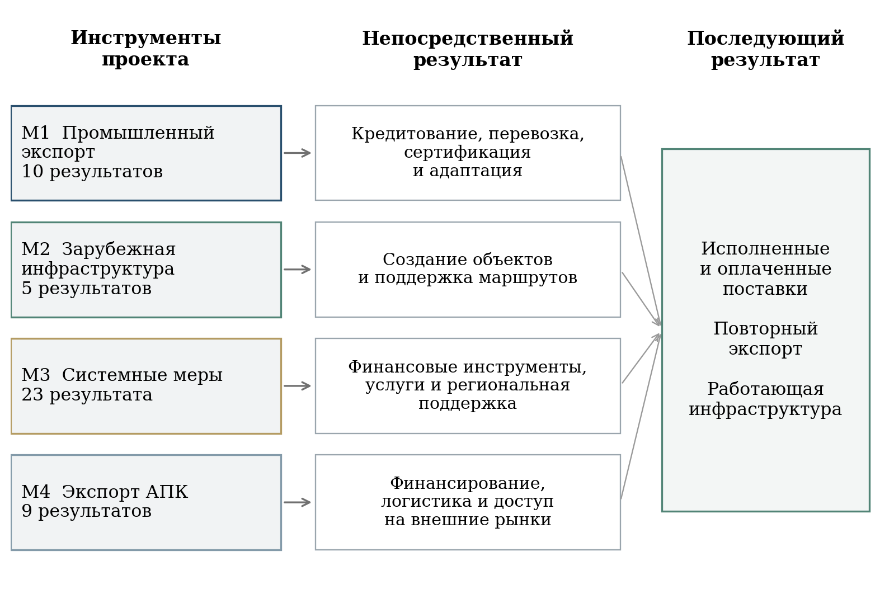

[B104; ReportCaption] Рисунок 1 – Архитектура проекта и переход к хозяйственным результатам

[B105; SourceNote] Составлено по паспортам. Правый блок содержит аналитическое описание последующих результатов, предлагаемых для проверки. [12]

[B106; ] В четырёх федеральных паспортах содержатся 47 результатов: 10 в промышленном экспорте, 5 в зарубежной инфраструктуре, 23 в системных мерах и 9 в экспорте АПК. Количество результатов описывает детализацию паспортной конструкции. Большое число строк в системных мерах отражает разнообразие функций и участников. По числу строк нельзя судить о сравнительной финансовой значимости или экономической эффективности направления. [13]

[B107; ] На уровне НП опубликованы семь показателей, на уровне ФП – 18 вхождений показателей. Четыре показателя повторяются на двух уровнях. После исключения повторов остаётся 21 уникальное наименование. Повторение обеспечивает вертикальную связь целей, однако при построении сводной оценки один результат должен учитываться однократно. Иначе промышленный или аграрный экспорт получает дополнительный вес лишь из-за своего появления в двух разделах документа.

[B108; ] Целевые значения установлены на каждый год проектного периода. По выбранной редакции паспорта ННЭ должен увеличиться до 248,1 млрд долл. к 2030 году, промышленный экспорт – до 192,9 млрд, экспорт АПК – до 55,2 млрд. Сумма отраслевых ориентиров точно составляет целевой ННЭ. Для 2025 и 2026 годов сохраняется такое же арифметическое согласование. Общий показатель и его составляющие образуют единую систему учёта. [14]

[B109; ReportCaption] Таблица 3 – Основные целевые значения выбранной редакции паспорта

[B110; таблица 3]

| Показатель | 2025 | 2026 | 2030 |
| --- | --- | --- | --- |
| Прирост ННЭ к 2023 году, % | 0,50 | 4,50 | 67,00 |
| ННЭ, млрд долл. | 149,24 | 155,25 | 248,10 |
| ННЭ в дружественные страны, млрд долл. | 113,32 | 122,63 | 206,10 |
| Промышленный экспорт, млрд долл. | 111,44 | 116,95 | 192,90 |
| Сделки с инструментами Группы РЭЦ, млрд долл. | 16,40 | 18,00 | 23,30 |
| Охват опорных направлений, % | 3,85 | 3,85 | 23,08 |
| Экспорт АПК, млрд долл. | 37,80 | 38,30 | 55,20 |

[B111; SourceNote] Все значения являются плановыми. Стоимостные величины выражены в номинальных ценах. Сопоставимость инфраструктурного показателя после изменения методики рассмотрена в разделе 3.5. [15]

[B112] 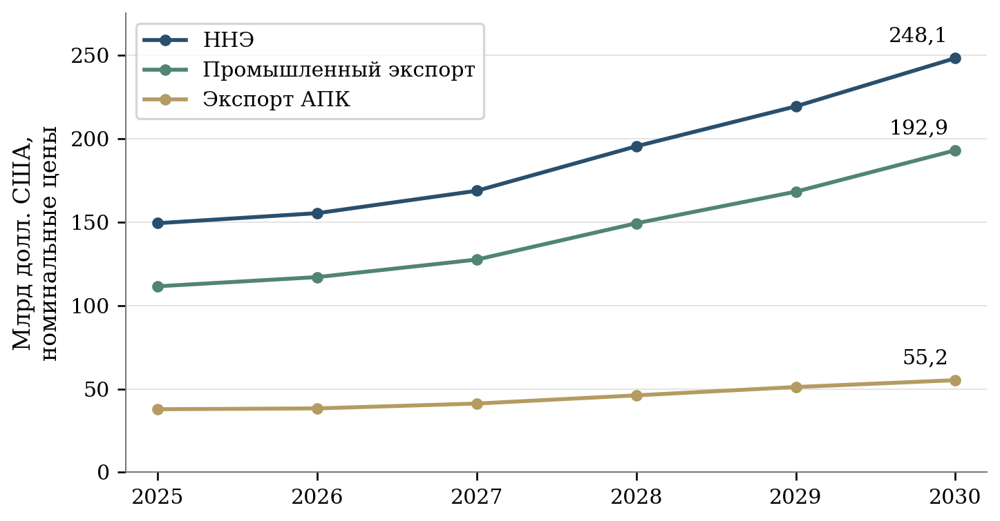

[B113; ReportCaption] Рисунок 2 – Плановые траектории стоимости экспорта на 2025–2030 годы

[B114; SourceNote] Номинальные цены. Общий ННЭ равен сумме промышленного экспорта и АПК. [16]

### [B115; Heading2] 2.2 Промышленный экспорт и технологическая специализация

[B116; ] Промышленное направление включает льготное кредитование экспортных проектов через РОСЭКСИМБАНК и ВЭБ.РФ, корпоративные программы повышения конкурентоспособности, компенсацию транспортных расходов, поддержку исследований и адаптации продукции, сертификации и послепродажного обслуживания. Часть результатов связана со страхованием приоритетных проектов. Инструменты воздействуют на разные ограничения экспортёра и требуют различных сроков наблюдения. [17]

[B117; ] Кредитная поддержка влияет на возможность финансировать производственный и торговый цикл. Результат зависит от исполнения контракта и получения оплаты. При расчёте стоимости поддержки необходимо учитывать срок кредита, величину субсидируемой ставки и продолжительность бюджетного обязательства. Одно и то же годовое назначение может обслуживать новые и ранее выданные кредиты. Поэтому экспорт текущего года нельзя автоматически сопоставлять со всеми расходами этого же года как с единым инвестиционным вложением.

[B118; ] Транспортная компенсация уменьшает часть затрат на поставку. Для её оценки важны конкретный маршрут, товар, период и изменение полной логистической стоимости. Расширение компенсируемого объёма может сопровождаться изменением состава получателей. Средняя субсидия на тонну зависит от расстояния и условий перевозки, а стоимость поддержанного экспорта – от цены и ассортимента. Межрегиональные сравнения должны учитывать эти различия.

[B119; ] Поддержка сертификации и адаптации продукции создаёт предпосылки допуска на зарубежный рынок. Непосредственным результатом выступает завершённая процедура, а последующим – поставка и устойчивые продажи. Для каждого сертификата целесообразно фиксировать рынок действия, срок, товарную позицию и наличие экспорта в течение следующего периода. Такая последовательность позволяет проверить, какие административные результаты действительно используются предприятиями.

[B120; ] Высокотехнологичный экспорт выделен самостоятельным показателем, однако технологический состав определяется установленной товарной классификацией. Для содержательной оценки полезно раскрывать долю продукции с высокой добавленной стоимостью, российских компонентов и сопутствующих услуг. Рост стоимостной величины в рамках фиксированного перечня не исчерпывает оценку технологического развития производства. [18]

### [B121; Heading2] 2.3 Зарубежная инфраструктура и использование созданных объектов

[B122; ] Федеральный проект зарубежной инфраструктуры объединяет создание транспортно-логистических центров и промышленных зон, индустриального парка в Таджикистане, мероприятия по российской промышленной зоне в Египте и поддержку перевозок по международным маршрутам. Набор результатов сочетает капитальные объекты, организационные действия и текущие логистические услуги. По выбранной редакции паспорта создание четырёх транспортно-логистических центров и промышленных зон отнесено к 2027–2030 годам. [19]

[B123; ] Паспортная характеристика создания объектов включает межправительственные соглашения, учреждение проектных компаний, отбор операторов, формирование пула инвесторов, подготовительные работы и ввод в эксплуатацию. Для управления строительством эти стадии необходимы. Экспортный эффект возникает после фактического использования объекта предприятиями. При оценке следует установить дату начала работы, доступную мощность, объём обработанных грузов и круг пользователей.

[B124; ] Показатель охвата направлений характеризует институциональное и инфраструктурное присутствие. Он не определяет пропускную способность и надёжность обслуживания. Для действующего объекта дополнительными измерениями могут служить загрузка, срок обработки груза, частота сбоев и полная стоимость операции. Их сопоставление с альтернативным маршрутом требует одинаковых характеристик груза и периода наблюдения.

[B125; ] В программе присутствует прокси-показатель исполнения мероприятий. Достижение годового плана подготовки или согласований может предшествовать появлению работающей инфраструктуры. Наблюдаемое сочетание 100% исполнения программы за 2025 год и нулевой записи охвата не позволяет считать показатели взаимозаменяемыми. Кроме различия стадий, необходимо учитывать смену методики охвата в августе 2026 года. [20]

[B126; ] Экономическая оценка зарубежного объекта должна учитывать российскую добавленную стоимость и занятость, обслуживание экспорта и развитие кооперации. Производственная деятельность за рубежом может создавать спрос на российское оборудование и компоненты, но часть операций окажется вне таможенной статистики российского товарного экспорта. Эти эффекты требуют самостоятельного описания границ учёта и данных по участникам проекта.

### [B127; Heading2] 2.4 Системные меры и последовательность действий экспортёра

[B128; ] Системные меры включают деятельность Группы РЭЦ, страхование и финансирование, факторинг, продвижение бренда «Сделано в России», участие в выставках, поддержку региональных центров экспорта, образовательные программы, правовую экспертизу и цифровую платформу «Одно окно». Среди результатов присутствует и поддержка импорта приоритетной продукции. Последняя может обеспечивать деятельность предприятий и технологическую кооперацию, однако её непосредственный результат относится к импортным операциям. [21]

[B129; ] Для цифрового направления необходимо различать доступность сервиса, регистрацию организации, инициирование услуги и её успешное завершение. Паспортные показатели отражают отдельные стадии этой последовательности. Накопительное число пользователей позволяет оценить длительный охват, но слабо характеризует текущую востребованность и качество обслуживания. Сопоставление пользователей с фактическими экспортными операциями требует единого идентификатора организации и одинакового периода наблюдения. [22]

[B130; ] Продвижение и обучение имеют более продолжительный путь к выручке. Информационное мероприятие может создать контакты, а образовательная программа – компетенции. Для проверки результата необходимо проследить участников до первой поставки, повторного контракта или выхода на новый рынок. Участие одного предприятия в нескольких мероприятиях должно отражаться в единой истории поддержки, чтобы стоимость его экспорта не суммировалась по каждому организатору.

[B131; ] Региональный экспортный стандарт задаёт требования к организации поддержки. Выполнение стандарта относится к институциональным условиям региона. Изменение поставок дополнительно зависит от товарной структуры, производственного потенциала, спроса и логистики. Оценка региональной программы должна связывать конкретную меру с кругом предприятий и проверять хозяйственные результаты, сохраняя отдельный учёт выполнения организационных требований.

[B132; ] Правовая и экспертная поддержка в международной торговле может снижать риски и помогать преодолевать барьеры. Количество консультаций и участников мероприятий характеризует охват. Для оценки полезности нужны сведения о решённых проблемах, времени их урегулирования и последующих операциях получателя. Показатели должны допускать и фиксацию неуспешного исхода, поскольку учёт только положительных случаев завышает представление о результативности.

### [B133; Heading2] 2.5 Экспорт АПК и межпроектные зависимости

[B134; ] Аграрное направление включает меры финансовой поддержки, транспортировки, продвижения, ветеринарного и фитосанитарного сопровождения, работы отраслевых представителей за рубежом и специализированных павильонов. Условия доступа на рынок существенно различаются по продуктам. Для части продукции решающими являются санитарные разрешения и холодовая цепь, для других категорий – цена, транспортная доступность и регулярность поставок. [23]

[B135; ] Поддержка доступа должна оцениваться по товарно-страновым сочетаниям. Формальное открытие рынка создаёт возможность экспорта, но величина реализации зависит от наличия конкурентоспособного предложения и коммерческих контрактов. Показатели освоения рынка целесообразно связывать с числом действующих поставщиков, длительностью работы и долей поставок с повышенной степенью переработки.

[B136; ] Взаимодействие с проектами транспортной инфраструктуры, производительности, кадров и цифровизации имеет предметный характер. Экспортёру могут одновременно требоваться доступный маршрут, производственные мощности, специалисты и своевременные расчёты. При совместном использовании мер необходимо устанавливать общий результат предприятия и вклад каждого механизма. Иначе один контракт может несколько раз появиться в ведомственных итогах поддержки.

[B137; ] Аграрный и промышленный экспорт также связаны через оборудование, упаковку, хранение и переработку. Для оценки внутренних эффектов следует изучать спрос на отечественных поставщиков, технологические затраты и загрузку мощностей. Предлагаемое дополнение статистики помогает объяснить, как внешние поставки отражаются на производственных связях и занятости в российских регионах.

## [B138; Heading1] 3 Методики расчёта и измеримость результатов

### [B139; Heading2] 3.1 Состав показателей и изменение методик

[B140; ] Система показателей проекта объединяет стоимость экспортированных товаров, объём сделок с государственной поддержкой, наличие зарубежной инфраструктуры и использование сервисов экспортёрами. Перечисленные величины относятся к разным стадиям хозяйственной деятельности. Для каждой из них требуется собственное основание оценки: статистическая стоимость поставок, условия учёта сделки, подтверждение ввода объекта либо действие пользователя. Сведение таких результатов к среднему проценту выполнения ослабляет содержательную интерпретацию. Высокое исполнение организационных мероприятий может сочетаться с более медленным ростом поставок, поскольку между получением поддержки и экспортной выручкой существует временной разрыв.

[B141; ] Методическую основу стоимостных показателей НП составляет приказ Минпромторга России от 6 мая 2025 г. № 2158. Для промышленного экспорта применяется приказ от той же даты № 2156. В августе 2026 г. утверждены новые методики системных мер и зарубежной инфраструктуры: приказы № 4026 и № 4141. Первый отменил приказ № 6270 от 27 декабря 2024 г. и изменения № 2706 от 3 июня 2025 г. Второй заменил приказ № 2157 от 6 мая 2025 г. Реестр Росстата связывает показатели экспорта АПК с приказом Минсельхоза России от 5 декабря 2025 г. № 768. [24]

[B142; ] При сопоставлении целей и фактических значений дата обновления паспорта сама по себе недостаточна. Редакция методики определяет содержание числителя, круг наблюдаемых организаций и период накопления. Пересмотр правил требует переходной таблицы, в которой каждому наблюдению присвоены дата расчёта, версия методики и признак пересмотра. Сохранение прежнего названия при изменении состава учитываемых операций способно создать искусственный разрыв ряда. Обратная ситуация возникает при изменении названия без пересчёта данных: новый показатель внешне получает длительную историю, хотя прежние наблюдения описывают другое явление.

[B143; ] В методиках № 2158, № 2156, № 4026 и № 4141 предусмотрено использование данных предыдущего периода при непредставлении необходимых компонентов. Повторяющееся значение поэтому не всегда означает отсутствие изменений в хозяйственной деятельности. Для анализа требуется различать подтверждённый результат, перенесённое значение и уточнённую оценку. Периодичность публикации также следует отделять от периодичности расчёта. Наличие месячной колонки в информационной системе ещё не даёт основания интерпретировать годовой показатель как самостоятельный итог месяца. [25]

[B144; ReportCaption] Таблица 4 – Методики и существенные условия сопоставления

[B145; таблица 4]

| Направление | Документ | Что требуется учитывать |
| --- | --- | --- |
| ННЭ и его прирост | Минпромторг, 06.05.2025 № 2158 | Номинальная стоимость, база 2023 года 148,5 млрд долл. |
| Промышленный экспорт | Минпромторг, 06.05.2025 № 2156 | Товарный перечень и определения эффективности поддержки |
| Системные меры | Минпромторг, 10.08.2026 № 4026 | Разные начала накопления, инициирование услуги, новая редакция региональных показателей |
| Зарубежная инфраструктура | Минпромторг, 18.08.2026 № 4141 | Вес объектов, 30 опорных направлений, подтверждение пересчёта старых данных |
| Экспорт АПК | Минсельхоз, 05.12.2025 № 768 | Ссылка на актуальный акт в реестре Росстата. Полный текст требует отдельной сверки |

[B146; SourceNote] Паспортные ссылки на прежние акты не заменяют проверку действующей методики. [26]

### [B147; Heading2] 3.2 Стоимостной объём несырьевого неэнергетического экспорта

[B148; ] Несырьевой неэнергетический экспорт в методике национального проекта определяется суммой экспорта товаров отраслей промышленности и продукции агропромышленного комплекса. Границы обеих составляющих задаются кодами ТН ВЭД ЕАЭС. Экономическое содержание показателя устанавливается этим перечнем. В промышленную составляющую включены, в частности, отдельные виды химической продукции, удобрений, металлов и изделий из них. Поэтому динамика ННЭ не равнозначна изменению экспорта готовых потребительских товаров или высокотехнологичной продукции. Последняя выделена в самостоятельный показатель с собственным перечнем. [27]

[B149; формула (1)] E_NNE,t = E_prom,t + E_APK,t

$$
E_{\mathrm{NNE},t}=E_{\mathrm{prom},t}+E_{\mathrm{APK},t}
$$

[B150; EquationNote] ENNE,t – стоимостной объём несырьевого неэнергетического экспорта, Eprom,t и EAPK,t – его промышленная и агропромышленная составляющие за одинаковый период, млрд долл. США. Формула соответствует приложению 2 к приказу № 2158.

[B151; ] Объём ННЭ рассчитывается в номинальных долларах США нарастающим итогом с начала календарного года. Прирост к 2023 г. представляет самостоятельный годовой показатель с базой 148,5 млрд долл. США. Его смысл раскрывается через отношение сопоставимых годовых стоимостных объёмов. Значение 10% означает превышение базового уровня на одну десятую. Показатель не является темпом роста к предыдущему году. При последовательном улучшении результата годовой прирост к 2023 г. и изменение относительно предыдущего года закономерно различаются. [28]

[B152; формула (2)] g_t = 100 × (E_NNE,t / 148,5 − 1)

$$
g_t=100\left(\frac{E_{\mathrm{NNE},t}}{148.5}-1\right)
$$

[B153; EquationNote] gt – прирост ННЭ к уровню 2023 г., %. В знаменателе используется установленная методикой база 148,5 млрд долл. США.

[B154; ] Различие годовой и декабрьской записей показателя ЕМИСС 62713 за 2025 г. требует отдельного рассмотрения. Годовое значение 10,2% согласуется со стоимостным итогом 163,65 млрд долл. США: отношение к базе 148,5 млрд даёт прирост 10,202%, округляемый до 10,2%. Декабрьское значение 0,5% при той же базе соответствовало бы приблизительно 149,24 млрд долл. США. Разница не может быть объяснена обычным округлением. До согласования редакций декабрьская запись не должна использоваться как альтернативный итог года или как месячный темп прироста. Сам факт наличия двух записей фиксирует проблему сопоставимости опубликованных представлений. [29]

[B155; ] Номинальная оценка реагирует на физическое количество товаров, их долларовые цены и изменение товарного состава. Рост стоимости может сопровождаться снижением тоннажа при увеличении доли более дорогих товаров. Снижение долларовой цены способно уменьшить стоимость экспорта при росте поставок в натуральном выражении. Аналитическая оценка должна включать индексы физического объёма по сопоставимым товарным группам и изменение удельной стоимости. Для неоднородной номенклатуры суммарная масса грузов имеет ограниченное экономическое значение, поскольку складывает товары с различной стоимостью и степенью переработки.

[B156; ] Уточнение годовых данных по ННЭ предусмотрено до 15 марта следующего года. Для оперативного мониторинга целесообразно использовать сопоставление одинаковых месяцев накопленного итога. Разность двух соседних накопленных значений даёт оценку поставок за месяц лишь при единой версии исходной информации. Если один месяц пересмотрен, а соседний сохранён в прежней редакции, полученная разность включает одновременно поставки и статистическое уточнение. Проверка сезонности и прогнозирование требуют сохранённой истории пересмотров. [30]

### [B157; Heading2] 3.3 Экспорт продукции агропромышленного комплекса

[B158; ] Национальная цель увеличения экспорта продукции АПК в полтора раза относится к уровню 2021 г. В реестре Росстата соответствующий показатель имеет единицу измерения «миллиард долларов», несмотря на присутствие слов «к показателю 2021 года» в названии. Следовательно, его опубликованное значение нельзя читать как процент или индекс. Для проверки достижения цели сопоставляются два стоимостных объёма, рассчитанных по одинаковым товарным и территориальным границам. Цели ННЭ и экспорта АПК представлены в номинальных стоимостных показателях. Индексы физического объёма используются в настоящей экспертизе как предлагаемое аналитическое дополнение. Прямое объединение данного ряда с индексом производства сельскохозяйственной продукции методически некорректно: индекс производства имеет другую ценовую основу и иной объект наблюдения. [31]

[B159; ] В составе ННЭ агропромышленная часть включает товарные группы 01–24 ТН ВЭД ЕАЭС и дополнительные коды за пределами этого интервала. Методика предусматривает также учёт рыбы, рыбопродуктов и морепродуктов, добытых и проданных вне зоны действия таможенного контроля, по форме № 8-ВЭС-рыба. Поэтому сумма только по таможенным группам 01–24 не воспроизводит показатель проекта в полном объёме. При проверке отраслевых итогов необходимо выделять охват дополнительной номенклатуры и сведения о рыбе за пределами таможенного контроля. [32]

[B160; ] Объём экспорта АПК, стоимость продовольственных товаров и сельскохозяйственного сырья в общей таможенной группировке и экспорт продукции конкретной отрасли могут иметь разные границы. Их расхождение следует сначала проверять по классификаторам и срокам уточнения. Отраслевая презентация с оперативными сведениями полезна для оценки направления изменений, однако подмена ею годового статистического итога создаёт риск смешения редакций. В расчётах долей общего ННЭ обе составляющие должны относиться к одному периоду. Данные АПК за январь–август нельзя вычитать из промышленного или общего объёма за январь–сентябрь.

[B161; ] Для оценки структурного изменения экспорта АПК необходимы отдельные наблюдения по товарам глубокой переработки, рынкам сбыта и устойчивости контрактов. Повышение средней стоимости тонны может быть связано с переработкой, ценовой конъюнктурой или изменением продуктовой смеси. Разложение по этим составляющим требует детализированных данных. В части поддержки целесообразно прослеживать фактические поставки после завершения строительства, расширения мощностей либо компенсации транспортных расходов. Временное несоответствие между расходами и экспортом особенно существенно для капиталоёмких проектов, результат которых возникает спустя несколько отчётных периодов.

### [B162; Heading2] 3.4 Промышленный экспорт и оценка эффективности поддержки

[B163; ] Показатели промышленного экспорта формируются по установленному перечню товарных кодов. Приказ № 2156 выделяет общий объём, поставки в дружественные страны, высокотехнологичную продукцию и минимальную годовую среднюю эффективность мер поддержки. Разделение позволяет изучать масштаб, географию и технологический состав поставок, но не устраняет зависимость стоимостных результатов от цен. Высокотехнологичность присваивается в соответствии с приложенным перечнем товаров. Наличие товара в перечне характеризует статистическую классификацию и само по себе не показывает величину российской добавленной стоимости в конкретной экспортной партии. [33]

[B164; ] Рост высокотехнологичного экспорта целесообразно сопровождать оценками локализации производства, повторных поставок и разнообразия покупателей. Объём одного крупного контракта способен существенно изменить годовой итог. Для предприятия важны продолжительность производственной программы, исполнение обязательств и поступление оплаты. Для региона существенны занятость, налоговая база и связи экспортёра с местными поставщиками. Полный экономический эффект не может быть восстановлен по одной таможенной стоимости, даже если товар включён в высокотехнологичную группу.

[B165; ] Минимальная годовая средняя эффективность промышленной поддержки определяется отношением объёма поддержанного экспорта к фактически предоставленным субсидиям. Обе составляющие выражены в рублях. Методика допускает применение прогнозных значений экспорта по отдельным финансовым инструментам. Следовательно, коэффициент требует раскрытия доли прогнозной составляющей и даты её последующего подтверждения. Название показателя не должно создавать впечатления, что речь идёт об установленном дополнительном эффекте бюджетных расходов. [34]

[B166; формула (3)] K_t = V_support,t / S_t

$$
K_t=\frac{V_{\mathrm{support},t}}{S_t}
$$

[B167; EquationNote] Kt – отношение поддержанного экспорта к фактически предоставленным субсидиям, Vsupport,t и St выражены в рублях. В интерпретации необходимо учитывать допускаемые методикой прогнозные значения числителя.

[B168; ] Высокое отношение экспорта к субсидии может возникнуть при поддержке уже устойчивого экспортёра с крупными поставками. Низкое значение возможно на ранней стадии выхода на новый рынок, когда требуются сертификация, адаптация продукции и поиск контрагентов. Сопоставление инструментов только по коэффициенту создаёт преимущество для мер, сопровождающих сложившиеся потоки. При оценке дополнительного результата требуется определить, какой объём поставок состоялся бы без поддержки. Для этого нужны сведения о сопоставимых предприятиях, условиях отбора и характеристиках получателей до предоставления средств.

[B169; ] Расчёт эффективности также чувствителен к распределению расходов между годами. Если субсидия предоставлена в одном году, а соответствующие поставки выполнены позднее, годовое отношение не описывает отдачу мероприятия за весь срок. Рекомендуется дополнять его оценкой по завершённым группам получателей с одинаковой датой вступления в программу. В пределах такой группы сопоставляются совокупные расходы, исполненные поставки, поступившие платежи и сохранение экспортной деятельности после окончания поддержки. Предлагаемая оценка предназначена для аналитического сопровождения и требует собственных регламентированных правил расчёта.

### [B170; Heading2] 3.5 Географическое направление поставок и зарубежная инфраструктура

[B171; ] В методике промышленного экспорта дружественные страны определены через исключение государств и территорий из перечня, утверждённого распоряжением Правительства Российской Федерации от 5 марта 2022 г. № 430-р. Показатель отражает стоимость поставок по данному административному составу направлений. Рост его доли может происходить вследствие увеличения поставок на соответствующие рынки, сокращения поставок в остальные страны либо изменения перечня. При анализе диверсификации требуется разложение этих причин и сопоставление по постоянному составу стран. [35]

[B172; ] Охват опорных стран зарубежной инфраструктурой по приказу № 4141 представляет взвешенную оценку присутствия. Объекты, созданные с использованием инструментов федерального проекта, учитываются с коэффициентом 1. Для объектов без федерального финансирования предусмотрены дополнительные веса, различающиеся в зависимости от содействия Минпромторга России. Первый объект получает внутренний вес 0,5, последующие – 0,25. Для группы при содействии ведомства применяется множитель 0,75, для другой группы – 0,5. Итог агрегируется по годам начиная с 2025 г. и делится на установленное число опорных направлений, равное 30. [36]

[B173; формула (4)] C_T = (100 / 30) × ∑_{t=2025}^{T} ∑_{j=1}^{30} s_jt

$$
C_T=\frac{100}{30}\sum_{t=2025}^{T}\sum_{j=1}^{30}s_{jt}
$$

[B174; EquationNote] CT – охват опорных направлений, %, sjt – взвешенная степень присутствия инфраструктуры в направлении j в году t. В официальной методике предусмотрено ограничение суммарного вклада компонентов по одному направлению.

[B175; ] Различные виды объектов поэтому дают неодинаковый вклад в итог. В условном расчёте первый объект без федерального финансирования при содействии Минпромторга России обеспечивает 1,25 процентного пункта, аналогичный объект без такого содействия – около 0,83 процентного пункта. Объект федерального проекта соответствует 3,33 процентного пункта до применения ограничений агрегации. Приведённые значения иллюстрируют устройство формулы. Они не характеризуют фактическое строительство. Одинаковое число объектов может сопровождаться различными значениями показателя в зависимости от способа их создания.

[B176; ] Географический знаменатель требует отдельного пояснения. В перечне присутствуют 29 государств и позиция «Африка как континент». Одновременно в него включены Алжир, Египет, Танзания, Эфиопия и Южно-Африканская Республика. Для расчёта и картографирования необходимо определить отнесение объекта к одному направлению и порядок устранения пересечения континентальной и страновых позиций. Отображение показателя как доли 30 самостоятельных государств искажало бы его состав. Аналогичное уточнение требуется для повторного ввода объектов в одной стране в разные годы. [37]

[B177; ] Нулевое значение охвата за 2025 г. в опубликованном ряду не позволяет заключить, что российская инфраструктура за рубежом отсутствует. Показатель ограничен правилами включения объектов, периодом накопления и подтверждающими документами. Метаданные ряда указывают последнее обновление 27 февраля 2026 г., то есть до утверждения приказа № 4141. Применять новую методику к прежнему значению без подтверждённого пересчёта нельзя. Необходимо различать исторически действующую сеть, объекты, введённые с 2025 г., и объекты, зачтённые в соответствующей редакции расчёта. Для содержательной оценки нужны реестр действующих мощностей, их загрузка, число обслуженных предприятий и устойчивость работы. [38]

[B178; ] Показатель исполнения программы создания сети рассчитывается по достигнутым и запланированным контрольным событиям. Он позволяет наблюдать продвижение организационных и инвестиционных действий, однако одинаковое число выполненных событий может относиться к различным стадиям готовности. Подписание соглашения, оформление имущественных прав и начало эксплуатации имеют разные последствия для экспортёра. В мониторинге следует сохранять исходный календарь, показывать переносы сроков и отдельно фиксировать ввод мощностей. Уменьшение числа запланированных событий способно повысить процент исполнения без увеличения фактического результата. [39]

### [B179; Heading2] 3.6 Сделки с поддержкой Группы РЭЦ и охват организаций

[B180; ] Объём внешнеторговых сделок с использованием инструментов Группы РЭЦ по приказу № 4026 формируется нарастающим итогом с 1 января текущего года. Источником служит корпоративное хранилище данных Российского экспортного центра. К группе отнесены РЭЦ, РОСЭКСИМБАНК, ЭКСАР и Школа экспорта. В формуле объединяются поддержанные сделки предыдущих месяцев и новые сделки текущего месяца. Ответственность за официальное статистическое представление возложена на Минпромторг России. [40]

[B181; ] Стоимость поддержанных сделок нельзя механически складывать со стоимостью ННЭ. Один и тот же экспорт может одновременно входить в таможенный итог и в результат предоставления поддержки. Кроме того, сам факт поддержки сделки не устанавливает дату отгрузки, полноту исполнения контракта и поступление оплаты. Для оценки вклада РЭЦ требуется согласование реестра поддержки с поставками по соответствующим контрактам. При использовании несколькими институтами разных инструментов по одной сделке необходима единая идентификация контракта, позволяющая контролировать повторный учёт.

[B182; ] Количество организаций, воспользовавшихся поддержкой Группы РЭЦ, учитывается в пределах календарного года с добавлением новых организаций. Методика связывает охват также с обучением, консультационными и информационно-аналитическими услугами для начинающих экспортёров. Поэтому получатель поддержки не обязательно является действующим экспортёром. Число получателей следует раскрывать по исходному статусу: начинающие компании, организации с предыдущими поставками и предприятия, расширяющие географию. Внутри каждой группы результат оценивается по переходу к следующей стадии экспортной деятельности. [41]

[B183; ] Для начинающих компаний наиболее содержательны доля заключивших первый исполненный контракт и сохранение поставок через один–два года. Для действующих экспортёров важны дополнительные рынки, повторные продажи и снижение затрат на обслуживание контрактов. Сравнение получателей со всей совокупностью предприятий без учёта исходного размера и опыта способно завысить оценку воздействия. Рекомендуется фиксировать характеристики компании на дату обращения, содержание оказанной услуги, завершённость её предоставления и последующий результат. Объединение сведений должно обеспечивать защиту коммерческой информации при публикации агрегированных оценок.

### [B184; Heading2] 3.7 Использование цифровой платформы и удовлетворённость услугами

[B185; ] Показатель числа экспортёров, использующих экосистему «Одно окно», накапливается с 1 января 2020 г. Учитывается пользователь с подтверждённой экспортной деятельностью по административным данным ФТС, имевшей место не ранее двух лет, предшествующих году регистрации, который инициировал получение хотя бы одной электронной услуги. Число активных личных кабинетов накапливается начиная с 2021 г. Для данного показателя достаточно инициирования хотя бы одной услуги. Оба правила отличаются от учёта действующей аудитории за последний месяц. [42]

[B186; ] Накопленные показатели пригодны для наблюдения за распространением платформы, однако не характеризуют частоту её использования в текущем периоде. Кабинет может сохраняться в накопленном итоге после длительного перерыва в работе. Инициированная услуга может завершиться отказом, отзывом заявления или техническим прерыванием. Для оценки удобства и практической полезности платформы требуется дополнительное наблюдение за завершёнными обращениями, сроками предоставления услуг и повторным использованием. Доли рассчитываются по одной группе заявлений с известной датой начала и достаточным сроком последующего наблюдения.

[B187; ] Количество доступных сервисов включает сервисы, для которых имеется акт приёмки в опытную эксплуатацию либо приказ о вводе в промышленную эксплуатацию. Показатель отражает предложение цифровых возможностей. Увеличение числа сервисов не даёт самостоятельной оценки количества решённых задач экспортёров. Приоритет следует отдавать использованию востребованных функций, успешности завершения процедур и снижению временных затрат организаций. Сервис, разделённый на несколько технических операций, также требует единообразного правила идентификации, чтобы изменение архитектуры платформы не выглядело как расширение поддержки. [43]

[B188; ] Удовлетворённость измеряется в баллах с верхней границей 10. Итоговая оценка взвешивается по количеству оказанных услуг соответствующего вида. При расчёте учитываются ответы о качестве услуги и готовности рекомендовать её получение через платформу. Состав услуг и доля ответивших пользователей поэтому влияют на интерпретацию общего среднего. Улучшение итоговой оценки может быть связано с увеличением доли сравнительно простых массовых обращений, даже если качество сложных процедур осталось прежним. [44]

[B189; ] Публикацию среднего балла рекомендуется дополнять числом анкет, долей оценённых обращений, распределением ответов и результатами по основным типам услуг. Для сопоставления во времени полезна дополнительная оценка при постоянной структуре услуг. Низкая доля ответов требует анализа различий между ответившими и не ответившими пользователями. Самостоятельное значение имеет завершённость обращения: высокая удовлетворённость среди успешно получивших услугу не описывает опыт организаций, прекративших процедуру до её окончания. Предлагаемые сведения позволяют связать пользовательскую оценку с фактическим качеством предоставления поддержки.

### [B190; Heading2] 3.8 Региональные показатели и требования к проверке результатов

[B191; ] В реестре статистики сохраняется показатель внедрения Регионального экспортного стандарта 2.0, тогда как приказ № 4026 содержит методику стандарта 3.0. Наблюдения прежней версии не могут автоматически использоваться для оценки новой. Требуется таблица соответствия инструментов, сроков внедрения и подтверждающих документов. Сопоставление должно показывать, какие требования сохранены, какие изменены и какие впервые введены. Без такого разграничения рост или снижение числа регионов может отражать изменение правил зачёта. [45]

[B192; ] Опубликованный текст приложений 6 и 7 к приказу № 4026 содержит положение, требующее официального уточнения. Формула суммирует компонент, описанный как предусмотренное планом число субъектов, и компонент, определённый как число субъектов с неподтверждённым внедрением стандарта либо неподтверждённой реализацией программы. Буквальное применение такого описания увеличивает итог при росте неподтверждённой части. До разъяснения необходимо проверять фактический алгоритм по первичным региональным сведениям и утверждённому экземпляру методики. Самостоятельно заменять знак в опубликованной формуле при расчёте официального показателя недопустимо. [46]

[B193; ] Дополнительной проверки требует показатель региональных программ, в названии которого одновременно присутствуют реализация программы и достижение планового прироста ННЭ. Подтверждение наличия программы не устанавливает достижение экспортной цели. Проверка должна включать утверждённую базу, план, сопоставимый фактический объём и состав мероприятий. Региональный итог чувствителен к месту регистрации экспортёра и организации оформления поставок. При содержательной оценке требуется разграничивать территорию производства, юридическую принадлежность компании и территорию, которой статистически отнесена операция.

[B194; ] Отсутствие региональных наблюдений в общедоступной подборке показателей ограничивает возможность расчёта рейтинга субъектов и многомерной классификации их результатов. Из национального числа регионов, внедривших стандарт, невозможно восстановить поимённый состав участников, полноту выполнения инструментов или величину регионального экспорта. Пространственная экспертиза в таких условиях опирается на документированные региональные программы, официальные перечни участников и сравнение условий развития экспорта. Любая картограмма должна точно обозначать, отображает ли она наличие инструмента, фактические поставки или предложенный аналитический показатель.

[B195; ] Основное направление совершенствования мониторинга состоит в согласовании экономического содержания показателя с подтверждающими сведениями. Для стоимостных рядов необходимо раскрывать товарный охват, цены и пересмотры. Для поддержки – связывать получателей и контракты с исполненными поставками. Для инфраструктуры – фиксировать ввод, загрузку и устойчивость эксплуатации. Для цифровых услуг – отделять накопленный охват от текущего использования и завершения процедур. Единые карточки показателей с историей изменений позволят сохранить преемственность наблюдений и установить, какая часть изменения обусловлена хозяйственными результатами.

## [B196; Heading1] 4 Статистические результаты и территориальные различия

### [B197; Heading2] 4.1 Общая динамика внешней торговли

[B198; ] Итоги внешней торговли за 2025 год позволяют выделить различающиеся направления изменения экспортной выручки. По таможенной статистике, опубликованной Росстатом, товарный экспорт составил 418,3 млрд долл. США против 434,5 млрд долл. в 2024 году. Импорт уменьшился с 282,8 до 279,0 млрд долл. Положительное сальдо, рассчитанное по этим значениям, сократилось со 151,7 до 139,3 млрд долл. Снижение совокупного экспорта сопровождалось ростом ряда товарных групп, имеющих непосредственное значение для национального проекта. [47]

[B199; ] Стоимость вывоза минеральных продуктов уменьшилась на 39,3 млрд долл., до 225,3 млрд долл. Экспорт остальных групп увеличился на 23,1 млрд долл., до 193,0 млрд долл. Полученное разложение объясняет уменьшение общего итога на 16,2 млрд долл. Доля минеральных продуктов снизилась приблизительно с 60,9 до 53,9%. При этом совокупность товаров за вычетом минеральных продуктов имеет самостоятельные классификационные границы и не заменяет официальный показатель несырьевого неэнергетического экспорта. [48]

[B200; ] Результаты проекта необходимо оценивать в составе общей структуры внешней торговли. Увеличение доли поддерживаемых товарных групп может происходить одновременно с сокращением их крупнейшей соседней группы. Поэтому изменение удельного веса ещё не характеризует расширение производственных возможностей экспортёров. Для такого вывода требуется подтвердить увеличение собственных поставок, устойчивость контрактов, сохранение рентабельности и рост внутренней добавленной стоимости. В аналитическом отчёте доля и абсолютный объём должны сопровождать друг друга.

[B201; ] Географическая структура товарного экспорта также требует раздельного рассмотрения размеров рынков и динамики продаж. В 2025 году экспорт в Азию составил 326,0 млрд долл., в Европу – 57,4 млрд долл., в Африку – 22,7 млрд долл., в Америку – 12,1 млрд долл. На Азию приходилось около 77,9% общей суммы. Крупная доля азиатского направления сама по себе не показывает распределения зависимости между отдельными государствами, покупателями и платёжными каналами. [49]

[B202; ] Стратегия географического расширения должна сочетать доступ к новым рынкам с оценкой устойчивости уже сложившихся связей. Поставки в несколько стран могут зависеть от одного перевалочного узла или одного банка. Дополнительный рынок снижает уязвимость только при наличии самостоятельной клиентской базы, доступного маршрута, работающей системы расчётов и возможности обслуживать поставленную продукцию. Число направлений поэтому целесообразно дополнять распределением выручки между покупателями и продолжительностью сотрудничества.

[B203; ] Общий рост экспорта не следует автоматически относить к расходам национального проекта. На стоимость поставок воздействуют внешние цены, валютные курсы, урожайность, загрузка производственных мощностей и условия международных расчётов. Оценка государственного воздействия требует наблюдения за получателями поддержки и сопоставимыми предприятиями, которые её не получали. Макроэкономическая статистика устанавливает масштаб и направление изменений, после чего проверяются конкретные механизмы поддержки.

[B204] 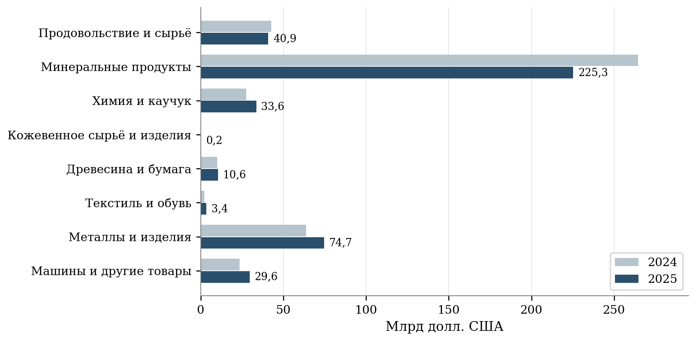

[B205; ReportCaption] Рисунок 3 – Товарный экспорт России по укрупнённым группам

[B206; SourceNote] 2024 и 2025 годы. Млрд долл. США. Состав укрупнённых групп ФТС не тождественен перечню ННЭ. [50]

### [B207; Heading2] 4.2 Несырьевой экспорт и экспорт продукции агропромышленного комплекса

[B208; ] Опубликованная в апреле 2026 года оценка Минпромторга характеризует несырьевой неэнергетический экспорт за 2025 год величиной 163,6 млрд долл. и ростом на 11% к предыдущему году. Сообщение подтверждает положительное направление годовой динамики. Для расчёта достижения показателя национального проекта необходимы точность официального статистического ряда, закреплённая база 2023 года и единая редакция данных. Процент к предыдущему году и прирост к базовому году отвечают на разные вопросы. [51]

[B209; ] Различия номинальных и физических изменений особенно существенны для продукции с высокой зависимостью от мировой конъюнктуры. Повышение цены увеличивает долларовую выручку при неизменном объёме поставки. Переход к более дорогой продукции также увеличивает среднюю стоимость единицы, хотя в данном случае изменение может отражать рост степени переработки. Для разграничения ценового и структурного факторов нужны подробные товарные группы, сопоставимые единицы количества и сведения о качестве продукции.

[B210; ] Оценка средней экспортной цены как отношения стоимости к массе полезна внутри относительно однородной товарной позиции. Объединение зерна, рыбы, масла и готовых пищевых продуктов в один показатель стоимости тонны создаёт зависимость результата от товарной структуры. Рост такой средней величины нельзя целиком объяснять удорожанием одинакового товара. Аналогичное ограничение возникает при сопоставлении изделий машиностроения, имеющих различную комплектацию, гарантийные обязательства и условия поставки.

[B211; ] По данным Федерального центра «Агроэкспорт», в 2025 году стоимость аграрного экспорта составила 41,6 млрд долл., физический объём превысил 83,3 млн тонн. Среди покупателей выделялись Китай с 7,7 млрд долл., Беларусь с 4,0 млрд долл., Казахстан и Турция с 3,8 млрд долл. каждый. Приведённые значения описывают аграрный экспорт в классификации отраслевого обзора. Сопоставление с таможенной группой продовольствия и сельскохозяйственного сырья требует согласования перечней товаров. [52]

[B212; ] Для оценки глубины переработки необходима устойчивая классификация товарных переделов. Перемещение экспортной сделки от одного юридического лица к другому не означает изменения производственной специализации. Аналогично рост доли готовых товаров при сокращении зерновых поставок может происходить без расширения выпуска готовой продукции. Поэтому показатель структурного изменения следует сопровождать абсолютными объёмами каждой группы, динамикой внутренних закупок сырья и числом предприятий, регулярно экспортирующих продукцию соответствующего передела.

[B213; ] Сравнение аграрного и промышленного направлений имеет смысл при согласованной временной и ценовой базе. Для аграрной продукции существенны сезон производства и сроки поступления урожая в оборот. Для оборудования важны графики крупных контрактов и этапы приёмки. Унифицированная помесячная оценка выполнения годового плана способна придать обычному календарному сдвигу вид устойчивого отставания. Предпочтительно сопоставлять одинаковые накопленные периоды и затем проверять причины отклонения на уровне отраслей и контрактов.

[B214; ] По срезу ЕМИСС за 2025 год накопленный итог декабря составляет 163,65 млрд долл. ННЭ, 122,09 млрд промышленного экспорта и 41,56 млрд экспорта АПК. Показатели согласованы по сумме. Отдельная годовая запись ННЭ в дружественные страны равна 141,59 млрд долл., декабрьская – 141,80 млрд. Для годового сопоставления принята годовая запись. Разность 0,21 млрд требует учёта при расчёте долей и исключает произвольную подмену одной версии другой. [53]

[B215; ReportCaption] Таблица 5 – Стоимостные показатели за 2025 год и плановые ориентиры

[B216; таблица 5]

| Показатель | План | Наблюдение | К плану, % |
| --- | --- | --- | --- |
| Несырьевой неэнергетический экспорт | 149,24 | 163,65 | 109,66 |
| Промышленный экспорт | 111,44 | 122,09 | 109,56 |
| Экспорт АПК | 37,80 | 41,56 | 109,95 |
| ННЭ в дружественные страны | 113,32 | 141,59 | 124,95 |
| Сделки с инструментами Группы РЭЦ | 16,40 | 22,309 | 136,03 |

[B217; SourceNote] Млрд долл. США. Для ННЭ в дружественные страны выбрана годовая запись. Для остальных показателей использован накопленный итог декабря. Сопоставление относится к выбранной редакции плана и не измеряет причинный эффект. [54]

### [B218; Heading2] 4.3 Оперативные результаты и поддержка экспортёров

[B219; ] Наблюдения за неполным 2026 годом используются для оценки текущей динамики с сохранением границ опубликованного периода. Годовой итог предыдущего года не служит непосредственной базой для процентного сравнения с восемью или девятью месяцами. При расчёте темпа выбирается совпадающий период предыдущего года. Сопоставление с годовой целью характеризует долю уже накопленного объёма, причём его интерпретация зависит от сезонности и календаря крупных поставок.

[B220; ] Текущая информация о внешней торговле услугами позволяет провести самостоятельную проверку общего направления изменения. По Банку России, экспорт услуг в первом полугодии 2026 года составил 23 233,86 млн долл. против 22 342,74 млн долл. за первые два квартала 2025 года. Рассчитанный прирост равен 3,99%. Использован именно сопоставимый шестимесячный интервал. Полученный результат относится к услугам и не добавляется к темпу роста товарного несырьевого экспорта. [55]

[B221; ] В официальном сообщении Российского экспортного центра о результатах 2025 года объём поддержанного группой экспорта оценён в 1,7 трлн руб., что на 9% больше предыдущего года. Число стран назначения поддержанных поставок увеличилось со 137 до 160. Денежная сумма характеризует экспорт, связанный с применением инструментов группы. Её нельзя использовать в качестве размера бюджетных затрат или дополнительного экспорта, целиком созданного государственной поддержкой. [56]

[B222; ] Один и тот же экспортный контракт может сочетать страхование, банковское финансирование, консультационную помощь и участие в выставочном мероприятии. При суммировании результатов отдельных инструментов возникает риск многократного учёта поставки. Статистический регистр поддержки должен содержать идентификаторы предприятия и контракта, даты начала и окончания помощи, стоимость фактических поставок и перечень применённых мер. Итог по совокупности инструментов формируется после устранения пересечений.

[B223; ] Положительная динамика стоимости поддержанных сделок не определяет величину дополнительного результата. Часть получателей могла бы осуществить поставки при иных условиях финансирования. Другие предприятия могли перенести уже запланированный контракт на более поздний период. Для установления вклада поддержки предлагается сравнивать изменение экспорта участников с изменением у близких по отрасли, масштабу и исходной экспортной активности предприятий. Отдельно следует учитывать получение поддержки до первой сделки и помощь организациям с длительной экспортной историей.

[B224; ] Число пользователей цифровых сервисов требует аналогичного разграничения. Регистрация организации, активность личного кабинета, завершённая услуга и оплаченная экспортная поставка представляют разные события. Между ними могут проходить месяцы. Оценка цифровой поддержки должна прослеживать одну совокупность организаций от обращения до результата. Сопоставление несогласованных годовых счётчиков завышает представление о доле пользователей, которые получили коммерческий результат.

[B225; ] Устойчивость результата целесообразно проверять через повторные поставки. Для впервые вышедших на внешний рынок предприятий предлагается фиксировать экспорт в течение следующих двенадцати и двадцати четырёх месяцев, количество независимых покупателей и продолжительность перерывов. Однократный контракт может обеспечивать выполнение годового денежного показателя без закрепления предприятия на рынке. Повторная продажа, своевременная оплата и сохранение положительной маржи дают более содержательное основание для оценки.

[B226; ReportCaption] Таблица 6 – Временное покрытие числовых наблюдений

[B227; таблица 6]

| Группа | Число | Последний период | Следствие для анализа |
| --- | --- | --- | --- |
| Денежные показатели ННЭ, промышленности и сделок РЭЦ | 4 | Сентябрь 2026 | Допустимы сопоставления января–сентября |
| Экспорт АПК и его дружественные направления | 2 | Август 2026 | Допустимы сопоставления января–августа |
| Исполнение программы инфраструктуры | 1 | Сентябрь 2026 | Оценивается стадия выполнения мероприятий |
| Прирост ННЭ, охват инфраструктуры, эффективность АПК | 3 | 2025 год | Используются годовые определения и проверка редакции |
| Промышленный экспорт в дружественные страны | 1 | Декабрь 2025 | Итог полного года |
| Высокотехнологичная продукция | 1 | Ноябрь 2025 | Полного годового значения в выборке нет |
| Цифровые и организационные показатели | 6 | Февраль 2025 | Не характеризуют состояние на конец 2025 или 2026 года |
| Показатели без числовых записей | 3 | Нет наблюдения | Отсутствие записи не заменяется нулём |

[B228; SourceNote] Во втором столбце указано число показателей. В группе денежных показателей ННЭ в дружественные страны присутствует также отдельная годовая запись. Группировка выполнена по последнему оперативному периоду. Реестр представлен в приложении А.

[B229; ReportCaption] Таблица 7 – Изменение за одинаковые периоды 2025 и 2026 годов

[B230; таблица 7]

| Показатель | Период | 2025 | 2026 | Прирост, % |
| --- | --- | --- | --- | --- |
| ННЭ | Январь–сентябрь | 113,380 | 122,110 | 7,70 |
| Промышленный экспорт | Январь–сентябрь | 87,360 | 92,010 | 5,32 |
| Сделки с инструментами РЭЦ | Январь–сентябрь | 16,473 | 14,126 | -14,25 |
| АПК | Январь–август | 22,530 | 27,060 | 20,11 |
| АПК в дружественные страны | Январь–август | 20,190 | 24,810 | 22,88 |

[B231; SourceNote] Стоимостные объёмы – млрд долл. США. В каждом сравнении сохранён одинаковый накопленный период. [57]

[B232] 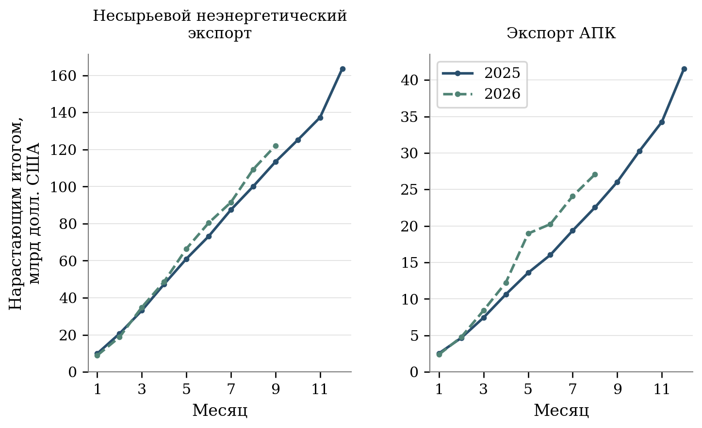

[B233; ReportCaption] Рисунок 4 – Накопленные объёмы ННЭ и экспорта АПК по месяцам

[B234; SourceNote] Для 2026 года ННЭ представлен по сентябрь, АПК – по август. Сравниваются одинаковые месяцы двух лет. [58]

[B235; ] Суммирование месячных колонок денежного экспорта привело бы к многократному учёту одних и тех же поставок. Для годового результата используется накопленный итог декабря. Межмесячная разность может включать пересмотр ранее учтённых операций. Шесть цифровых и организационных рядов, заканчивающихся февралем 2025 года, не используются для оценки достижения целей конца года. Наличие этих записей подтверждает наблюдаемость показателя в отдельном периоде, но не полноту текущего мониторинга.

### [B236; Heading2] 4.4 Территориальные различия экспорта услуг

[B237; ] Региональная статистика услуг расширяет оценку экспортной деятельности за пределы товарных показателей национального проекта. В 2025 году экспорт услуг России составил 46 264,08 млн долл., увеличившись на 9,29% относительно 2024 года. При этом уровень 2021 года, равный 55 555,47 млн долл., превышал результат 2025 года на 9 291,39 млн долл. Восстановление после 2023 года поэтому сочеталось с сохранением существенного отставания от более ранней величины. [59]

[B238; ] В составе экспорта услуг за 2025 год транспорт обеспечивал 29,86%, поездки – 19,36%, прочие деловые услуги – 15,06%, строительство – 11,79%. Различия направлений имеют значение для территориальной интерпретации. Международные перевозки могут обслуживаться из одного региона при прохождении груза через несколько субъектов. Образовательные и медицинские поездки связаны с местом предоставления соответствующих услуг. Поэтому одинаковая долларовая выручка отражает различную связь с местной занятостью и инфраструктурой. [60]

[B239; ] Для регионального сопоставления использованы 85 непересекающихся территорий. Архангельская область учитывается без Ненецкого автономного округа, Тюменская область – без Ханты-Мансийского и Ямало-Ненецкого автономных округов. Округа включаются самостоятельными наблюдениями. Сумма региональных значений за 2025 год составляет 44 995,71 млн долл., не распределено по субъектам 1 268,04 млн долл. Расхождение их суммы с общероссийским итогом равно 0,33 млн долл. и находится в пределах накопленной погрешности округления. [61]

[B240; ] На Москву приходится 45,91% общероссийского экспорта услуг, на Санкт-Петербург – 8,31%, на Краснодарский край – 7,67%. Десять крупнейших территорий обеспечивают 79,30% национального итога. После исключения нераспределённых операций их доля в сумме территориальных наблюдений составляет 81,53%. Применение разных знаменателей объясняет различие двух последних величин. Для карт и сравнительных таблиц предпочтительно сохранять долю в национальном итоге, отдельно показывая нераспределённую часть. [62]

[B241; ] Межрегиональная концентрация усилилась. Индекс Херфиндаля – Хиршмана, рассчитанный по долям 85 субъектов в территориально распределённом экспорте услуг, увеличился с 0,2238 в 2024 году до 0,2426 в 2025 году. Доля Москвы в общероссийском объёме выросла с 43,68 до 45,91%. Рост стоимости услуг отмечен в 63 из 85 сопоставленных субъектов, снижение – в 22. Наличие положительной динамики в большинстве регионов совместимо с усилением концентрации национальной выручки. [63]

[B242; ] При чтении карты необходимо учитывать способ территориального отнесения операций. Методика Банка России связывает экспорт услуг юридического лица с территориальной принадлежностью организации. Услуги нерезидентам по статье поездок распределяются по месту фактического предоставления. Примечание к региональной таблице отдельно устанавливает привязку операций индивидуальных предпринимателей к территории банковского филиала, на счёт в котором поступили средства. Карта поэтому характеризует распределение учтённых операций, которое может расходиться с географией выполнения работ. [64]

[B243; ] Перемещение головного офиса или расчётного обслуживания способно изменить региональный показатель без соответствующего перемещения работников и оборудования. Для разработки территориальных мер поддержки требуется дополнительная привязка экспортёра к производственным подразделениям. Наиболее полезно сопоставлять сведения об экспортной сделке с местом выполнения работ, численностью персонала и выплатами по оплате труда. Для многорегиональной организации возможно распределение части показателей между подразделениями при раскрытой и неизменной методике.

[B244; ] Картограмма по объёму услуг не должна представляться рейтингом эффективности региональных властей. Высокое значение может отражать концентрацию крупных компаний, существующую транспортную специализацию или размещение центральных офисов. Сравнение административных результатов требует наблюдения за теми предприятиями, которым регион предоставил помощь, и контроля исходных различий. Межрегиональная статистика полезна прежде всего для выявления специализации, масштабов рынка и направлений дальнейшего обследования.

[B245] 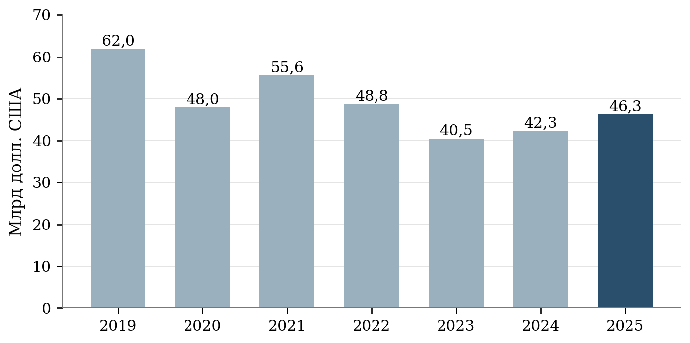

[B246; ReportCaption] Рисунок 5 – Экспорт услуг России в 2019–2025 годах

[B247; SourceNote] Полные календарные годы. Номинальная стоимость по статистике Банка России. [65]

[B248] 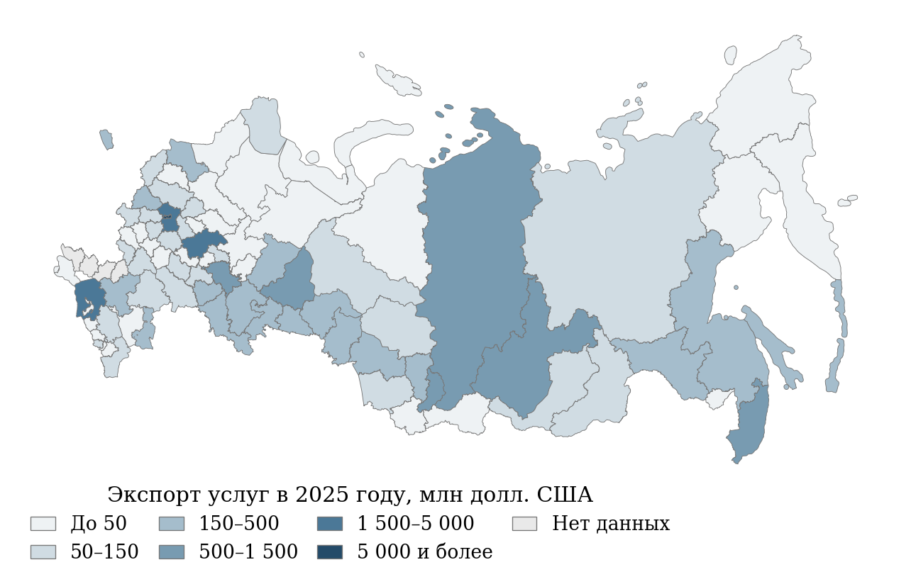

[B249; ReportCaption] Рисунок 6 – Территориальное распределение экспорта услуг в 2025 году

[B250; SourceNote] Млн долл. США. 85 непересекающихся субъектов, без нераспределённых операций. Областные значения показаны без входящих автономных округов. Отсутствие данных обозначено отдельно. [66]

[B251; ReportCaption] Таблица 8 – Десять крупнейших субъектов по экспорту услуг

[B252; таблица 8]

| Субъект | 2024, млн долл. | 2025, млн долл. | Прирост, % | Доля РФ, % |
| --- | --- | --- | --- | --- |
| Москва | 18 492,67 | 21 241,97 | 14,87 | 45,91 |
| Санкт-Петербург | 3 359,70 | 3 842,55 | 14,37 | 8,31 |
| Краснодарский край | 3 067,60 | 3 547,73 | 15,65 | 7,67 |
| Нижегородская область | 2 125,80 | 1 800,16 | -15,32 | 3,89 |
| Московская область | 1 396,65 | 1 681,39 | 20,39 | 3,63 |
| Иркутская область | 1 043,83 | 1 350,35 | 29,36 | 2,92 |
| Приморский край | 1 215,99 | 1 084,85 | -10,78 | 2,34 |
| Республика Хакасия | 941,51 | 750,63 | -20,27 | 1,62 |
| Красноярский край | 677,79 | 703,30 | 3,76 | 1,52 |
| Свердловская область | 846,50 | 683,11 | -19,30 | 1,48 |

[B253; SourceNote] Доли рассчитаны относительно общероссийского итога 46 264,08 млн долл., включая нераспределённые операции. В расчёте суммы регионов исключено вложение автономных округов в областные итоги. [67]

### [B254; Heading2] 4.5 Территориальная структура аграрного экспорта

[B255; ] Данные Агроэкспорта показывают значительное сосредоточение стоимостных поставок в ограниченном числе регионов. Десять крупнейших субъектов обеспечивают примерно 62,7% общероссийского объёма. В первую пятёрку входят Москва, Ростовская и Московская области, Краснодарский и Приморский края. Присутствие Москвы среди лидеров существенно связано с регистрацией крупнейших зерновых трейдеров, что прямо отмечено в отраслевом обзоре. Показатель территории экспортёра необходимо отличать от вклада территории выращивания и переработки продукции. [68]

[B256; ] Для аграрной продукции территориальная связь имеет несколько последовательных стадий. Сырьё может производиться в одном субъекте, перерабатываться в другом, закупаться торговой компанией в третьем и вывозиться через порт в четвёртом. Каждая стадия создаёт доходы и рабочие места, но стоимость товара в таможенной записи учитывается однократно. Отнесение всей экспортной суммы к месту регистрации продавца не измеряет распределение добавленной стоимости по этой цепочке.

[B257; ] Региональную поддержку целесообразно связывать с той стадией, на которую субъект способен непосредственно воздействовать. Для производственных территорий существенны качество сырья, стабильность партий, переработка и хранение. Для транспортных узлов – сроки прохождения грузов, доступность терминальных услуг и потери продукции. Для центров торговли – поиск покупателей, страхование и международные расчёты. Единый показатель долларового экспорта способен скрывать вклад каждого типа территории и создавать стимулы к административному переносу регистрации.

[B258; ] Отраслевая концентрация характеризует иной аспект устойчивости. В обзоре Агроэкспорта индекс Херфиндаля – Хиршмана рассчитан по шести подотраслям и составляет для России 0,19. По опубликованным значениям, у Тамбовской области, Бурятии и Новгородской области индекс равен 0,23, у ряда северных рыбопромысловых территорий он близок к единице. Различия отражают специализацию, поэтому сами по себе не устанавливают качество управления экспортом. [69]

[B259; ] Высокая специализация может быть экономически оправдана природными условиями, компетенциями предприятий и существующей инфраструктурой. Для специализированного региона важна устойчивость нескольких рынков сбыта одного товара, разнообразие покупателей, глубина переработки и запас финансовой прочности. Расширение товарной номенклатуры за счёт экономически слабых направлений способно снизить индекс концентрации без увеличения благосостояния. Политика диверсификации должна оцениваться через совместное изменение доходности и риска.

[B260; ] В опубликованном обзоре обнаружены отдельные несовпадения сведений между текстом и приложениями. Темп изменения экспорта Москвы за 2025 год и индекс отраслевой концентрации Ханты-Мансийского автономного округа представлены неодинаковыми значениями. Спорные записи не используются для ранжирования. Доля десяти крупнейших территорий приводится с округлением. Наличие таких расхождений усиливает потребность в открытой машиночитаемой таблице с указанием редакции и журналом исправлений. [70]

[B261; ] Сравнивать региональный индекс концентрации экспорта услуг с отраслевым индексом аграрного экспорта напрямую нельзя. Первый рассчитывается по распределению между территориями, второй – по составу продукции. Число категорий и экономический смысл квадратов долей различаются. Для межотраслевого сопоставления требуется выбрать одно основание распределения, например одинаковый перечень регионов, и привести показатели к согласованной территориальной совокупности.

[B262] 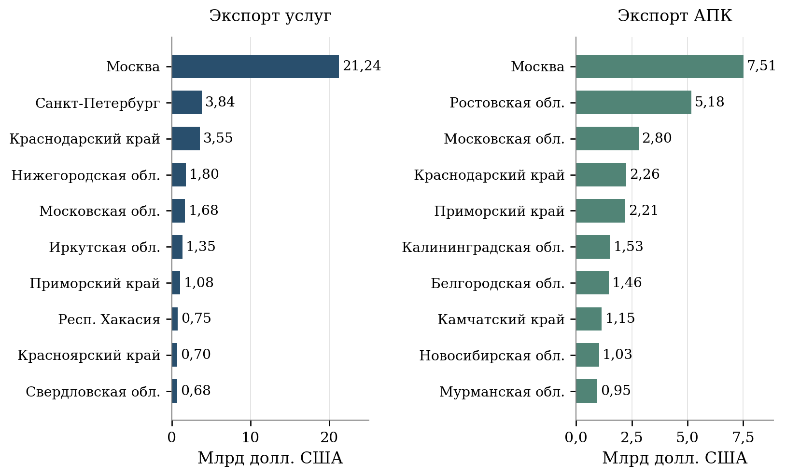

[B263; ReportCaption] Рисунок 7 – Крупнейшие территории экспорта услуг и продукции АПК

[B264; SourceNote] 2025 год. Панели имеют разные шкалы. Статистика операций по регионам не совпадает с географией производства. Значения АПК в обзоре округлены. [71]

### [B265; Heading2] 4.6 Ограничения оценки и социальные результаты

[B266; ] Статистические результаты дают основания говорить о неоднородности экспортной динамики, высокой территориальной концентрации отдельных направлений и необходимости более точного учёта результатов поддержки. Установленные различия не позволяют рассчитать причинный вклад национального проекта простым сопоставлением его бюджета с общей экспортной выручкой. Для такой задачи требуется связать расходы, получателей, контракты и экономические результаты в одной системе наблюдения.

[B267; ] Влияние экспорта на занятость следует оценивать на уровне предприятий и производственных подразделений. Рост стоимости поставок может сопровождаться расширением выпуска, повышением цен, увеличением производительности либо изменением ассортимента. Воздействие каждого процесса на потребность в работниках различно. Поэтому количество созданных рабочих мест нельзя выводить из суммы экспортных контрактов посредством единого коэффициента для всех отраслей.

[B268; ] Для оценки социальных результатов предлагается наблюдать среднесписочную численность, фонд оплаты труда, реальные заработные платы и устойчивость занятости у получателей поддержки. Для сезонных производств дополнительно требуется число месяцев занятости и распределение рабочих часов. Сопоставление с близкими организациями без поддержки позволит отличить общую отраслевую динамику от изменений, связанных с условиями участия в программе. Конкретные результаты такой оценки должны сопровождаться указанием состава сравниваемых предприятий.

[B269; ] Демографическое значение экспортных производств проявляется через условия жизни работников и их семей. Стабильные рабочие места могут повышать привлекательность территории, однако между созданием экспортной мощности и миграционным результатом находятся доступность жилья, транспорта, образования и медицинской помощи. В рамках экспертизы отсутствуют основания количественно приписывать национальному проекту изменение миграции или рождаемости. Возможность такого воздействия рассматривается как исследовательская гипотеза с необходимостью отдельной проверки.

[B270; ] Наблюдение за экспортёрами целесообразно организовать с сохранением группы предприятий, получивших поддержку в одном году. Последующие результаты фиксируются независимо от продолжения участия, изменения юридического адреса и перехода на другую меру. Выбывшие организации учитываются при оценке устойчивости. Исключение прекративших экспорт предприятий из знаменателя приводило бы к систематическому завышению результатов и затрудняло сравнение разных периодов программы.

[B271; ] Практическое значение проведённого анализа состоит в переходе к совместному наблюдению за стоимостью поставок, физическими объёмами, повторными продажами и состоянием предприятий. Национальная статистика определяет общий масштаб, территориальные данные раскрывают распределение операций, сведения о поддержке позволяют исследовать отдельные механизмы. Согласование этих уровней даст возможность оценивать экспортный рост вместе с его устойчивостью, производственной основой и социальными результатами.

### [B272; Heading2] 4.7 Сценарные условия достижения целей 2030 года

[B273; ] От достигнутого уровня 2025 года к целям 2030 года остаются пять годовых переходов. При неизменности определения требуемый среднегодовой номинальный прирост ННЭ составляет 8,68%, промышленного экспорта – 9,58%, экспорта АПК – 5,84%. Расчёт показывает интенсивность необходимого движения и позволяет сопоставить её между направлениями. Он не определяет вероятность достижения цели. [72]

[B274; формула (5)] r = (E_2030 / E_2025)^(1/5) − 1

$$
r=\sqrt[5]{\frac{E_{2030}}{E_{2025}}}-1
$$

[B275; EquationNote] r – необходимый среднегодовой темп прироста, E2025 – исходная стоимость экспорта, E2030 – целевое значение. Для представления результата в процентах r умножается на 100.

[B276; ReportCaption] Таблица 9 – Темпы движения от результата 2025 года к цели 2030 года

[B277; таблица 9]

| Показатель | 2025 | Цель 2030 | Необходимый среднегодовой прирост, % |
| --- | --- | --- | --- |
| ННЭ | 163,65 | 248,10 | 8,68 |
| Промышленный экспорт | 122,09 | 192,90 | 9,58 |
| Экспорт АПК | 41,56 | 55,20 | 5,84 |

[B278; SourceNote] Стоимостные объёмы – млрд долл. США. Расчёт предполагает пять годовых переходов и неизменность определения. Расчёт определяет требуемые темпы. Прогнозная оценка не выполняется. [73]

[B279] 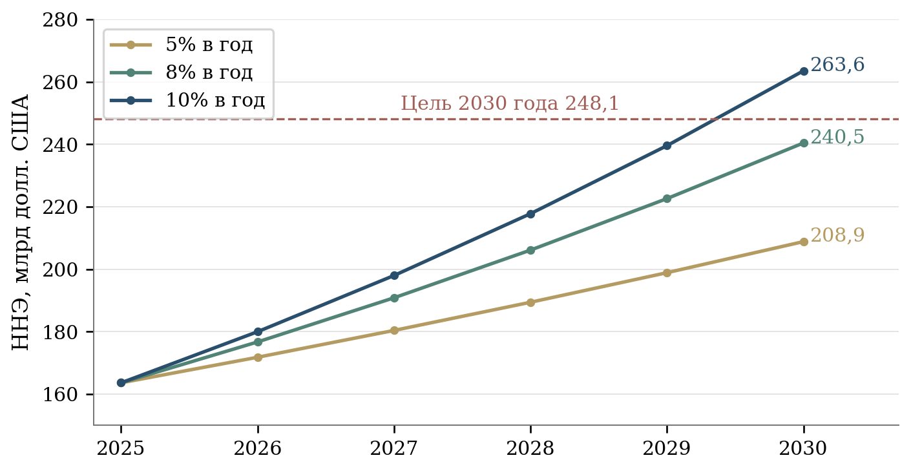

[B280; ReportCaption] Рисунок 8 – Условные траектории ННЭ при постоянном номинальном приросте

[B281; SourceNote] База 2025 года – 163,65 млрд долл. Сценарии 5%, 8% и 10% в год иллюстрируют чувствительность результата. Они не являются прогнозом или оценкой эффекта проекта. [74]

[B282; ] При постоянном приросте ННЭ на 5% в год к 2030 году получится около 208,86 млрд долл., при 8% – 240,46 млрд, при 10% – 263,56 млрд. Сценарии основаны на неизменной базе 163,65 млрд и пяти последовательных годовых приростах. Одинаковый стоимостной результат может быть получен при разных сочетаниях цен и физических объёмов. Для оценки производственного эффекта требуется отдельное разложение.

[B283; ] Доступный ряд нового проектного цикла короток, месячные значения накопительные, часть показателей меняет методику. Эти ограничения препятствуют надёжной оценке сложной прогностической модели. Сценарии позволяют проверить достаточность производственных мощностей, финансовых ресурсов и пропускной способности маршрутов для заданной траектории. Изменение внешнего спроса или цен требует пересмотра допущений и расчёта.

## [B284; Heading1] 5 Финансовое обеспечение и стоимость поддержки

### [B285; Heading2] 5.1 Периметр финансовой оценки и сопоставимость источников

[B286; ] Финансовый план национального проекта охватывает бюджетную поддержку экспортных операций, развитие инфраструктуры и работу институтов содействия экспорту. Объём кредитов, страховых обязательств, заключённых внешнеторговых контрактов и экспортной выручки относится к результатам либо финансовым инструментам. Складывать такие величины с бюджетными назначениями нельзя. Субсидия банку возмещает определённую часть стоимости кредитования, тогда как сумма выданного кредита подлежит возврату заёмщиком. Объём страхового покрытия характеризует принятые обязательства. Бюджетные расходы на страховую поддержку могут включать субсидии и специальные взносы, перечисляемые до наступления страхового случая. Страховые выплаты и последующие возмещения следует учитывать отдельно от этих бюджетных перечислений. Данное разграничение необходимо для оценки реального объёма государственных ресурсов. [75]

[B287; ] В открытом представлении паспорта национального проекта за 2025–2030 годы указано 723,3116451 млрд рублей. Из этой суммы 721,5400066 млрд приходится на федеральный бюджет, 1,7716385 млрд – на консолидированные бюджеты субъектов Российской Федерации. Открытые строки не содержат отдельной суммы внебюджетного финансирования. Отсутствие такой строки характеризует устройство финансового плана и не означает отсутствия собственных вложений экспортёров. Паспортные назначения следует рассматривать как план поддержки в выбранной редакции, с указанием горизонта и источника средств. [76]

[B288; ] При сопоставлении федеральных проектов выявлено различие временных границ. Заголовочный итог проекта «Экспорт продукции агропромышленного комплекса» составляет 293,7162982 млрд рублей, хотя в его финансовой разбивке присутствуют расходы 2031–2036 годов. Их сумма равна 3,9217044 млрд рублей. За период 2025–2030 годов объём составляет 289,7945938 млрд рублей. После исключения расходов за пределами рассматриваемого горизонта сумма четырёх федеральных проектов совпадает с заголовочным итогом национального проекта. Расхождение, возникающее при сложении заголовочных сумм, объясняется именно включением последующих лет. [77]

[B289; ] Отдельной корректировки требует повторный учёт межбюджетного трансферта. В федеральном проекте «Системные меры развития международной кооперации и экспорта» на поддержку центров экспорта в 2025 году раскрыто 1,3716385 млрд рублей расходов консолидированных региональных бюджетов. В составе того же результата приведены 1,3383563 млрд рублей, передаваемые бюджетам субъектов Федерации. Назначение и величина трансферта подтверждаются распоряжением Правительства Российской Федерации № 2537-р в редакции от 19 ноября 2025 года. Федеральный трансферт входит в региональные расходы и не образует дополнительного ресурса при их объединении. [78]

[B290; ] Проверка по результатам федерального проекта подтверждает включение указанного трансферта в федеральный итог. Сумма прямо обозначенных федеральных финансовых строк результатов за 2025 год составляет 7,0295283 млрд рублей, а сводный федеральный итог – 8,3678846 млрд рублей. Разность равна 1,3383563 млрд рублей. Следовательно, арифметическое объединение федерального и регионального итогов учитывает трансферт дважды. После его исключения сумма раскрытых ресурсов национального проекта за 2025–2030 годы составляет 721,9732888 млрд рублей. Уточнение относится к объединению источников и не изменяет установленную в паспорте сумму федерального финансирования. [79]

[B291; ] Собственный региональный вклад в рассматриваемое мероприятие 2025 года, рассчитанный как разность консолидированных расходов и федерального трансферта, равен 33,2822 млн рублей. В финансовом плане также отражено по 200 млн рублей региональных расходов на 2028 и 2029 годы. Для этих сумм отдельный федеральный трансферт в соответствующей строке результата не раскрыт. Поэтому величина 721,9732888 млрд рублей имеет точное аналитическое содержание: сумма финансовых строк на едином горизонте после исключения прямо установленного повторного счёта. Она не является оценкой всех затрат российского бизнеса на экспорт. [80]

[B292; ReportCaption] Таблица 10 – Источники финансирования и подтверждённый повторный счёт

[B293; таблица 10]

| Год | Федеральный бюджет | Региональные суммы | Общая сумма | Известный повтор | После вычета |
| --- | --- | --- | --- | --- | --- |
| 2025 | 104,494 | 1,372 | 105,866 | 1,338 | 104,527 |
| 2026 | 85,259 | 0,000 | 85,259 | 0,000 | 85,259 |
| 2027 | 56,979 | 0,000 | 56,979 | 0,000 | 56,979 |
| 2028 | 154,775 | 0,200 | 154,975 | 0,000 | 154,975 |
| 2029 | 157,846 | 0,200 | 158,046 | 0,000 | 158,046 |
| 2030 | 162,186 | 0,000 | 162,186 | 0,000 | 162,186 |
| Всего | 721,540 | 1,772 | 723,312 | 1,338 | 721,973 |

[B294; SourceNote] Млрд рублей. Нули в столбце известного повтора означают отсутствие отдельно подтверждённого вычета. Региональные назначения 2028–2029 годов требуют дальнейшего раскрытия состава. [81]

### [B295; Heading2] 5.2 Распределение средств между направлениями и годами

[B296; ] В структуре сопоставимых паспортных назначений за 2025–2030 годы преобладают два направления. На «Промышленный экспорт» приходится 339,8334826 млрд рублей, на экспорт продукции АПК – 289,7945938 млрд рублей. По отношению к арифметическому паспортному итогу их доли составляют соответственно 46,98 и 40,06%. «Системные меры развития международной кооперации и экспорта» занимают 9,17%, «Создание зарубежной инфраструктуры» – 3,79%. Для анализа распределения паспортных строк применён исходный итог, поскольку он соответствует представлению федеральных проектов. При оценке совокупного ресурса используется сумма с поправкой на трансферт. [82]

[B297; ] Финансовый план существенно смещён к завершению периода. На 2025 год предусмотрено 105,8657 млрд рублей, на 2026 год – 85,2592 млрд, на 2027 год – 56,9792 млрд рублей. В 2028 году сумма возрастает до 154,9751 млрд, в 2029 году – до 158,0460 млрд, в 2030 году – до 162,1864 млрд рублей. На последние три года приходится 65,70% арифметического объёма финансирования за весь период. Подобное распределение увеличивает значение своевременной подготовки проектов, поскольку позднее выделение средств может ограничивать срок получения экспортного результата к 2030 году. [83]

[B298; ] Из годового распределения нельзя непосредственно вывести момент возникновения экономического эффекта. Для процентной субсидии расходы текущего года могут обслуживать кредит, выданный ранее. Финансирование строительства объекта за рубежом предшествует его вводу и началу регулярных поставок. Возмещение транспортных затрат, напротив, может следовать за перевозкой. Оценка сроков должна учитывать тип обязательства, год заключения соглашения, начало финансирования и период фактического использования результата. Без такого календаря сопоставление расходов года с экспортом того же года смешивает разные стадии реализации мер. [84]

[B299; ] Для промышленного экспорта основной прирост паспортных назначений приходится на 2028–2030 годы. За эти годы предусмотрено 250,4858 млрд рублей, что составляет 73,71% шестилетнего финансового плана данного федерального проекта. В зарубежной инфраструктуре к последним трём годам отнесено 24,0858 млрд рублей из 27,3810 млрд. Значительная часть работы должна быть подготовлена до периода основной финансовой нагрузки. Необходимы завершённые процедуры отбора, подтверждённый спрос и согласованные условия эксплуатации, позволяющие переходить от выделения средств к выполнению обязательств без длительного ожидания. [85]

[B300; ] Структура финансирования отражает различия капиталоёмкости и финансовых инструментов. Малая доля системных мер в сумме назначений не доказывает их второстепенного значения. От цифрового оформления, доступа к информации, сертификации и сопровождения сделок может зависеть использование более крупных кредитных и транспортных программ. Оценивать согласованность распределения следует по фактическим ограничениям экспортёров и стоимости их устранения. Для этого нужны сведения о неудовлетворённых заявках, сроках ожидания и причинах отказов, сопоставленные с результатами уже поддержанных организаций.

[B301; ReportCaption] Таблица 11 – Паспортное финансирование федеральных проектов за 2025–2030 годы

[B302; таблица 11]

| ФП | 2025 | 2026 | 2027 | 2028 | 2029 | 2030 | Итого |
| --- | --- | --- | --- | --- | --- | --- | --- |
| М1 | 37,367 | 23,486 | 28,495 | 77,922 | 84,628 | 87,936 | 339,833 |
| М2 | 0,002 | 1,293 | 2,000 | 10,531 | 7,554 | 6,000 | 27,381 |
| М3 | 9,740 | 9,890 | 4,722 | 14,334 | 13,330 | 14,287 | 66,303 |
| М4 | 58,757 | 50,591 | 21,762 | 52,188 | 52,534 | 53,963 | 289,795 |
| Всего | 105,866 | 85,259 | 56,979 | 154,975 | 158,046 | 162,186 | 723,312 |

[B303; SourceNote] Млрд рублей. Арифметические суммы опубликованных строк до устранения установленного повторного счёта трансферта. Расходы после 2030 года исключены. [86]

[B304] 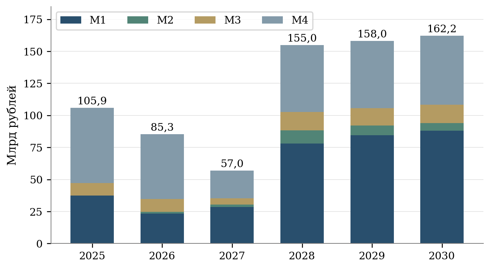

[B305; ReportCaption] Рисунок 9 – Паспортное финансирование по годам и федеральным проектам

[B306; SourceNote] Млрд рублей. Арифметический периметр паспортных сумм до вычета подтверждённого повторного счёта. М1 – промышленный экспорт, М2 – инфраструктура, М3 – системные меры, М4 – АПК. [87]

### [B307; Heading2] 5.3 Содержание поддержки и измерение её отдачи

[B308; ] В промышленном экспорте на субсидирование корпоративных программ повышения конкурентоспособности и льготное кредитование через РОСЭКСИМБАНК и ВЭБ.РФ за 2025–2030 годы предусмотрено в сумме 243,7708418 млрд рублей. Их доля составляет 71,73% финансового плана федерального проекта. Ещё 55,6574790 млрд рублей приходится на компенсацию затрат на транспортировку. Существенный объём средств направлен на снижение финансовой и логистической нагрузки. Проверка результата должна устанавливать, какую часть экспортных поставок удалось осуществить благодаря улучшению условий финансирования и доставки. [88]

[B309; ] В экспорте продукции АПК расходы на возмещение недополученных доходов по льготным кредитам составляют 211,5669305 млрд рублей, или 73,01% плана за 2025–2030 годы. На компенсацию транспортных затрат предусмотрено 63,1827956 млрд рублей. Увеличение производства при получении кредита может обслуживать внутренний и внешний спрос одновременно. Поэтому экспортный результат необходимо связывать с конкретным получателем, мощностью и товаром, сохраняя сведения об использовании продукции на внутреннем рынке. Одно лишь получение кредита не устанавливает величину дополнительного экспорта. [89]

[B310; ] Отношение поддержанного экспорта к субсидии полезно для описания финансового масштаба программы, однако не измеряет чистую отдачу бюджетных расходов. Экспортёр мог осуществить часть поставок при рыночном кредитовании, использовании собственных средств или другой форме поддержки. Результат зависит и от мировых цен, курса валют и спроса покупателей. Для оценки дополнительного эффекта требуется сравнение с организациями, имеющими близкие исходные характеристики, и наблюдение до предоставления поддержки. Выбор сравниваемых организаций должен учитывать отрасль, размер, прежний экспорт, рынки сбыта и доступ к кредитованию.

[B311; ] Процентная субсидия требует учёта полного срока обязательств. Небольшая выплата в год заключения кредитного договора может сопровождаться многолетними расходами бюджета. Ожидаемую экспортную выручку за весь срок кредита необходимо сопоставлять с полной стоимостью его поддержки. По каждой группе кредитов следует раскрывать остаток задолженности, график субсидирования, фактическую ставку для заёмщика и бюджетные расходы за весь период. Расчёт чувствительности к ставкам должен отделять удорожание действующих кредитов от расходов на расширение круга получателей. [90]

[B312; ] Для страховых и гарантийных инструментов необходимы показатели принятых обязательств, действующего покрытия, выплат и последующих возмещений. Дополнительный страховой лимит расширяет возможность проведения сделок, но ещё не означает заключения контрактов или поступления экспортной выручки. В паспорте системных мер предусмотрены специальные взносы для страховой поддержки проектов в перспективных странах. Их оценка должна учитывать концентрацию рисков по покупателям, странам и валютам, продолжительность обязательств и долю операций, по которым произошло фактическое исполнение. Простое увеличение страхового покрытия не раскрывает качество поддержанного портфеля. [91]

[B313; ] В зарубежной инфраструктуре бюджетный результат следует связывать с использованием объектов. Для транспортно-логистического центра существенны дата начала работы, загрузка, стоимость обработки груза и сохранность поставок. Для промышленной зоны необходимы число действующих резидентов, выпуск и экспорт продукции, занятость и частные вложения. Финансовый план содержит как создание объектов, так и компенсацию перевозок. Указанные меры имеют разные сроки действия и механизм влияния, поэтому их нельзя оценивать единым показателем количества построенных объектов или перевезённых партий. [92]

[B314] 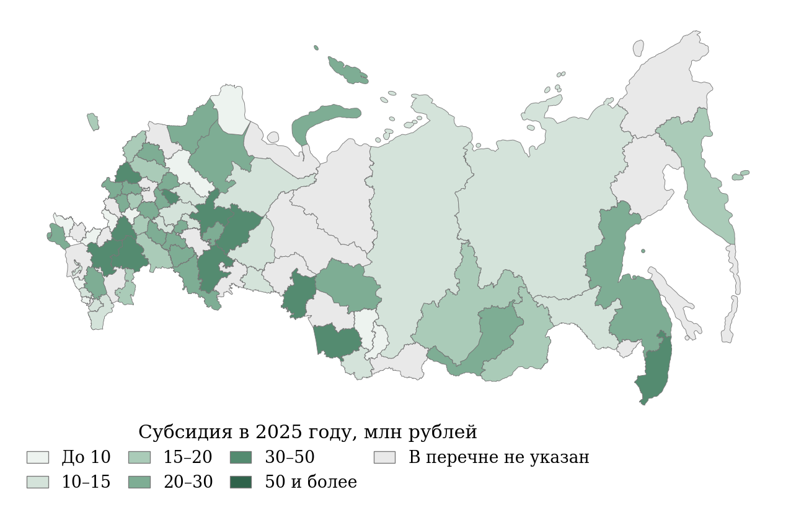

[B315; ReportCaption] Рисунок 10 – Распределение субсидии региональным центрам поддержки экспорта

[B316; SourceNote] 2025 год, млн рублей. В перечень включены 67 субъектов. Отсутствие в перечне не означает отсутствия других мер поддержки. [93]

### [B317; Heading2] 5.4 Предложения федерального бюджета на 2027–2029 годы

[B318; ] В пояснительной записке к проекту федерального бюджета на 2027–2029 годы финансирование национального проекта определено в размере 80,4747 млрд рублей в 2027 году, 137,5902 млрд в 2028 году и 138,5093 млрд рублей в 2029 году. Совокупный объём трёхлетних предложений составляет 356,5742 млрд рублей. Данные относятся к проекту бюджета, внесённому в Государственную Думу 30 сентября 2026 года. Они рассматриваются отдельно от паспортного плана и не обозначаются как исполненные расходы либо окончательно принятые назначения. [94]

[B319; ] По сравнению со сводной бюджетной росписью на 1 сентября 2026 года, приведённой в той же таблице пояснительной записки, финансирование 2027 года уменьшается с 84,7812 до 80,4747 млрд рублей, или на 5,08%. Изменение распределено неодинаково. «Промышленный экспорт» увеличивается с 23,0076 до 36,2184 млрд рублей, зарубежная инфраструктура – с 1,2928 до 2,5000 млрд, системные меры – с 9,8898 до 10,4754 млрд рублей. По экспорту продукции АПК сумма уменьшается с 50,5910 до 31,2809 млрд рублей. Снижение общего итога связано с последним направлением. [95]

[B320; ] Внутри экспорта продукции АПК объяснение требует дополнительной детализации. В базе 2026 года строка «Иные мероприятия структурного элемента» составляет 22,7792 млрд рублей, а в предложениях 2027 года равна нулю. Сумма остальных поимённо раскрытых направлений, рассчитанная по итоговым значениям, увеличивается с 27,8118 до 31,2809 млрд рублей, то есть на 3,4691 млрд рублей. Следовательно, общий спад не означает сокращения каждой меры поддержки. Содержание крупной агрегированной строки и её связь с последующими назначениями имеют решающее значение для интерпретации изменения. [96]

[B321; ] По промышленному экспорту наиболее заметно увеличение транспортной поддержки: с 2,2293 млрд рублей в базе 2026 года до 17,7090 млрд в предложениях 2027 года. На эту меру приходится 48,90% планируемого финансирования федерального проекта в 2027 году. Для оценки обоснованности такого распределения необходимы сведения о стоимости перевозки единицы продукции, маршрутах и доле субсидии в экспортной марже. Само увеличение назначения не показывает, расширится ли география продаж, возрастёт ли физический объём поставок либо будет компенсировано удорожание существующих перевозок. [97]

[B322; ] Предложения 2027 года предусматривают 2,3389 млрд рублей на софинансирование региональных проектов при участии центров поддержки экспорта и региональных программ развития экспорта. На 2028 и 2029 годы указано по 2,5 млрд рублей. В аналитическом объединении будущих федеральных и региональных расходов данные суммы должны учитываться один раз. При распределении по территориям необходимо различать федеральный трансферт и средства субъекта Федерации, а также сохранять связь с фактически оказанными услугами и экспортом получателей. [98]

[B323; ] Сопоставление с федеральной составляющей выбранного паспортного плана показывает смену распределения по годам. Предложение на 2027 год выше паспортной суммы 56,9792 млрд рублей на 41,24%. На 2028 год предложение 137,5902 млрд рублей ниже паспортных 154,7751 млрд на 11,10%. Значение 2029 года ниже паспортного федерального ориентира 157,8460 млрд рублей на 12,25%. Подобное сравнение характеризует различие плановых редакций. Для вывода о фактическом сокращении поддержки необходимы окончательные назначения, переходящие обязательства и изменения состава результатов. [99]

[B324; ] Роспись на 1 сентября 2026 года и представление паспорта, обновлённое в октябре, также имеют разные итоги: 84,7812 и 85,2592 млрд рублей. Разность около 478 млн рублей сосредоточена преимущественно в промышленном экспорте. Расхождение не следует устранять заменой одной суммы другой без указания даты. Для временных сопоставлений используется одна версия финансового плана, а изменения фиксируются отдельно. Для оценки кассового исполнения необходимы назначения и выплаты, сформированные на одну отчётную дату и по одинаковому набору кодов бюджетной классификации. [100]

[B325; ReportCaption] Таблица 12 – Федеральные бюджетные предложения на 2027–2029 годы

[B326; таблица 12]

| Направление | Роспись 2026 | 2027 | 2028 | 2029 |
| --- | --- | --- | --- | --- |
| Всего | 84,781 | 80,475 | 137,590 | 138,509 |
| М1 | 23,008 | 36,218 | 55,561 | 57,388 |
| М2 | 1,293 | 2,500 | 9,031 | 8,054 |
| М3 | 9,890 | 10,475 | 16,152 | 15,694 |
| М4 | 50,591 | 31,281 | 56,846 | 57,373 |

[B327; SourceNote] Млрд рублей. 2026 год – сводная бюджетная роспись на 01.09.2026. 2027–2029 годы – предложения пояснительной записки к законопроекту. [101]

[B328] 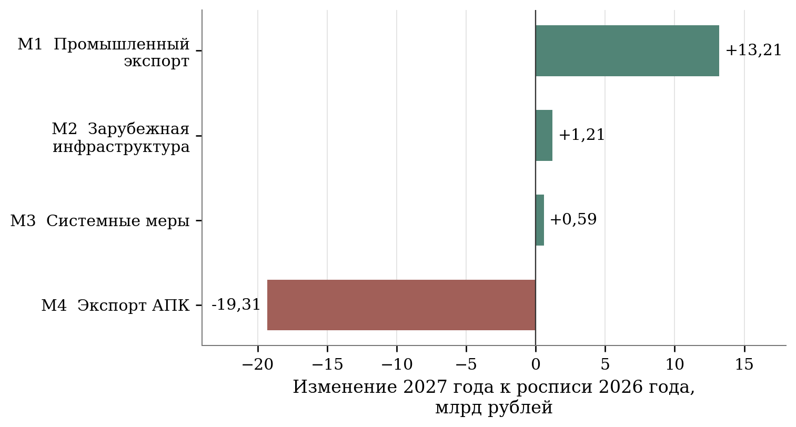

[B329; ReportCaption] Рисунок 11 – Вклад федеральных проектов в изменение бюджетных предложений

[B330; SourceNote] 2027 год относительно сводной росписи 2026 года на 01.09.2026. Совокупное изменение – минус 4,307 млрд рублей. [102]

### [B331; Heading2] 5.5 Кассовое исполнение и достижение результатов

[B332; ] По опубликованному сообщению Минфина России от 8 октября 2026 года исполнение расходов национального проекта на 1 октября составило 84,7% от плановых бюджетных назначений. Доля выше общей по национальным проектам, составлявшей 68,0%. Показатель характеризует перечисление средств из федерального бюджета. Он не означает выполнения 84,7% экспортной цели и не позволяет установить долю завершённых инвестиционных проектов, оплаченных поставок или устойчиво работающих получателей поддержки. Экономический результат требует самостоятельного наблюдения. [103]

[B333; ] Умножать опубликованные 84,7% на октябрьский паспортный итог для получения точной суммы кассовых расходов нельзя. Назначения, использованные в расчёте исполнения, относятся к определённой отчётной дате и могут отличаться от представления паспорта. Процент опубликован с округлением до одной десятой. Поэтому обратный расчёт даёт только приближение и дополнительно зависит от выбранного знаменателя. При отсутствии одновременной детализации назначения и выплаты следует сохранять опубликованную процентную оценку, не приписывая ей точность до миллиона рублей. [104]

[B334; ] Помесячные сведения в паспортах обозначены как план исполнения бюджета. Они не заменяют данные Федерального казначейства о фактических расходах. В ряде строк значения имеют накопительный характер, а отдельные годовые суммы отличаются от показателя, отображённого для декабря. Такие записи требуют изучения правил формирования и истории корректировок. Их механическое суммирование по месяцам многократно увеличивает объём финансирования. Сведения о фактическом исполнении целесообразно хранить отдельно от плана, сохраняя дату обновления и статус каждого значения. [105]

[B335; ] Высокая доля перечисленных средств может сочетаться с длительным ожиданием экспортного результата, если выплаты произведены авансом, направлены на обслуживание ранее выданных кредитов либо на пополнение финансовых возможностей института поддержки. В оценке исполнения необходимо прослеживать движение от бюджетного перечисления к обязательству получателя и фактической поставке. Для текущего года достаточно группировки по заключённым соглашениям, начатым операциям и подтверждённым результатам. Доля средств без соответствующего подтверждённого результата должна сопровождаться объяснением предусмотренного срока его получения.

### [B336; Heading2] 5.6 Дополнительность поддержки и финансовые риски

[B337; ] Основной единицей оценки дополнительности целесообразно принять экспортную операцию получателя, связанную с конкретной мерой поддержки. Для организации, одновременно использующей кредит, страхование, транспортную субсидию и консультационное сопровождение, необходимо сохранять единый идентификатор сделки. Общий объём поставки учитывается один раз. Распределение вклада отдельных инструментов возможно по специальному правилу, однако сумма условно отнесённых эффектов не должна превышать установленный результат операции. Такая организация учёта позволяет анализировать совместное действие мер без повторного начисления одного и того же экспортного результата.

[B338; ] Дополнительный эффект следует оценивать в сопоставимых ценах и по одинаковым товарным группам. При росте мировой цены увеличение долларовой выручки возможно без расширения производства и поставок. Для мер, ориентированных на транспортные расходы, особенно важно изменение физического объёма и себестоимости доставки. Для поддержки технологической продукции необходимы сведения о номенклатуре, доле российской добавленной стоимости и повторных продажах. Финансовая результативность приобретает содержательный смысл при одновременном наблюдении расходов государства, результата получателя и его устойчивости после завершения поддержки.

[B339; ] Кредитная и страховая поддержка создаёт обязательства, выходящие за пределы года выдачи. Оценку ожидаемой нагрузки следует проводить по срокам погашения, вероятности невыполнения обязательств, валюте и концентрации на отдельных заёмщиках. Для зарубежных объектов дополнительно учитываются расходы на эксплуатацию, требования принимающей страны, доступность платежей и возможность получения дохода. Сценарные расчёты полезно строить вокруг конкретных параметров: задержки ввода, снижения загрузки, удорожания кредитования и роста логистических расходов. Результат сценария должен показывать изменение бюджетных обязательств и достижимости целевого результата.

[B340; ] Для оценки территориального распределения поддержки необходимо учитывать различия экспортного потенциала и доступности услуг. Абсолютная сумма субсидии региону не характеризует качество работы центра поддержки экспорта. Требуются число обслуженных организаций, доля впервые начавших экспорт, сохранение поставок через год и объём оплаченных контрактов. Соответствующие показатели должны рассчитываться для одних и тех же получателей. Федеральный трансферт, собственные региональные расходы и расходы других программ фиксируются раздельно, чтобы сравнение стоимости поддержки не зависело от особенностей представления бюджетных данных.

[B341; ] Практическое совершенствование финансового мониторинга целесообразно начать с единого реестра назначений, соглашений и операций получателей. Первая задача состоит в согласовании горизонта, источников и межбюджетных потоков. Следующий этап предполагает объединение сведений о разных мерах поддержки одной организации и связи с подтверждёнными поставками. После накопления наблюдений возможно регулярное сравнение получателей с сопоставимыми организациями и оценка устойчивости экспорта. Приоритет следует отдавать мерам, для которых установлены дополнительный результат, приемлемая стоимость и сохранение деятельности после окончания субсидирования.

## [B342; Heading1] 6 Связи мероприятий с показателями и текстовая структура

### [B343; Heading2] 6.1 Документированные связи и единицы анализа

[B344; ] Анализ связей выполнен по полным разделам результатов и показателей четырёх федеральных паспортов. Единицей мероприятия служит отдельная паспортная запись результата вместе с её содержательной характеристикой. Контрольные точки, реквизиты исполнителей и повторяющиеся служебные подписи исключены из текстового сравнения. Единицей показателя служит его полное наименование. Такая подготовка сохраняет хозяйственный смысл документа и уменьшает влияние многократного повторения административных формулировок. [106]

[B345; ] Получены 47 профилей результатов и 18 наименований показателей ФП. У каждого результата зафиксирована принадлежность задаче своего федерального проекта. По общей задаче можно образовать 284 пары «результат – показатель»: 40 для М1, 10 для М2, 207 для М3 и 27 для М4. Числа соответствуют произведениям количества результатов и показателей внутри каждого направления. Общая задача устанавливает принадлежность программной конструкции, но не выделяет конкретный механизм воздействия каждой пары.

[B346; ] Наиболее плотная группа возникает в системных мерах: 23 результата соединяются общей задачей с девятью показателями. В неё одновременно входят цифровые услуги, кредитование, продвижение, региональная поддержка и экспертиза. Для оценки ответственности за результат необходимо дополнить такую общую связь указанием конкретного показателя назначения, единицы наблюдения, ожидаемого срока и источника подтверждения.

### [B347; Heading2] 6.2 Методика лексического сопоставления

[B348; ] Векторизация TF–IDF выполнена для корпуса из 65 текстов: 47 профилей результатов и 18 названий показателей ФП. Текст приведён к нижнему регистру, буква «ё» нормализована к «е». Из рассмотрения исключены предлоги, союзы, местоимения и повторяющиеся административные слова. Числа сохранены, поскольку версии стандартов и временные обозначения способны изменять смысл. Использованы отдельные слова и пары соседних слов. Морфологическое сведение форм не выполнялось, что ограничивает совпадения разных падежей и учтено при интерпретации.

[B349; ] Частотный вес преобразован по правилу 1 + ln(tf), обратная частота документа рассчитана как ln((1 + N)/(1 + df)) + 1. Векторы нормированы по евклидовой длине. Сходство определяется косинусом угла между ними. Для каждого результата выбран показатель своего ФП с наибольшим значением сходства. Область поиска ограничена соответствующим направлением, чтобы тематическое совпадение с соседним проектом не выдавалось за закреплённую паспортом ответственность.

[B350; формула (6)] S(a,i) = ∑_{k=1}^{m}(w_ak w_ik) / (√∑_{k=1}^{m}w_ak² × √∑_{k=1}^{m}w_ik²)

$$
S(a,i)=\frac{\sum_{k=1}^{m}w_{ak}w_{ik}}{\sqrt{\sum_{k=1}^{m}w_{ak}^{2}}\sqrt{\sum_{k=1}^{m}w_{ik}^{2}}}
$$

[B351; EquationNote] S(a,i) – косинусное сходство профиля результата a и названия показателя i. wak и wik – веса k-го термина в документах a и i, m – число терминов общего словаря. Значения TF–IDF служат признаками лексической близости. Их величина не является оценкой причинного эффекта.

[B352; ] Порог сходства не имеет нормативного содержания. В основном сравнении показаны непрерывные значения, а чувствительность отбора проверена на нескольких порогах. При пороге 0,05 хотя бы один кандидат находится для 26 результатов, при 0,10 – для 15, при 0,15 – для восьми, при 0,20 – для шести. Сильная зависимость числа отобранных пар от порога исключает использование доли лексических совпадений в качестве самостоятельного показателя качества проекта.

[B353] 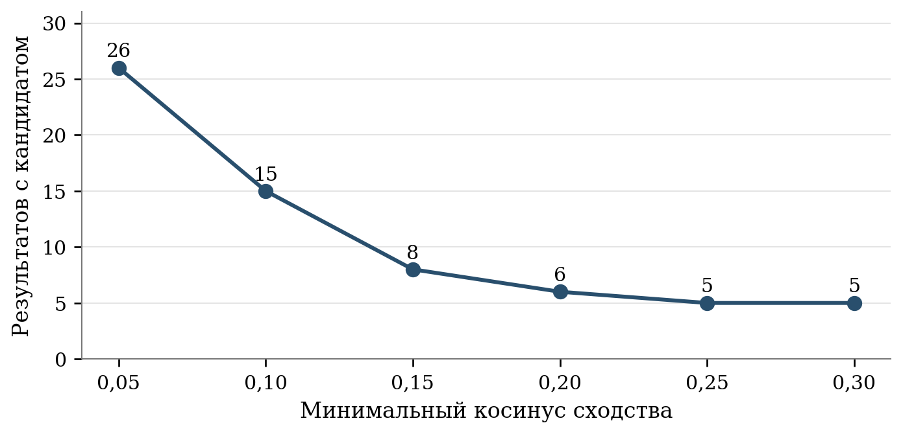

[B354; ReportCaption] Рисунок 12 – Чувствительность числа лексических кандидатов к порогу отбора

[B355; SourceNote] Для каждого из 47 результатов выбран наиболее близкий по словам показатель своего федерального проекта. Порог не является нормативной оценкой качества.

[B356] 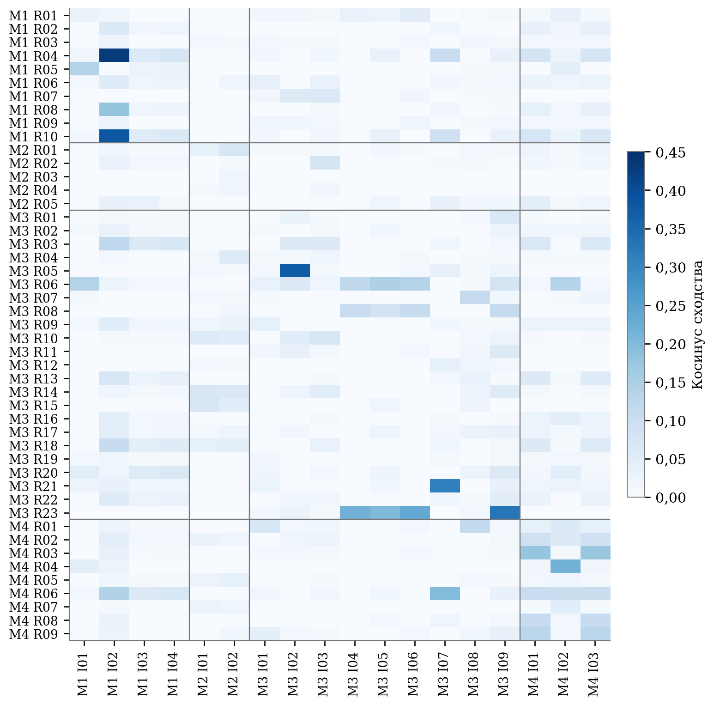

[B357; ReportCaption] Рисунок 13 – Лексическое сходство 47 результатов и 18 показателей ФП

[B358; SourceNote] TF–IDF и косинусное сходство. Полная матрица включает межпроектные пары. Отбор кандидатов выполнен внутри ФП. Расшифровка кодов – приложения А и Б.

### [B359; Heading2] 6.3 Специализация федеральных проектов

[B360; ] Для сопоставления четырёх федеральных направлений результаты и наименования показателей объединены в четыре содержательных профиля. На них повторно рассчитаны TF–IDF и косинусное сходство. Значения между разными проектами составляют от 0,038 до 0,144. Наибольшее сходство обнаруживается у промышленного и аграрного экспорта – 0,144, близкое значение имеет пара промышленного экспорта и системных мер – 0,143. Обе пары используют лексику финансовой поддержки и экспортных поставок.

[B361] 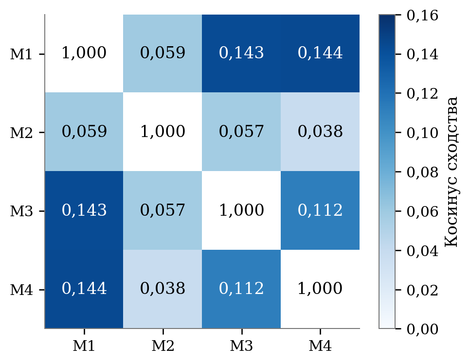

[B362; ReportCaption] Рисунок 14 – Лексическая близость содержательных профилей четырёх ФП

[B363; SourceNote] Диагональ показывает тождество профиля самому себе. Шкала цвета относится к межпроектным значениям. М1 – промышленный экспорт, М2 – инфраструктура, М3 – системные меры, М4 – АПК.

[B364; ] Зарубежная инфраструктура обладает наиболее обособленным словарём: создание объектов, транспортно-логистические маршруты, промышленные зоны и индустриальные парки. Низкая лексическая близость к аграрному направлению не означает слабой экономической связи. Услуги инфраструктуры могут использоваться экспортёрами разных отраслей, хотя формулировки их паспортных результатов не содержат одинаковых слов.

[B365; ] Словарный тематический анализ выделяет финансирование, логистику и инфраструктуру, продвижение и доступ, цифровые услуги, компетенции и региональное развитие, кооперацию и регулирование. Для каждой темы рассчитана доля результатов ФП, в наименовании или характеристике которых присутствует соответствующий признак. Темы могут пересекаться. Поэтому сумма долей не должна равняться 100%, а число упоминаний характеризует документальное внимание к вопросу.

[B366] 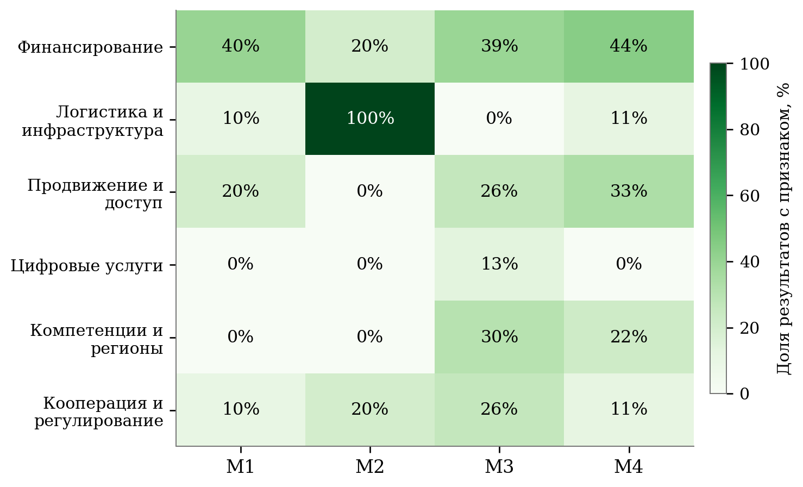

[B367; ReportCaption] Рисунок 15 – Тематические признаки в результатах федеральных проектов

[B368; SourceNote] Доля результатов, содержащих признак в наименовании или характеристике. Темы пересекаются и не образуют разбиение на 100%.

[B369; ] Тематическая матрица показывает разнообразие системных мер и более выраженную отраслевую специализацию двух экспортных направлений. Часть результатов одновременно касается финансирования и продвижения либо логистики и кооперации. Такие пересечения полезны при планировании совместного наблюдения. Для оценки фактического взаимодействия необходимы сведения о предприятиях, использовавших несколько инструментов, и последовательности их получения.

### [B370; Heading2] 6.4 Содержательная проверка лексических кандидатов

[B371; ] Наиболее близкая пара связана с льготным кредитованием высокотехнологичных поставок через РОСЭКСИМБАНК и показателем экспорта высокотехнологичной продукции: косинусное сходство составляет 0,429. Связь имеет содержательное основание. Для её количественной проверки требуется сопоставить поддержанные контракты с поставками, отнесёнными к установленному товарному перечню, и исключить повторный учёт при использовании других механизмов. [107]

[B372; ] Пара внедрения Регионального экспортного стандарта 3.0 и числа субъектов, внедривших стандарт, имеет сходство 0,371. Здесь совпадает предмет непосредственного организационного результата. Однако переход к росту регионального экспорта остаётся самостоятельной гипотезой. Величина счётчика должна подтверждаться выполнением требований стандарта и не заменяет наблюдение за предприятиями. [108]

[B373; ] Создание сервисов «Одного окна» наиболее близко по словам к числу экспортёров, использующих цифровую экосистему: 0,328. Содержательная связь между этими показателями опосредована доступностью, востребованностью и успешным завершением услуги. Количество созданных сервисов может увеличиться без расширения экспортной деятельности пользователей. Для проверки следует связать журнал обращений с организациями, подтверждёнными внешнеторговыми операциями и временными затратами. [109]

[B374; ] Выявлен и пример слабой содержательной интерпретации относительно высокого лексического веса. Сопровождение мероприятий проектным офисом АПК получило сходство 0,216 с показателем эффективности поддержки. Совпадение возникает из общих слов о проекте, мероприятиях и поддержке. Работа проектного офиса способна влиять на организацию исполнения, но сама по себе не определяет величину экспортной выручки на рубль субсидии. [110]

[B375; ReportCaption] Таблица 13 – Примеры содержательной проверки лексических связей

[B376; таблица 13]

| Результат | Показатель-кандидат | Сходство | Необходимое подтверждение |
| --- | --- | --- | --- |
| Кредитование высокотехнологичного экспорта РОСЭКСИМБАНКом | Высокотехнологичный экспорт | 0,429 | Поставки по поддержанным контрактам в установленном товарном перечне |
| Внедрение РЭС 3.0 | Количество субъектов с внедрённым РЭС 3.0 | 0,371 | Выполнение требований стандарта, дата и основание подтверждения |
| Создание сервисов «Одного окна» | Число экспортёров, использующих экосистему | 0,328 | Использование и завершение услуги, подтверждённая операция экспортёра |
| Сопровождение мероприятий офисом АПК | Эффективность мер поддержки АПК | 0,216 | Связь с расходами и поставками. Одного лексического совпадения недостаточно |
| Компенсация перевозок по международным коридорам | Охват зарубежной инфраструктурой | 0,000 | Маршрут, объект, грузопоток и период работы. Разная лексика не исключает связи |

[B377; SourceNote] Расчёты по содержательным профилям паспортов. Сходство характеризует текст. Коды результатов и показателей для полной матрицы приведены в приложениях А и Б.

[B378; ] Обратный пример дают компенсация перевозок по международным коридорам и показатель инфраструктурного охвата: в применённой словесной модели их сходство равно нулю. Оба результата относятся к зарубежной инфраструктуре, однако используют разную лексику и измеряют разные стороны её работы. Нулевой вес показывает отсутствие совпадающих признаков в выбранном представлении. Он не доказывает отсутствие хозяйственной взаимосвязи.

[B379; ] Практическое назначение автоматического сопоставления состоит в отборе вопросов для экспертного рассмотрения. Пара становится пригодной для мониторинга после определения механизма, требуемых наблюдений и периода результата. Утверждение прямой связи должно опираться на содержание меры и статистические условия учёта. Порог TF–IDF не может выполнять эту функцию.

### [B380; Heading2] 6.5 Межпроектные связи и общая история поддержки

[B381; ] Экспортная операция может включать кредит, страхование, компенсацию перевозки, участие в выставке и цифровое сопровождение. В отдельных отчётных системах одна поставка будет связана с несколькими инструментами. Для общей оценки необходимо создать запись сделки с уникальным идентификатором и перечнем использованных мер. Стоимость поставки учитывается в итоговом экспорте один раз, а расходы и действия каждого участника сохраняются отдельными полями.

[B382; ] Связи с национальными проектами транспортной инфраструктуры, кадров, производительности и цифровизации следует описывать на уровне конкретных ограничений. Если предприятие не может нарастить экспорт из-за недостаточной пропускной способности маршрута, предметом совместной оценки становится стоимость и срок перевозки. Если ограничение связано с кадрами, наблюдаются вакантные рабочие места, сроки подготовки и производственная мощность. Совпадение общих слов в паспортах лишь указывает на возможное пересечение задач.

[B383; ] Региональная программа поддержки требует связи между организацией, производственной площадкой и внешним рынком. Юридический адрес полезен для администрирования, но недостаточен для оценки территориального результата. В общей истории поддержки целесообразно сохранять место производства, принадлежность к группе компаний, объём закупок у региональных поставщиков и агрегированные показатели занятости. Доступ к детальным данным может быть ограничен, тогда как для публикации достаточно согласованных обезличенных агрегатов.

### [B384; Heading2] 6.6 Выводы по структуре измерения

[B385; ] Паспортная архитектура обеспечивает отраслевую специализацию и общий набор инструментов для внешнеэкономической деятельности. Основной дефицит относится к переходу между непосредственным мероприятием и наблюдаемым хозяйственным результатом. Для финансовой поддержки требуется различать договор, поставку и оплату. Для инфраструктуры – ввод и эксплуатацию. Для цифровых услуг – доступность, использование и завершение.

[B386; ] Содержательная матрица связей должна стать основой согласования ответственности. Для каждой меры необходимы показатель непосредственного результата, ожидаемый последующий эффект, срок наблюдения и источник подтверждения. Промежуточные организационные показатели сохраняют значение для управления. Их интерпретация становится точнее при наличии последующих результатов, позволяющих оценить использование созданных возможностей.

## [B387; Heading1] 7 Предложения по совершенствованию проекта и оценке его результатов

### [B388; Heading2] 7.1 Согласование показателей и сохранение истории изменений

[B389; ] Предлагаемые изменения предназначены для аналитического сопровождения национального проекта. Их внедрение предполагает обсуждение с ответственными ведомствами и утверждение правил расчёта дополнительных показателей. Основная задача состоит в установлении связи между предоставленной поддержкой и устойчивой экспортной деятельностью. Действующие паспортные показатели сохраняют значение для контроля обязательств. Дополнительные наблюдения должны раскрывать экономическое содержание достигнутых значений и причины отклонений.

[B390; ] Для каждого показателя рекомендуется утвердить расширенную карточку, включающую единицу наблюдения, товарные и территориальные границы, ценовую основу, период накопления, формулу и срок уточнения. Особое место занимает история редакций. Каждое опубликованное значение должно сопровождаться датой расчёта, датой поступления исходных сведений и идентификатором применённой методики. При пересмотре необходимо сохранять прежнее значение и основание замены. Правило использования данных прошлого периода, предусмотренное действующими методиками, требует явного признака переноса, позволяющего отличить отсутствие новых сведений от подтверждённой стабильности результата. [111]

[B391; ] Для ННЭ целесообразно установить автоматическую проверку согласованности общего объёма с промышленной и агропромышленной составляющими за одинаковый период. Одновременно проверяется соответствие годового прироста стоимостному объёму и установленной базе. Расхождения между декабрьской и годовой записью должны сопровождаться пояснением о предварительном или уточнённом статусе. Сводная публикация должна показывать согласованную годовую оценку. Внутригодовые данные следует представлять с одинаковыми границами накопления, исключая сопоставление итогов за различное число месяцев. [112]

[B392; ] Номинальный экспорт рекомендуется дополнять оценкой изменения физического объёма по сопоставимым группам товаров. Ценовая и количественная составляющие рассчитываются при постоянной номенклатуре, а влияние её изменения раскрывается отдельно. Для географических показателей необходимы два сопоставления: по действующему перечню стран и по постоянному составу направлений. Предлагаемый подход позволяет различать хозяйственные изменения и результат переклассификации. Координацию согласования карточек целесообразно возложить на Минпромторг России с участием Минсельхоза России, Росстата и владельцев исходных административных данных.

[B393; ] Изменение показателя должно сопровождаться оценкой последствий для уже опубликованной истории. Рекомендуется заранее устанавливать, какие годы подлежат пересчёту, как долго одновременно публикуются прежняя и новая версии и кто подтверждает их сопоставимость. Для данных с ограниченным доступом открытая публикация может содержать агрегированный результат проверки без раскрытия отдельных контрактов. Применяемые ограничения доступа не должны препятствовать раскрытию единиц измерения, состава совокупности и правил расчёта. Справка о пересмотре позволяет пользователю установить, изменился экономический результат или способ его статистического представления.

### [B394; Heading2] 7.2 Экономический результат поддержанных сделок

[B395; ] Наблюдение за получателем поддержки предлагается организовать по дате первого обращения и виду предоставленного инструмента. Единицей анализа становится организация с зафиксированными исходными характеристиками и перечнем связанных контрактов. В рамках контракта следует различать согласованную стоимость, фактическую отгрузку, наступление срока оплаты и полученные платежи. Такой учёт позволяет проследить исполнение сделки после завершения административной процедуры предоставления поддержки. Для нескольких инструментов по одному контракту необходим единый идентификатор, обеспечивающий согласование сведений РЭЦ, кредитной организации и страховщика.

[B396; ] Долю оплаченных поставок рекомендуется определять по стоимости отгрузок, срок оплаты которых наступил к дате наблюдения. Частичная оплата включается пропорционально фактически погашенной сумме. Платёж должен быть отнесён к конкретной отгрузке. Поставки с ещё не наступившим сроком оплаты выделяются отдельно. Для операций в разных валютах применяется единое заранее установленное правило пересчёта, позволяющее исключить искусственное изменение доли из-за различной оценки числителя и знаменателя.

[B397; формула (7)] P_T = 100 × [∑_i min(A_{i,T}, V_i)] / [∑_i V_i]

$$
P_T=100\frac{\sum_i\min(A_{i,T},V_i)}{\sum_iV_i}
$$

[B398; EquationNote] PT – доля оплаченных поставок, %. В расчёт включаются отгрузки i со сроком оплаты не позднее даты T. Vi – подлежащая оплате стоимость отгрузки, Ai,T – сумма подтверждённых платежей по ней к дате T. Обе величины приведены к единой валютной оценке. Формула предлагается для дополнительного мониторинга.

[B399; ] Для начинающих экспортёров предлагается наблюдать повторные поставки в течение второго года после первого исполненного контракта. В знаменатель включаются все компании соответствующей группы, по которым завершилось полное двухлетнее наблюдение. Прекращение деятельности компании не является основанием для её исключения. Повторной поставкой признаётся самостоятельная экспортная операция, отвечающая заранее установленным критериям учёта. Возврат товара, техническое исправление декларации и дробление одной партии не должны увеличивать число устойчиво экспортирующих организаций.

[B400; формула (8)] R_c,24 = 100 × N_c,13:24 / N_c

$$
R_{c,24}=100\frac{N_{c,13:24}}{N_c}
$$

[B401; EquationNote] Rc,24 – доля повторных экспортёров в группе c, %. Nc – число впервые вышедших на экспорт компаний с полным наблюдением за 24 месяца, Nc,13:24 – число компаний этой группы, выполнивших повторную поставку в месяцы с 13-го по 24-й после первой поставки. Показатель является авторским предложением.

[B402; ] Дополнительный экспорт на рубль поддержки следует оценивать по группам получателей с одинаковым началом участия и достаточным сроком наблюдения. Числитель включает разницу между наблюдаемым экспортом и обоснованной оценкой поставок при отсутствии поддержки. Знаменатель охватывает расходы на конкретную группу за согласованный срок. Для субсидий учитываются фактически предоставленные средства. Объём банковского кредита не заменяет бюджетную стоимость его поддержки. При наличии гарантий или страхования правила оценки расходов требуют отдельного согласования.

[B403; формула (9)] A_c,H = ∑_{h=0}^{H}(E_c,h − Ê⁰_c,h) / ∑_{h=0}^{H} B_c,h

$$
A_{c,H}=\frac{\sum_{h=0}^{H}(E_{c,h}-\widehat{E}_{c,h}^{0})}{\sum_{h=0}^{H}B_{c,h}}
$$

[B404; EquationNote] Ac,H – дополнительный экспорт на рубль поддержки группы c за горизонт H, Ec,h – наблюдаемый экспорт, Ê⁰c,h – его оценка при отсутствии поддержки, Bc,h – расходы на поддержку. Денежные величины приводятся к одной ценовой и валютной основе. Горизонт H выбирается с учётом задержки между поддержкой и поставками. При отсутствии обоснованной оценки Ê⁰ коэффициент не рассчитывается.

[B405; ] Для сравнения инструментов необходимо учитывать различную зрелость наблюдаемых групп. Компании, получившие поддержку недавно, имеют меньше времени для поставок и оплаты. Их текущий результат нельзя сопоставлять с полным двухлетним итогом прежних участников. В аналитических таблицах рекомендуется одновременно указывать число месяцев наблюдения и долю компаний, для которых соответствующий срок завершён. При раннем прекращении деятельности получателя сохраняется информация о предоставленной поддержке и достигнутых результатах. Исключение таких компаний из группы способно завысить оценку устойчивости экспорта.

### [B406; Heading2] 7.3 Зарубежная инфраструктура после ввода объектов

[B407; ] Для зарубежной инфраструктуры рекомендуется дополнить показатель охвата наблюдением за фактической эксплуатацией. В карточке объекта необходимо фиксировать территорию, вид услуг, долю российского участия, дату ввода, доступную мощность и условия обслуживания предприятий. Отдельно следует указывать основание включения в расчёт охвата. Действующая методика использует разные веса для объектов, созданных с различными формами содействия, поэтому физическое число объектов и взвешенный итог должны публиковаться раздельно. [113]

[B408; ] Порядок работы с перечнем опорных направлений требует письменного разъяснения. Для объектов в африканских государствах следует установить правило отнесения к страновой либо континентальной позиции. Для нескольких объектов в одной стране необходимо определить применение ограничения вклада при вводе в разные годы. Регистр должен сохранять сведения об объектах, прекративших деятельность, изменивших профиль или утративших доступность для российских предприятий. Признание объекта действующим следует подтверждать документами об эксплуатации и оказанных услугах.

[B409; ] Загрузку предлагается рассчитывать по мощности, фактически доступной в течение наблюдаемого периода. Для склада учитывается доступная площадь или вместимость с учётом времени работы, для сервисного центра – возможность выполнения определённых операций. Сопоставлять загрузку разных типов объектов в одном среднем показателе без определения общей экономической базы нецелесообразно. Содержательный анализ должен раскрывать число обслуженных организаций, объём выполненных операций и повторное обращение пользователей. Для расчёта интенсивности использования действующей мощности недоступность объекта уменьшает временную базу доступной мощности. Одновременно следует раскрывать долю времени доступности и использование плановой мощности за весь расчётный период. Такой набор показателей позволяет учитывать простои при оценке результата бюджетного финансирования.

[B410; ] Экономический результат инфраструктуры целесообразно оценивать по изменению расходов экспортёров и сроков исполнения заказов на связанных направлениях. В качестве исходного уровня фиксируются условия до начала использования объекта, включая перевозку, хранение и обслуживание товара. Изменение общей логистической ситуации необходимо учитывать через сопоставимые маршруты и предприятия. Оценка после ввода проводится с задержкой, достаточной для освоения мощности. Предлагается первый эксплуатационный анализ через 12 месяцев работы и повторный анализ через 24 месяца. Указанные сроки относятся к предлагаемому порядку наблюдения.

### [B411; Heading2] 7.4 Цифровые услуги и региональные программы

[B412; ] Дополнительные показатели цифровой платформы должны описывать завершение конкретных процедур. Для каждой услуги требуется единое определение успешного результата и перечень причин прекращения обращения. Долю завершённых услуг предлагается рассчитывать по обращениям, начатым в один период и наблюдавшимся в течение заранее установленного срока. В расчёте необходимо сохранять отклонённые и отозванные заявления. Повторные обращения по одной задаче связываются между собой, чтобы исправление технических ошибок не увеличивало видимый объём спроса.

[B413; формула (10)] F_c,L = 100 × N_c,L^done / N_c^start

$$
F_{c,L}=100\frac{N_{c,L}^{\mathrm{done}}}{N_c^{\mathrm{start}}}
$$

[B414; EquationNote] Fc,L – доля успешно завершённых обращений группы c в течение срока L, %. Nstart,c – число начатых обращений группы, Ndone,c,L – число успешно завершённых обращений за установленный срок наблюдения. Отказы, отзывы и незавершённые обращения остаются в знаменателе и раскрываются по причинам.

[B415; ] Продолжительность услуги рекомендуется измерять от первого корректно зарегистрированного обращения до предоставления результата. Основной показатель – медиана срока, дополненная значением, ниже которого завершены 90% обращений. Помимо общей длительности следует раскрывать время ожидания действий ведомства и заявителя. Медиана только успешно завершённых услуг может улучшаться при накоплении длительных незавершённых обращений, поэтому рядом необходимо публиковать их число и возраст. Начало нового обращения после технического сбоя не должно обнулять срок решения исходной задачи.

[B416; ] Накопленные счётчики кабинетов и экспортёров сохраняются как показатели распространения платформы. Для оценки текущего использования предлагается выделить организации с обращениями за последние 30 и 90 дней. Удовлетворённость следует публиковать вместе с охватом анкетированием и распределением оценок. Отдельное сравнение по постоянному составу услуг позволит выявлять улучшение качества независимо от изменения структуры обращений. Основой согласования служат действующие определения приказа № 4026 с явно обозначенными дополнительными показателями. [114]

[B417; ] Региональные программы предлагается оценивать на уровне конкретных инструментов и групп предприятий. Переход от стандарта 2.0 к стандарту 3.0 должен сопровождаться таблицей соответствия требований. Наличие документа, его фактическое исполнение и изменение экспортной деятельности получателей проверяются раздельно. Приоритетные дополнительные результаты для региона включают сохранение новых экспортёров и расширение устойчивых производственных связей. Ответственным исполнителям программ рекомендуется представлять сведения о получателях в едином формате, позволяющем сопоставить исходное положение и последующие результаты без раскрытия коммерческой информации.

[B418; ] Для региональных программ полезна проверка доступности инструментов предприятиям за пределами административного центра субъекта. Предлагается учитывать место фактической деятельности получателя, канал обращения и время получения результата. Концентрация получателей в региональной столице может отражать расположение экспортёров, устройство посреднических организаций или неодинаковую доступность консультаций. Разделить эти объяснения позволит сопоставление охвата поддержки с территориальным размещением потенциальных получателей. Использование одного лишь юридического адреса компании ограничивает такую оценку. Вывод о территориальном неравенстве требует проверки производственной географии предприятий.

### [B419; Heading2] 7.5 Условия оценки дополнительного воздействия

[B420; ] Причинная оценка предполагает сравнение результата получателей поддержки с обоснованным вариантом развития без участия в программе. Простое сопоставление поддержанных и неподдержанных предприятий недостаточно: обращение за поддержкой и решение о её предоставлении связаны с размером компании, опытом экспорта и качеством проекта. Указанные различия способны существовать ещё до начала программы. Подбор сопоставимых участников рекомендуется проводить по характеристикам, измеренным до поддержки, с учётом отрасли, региона, размеров предприятия и прежней экспортной динамики.

[B421; ] При наличии нескольких периодов до и после начала поддержки может применяться метод разности разностей. Его содержание состоит в сравнении изменения результата у получателей с изменением в сопоставимой группе. Применимость требует обоснования сходной динамики при отсутствии воздействия. Проверка предшествующих тенденций должна охватывать несколько периодов и учитывать возможное ожидание поддержки. Статистически незначимое различие предшествующих трендов само по себе не доказывает выполнения этого условия.

[B422; формула (11)] τ̂ = (Ȳ_T,after − Ȳ_T,before) − (Ȳ_C,after − Ȳ_C,before)

$$
\widehat{\tau}=(\overline{Y}_{T,\mathrm{after}}-\overline{Y}_{T,\mathrm{before}})-(\overline{Y}_{C,\mathrm{after}}-\overline{Y}_{C,\mathrm{before}})
$$

[B423; EquationNote] τ̂ – оценка эффекта при выполнении условий сопоставимости, Y – выбранный результат, T – получатели поддержки, C – группа сравнения, before и after – периоды до и после участия. Формула описывает принцип предлагаемого исследования. Оценка эффекта в настоящей экспертизе по ней не получена.

[B424; ] Если предприятия начинают участие в разные годы, расчёт следует вести с учётом даты вступления и неодинаковой продолжительности воздействия. Уже получившие поддержку организации не должны автоматически выступать сравнением для новых участников. Необходимо проверить устойчивость результата к составу группы сравнения, отдельным крупным компаниям и выбору временного интервала. Влияние отраслевых ценовых изменений и общих ограничений внешней торговли учитывается отдельно. Для инфраструктурных проектов дополнительно проверяются изменения у предприятий, которые пользуются объектом косвенно.

[B425; ] Публичные агрегированные показатели проекта не обеспечивают всех условий такого исследования. До расчёта эффекта необходимо получить обезличенные сведения о получателях, датах предоставления средств, характеристиках контрактов и предшествующей деятельности. Доступность данных и качество сопоставления проверяются до выбора окончательной модели. При недостаточности информации допустимо оценивать исполнение мероприятий и наблюдаемую динамику. Численное значение дополнительного воздействия в таком случае должно оставаться неопределённым.

### [B426; Heading2] 7.6 Последовательность внедрения рекомендаций

[B427; ] В течение первых трёх месяцев после утверждения рекомендаций предлагается согласовать карточки ключевых показателей и перечень расхождений, требующих ведомственного разъяснения. Минпромторгу России целесообразно организовать сверку общих экспортных итогов, Минсельхозу России – агропромышленной составляющей, РЭЦ – данных о поддержке и цифровых услугах. Результатом этапа должны стать согласованные правила периодов, версий и проверки итогов. Для спорных положений методик требуется письменное решение, устанавливающее применяемую трактовку.

[B428; ] В период с третьего по шестой месяц рекомендуется провести ограниченную апробацию дополнительных показателей на нескольких инструментах поддержки и типах услуг. Выбор объектов апробации должен обеспечивать различие сроков получения результата и состава получателей. На данном этапе проверяются связность идентификаторов, возможность наблюдать завершённые поставки и трудоёмкость формирования сведений. Показатели с ненадёжным знаменателем или неполным охватом не включаются в сводную оценку до устранения соответствующих ограничений.

[B429; ] С шестого по двенадцатый месяц целесообразно расширить наблюдение на согласованный круг участников и опубликовать первый аналитический отчёт. В нём показываются результаты проверки качества данных, фактическое использование инфраструктуры и завершённость услуг. Для каждого инструмента определяется достаточный срок последующего наблюдения. Подготовка исследования дополнительного воздействия начинается только после подтверждения доступности предшествующих данных и сопоставимых участников.

[B430; ] В течение второго года предлагается оценить устойчивость новых экспортёров и выполнить повторную проверку эксплуатационных результатов объектов. Решение о распространении показателей на весь проект принимается по итогам апробации. Предложенные сроки отсчитываются от утверждения рекомендаций и не являются действующими обязательствами ведомств. Ответственные исполнители и формы представления информации должны быть закреплены отдельным согласованным решением.

[B431; ReportCaption] Таблица 14 – Предлагаемая последовательность внедрения изменений

[B432; таблица 14]

| Срок от утверждения | Основные действия | Проверяемый итог |
| --- | --- | --- |
| 0–3 месяца | Согласование определений, редакций и межведомственных идентификаторов | Утверждённые описания показателей и таблица перехода между методиками |
| 3–6 месяцев | Апробация на выбранных инструментах и группах организаций | Согласованные записи поддержки, поставок, оплаты и завершённых услуг |
| 6–12 месяцев | Расширение наблюдения и публикация агрегированных результатов | Первые сопоставимые отчёты с раскрытием охвата, пересмотров и расходов |
| Второй год | Наблюдение повторного экспорта и оценочное исследование | Результаты по созревшим группам участников и проверка предпосылок причинной оценки |

[B433; SourceNote] Авторские предложения. Сроки не являются действующими обязательствами исполнителей национального проекта.

## [B434; Heading1] Заключение

[B435; ] Национальный проект «Международная кооперация и экспорт» объединяет меры, способные влиять на стоимость финансирования, доступ к зарубежным рынкам, логистику и организацию внешнеэкономической деятельности. Совокупность четырёх федеральных направлений охватывает основные стадии работы экспортёра. Эффективность этой конструкции зависит от согласованного учёта предприятий, сделок и последующих результатов.

[B436; ] Статистическая проверка подтвердила арифметическую согласованность объёма ННЭ за 2025 год с промышленной и аграрной составляющими и годовым приростом к базе 2023 года. Одновременно выявлены расхождения годовых и декабрьских записей, неодинаковая актуальность показателей и изменение нормативных определений. Для доказательной оценки необходима публикация истории пересмотров и правил перехода между редакциями. Наличие числового значения следует рассматривать вместе с периодом и содержанием его расчёта.

[B437; ] Финансовый план характеризуется значительной концентрацией ресурсов в промышленном и аграрном экспорте и переносом большей части шестилетних назначений на 2028–2030 годы. Проверка горизонтов и межбюджетных трансфертов изменила интерпретацию общей суммы. При оценке стоимости поддержки следует учитывать срок обязательства, бюджетный источник и вид финансового инструмента. Поддержанная экспортная стоимость, кредитное финансирование, страховое покрытие и фактический расход бюджета требуют раздельного учёта.

[B438; ] Территориальные результаты неоднородны и зависят от отраслевой структуры и места регистрации экспортёров. Статистика услуг и аграрных поставок показывает высокую концентрацию операций. Оценка регионального развития должна дополнительно устанавливать размещение производства, занятость и участие местных поставщиков. Распределение субсидий центрам экспорта характеризует отдельный механизм поддержки и не исчерпывает объём ресурсов, направленных на экспортную деятельность в регионе.

[B439; ] Основное направление совершенствования проекта состоит в согласовании определений и формировании последовательного наблюдения за использованием поддержки. Для принятия решений нужны сведения о завершённых услугах, исполненных и оплаченных поставках, повторном экспорте и работе созданной инфраструктуры. Предложенная система дополнительных показателей и оценочных исследований позволяет проверить эти результаты без подмены экономического эффекта административным счётчиком. Реализация рекомендаций должна сопровождаться сохранением сопоставимости временных рядов и публичным объяснением изменений методик.

## [B440; Heading1] Приложение А Реестр показателей и статистических записей

[B441; ReportCaption] Таблица 15 – Реестр показателей и последних доступных значений

[B442; таблица 15]

| Код и матрица | Наименование | Последняя запись | План | Источник |
| --- | --- | --- | --- | --- |
| М.1 НП | Прирост объема экспорта несырьевых неэнергетических товаров к показателю 2023 года | 10,20 2025 процент | 2026: 4,50 2030: 67,00 | ЕМИСС 62713 |
| М.2 НП | Объем экспорта несырьевых неэнергетических товаров (в номинальных ценах) | 122,11 2026-09 миллиард долларов США | 2026: 155,25 2030: 248,10 | ЕМИСС 62715 |
| М.3 НП | Объем экспорта несырьевых неэнергетических товаров в дружественные страны (в номинальных ценах) | 105,82 2026-09 миллиард долларов США | 2026: 122,63 2030: 206,10 | ЕМИСС 62716 |
| М.4 М1-I04 | Объем экспорта товаров отраслей промышленности (в номинальных ценах) | 92,01 2026-09 миллиард долларов США | 2026: 116,95 2030: 192,90 | ЕМИСС 62717 |
| М.5 М3-I07 | Объем внешнеторговых сделок с использованием инструментов Группы РЭЦ | 14,126 2026-09 миллиард долларов США | 2026: 18,00 2030: 23,30 | ЕМИСС 62718 |
| М.6 М2-I01 | Охват опорных стран российской инфраструктурой для ведения внешнеэкономической деятельности и обеспечения производственной и кооперационной связанности | 0,00 2025 процент | 2026: 3,85 2030: 23,08 | ЕМИСС 62719 |
| М.7 М4-I03 | Объем экспорта продукции агропромышленного комплекса к показателю 2021 года (в номинальных ценах) | 27,06 2026-08 миллиард долларов США | 2026: 38,30 2030: 55,20 | ЕМИСС 62742 |
| М1.1 М1-I03 | Объем экспорта товаров отраслей промышленности в дружественные страны (в номинальных ценах) | 103,75 2025-12 миллиард долларов США | 2026: 89,93 2030: 157,60 | ЕМИСС 62720 |
| М1.2 М1-I02 | Объем экспорта российской высокотехнологичной продукции | 22,88 2025-11 миллиард долларов США | 2026: 24,11 2030: 40,95 | ЕМИСС 62721 |
| М1.3 М1-I01 | Минимальная годовая средняя эффективность мер поддержки по федеральному проекту «Промышленный экспорт» | Числовой записи нет | 2026: 5,00 2030: 9,00 | ЕМИСС 62722 |
| М2.1 М2-I02 | Доля исполнения программы создания сети российских инфраструктурных объектов за рубежом для ведения внешнеэкономической деятельности и обеспечения производственной и кооперационной связанности Российской Федерации и опорных стран (прокси-показатель для показателя П03363-М) | 50,00 2026-09 процент | 2026: 100,00 2030: 100,00 | ЕМИСС 63154 |
| М3.1 М3-I06 | Количество cервисов информационной системы «Одно окно», доступных пользователям | 44,00 2025-02 единица | 2026: 48,00 2030: 58,00 | ЕМИСС 62723 |
| М3.2 М3-I09 | Количество экспортеров, которые осуществляют внешнеэкономическую деятельность с использованием экосистемы поддержки экспорта на базе цифровой платформы АО «Российский экспортный центр» («Одно окно»)» | 13 602,00 2025-02 единица | 2026: 19 000,00 2030: 21 400,00 | ЕМИСС 62724 |
| М3.3 М3-I05 | Удовлетворенность качеством оказания услуг, в том числе государственных, предоставляемых с использованием информационной системы «Одно окно» | 8,75 2025-02 условная единица | 2026: 8,00 2030: 8,00 | ЕМИСС 62728 |
| М3.4 М3-I04 | Число активных «личных кабинетов» информационной системы «Одно окно» | 23 976,00 2025-02 единица | 2026: 29 200,00 2030: 33 200,00 | ЕМИСС 62729 |
| М3.5 М3-I01 | Количество организаций, воспользовавшихся мерами поддержки Группы РЭЦ | 2 968,00 2025-02 единица | 2026: 16 963,00 2030: 17 634,00 | ЕМИСС 62730 |
| М3.6 М3-I02 | Количество субъектов Российской Федерации, в которых внедрен Региональный экспортный стандарт 3.0 В статистическом реестре сохранено обозначение 2.0 | 75,00 2025-02 единица | 2026: 85,00 2030: 89,00 | ЕМИСС 62731 |
| М3.7 М3-I03 | Количество субъектов Российской Федерации, в которых реализованы в отчетном году региональные программы развития экспорта и достигнуты плановые показатели по приросту несырьевого неэнергетического экспорта | Числовой записи нет | 2026: Нет значения 2030: Нет значения | ЕМИСС 62732 |
| М3.8 М3-I08 | Количество организаций, воспользовавшихся экспертизой АНО «Центр экспертизы ВТО»и принявших участие в мероприятиях по информированию научного и бизнес-сообщества об участии России в работе ВТО, правилах ВТО, правилах иных международных торговых соглашений, основанных на правилах ВТО, и переговорной повестке ВТО | Числовой записи нет | 2026: 25,00 2030: 33,00 | Источник не связан |
| М4.1 М4-I01 | Объем экспорта продукции агропромышленного комплекса в дружественные страны (в номинальных ценах) | 24,81 2026-08 миллиард долларов США | 2026: 32,70 2030: 48,50 | ЕМИСС 62736 |
| М4.2 М4-I02 | Минимальная годовая средняя эффективность мер поддержки по федеральному проекту "Экспорт продукции АПК" | 15,41 2025 единица | 2026: 5,00 2030: 9,00 | ЕМИСС 62740 |

[B443; SourceNote] Общий префикс реестровых кодов 2.14 опущен. Обозначения I относятся к столбцам лексической матрицы. «НП» означает отсутствие отдельного столбца ФП. Последняя запись не обязательно характеризует текущий период. Планы приведены по паспортам, наблюдения – по срезу ЕМИСС 15.10.2026. Полные методические ограничения раскрыты в главах 3 и 4.

## [B444; Heading1] Приложение Б Результаты федеральных проектов

[B445; SourceNote] Коды R присвоены для анализа в порядке представления результатов внутри федеральных проектов. Они не заменяют официальные идентификаторы. Формулировки сохранены по паспортам. [115]

[B446; ReportCaption] Таблица 16 – Результаты федеральных проектов в лексической матрице

[B447; таблица 16]

| Код | Паспортное наименование |
| --- | --- |
| М1-R01 | Обеспечено послепродажное обслуживание поставленной на экспорт высокотехнологической продукции |
| М1-R02 | Увеличен объем поставок промышленной продукции на внешние рынки за счет компенсации экспортерам части планируемых затрат на транспортировку промышленной продукции в соответствии с программой поставок |
| М1-R03 | Проведены международные выставки продукции военного назначения на территориях иностранных государств |
| М1-R04 | Достигнут плановый объем экспорта высокотехнологичной продукции в рамках реализации экспортных проектов (сделок) с использованием льготного кредитования АО РОСЭКСИМБАНК |
| М1-R05 | Проектным офисом национального проекта "Международная кооперация и экспорт" и входящего в его состав федерального проекта "Промышленный экспорт" проведены работы по актуализации и сопровождению мероприятий национального и федерального проектов |
| М1-R06 | Увеличен объем поставок российской промышленной продукции на внешние рынки за счет льготного кредитования организаций, реализующих корпоративные программы повышения конкурентоспособности |
| М1-R07 | Реализованы приоритетные проекты, застрахованные АО "ЭКСАР" |
| М1-R08 | Увеличен объем поставок российской промышленной продукции за счет компенсации части затрат связанных с проведением НИОКР и (или) омологацией существующей промышленной продукции для внешних рынков |
| М1-R09 | Увеличено количество сертификатов соответствия российской промышленной продукции требованиям внешних рынков за счет компенсации части соответствующих затрат |
| М1-R10 | Достигнут плановый объем экспорта высокотехнологичной продукции в рамках реализации экспортных проектов (сделок) с использованием льготного кредитования государственной корпорацией развития ВЭБ.РФ |
| М2-R01 | Созданы транспортно-логистические центры и российские промышленные зоны в опорных странах |
| М2-R02 | Перевезена отечественная продукция несырьевого неэнергетического экспорта через государственную границу Российской Федерации за счет предоставления льготного тарифа логистическими операторами в рамках создания новых международных транспортно-логистических маршрутов |
| М2-R03 | Создан индустриальный парк в Республике Таджикистан |
| М2-R04 | Реализованы мероприятия, направленные на создание Российской промышленной зоны в Экономической зоне Суэцкого канала Арабской Республики Египет |
| М2-R05 | Перевезена продукция через государственную границу Российской Федерации за счет компенсации логистическим операторам части затрат на перевозку продукции в приоритетные страны с использованием международных транспортных коридоров |
| М3-R01 | Обеспечено выполнение АО "Российский экспортный центр" функций агента Правительства Российской Федерации по договорам о выполнении функций агента Правительства Российской Федерации, заключенным АО "Российский экспортный центр" с федеральными органами исполнительной власти |
| М3-R02 | Обеспечен рост объема экспорта услуг категорий "телекоммуникационные, компьютерные и информационные услуги", "услуги частным лицам и услуги в сфере культуры и отдыха" и "плата за пользование интеллектуальной собственностью" за счет государственной поддержки компаний-экспортеров анимационной, кинематографической и ИТ-продукции, связанной с субсидированием затрат на продвижение, сертификацию и (или) адаптацию российской продукции к требованиям внешних рынков |
| М3-R03 | Достигнут плановый объем экспорта из субъектов Российской Федерации при реализации мероприятий региональных программ развития экспорта в субъектах Российской Федерации |
| М3-R04 | Проведены информационно-просветительские, рекламно-информационные и маркетинговые мероприятия в рамках программы продвижения национального бренда «Сделано в России» за рубежом |
| М3-R05 | Стандарт по обеспечению благоприятных условий для развития экспортной деятельности (Региональный экспортный стандарт 3.0) внедрен в субъектах Российской Федерации |
| М3-R06 | Цифровой стандарт предоставления региональных услуг и мер поддержки в сфере экспорта внедрен в соответствии с графиком, одобренным комиссией Государственного Совета Российской Федерации по направлению "Международная кооперация и экспорт" |
| М3-R07 | Проведены мероприятия в рамках экспертно-аналитической, правовой и организационной поддержки участия Российской Федерации в деятельности Всемирной торговой организации (ВТО) и в спорах с участием Российской Федерации в рамках ВТО по линии автономной некоммерческой организации "Центр экспертизы по вопросам Всемирной торговой организации", г. Москва |
| М3-R08 | Обеспечены условия создания национального механизма "Единого окна" в соответствии с законодательством Российской Федерации и актами ЕАЭС на базе ИС "Одно окно" |
| М3-R09 | Достигнут плановый объем приоритетной продукции для целей поддержки импорта которой предоставлено финансирование АО РОСЭКСИМБАНК |
| М3-R10 | В субъектах Российской Федерации реализованы программы для экспортно ориентированных субъектов малого и среднего предпринимательства в целях формирования компетенций в сфере внешнеэкономической деятельности и программы для региональных управленческих команд в целях реализации мероприятий Регионального экспортного стандарта |
| М3-R11 | Реализована совместная программа ВЭБ.РФ и АО "Российский экспортный центр" по поддержке внешнеэкономических проектов |
| М3-R12 | Организациями получена информационно-консультационная поддержка АНО "Информационно-аналитический центр по вопросам внешнеторговой деятельности" |
| М3-R13 | Достигнут плановый объем экспорта продукции за счет возмещения организациям части затрат, связанных с участием в международных выставочно-ярмарочных мероприятиях |
| М3-R14 | АНО ДПО "Школа экспорта АО "Российский экспортный центр" реализованы образовательные программы, направленные на формирование компетенций в сфере внешнеэкономической деятельности, с участием молодежи и студентов |
| М3-R15 | Проведены ежегодные информационно-популяризационные мероприятия по информированию о преимуществах использования механизма "одного окна" в сфере внешнеэкономической деятельности |
| М3-R16 | Достигнут плановый объем предоставленного финансирования в рамках экспортных кредитов, выданных уполномоченными банками в 2017-2018 гг. |
| М3-R17 | Достигнут плановый объем заключенных обязательств об экспорте высокотехнологичных, инновационных и иных видов продукции и услуг |
| М3-R18 | Увеличен объем экспорта за счет реализации программы продвижения российской продукции под национальным брендом "Сделано в России" на рынках дружественных стран |
| М3-R19 | Застрахованы экспортные проекты в приоритетных странах за счет дополнительных лимитов страхования АО "ЭКСАР" |
| М3-R20 | Субъектами малого и среднего предпринимательства осуществлен экспорт товаров (работ, услуг) при участии центров поддержки экспорта |
| М3-R21 | Обеспечен объем финансовой поддержки, предоставленной факторинговой компанией в рамках реализации внешнеторговых проектов |
| М3-R22 | Увеличен объем поддержанного АО "ЭКСАР" экспорта за счет докапитализации АО "ЭКСАР" |
| М3-R23 | Созданы сервисы цифровой экосистемы "Одно окно" экспортера на базе цифровой платформы АО "Российский экспортный центр" для предоставления услуг |
| М4-R01 | ФГБУ "Агроэкспорт" проведены исследования и деловые мероприятия, направленные на развитие экспорта российской продукции АПК |
| М4-R02 | ФГБУ "Агроэкспорт" подготовлены информационно-аналитические материалы для обеспечения развития экспорта продукции АПК |
| М4-R03 | Достигнут объем выданных кредитов по льготной ставке в текущем финансовом году в целях наращивания объемов производства продукции агропромышленного комплекса |
| М4-R04 | Проектным офисом федерального проекта "Экспорт продукции АПК" проведены работы по актуализации и сопровождению мероприятий федерального проекта |
| М4-R05 | Представителями Минсельхоза России за рубежом обеспечено содействие компаниям-экспортерам в развитии экспорта сельскохозяйственной продукции и продовольствия на рынки стран пребывания |
| М4-R06 | Достигнут плановый объем экспорта продукции АПК в рамках реализации экспортных проектов (сделок) с использованием инструментов финансирования |
| М4-R07 | Оформлены сертификаты на экспортируемую продукцию АПК в рамках деятельности Россельхознадзора по обеспечению ее доступа на зарубежные рынки |
| М4-R08 | Осуществлена перевозка продукции с использованием компенсации части затрат на транспортировку продукции агропромышленного комплекса |
| М4-R09 | Обеспечено продвижение продукции агропромышленного комплекса на внешние рынки организаций-экспортеров посредством функционирования павильонов |

# Сноски и источники

[1] DataBudget. Опубликованное представление паспорта национального проекта «Международная кооперация и экспорт». Версия 26.21. Обновление представления 16.10.2026. Открытое представление данных ГИИС «Электронный бюджет». URL: https://databudget.ru/projects/np/27 (дата обращения: 29.10.2026).

[2] Единая межведомственная информационно-статистическая система. Прирост объёма экспорта несырьевых неэнергетических товаров к показателю 2023 года. Показатель 62713. 2026. Статистическая выгрузка от 15.10.2026. URL: https://www.fedstat.ru/indicator/62713 (дата обращения: 15.10.2026).
Единая межведомственная информационно-статистическая система. Объём экспорта несырьевых неэнергетических товаров в номинальных ценах. Показатель 62715. 2026. Статистическая выгрузка от 15.10.2026. URL: https://www.fedstat.ru/indicator/62715 (дата обращения: 15.10.2026).
Единая межведомственная информационно-статистическая система. Объем экспорта товаров отраслей промышленности к показателю 2023 года (в номинальных ценах) (М1). Показатель 62717. Статистическая выгрузка от 15.10.2026. URL: https://www.fedstat.ru/indicator/62717 (дата обращения: 15.10.2026).
Единая межведомственная информационно-статистическая система. Объем экспорта продукции агропромышленного комплекса к показателю 2021 года (в номинальных ценах) (М4). Показатель 62742. Статистическая выгрузка от 15.10.2026. URL: https://www.fedstat.ru/indicator/62742 (дата обращения: 15.10.2026).

[3] Единая межведомственная информационно-статистическая система. Объём экспорта несырьевых неэнергетических товаров в номинальных ценах. Показатель 62715. 2026. Статистическая выгрузка от 15.10.2026. URL: https://www.fedstat.ru/indicator/62715 (дата обращения: 15.10.2026).
Единая межведомственная информационно-статистическая система. Объем экспорта товаров отраслей промышленности к показателю 2023 года (в номинальных ценах) (М1). Показатель 62717. Статистическая выгрузка от 15.10.2026. URL: https://www.fedstat.ru/indicator/62717 (дата обращения: 15.10.2026).
Единая межведомственная информационно-статистическая система. Объем внешнеторговых сделок с использованием инструментов поддержки Группы РЭЦ (М3). Показатель 62718. Статистическая выгрузка от 15.10.2026. URL: https://www.fedstat.ru/indicator/62718 (дата обращения: 15.10.2026).
Единая межведомственная информационно-статистическая система. Объем экспорта продукции агропромышленного комплекса к показателю 2021 года (в номинальных ценах) (М4). Показатель 62742. Статистическая выгрузка от 15.10.2026. URL: https://www.fedstat.ru/indicator/62742 (дата обращения: 15.10.2026).

[4] Банк России. Экспорт отдельных видов услуг по субъектам Российской Федерации за 2025 год. Дата обновления файла: 14.07.2026. URL: https://www.cbr.ru/vfs/statistics/credit_statistics/trade/exp_services_reg_25.xlsx (дата обращения: 29.10.2026).

[5] DataBudget. Опубликованное представление паспорта национального проекта «Международная кооперация и экспорт». Версия 26.21. Обновление представления 16.10.2026. Открытое представление данных ГИИС «Электронный бюджет». URL: https://databudget.ru/projects/np/27 (дата обращения: 29.10.2026).
DataBudget. Опубликованное представление паспорта федерального проекта «Системные меры развития международной кооперации и экспорта». Версия 26.27. Обновление представления 16.10.2026. Открытое представление данных ГИИС «Электронный бюджет». URL: https://databudget.ru/projects/fp/252 (дата обращения: 29.10.2026).
DataBudget. Опубликованное представление паспорта федерального проекта «Экспорт продукции агропромышленного комплекса». Версия 26.23. Обновление представления 16.10.2026. Открытое представление данных ГИИС «Электронный бюджет». URL: https://databudget.ru/projects/fp/264 (дата обращения: 29.10.2026).
Распоряжение Правительства Российской Федерации от 16.09.2025 № 2537-р о выделении субсидий бюджетам субъектов Российской Федерации на поддержку центров экспорта в редакции распоряжения от 19.11.2025 № 3341-р. Текст нормативного акта в редакции от 19.11.2025. URL: https://legalacts.ru/doc/rasporjazhenie-pravitelstva-rf-ot-16092025-n-2537-r-o-vydelenii/ (дата обращения: 29.10.2026).

[6] Министерство промышленности и торговли Российской Федерации. Приказ от 18 августа 2026 г. № 4141 «Об утверждении методик расчёта показателей федерального проекта „Создание зарубежной инфраструктуры“, входящего в состав национального проекта „Международная кооперация и экспорт“». Приложения 1 и 2. 18.08.2026. URL: https://dcvi.tks.ru/document/842951 (дата обращения: 29.10.2026).
Министерство промышленности и торговли Российской Федерации. Приказ от 10 августа 2026 г. № 4026 «Об утверждении методик расчёта показателей федерального проекта „Системные меры развития международной кооперации и экспорта“, входящего в состав национального проекта „Международная кооперация и экспорт“». Приложения 1–8. 10.08.2026. URL: https://legalacts.ru/doc/prikaz-minpromtorga-rossii-ot-10082026-n-4026-ob-utverzhdenii/ (дата обращения: 29.10.2026).

[7] Президент Российской Федерации. Указ от 7 мая 2024 г. № 309 «О национальных целях развития Российской Федерации на период до 2030 года и на перспективу до 2036 года». Пункт 6, подпункты «о», «р», «с». 07.05.2024. URL: https://base.garant.ru/408992634/ (дата обращения: 29.10.2026).
DataBudget. Опубликованное представление паспорта национального проекта «Международная кооперация и экспорт». Версия 26.21. Обновление представления 16.10.2026. Открытое представление данных ГИИС «Электронный бюджет». URL: https://databudget.ru/projects/np/27 (дата обращения: 29.10.2026).

[8] DataBudget. Опубликованное представление паспорта национального проекта «Международная кооперация и экспорт». Версия 26.21. Обновление представления 16.10.2026. Открытое представление данных ГИИС «Электронный бюджет». URL: https://databudget.ru/projects/np/27 (дата обращения: 29.10.2026).
DataBudget. Опубликованное представление паспорта федерального проекта «Промышленный экспорт». Версия 26.18. Обновление представления 16.10.2026. Открытое представление данных ГИИС «Электронный бюджет». URL: https://databudget.ru/projects/fp/244 (дата обращения: 29.10.2026).
DataBudget. Опубликованное представление паспорта федерального проекта «Создание зарубежной инфраструктуры». Версия 26.19. Обновление представления 16.10.2026. Открытое представление данных ГИИС «Электронный бюджет». URL: https://databudget.ru/projects/fp/263 (дата обращения: 29.10.2026).
DataBudget. Опубликованное представление паспорта федерального проекта «Системные меры развития международной кооперации и экспорта». Версия 26.27. Обновление представления 16.10.2026. Открытое представление данных ГИИС «Электронный бюджет». URL: https://databudget.ru/projects/fp/252 (дата обращения: 29.10.2026).
DataBudget. Опубликованное представление паспорта федерального проекта «Экспорт продукции агропромышленного комплекса». Версия 26.23. Обновление представления 16.10.2026. Открытое представление данных ГИИС «Электронный бюджет». URL: https://databudget.ru/projects/fp/264 (дата обращения: 29.10.2026).

[9] Федеральная служба государственной статистики. Социально-экономическое положение России. Январь 2026 года. Раздел 2.5 Внешняя торговля. С. 94. URL: https://www.rosstat.gov.ru/storage/mediabank/osn-01-2026.pdf (дата обращения: 29.10.2026).
Банк России. Экспорт отдельных видов услуг по субъектам Российской Федерации за 2025 год. Дата обновления файла: 14.07.2026. URL: https://www.cbr.ru/vfs/statistics/credit_statistics/trade/exp_services_reg_25.xlsx (дата обращения: 29.10.2026).
Федеральный центр развития экспорта продукции АПК Минсельхоза России. Аграрный экспорт регионов России в 2025 году. Москва. 2026. 30 с. С. 3–8, 18–28. URL: https://aemcx.ru/wp-content/uploads/2026/04/agrarnyj-eksport-regionov-rossii_2025.pdf (дата обращения: 29.10.2026).
Правительство Российской Федерации. Пояснительная записка к проекту федерального закона № 615-9 «О федеральном бюджете на 2027 год и на плановый период 2028 и 2029 годов». Таблица 4.1.7. Воспроизведение первичного бюджетного документа в системе ГАРАНТ. Роспись на 01.09.2026 и предложения на 2027–2029 годы. URL: https://base.garant.ru/411685865/ (дата обращения: 29.10.2026).

[10] DataBudget. Опубликованное представление паспорта национального проекта «Международная кооперация и экспорт». Версия 26.21. Обновление представления 16.10.2026. Открытое представление данных ГИИС «Электронный бюджет». URL: https://databudget.ru/projects/np/27 (дата обращения: 29.10.2026).

[11] DataBudget. Опубликованное представление паспорта национального проекта «Международная кооперация и экспорт». Версия 26.21. Обновление представления 16.10.2026. Открытое представление данных ГИИС «Электронный бюджет». URL: https://databudget.ru/projects/np/27 (дата обращения: 29.10.2026).

[12] DataBudget. Опубликованное представление паспорта национального проекта «Международная кооперация и экспорт». Версия 26.21. Обновление представления 16.10.2026. Открытое представление данных ГИИС «Электронный бюджет». URL: https://databudget.ru/projects/np/27 (дата обращения: 29.10.2026).

[13] DataBudget. Опубликованное представление паспорта федерального проекта «Промышленный экспорт». Версия 26.18. Обновление представления 16.10.2026. Открытое представление данных ГИИС «Электронный бюджет». URL: https://databudget.ru/projects/fp/244 (дата обращения: 29.10.2026).
DataBudget. Опубликованное представление паспорта федерального проекта «Создание зарубежной инфраструктуры». Версия 26.19. Обновление представления 16.10.2026. Открытое представление данных ГИИС «Электронный бюджет». URL: https://databudget.ru/projects/fp/263 (дата обращения: 29.10.2026).
DataBudget. Опубликованное представление паспорта федерального проекта «Системные меры развития международной кооперации и экспорта». Версия 26.27. Обновление представления 16.10.2026. Открытое представление данных ГИИС «Электронный бюджет». URL: https://databudget.ru/projects/fp/252 (дата обращения: 29.10.2026).
DataBudget. Опубликованное представление паспорта федерального проекта «Экспорт продукции агропромышленного комплекса». Версия 26.23. Обновление представления 16.10.2026. Открытое представление данных ГИИС «Электронный бюджет». URL: https://databudget.ru/projects/fp/264 (дата обращения: 29.10.2026).

[14] DataBudget. Опубликованное представление паспорта национального проекта «Международная кооперация и экспорт». Версия 26.21. Обновление представления 16.10.2026. Открытое представление данных ГИИС «Электронный бюджет». URL: https://databudget.ru/projects/np/27 (дата обращения: 29.10.2026).

[15] DataBudget. Опубликованное представление паспорта национального проекта «Международная кооперация и экспорт». Версия 26.21. Обновление представления 16.10.2026. Открытое представление данных ГИИС «Электронный бюджет». URL: https://databudget.ru/projects/np/27 (дата обращения: 29.10.2026).

[16] DataBudget. Опубликованное представление паспорта национального проекта «Международная кооперация и экспорт». Версия 26.21. Обновление представления 16.10.2026. Открытое представление данных ГИИС «Электронный бюджет». URL: https://databudget.ru/projects/np/27 (дата обращения: 29.10.2026).

[17] DataBudget. Опубликованное представление паспорта федерального проекта «Промышленный экспорт». Версия 26.18. Обновление представления 16.10.2026. Открытое представление данных ГИИС «Электронный бюджет». URL: https://databudget.ru/projects/fp/244 (дата обращения: 29.10.2026).

[18] Министерство промышленности и торговли Российской Федерации. Приказ от 6 мая 2025 г. № 2156 «Об утверждении методик расчёта показателей федерального проекта „Промышленный экспорт“, входящего в состав национального проекта „Международная кооперация и экспорт“». Приложения 1–4. 06.05.2025. URL: https://sudact.ru/law/prikaz-minpromtorga-rossii-ot-06052025-n-2156/ (дата обращения: 29.10.2026).

[19] DataBudget. Опубликованное представление паспорта федерального проекта «Создание зарубежной инфраструктуры». Версия 26.19. Обновление представления 16.10.2026. Открытое представление данных ГИИС «Электронный бюджет». URL: https://databudget.ru/projects/fp/263 (дата обращения: 29.10.2026).

[20] Единая межведомственная информационно-статистическая система. Доля исполнения программы создания сети российских инфраструктурных объектов за рубежом для ведения внешнеэкономической деятельности и обеспечения производственной и кооперационной связанности Российской Федерации и опорных стран. Показатель 63154. Статистическая выгрузка от 15.10.2026. URL: https://www.fedstat.ru/indicator/63154 (дата обращения: 15.10.2026).
Единая межведомственная информационно-статистическая система. Охват опорных стран российской инфраструктурой для ведения внешнеэкономической деятельности и обеспечения производственной и кооперационной связанности. Показатель 62719. 2026. Статистическая выгрузка от 15.10.2026. URL: https://www.fedstat.ru/indicator/62719 (дата обращения: 15.10.2026).
Министерство промышленности и торговли Российской Федерации. Приказ от 18 августа 2026 г. № 4141 «Об утверждении методик расчёта показателей федерального проекта „Создание зарубежной инфраструктуры“, входящего в состав национального проекта „Международная кооперация и экспорт“». Приложения 1 и 2. 18.08.2026. URL: https://dcvi.tks.ru/document/842951 (дата обращения: 29.10.2026).

[21] DataBudget. Опубликованное представление паспорта федерального проекта «Системные меры развития международной кооперации и экспорта». Версия 26.27. Обновление представления 16.10.2026. Открытое представление данных ГИИС «Электронный бюджет». URL: https://databudget.ru/projects/fp/252 (дата обращения: 29.10.2026).

[22] Министерство промышленности и торговли Российской Федерации. Приказ от 10 августа 2026 г. № 4026 «Об утверждении методик расчёта показателей федерального проекта „Системные меры развития международной кооперации и экспорта“, входящего в состав национального проекта „Международная кооперация и экспорт“». Приложения 1–8. 10.08.2026. URL: https://legalacts.ru/doc/prikaz-minpromtorga-rossii-ot-10082026-n-4026-ob-utverzhdenii/ (дата обращения: 29.10.2026).

[23] DataBudget. Опубликованное представление паспорта федерального проекта «Экспорт продукции агропромышленного комплекса». Версия 26.23. Обновление представления 16.10.2026. Открытое представление данных ГИИС «Электронный бюджет». URL: https://databudget.ru/projects/fp/264 (дата обращения: 29.10.2026).

[24] Федеральная служба государственной статистики. Методики расчёта показателей национального проекта «Международная кооперация и экспорт». 2026. URL: https://rosstat.gov.ru/storage/mediabank/NP08_N.htm (дата обращения: 29.10.2026).
Министерство промышленности и торговли Российской Федерации. Приказ от 10 августа 2026 г. № 4026 «Об утверждении методик расчёта показателей федерального проекта „Системные меры развития международной кооперации и экспорта“, входящего в состав национального проекта „Международная кооперация и экспорт“». Приложения 1–8. 10.08.2026. URL: https://legalacts.ru/doc/prikaz-minpromtorga-rossii-ot-10082026-n-4026-ob-utverzhdenii/ (дата обращения: 29.10.2026).
Министерство промышленности и торговли Российской Федерации. Приказ от 18 августа 2026 г. № 4141 «Об утверждении методик расчёта показателей федерального проекта „Создание зарубежной инфраструктуры“, входящего в состав национального проекта „Международная кооперация и экспорт“». Приложения 1 и 2. 18.08.2026. URL: https://dcvi.tks.ru/document/842951 (дата обращения: 29.10.2026).
Федеральная служба государственной статистики. Методики расчёта показателей федерального проекта «Экспорт продукции агропромышленного комплекса». Указание на приказ Минсельхоза России от 5 декабря 2025 г. № 768. 2026. URL: https://rosstat.gov.ru/storage/mediabank/FP_0804.htm (дата обращения: 29.10.2026).

[25] Министерство промышленности и торговли Российской Федерации. Приказ от 6 мая 2025 г. № 2158 «Об утверждении методик расчёта показателей национального проекта „Международная кооперация и экспорт“». Приложение 1. Методика расчёта показателя «Прирост объёма экспорта несырьевых неэнергетических товаров к показателю 2023 года». 06.05.2025. URL: https://www.consultant.ru/document/cons_doc_LAW_507075/dbf7891d97ffc1408a2606e56700e6124df8ff96/ (дата обращения: 29.10.2026).
Министерство промышленности и торговли Российской Федерации. Приказ от 6 мая 2025 г. № 2156 «Об утверждении методик расчёта показателей федерального проекта „Промышленный экспорт“, входящего в состав национального проекта „Международная кооперация и экспорт“». Приложения 1–4. 06.05.2025. URL: https://sudact.ru/law/prikaz-minpromtorga-rossii-ot-06052025-n-2156/ (дата обращения: 29.10.2026).
Министерство промышленности и торговли Российской Федерации. Приказ от 10 августа 2026 г. № 4026 «Об утверждении методик расчёта показателей федерального проекта „Системные меры развития международной кооперации и экспорта“, входящего в состав национального проекта „Международная кооперация и экспорт“». Приложения 1–8. 10.08.2026. URL: https://legalacts.ru/doc/prikaz-minpromtorga-rossii-ot-10082026-n-4026-ob-utverzhdenii/ (дата обращения: 29.10.2026).
Министерство промышленности и торговли Российской Федерации. Приказ от 18 августа 2026 г. № 4141 «Об утверждении методик расчёта показателей федерального проекта „Создание зарубежной инфраструктуры“, входящего в состав национального проекта „Международная кооперация и экспорт“». Приложения 1 и 2. 18.08.2026. URL: https://dcvi.tks.ru/document/842951 (дата обращения: 29.10.2026).

[26] Федеральная служба государственной статистики. Методики расчёта показателей национального проекта «Международная кооперация и экспорт». 2026. URL: https://rosstat.gov.ru/storage/mediabank/NP08_N.htm (дата обращения: 29.10.2026).
Федеральная служба государственной статистики. Методики расчёта показателей федерального проекта «Экспорт продукции агропромышленного комплекса». Указание на приказ Минсельхоза России от 5 декабря 2025 г. № 768. 2026. URL: https://rosstat.gov.ru/storage/mediabank/FP_0804.htm (дата обращения: 29.10.2026).

[27] Министерство промышленности и торговли Российской Федерации. Приказ от 6 мая 2025 г. № 2158 «Об утверждении методик расчёта показателей национального проекта „Международная кооперация и экспорт“». Приложение 2. Методика расчёта показателя «Объём экспорта несырьевых неэнергетических товаров в номинальных ценах». 06.05.2025. URL: https://www.consultant.ru/document/cons_doc_LAW_507075/29637f13992dbe4a20b3b1d7de9f8de720d54741/ (дата обращения: 29.10.2026).
Министерство промышленности и торговли Российской Федерации. Приказ от 6 мая 2025 г. № 2156 «Об утверждении методик расчёта показателей федерального проекта „Промышленный экспорт“, входящего в состав национального проекта „Международная кооперация и экспорт“». Приложения 1–4. 06.05.2025. URL: https://sudact.ru/law/prikaz-minpromtorga-rossii-ot-06052025-n-2156/ (дата обращения: 29.10.2026).

[28] Министерство промышленности и торговли Российской Федерации. Приказ от 6 мая 2025 г. № 2158 «Об утверждении методик расчёта показателей национального проекта „Международная кооперация и экспорт“». Приложение 1. Методика расчёта показателя «Прирост объёма экспорта несырьевых неэнергетических товаров к показателю 2023 года». 06.05.2025. URL: https://www.consultant.ru/document/cons_doc_LAW_507075/dbf7891d97ffc1408a2606e56700e6124df8ff96/ (дата обращения: 29.10.2026).
Министерство промышленности и торговли Российской Федерации. Приказ от 6 мая 2025 г. № 2158 «Об утверждении методик расчёта показателей национального проекта „Международная кооперация и экспорт“». Приложение 2. Методика расчёта показателя «Объём экспорта несырьевых неэнергетических товаров в номинальных ценах». 06.05.2025. URL: https://www.consultant.ru/document/cons_doc_LAW_507075/29637f13992dbe4a20b3b1d7de9f8de720d54741/ (дата обращения: 29.10.2026).

[29] Единая межведомственная информационно-статистическая система. Прирост объёма экспорта несырьевых неэнергетических товаров к показателю 2023 года. Показатель 62713. 2026. Статистическая выгрузка от 15.10.2026. URL: https://www.fedstat.ru/indicator/62713 (дата обращения: 15.10.2026).
Единая межведомственная информационно-статистическая система. Объём экспорта несырьевых неэнергетических товаров в номинальных ценах. Показатель 62715. 2026. Статистическая выгрузка от 15.10.2026. URL: https://www.fedstat.ru/indicator/62715 (дата обращения: 15.10.2026).

[30] Министерство промышленности и торговли Российской Федерации. Приказ от 6 мая 2025 г. № 2158 «Об утверждении методик расчёта показателей национального проекта „Международная кооперация и экспорт“». Приложение 2. Методика расчёта показателя «Объём экспорта несырьевых неэнергетических товаров в номинальных ценах». 06.05.2025. URL: https://www.consultant.ru/document/cons_doc_LAW_507075/29637f13992dbe4a20b3b1d7de9f8de720d54741/ (дата обращения: 29.10.2026).

[31] Президент Российской Федерации. Указ от 7 мая 2024 г. № 309 «О национальных целях развития Российской Федерации на период до 2030 года и на перспективу до 2036 года». Пункт 6, подпункты «о», «р», «с». 07.05.2024. URL: https://base.garant.ru/408992634/ (дата обращения: 29.10.2026).
Федеральная служба государственной статистики. Методики расчёта показателей федерального проекта «Экспорт продукции агропромышленного комплекса». Указание на приказ Минсельхоза России от 5 декабря 2025 г. № 768. 2026. URL: https://rosstat.gov.ru/storage/mediabank/FP_0804.htm (дата обращения: 29.10.2026).
Федеральная служба государственной статистики. Сборник методик расчёта показателей национальных целей развития Российской Федерации на период до 2030 года и на перспективу до 2036 года. 2026. URL: https://rosstat.gov.ru/storage/mediabank/Sborn_met_NCR_2036.htm (дата обращения: 29.10.2026).

[32] Министерство промышленности и торговли Российской Федерации. Приказ от 6 мая 2025 г. № 2158 «Об утверждении методик расчёта показателей национального проекта „Международная кооперация и экспорт“». Приложение 2. Методика расчёта показателя «Объём экспорта несырьевых неэнергетических товаров в номинальных ценах». 06.05.2025. URL: https://www.consultant.ru/document/cons_doc_LAW_507075/29637f13992dbe4a20b3b1d7de9f8de720d54741/ (дата обращения: 29.10.2026).

[33] Министерство промышленности и торговли Российской Федерации. Приказ от 6 мая 2025 г. № 2156 «Об утверждении методик расчёта показателей федерального проекта „Промышленный экспорт“, входящего в состав национального проекта „Международная кооперация и экспорт“». Приложения 1–4. 06.05.2025. URL: https://sudact.ru/law/prikaz-minpromtorga-rossii-ot-06052025-n-2156/ (дата обращения: 29.10.2026).

[34] Министерство промышленности и торговли Российской Федерации. Приказ от 6 мая 2025 г. № 2156 «Об утверждении методик расчёта показателей федерального проекта „Промышленный экспорт“, входящего в состав национального проекта „Международная кооперация и экспорт“». Приложения 1–4. 06.05.2025. URL: https://sudact.ru/law/prikaz-minpromtorga-rossii-ot-06052025-n-2156/ (дата обращения: 29.10.2026).

[35] Министерство промышленности и торговли Российской Федерации. Приказ от 6 мая 2025 г. № 2156 «Об утверждении методик расчёта показателей федерального проекта „Промышленный экспорт“, входящего в состав национального проекта „Международная кооперация и экспорт“». Приложения 1–4. 06.05.2025. URL: https://sudact.ru/law/prikaz-minpromtorga-rossii-ot-06052025-n-2156/ (дата обращения: 29.10.2026).

[36] Министерство промышленности и торговли Российской Федерации. Приказ от 18 августа 2026 г. № 4141 «Об утверждении методик расчёта показателей федерального проекта „Создание зарубежной инфраструктуры“, входящего в состав национального проекта „Международная кооперация и экспорт“». Приложения 1 и 2. 18.08.2026. URL: https://dcvi.tks.ru/document/842951 (дата обращения: 29.10.2026).

[37] Министерство промышленности и торговли Российской Федерации. Приказ от 18 августа 2026 г. № 4141 «Об утверждении методик расчёта показателей федерального проекта „Создание зарубежной инфраструктуры“, входящего в состав национального проекта „Международная кооперация и экспорт“». Приложения 1 и 2. 18.08.2026. URL: https://dcvi.tks.ru/document/842951 (дата обращения: 29.10.2026).

[38] Единая межведомственная информационно-статистическая система. Охват опорных стран российской инфраструктурой для ведения внешнеэкономической деятельности и обеспечения производственной и кооперационной связанности. Показатель 62719. 2026. Статистическая выгрузка от 15.10.2026. URL: https://www.fedstat.ru/indicator/62719 (дата обращения: 15.10.2026).
Министерство промышленности и торговли Российской Федерации. Приказ от 18 августа 2026 г. № 4141 «Об утверждении методик расчёта показателей федерального проекта „Создание зарубежной инфраструктуры“, входящего в состав национального проекта „Международная кооперация и экспорт“». Приложения 1 и 2. 18.08.2026. URL: https://dcvi.tks.ru/document/842951 (дата обращения: 29.10.2026).

[39] Министерство промышленности и торговли Российской Федерации. Приказ от 18 августа 2026 г. № 4141 «Об утверждении методик расчёта показателей федерального проекта „Создание зарубежной инфраструктуры“, входящего в состав национального проекта „Международная кооперация и экспорт“». Приложения 1 и 2. 18.08.2026. URL: https://dcvi.tks.ru/document/842951 (дата обращения: 29.10.2026).

[40] Министерство промышленности и торговли Российской Федерации. Приказ от 10 августа 2026 г. № 4026 «Об утверждении методик расчёта показателей федерального проекта „Системные меры развития международной кооперации и экспорта“, входящего в состав национального проекта „Международная кооперация и экспорт“». Приложения 1–8. 10.08.2026. URL: https://legalacts.ru/doc/prikaz-minpromtorga-rossii-ot-10082026-n-4026-ob-utverzhdenii/ (дата обращения: 29.10.2026).

[41] Министерство промышленности и торговли Российской Федерации. Приказ от 10 августа 2026 г. № 4026 «Об утверждении методик расчёта показателей федерального проекта „Системные меры развития международной кооперации и экспорта“, входящего в состав национального проекта „Международная кооперация и экспорт“». Приложения 1–8. 10.08.2026. URL: https://legalacts.ru/doc/prikaz-minpromtorga-rossii-ot-10082026-n-4026-ob-utverzhdenii/ (дата обращения: 29.10.2026).

[42] Министерство промышленности и торговли Российской Федерации. Приказ от 10 августа 2026 г. № 4026 «Об утверждении методик расчёта показателей федерального проекта „Системные меры развития международной кооперации и экспорта“, входящего в состав национального проекта „Международная кооперация и экспорт“». Приложения 1–8. 10.08.2026. URL: https://legalacts.ru/doc/prikaz-minpromtorga-rossii-ot-10082026-n-4026-ob-utverzhdenii/ (дата обращения: 29.10.2026).

[43] Министерство промышленности и торговли Российской Федерации. Приказ от 10 августа 2026 г. № 4026 «Об утверждении методик расчёта показателей федерального проекта „Системные меры развития международной кооперации и экспорта“, входящего в состав национального проекта „Международная кооперация и экспорт“». Приложения 1–8. 10.08.2026. URL: https://legalacts.ru/doc/prikaz-minpromtorga-rossii-ot-10082026-n-4026-ob-utverzhdenii/ (дата обращения: 29.10.2026).

[44] Министерство промышленности и торговли Российской Федерации. Приказ от 10 августа 2026 г. № 4026 «Об утверждении методик расчёта показателей федерального проекта „Системные меры развития международной кооперации и экспорта“, входящего в состав национального проекта „Международная кооперация и экспорт“». Приложение 4. Методика расчёта показателя «Удовлетворённость качеством оказания услуг, в том числе государственных, предоставляемых с использованием информационной системы „Одно окно“». 10.08.2026. URL: https://www.consultant.ru/document/cons_doc_LAW_546969/c9109ec67dfc8ce7bf438e0f85e927b5400a6f63/ (дата обращения: 29.10.2026).

[45] Единая межведомственная информационно-статистическая система. Количество субъектов Российской Федерации, в которых внедрён Региональный экспортный стандарт 2.0. Показатель 62731. 2026. Статистическая выгрузка от 15.10.2026. URL: https://www.fedstat.ru/indicator/62731 (дата обращения: 15.10.2026).
Министерство промышленности и торговли Российской Федерации. Приказ от 10 августа 2026 г. № 4026 «Об утверждении методик расчёта показателей федерального проекта „Системные меры развития международной кооперации и экспорта“, входящего в состав национального проекта „Международная кооперация и экспорт“». Приложения 1–8. 10.08.2026. URL: https://legalacts.ru/doc/prikaz-minpromtorga-rossii-ot-10082026-n-4026-ob-utverzhdenii/ (дата обращения: 29.10.2026).

[46] Министерство промышленности и торговли Российской Федерации. Приказ от 10 августа 2026 г. № 4026 «Об утверждении методик расчёта показателей федерального проекта „Системные меры развития международной кооперации и экспорта“, входящего в состав национального проекта „Международная кооперация и экспорт“». Приложение 6. Методика расчёта показателя «Количество субъектов Российской Федерации, в которых внедрён Региональный экспортный стандарт 3.0». 10.08.2026. URL: https://www.consultant.ru/document/cons_doc_LAW_546969/55d650404074d47ed768a270e11f6888f56fc708/ (дата обращения: 29.10.2026).
Министерство промышленности и торговли Российской Федерации. Приказ от 10 августа 2026 г. № 4026 «Об утверждении методик расчёта показателей федерального проекта „Системные меры развития международной кооперации и экспорта“, входящего в состав национального проекта „Международная кооперация и экспорт“». Приложение 7. Методика расчёта показателя «Количество субъектов Российской Федерации, в которых реализованы в отчётном году региональные программы развития экспорта и достигнуты плановые показатели по приросту несырьевого неэнергетического экспорта». 10.08.2026. URL: https://legalacts.ru/doc/prikaz-minpromtorga-rossii-ot-10082026-n-4026-ob-utverzhdenii/#100194 (дата обращения: 29.10.2026).

[47] Федеральная служба государственной статистики. Социально-экономическое положение России. Январь 2026 года. Раздел 2.5 Внешняя торговля. С. 94. URL: https://www.rosstat.gov.ru/storage/mediabank/osn-01-2026.pdf (дата обращения: 29.10.2026).

[48] Федеральная служба государственной статистики. Социально-экономическое положение России. Январь 2026 года. Раздел 2.5 Внешняя торговля. С. 94. URL: https://www.rosstat.gov.ru/storage/mediabank/osn-01-2026.pdf (дата обращения: 29.10.2026).

[49] Федеральная служба государственной статистики. Социально-экономическое положение России. Январь 2026 года. Раздел 2.5 Внешняя торговля. С. 94. URL: https://www.rosstat.gov.ru/storage/mediabank/osn-01-2026.pdf (дата обращения: 29.10.2026).

[50] Федеральная служба государственной статистики. Социально-экономическое положение России. Январь 2026 года. Раздел 2.5 Внешняя торговля. С. 94. URL: https://www.rosstat.gov.ru/storage/mediabank/osn-01-2026.pdf (дата обращения: 29.10.2026).

[51] Министерство транспорта Российской Федерации. Россия в 2025 году нарастила несырьевой неэнергетический экспорт на 11 процентов. 3 апреля 2026 года. Публикация сообщения ТАСС на официальном сайте Минтранса России. URL: https://mintrans.gov.ru/press-center/branch-news/8686 (дата обращения: 29.10.2026).

[52] Федеральный центр развития экспорта продукции АПК Минсельхоза России. Аграрный экспорт регионов России в 2025 году. Москва. 2026. 30 с. С. 3–8, 18–28. URL: https://aemcx.ru/wp-content/uploads/2026/04/agrarnyj-eksport-regionov-rossii_2025.pdf (дата обращения: 29.10.2026).

[53] Единая межведомственная информационно-статистическая система. Объём экспорта несырьевых неэнергетических товаров в номинальных ценах. Показатель 62715. 2026. Статистическая выгрузка от 15.10.2026. URL: https://www.fedstat.ru/indicator/62715 (дата обращения: 15.10.2026).
Единая межведомственная информационно-статистическая система. Объем экспорта товаров отраслей промышленности к показателю 2023 года (в номинальных ценах) (М1). Показатель 62717. Статистическая выгрузка от 15.10.2026. URL: https://www.fedstat.ru/indicator/62717 (дата обращения: 15.10.2026).
Единая межведомственная информационно-статистическая система. Объем экспорта продукции агропромышленного комплекса к показателю 2021 года (в номинальных ценах) (М4). Показатель 62742. Статистическая выгрузка от 15.10.2026. URL: https://www.fedstat.ru/indicator/62742 (дата обращения: 15.10.2026).
Единая межведомственная информационно-статистическая система. Объем экспорта несырьевых неэнергетических товаров в дружественные страны (в номинальных ценах). Показатель 62716. Статистическая выгрузка от 15.10.2026. URL: https://www.fedstat.ru/indicator/62716 (дата обращения: 15.10.2026).

[54] DataBudget. Опубликованное представление паспорта национального проекта «Международная кооперация и экспорт». Версия 26.21. Обновление представления 16.10.2026. Открытое представление данных ГИИС «Электронный бюджет». URL: https://databudget.ru/projects/np/27 (дата обращения: 29.10.2026).
Единая межведомственная информационно-статистическая система. Объём экспорта несырьевых неэнергетических товаров в номинальных ценах. Показатель 62715. 2026. Статистическая выгрузка от 15.10.2026. URL: https://www.fedstat.ru/indicator/62715 (дата обращения: 15.10.2026).
Единая межведомственная информационно-статистическая система. Объем экспорта товаров отраслей промышленности к показателю 2023 года (в номинальных ценах) (М1). Показатель 62717. Статистическая выгрузка от 15.10.2026. URL: https://www.fedstat.ru/indicator/62717 (дата обращения: 15.10.2026).
Единая межведомственная информационно-статистическая система. Объем экспорта продукции агропромышленного комплекса к показателю 2021 года (в номинальных ценах) (М4). Показатель 62742. Статистическая выгрузка от 15.10.2026. URL: https://www.fedstat.ru/indicator/62742 (дата обращения: 15.10.2026).
Единая межведомственная информационно-статистическая система. Объем экспорта несырьевых неэнергетических товаров в дружественные страны (в номинальных ценах). Показатель 62716. Статистическая выгрузка от 15.10.2026. URL: https://www.fedstat.ru/indicator/62716 (дата обращения: 15.10.2026).
Единая межведомственная информационно-статистическая система. Объем внешнеторговых сделок с использованием инструментов поддержки Группы РЭЦ (М3). Показатель 62718. Статистическая выгрузка от 15.10.2026. URL: https://www.fedstat.ru/indicator/62718 (дата обращения: 15.10.2026).

[55] Банк России. Внешняя торговля Российской Федерации услугами в структуре расширенной классификации услуг по методологии платежного баланса за январь – июнь 2026 год. Данные за первое полугодие 2026 года. URL: https://www.cbr.ru/vfs/statistics/credit_statistics/trade/63-trade_26.xls (дата обращения: 29.10.2026).
Банк России. Внешняя торговля Российской Федерации услугами в структуре расширенной классификации услуг по методологии платежного баланса за 2025 год. URL: https://www.cbr.ru/vfs/statistics/credit_statistics/trade/63-trade_25.xls (дата обращения: 29.10.2026).

[56] Российский экспортный центр. О результатах рабочей встречи Президента России с генеральным директором Российского экспортного центра Вероникой Никишиной. Официальный канал РЭЦ. 7 июля 2026 года. Официальное сообщение Российского экспортного центра. URL: https://t.me/rusexportnews/14868 (дата обращения: 29.10.2026).

[57] Единая межведомственная информационно-статистическая система. Объём экспорта несырьевых неэнергетических товаров в номинальных ценах. Показатель 62715. 2026. Статистическая выгрузка от 15.10.2026. URL: https://www.fedstat.ru/indicator/62715 (дата обращения: 15.10.2026).
Единая межведомственная информационно-статистическая система. Объем экспорта товаров отраслей промышленности к показателю 2023 года (в номинальных ценах) (М1). Показатель 62717. Статистическая выгрузка от 15.10.2026. URL: https://www.fedstat.ru/indicator/62717 (дата обращения: 15.10.2026).
Единая межведомственная информационно-статистическая система. Объем внешнеторговых сделок с использованием инструментов поддержки Группы РЭЦ (М3). Показатель 62718. Статистическая выгрузка от 15.10.2026. URL: https://www.fedstat.ru/indicator/62718 (дата обращения: 15.10.2026).
Единая межведомственная информационно-статистическая система. Объем экспорта продукции агропромышленного комплекса к показателю 2021 года (в номинальных ценах) (М4). Показатель 62742. Статистическая выгрузка от 15.10.2026. URL: https://www.fedstat.ru/indicator/62742 (дата обращения: 15.10.2026).
Единая межведомственная информационно-статистическая система. Объем экспорта продукции агропромышленного комплекса в дружественные страны (в номинальных ценах). Показатель 62736. Статистическая выгрузка от 15.10.2026. URL: https://www.fedstat.ru/indicator/62736 (дата обращения: 15.10.2026).

[58] Единая межведомственная информационно-статистическая система. Объём экспорта несырьевых неэнергетических товаров в номинальных ценах. Показатель 62715. 2026. Статистическая выгрузка от 15.10.2026. URL: https://www.fedstat.ru/indicator/62715 (дата обращения: 15.10.2026).
Единая межведомственная информационно-статистическая система. Объем экспорта продукции агропромышленного комплекса к показателю 2021 года (в номинальных ценах) (М4). Показатель 62742. Статистическая выгрузка от 15.10.2026. URL: https://www.fedstat.ru/indicator/62742 (дата обращения: 15.10.2026).

[59] Банк России. Внешняя торговля Российской Федерации услугами в структуре расширенной классификации услуг по методологии платежного баланса за 2021 год. URL: https://www.cbr.ru/vfs/statistics/credit_statistics/trade/63-trade_21.xls (дата обращения: 29.10.2026).
Банк России. Внешняя торговля Российской Федерации услугами в структуре расширенной классификации услуг по методологии платежного баланса за 2024 год. URL: https://www.cbr.ru/vfs/statistics/credit_statistics/trade/63-trade_24.xls (дата обращения: 29.10.2026).
Банк России. Внешняя торговля Российской Федерации услугами в структуре расширенной классификации услуг по методологии платежного баланса за 2025 год. URL: https://www.cbr.ru/vfs/statistics/credit_statistics/trade/63-trade_25.xls (дата обращения: 29.10.2026).

[60] Банк России. Внешняя торговля Российской Федерации услугами в структуре расширенной классификации услуг по методологии платежного баланса за 2025 год. URL: https://www.cbr.ru/vfs/statistics/credit_statistics/trade/63-trade_25.xls (дата обращения: 29.10.2026).

[61] Банк России. Экспорт отдельных видов услуг по субъектам Российской Федерации за 2025 год. Дата обновления файла: 14.07.2026. URL: https://www.cbr.ru/vfs/statistics/credit_statistics/trade/exp_services_reg_25.xlsx (дата обращения: 29.10.2026).

[62] Банк России. Экспорт отдельных видов услуг по субъектам Российской Федерации за 2025 год. Дата обновления файла: 14.07.2026. URL: https://www.cbr.ru/vfs/statistics/credit_statistics/trade/exp_services_reg_25.xlsx (дата обращения: 29.10.2026).

[63] Банк России. Экспорт отдельных видов услуг по субъектам Российской Федерации за 2024 год. Дата обновления файла: 14.10.2026. URL: https://www.cbr.ru/vfs/statistics/credit_statistics/trade/exp_services_reg_24.xlsx (дата обращения: 29.10.2026).
Банк России. Экспорт отдельных видов услуг по субъектам Российской Федерации за 2025 год. Дата обновления файла: 14.07.2026. URL: https://www.cbr.ru/vfs/statistics/credit_statistics/trade/exp_services_reg_25.xlsx (дата обращения: 29.10.2026).

[64] Банк России. Методика формирования статистики внешней торговли Российской Федерации услугами. URL: https://www.cbr.ru/statistics/macro_itm/external_sector/ets/meth_com_ext_tr_s/ (дата обращения: 29.10.2026).
Банк России. Экспорт отдельных видов услуг по субъектам Российской Федерации за 2025 год. Дата обновления файла: 14.07.2026. URL: https://www.cbr.ru/vfs/statistics/credit_statistics/trade/exp_services_reg_25.xlsx (дата обращения: 29.10.2026).

[65] Банк России. Внешняя торговля Российской Федерации услугами в структуре расширенной классификации услуг по методологии платежного баланса за 2021 год. URL: https://www.cbr.ru/vfs/statistics/credit_statistics/trade/63-trade_21.xls (дата обращения: 29.10.2026).
Банк России. Внешняя торговля Российской Федерации услугами в структуре расширенной классификации услуг по методологии платежного баланса за 2024 год. URL: https://www.cbr.ru/vfs/statistics/credit_statistics/trade/63-trade_24.xls (дата обращения: 29.10.2026).
Банк России. Внешняя торговля Российской Федерации услугами в структуре расширенной классификации услуг по методологии платежного баланса за 2025 год. URL: https://www.cbr.ru/vfs/statistics/credit_statistics/trade/63-trade_25.xls (дата обращения: 29.10.2026).

[66] Банк России. Экспорт отдельных видов услуг по субъектам Российской Федерации за 2025 год. Дата обновления файла: 14.07.2026. URL: https://www.cbr.ru/vfs/statistics/credit_statistics/trade/exp_services_reg_25.xlsx (дата обращения: 29.10.2026).

[67] Банк России. Экспорт отдельных видов услуг по субъектам Российской Федерации за 2024 год. Дата обновления файла: 14.10.2026. URL: https://www.cbr.ru/vfs/statistics/credit_statistics/trade/exp_services_reg_24.xlsx (дата обращения: 29.10.2026).
Банк России. Экспорт отдельных видов услуг по субъектам Российской Федерации за 2025 год. Дата обновления файла: 14.07.2026. URL: https://www.cbr.ru/vfs/statistics/credit_statistics/trade/exp_services_reg_25.xlsx (дата обращения: 29.10.2026).

[68] Федеральный центр развития экспорта продукции АПК Минсельхоза России. Аграрный экспорт регионов России в 2025 году. Москва. 2026. 30 с. С. 3–8, 18–28. URL: https://aemcx.ru/wp-content/uploads/2026/04/agrarnyj-eksport-regionov-rossii_2025.pdf (дата обращения: 29.10.2026).

[69] Федеральный центр развития экспорта продукции АПК Минсельхоза России. Аграрный экспорт регионов России в 2025 году. Москва. 2026. 30 с. С. 3–8, 18–28. URL: https://aemcx.ru/wp-content/uploads/2026/04/agrarnyj-eksport-regionov-rossii_2025.pdf (дата обращения: 29.10.2026).

[70] Федеральный центр развития экспорта продукции АПК Минсельхоза России. Аграрный экспорт регионов России в 2025 году. Москва. 2026. 30 с. С. 3–8, 18–28. URL: https://aemcx.ru/wp-content/uploads/2026/04/agrarnyj-eksport-regionov-rossii_2025.pdf (дата обращения: 29.10.2026).

[71] Банк России. Экспорт отдельных видов услуг по субъектам Российской Федерации за 2025 год. Дата обновления файла: 14.07.2026. URL: https://www.cbr.ru/vfs/statistics/credit_statistics/trade/exp_services_reg_25.xlsx (дата обращения: 29.10.2026).
Федеральный центр развития экспорта продукции АПК Минсельхоза России. Аграрный экспорт регионов России в 2025 году. Москва. 2026. 30 с. С. 3–8, 18–28. URL: https://aemcx.ru/wp-content/uploads/2026/04/agrarnyj-eksport-regionov-rossii_2025.pdf (дата обращения: 29.10.2026).

[72] DataBudget. Опубликованное представление паспорта национального проекта «Международная кооперация и экспорт». Версия 26.21. Обновление представления 16.10.2026. Открытое представление данных ГИИС «Электронный бюджет». URL: https://databudget.ru/projects/np/27 (дата обращения: 29.10.2026).
Единая межведомственная информационно-статистическая система. Объём экспорта несырьевых неэнергетических товаров в номинальных ценах. Показатель 62715. 2026. Статистическая выгрузка от 15.10.2026. URL: https://www.fedstat.ru/indicator/62715 (дата обращения: 15.10.2026).
Единая межведомственная информационно-статистическая система. Объем экспорта товаров отраслей промышленности к показателю 2023 года (в номинальных ценах) (М1). Показатель 62717. Статистическая выгрузка от 15.10.2026. URL: https://www.fedstat.ru/indicator/62717 (дата обращения: 15.10.2026).
Единая межведомственная информационно-статистическая система. Объем экспорта продукции агропромышленного комплекса к показателю 2021 года (в номинальных ценах) (М4). Показатель 62742. Статистическая выгрузка от 15.10.2026. URL: https://www.fedstat.ru/indicator/62742 (дата обращения: 15.10.2026).

[73] DataBudget. Опубликованное представление паспорта национального проекта «Международная кооперация и экспорт». Версия 26.21. Обновление представления 16.10.2026. Открытое представление данных ГИИС «Электронный бюджет». URL: https://databudget.ru/projects/np/27 (дата обращения: 29.10.2026).
Единая межведомственная информационно-статистическая система. Объём экспорта несырьевых неэнергетических товаров в номинальных ценах. Показатель 62715. 2026. Статистическая выгрузка от 15.10.2026. URL: https://www.fedstat.ru/indicator/62715 (дата обращения: 15.10.2026).
Единая межведомственная информационно-статистическая система. Объем экспорта товаров отраслей промышленности к показателю 2023 года (в номинальных ценах) (М1). Показатель 62717. Статистическая выгрузка от 15.10.2026. URL: https://www.fedstat.ru/indicator/62717 (дата обращения: 15.10.2026).
Единая межведомственная информационно-статистическая система. Объем экспорта продукции агропромышленного комплекса к показателю 2021 года (в номинальных ценах) (М4). Показатель 62742. Статистическая выгрузка от 15.10.2026. URL: https://www.fedstat.ru/indicator/62742 (дата обращения: 15.10.2026).

[74] Единая межведомственная информационно-статистическая система. Объём экспорта несырьевых неэнергетических товаров в номинальных ценах. Показатель 62715. 2026. Статистическая выгрузка от 15.10.2026. URL: https://www.fedstat.ru/indicator/62715 (дата обращения: 15.10.2026).
DataBudget. Опубликованное представление паспорта национального проекта «Международная кооперация и экспорт». Версия 26.21. Обновление представления 16.10.2026. Открытое представление данных ГИИС «Электронный бюджет». URL: https://databudget.ru/projects/np/27 (дата обращения: 29.10.2026).

[75] DataBudget. Опубликованное представление паспорта федерального проекта «Промышленный экспорт». Версия 26.18. Обновление представления 16.10.2026. Открытое представление данных ГИИС «Электронный бюджет». URL: https://databudget.ru/projects/fp/244 (дата обращения: 29.10.2026).
DataBudget. Опубликованное представление паспорта федерального проекта «Системные меры развития международной кооперации и экспорта». Версия 26.27. Обновление представления 16.10.2026. Открытое представление данных ГИИС «Электронный бюджет». URL: https://databudget.ru/projects/fp/252 (дата обращения: 29.10.2026).

[76] DataBudget. Опубликованное представление паспорта национального проекта «Международная кооперация и экспорт». Версия 26.21. Обновление представления 16.10.2026. Открытое представление данных ГИИС «Электронный бюджет». URL: https://databudget.ru/projects/np/27 (дата обращения: 29.10.2026).

[77] DataBudget. Опубликованное представление паспорта федерального проекта «Экспорт продукции агропромышленного комплекса». Версия 26.23. Обновление представления 16.10.2026. Открытое представление данных ГИИС «Электронный бюджет». URL: https://databudget.ru/projects/fp/264 (дата обращения: 29.10.2026).
DataBudget. Опубликованное представление паспорта национального проекта «Международная кооперация и экспорт». Версия 26.21. Обновление представления 16.10.2026. Открытое представление данных ГИИС «Электронный бюджет». URL: https://databudget.ru/projects/np/27 (дата обращения: 29.10.2026).

[78] DataBudget. Опубликованное представление паспорта федерального проекта «Системные меры развития международной кооперации и экспорта». Версия 26.27. Обновление представления 16.10.2026. Открытое представление данных ГИИС «Электронный бюджет». URL: https://databudget.ru/projects/fp/252 (дата обращения: 29.10.2026).
Распоряжение Правительства Российской Федерации от 16.09.2025 № 2537-р о выделении субсидий бюджетам субъектов Российской Федерации на поддержку центров экспорта в редакции распоряжения от 19.11.2025 № 3341-р. Текст нормативного акта в редакции от 19.11.2025. URL: https://legalacts.ru/doc/rasporjazhenie-pravitelstva-rf-ot-16092025-n-2537-r-o-vydelenii/ (дата обращения: 29.10.2026).

[79] DataBudget. Опубликованное представление паспорта федерального проекта «Системные меры развития международной кооперации и экспорта». Версия 26.27. Обновление представления 16.10.2026. Открытое представление данных ГИИС «Электронный бюджет». URL: https://databudget.ru/projects/fp/252 (дата обращения: 29.10.2026).
DataBudget. Опубликованное представление паспорта национального проекта «Международная кооперация и экспорт». Версия 26.21. Обновление представления 16.10.2026. Открытое представление данных ГИИС «Электронный бюджет». URL: https://databudget.ru/projects/np/27 (дата обращения: 29.10.2026).

[80] DataBudget. Опубликованное представление паспорта федерального проекта «Системные меры развития международной кооперации и экспорта». Версия 26.27. Обновление представления 16.10.2026. Открытое представление данных ГИИС «Электронный бюджет». URL: https://databudget.ru/projects/fp/252 (дата обращения: 29.10.2026).

[81] DataBudget. Опубликованное представление паспорта национального проекта «Международная кооперация и экспорт». Версия 26.21. Обновление представления 16.10.2026. Открытое представление данных ГИИС «Электронный бюджет». URL: https://databudget.ru/projects/np/27 (дата обращения: 29.10.2026).
Распоряжение Правительства Российской Федерации от 16.09.2025 № 2537-р о выделении субсидий бюджетам субъектов Российской Федерации на поддержку центров экспорта в редакции распоряжения от 19.11.2025 № 3341-р. Текст нормативного акта в редакции от 19.11.2025. URL: https://legalacts.ru/doc/rasporjazhenie-pravitelstva-rf-ot-16092025-n-2537-r-o-vydelenii/ (дата обращения: 29.10.2026).

[82] DataBudget. Опубликованное представление паспорта федерального проекта «Промышленный экспорт». Версия 26.18. Обновление представления 16.10.2026. Открытое представление данных ГИИС «Электронный бюджет». URL: https://databudget.ru/projects/fp/244 (дата обращения: 29.10.2026).
DataBudget. Опубликованное представление паспорта федерального проекта «Системные меры развития международной кооперации и экспорта». Версия 26.27. Обновление представления 16.10.2026. Открытое представление данных ГИИС «Электронный бюджет». URL: https://databudget.ru/projects/fp/252 (дата обращения: 29.10.2026).
DataBudget. Опубликованное представление паспорта федерального проекта «Создание зарубежной инфраструктуры». Версия 26.19. Обновление представления 16.10.2026. Открытое представление данных ГИИС «Электронный бюджет». URL: https://databudget.ru/projects/fp/263 (дата обращения: 29.10.2026).
DataBudget. Опубликованное представление паспорта федерального проекта «Экспорт продукции агропромышленного комплекса». Версия 26.23. Обновление представления 16.10.2026. Открытое представление данных ГИИС «Электронный бюджет». URL: https://databudget.ru/projects/fp/264 (дата обращения: 29.10.2026).

[83] DataBudget. Опубликованное представление паспорта национального проекта «Международная кооперация и экспорт». Версия 26.21. Обновление представления 16.10.2026. Открытое представление данных ГИИС «Электронный бюджет». URL: https://databudget.ru/projects/np/27 (дата обращения: 29.10.2026).

[84] DataBudget. Опубликованное представление паспорта федерального проекта «Промышленный экспорт». Версия 26.18. Обновление представления 16.10.2026. Открытое представление данных ГИИС «Электронный бюджет». URL: https://databudget.ru/projects/fp/244 (дата обращения: 29.10.2026).
DataBudget. Опубликованное представление паспорта федерального проекта «Создание зарубежной инфраструктуры». Версия 26.19. Обновление представления 16.10.2026. Открытое представление данных ГИИС «Электронный бюджет». URL: https://databudget.ru/projects/fp/263 (дата обращения: 29.10.2026).

[85] DataBudget. Опубликованное представление паспорта федерального проекта «Промышленный экспорт». Версия 26.18. Обновление представления 16.10.2026. Открытое представление данных ГИИС «Электронный бюджет». URL: https://databudget.ru/projects/fp/244 (дата обращения: 29.10.2026).
DataBudget. Опубликованное представление паспорта федерального проекта «Создание зарубежной инфраструктуры». Версия 26.19. Обновление представления 16.10.2026. Открытое представление данных ГИИС «Электронный бюджет». URL: https://databudget.ru/projects/fp/263 (дата обращения: 29.10.2026).

[86] DataBudget. Опубликованное представление паспорта национального проекта «Международная кооперация и экспорт». Версия 26.21. Обновление представления 16.10.2026. Открытое представление данных ГИИС «Электронный бюджет». URL: https://databudget.ru/projects/np/27 (дата обращения: 29.10.2026).
DataBudget. Опубликованное представление паспорта федерального проекта «Промышленный экспорт». Версия 26.18. Обновление представления 16.10.2026. Открытое представление данных ГИИС «Электронный бюджет». URL: https://databudget.ru/projects/fp/244 (дата обращения: 29.10.2026).
DataBudget. Опубликованное представление паспорта федерального проекта «Создание зарубежной инфраструктуры». Версия 26.19. Обновление представления 16.10.2026. Открытое представление данных ГИИС «Электронный бюджет». URL: https://databudget.ru/projects/fp/263 (дата обращения: 29.10.2026).
DataBudget. Опубликованное представление паспорта федерального проекта «Системные меры развития международной кооперации и экспорта». Версия 26.27. Обновление представления 16.10.2026. Открытое представление данных ГИИС «Электронный бюджет». URL: https://databudget.ru/projects/fp/252 (дата обращения: 29.10.2026).
DataBudget. Опубликованное представление паспорта федерального проекта «Экспорт продукции агропромышленного комплекса». Версия 26.23. Обновление представления 16.10.2026. Открытое представление данных ГИИС «Электронный бюджет». URL: https://databudget.ru/projects/fp/264 (дата обращения: 29.10.2026).

[87] DataBudget. Опубликованное представление паспорта национального проекта «Международная кооперация и экспорт». Версия 26.21. Обновление представления 16.10.2026. Открытое представление данных ГИИС «Электронный бюджет». URL: https://databudget.ru/projects/np/27 (дата обращения: 29.10.2026).

[88] DataBudget. Опубликованное представление паспорта федерального проекта «Промышленный экспорт». Версия 26.18. Обновление представления 16.10.2026. Открытое представление данных ГИИС «Электронный бюджет». URL: https://databudget.ru/projects/fp/244 (дата обращения: 29.10.2026).

[89] DataBudget. Опубликованное представление паспорта федерального проекта «Экспорт продукции агропромышленного комплекса». Версия 26.23. Обновление представления 16.10.2026. Открытое представление данных ГИИС «Электронный бюджет». URL: https://databudget.ru/projects/fp/264 (дата обращения: 29.10.2026).

[90] DataBudget. Опубликованное представление паспорта федерального проекта «Промышленный экспорт». Версия 26.18. Обновление представления 16.10.2026. Открытое представление данных ГИИС «Электронный бюджет». URL: https://databudget.ru/projects/fp/244 (дата обращения: 29.10.2026).
DataBudget. Опубликованное представление паспорта федерального проекта «Экспорт продукции агропромышленного комплекса». Версия 26.23. Обновление представления 16.10.2026. Открытое представление данных ГИИС «Электронный бюджет». URL: https://databudget.ru/projects/fp/264 (дата обращения: 29.10.2026).

[91] DataBudget. Опубликованное представление паспорта федерального проекта «Системные меры развития международной кооперации и экспорта». Версия 26.27. Обновление представления 16.10.2026. Открытое представление данных ГИИС «Электронный бюджет». URL: https://databudget.ru/projects/fp/252 (дата обращения: 29.10.2026).

[92] DataBudget. Опубликованное представление паспорта федерального проекта «Создание зарубежной инфраструктуры». Версия 26.19. Обновление представления 16.10.2026. Открытое представление данных ГИИС «Электронный бюджет». URL: https://databudget.ru/projects/fp/263 (дата обращения: 29.10.2026).

[93] Распоряжение Правительства Российской Федерации от 16.09.2025 № 2537-р о выделении субсидий бюджетам субъектов Российской Федерации на поддержку центров экспорта в редакции распоряжения от 19.11.2025 № 3341-р. Текст нормативного акта в редакции от 19.11.2025. URL: https://legalacts.ru/doc/rasporjazhenie-pravitelstva-rf-ot-16092025-n-2537-r-o-vydelenii/ (дата обращения: 29.10.2026).

[94] Правительство Российской Федерации. Пояснительная записка к проекту федерального закона № 615-9 «О федеральном бюджете на 2027 год и на плановый период 2028 и 2029 годов». Таблица 4.1.7. Воспроизведение первичного бюджетного документа в системе ГАРАНТ. Роспись на 01.09.2026 и предложения на 2027–2029 годы. URL: https://base.garant.ru/411685865/ (дата обращения: 29.10.2026).

[95] Правительство Российской Федерации. Пояснительная записка к проекту федерального закона № 615-9 «О федеральном бюджете на 2027 год и на плановый период 2028 и 2029 годов». Таблица 4.1.7. Воспроизведение первичного бюджетного документа в системе ГАРАНТ. Роспись на 01.09.2026 и предложения на 2027–2029 годы. URL: https://base.garant.ru/411685865/ (дата обращения: 29.10.2026).

[96] Правительство Российской Федерации. Пояснительная записка к проекту федерального закона № 615-9 «О федеральном бюджете на 2027 год и на плановый период 2028 и 2029 годов». Таблица 4.1.7. Воспроизведение первичного бюджетного документа в системе ГАРАНТ. Роспись на 01.09.2026 и предложения на 2027–2029 годы. URL: https://base.garant.ru/411685865/ (дата обращения: 29.10.2026).

[97] Правительство Российской Федерации. Пояснительная записка к проекту федерального закона № 615-9 «О федеральном бюджете на 2027 год и на плановый период 2028 и 2029 годов». Таблица 4.1.7. Воспроизведение первичного бюджетного документа в системе ГАРАНТ. Роспись на 01.09.2026 и предложения на 2027–2029 годы. URL: https://base.garant.ru/411685865/ (дата обращения: 29.10.2026).

[98] Правительство Российской Федерации. Пояснительная записка к проекту федерального закона № 615-9 «О федеральном бюджете на 2027 год и на плановый период 2028 и 2029 годов». Таблица 4.1.7. Воспроизведение первичного бюджетного документа в системе ГАРАНТ. Роспись на 01.09.2026 и предложения на 2027–2029 годы. URL: https://base.garant.ru/411685865/ (дата обращения: 29.10.2026).

[99] DataBudget. Опубликованное представление паспорта национального проекта «Международная кооперация и экспорт». Версия 26.21. Обновление представления 16.10.2026. Открытое представление данных ГИИС «Электронный бюджет». URL: https://databudget.ru/projects/np/27 (дата обращения: 29.10.2026).
Правительство Российской Федерации. Пояснительная записка к проекту федерального закона № 615-9 «О федеральном бюджете на 2027 год и на плановый период 2028 и 2029 годов». Таблица 4.1.7. Воспроизведение первичного бюджетного документа в системе ГАРАНТ. Роспись на 01.09.2026 и предложения на 2027–2029 годы. URL: https://base.garant.ru/411685865/ (дата обращения: 29.10.2026).

[100] Правительство Российской Федерации. Пояснительная записка к проекту федерального закона № 615-9 «О федеральном бюджете на 2027 год и на плановый период 2028 и 2029 годов». Таблица 4.1.7. Воспроизведение первичного бюджетного документа в системе ГАРАНТ. Роспись на 01.09.2026 и предложения на 2027–2029 годы. URL: https://base.garant.ru/411685865/ (дата обращения: 29.10.2026).
DataBudget. Опубликованное представление паспорта национального проекта «Международная кооперация и экспорт». Версия 26.21. Обновление представления 16.10.2026. Открытое представление данных ГИИС «Электронный бюджет». URL: https://databudget.ru/projects/np/27 (дата обращения: 29.10.2026).

[101] Правительство Российской Федерации. Пояснительная записка к проекту федерального закона № 615-9 «О федеральном бюджете на 2027 год и на плановый период 2028 и 2029 годов». Таблица 4.1.7. Воспроизведение первичного бюджетного документа в системе ГАРАНТ. Роспись на 01.09.2026 и предложения на 2027–2029 годы. URL: https://base.garant.ru/411685865/ (дата обращения: 29.10.2026).

[102] Правительство Российской Федерации. Пояснительная записка к проекту федерального закона № 615-9 «О федеральном бюджете на 2027 год и на плановый период 2028 и 2029 годов». Таблица 4.1.7. Воспроизведение первичного бюджетного документа в системе ГАРАНТ. Роспись на 01.09.2026 и предложения на 2027–2029 годы. URL: https://base.garant.ru/411685865/ (дата обращения: 29.10.2026).

[103] Минфин России. Исполнение расходов федерального бюджета на реализацию национальных проектов. 08.10.2026. Текст сообщения в публикации Finrosa. Сообщение Минфина России в публикации Finrosa. Предварительная оценка по состоянию на 01.10.2026. URL: https://finrosa.ru/news-minfin/minfin-40672 (дата обращения: 29.10.2026).

[104] Минфин России. Исполнение расходов федерального бюджета на реализацию национальных проектов. 08.10.2026. Текст сообщения в публикации Finrosa. Сообщение Минфина России в публикации Finrosa. Предварительная оценка по состоянию на 01.10.2026. URL: https://finrosa.ru/news-minfin/minfin-40672 (дата обращения: 29.10.2026).
DataBudget. Опубликованное представление паспорта национального проекта «Международная кооперация и экспорт». Версия 26.21. Обновление представления 16.10.2026. Открытое представление данных ГИИС «Электронный бюджет». URL: https://databudget.ru/projects/np/27 (дата обращения: 29.10.2026).

[105] DataBudget. Опубликованное представление паспорта федерального проекта «Промышленный экспорт». Версия 26.18. Обновление представления 16.10.2026. Открытое представление данных ГИИС «Электронный бюджет». URL: https://databudget.ru/projects/fp/244 (дата обращения: 29.10.2026).
DataBudget. Опубликованное представление паспорта федерального проекта «Системные меры развития международной кооперации и экспорта». Версия 26.27. Обновление представления 16.10.2026. Открытое представление данных ГИИС «Электронный бюджет». URL: https://databudget.ru/projects/fp/252 (дата обращения: 29.10.2026).

[106] DataBudget. Опубликованное представление паспорта федерального проекта «Промышленный экспорт». Версия 26.18. Обновление представления 16.10.2026. Открытое представление данных ГИИС «Электронный бюджет». URL: https://databudget.ru/projects/fp/244 (дата обращения: 29.10.2026).
DataBudget. Опубликованное представление паспорта федерального проекта «Создание зарубежной инфраструктуры». Версия 26.19. Обновление представления 16.10.2026. Открытое представление данных ГИИС «Электронный бюджет». URL: https://databudget.ru/projects/fp/263 (дата обращения: 29.10.2026).
DataBudget. Опубликованное представление паспорта федерального проекта «Системные меры развития международной кооперации и экспорта». Версия 26.27. Обновление представления 16.10.2026. Открытое представление данных ГИИС «Электронный бюджет». URL: https://databudget.ru/projects/fp/252 (дата обращения: 29.10.2026).
DataBudget. Опубликованное представление паспорта федерального проекта «Экспорт продукции агропромышленного комплекса». Версия 26.23. Обновление представления 16.10.2026. Открытое представление данных ГИИС «Электронный бюджет». URL: https://databudget.ru/projects/fp/264 (дата обращения: 29.10.2026).

[107] DataBudget. Опубликованное представление паспорта федерального проекта «Промышленный экспорт». Версия 26.18. Обновление представления 16.10.2026. Открытое представление данных ГИИС «Электронный бюджет». URL: https://databudget.ru/projects/fp/244 (дата обращения: 29.10.2026).
Министерство промышленности и торговли Российской Федерации. Приказ от 6 мая 2025 г. № 2156 «Об утверждении методик расчёта показателей федерального проекта „Промышленный экспорт“, входящего в состав национального проекта „Международная кооперация и экспорт“». Приложения 1–4. 06.05.2025. URL: https://sudact.ru/law/prikaz-minpromtorga-rossii-ot-06052025-n-2156/ (дата обращения: 29.10.2026).

[108] DataBudget. Опубликованное представление паспорта федерального проекта «Системные меры развития международной кооперации и экспорта». Версия 26.27. Обновление представления 16.10.2026. Открытое представление данных ГИИС «Электронный бюджет». URL: https://databudget.ru/projects/fp/252 (дата обращения: 29.10.2026).
Министерство промышленности и торговли Российской Федерации. Приказ от 10 августа 2026 г. № 4026 «Об утверждении методик расчёта показателей федерального проекта „Системные меры развития международной кооперации и экспорта“, входящего в состав национального проекта „Международная кооперация и экспорт“». Приложения 1–8. 10.08.2026. URL: https://legalacts.ru/doc/prikaz-minpromtorga-rossii-ot-10082026-n-4026-ob-utverzhdenii/ (дата обращения: 29.10.2026).

[109] DataBudget. Опубликованное представление паспорта федерального проекта «Системные меры развития международной кооперации и экспорта». Версия 26.27. Обновление представления 16.10.2026. Открытое представление данных ГИИС «Электронный бюджет». URL: https://databudget.ru/projects/fp/252 (дата обращения: 29.10.2026).
Министерство промышленности и торговли Российской Федерации. Приказ от 10 августа 2026 г. № 4026 «Об утверждении методик расчёта показателей федерального проекта „Системные меры развития международной кооперации и экспорта“, входящего в состав национального проекта „Международная кооперация и экспорт“». Приложения 1–8. 10.08.2026. URL: https://legalacts.ru/doc/prikaz-minpromtorga-rossii-ot-10082026-n-4026-ob-utverzhdenii/ (дата обращения: 29.10.2026).

[110] DataBudget. Опубликованное представление паспорта федерального проекта «Экспорт продукции агропромышленного комплекса». Версия 26.23. Обновление представления 16.10.2026. Открытое представление данных ГИИС «Электронный бюджет». URL: https://databudget.ru/projects/fp/264 (дата обращения: 29.10.2026).

[111] Министерство промышленности и торговли Российской Федерации. Приказ от 6 мая 2025 г. № 2158 «Об утверждении методик расчёта показателей национального проекта „Международная кооперация и экспорт“». Приложение 2. Методика расчёта показателя «Объём экспорта несырьевых неэнергетических товаров в номинальных ценах». 06.05.2025. URL: https://www.consultant.ru/document/cons_doc_LAW_507075/29637f13992dbe4a20b3b1d7de9f8de720d54741/ (дата обращения: 29.10.2026).
Министерство промышленности и торговли Российской Федерации. Приказ от 10 августа 2026 г. № 4026 «Об утверждении методик расчёта показателей федерального проекта „Системные меры развития международной кооперации и экспорта“, входящего в состав национального проекта „Международная кооперация и экспорт“». Приложения 1–8. 10.08.2026. URL: https://legalacts.ru/doc/prikaz-minpromtorga-rossii-ot-10082026-n-4026-ob-utverzhdenii/ (дата обращения: 29.10.2026).

[112] Министерство промышленности и торговли Российской Федерации. Приказ от 6 мая 2025 г. № 2158 «Об утверждении методик расчёта показателей национального проекта „Международная кооперация и экспорт“». Приложение 1. Методика расчёта показателя «Прирост объёма экспорта несырьевых неэнергетических товаров к показателю 2023 года». 06.05.2025. URL: https://www.consultant.ru/document/cons_doc_LAW_507075/dbf7891d97ffc1408a2606e56700e6124df8ff96/ (дата обращения: 29.10.2026).
Министерство промышленности и торговли Российской Федерации. Приказ от 6 мая 2025 г. № 2158 «Об утверждении методик расчёта показателей национального проекта „Международная кооперация и экспорт“». Приложение 2. Методика расчёта показателя «Объём экспорта несырьевых неэнергетических товаров в номинальных ценах». 06.05.2025. URL: https://www.consultant.ru/document/cons_doc_LAW_507075/29637f13992dbe4a20b3b1d7de9f8de720d54741/ (дата обращения: 29.10.2026).

[113] Министерство промышленности и торговли Российской Федерации. Приказ от 18 августа 2026 г. № 4141 «Об утверждении методик расчёта показателей федерального проекта „Создание зарубежной инфраструктуры“, входящего в состав национального проекта „Международная кооперация и экспорт“». Приложения 1 и 2. 18.08.2026. URL: https://dcvi.tks.ru/document/842951 (дата обращения: 29.10.2026).

[114] Министерство промышленности и торговли Российской Федерации. Приказ от 10 августа 2026 г. № 4026 «Об утверждении методик расчёта показателей федерального проекта „Системные меры развития международной кооперации и экспорта“, входящего в состав национального проекта „Международная кооперация и экспорт“». Приложения 1–8. 10.08.2026. URL: https://legalacts.ru/doc/prikaz-minpromtorga-rossii-ot-10082026-n-4026-ob-utverzhdenii/ (дата обращения: 29.10.2026).

[115] DataBudget. Опубликованное представление паспорта федерального проекта «Промышленный экспорт». Версия 26.18. Обновление представления 16.10.2026. Открытое представление данных ГИИС «Электронный бюджет». URL: https://databudget.ru/projects/fp/244 (дата обращения: 29.10.2026).
DataBudget. Опубликованное представление паспорта федерального проекта «Создание зарубежной инфраструктуры». Версия 26.19. Обновление представления 16.10.2026. Открытое представление данных ГИИС «Электронный бюджет». URL: https://databudget.ru/projects/fp/263 (дата обращения: 29.10.2026).
DataBudget. Опубликованное представление паспорта федерального проекта «Системные меры развития международной кооперации и экспорта». Версия 26.27. Обновление представления 16.10.2026. Открытое представление данных ГИИС «Электронный бюджет». URL: https://databudget.ru/projects/fp/252 (дата обращения: 29.10.2026).
DataBudget. Опубликованное представление паспорта федерального проекта «Экспорт продукции агропромышленного комплекса». Версия 26.23. Обновление представления 16.10.2026. Открытое представление данных ГИИС «Электронный бюджет». URL: https://databudget.ru/projects/fp/264 (дата обращения: 29.10.2026).
