[B0; ] ФЕДЕРАЛЬНОЕ ГОСУДАРСТВЕННОЕ БЮДЖЕТНОЕ УЧРЕЖДЕНИЕ НАУКИ
ФЕДЕРАЛЬНЫЙ НАУЧНО-ИССЛЕДОВАТЕЛЬСКИЙ
СОЦИОЛОГИЧЕСКИЙ ЦЕНТР
РОССИЙСКОЙ АКАДЕМИИ НАУК

[B1; ] УТВЕРЖДАЮ

[B2; ] И. о. директора ФНИСЦ РАН

[B3; ] д. соц. н., проф.

[B4; ] ____________ Ю. А. Зубок

[B5; ] «___» ____________ 2026 г.

[B6; ] ОТЧЁТ
О НАУЧНО-ИССЛЕДОВАТЕЛЬСКОЙ РАБОТЕ

[B7; ] Тема

[B8; Title] ЭКСПЕРТИЗА НАЦИОНАЛЬНОГО ПРОЕКТА
«ИНФРАСТРУКТУРА ДЛЯ ЖИЗНИ»

[B9; ] Москва
2026

[B11; ] СОДЕРЖАНИЕ

[B12; TOCEntry] Основные результаты экспертизы	3

[B13; TOCEntry] 1 Предмет и методические основания экспертизы	6

[B14; TOCEntry] 1.1 Предмет экспертизы и критерий общественной результативности	6

[B15; TOCEntry] 1.2 Источники и логика доказательств	7

[B16; TOCEntry] 2 Архитектура национального проекта и механизмы реализации	9

[B17; TOCEntry] 2.1 Целевая архитектура и институциональная организация	9

[B18; TOCEntry] 2.2 Жилищные и коммунальные механизмы	12

[B19; TOCEntry] 2.3 Транспортные направления и безопасность	14

[B20; TOCEntry] 2.4 Территориальное согласование и управление результатами	16

[B21; TOCEntry] 3 Статистические результаты и территориальные различия	18

[B22; TOCEntry] 3.1 Выполнение ориентиров и устойчивость динамики	18

[B23; TOCEntry] 3.2 Строительство и обеспеченность жильём	21

[B24; TOCEntry] 3.3 Дороги и общественный транспорт	26

[B25; TOCEntry] 3.4 Коммунальная модернизация и благоустройство	30

[B26; TOCEntry] 3.5 Интегральный показатель качества среды	32

[B27; TOCEntry] 3.6 Многомерность территориальных различий	35

[B28; TOCEntry] 4 Финансовое обеспечение и бюджетные риски	38

[B29; TOCEntry] 5 Связи мероприятий с показателями и анализ проектных текстов	44

[B30; TOCEntry] 5.1 Методика анализа проектной логики и текстового корпуса	44

[B31; TOCEntry] 5.2 Мероприятия и общественные результаты	46

[B32; TOCEntry] 5.3 Тематическая специализация федеральных направлений	52

[B33; TOCEntry] 5.4 Межпроектная близость и лексический профиль	56

[B34; TOCEntry] 5.5 Устойчивость результатов и границы интерпретации	59

[B35; TOCEntry] 6 Территориальная согласованность и устойчивость услуг	62

[B36; TOCEntry] 6.1 Соответствие жилищного предложения потребностям территории	62

[B37; TOCEntry] 6.2 Надёжность коммунальных услуг	64

[B38; TOCEntry] 6.3 Доступность и безопасность повседневных перемещений	66

[B39; TOCEntry] 6.4 Стоимость жизненного цикла и выбор приоритетов	68

[B40; TOCEntry] 7 Направления совершенствования национального проекта	70

[B41; TOCEntry] 7.1 Согласование мероприятий и ответственности	70

[B42; TOCEntry] 7.2 Дополнение мониторинга показателями работы услуг	71

[B43; TOCEntry] 7.3 Последовательность внедрения и оценка дополнительного эффекта	73

[B44; TOCEntry] Заключение	75

[B45; Heading1] Основные результаты экспертизы

[B46; ] Национальный проект «Инфраструктура для жизни» объединяет 12 федеральных проектов и создаёт организационную основу для согласованного развития жилья, коммунального хозяйства, дорожной сети, транспорта и городской среды. Межотраслевая логика закреплена в его содержании, включая обеспечение комплексного развития территорий. Основной предмет совершенствования – проверяемая совместная готовность объектов и устойчивое изменение услуг для населения. Для этого требуется соединение отраслевых результатов с конкретными территориями, сроками, получателями и эксплуатационными обязательствами. [Сноски 1]

[B47; ] Выполнение планового ориентира и фактическая динамика процесса дают разные оценки. Ввод жилья в 2025 г. составил 108,142 млн м² и превысил цель опубликованной 16 октября 2026 г. редакции паспорта на 16,5%, однако прирост к 2024 г. равен лишь 0,35%. Ипотечная выдача оказалась выше текущего ориентира на 27,2% при сокращении к предыдущему году на 8,9%. Следовательно, процент выполнения такого плана не является достаточной характеристикой расширения жилищных возможностей. Он должен сопровождаться сопоставимой динамикой и оценкой доступности для домохозяйств. [Сноски 2]

[B48; ] За январь–сентябрь 2026 г. ввод жилья снизился на 13,37% к тем же месяцам 2025 г.; сокращение ввода населением сочеталось с увеличением многоквартирного строительства. Территориальные различия существенны и в дорожном хозяйстве: в годовом срезе 2025 г. в 13 из 84 регионов с сопоставимыми данными нормативной является менее половины региональной и межмуниципальной сети. [Сноски 3]

[B49; ] Для коммунальной модернизации выявлено ограничение доказательной базы. После положительного накопленного значения в июне 2026 г. в сохранённой выгрузке за июль–сентябрь отражены нули по стране и всем представленным регионам. Их нельзя считать фактическим исчезновением достигнутого результата. До сверки охвата и правил учёта не обоснованы ни вывод о провале, ни оценка кратного перевыполнения раннего плана. Одновременно 54,5% предусмотренного прироста охвата коммунальными улучшениями приходится на 2029–2030 гг., что повышает значение заблаговременной подготовки объектов и операторов. [Сноски 4]

[B50; ] Плановое финансирование 2025–2030 гг. составляет 15,094 трлн руб.; существенная часть приходится на региональные и внебюджетные источники. Сверка национального и федеральных паспортов выявляет расхождение, требующее документального объяснения. В предложениях федерального бюджета на 2027 г. два дорожных направления концентрируют 83,89% ассигнований проекта. Эту долю нельзя распространять на все источники средств или считать распределением общественного эффекта. [Сноски 5]

[B51; ] Интегральный показатель качества среды в опорных населённых пунктах необходимо интерпретировать с учётом действующей методики из 16 компонентов, особенностей базового периода, территориального охвата и переноса необновлённых значений. Различия методических редакций ограничивают прямое чтение месячной динамики. Для управленческих решений итоговый индекс целесообразно сопровождать профилем исходных услуг и сведениями о полноте обновления данных. Это позволит отличать фактическое изменение среды от изменения измерения. [Сноски 6]

[B52; ] Анализ паспортной логики выявил 160 записей о влиянии результатов на показатели, подписи которых в доступном электронном представлении не позволяют однозначно установить показатель назначения. Это ограничение внешней проверяемости публикации, а не доказательство отсутствия связей внутри проекта. Лексический анализ TF-IDF на сопоставимом корпусе подтверждает устойчивое транспортное сопряжение, но положение других проектов чувствительно к уровню обобщения текста. Ни общая задача, ни сходство слов не дают самостоятельной оценки причинного эффекта. [Сноски 7]

[B53; ] Приоритеты совершенствования – проверяемая территориальная увязка мероприятий, адресуемые связи результата с показателем, согласование редакций и подтверждение эксплуатационной готовности. Мониторинг предлагается дополнить оценкой надёжности услуг, доступности поездок, полной нагрузки обязательных расходов и готовности обслуживания при заселении. Изменения могут внедряться поэтапно с использованием существующих информационных систем.

[B54; Heading1] 1 Предмет и методические основания экспертизы

[B55; Heading2] 1.1 Предмет экспертизы и критерий общественной результативности

[B56; ] Национальный проект «Инфраструктура для жизни» рассматривается как система преобразования жилой среды и повседневных условий жизни. Предмет экспертизы – согласованность его целей, мероприятий, измеряемых результатов и финансовых обязательств. Оценивается, позволяет ли проектная конструкция соединить строительство и обновление объектов с устойчивым предоставлением услуг населению, а система наблюдения – установить, где и для кого условия жизни действительно изменились.

[B57; ] Главная единица содержательной оценки – территория проживания и обслуживания населения. Жильё, коммунальные сети, дорожная сеть, общественный транспорт и общественные пространства образуют совместно используемую среду. Их раздельное развитие способно обеспечить выполнение отраслевых планов при сохранении локальных ограничений. Поэтому федеральные результаты анализируются также по отношению к общему территориальному эффекту: доступности услуг, безопасности, надёжности снабжения и посильности обязательных расходов домохозяйств.

[B58; ] Экспертиза относится к начальному этапу реализации проекта. Нормативные и проектные положения проверены по состоянию на 28 октября 2026 г.; периоды статистических наблюдений указаны отдельно для каждого сравнения. Результаты 2025 г., оперативные значения 2026 г. и цели 2030–2036 гг. имеют различный статус. Неполный временной горизонт позволяет оценивать организацию реализации и промежуточные изменения, но ограничивает выводы о долгосрочном общественном эффекте.

[B59; ] Применяются четыре последовательных критерия. Содержательная обоснованность характеризует соответствие мероприятий решаемой проблеме. Исполнимость отражает обеспеченность ресурсами, готовность смежной инфраструктуры и распределение ответственности. Наблюдаемость означает возможность проверить результат по сопоставимым данным. Общественная результативность определяется изменением услуг и условий жизни с учётом распределения выгод и издержек. Выполнение одного критерия не заменяет проверки остальных.

[B60; Caption] Таблица 1 – Уровни оценки инфраструктурного результата

[TABLE 1; B61]
Уровень | Что проверяется | Основание для вывода
Работы и объекты | Ввод, ремонт, поставка, благоустройство | Приёмка и технические характеристики результата
Работающая услуга | Регулярность, надёжность, доступность и безопасность | Наблюдение после ввода с известной зоной обслуживания
Условия жизни | Изменения для жителей и отдельных социальных групп | Сопоставимые показатели территории и домохозяйств
Дополнитель­ный эффект | Изменение, обусловленное поддержкой проекта | Сравнение с обоснованной альтернативной траекторией

[B62; SourceNote] Предлагаемая аналитическая схема. Последовательность уровней не означает, что каждый эффект уже измерен.

[B63; ] При оценке используются национальные ориентиры и утверждённые методики, а для предложений – подходы к управлению инфраструктурой на всём сроке её службы. В частности, международная методология управления активами связывает решения о создании объектов с их состоянием, эксплуатационными расходами и качеством последующих услуг. В настоящей экспертизе этот принцип конкретизируется применительно к территориальным мероприятиям проекта. [Сноски 8]

[B64; Heading2] 1.2 Источники и логика доказательств

[B65; ] Доказательная база включает нормативные акты, паспорта проектов, финансовые таблицы, статистические ряды и методики показателей. Открытые републикации паспортов и сохранённые официальные выгрузки используются с указанием происхождения и периода. Дата публикации страницы не подтверждает обновление каждого пояснительного фрагмента. При расхождениях определение показателя устанавливается по действующей методике, а план – по соответствующей датированной таблице.

[B66; ] Количественная проверка охватывает единицы измерения, периодичность, территориальную совокупность и накопление значений. Годовые итоги и оперативные записи сравниваются раздельно. Повторяющаяся месячная запись годового показателя не считается независимым наблюдением; пропуски и сомнительные нули не заменяются предполагаемыми результатами. Для регионов используются распределения, ранги, корреляции и карты с явно обозначенными периодами и отсутствующими данными.

[B67; ] Общероссийский показатель и среднее по субъектам имеют разные веса. Размер территории на карте характеризует географию, а не число жителей. В финансовой части сопоставляются одинаковые горизонты и источники: паспортный план, бюджетные назначения, предложения и кассовое исполнение не взаимозаменяемы. Арифметическое расхождение требует объяснения, но без проверки первичных обязательств не доказывает нарушения.

[B68; ] Текстовый анализ соединяет содержательное чтение паспортов, проверку связей результатов с показателями и TF-IDF на однотипных полях документов. Общая задача, запись о влиянии и лексическая близость обозначают разные виды связи. Сходство слов не подтверждает причинного механизма; его оценка требует наблюдений реализации и обоснованного сравнения.

[B69; ] Выводы различаются по силе основания. Воспроизводимое расхождение или изменение определения фиксируется как факт. Недостаточность измерителя объясняется через недостающую информацию. Возможный неблагоприятный механизм обозначается как риск, способ его контроля – как предложение. Единая балльная оценка эффективности не вводится: она скрыла бы различия качества данных, выполнения работ и общественной пользы.

[B70; Heading1] 2 Архитектура национального проекта и механизмы реализации

[B71; Heading2] 2.1 Целевая архитектура и институциональная организация

[B72; ] Национальный проект «Инфраструктура для жизни» объединяет жилищное строительство, коммунальное хозяйство, благоустройство, автомобильные дороги, общественный транспорт и часть железнодорожной инфраструктуры. Его предметом выступает не отдельная отрасль, а совокупность условий повседневной жизни, складывающихся на конкретной территории. В паспорте установлен период реализации с 1 января 2025 г. по 31 декабря 2030 г., а целевой группой названы все граждане Российской Федерации. Такое определение оправданно для инфраструктурного проекта, однако само по себе не обеспечивает адресности: одинаковый прирост введённых объектов может иметь различную общественную ценность в зависимости от исходного дефицита, числа реально обслуживаемых жителей и доступности услуг. [Сноски 9]

[B73; ] Нормативные ориентиры включают улучшение качества среды в опорных населённых пунктах на 30% к 2030 г. и на 60% к 2036 г.; обеспеченность жильём не менее 33 и 38 м² на человека соответственно; обновление жилищного фонда к 2030 г. не менее чем на 20% относительно 2019 г.; улучшение коммунальных услуг для 20 млн человек. К 2030 г. предусмотрены также благоустройство не менее 30 тыс. общественных территорий, реализация не менее 1600 конкурсных проектов в малых городах и исторических поселениях, строительство или реконструкция не менее 2 тыс. объектов питьевого водоснабжения и водоподготовки. Это разные типы обязательств: изменение состояния среды, обеспеченность населения, охват получателей услуг и выпуск объектов. Складывать их в единую оценку результативности без явного различения экономического и социального содержания некорректно. [Сноски 10]

[B74; ] Нормативный минимум следует отличать от плановой траектории действующего паспорта. В опубликованных 16 октября 2026 г. карточках показателей улучшение качества среды в опорных населённых пунктах к 2030 г. составляет 34,61%, а обновление жилищного фонда – 23%; соответствующие формулировки задач сохраняют ориентиры 30 и 20%. Для опорных населённых пунктов на 2026 г. предусмотрено 26,41%. Эти различия не следует автоматически исправлять или считать ошибкой вычисления: показатели паспорта могут конкретизировать более напряжённую траекторию достижения национальной цели. При оценке исполнения необходимо указывать, с чем сопоставлен факт: с нормативным порогом, годовым планом или исторической редакцией. Горизонт 2036 г. относится к национальным целям и не означает наличия утверждённого финансового обеспечения всех мероприятий проекта на этот срок. [Сноски 11]

[B75; ] Проект включает 12 федеральных проектов. Пять относятся к ведению Минстроя России, пять – Минтранса России, по одному – МВД России и Минфина России. Их состав показывает таблица 2. Единое руководство национальным проектом должно обеспечивать согласование этих направлений, однако отраслевые ведомства сохраняют собственные инструменты, системы учёта и контуры ответственности. Поэтому главным институциональным вопросом становится не наличие межведомственного взаимодействия как процедуры, а закрепление ответственности за совместный конечный результат. [Сноски 12]

[B76; Caption] Таблица 2 – Состав национального проекта и ведущие федеральные ведомства

[TABLE 2; B77]
Код | Федеральный проект | Ведомство
И1 | Развитие инфраструктуры в населенных пунктах | Минстрой России
И2 | Жилье | Минстрой России
И3 | Модернизация коммунальной инфраструктуры | Минстрой России
И4 | Формирование комфортной городской среды | Минстрой России
И5 | Безопасность дорожного движения | МВД России
И6 | Развитие общественного транспорта | Минтранс России
И7 | Развитие федеральной сети | Минтранс России
И8 | Региональная и местная дорожная сеть | Минтранс России
И9 | Общесистемные меры развития дорожного хозяйства | Минтранс России
ИА | Новый ритм строительства | Минстрой России
ИБ | Ипотека | Минфин России
ИВ | Развитие железнодорожной инфраструктуры центрального транспортного узла | Минтранс России

[B78; SourceNote] Ведомство указано как ведущий федеральный участник соответствующего направления; это не отменяет полномочий регионов, муниципальных образований, собственников инфраструктуры и эксплуатирующих организаций. [Сноски 13]

[B79; ] Для жилищного квартала результат возникает при совместной готовности жилых домов, инженерных сетей, подъездных дорог, маршрутов общественного транспорта и социальной инфраструктуры. Последняя частично финансируется через другие национальные проекты и государственные программы. Аналогично обновление дороги не обеспечивает доступность медицинской помощи при отсутствии транспорта, а строительство водозабора не гарантирует качество воды у потребителя без исправной распределительной сети. Из этой взаимозависимости следует необходимость территориального плана результатов, содержащего общие сроки ввода, узкие места и ответственных за устранение несогласованности. Такой план должен дополнять ведомственные паспорта и связывать их с реально предоставляемыми услугами.

[B80; ] Ответственность целесообразно распределять по стадиям жизненного цикла: от обоснования потребности и выбора местоположения до проектирования, строительства, эксплуатации и восстановления. Для каждого объекта необходимо заранее определить собственника, эксплуатирующую организацию, источник оплаты текущих расходов и порядок подтверждения качества услуги. Федеральное софинансирование строительства и обязательства по эксплуатации, возлагаемые на соответствующих собственников и операторов, имеют различное содержание. Если эксплуатационные обязательства не обеспечены ресурсами, формальное завершение инвестиционного мероприятия может сопровождаться накоплением будущего дефицита содержания. Предметом управленческой проверки должна стать согласованность этих обязательств на всём сроке службы объекта.

[B81; Heading2] 2.2 Жилищные и коммунальные механизмы

[B82; ] Жилищный блок сочетает цели строительства, обновления фонда, обеспеченности площадью и ипотечного кредитования. Эти показатели описывают значимые, но не тождественные процессы. Рост введённой площади характеризует предложение; площадь на одного жителя – агрегированную обеспеченность; обновление фонда – его структурное изменение; ипотечные выдачи – объём финансового посредничества. Улучшение положения домохозяйств требует дополнительного ответа на вопросы о цене, долговой нагрузке, качестве жилья и расположении относительно рабочих мест и услуг. Поэтому оценка жилищной политики не должна ограничиваться выполнением физических объёмов и суммой выданных кредитов. [Сноски 14]

[B83; ] Федеральный проект «Ипотека» имеет особое место в финансовой архитектуре. Его паспорт прямо указывает, что выделение средств федерального бюджета внутри этого федерального проекта не предусмотрено. Вместе с тем программы субсидирования ипотечных кредитов действуют в других бюджетных контурах: семейная ипотека – в национальном проекте «Семья»; дальневосточная, арктическая ипотека и ипотека на территориях новых субъектов – в государственной программе обеспечения доступным жильём; сельская ипотека – в иной государственной программе. Следовательно, отсутствие самостоятельной строки ассигнований по проекту «Ипотека» не означает отсутствия государственной поддержки жилищного спроса. Межпроектная оценка должна учитывать эти связи, не складывая повторно одни и те же расходы. [Сноски 15]

[B84; ] Коммунальный блок ставит задачу улучшения качества услуг для 20 млн человек к 2030 г. Текущая паспортная траектория предусматривает 1,3 млн человек в 2025 г., 3,1 млн – в 2026 г., 5,6 млн – в 2027 г., 9,1 млн – в 2028 г. и 13,8 млн – в 2029 г.; показатель является накопительным с 2025 г. Его социальное содержание зависит от того, что признаётся улучшением и как устанавливается связь между модернизированным объектом и конкретными потребителями. Число подключённых жителей, расчётная зона обслуживания и число граждан, для которых подтверждено изменение качества, не должны использоваться как взаимозаменяемые величины. [Сноски 16]

[B85; ] Обоснованная система подтверждения коммунального результата должна соединять объектные и потребительские данные. Для теплоснабжения это продолжительность и повторяемость перебоев, соблюдение параметров подачи и надёжность в периоды пиковых нагрузок; для водоснабжения – непрерывность, качество воды у потребителя и потери в сети; для водоотведения – устойчивость работы и соответствие качества очистки установленным требованиям. Если один житель получает улучшение нескольких услуг, необходим прозрачный порядок учёта уникальных получателей и отдельных изменений по видам услуг. Эти предложения направлены на усиление доказательности результата и не подменяют действующие методики расчёта паспортных показателей.

[B86; ] Экономическое обоснование коммунальной модернизации целесообразно связывать с оценкой критичности отказов, перспективного спроса и стоимости жизненного цикла, рассматриваемой в территориальном анализе инфраструктурных решений.

[B87; Heading2] 2.3 Транспортные направления и безопасность

[B88; ] В транспортной части национальной цели к 2030 г. предусмотрено доведение доли нормативных автомобильных дорог федерального значения, дорог крупнейших городских агломераций и опорной сети не менее чем до 85%, региональных или межмуниципальных дорог – не менее чем до 60%. Доля парка общественного транспорта в агломерациях и городах, имеющего срок эксплуатации не старше нормативного, должна составить не менее 85%. Смертность в ДТП необходимо снизить в полтора раза к 2030 г. и вдвое к 2036 г. относительно 2023 г. Эти ориентиры относятся к разным объектам наблюдения и должны оцениваться раздельно. [Сноски 17]

[B89; ] Нормативное состояние дороги является необходимым условием устойчивого транспортного сообщения, однако не выражает полностью доступность. Для жителя существенны время пути до места работы, школы или медицинской организации, наличие маршрута, регулярность движения и приемлемость стоимости поездки. Поэтому дорожные результаты целесообразно дополнять изменением доступности ключевых услуг на транспортной сети. Приоритетность ремонта может определяться не только протяжённостью и технической категорией участка, но и отсутствием альтернативного сообщения, числом обслуживаемых населённых пунктов и критичностью маршрута для социальных служб. Это позволяет связать отраслевую программу с территориальными потребностями.

[B90; ] Возраст подвижного состава отражает обновление активов, но не гарантирует рост предложения перевозок. Новый автобус улучшает качество поездки только при наличии водителя, устойчивого эксплуатационного финансирования, ремонтной базы и разумного расписания. Поэтому инвестиционный отбор должен учитывать стоимость не только приобретения, но и поддержания маршрутной работы. Для мониторинга полезны фактически выполненные рейсы, интервалы, доступность остановок, доля отмен и доступность для маломобильных пассажиров. Особенно важно совместно планировать обновление парка и маршрутную сеть: без этого общественный транспорт может сохранять недостаточный охват даже при выполнении показателя нормативного возраста. [Сноски 18]

[B91; ] Паспортный показатель безопасности движения рассчитывается как число погибших в ДТП на 10 тыс. транспортных средств. Его нельзя непосредственно сопоставлять с абсолютным числом погибших или смертностью на 100 тыс. населения. Изменение знаменателя способно влиять на динамику относительного показателя, поэтому оценку следует сопровождать абсолютными потерями и, при наличии сопоставимых данных, показателями интенсивности движения и риска для отдельных участников. Участки с высокой тяжестью последствий, опасные переходы и школьные маршруты требуют самостоятельного приоритета. Снижение среднего риска по территории не исключает сохранения локальных очагов опасности. [Сноски 19]

[B92; ] Железнодорожный проект центрального транспортного узла дополняет национальный проект задачами межрегиональной и агломерационной связности. Его паспорт предусматривает участие разных источников и организаций, включая Москву и ОАО «РЖД», причём часть перспективного финансирования увязана с последующими инвестиционными решениями. Для таких проектов особенно важна согласованность инфраструктуры, подвижного состава, пересадочных узлов и наземных маршрутов. Увеличение пропускной способности следует оценивать вместе с изменением времени полной поездки и удобства пересадок. При этом эффекты столичного узла не могут механически переноситься на территории с иной плотностью населения и структурой спроса. [Сноски 20]

[B93; Heading2] 2.4 Территориальное согласование и управление результатами

[B94; ] Федеральный проект развития инфраструктуры в населённых пунктах выполняет связующую функцию: его комплексный показатель должен отражать совместное изменение нескольких сторон среды для жизни. Действующая методика утверждена приказом Минстроя России от 9 июня 2026 г. № 363/пр и включает 16 компонентов. Она предусматривает расчёт на различных территориальных уровнях и использование ранее полученных значений отдельных компонентов при отсутствии новых сведений. Следовательно, актуальная дата публикации агрегата не означает, что все его составляющие относятся к одинаковому периоду наблюдения. Это необходимо учитывать при интерпретации годового изменения. [Сноски 21]

[B95; ] В содержательном отношении комплексный показатель полезен как средство межведомственного согласования, однако его рост сам по себе не раскрывает, какие именно ограничения устранены. Улучшение одного компонента может сочетаться с сохранением критического дефицита другого. Поэтому итоговую величину следует сопровождать профилем компонентов, указанием периода каждого наблюдения и выделением минимально допустимых уровней базовых услуг. На территории с ненадёжным водоснабжением или отсутствием транспортной связи положительная динамика благоустройства не должна затруднять обнаружение нерешённой инфраструктурной проблемы. Это предложение относится к представлению и использованию результатов, а не к произвольному изменению утверждённой формулы.

[B96; ] Нормативная и информационная согласованность также требует внимания. Пояснения 2024 г. и сохраняющиеся в отдельных паспортных материалах исторические формулировки описывают прежнюю конфигурацию из 15 компонентов. Для текущего расчёта приоритет имеет действующая методика с 16 компонентами. Пересмотр формулы или состава исходных данных должен сопровождаться документированием сопоставимости: какие значения пересчитаны, какие сохранили прежнюю основу и с какого периода действует новая процедура. Без этого изменения расчёта могут быть ошибочно приняты за изменение среды для жизни. [Сноски 22]

[B97; ] В рамках действующих программ развития опорных населённых пунктов и механизмов комплексного развития территорий целесообразно усилить проверяемость зависимостей между объектами, совместных сроков готовности услуг и ответственности за устранение задержек. Для этого может использоваться территориальная матрица обязательств, объединяющая уже имеющиеся сведения о результатах, обеспечивающих объектах и будущих операторах. Такая матрица позволяет выявить, например, опережение ввода жилья относительно строительства дороги или зависимость новой очистной станции от реконструкции коллектора. Матрица конкретизирует контроль совместного результата и позволяет адресно рассматривать ограничения в рамках существующих координационных процедур. Ведомственную приёмку отдельного объекта необходимо отличать от фактической готовности услуги для жителей.

[B98; Heading1] 3 Статистические результаты и территориальные различия

[B99; Heading2] 3.1 Выполнение ориентиров и устойчивость динамики

[B100; ] Количественные выводы основаны на сохранённых официальных выгрузках ЕМИСС, полученных 15 октября 2026 года непосредственно с сервера fedstat.ru. Эта дата обозначает получение статистического среза; даты обновления отдельных показателей и отчётные периоды различаются. При подготовке экспертизы проверены сохранённые значения и их метаданные. Повторное получение статистических таблиц с официального сервера на 28 октября 2026 года не производилось, поэтому возможные последующие пересмотры в расчётах не учтены. Период наблюдения, территориальный охват и вид итогов указаны при каждом сопоставлении. [Сноски 23]

[B101; ] Статистическая оценка национального проекта обнаруживает сочетание благоприятных соотношений фактических и целевых значений с существенно более неоднородной динамикой самих процессов. Установление превышения плана отвечает на вопрос о положении относительно административного ориентира. Для вывода об улучшении условий жизни дополнительно необходимы изменение к сопоставимому прошлому периоду, распределение результата между территориями и подтверждение качества полученной услуги. Эти три измерения особенно важны для жилищного строительства, ипотечного кредитования и обновления коммунальной инфраструктуры.

[B102; ] Для законченного годового сопоставления приняты итоги 2025 года. Показатели 2026 года рассматриваются за конкретные доступные месяцы и не подменяют годовые результаты. Значения плана взяты из действующей на дату экспертизы редакции паспорта от 16 октября 2026 года. Поэтому приведённое сопоставление характеризует положение относительно текущей траектории проекта; оно не является проверкой исполнения неизменного первоначального задания 2025 года. Для долей разность выражена в процентных пунктах, для объёмов – в исходных единицах; направление желательного изменения учитывается отдельно. [Сноски 24]

[B103; Caption] Таблица 3 – Сопоставление результатов 2025 года с целями текущей редакции паспорта

[TABLE 3; B104]
Показатель | Цель 2025 | Результат 2025 | Отклонение от цели
Ввод жилья, млн м² | 92,8 | 108,142 | +15,342 млн м²; +16,5%
Обновлённый после 2019 года жилищный фонд, % | 13,3 | 13,7 | +0,4 п.п.
Региональные и межмуниципальные дороги в нормативном состоянии, % | 55,0 | 56,31 | +1,31 п.п.
Дороги опорной сети в нормативном состоянии, % | 70,5 | 74,93 | +4,43 п.п.
Федеральные дороги в нормативном состоянии, % | 68,2 | 74,40 | +6,20 п.п.
Погибшие в ДТП на 10 тыс. транспортных средств, человек | 2,24 | 2,1762 | −0,0638; благоприятное
Выданные ипотечные кредиты, трлн руб. | 3,5 | 4,452* | +0,952 трлн руб.; +27,2%

[B105; SourceNote] Годовые значения и отдельная категория «на конец года» ЕМИСС. * Ипотека – накопленный итог января–декабря 2025 года; валютный компонент в представленном ряду равен нулю. Цели приведены по редакции 16.10.2026. Отклонение не доказывает причинный вклад проекта. [Сноски 25]

[B106; ] В таблице 3 по выбранным показателям наблюдается благоприятное положение относительно текущих годовых ориентиров. Однако одинаково положительный знак отклонения имеет разный содержательный смысл. Ввод жилья 2025 года на 16,5% выше цели, тогда как прирост к 2024 году составляет лишь 0,35%. Объём ипотечной выдачи выше цели на 27,2%, но ниже предыдущего годового результата на 8,9%. Следовательно, представление этих двух результатов только через процент исполнения создало бы впечатление более сильного расширения жилищных возможностей, чем следует из сопоставимых временных рядов. [Сноски 26]

[B107; ] Сопоставимость зависит и от вида наблюдения. Для региональных дорог 2025 года в ЕМИСС отдельно опубликованы декабрьское значение 57,41% и значение «на конец года» 56,31%; для опорной сети соответственно 75,98 и 74,93%. В годовом анализе использована вторая категория. Различия составляют 1,10 и 1,05 процентного пункта и сопоставимы с ежегодным движением целевых ориентиров. Они показывают, почему выбор между оперативным и годовым показателем способен изменить оценку темпа продвижения, даже когда обе записи относятся к одному календарному году. [Сноски 27]

[B108; ] Оценка результативности должна поэтому сохранять два самостоятельных основания: достижение согласованного задания и фактическое сокращение инфраструктурного дефицита. Первое необходимо для ответственности исполнителей, второе – для корректировки содержания политики. Их объединение в один средний процент исполнения методологически неоправданно: объёмы строительства, доли нормативных дорог, обеспеченность жильём и риск гибели в ДТП имеют разные знаменатели и разные механизмы формирования.

[B109; Heading2] 3.2 Строительство и обеспеченность жильём

[B110; ] В 2025 году введено 108,142 млн м² жилья, включая 44,601 млн м² в многоквартирных домах и 63,542 млн м² жилья, построенного населением. По сравнению с 2024 годом многоквартирный ввод сократился на 1,97%, а ввод населением увеличился на 2,04%. На второй сегмент пришлось 58,76% общей площади. Эти пропорции подтверждают, что сохранение общего объёма строительства сопровождалось изменением его структуры. Независимая публикация Росстата также фиксирует 108,1 млн м² и долю индивидуального домостроения 58,8%. [Сноски 28]

[B111; ] Территориальная концентрация нового строительства требует самостоятельного внимания. В 2025 году на пять субъектов с наибольшим вводом – Московскую область, Москву, Краснодарский край, Ленинградскую область и Татарстан – приходится 33,856 млн м², или 31,31% общероссийского объёма. Десять крупнейших по вводу территорий обеспечивают 44,79%. Эти доли описывают размещение нового фонда, но без сопоставления с численностью населения, жилищной нуждаемостью и миграционным спросом не доказывают избыточность строительства. Для проекта существенна возможность сочетания высокого общего ввода с недостатком подходящего жилья именно в тех населённых пунктах и ценовых сегментах, где сохраняется потребность. [Сноски 29]

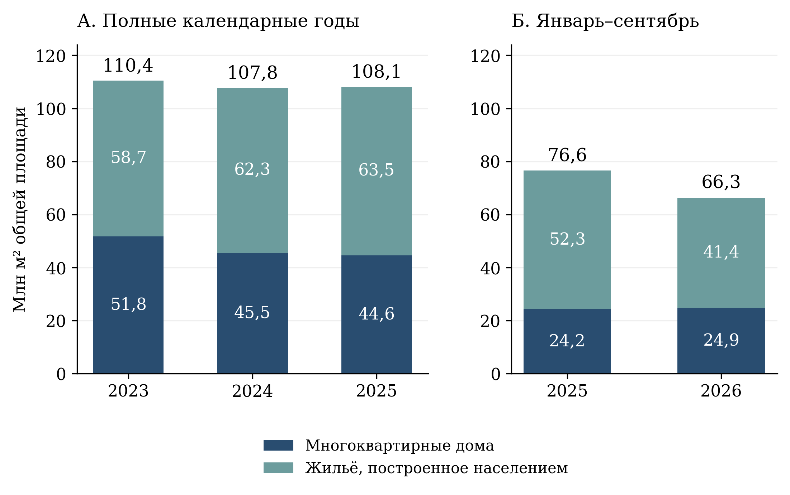

[B113; Caption] Рисунок 1 – Структура жилищного строительства в полные годы и за сопоставимые девять месяцев

[B114; SourceNote] Слева – полные 2023–2025 годы; справа – январь–сентябрь 2025 и 2026 годов. Млн м² общей площади. Территориальный охват всех сравнений одинаков: Российская Федерация без учёта новых субъектов в определении статистического источника с 01.01.2023. Небольшие расхождения суммы компонентов с итогом обусловлены округлением. [Сноски 30]

[B115; ] Оперативные данные 2026 года показывают иную конфигурацию изменений. За январь–сентябрь общий ввод составил 66,330 млн м² против 76,565 млн м² за тот же период 2025 года, то есть снизился на 13,37%. При этом многоквартирный сегмент вырос с 24,234 до 24,890 млн м², или на 2,71%, а ввод населением сократился с 52,331 до 41,440 млн м², или на 20,81%. Таким образом, отрицательное изменение общего объёма за девять месяцев связано в арифметическом разложении с индивидуальным сегментом. Причины изменения требуют отдельного анализа регистрации построек, спроса и финансирования; сами объёмы ввода не позволяют выбрать одно из этих объяснений. [Сноски 31]

[B116; ] Для достижения установленной на 2026 год цели 93,8 млн м² в четвёртом квартале требуется 27,47 млн м². В четвёртом квартале 2025 года введено 31,577 млн м²; следовательно, необходимый результат допускает снижение примерно на 13,0% к сопоставимому кварталу. Этот расчёт задаёт конкретный объём оставшейся задачи, но не является прогнозом. Доля девяти месяцев в годовом вводе зависит от сезонности и сроков регистрации, поэтому механическое умножение 66,33 на 12/9 не даёт обоснованной оценки года. [Сноски 32]

[B117; ] Инвестиционно-строительный цикл имеет самостоятельное значение для интерпретации результатов. Опубликованная длительность составляет 1250 суток в декабре 2025 года и 1235 суток в сентябре 2026 года при цели 1000 суток к 2030 году. Многолетний горизонт означает, что момент ввода объекта отстоит от решений о его запуске и финансировании. Поэтому изменение ввода в первый год действия проекта нельзя целиком приписывать новым мероприятиям. Для оценки их дополнительного вклада полезно сравнивать группы проектов по году начала, полученной поддержке и стадии готовности, отслеживая сроки прохождения согласований, обеспеченность сетями и переход от разрешения к фактическому вводу. Такое наблюдение одновременно помогает выявлять будущие ограничения предложения. [Сноски 33]

[B118; ] Обеспеченность жильём описывает другую сторону ситуации. В сопоставимом территориальном срезе 2024 года общероссийское значение составляет 29,38 м² на жителя. Региональная медиана – 30,34 м², половина 85 наблюдений лежит между 27,00 и 33,17 м². Минимальные значения зарегистрированы в Ингушетии 15,86 м² и Тыве 16,38 м²; максимальные – в Псковской области 38,85 м² и Новгородской области 37,62 м². Отношение крайних значений равно 2,45, а отношение 90-го к 10-му процентилю – 1,54. Более устойчивый к единичным крайним наблюдениям второй показатель также указывает на существенную территориальную неоднородность. [Сноски 34]

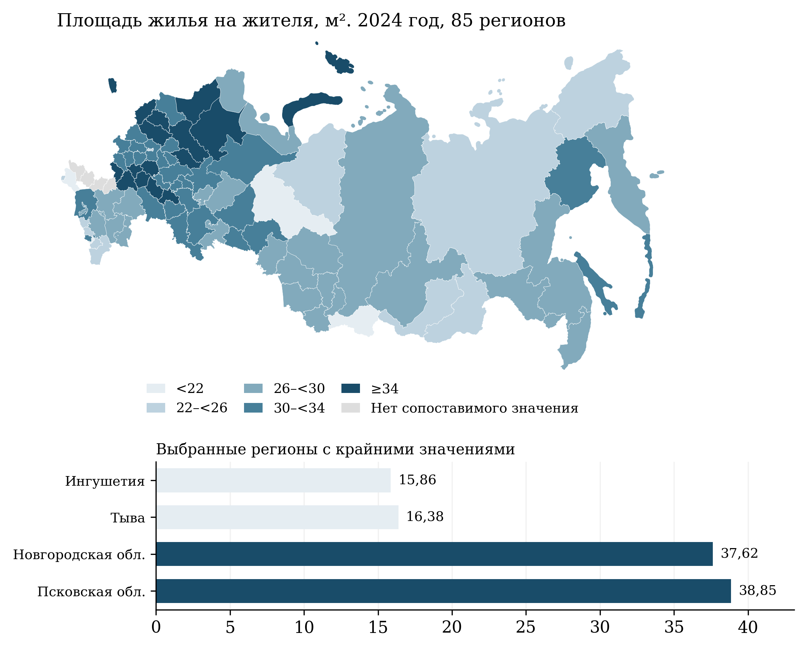

[B120; Caption] Рисунок 2 – Территориальные различия площади жилых помещений на одного жителя

[B121; SourceNote] 2024 год; 85 регионов с сопоставимыми значениями, категория «Всего». Интервалы заданы в абсолютных м² на человека. Отсутствующие наблюдения показаны серым. Архангельская и Тюменская области представлены без входящих автономных округов, которые учтены отдельно. Карта характеризует среднюю площадь, а не доступность покупки или качество жилища. [Сноски 35]

[B122; ] Обновление жилищного фонда также распределено неравномерно. В 2025 году общероссийская доля фонда, обновлённого после 2019 года, составила 13,7%, региональная медиана – 11,4%; центральная половина регионов находилась в интервале 9,4–14,0%. Наибольшие доли отмечены в Ленинградской области 33,1%, Чеченской Республике 28,0% и Тюменской области 24,5%, наименьшие – в Магаданской области 1,7%, Мурманской области 2,6% и Чукотском автономном округе 2,7%. Величина обновления относительна к исходному фонду: одинаковый введённый объём даёт разные доли в территориях различного размера. Показатель следует дополнять возрастом и состоянием сохраняющегося фонда. [Сноски 36]

[B123; ] Сумма ипотечных кредитов – финансовый поток, который нельзя непосредственно отождествлять с числом семей, улучшивших жилищные условия. В 2025 году рублёвая выдача составила 4,452 трлн руб. против 4,888 трлн руб. в 2024 году. За январь–август 2026 года она достигла 2,960 трлн руб., увеличившись на 31,79% к 2,246 трлн руб. за сопоставимые месяцы 2025 года. Одновременно опубликованный средний уровень ипотечной ставки повысился с 7,58% в августе 2025 года до 9,62% в августе 2026 года. Эти наблюдения совместимы с различными изменениями состава кредитов, размера займа и круга заёмщиков. Для вывода о доступности необходимы данные о доходах, цене стандартного жилья, первоначальном взносе и распределении платежа по группам домохозяйств. [Сноски 37]

[B124; ] Переселение из непригодного фонда требует отдельного баланса. Годовой показатель 2025 года составляет 937,37 тыс. человек с 2019 года; сентябрьское значение 2026 года – 993,403 тыс. человек с той же накопительной базой. Второе число не является количеством переселённых за 2026 год. Кроме того, выполнение накопленного задания не показывает, насколько сокращается актуальная потребность: одновременно может признаваться аварийным новый фонд. Для управленческой оценки необходимы остаток непереселённых жителей на начало и конец периода, вновь выявленная потребность и время ожидания переселения. [Сноски 38]

[B125; Heading2] 3.3 Дороги и общественный транспорт

[B126; ] По годовому итогу 2025 года доля региональных и межмуниципальных дорог в нормативном состоянии составляет 56,31%, доля дорог опорной сети – 74,93%, федеральных дорог – 74,40%. Эти показатели характеризуют разные совокупности и не складываются в единую долю нормативной сети. В сентябре 2026 года оперативные значения составляют соответственно 56,9489%, 75,3977% и 74,40%. Разность между сентябрьским и годовым наблюдениями описывает положение в двух отчётных срезах; оценка устойчивого годового изменения потребует завершённого итога 2026 года. [Сноски 39]

[B127; ] За общероссийской долей региональных дорог скрывается значительный диапазон территориальных условий. В 2025 году среди 84 регионов с годовым значением медиана составляет 56,055%, межквартильный интервал 52,223–62,425%. В 13 регионах доля нормативных дорог ниже 50%, в 26 достигает 60% и более. Минимальные значения отмечены в Тверской области 33,00%, Архангельской области 34,00%, Магаданской области 34,65% и Нижегородской области 35,03%; максимальные – в Ханты-Мансийском автономном округе – Югре 87,60% и Ингушетии 85,81%. Общероссийская цель 60% не является автоматически одинаковым обязательством каждого субъекта: региональные задания должны оцениваться по утверждённой территориальной декомпозиции. [Сноски 40]

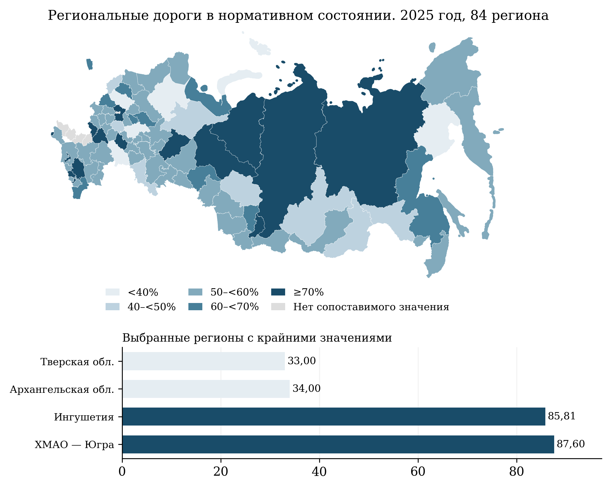

[B129; Caption] Рисунок 3 – Доля региональных и межмуниципальных дорог в нормативном состоянии по регионам

[B130; SourceNote] Годовая категория «на конец года», 2025 год; 84 региона. Москва и территории без сопоставимого наблюдения показаны серым. Доли относятся к сети соответствующей категории в каждом регионе; они не измеряют одинаковую протяжённость и интенсивность движения. Градации карты описательные и не заменяют региональные целевые задания. [Сноски 41]

[B131; ] Низкую долю нормативных дорог следует рассматривать вместе с протяжённостью сети, интенсивностью движения и транспортной доступностью поселений. При одинаковой доле ненормативных участков потребность в капитальных вложениях может существенно различаться. Практически обоснованный порядок приоритетов требует перечня конкретных участков и ожидаемого результата ремонта: сокращения времени поездки, устранения сезонной недоступности, повышения безопасности и надёжности маршрутов общественного транспорта. Это позволяет связать долевой показатель с общественной пользой каждого проекта и избежать преимущественного отбора наиболее простых участков только ради улучшения процента.

[B132; ] Региональные данные по крупнейшим агломерациям имеют особенность охвата: из 84 годовых записей 2025 года 67 равны нулю, тогда как общероссийская доля составляет 85%. Ненулевые значения представлены в 17 регионах. Без подтверждения применимости показателя к каждой территории нули нельзя трактовать как отсутствие нормативных городских дорог. Поэтому данный ряд не используется для общего ранжирования регионов и расчёта межрегиональных корреляций. В публичном мониторинге необходимо отдельно обозначать отсутствие соответствующей совокупности, отсутствие сведений и измеренное нулевое значение; эти состояния имеют различный управленческий смысл. [Сноски 42]

[B133; ] Возрастная нормативность парка общественного транспорта отражает состояние активов, но лишь частично характеризует услугу для пассажира. Общероссийский показатель составляет 76,8% в декабре 2025 года и 72,0% в марте 2026 года. Региональный декабрьский срез содержит 86 наблюдений с медианой 76,6% и диапазоном 18,5–100%. Сопоставление этих величин требует учета изменения состава парка и границ наблюдаемой сети. Даже полностью соответствующий возрастному нормативу парк может обеспечивать редкое движение или недостаточную провозную способность; поэтому качество транспорта следует проверять по фактически выполненным рейсам, интервалам, отменам, доступности остановок и возможности поездки для маломобильных пассажиров. [Сноски 43]

[B134; ] Важнейшим конечным результатом транспортной политики остаётся снижение риска гибели. В используемом показателе число погибших нормируется на 10 тыс. транспортных средств. Оно снизилось с 2,3586 в 2023 году до 2,1762 в 2025 году, или на 7,73% за два года. Для достижения целевого значения 1,57 к 2030 году требуется среднегодовое снижение приблизительно на 6,32% от уровня 2025 года; фактический среднегодовой темп за 2023–2025 годы составлял около 3,94%. Таким образом, при сохранении определения показателя требуется ускорение снижения риска. Это расчёт необходимого темпа, а не предсказание будущей смертности. [Сноски 44]

[B135; ] Нормирование на зарегистрированный парк чувствительно к изменению числа транспортных средств и не учитывает напрямую интенсивность их использования. Для содержательной оценки безопасности целесообразно параллельно публиковать абсолютное число погибших, показатель на 100 тыс. жителей и, при доступности данных, на единицу транспортной работы. Девятимесячный оперативный показатель 2026 года не следует сравнивать с полным годом 2025: различная продолжительность накопления сама по себе создаёт снижение. Инфраструктурные мероприятия должны оцениваться также по изменениям на конкретных участках с учётом движения, погодных условий и мер контроля. [Сноски 45]

[B136; Heading2] 3.4 Коммунальная модернизация и благоустройство

[B137; ] Планируемый результат коммунальной модернизации имеет выраженную концентрацию в конце периода. Накопленные целевые значения численности жителей с улучшенными услугами составляют 1,3; 3,1; 5,6; 9,1; 13,8 и 20,0 млн человек по 2025–2030 годам. Разность соседних значений даёт необходимый годовой прирост 1,3; 1,8; 2,5; 3,5; 4,7 и 6,2 млн человек. На 2029–2030 годы приходится 10,9 млн, или 54,5% всего шестилетнего результата. Такая траектория повышает значение заблаговременной подготовки проектной документации, подключения объектов, пусконаладки и организационной готовности эксплуатирующих организаций. [Сноски 46]

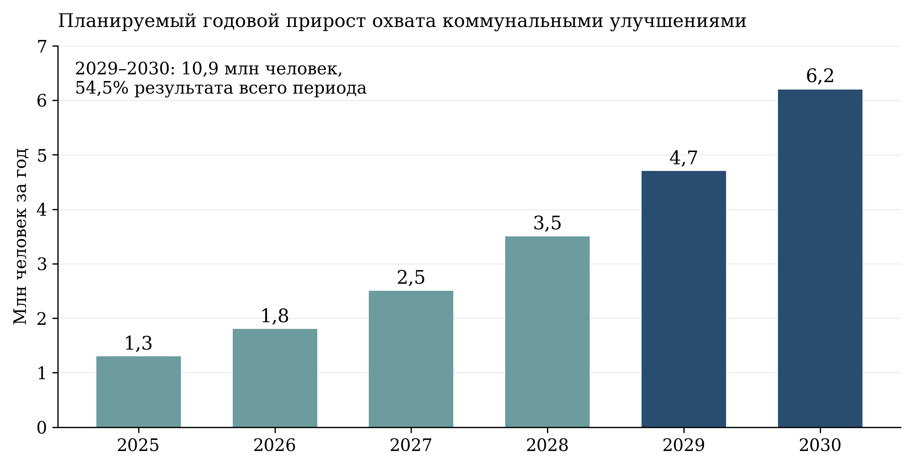

[B139; Caption] Рисунок 4 – Годовой прирост охвата коммунальными улучшениями, необходимый по действующей траектории

[B140; SourceNote] Расчёт разностей соседних накопленных целевых значений на 2025–2030 годы. Показаны плановые приращения численности, а не фактически введённые мощности и не прогноз. Общий накопленный результат 2030 года – 20 млн человек. [Сноски 47]

[B141; ] При проверке фактического ряда обнаружен содержательно значимый разрыв. В декабре 2025 года ЕМИСС содержит 8,145 млн человек, в июне 2026 года 8,3974 млн, после чего за июль–сентябрь записаны нули как по Российской Федерации, так и по всем 88 регионам с числовыми записями. Для показателя с накоплением с 2025 года такое синхронное обнуление нельзя интерпретировать как фактическую утрату результата или отсутствие оказанных услуг. Без разъяснения причин разрыва последние нули не пригодны для оценки достижения цели. [Сноски 48]

[B142; ] Высокие предшествующие значения также требуют содержательной сверки: 8,145 млн человек существенно превышают ориентир 1,3 млн на 2025 год. Возможные различия охвата мероприятий и правил учёта здесь являются гипотезами, а не установленным объяснением. До получения сопоставимого ряда не обоснован ни вывод о кратном перевыполнении, ни вывод о провале. Для устранения неопределённости нужны правила включения получателей, идентификация повторного охвата одного жителя несколькими услугами и публикация пересмотренных значений вместе с причиной изменения. [Сноски 49]

[B143; ] Аналогично количество объектов водоснабжения и водоподготовки, накопленное с 2019 года, не совпадает с объёмом работ за текущий год. В декабре 2025 года опубликовано 2120 объектов, в сентябре 2026 года 2273. Само по себе количество объектов не содержит информации об их мощности, числе подключённых жителей, работоспособности и фактическом качестве воды. Для общественной оценки необходима связка «объект – зона обслуживания – устойчивое изменение услуги», а не только акт завершения строительства. Особое значение имеют повторные проверки после начала эксплуатации и доступность данных о перерывах водоснабжения. [Сноски 50]

[B144; ] В благоустройстве к декабрю 2025 года отражено 5497 общественных территорий и 246 проектов – победителей всероссийского конкурса; к сентябрю 2026 года соответственно 8256 и 277, нарастающим итогом с 2025 года. Разность с декабрём показывает добавление 2759 территорий и 31 конкурсного проекта в доступном оперативном ряду 2026 года. Конкурсный проект и общественная территория являются различными единицами учёта, поэтому их нельзя складывать как число независимых благополучателей. Оценку эффектов целесообразно строить вокруг использования пространств, их безопасности, доступности и обеспеченности последующим содержанием. [Сноски 51]

[B145; ] Для коммунальной инфраструктуры и благоустройства общим управленческим требованием является проверка устойчивого результата после завершения работ. Полезно закрепить период наблюдения через 6 и 12 месяцев и измерять изменение относительно исходного состояния конкретной территории. В коммунальной сфере это частота и продолжительность перерывов, качество воды, устойчивость температурного режима и обращения граждан; в благоустройстве – фактическое использование пространства различными группами жителей и сохранность его функций. Такие наблюдения позволяют различать формальное завершение объекта и достижение цели улучшения повседневной среды.

[B146; Heading2] 3.5 Интегральный показатель качества среды

[B147; ] Интегральная оценка качества среды в опорных населённых пунктах способна объединить разнородные направления политики, однако её интерпретация зависит от состава компонентов, базового года и территориальных весов. Действующая на дату экспертизы методика утверждена приказом Минстроя России от 9 июня 2026 года № 363/пр и предусматривает 16 компонентов. Она заменила методику от 2 апреля 2026 года № 208/пр. Поэтому число компонентов и правила агрегирования из более ранних пояснений к проекту не должны использоваться как описание актуального показателя. [Сноски 52]

[B148; ] Согласно методике, базой в общем случае выступает 2019 год, но предусмотрены специальные базовые периоды. Общероссийское и региональное обобщение учитывает численность населения опорных населённых пунктов; при расчёте общероссийского значения отдельно оговорены исключения Москвы, Донецкой и Луганской народных республик, Запорожской и Херсонской областей, а также Байконура вследствие особенностей базовых условий. Следовательно, показатель не представляет собой среднее улучшение среды всех жителей страны. Его территориальную совокупность следует указывать при каждом публичном сообщении об общероссийском результате. [Сноски 53]

[B149; ] Порядок расчёта допускает использование значения предыдущего периода при непредставлении новых данных компонента. Поэтому неизменность месячного индекса может означать как отсутствие изменения, так и отсутствие обновления исходных сведений. Для отдельных жилищных расчётов при отсутствии данных по опорному населённому пункту предусмотрены муниципальные или региональные значения. Такая замена обеспечивает техническую рассчитываемость, однако снижает локальную точность. Для оценки качества управленческой информации желательно публиковать долю компонентов, обновлённых в отчётном периоде, и долю значений, рассчитанных по территориальным заменителям. [Сноски 54]

[B150; ] В доступном ряду ЕМИСС общероссийское значение составляет 27,80% в декабре 2025 года и 28,14% в июне 2026 года. Месячные значения начала 2026 года не образуют строго монотонную последовательность. Без пересчёта по единой редакции методики их разность не позволяет установить изменение качества среды в постоянных условиях измерения. Особенно нежелательно трактовать такой индекс как независимое доказательство вклада именно текущего национального проекта: часть изменения относится к периоду после 2019 года, предшествующему его запуску. [Сноски 55]

[B151; ] Составной показатель необходимо сопровождать профилем компонентов и исходными уровнями услуг. Одинаковое среднее улучшение может складываться из разных сочетаний жилищного строительства, состояния дорог, общественных пространств и социальной инфраструктуры. Усреднение создаёт возможность компенсации слабого результата по одной сфере ростом другой, хотя для жителей отсутствие базовой услуги не всегда компенсируется благоустройством или новым объектом. Для предотвращения этого эффекта целесообразно дополнить индекс неперекрываемыми минимальными требованиями: непрерывностью коммунального обслуживания, базовой транспортной доступностью и отсутствием опасных жилищных условий.

[B152; ] Методический аудит должен также проверять, насколько расчётные приближения соответствуют реальным пользовательским возможностям. Например, компонент транспортной связанности предусматривает коэффициент 1 при наличии ежедневного регулярного маршрута до регионального центра и 0,9 при его отсутствии. Такой коэффициент является нормативным правилом агрегирования, а не измеренным различием времени или стоимости поездки. Его полезно проверять совместно с фактическим временем в пути, частотой доступных поездок и сезонной устойчивостью сообщения. Это позволяет обсуждать общественный результат в наблюдаемых характеристиках, сохраняя индекс как средство обобщения. [Сноски 56]

[B153; Heading2] 3.6 Многомерность территориальных различий

[B154; ] Региональные сравнения показывают, что жилищные и транспортные характеристики не выстраиваются в единую шкалу. Для проверки этого положения рассчитаны ранговые корреляции Спирмена между шестью характеристиками: площадью жилья на жителя, обновлением жилищного фонда, нормативностью региональных дорог и опорной сети, возрастной нормативностью общественного транспорта и количеством погибших в ДТП на 10 тыс. транспортных средств. Пять характеристик относятся к 2025 году, жилищная площадь – к 2024 году; транспортный парк представлен декабрьским оперативным наблюдением. Такой набор описывает близкие по времени структурные условия, а не одновременную динамику исполнения проекта. [Сноски 57]

[B155; ] Сопоставление выполнено по 82 регионам, имеющим значения всех шести характеристик. Пропуски не заменялись средними или медианами, наблюдения не взвешивались по численности жителей. Коэффициенты характеризуют согласованность регионального порядка и устойчивы к простой замене шкалы исходных величин. Они не являются оценками влияния расходов или мероприятий: различия территорий могут одновременно определяться структурой расселения, климатом, размером сети и накопленным состоянием инфраструктуры.

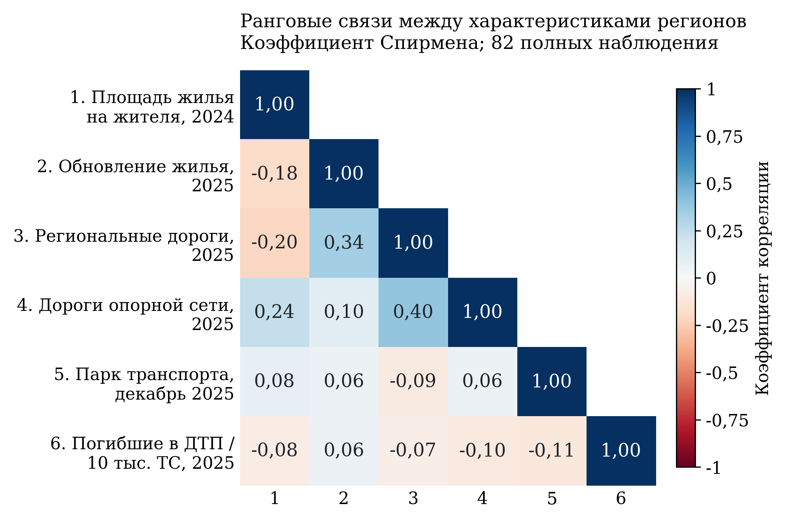

[B157; Caption] Рисунок 5 – Связи между жилищными и транспортными характеристиками регионов

[B158; SourceNote] Корреляции Спирмена на единой совокупности 82 регионов без заполнения пропусков. Жилищная площадь – 2024 год; обновление фонда, дороги и погибшие в ДТП – 2025 год; парк общественного транспорта – декабрь 2025 года. Все регионы имеют одинаковый статистический вес. Диагональные единицы показывают связь переменной с самой собой; коэффициенты не устанавливают причинности. [Сноски 58]

[B159; ] Наиболее выраженная положительная связь наблюдается между нормативностью региональных дорог и дорог опорной сети: ρ=0,395. Корреляция нормативности региональных дорог с обновлением жилищного фонда составляет 0,338. Связь площади жилья на жителя с обновлением фонда слабая и отрицательная: ρ=−0,181. Коэффициенты между возрастной нормативностью транспорта и двумя дорожными характеристиками близки к нулю: −0,088 и 0,057. Таким образом, хорошее положение по одному блоку не обеспечивает аналогичного положения по другому. Из этого не следует отсутствие причинных связей между инфраструктурой и благополучием; результат ограничен межрегиональным срезом и выбранными измерителями.

[B160; ] Содержательный вывод состоит в необходимости территориальных профилей потребностей. Для региона с небольшой площадью жилья и сравнительно хорошими дорогами приоритет может состоять в обеспечении доступного жилья и подключении новых кварталов. Для региона с достаточной средней площадью, слабым обновлением фонда и низкой нормативностью дорог требуется иной набор мер: модернизация существующей среды, ремонт и поддержание доступности. Формирование таких профилей должно опираться на конкретные исходные условия, демографическую перспективу и стоимость жизненного цикла объектов, а не на механическое усреднение рангов.

[B161; ] Рекомендуемая система оценки должна содержать общероссийский результат, распределение по регионам и территории с устойчиво неблагоприятным положением. Помимо среднего целесообразно отслеживать медиану, нижний дециль и разрыв между верхней и нижней частями распределения. Это позволяет проверить, сопровождается ли общий прогресс сокращением территориального дефицита. Финансирование и задания желательно увязывать с ожидаемым сокращением конкретной проблемы, а качество исполнения – подтверждать наблюдением за услугой после ввода объекта. Такой подход сохраняет количественную проверяемость проекта и делает её содержательно ближе к цели повышения качества жизни.

[B162; Heading1] 4 Финансовое обеспечение и бюджетные риски

[B163; ] Финансовую достаточность проекта необходимо оценивать по нескольким уровням. Паспортный финансовый план отражает предполагаемый объём ресурсов на весь период; закон о бюджете и сводная бюджетная роспись – бюджетные назначения соответствующего периода; кассовое исполнение – фактически произведённые выплаты. Отдельный уровень образуют принятые контрактные обязательства и стоимость будущей эксплуатации. Показатели этих уровней отвечают на разные вопросы. Поэтому паспортные суммы и предложения к очередному бюджету не дают самостоятельного основания для вывода об освоении средств, экономии, перерасходе или уже полученном социальном эффекте.

[B164; ] В публикации паспорта от 16 октября 2026 г. совокупное плановое финансирование на 2025–2030 гг. составляет 15 094,4 млрд руб. Из них 9749,9 млрд руб., или 64,59%, отнесены к федеральному бюджету; 4189,8 млрд руб., или 27,76%, – к консолидированным бюджетам субъектов Российской Федерации; 1154,8 млрд руб., или 7,65%, – к внебюджетным источникам. Распределение по годам приведено в таблице 4 и на рисунке 6. Все суммы являются номинальными плановыми величинами. Максимум общего объёма приходится на 2028 г. – 3058,9 млрд руб.; это характеризует распределение финансового плана во времени, а не фактическую интенсивность уже выполненных работ. [Сноски 59]

[B165; Caption] Таблица 4 – Паспортное плановое финансирование национального проекта по источникам, млрд руб.

[TABLE 4; B166]
Год | Федеральный бюджет | Бюджеты регионов, консолидированные | Внебюджетные источники | Всего
2025 | 1 267,7 | 542,7 | 168,8 | 1 979,2
2026 | 1 306,4 | 636,5 | 94,7 | 2 037,6
2027 | 1 644,1 | 790,4 | 139,9 | 2 574,4
2028 | 2 003,1 | 829,3 | 226,6 | 3 058,9
2029 | 1 749,7 | 683,9 | 254,4 | 2 688,0
2030 | 1 778,9 | 707,0 | 270,4 | 2 756,3
Всего | 9 749,9 | 4 189,8 | 1 154,8 | 15 094,4

[B167; SourceNote] План на 2025–2030 гг. по публикации паспорта от 16.10.2026; суммы в текущих ценах. Округление до 0,1 млрд руб. может вызывать расхождения при сложении отображённых чисел. Кассовое исполнение не представлено. [Сноски 60]

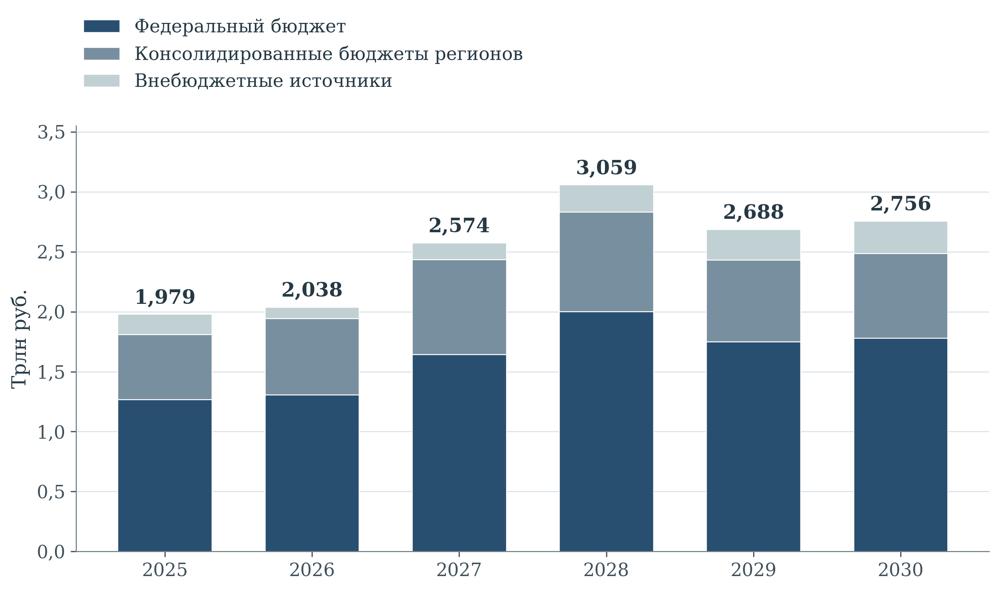

[B169; Caption] Рисунок 6 – Источники паспортного финансирования национального проекта в 2025–2030 гг.

[B170; SourceNote] Плановые номинальные суммы; трлн руб. Расчёт по паспортным данным, опубликованным 16.10.2026. [Сноски 61]

[B171; ] Участие региональных бюджетов более чем в четверти совокупного плана означает существенную зависимость реализации от субнациональных возможностей. Это не свидетельствует само по себе о недостаточности финансирования, но делает необходимой проверку обеспеченности региональной доли, распределения её по годам и совместимости с другими обязательствами. Для внебюджетного участия важно различать общую ожидаемую сумму, согласованную инвестиционную программу и юридически принятые обязательства. Единая запись об источнике не раскрывает вероятности поступления средств. Поэтому финансовый мониторинг должен показывать степень подтверждённости каждого существенного источника и последствия его задержки для связанных объектов.

[B172; ] Сопоставление паспортных сумм требует единого временного охвата. В финансовой части федерального проекта «Формирование комфортной городской среды» дополнительно приведены 435 млрд руб. на 2031–2036 гг.; они исключаются при сопоставлении с национальным проектом за 2025–2030 гг. Даже после такого выравнивания сумма 12 федеральных проектов превышает итог национального проекта на 4,371 млрд руб., или приблизительно 0,029%: расхождение относится к 2025–2027 гг. Небольшая относительная величина не устраняет необходимости документированной сверки. Вместе с тем это информационное расхождение не является доказательством перерасхода либо финансового нарушения: для такого заключения потребовались бы данные об основаниях корректировок и исполнении обязательств. [Сноски 62]

[B173; ] Проект федерального бюджета на 2027–2029 гг. образует иной контур рассмотрения. В пояснительной записке к законопроекту № 615-9 на национальный проект предложено 1413,125 млрд руб. в 2027 г., 1759,333 млрд руб. в 2028 г. и 1439,538 млрд руб. в 2029 г. По состоянию на 28 октября 2026 г. эти значения рассматриваются как бюджетные предложения. Сопоставительная величина 2026 г. – 1304,889 млрд руб. – относится к сводной бюджетной росписи на 1 сентября 2026 г., а не к кассовому исполнению. Структуру показывает таблица 5. Из сопоставления этой росписи с более поздней паспортной публикацией нельзя без дополнительной сверки выводить объём недофинансирования. [Сноски 63]

[B174; Caption] Таблица 5 – Федеральные бюджетные назначения 2026 г. и предложения на 2027–2029 гг. по направлениям проекта, млрд руб.

[TABLE 5; B175]
Федеральный проект | 2026: роспись | 2027: проект | 2028: проект | 2029: проект
Развитие инфраструктуры в населенных пунктах | 13,902 | 10,968 | 0,000 | 0,000
Жилье | 63,708 | 67,222 | 67,620 | 67,348
Модернизация коммунальной инфраструктуры | 44,225 | 47,446 | 47,187 | 47,241
Формирование комфортной городской среды | 60,581 | 60,073 | 60,373 | 60,073
Безопасность дорожного движения | 6,942 | 7,007 | 7,010 | 7,011
Развитие общественного транспорта | 19,455 | 20,082 | 23,218 | 21,966
Развитие федеральной сети | 719,847 | 799,513 | 1 111,812 | 755,504
Региональная и местная дорожная сеть | 371,485 | 385,932 | 424,809 | 461,463
Общесистемные меры развития дорожного хозяйства | 2,827 | 2,827 | 2,827 | 2,827
Новый ритм строительства | 1,917 | 2,057 | 2,477 | 2,604
Железнодорожный центральный транспортный узел | 0,000 | 10,000 | 12,000 | 13,500
Всего | 1 304,889 | 1 413,125 | 1 759,333 | 1 439,538

[B176; SourceNote] 2026 г. – сводная бюджетная роспись на 01.09.2026; 2027–2029 гг. – законопроект № 615-9, а не утверждённые расходы и не исполнение. Приведены итоги таблицы 4.1.4 пояснительной записки; исходные суммы в млн руб. переведены в млрд руб. Итоги и строки могут не совпадать из-за округления. Отсутствие строки «Ипотека» не означает отсутствия бюджетных ипотечных программ. [Сноски 64]

[B177; ] В предложениях на 2027 г. федеральная дорожная сеть получает 799,5 млрд руб., региональная и местная – 385,9 млрд руб. Вместе два направления составляют 83,89% федеральных ассигнований по национальному проекту; в 2028 г. их доля достигает 87,34%, в 2029 г. – 84,54%. Состав предложений на 2027 г. представлен на рисунке 7. Это выраженная концентрация федерального финансирования, но не доказательство аналогичной структуры всех ресурсов проекта: участие регионов, внебюджетных источников и других государственных программ различается по направлениям. Для оценки сбалансированности необходимо сопоставлять не только доли расходов, но и исходный дефицит инфраструктуры, стоимость жизненного цикла и охват улучшенных услуг. [Сноски 65]

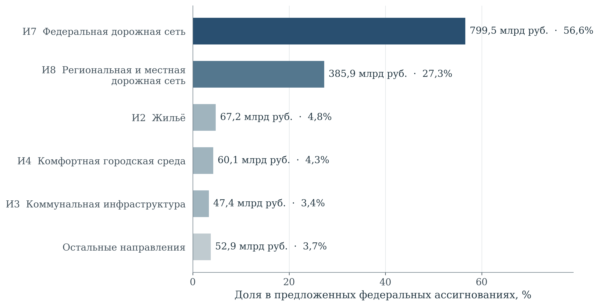

[B179; Caption] Рисунок 7 – Структура предложенных федеральных ассигнований на национальный проект в 2027 г.

[B180; SourceNote] Законопроект № 615-9; предложения, рассматриваемые по состоянию на 28.10.2026. Доли рассчитаны от общего объёма 1413,1251 млрд руб. «Остальные направления» – остаток до опубликованного итога. [Сноски 66]

[B181; ] Внутри дорожного блока необходимо различать новое строительство, реконструкцию и поддержание существующей сети. В предложениях по федеральной сети на 2027 г. на капитальный ремонт, ремонт и содержание приходится 513,985 млрд руб. из 799,513 млрд руб. Такой состав показывает, что высокая доля дорожного направления не может целиком интерпретироваться как расширение сети. Одновременно сокращение общего предложенного объёма в 2029 г. относительно 2028 г. на 18,18% является номинальным изменением бюджетного профиля, а не установленным сокращением объёма услуг. Его последствия зависят от графика завершения объектов, стоимости контрактов и необходимого содержания введённых мощностей. [Сноски 67]

[B182; ] Инфраструктурные кредиты и высвобождение ресурсов вследствие изменения долговых обязательств регионов требуют отдельного представления. Возвратный кредит, безвозмездный трансферт и собственные расходы субъекта имеют различное влияние на будущую бюджетную устойчивость. Если заёмные средства включены в расходы на объект, повторное добавление суммы кредита к стоимости проекта создаёт двойной счёт. При оценке доступности финансирования следует учитывать сроки погашения, процентные расходы и способность бюджета одновременно обслуживать долг и содержать построенную инфраструктуру. Наличие источника капитальных вложений не является достаточным подтверждением обеспеченности эксплуатационных обязательств.

[B183; ] Ежегодные финансовые назначения целесообразно связывать с готовностью документации, разрешений, участков и сетевых подключений, а также с проверяемыми промежуточными результатами. При переносе средств необходима оценка влияния на стоимость и срок предоставления услуги. В составе портфеля следует различать подтверждённые обязательства, условные источники и потребность в содержании. Такая детализация позволяет установить, связана ли задержка с финансированием, подготовкой объекта или изменением потребности в нём.

[B184; Heading1] 5 Связи мероприятий с показателями и анализ проектных текстов

[B185; Heading2] 5.1 Методика анализа проектной логики и текстового корпуса

[B186; ] Содержательная экспертиза разделяет три объекта: предусмотренный механизм изменения условий жизни, документально закреплённую связь результатов с показателями и лексическую структуру проектных текстов. Их совмещение позволяет установить, какие переходы описаны непосредственно, какие нуждаются в дополнительных измерениях и какие сходства обусловлены языком планирования. Автоматический анализ применяется как средство систематического сопоставления; интерпретация каждого существенного результата проверяется чтением соответствующих формулировок. Такой порядок соответствует требованиям содержательной валидации количественного анализа политических текстов. [Сноски 68]

[B187; ] Сопоставимый корпус включает 98 электронных представлений паспортов: 12 национальных и 86 федеральных, относящихся к 12 национальным проектам. Его объём составляет 75 539 токенов – лексических единиц, выделенных по единому правилу. Это целевой межпроектный корпус, а не полная совокупность действующих национальных проектов. Для «Инфраструктуры для жизни» исследованы национальный паспорт и 12 федеральных паспортов, содержащие 5 889 токенов. Их опубликованная дата обновления – 16 октября 2026 г.; срез доступных материалов выполнен на 28 октября 2026 г. Электронные представления используются как вторичная публикация паспортных сведений, а официальный паспорт – как самостоятельный источник архитектуры проекта. [Сноски 69]

[B188; ] Во всех проектах отобраны одинаковые поля: цель, задачи, название и характеристика результата, название показателя. Точные повторения содержательных фрагментов внутри документа удалены. Названия органов, календарные записи и финансовые таблицы исключены из лексического сравнения, поскольку они характеризуют иной предмет. Буквы приведены к нижнему регистру, «ё» – к «е»; числа не образуют текстовые признаки. Удалены 120 служебных и общеупотребительных слов. Использованы отдельные слова и пары соседних оставшихся слов; пары не пересекают границы самостоятельных содержательных фрагментов. Частота одного признака сглажена логарифмически. Обратная документная частота рассчитана на всём корпусе из 98 документов. [Сноски 70]

[B189; EquationText] (1)

[Формула] wₜd = (1 + ln fₜd) × [ln((N + 1)/(dfₜ + 1)) + 1] при fₜd > 0, иначе 0

$$
w_{td}=\begin{cases}(1+\ln f_{td})\left[\ln\frac{N+1}{df_t+1}+1\right],&f_{td}>0\\0,&f_{td}=0\end{cases}
$$

[B190; ] Здесь ftd – частота признака t в документе d; dfₜ – число документов, содержащих этот признак; N = 98. Признаки, присутствующие более чем в 98 % документов, исключены; редкие признаки сохранены, ограничение размера словаря не вводилось. Базовый словарь содержит 46 519 признаков. Каждый вектор делится на свою евклидову длину – применяется нормировка L2. Профиль национального проекта представляет собой среднее его нормированных паспортных векторов с последующей повторной нормировкой. Тем самым длинный паспорт не получает больший вес только вследствие объёма текста.

[B191; EquationText] (2)

[Формула] cos(a, b) = Σₜ aₜbₜ / (√Σₜ aₜ² × √Σₜ bₜ²)

$$
\cos(a,b)=\frac{\sum_t a_tb_t}{\sqrt{\sum_t a_t^2}\sqrt{\sum_t b_t^2}}
$$

[B192; ] Косинусная близость определяется совпадением взвешенных признаков; для векторов единичной длины она равна их скалярному произведению. Показатель не является вероятностью, долей выполненных мероприятий или оценкой эффективности. Отдельно выполнен словарный тематический анализ с частотами на 1 000 токенов и шесть спецификаций проверки устойчивости.

[B193; Heading2] 5.2 Мероприятия и общественные результаты

[B194; ] В рассматриваемых электронных паспортах выделены 85 карточек результатов и 51 карточка показателей: 17 национального уровня и 34 федерального уровня. Это число документных карточек, а не число независимых измерителей: показатели разных уровней могут описывать один и тот же процесс. Состав материала приведён в таблице 6. Он позволяет отделить фактическую структуру публикации от содержательной насыщенности направления: большее число карточек само по себе не означает ни большего общественного значения, ни более совершенной системы управления. [Сноски 71]

[B195; Caption] Таблица 6 – Состав материала для анализа проектной логики

[TABLE 6; B196]
Код | Национальный или федеральный проект | Резуль­таты | Показа­тели | Записи влияния | Токены
И | Инфраструктура для жизни | 0 | 17 | 0 | 514
И1 | Развитие инфраструктуры в населенных пунктах | 2 | 1 | 2 | 206
И2 | Жилье | 15 | 9 | 66 | 623
И3 | Модернизация коммунальной инфраструктуры | 6 | 2 | 12 | 277
И4 | Формирование комфортной городской среды | 3 | 2 | 6 | 183
И5 | Безопасность дорожного движения | 20 | 2 | 20 | 1 664
И6 | Развитие общественного транспорта | 7 | 3 | 9 | 418
И7 | Развитие федеральной сети | 3 | 3 | 5 | 166
И8 | Региональная и местная дорожная сеть | 6 | 6 | 9 | 398
И9 | Общесистемные меры развития дорожного хозяйства | 6 | 1 | 5 | 460
ИА | Новый ритм строительства | 15 | 2 | 23 | 771
ИБ | Ипотека | 1 | 2 | 2 | 106
ИВ | Развитие железнодорожной инфраструктуры центрального транспортного узла | 1 | 1 | 1 | 103
Всего | 13 электронных паспортов | 85 | 51 | 160 | 5 889

[B197; SourceNote] Подсчитаны карточки и записи в электронных представлениях. И – национальный паспорт. Повторяющиеся содержательные фрагменты исключены при подсчёте токенов, но карточки разных уровней не отождествляются. [Сноски 72]

[B198; ] Принципиальное ограничение выявлено при проверке адресуемости связей. Все 160 записей, опубликованных в подразделах о влиянии результата на показатели, повторяют в подписи название самого результата; ни одна подпись точно не идентифицирует карточку показателя. Поэтому численные значения этих записей нельзя обоснованно распределить по рёбрам взвешенного графа «результат – показатель». Вывод относится к доступному электронному представлению. Он не доказывает отсутствия соответствующих связей в исходном паспорте или внутренней системе управления. Для внешней проверки требуется публикация пары устойчивых идентификаторов результата и показателя вместе со значением и смыслом веса. [Сноски 73]

[B199; ] Соединение результатов и показателей через общую паспортную задачу даёт 266 потенциальных пар; соединение всех карточек внутри одного федерального проекта – 300 пар. Разница отражает административное группирование, но не подтверждение причинного механизма. Например, одна задача проекта «Жильё» объединяет 15 результатов и 9 показателей, образуя 135 пар. Если объявить каждую такую пару доказанным влиянием, информационная кампания, подготовка участка и ввод жилья получат одинаковый формальный статус. Поэтому общей задаче придаётся значение документальной принадлежности; причинная интерпретация рассматривается отдельно.

[B200; ] Авторская реконструкция механизмов представлена на рисунке 8. Её центральное различение – между созданным объектом или оказанной поддержкой и изменением повседневных условий для жителей. Новое жильё должно быть пригодно для проживания и обеспечено услугами; модернизированная сеть – давать устойчивое качество; обновлённый транспорт – обеспечивать доступную и надёжную поездку; благоустроенное пространство – использоваться населением. Пунктир обозначает общие условия реализации этих переходов. Направления стрелок являются проверяемыми гипотезами механизма, а не результатом статистического оценивания причинных эффектов.

[B201; ] Межотраслевая логика в проекте присутствует содержательно. В «Жилье» прямо предусмотрены социальная, транспортная и коммунальная инфраструктура для комплексного развития территорий, а также подключение объектов к сетям. Поэтому недостаточно обоснованным было бы утверждение, что жилищное строительство проектируется изолированно от услуг. Предмет совершенствования иной: возможность проверить совместную готовность этих компонентов по конкретной территории и сроку. Суммарный ввод жилья и суммарный ввод сетей могут расти одновременно, но без адресного сопоставления остаётся неизвестным, обеспечивают ли они одни и те же новые жилые районы. [Сноски 74]

[B202; ] Такая проверка требует связать объект жилищного строительства с доступной мощностью инженерных сетей, сроком фактического подключения, транспортным обслуживанием и эксплуатационной ответственностью. Проверяемой единицей становится территория заселения либо совокупность обслуживаемых домовладений. Здесь особенно важно различать принятое финансовое обязательство, завершённое строительство и начало устойчивого оказания услуги: это последовательные, но несовпадающие состояния. Аналогично приобретение автобуса ещё не описывает интервал движения, а число благоустроенных территорий – возможность пользоваться ими для маломобильного человека. Переходы, требующие самостоятельной проверки, систематизированы в таблице 7.

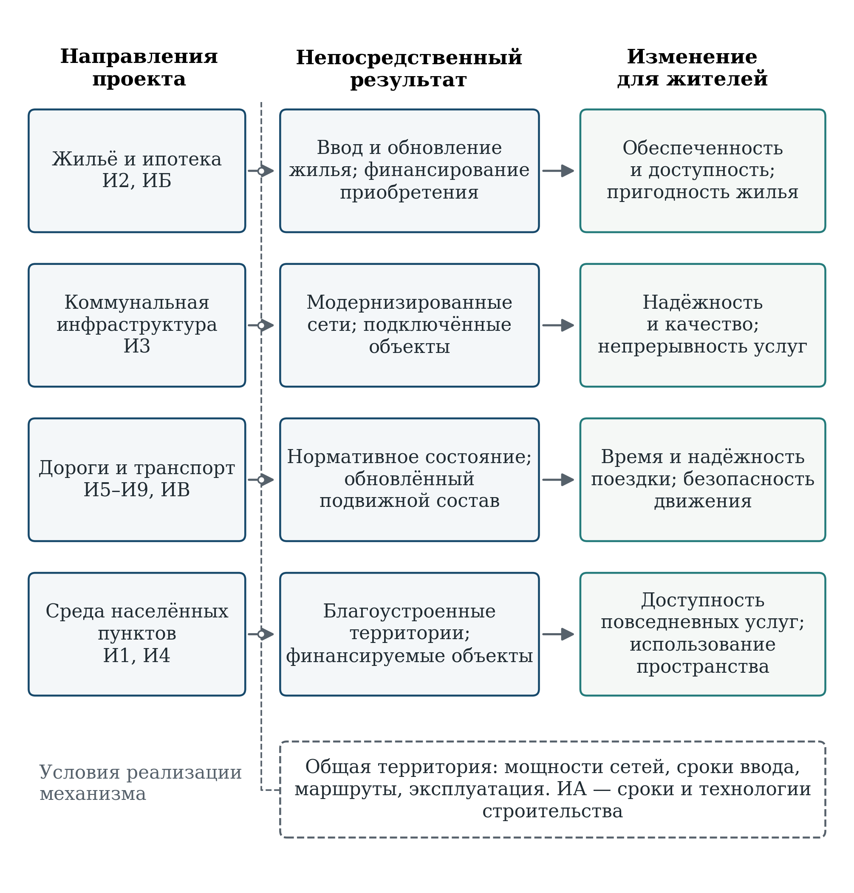

[B204; Caption] Рисунок 8 – Механизмы преобразования инфраструктурных результатов в изменения условий жизни

[B205; SourceNote] Авторская логическая реконструкция. Стрелки обозначают предполагаемые механизмы, а не оценённые причинные эффекты. Формальные показатели и предлагаемые измерения различены в тексте. [Сноски 75]

[B206; Caption] Таблица 7 – Переходы от паспортного результата к изменению условий жизни

[TABLE 7; B207]
Направление | Наблюдаемый результат или показатель | Проверяемый механизм | Дополнительное измерение для проверки
Жильё и ипотека | Ввод и обновление жилья; параметры ипотечного кредитования | Домохозяйство получает пригодное и финансово доступное жильё | Остаточный доход после жилищных расходов; готовность сетей и услуг по территории заселения
Коммунальная инфра­структура | Модернизированные объекты; население с улучшением качества услуг | Обновление оборудования меняет фактическое качество и надёжность услуги | Перерывы и длительность отключений; параметры услуги до и после работ; фактически обслуживаемое население
Городская среда | Число благоустроенных территорий и реализованных конкурсных проектов | Созданное пространство используется различными группами жителей | Доступность маршрута; частота использования; оценка состояния и содержания пространства
Общественный транспорт | Возраст парка; состояние электротранспортной инфраструктуры; движение поездов | Обновление активов улучшает доступность и надёжность поездки | Фактические интервалы и время в пути; доступность остановок; стоимость поездки относительно дохода
Безопасность движения | Мероприятия безопасности; показатели гибели в ДТП | Меры снижают риск при сопоставимой транспортной нагрузке | Интенсивность движения; характеристики участков; аварийность и тяжесть последствий до и после вмешательства
Новый ритм строительства | Технологические, нормативные и кадровые мероприятия; длительность цикла и энергосбережение | Внедрение изменений сокращает задержки и повышает ресурсную эффективность | Реальный охват внедрением; длительность стадий сопоставимых объектов; эксплуатационные характеристики

[B208; SourceNote] В первых двух содержательных столбцах обобщены паспортные направления; механизмы и дополнительные измерения сформулированы в ходе экспертизы. Они не объявляются отсутствующими во всех ведомственных системах. [Сноски 76]

[B209; ] Лексическая матрица «Жилья» демонстрирует полезность и границы автоматической проверки (рисунок 9). Наиболее заметное совпадение относится к исполнению договоров газификации и числу подключённых домовладений: косинусная близость равна 0,502. Однако информирование граждан об использовании счетов эскроу также близко к показателю доли такого строительства – 0,419. Сходство формулировок обнаруживает общую предметную область, но не устанавливает, насколько информационная мера меняет поведение граждан и подрядчиков. В этих двух случаях одинаково высокий по сравнению с большинством пар результат алгоритма сопровождает разные по длине и проверяемости причинные цепочки. [Сноски 77]

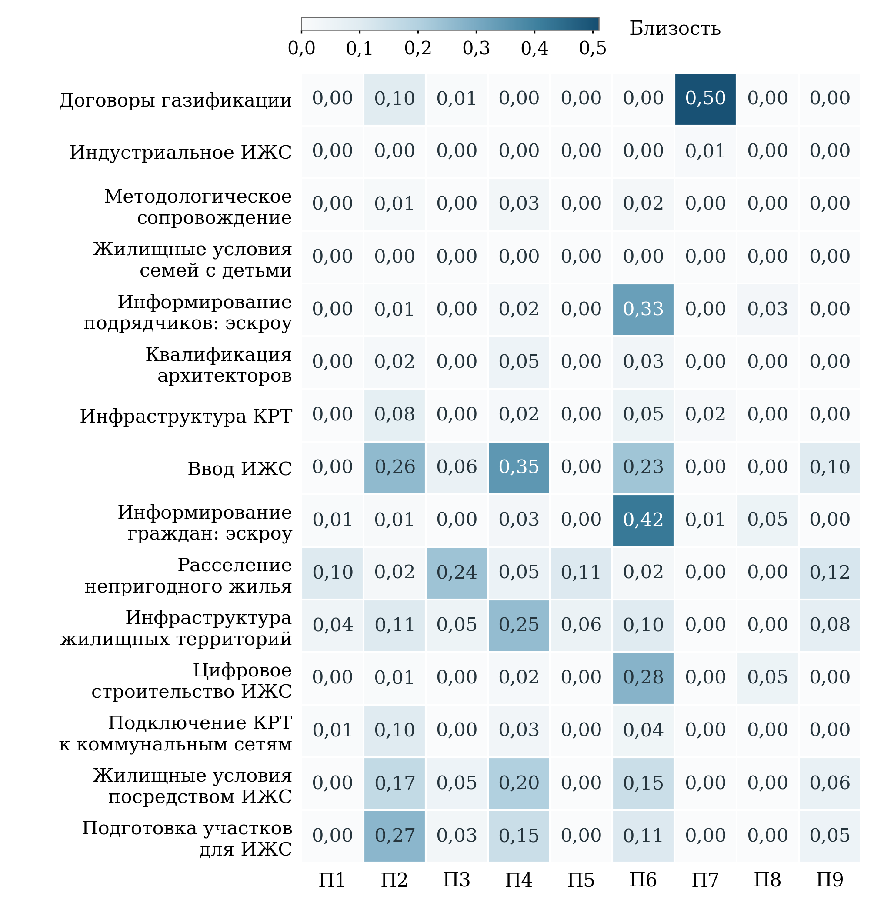

[B211; Caption] Рисунок 9 – Лексическая близость результатов и показателей федерального проекта «Жильё»

[B212; SourceNote] Названия результатов сокращены; КРТ – комплексное развитие территорий, ИЖС – индивидуальное жилищное строительство. Коды П1–П9 раскрыты в тексте. Значения округлены до 0,01: отображаемое 0,00 может означать малую положительную близость. Светлая клетка не доказывает отсутствия причинной связи; тёмная не доказывает влияния. Все 135 пар относятся к одной паспортной задаче. [Сноски 78]

[B213; ] Столбцы матрицы соответствуют следующим показателям: П1 – повышение доступности жилья на первичном рынке; П2 – площадь земельных участков, выявленных для вовлечения в оборот в целях индивидуального жилищного строительства, нарастающим итогом; П3 – количество граждан, переселённых из непригодного для проживания жилищного фонда, нарастающим итогом с 2019 года; П4 – объём жилищного строительства; П5 – индекс доступности жилья; П6 – доля строительства объектов ИЖС по договорам строительного подряда с использованием счетов эскроу в общем объёме строительства таких объектов; П7 – количество подключённых домовладений к сетевому природному газу в рамках социальной газификации; П8 – общая площадь жилых помещений в среднем на одного жителя; П9 – доля жилищного фонда, обновлённого после 2019 года.

[B214; ] Светлые клетки в столбцах доступности не означают, что строительство или подключение сетей не влияет на доступность жилья. Механизм может выражаться различными словами и зависеть от промежуточных условий: доходов, цен, кредитных требований, территориального размещения. Обратный пример – связь выданных ипотечных кредитов со средней ставкой: в исходных словоформах их лексическая близость равна нулю, хотя экономическая связь содержательно очевидна. Поэтому матрица пригодна для отбора пар, требующих чтения и уточнения измерений. Использовать её как замену причинной модели или как автоматическую оценку качества мероприятия методологически неверно.

[B215; Heading2] 5.3 Тематическая специализация федеральных направлений

[B216; ] Словарная карта охватывает восемь направлений: жильё и ипотеку, коммунальные услуги, дороги, перевозки, среду населённых пунктов, безопасность движения, цифровые решения, доступность и включение. Для каждого направления заданы группы основ слов и устойчивых сочетаний. Например, коммунальный словарь включает упоминания водоснабжения, водоотведения, водоподготовки, теплоснабжения и канализации; словарь доступности – доступность, инвалидность, маломобильность и социальную поддержку. Совпадения нормированы на объём каждого документа. Категории могут пересекаться, поэтому их значения не суммируются до 100 %; тематическая частота не измеряет долю финансирования или объём фактической деятельности.

[B217; ] Результаты отражают выраженную отраслевую специализацию (рисунок 10). В коммунальном проекте соответствующий словарь даёт 122,7 упоминания на 1 000 токенов; в федеральной дорожной сети дорожный словарь – 138,6; в общественном транспорте транспортный – 100,5; в комфортной городской среде профильный словарь – 87,4. Эти различия согласуются с предметом направлений. Высокая концентрация в коротких паспортах требует особой осторожности: например, 160,4 упоминания жилищной тематики в «Ипотеке» получены из 17 совпадений при объёме всего 106 токенов. Такой результат описывает концентрацию словаря, а не масштаб направления. [Сноски 79]

[B218; ] Национальный паспорт соединяет жилищную, коммунальную, дорожную и транспортную лексику, тогда как федеральные паспорта гораздо сильнее специализированы. При этом «Жильё» сохраняет заметное коммунальное содержание – 16,1 упоминания на 1 000 токенов. Это согласуется с непосредственно предусмотренными инфраструктурными мероприятиями КРТ и служит содержательной проверкой словарного результата. Цифровая тематика наиболее выражена в «Новом ритме строительства» – 15,6, и общесистемных дорожных мерах – 15,2. В обоих случаях она относится преимущественно к средствам организации отрасли; сама частота цифровых терминов не характеризует удобство услуги для жителя.

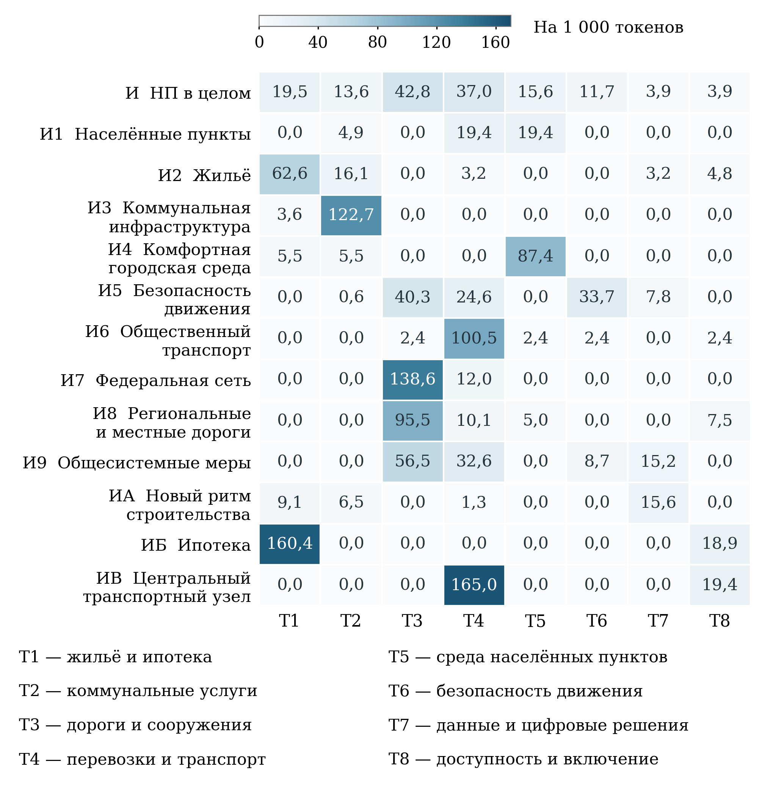

[B220; Caption] Рисунок 10 – Тематический профиль направлений национального проекта

[B221; SourceNote] Словарный анализ сопоставимых содержательных фрагментов. Каждая ячейка – число совпадений словаря на 1 000 токенов. Категории могут пересекаться; ноль означает отсутствие совпадений, а не отсутствие политики. [Сноски 80]

[B222; ] Словарь доступности и включения обнаруживает отдельные совпадения в жилищных, ипотечных, транспортных и дорожных формулировках. Их небольшое число не позволяет утверждать, что интересы соответствующих групп не учтены: часть требований может быть закреплена в технических нормах и документах другого уровня. Более узкий вывод состоит в том, что данный набор кратких паспортных формулировок слабо описывает различия опыта жителей. Поэтому оценку доступности целесообразно вести раздельно по доходу, возрасту, ограничению мобильности и типу территории, проверяя уже действующие измерения на достаточность для этих групп.

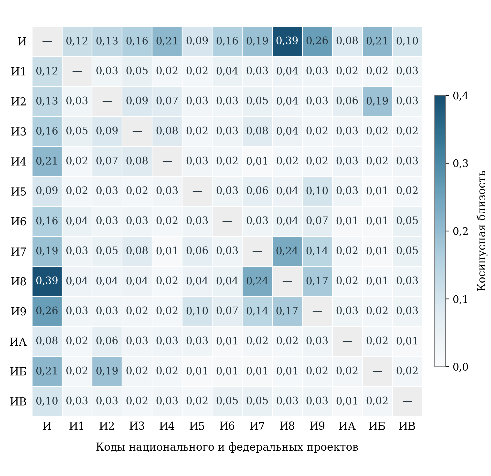

[B224; Caption] Рисунок 11 – Лексическая близость национального и федеральных паспортов

[B225; SourceNote] TF-IDF по общему словарю; нормировка L2. И – национальный паспорт; остальные коды расшифрованы в таблице состава корпуса. Диагональ исключена из цветовой шкалы; максимальная внедиагональная близость 0,392. [Сноски 81]

[B226; ] Внутренняя матрица TF-IDF подтверждает неоднородность тематических связей (рисунок 11). Самая высокая внедиагональная близость наблюдается между национальным паспортом и региональной и местной дорожной сетью – 0,392. Среди федеральных паспортов выделяется пара федеральной и региональной дорожных сетей – 0,236; близость «Жилья» и «Ипотеки» составляет 0,188. Между жильём и коммунальной инфраструктурой она равна 0,087, между жильём и общественным транспортом – 0,029. Последние значения не свидетельствуют о провале координации: необходимые для интеграции отрасли закономерно используют разные словари. Они показывают, почему проверка территориального согласования должна опираться на идентификаторы объектов и условия их совместной работы, а не на текстовое сходство.

[B227; ] Таким образом, специализация федеральных направлений объяснима их предметом; общей для них единицей оценки следует сделать изменение условий жизни на территории. Содержательная ценность объединения в национальном проекте возникает тогда, когда отраслевые результаты согласованы в пространстве и во времени. Лексическая карта помогает локализовать места такого согласования, но положительный вывод о его фактическом качестве требует сведений о готовности объектов, предоставляемых услугах и охваченных группах населения.

[B228; Heading2] 5.4 Межпроектная близость и лексический профиль

[B229; ] В агрегированном профиле «Инфраструктуры для жизни» наибольшие веса имеют слова и сочетания, связанные с автомобильными дорогами, строительством, объектами, дорожным хозяйством и жильём. Однако в верхней части профиля встречается также административная лексика и сочетания, возникающие после удаления служебных слов. Поэтому перечень частотных признаков нельзя непосредственно превращать в рейтинг общественных приоритетов. Его смысл раскрывается через сопоставление документов, вклад конкретных слов в сходство и чтение исходных формулировок.

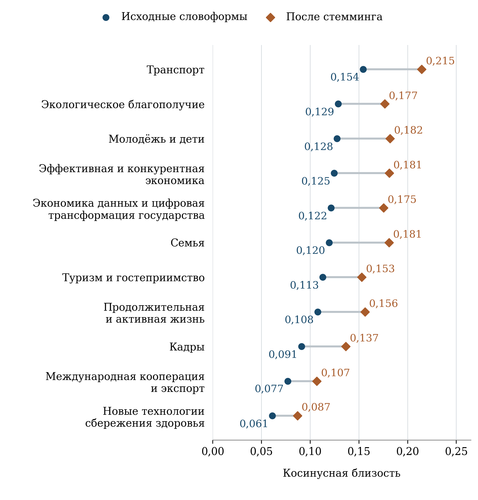

[B231; Caption] Рисунок 12 – Межпроектная лексическая близость и чувствительность к стеммингу

[B232; SourceNote] Профиль проекта – нормированное среднее нормированных паспортных векторов; равный вес каждого документа. Стемминг объединяет формы слов. Соединяющие линии обозначают различия спецификаций, не доверительные интервалы. [Сноски 82]

[B233; ] В базовой модели ближайшим из 11 сопоставляемых проектов является «Транспорт»: косинусная близость составляет 0,154. Далее следуют «Экологическое благополучие» – 0,129, «Молодёжь и дети» – 0,128, «Эффективная и конкурентная экономика» – 0,125 и «Экономика данных и цифровая трансформация государства» – 0,122. Близость к «Семье» равна 0,120, к «Туризму и гостеприимству» – 0,113, к «Продолжительной и активной жизни» – 0,108. Остальные значения показаны на рисунке 12. Это относительное положение внутри выбранного корпуса; универсального порога, после которого проекты считаются согласованными, данный метод не устанавливает. [Сноски 83]

[B234; ] Первое место «Транспорта» содержательно объяснимо: существенный вклад в сходство дают транспортная инфраструктура, строительство, дороги, сети и реконструкция. У экологического проекта к общим словам об объектах и строительстве добавляются среда, территории и коммунальные объекты. Такое соседство указывает на предметные области, где оправдана совместная проверка решений: территориальное размещение инфраструктуры, её воздействие на окружающую среду и непрерывность транспортных маршрутов. Однако сам коэффициент не показывает наличия общего календаря, устранения дублирования расходов или достижения синергии.

[B235; ] Близость к «Молодёжи и детям» имеет иной характер. Среди наиболее значимых общих признаков находятся слова о мероприятиях, обеспечении, целях, развитии и строительстве. Это сочетание предметного пересечения с общим языком государственных программ. По этой причине третье место данного проекта нельзя трактовать как доказательство более тесной функциональной связи, чем, например, с «Семьёй». Для содержательного вывода необходима конкретизация: какие образовательные или иные социальные объекты обеспечивают новые жилые территории, где расположены пользователи и как соотнесены сроки готовности.

[B236; ] Укрупнённая межпроектная карта, следовательно, полезна как ориентир для проверки границ ответственности. Наиболее устойчиво выделяется транспортное сопряжение; для проектов средней части распределения важнее предметный механизм и территориальная привязка, чем различия третьего десятичного знака. При формировании рекомендаций приоритет отдан тем связям, которые подтверждаются содержанием мероприятий и требованием совместной готовности услуг, а не только местом в лексическом ранжировании.

[B237; Heading2] 5.5 Устойчивость результатов и границы интерпретации

[B238; ] Проверка чувствительности отделяет выводы, зависящие от способа представления текста, от устойчивых характеристик проекта. Изменены четыре элемента модели: формы слов, включение двухсловных сочетаний, относительный вес уровней управления и сам уровень паспорта. Для морфологической проверки применён русский алгоритм Snowball, сводящий формы слов к основам. Он уменьшает влияние падежных и словообразовательных различий, но не равнозначен полной лемматизации. Во всех вариантах сравнивается один и тот же набор проектов. [Сноски 84]

[B239; Caption] Таблица 8 – Чувствительность межпроектного ранжирования к спецификации модели

[TABLE 8; B240]
Спецификация | Призна­ков | ρ Спирмена с базовой моделью | Второе место
Базовая: равный вес документов | 46 519 | 1,000 | Экологическое благополучие
Стемминг русских слов | 35 510 | 0,918 | Молодёжь и дети
Только отдельные слова | 10 329 | 0,991 | Экологическое благополучие
Равный вес национального и федерального уровней | 46 519 | 0,691 | Экологическое благополучие
Только федеральные паспорта | 46 519 | 0,991 | Молодёжь и дети
Только национальные паспорта | 46 519 | 0,045 | Международная кооперация и экспорт

[B241; SourceNote] Во всех шести спецификациях первое место занимает «Транспорт». Коэффициент Спирмена рассчитан по 11 проектам относительно их близости к «Инфраструктуре для жизни». При изменении уровня агрегирования словарь и IDF сохраняются; это проверка весов документов, а не переобучение словаря. [Сноски 85]

[B242; ] Стемминг повышает близость ко всем сопоставляемым проектам, поскольку объединяет ранее раздельные формы слов. Для «Транспорта» значение изменяется с 0,154 до 0,215; для «Семьи» – с 0,120 до 0,181. Эти сдвиги не означают усиления реального межведомственного взаимодействия: они обусловлены преобразованием признакового пространства. При этом ранговая согласованность с базовой моделью остаётся высокой – ρ = 0,918. Исключение двухсловных сочетаний меняет ранжирование ещё меньше: ρ = 0,991. Следовательно, положение транспортного направления не является случайным следствием одной формы слова или нескольких устойчивых выражений.

[B243; ] Наибольшее значение имеет способ учёта национального и федерального уровней. При равном весе каждого документа национальный паспорт «Инфраструктуры для жизни» получает одну тринадцатую общего веса до заключительной нормировки. При равном весе уровней национальный паспорт получает половину, а средний профиль 12 федеральных паспортов – вторую половину. Ранговая согласованность тогда снижается до 0,691. Это не выбор между правильным и неправильным расчётом: варианты отвечают разным вопросам – о детальной совокупности инструментов либо об укрупнённом целеполагании.

[B244; ] Сравнение только федеральных паспортов почти воспроизводит базовый порядок: ρ = 0,991. Сравнение только национальных паспортов даёт ρ = 0,045, хотя «Транспорт» сохраняет первое место. Следовательно, общий результат устойчив для ведущего предметного сопряжения, но состав ближайшего окружения зависит от уровня описания. Особенно ненадёжно было бы ранжировать межпроектную координацию по кратким национальным формулировкам, не учитывая содержание федеральных инструментов. Вторая позиция экспорта в такой модели показывает чувствительность к общим формулировкам, а не установленную функциональную зависимость.

[B245; ] У исследования есть три содержательные границы. Первая связана с документной природой данных: анализируется заявленная конструкция проекта, а не фактическая реализация всех мероприятий. Вторая – с полнотой внешней наблюдаемости: неадресуемые записи влияния ограничивают воспроизведение официальной матрицы связей, но не позволяют оценивать внутреннюю работу ведомств. Третья – с идентификацией эффекта: ни общая задача, ни совпадение слов, ни авторский граф механизмов не отделяют воздействие проекта от цен, доходов, демографии и других условий. Для такого вывода потребовались бы наблюдения по территории и времени, сопоставимые группы и специально обоснованный дизайн оценки.

[B246; ] Практический результат анализа состоит в выделении проверяемых переходов между строительством, инфраструктурным обеспечением и качеством жизни. Для совершенствования проекта существенны адресуемые связи результата с показателем, совместная готовность жилья и услуг, различение строительного и эксплуатационного результата и проверка доступности для разных групп жителей. Лексические методы подтверждают отраслевую специализацию и устойчивое транспортное сопряжение, одновременно показывая пределы автоматического сравнения. Эти выводы задают основания для содержательной доработки показателей и процедур оценки, не подменяя её формальным рейтингом текстов.

[B247; Heading1] 6 Территориальная согласованность и устойчивость услуг

[B248; Heading2] 6.1 Соответствие жилищного предложения потребностям территории

[B249; ] Целевой рост жилищной обеспеченности имеет социальный смысл при сочетании достаточной площади, приемлемого качества жилья и возможности пользоваться необходимыми услугами. Средняя площадь на человека характеризует обеспеченность жилищным фондом в агрегате. Она не показывает распределение площади между домохозяйствами, доступность приобретения или аренды, долю пустующих помещений и соответствие местоположения жилья рабочим местам. Эти ограничения особенно существенны при сопоставлении территорий с различной динамикой населения.

[B250; ] Зависимость показателя от численности населения выражается тождеством:

[B251; EquationText] (3)

[Формула] hₜ = Hₜ / Nₜ; hₜ / h₀ = (Hₜ / H₀) / (Nₜ / N₀)

$$
h_t=\frac{H_t}{N_t},\quad\frac{h_t}{h_0}=\frac{H_t/H_0}{N_t/N_0}
$$

[B252; ] Здесь h – площадь жилищного фонда на одного жителя, H – общая площадь фонда, N – численность населения. Из формулы следует, что средняя обеспеченность способна увеличиваться при неизменном фонде и сокращении населения. Это арифметическое свойство показателя, а не утверждение о причинах наблюдаемой динамики в конкретном субъекте. В территориальном анализе рост h целесообразно разлагать на изменение фонда и населения, одновременно проверяя состояние и занятость помещений.

[B253; ] Для растущих агломераций существенна синхронизация ввода жилья с инженерными мощностями, маршрутной сетью и социальной инфраструктурой. Для территорий со сокращением населения приоритетом может стать обновление существующего фонда, устранение аварийности и сохранение доступности услуг при меньшем числе пользователей. В малонаселённых районах важны расстояния, сезонность сообщения и удельные расходы на содержание сетей. Это типы управленческих ситуаций, требующие проверки на местных данных, а не установленная настоящим исследованием кластеризация субъектов.

[B254; ] Территориальную согласованность целесообразно проверять до принятия необратимых решений о застройке. Для каждого крупного жилого проекта должны быть известны ожидаемое заселение, доступная мощность коммунальных систем, сроки ввода смежных объектов и источник их последующего содержания. Сведение сроков в один календарь позволяет выявить разрыв между заселением и началом обслуживания. Показатель готовности такого комплекса должен отражать фактическую возможность пользования услугами, а не только наличие соглашений о будущих поставках.

[B255; ] Концентрация мер в опорных населённых пунктах требует оценки территории, которую они обслуживают. Стратегия пространственного развития определяет их роль через обеспечение жителей прилегающих территорий инфраструктурой и услугами. Поэтому границы административного населённого пункта не исчерпывают круг получателей результата. Для экспертизы конкретного мероприятия необходимо устанавливать зону обслуживания и проверять, изменилось ли время и стоимость доступа для жителей периферии. Изменение среднего показателя самого центра не заменяет этой проверки. [Сноски 86]

[B256; ] Доступность жилья следует оценивать отдельно от прироста предложения. Для семей с разными доходами имеют значение первоначальный взнос, ежемесячный платёж, арендная нагрузка, коммунальные платежи и транспортные расходы. Отсутствие одного из этих измерений способно скрывать перенос издержек: более дешёвое жильё на периферии может потребовать больших расходов времени и денег на поездки. Для предлагаемого мониторинга достаточно согласованного набора распределительных характеристик; искусственно объединять их в единый индекс без обоснования весов не требуется.

[B257; Heading2] 6.2 Надёжность коммунальных услуг

[B258; ] Результат модернизации коммунальной инфраструктуры следует связывать с изменением обслуживания определённой группы потребителей. Длина заменённой сети и число модернизированных объектов характеризуют объём вмешательства. Для жителей существенны продолжительность отключений, качество ресурса, давление и температурный режим, доступность подключения и величина платежей. Связь этих уровней проверяется на конкретной системе снабжения с учётом состояния смежных участков.

[B259; ] Устойчивость отдельного объекта и устойчивость услуги различаются. Отказ короткого, но критичного участка способен прервать обслуживание большой территории; ремонт менее значимого участка может дать меньший эффект при большей физической протяжённости. Международные исследования инфраструктурной устойчивости обосновывают анализ сетевой взаимозависимости и потерь пользователей, наряду с повреждением самих активов. Для отбора российских мероприятий предлагается устанавливать число и состав затронутых потребителей, резервные пути снабжения, ожидаемую длительность восстановления и зависимые социальные объекты. [Сноски 87]

[B260; ] Первичная единица мониторинга – событие нарушения услуги, отнесённое к зоне обслуживания. Для него должны фиксироваться начало и окончание, причина, число затронутых пользователей и связь с участком сети. Плановые и аварийные перерывы необходимо различать. При агрегировании следует учитывать суммарную длительность воздействия на потребителей: один длительный перерыв для большого числа жителей и несколько коротких локальных отключений имеют разную социальную значимость. Неидентифицированные повторные сообщения об одной аварии не должны увеличивать число событий.

[B261; ] Послеремонтное улучшение следует оценивать на сопоставимом сезонном интервале. Изменение погоды, нагрузки, режима использования и правил регистрации способно повлиять на число аварий независимо от ремонта. Поэтому для эксплуатационного контроля полезно сопоставление одинаковых месяцев, а для оценки дополнительного эффекта – также сравнение с системами, сходными по исходному состоянию. При отсутствии таких данных допустим вывод о выполненных работах и наблюдаемом качестве услуги, но не количественная оценка предотвращённого ущерба.

[B262; ] Эксплуатационная устойчивость включает кадровое обеспечение, техническое обслуживание, запас материалов, диагностику и обновление оборудования. Эти расходы целесообразно проверять до ввода объекта. В соглашении о реализации мероприятия предлагается фиксировать будущего оператора, состав передаваемых активов, источники содержания и порядок подтверждения готовности к обслуживанию. Для комплексных объектов отдельно проверяется, не остаётся ли критичная часть сети вне границ ответственности участников.

[B263; ] Рост тарифа или обязательных платежей нельзя оценивать только как источник окупаемости. Для домохозяйств с низкими доходами он меняет доступность базовых услуг. При выборе инвестиционного варианта необходимо одновременно раскрывать эксплуатационные затраты и предполагаемое распределение платежной нагрузки. Если расходы предполагается компенсировать бюджетом, это должно отражаться в оценке долгосрочных обязательств. Финансовая жизнеспособность оператора и социальная доступность услуги подлежат совместной проверке, без их автоматического отождествления.

[B264; Heading2] 6.3 Доступность и безопасность повседневных перемещений

[B265; ] Нормативное состояние дорог и обновление транспортных средств создают необходимые условия перевозок. Доступность для населения определяется также маршрутами, частотой движения, пересадками, временем ожидания, ценой поездки и возможностью воспользоваться транспортом при ограниченной мобильности. Подход Международного транспортного форума рассматривает доступ к возможностям и услугам через совместное влияние транспорта, территориального размещения объектов и характеристик пользователей. В оценке проекта это предполагает дополнение оценки состояния транспортных активов проверкой конкретных повседневных направлений поездок. [Сноски 88]

[B266; ] Для территориального мониторинга предлагается оценивать долю жителей, которым в заданный период доступна определённая услуга в пределах обоснованного времени поездки. Порог необходимо устанавливать для вида услуги и типа территории; единая произвольная граница для всей страны исказила бы различия условий. Общая форма показателя имеет вид:

[B267; EquationText] (4)

[Формула] Aₛ(τ) = 100 × Σᵢ[Nᵢ × 1(tᵢₛ ≤ τ)] / ΣᵢNᵢ

$$
A_s(\tau)=100\frac{\sum_i N_i\,\mathbf{1}(t_{is}\leq\tau)}{\sum_iN_i}
$$

[B268; ] Здесь Aₛ(τ) – доля населения с доступом к услуге s за время не более τ; Nᵢ – число жителей непересекающейся зоны i; tᵢₛ – полное время поездки, включая подход, ожидание и пересадки; 1(·) – индикатор выполнения условия. Учитывается фактически работающий и доступный данному пользователю объект услуги; при его отсутствии условие не выполнено. Показатель предлагается как инструмент территориальной диагностики и в настоящем отчёте не рассчитывается: для него нужны согласованные данные о населении, расписаниях и расположении услуг. Измерение следует проводить по времени суток и дням недели, а доступность для маломобильных пользователей – проверять отдельно.

[B269; ] Для обновления общественного транспорта существенны выход на линию, выполнение рейсов и регулярность движения. Поставка транспортного средства не завершает результат, если отсутствуют водитель, ремонтная база или финансирование работы маршрута. Предлагается привязывать послепоставочный контроль к конкретному маршруту и периоду эксплуатации. Изменение числа перевезённых пассажиров следует интерпретировать вместе с предложением рейсов и численностью населения: рост либо снижение спроса сами по себе не определяют качество услуги.

[B270; ] Дорожную безопасность следует оценивать через тяжесть последствий для всех участников движения. Международный подход Safe System связывает безопасность инфраструктуры, транспортных средств, режимов движения, поведения участников и помощи после происшествия. Для проектного контроля это означает проверку переходов, остановок, подходов к школам и другим объектам массового посещения одновременно с состоянием проезжей части. Приведение дороги к техническому нормативу не освобождает от отдельной проверки риска тяжёлых происшествий. [Сноски 89]

[B271; ] Паспортный показатель безопасности использует число погибших на 10 тыс. транспортных средств. При сопоставлении территорий его полезно дополнять числом погибших на 100 тыс. жителей и показателем, учитывающим транспортную работу, если она измерена сопоставимо. Для малых территорий и редких событий годовые колебания могут быть велики; предпочтительны многолетние окна с сохранением актуальных оперативных данных. Выбор аварийного участка только по последнему пиковому году требует осторожности: часть последующего снижения может отражать возврат случайно высокого значения к обычному уровню. Для оценки эффекта реконструкции нужен контроль исходной аварийности и сопоставимых участков. [Сноски 90]

[B272; ] Общественные пространства также следует оценивать как элементы повседневной доступности. Значимы связность пешеходных маршрутов, освещение, безопасность переходов, сезонная пригодность и возможность использования разными возрастными группами. Количество благоустроенных территорий даёт меру объёма работ, но не раскрывает устойчивость пользования. Наблюдение после завершения работ и обратная связь жителей должны относиться к конкретному месту и условиям его эксплуатации.

[B273; Heading2] 6.4 Стоимость жизненного цикла и выбор приоритетов

[B274; ] Приоритет инфраструктурного мероприятия предлагается определять по тяжести исходного дефицита, числу и уязвимости пользователей, способности устранить системное ограничение и полной стоимости обслуживания. Такое сопоставление позволяет рассмотреть ремонт, реконструкцию, изменение режима эксплуатации и новое строительство как альтернативные способы решения одной проблемы. Выбор более капиталоёмкого варианта требует объяснения дополнительных выгод и издержек.

[B275; ] Для сравнения альтернатив с одинаковыми требованиями к услуге применима приведённая стоимость жизненного цикла:

[B276; EquationText] (5)

[Формула] LCC = I₀ + Σₜ₌₁ᵀ[(Mₜ + Oₜ + Rₜ)/(1 + r)ᵗ] − Vₜ/(1 + r)ᵀ

$$
LCC=I_0+\sum_{t=1}^{T}\frac{M_t+O_t+R_t}{(1+r)^t}-\frac{V_T}{(1+r)^T}
$$

[B277; ] I₀ – первоначальные инвестиции; Mₜ – содержание и обслуживание; Oₜ – прочие эксплуатационные затраты, не включённые в Mₜ; Rₜ – капитальное восстановление и замены; VT – остаточная стоимость за вычетом затрат на выбытие; r – ставка дисконтирования; T – общий горизонт сравнения. Состав затрат должен исключать двойной счёт. Номинальные денежные потоки сопоставляются с номинальной ставкой, реальные – с реальной. Формула описывает предлагаемый критерий выбора и не является расчётом стоимости конкретных мероприятий проекта.

[B278; ] Сравнивать только расходы на строительство допустимо лишь при доказанно одинаковых последующих услугах и расходах. На практике необходимы варианты стоимости материалов и энергии, загрузки, срока службы и задержки ввода. Сценарии следует показывать раздельно, сохраняя исходные предпосылки. Малая приведённая стоимость не даёт достаточного основания для выбора, если вариант хуже обеспечивает безопасность или нарушает обязательные требования доступности.

[B279; Caption] Таблица 9 – Условия выбора инфраструктурных решений для разных территориальных ситуаций

[TABLE 9; B280]
Ситуация | Приоритет проверки | Признак обоснованного решения
Рост жилищного строительства | Мощность сетей и сроки начала обслуживания | Жильё и необходимые услуги готовы к заселению
Сокращение населения | Будущая загрузка и расходы на одного пользователя | Масштаб решения соответствует проверенному спросу
Высокая аварийность сетей | Критичные участки и уязвимые потребители | Снижаются длительность и охват нарушений услуги
Недоступность социальных услуг | Время, стоимость и регулярность поездок | Улучшается доступ жителей обслуживаемой территории
Ограниченные местные ресурсы | Оператор и обеспеченность содержания | Эксплуатационные обязательства имеют источник покрытия

[B281; SourceNote] Экспертная схема выбора. Территориальные ситуации могут сочетаться и не образуют взаимоисключающей статистической классификации.

[B282; ] Отбор по числу получателей не должен вытеснять малочисленные и удалённые сообщества из приоритетов. Базовые требования безопасности и доступности выступают самостоятельными ограничениями, а оценка удельных затрат помогает выбрать способ их выполнения. Для территорий с высокой стоимостью обслуживания целесообразно сопоставлять несколько технических и организационных решений при одинаковом требуемом качестве услуги. Публичное обоснование должно раскрывать, какие условия приняты обязательными и какие варианты были отвергнуты.

[B283; Heading1] 7 Направления совершенствования национального проекта

[B284; Heading2] 7.1 Согласование мероприятий и ответственности

[B285; ] Первое направление совершенствования – усиление проверяемости территориальной увязки мероприятий в рамках действующих программ развития опорных населённых пунктов и механизмов комплексного развития территорий. Для выбранного населённого пункта или зоны обслуживания предлагается соединять сведения о проблеме, поддерживаемых объектах, сроках готовности и ожидаемом изменении услуг. Это представление должно использовать сведения существующих государственных и ведомственных систем. Создание ещё одной автономной отчётности без согласования идентификаторов увеличило бы нагрузку, сохранив проблему сопоставления.

[B286; ] Каждый территориальный комплекс следует снабжать явной схемой зависимостей. Для жилищной застройки это подключение к сетям и доступ к транспорту; для благоустройства – безопасные подходы и содержание; для обновления подвижного состава – готовность маршрута и оператора. В схеме необходимо обозначать критичные сроки и исполнителя, отвечающего за устранение каждого ограничения. Межведомственное рассмотрение полезно сосредоточить на таких зависимостях, а не на повторном перечислении всех выполненных мероприятий.

[B287; ] Второе направление – завершение связи между результатом и показателем. Для каждой карточки результата предлагается указывать конкретный показатель, механизм предполагаемого изменения, территорию и получателей, ожидаемый временной лаг и необходимые внешние условия. Для показателей, формируемых несколькими мерами, должны быть видны все существенные участники. Это позволит обсуждать вклад каждого направления без необоснованного распределения общего эффекта пропорционально финансированию.

[B288; ] Третье направление – согласованное управление редакциями. Для изменений методики, состава наблюдаемых территорий, целевой траектории и финансовой таблицы требуется дата действия и краткое объяснение перехода. Если возможен пересчёт прошлых значений, его следует публиковать вместе с исходным рядом; если невозможен – обозначать разрыв. Показатель, текст задачи и обоснование финансирования должны проверяться как связанные части одного решения.

[B289; ] Четвёртое направление – подтверждение готовности эксплуатации до завершения инвестиций. Рекомендуется предусмотреть проверку будущего оператора, обязательств по содержанию, достаточности кадров и доступности запасных частей. Для наиболее значимых объектов целесообразен последующий обзор качества услуги на полном сезонном цикле. Результат такого обзора должен влиять на корректировку технических решений и выбор аналогичных мероприятий, а не только завершать формальную отчётность.

[B290; ] Пятое направление – финансовая прослеживаемость. В управленческом представлении следует раздельно показывать источники средств, утверждённый план, изменения плана, принятые обязательства и исполнение за одинаковый период. Согласование агрегатов должно учитывать разные горизонты и возможность финансирования связанных мер вне данного национального проекта. Выявленное расхождение подлежит документальному объяснению; вывод о финансовом нарушении требует самостоятельной проверки первичных обязательств и платежей.

[B291; Heading2] 7.2 Дополнение мониторинга показателями работы услуг

[B292; ] Предлагаемое дополнение системы наблюдения направлено на проверку общественного смысла уже учитываемых результатов. Оно не требует автоматически включать каждый показатель в федеральную систему обязательной отчётности. Сначала следует установить, какие сведения уже собираются, сопоставить определения и провести пилот на ограниченном числе территорий. Ключевое требование – возможность связать значение с конкретным вмешательством, периодом и населением.

[B293; Caption] Таблица 10 – Предлагаемые показатели для территориальной проверки результатов

[TABLE 10; B294]
Показатель | Определение и единица | Условия сопоставления
Готовность услуг при заселении | Площадь вводимого жилья с готовыми согласованными условиями обслуживания к общей площади вводимого жилья, % | Единый перечень сетевых и транспортных условий; срок заселения; раскрытие невыполненных условий
Длительность нарушения коммунальной услуги | Сумма часов перерыва, взвешенная числом затронутых потребителей, на одного потребителя зоны | Раздельно по услуге; плановые и аварийные события; исключение дублей
Доступ к ключевой услуге | Доля жителей, достигающих выбранной услуги за установленное время поездки, % | Обоснованный порог; ожидание и пересадки; день недели; особые потребности
Выполнение транспортной работы | Выполненные рейсы по отношению к запланированным, % | Один маршрут и период; причины отмен; контроль изменения расписания
Полная нагрузка обязательных расходов | Жильё, коммунальные платежи и необходимые поездки по отношению к доходу домохозяйства, % | Распределение по доходу и типу семьи; сопоставимый состав расходов
Готовность эксплуатации | Доля вводимых объектов с подтверждёнными оператором и источником содержания, % | Подтверждение обязательств; последующая проверка фактической работы

[B295; SourceNote] Предложения экспертизы. Численные нормативы и целевые уровни должны определяться после проверки исходного распределения и сопоставимости данных.

[B296; ] Для каждого предлагаемого показателя необходим краткий паспорт: вопрос управления, единица наблюдения, числитель и знаменатель, источники, правила обновления, допустимые пропуски и ответственная организация. Изменение границ зоны обслуживания или состава потребителей должно сопровождаться пересчётом сопоставимого основания. При невозможности восстановления сопоставимости два периода необходимо публиковать отдельно.

[B297; ] Социальные различия рекомендуется раскрывать там, где они меняют вывод о доступности: по доходу, составу домохозяйства, возрасту и ограничениям мобильности. Достаточность детализации определяется качеством выборки и защищённостью персональных сведений. Удовлетворённость жителей полезна как самостоятельный источник информации об опыте пользования услугой, но её нельзя механически превращать в меру технического состояния объекта. Для опросов нужны известные правила отбора, период, формулировки вопросов и оценка неопределённости.

[B298; ] Расширение наблюдения следует сопровождать сокращением дублирования. Если показатель может быть получен из эксплуатационного журнала, реестра объектов или действующей транспортной системы, предпочтителен согласованный расчёт из этих источников. Выборочные обследования нужны прежде всего для сведений, которые административный учёт не раскрывает: фактических барьеров пользования, неформальных издержек и распределения нагрузки внутри домохозяйств.

[B299; Heading2] 7.3 Последовательность внедрения и оценка дополнительного эффекта

[B300; ] Реализацию предложений целесообразно организовать по проверяемым этапам. В первые три месяца после принятия соответствующего управленческого решения можно согласовать словарь показателей, проверить расхождения редакций и выбрать пилотные территории. Следующий этап должен подтвердить возможность связать объект, мероприятие, расходы и зону обслуживания. Распространение подхода оправдано после проверки трудоёмкости и качества данных. Указанные сроки являются предложением экспертизы, а не действующим календарём национального проекта.

[B301; Caption] Таблица 11 – Предлагаемая последовательность внедрения изменений

[TABLE 11; B302]
Этап | Основной результат | Критерий перехода
Первые 3 месяца | Согласованные определения и перечень расхождений | Для каждого расхождения определены владелец и способ устранения
3–6 месяцев | Пилотное соединение сведений об объектах и услугах | Данные воспроизводимы; трудоёмкость приемлема; зоны обслуживания установлены
6–12 месяцев | Первый обзор эксплуатации и распределения результатов | Выявлены конкретные изменения услуг и ограничения интерпретации
После полного сезонного цикла | Проверка устойчивости и корректировка отбора | Результаты используются при следующем распределении поддержки

[B303; SourceNote] Сроки отсчитываются от принятия решения о внедрении; сезонные требования могут увеличивать длительность отдельных проверок.

[B304; ] Причинную оценку рекомендуется планировать до очередного этапа распределения поддержки. Для поэтапного подключения территорий нужно заранее сохранить критерии отбора, даты фактического начала воздействия и результаты за предшествующие периоды. Метод разностей разностей с несколькими моментами начала участия позволяет учитывать неодинаковые сроки и неоднородность эффекта, но требует обоснования сравнимой динамики при отсутствии вмешательства. В качестве сравнения нельзя автоматически использовать все неподдержанные территории: они могут отличаться исходной тяжестью проблем и финансовыми возможностями. [Сноски 91]

[B305; ] Оценка должна учитывать вмешательства других программ, изменение границ, миграцию и сетевые эффекты. Если новая транспортная или коммунальная инфраструктура обслуживает соседние территории, часть контрольной группы также получает воздействие. Это требует пересмотра зоны оценки. Проверка предшествующих тенденций, устойчивости к составу сравнения и чувствительности к альтернативным датам необходима для содержательного доверия к результату. Статистическая значимость без приемлемого механизма сравнения не доказывает эффект.

[B306; ] Для мер с недостаточной историей или отсутствием подходящей группы сравнения приоритетны проверка реализации и эксплуатационный мониторинг. По мере накопления данных возможна оценка прироста надёжности, сокращения времени доступа и изменения платёжной нагрузки. Если проект отбирался по особенно неблагоприятному последнему наблюдению, это условие следует учитывать в дизайне. Отдельно рекомендуется проверять, сохраняется ли улучшение после окончания первоначальной поддержки.

[B307; ] Продолжение или масштабирование мероприятия следует обосновывать выполнением работ, устойчивой работой услуги, распределением улучшений между жителями и качеством оценки дополнительного эффекта. Эти основания позволяют корректировать проект в ходе реализации.

[B308; Heading1] Заключение

[B309; ] Национальный проект «Инфраструктура для жизни» обладает содержательно обоснованной межотраслевой конструкцией. Объединение жилищных, коммунальных и транспортных направлений отвечает взаимозависимости повседневных условий жизни. Основные ограничения выявлены в способах подтверждения совместного результата, сопоставимости отдельных наблюдений и прослеживаемости связей между расходами, объектами и устойчивыми услугами. Их устранение не требует отказа от отраслевых показателей; оно требует дополнения их территориальной и эксплуатационной проверкой.

[B310; ] Статистический анализ показывает, что благоприятное положение относительно текущих целей может сочетаться со слабой либо отрицательной динамикой отдельных процессов. Региональные распределения раскрывают различия, которые не видны в общероссийском агрегате. Поэтому исполнение годового задания, изменение инфраструктурного дефицита и распределение результата между жителями следует оценивать раздельно. Особенно осторожного обращения требуют накопительные ряды, условные нули, оперативные записи и показатели, методика которых изменилась.

[B311; ] Финансовая экспертиза фиксирует необходимость сопоставлять однородные горизонты и источники. Паспортный план, бюджетные предложения, назначения и фактические выплаты имеют разный статус. Высокая концентрация федеральных средств в дорожных направлениях должна обсуждаться вместе с содержанием этих расходов, региональным участием и потребностью в обслуживании существующей сети. Для принятия решений о новых объектах существенны обязательства будущего оператора и полная стоимость поддержания требуемого качества услуги.

[B312; ] Исследование текстов и проектных связей подтверждает отраслевую специализацию федеральных направлений и наличие межотраслевого замысла. Одновременно доступная публикация не обеспечивает воспроизведения адресуемой матрицы влияния результатов на показатели. Исправление этой проблемы сделало бы внешнюю экспертизу более точной и позволило бы обсуждать конкретные механизмы достижения целей. Лексические методы полезны для диагностики структуры документации, но не заменяют наблюдение реализации и условий жизни.

[B313; ] Наиболее существенное направление совершенствования – соединение мероприятий по месту и времени предоставления услуги. Для нового жилья это готовность сетей и транспортного обслуживания; для коммунального объекта – устойчивое качество снабжения определённых потребителей; для транспорта – возможность фактически совершать необходимые поездки; для общественного пространства – пригодность и доступность после завершения работ. В каждом случае важны исходное состояние, круг пользователей, подтверждённое изменение и расходы на сохранение результата.

[B314; ] Предлагаемый порядок внедрения предусматривает первоначальную сверку определений и редакций, пилотное соединение объектных и эксплуатационных данных, последующий обзор полного сезонного цикла и использование результатов при следующем отборе мероприятий. Причинную оценку следует планировать там, где возможно обосновать сравнение и сохранить предшествующие наблюдения. В остальных случаях достоверная проверка выполнения работ и качества услуги остаётся самостоятельным управленчески значимым результатом.

[B315; ] Критерием успешного совершенствования проекта должно стать повышение способности органов управления объяснить, какое ограничение устранено, для каких жителей, на какой территории, с какой устойчивостью и ценой последующего содержания. Такая постановка делает связь между инфраструктурными инвестициями и качеством жизни проверяемой и позволяет корректировать проект в ходе реализации.

# Сноски и источники

[1] Инфраструктура для жизни : национальный проект : паспорт, публикация от 16 октября 2026 г., версия 26.60 // DataBudget. – Текст : электронный. Режим доступа: https:/​/​databudget.​ru/​projects/​np/​18 (дата обращения: 28.10.2026); DataBudget. Жилье : электронное представление паспорта федерального проекта. – Текст : электронный. Режим доступа: https:/​/​databudget.​ru/​projects/​fp/​253 (дата обращения: 28.10.2026).

[2] Федеральная служба государственной статистики. Объем жилищного строительства : показатель ЕМИСС № 59263 [Электронный ресурс] // Единая межведомственная информационно-статистическая система. – Режим доступа: https:/​/​www.​fedstat.​ru/​indicator/​59263. – Сохранённая выгрузка от 15.10.2026 (дата обращения к сохранённой копии: 28.10.2026); Центральный банк Российской Федерации. Объем ипотечных жилищных кредитов (траншей) в рублях и иностранной валюте, предоставленных физическим лицам-резидентам за год : показатель ЕМИСС № 61608 [Электронный ресурс] // Единая межведомственная информационно-статистическая система. – Режим доступа: https:/​/​www.​fedstat.​ru/​indicator/​61608. – Сохранённая выгрузка от 15.10.2026 (дата обращения к сохранённой копии: 28.10.2026); Паспорт национального проекта «Инфраструктура для жизни» : версия 26.60 от 16 октября 2026 г. [Электронный ресурс] // DataBudget : публикация данных ГИИС «Электронный бюджет». – Режим доступа: https:/​/​databudget.​ru/​projects/​np/​18 (дата обращения: 28.10.2026).

[3] Федеральная служба государственной статистики. Объем жилищного строительства : показатель ЕМИСС № 59263. Режим доступа: https:/​/​www.​fedstat.​ru/​indicator/​59263; Федеральная служба государственной статистики. Ввод жилья в многоквартирных жилых домах : показатель ЕМИСС № 59262 [Электронный ресурс] // Единая межведомственная информационно-статистическая система. – Режим доступа: https:/​/​www.​fedstat.​ru/​indicator/​59262. – Сохранённая выгрузка от 15.10.2026 (дата обращения к сохранённой копии: 28.10.2026); Федеральное дорожное агентство. Доля автомобильных дорог регионального и межмуниципального значения, соответствующих нормативным требованиям (И8) : показатель ЕМИСС № 62794 [Электронный ресурс] // Единая межведомственная информационно-статистическая система. – Режим доступа: https:/​/​www.​fedstat.​ru/​indicator/​62794. – Сохранённая выгрузка от 15.10.2026 (дата обращения к сохранённой копии: 28.10.2026).

[4] Министерство строительства и жилищно-коммунального хозяйства Российской Федерации. Численность населения, для которого улучшится качество предоставления коммунальных услуг (в сфере тепло-, водоснабжения и водоотведения), нарастающим итогом с 2025 года (И3) : показатель ЕМИСС № 62882 [Электронный ресурс] // Единая межведомственная информационно-статистическая система. – Режим доступа: https:/​/​www.​fedstat.​ru/​indicator/​62882. – Сохранённая выгрузка от 15.10.2026 (дата обращения к сохранённой копии: 28.10.2026); Паспорт национального проекта «Инфраструктура для жизни» : версия 26.60 от 16 октября 2026 г. Режим доступа: https:/​/​databudget.​ru/​projects/​np/​18.

[5] Инфраструктура для жизни : национальный проект : паспорт, публикация от 16 октября 2026 г., версия 26.60. Режим доступа: https:/​/​databudget.​ru/​projects/​np/​18; Формирование комфортной городской среды : федеральный проект : паспорт, публикация от 16 октября 2026 г., версия 26.4 // DataBudget. – Текст : электронный. Режим доступа: https:/​/​databudget.​ru/​projects/​fp/​297 (дата обращения: 28.10.2026); Правительство Российской Федерации. Пояснительная записка к проекту федерального закона № 615-9 «О федеральном бюджете на 2027 год и на плановый период 2028 и 2029 годов», внесённому 30 сентября 2026 г. Разд. IV, табл. 4.1.4 // ГАРАНТ. – Текст : электронный. Режим доступа: https:/​/​base.​garant.​ru/​411685865/​ (дата обращения: 28.10.2026).

[6] Министерство строительства и жилищно-коммунального хозяйства Российской Федерации. Об утверждении методики расчета показателя «Улучшение качества среды для жизни в опорных населенных пунктах» : приказ от 9 июня 2026 г. № 363/пр [Электронный ресурс]. – Режим доступа: https:/​/​pravo.​ppt.​ru/​prikaz/​minstroy/​n-​363-​pr-​342625 (дата обращения: 28.10.2026).

[7] DataBudget. Инфраструктура для жизни : электронное представление паспорта национального проекта и входящих федеральных проектов. – Текст : электронный. Режим доступа: https:/​/​databudget.​ru/​projects/​np/​18 (дата обращения: 28.10.2026); DataBudget. Национальные проекты : каталог электронных паспортов. – Текст : электронный. Режим доступа: https:/​/​databudget.​ru/​projects (дата обращения: 28.10.2026).

[8] González S., Dekyi T. Management of assets throughout their life cycle: Evidence from the Infrastructure Governance Indicators [Электронный ресурс] // OECD Working Papers on Public Governance. 2026. No. 89. Paris : OECD Publishing. DOI: 10.1787/86ce92d8-en. Режим доступа: https:/​/​doi.​org/​10.​1787/​86ce92d8-​en (дата обращения: 28.10.2026).

[9] Министерство строительства и жилищно-коммунального хозяйства Российской Федерации. Национальный проект «Инфраструктура для жизни» : паспорт. – Текст : электронный. Режим доступа: https:/​/​mingrad.​gov-​murman.​ru/​np-​infrastruktura-​dlya-​zhizni-​_​i_​.​pdf (дата обращения: 28.10.2026).

[10] Министерство строительства и жилищно-коммунального хозяйства Российской Федерации. Национальный проект «Инфраструктура для жизни» : паспорт. Режим доступа: https:/​/​mingrad.​gov-​murman.​ru/​np-​infrastruktura-​dlya-​zhizni-​_​i_​.​pdf.

[11] Инфраструктура для жизни : национальный проект : паспорт, публикация от 16 октября 2026 г., версия 26.60. Режим доступа: https:/​/​databudget.​ru/​projects/​np/​18; Министерство строительства и жилищно-коммунального хозяйства Российской Федерации. Национальный проект «Инфраструктура для жизни» : паспорт. Режим доступа: https:/​/​mingrad.​gov-​murman.​ru/​np-​infrastruktura-​dlya-​zhizni-​_​i_​.​pdf.

[12] Министерство строительства и жилищно-коммунального хозяйства Российской Федерации. О разъяснениях основных направлений, мероприятий, показателей, методик национального проекта «Инфраструктура для жизни» : письмо от 20 декабря 2024 г. № 76775-ЮМ/02 // ГАРАНТ. – Текст : электронный. Режим доступа: https:/​/​base.​garant.​ru/​412838099/​ (дата обращения: 28.10.2026); Инфраструктура для жизни : национальный проект : паспорт, публикация от 16 октября 2026 г., версия 26.60. Режим доступа: https:/​/​databudget.​ru/​projects/​np/​18.

[13] Министерство строительства и жилищно-коммунального хозяйства Российской Федерации. О разъяснениях основных направлений, мероприятий, показателей, методик национального проекта «Инфраструктура для жизни» : письмо от 20 декабря 2024 г. № 76775-ЮМ/02. Режим доступа: https:/​/​base.​garant.​ru/​412838099/​; Инфраструктура для жизни : национальный проект : паспорт, публикация от 16 октября 2026 г., версия 26.60. Режим доступа: https:/​/​databudget.​ru/​projects/​np/​18.

[14] Жилье : федеральный проект : паспорт, публикация от 16 октября 2026 г., версия 26.5 // DataBudget. – Текст : электронный. Режим доступа: https:/​/​databudget.​ru/​projects/​fp/​253 (дата обращения: 28.10.2026); Ипотека : федеральный проект : паспорт, публикация от 16 октября 2026 г., версия 26.2 // DataBudget. – Текст : электронный. Режим доступа: https:/​/​databudget.​ru/​projects/​fp/​259 (дата обращения: 28.10.2026).

[15] Ипотека : федеральный проект : паспорт, публикация от 16 октября 2026 г., версия 26.2. Режим доступа: https:/​/​databudget.​ru/​projects/​fp/​259.

[16] Инфраструктура для жизни : национальный проект : паспорт, публикация от 16 октября 2026 г., версия 26.60. Режим доступа: https:/​/​databudget.​ru/​projects/​np/​18; Модернизация коммунальной инфраструктуры : федеральный проект : паспорт, публикация от 16 октября 2026 г., версия 26.10 // DataBudget. – Текст : электронный. Режим доступа: https:/​/​databudget.​ru/​projects/​fp/​245 (дата обращения: 28.10.2026).

[17] Министерство строительства и жилищно-коммунального хозяйства Российской Федерации. Национальный проект «Инфраструктура для жизни» : паспорт. Режим доступа: https:/​/​mingrad.​gov-​murman.​ru/​np-​infrastruktura-​dlya-​zhizni-​_​i_​.​pdf.

[18] Развитие общественного транспорта : федеральный проект : паспорт, публикация от 16 октября 2026 г., версия 26.11 // DataBudget. – Текст : электронный. Режим доступа: https:/​/​databudget.​ru/​projects/​fp/​254 (дата обращения: 28.10.2026).

[19] Безопасность дорожного движения : федеральный проект : паспорт, публикация от 16 октября 2026 г., версия 26.23 // DataBudget. – Текст : электронный. Режим доступа: https:/​/​databudget.​ru/​projects/​fp/​249 (дата обращения: 28.10.2026).

[20] Развитие железнодорожной инфраструктуры центрального транспортного узла : федеральный проект : паспорт, публикация от 16 октября 2026 г., версия 26.2 // DataBudget. – Текст : электронный. Режим доступа: https:/​/​databudget.​ru/​projects/​fp/​260 (дата обращения: 28.10.2026).

[21] Министерство строительства и жилищно-коммунального хозяйства Российской Федерации. Об утверждении методики расчета показателя «Улучшение качества среды для жизни в опорных населенных пунктах» федерального проекта «Развитие инфраструктуры в населенных пунктах» национального проекта «Инфраструктура для жизни» : приказ от 9 июня 2026 г. № 363/пр // ГАРАНТ. – Текст : электронный. Режим доступа: https:/​/​base.​garant.​ru/​414380871/​ (дата обращения: 28.10.2026).

[22] Министерство строительства и жилищно-коммунального хозяйства Российской Федерации. О разъяснениях основных направлений, мероприятий, показателей, методик национального проекта «Инфраструктура для жизни» : письмо от 20 декабря 2024 г. № 76775-ЮМ/02. Режим доступа: https:/​/​base.​garant.​ru/​412838099/​; Развитие инфраструктуры в населенных пунктах : федеральный проект : паспорт, публикация от 16 октября 2026 г., версия 26.4 // DataBudget. – Текст : электронный. Режим доступа: https:/​/​databudget.​ru/​projects/​fp/​265 (дата обращения: 28.10.2026); Министерство строительства и жилищно-коммунального хозяйства Российской Федерации. Об утверждении методики расчета показателя «Улучшение качества среды для жизни в опорных населенных пунктах» федерального проекта «Развитие инфраструктуры в населенных пунктах» национального проекта «Инфраструктура для жизни» : приказ от 9 июня 2026 г. № 363/пр. Режим доступа: https:/​/​base.​garant.​ru/​414380871/​.

[23] Федеральная служба государственной статистики. Общая площадь жилых помещений, приходящаяся в среднем на одного жителя : показатель ЕМИСС № 40466 [Электронный ресурс] // Единая межведомственная информационно-статистическая система. – Режим доступа: https:/​/​www.​fedstat.​ru/​indicator/​40466. – Сохранённая выгрузка от 15.10.2026 (дата обращения к сохранённой копии: 28.10.2026); Федеральная служба государственной статистики. Объем жилищного строительства : показатель ЕМИСС № 59263. Режим доступа: https:/​/​www.​fedstat.​ru/​indicator/​59263.

[24] Паспорт национального проекта «Инфраструктура для жизни» : версия 26.60 от 16 октября 2026 г. Режим доступа: https:/​/​databudget.​ru/​projects/​np/​18.

[25] Паспорт национального проекта «Инфраструктура для жизни» : версия 26.60 от 16 октября 2026 г. Режим доступа: https:/​/​databudget.​ru/​projects/​np/​18; Федеральная служба государственной статистики. Объем жилищного строительства : показатель ЕМИСС № 59263. Режим доступа: https:/​/​www.​fedstat.​ru/​indicator/​59263; Министерство строительства и жилищно-коммунального хозяйства Российской Федерации. Доля жилищного фонда, обновленного после 2019 года (И2) : показатель ЕМИСС № 62876 [Электронный ресурс] // Единая межведомственная информационно-статистическая система. – Режим доступа: https:/​/​www.​fedstat.​ru/​indicator/​62876. – Сохранённая выгрузка от 15.10.2026 (дата обращения к сохранённой копии: 28.10.2026); Федеральное дорожное агентство. Доля автомобильных дорог регионального и межмуниципального значения, соответствующих нормативным требованиям (И8) : показатель ЕМИСС № 62794. Режим доступа: https:/​/​www.​fedstat.​ru/​indicator/​62794; Федеральное дорожное агентство. Доля автомобильных дорог, входящих в опорную сеть, соответствующих нормативным требованиям (И8) : показатель ЕМИСС № 62801 [Электронный ресурс] // Единая межведомственная информационно-статистическая система. – Режим доступа: https:/​/​www.​fedstat.​ru/​indicator/​62801. – Сохранённая выгрузка от 15.10.2026 (дата обращения к сохранённой копии: 28.10.2026); Федеральное дорожное агентство. Доля автомобильных дорог федерального значения, находящихся в нормативном состоянии (И7) : показатель ЕМИСС № 62798 [Электронный ресурс] // Единая межведомственная информационно-статистическая система. – Режим доступа: https:/​/​www.​fedstat.​ru/​indicator/​62798. – Сохранённая выгрузка от 15.10.2026 (дата обращения к сохранённой копии: 28.10.2026); Министерство внутренних дел Российской Федерации. Количество погибших в дорожно-транспортных происшествиях на 10 тыс. транспортных средств (И5) : показатель ЕМИСС № 63457 [Электронный ресурс] // Единая межведомственная информационно-статистическая система. – Режим доступа: https:/​/​www.​fedstat.​ru/​indicator/​63457. – Сохранённая выгрузка от 15.10.2026 (дата обращения к сохранённой копии: 28.10.2026); Центральный банк Российской Федерации. Объем ипотечных жилищных кредитов (траншей) в рублях и иностранной валюте, предоставленных физическим лицам-резидентам за год : показатель ЕМИСС № 61608. Режим доступа: https:/​/​www.​fedstat.​ru/​indicator/​61608.

[26] Федеральная служба государственной статистики. Объем жилищного строительства : показатель ЕМИСС № 59263. Режим доступа: https:/​/​www.​fedstat.​ru/​indicator/​59263; Центральный банк Российской Федерации. Объем ипотечных жилищных кредитов (траншей) в рублях и иностранной валюте, предоставленных физическим лицам-резидентам за год : показатель ЕМИСС № 61608. Режим доступа: https:/​/​www.​fedstat.​ru/​indicator/​61608; Паспорт национального проекта «Инфраструктура для жизни» : версия 26.60 от 16 октября 2026 г. Режим доступа: https:/​/​databudget.​ru/​projects/​np/​18.

[27] Федеральное дорожное агентство. Доля автомобильных дорог регионального и межмуниципального значения, соответствующих нормативным требованиям (И8) : показатель ЕМИСС № 62794. Режим доступа: https:/​/​www.​fedstat.​ru/​indicator/​62794; Федеральное дорожное агентство. Доля автомобильных дорог, входящих в опорную сеть, соответствующих нормативным требованиям (И8) : показатель ЕМИСС № 62801. Режим доступа: https:/​/​www.​fedstat.​ru/​indicator/​62801.

[28] Федеральная служба государственной статистики. Ввод жилья в многоквартирных жилых домах : показатель ЕМИСС № 59262. Режим доступа: https:/​/​www.​fedstat.​ru/​indicator/​59262; Федеральная служба государственной статистики. Объем ввода жилья, построенного населением : показатель ЕМИСС № 59993 [Электронный ресурс] // Единая межведомственная информационно-статистическая система. – Режим доступа: https:/​/​www.​fedstat.​ru/​indicator/​59993. – Сохранённая выгрузка от 15.10.2026 (дата обращения к сохранённой копии: 28.10.2026); Федеральная служба государственной статистики. Объем жилищного строительства : показатель ЕМИСС № 59263. Режим доступа: https:/​/​www.​fedstat.​ru/​indicator/​59263; Федеральная служба государственной статистики. Росстат: в 2025 году построено 480 тысяч жилых домов [Электронный ресурс]. – Режим доступа: https:/​/​www.​rosstat.​gov.​ru/​folder/​313/​document/​288267 (дата обращения: 28.10.2026).

[29] Федеральная служба государственной статистики. Объем жилищного строительства : показатель ЕМИСС № 59263. Режим доступа: https:/​/​www.​fedstat.​ru/​indicator/​59263.

[30] Федеральная служба государственной статистики. Ввод жилья в многоквартирных жилых домах : показатель ЕМИСС № 59262. Режим доступа: https:/​/​www.​fedstat.​ru/​indicator/​59262; Федеральная служба государственной статистики. Объем жилищного строительства : показатель ЕМИСС № 59263. Режим доступа: https:/​/​www.​fedstat.​ru/​indicator/​59263; Федеральная служба государственной статистики. Объем ввода жилья, построенного населением : показатель ЕМИСС № 59993. Режим доступа: https:/​/​www.​fedstat.​ru/​indicator/​59993.

[31] Федеральная служба государственной статистики. Ввод жилья в многоквартирных жилых домах : показатель ЕМИСС № 59262. Режим доступа: https:/​/​www.​fedstat.​ru/​indicator/​59262; Федеральная служба государственной статистики. Объем жилищного строительства : показатель ЕМИСС № 59263. Режим доступа: https:/​/​www.​fedstat.​ru/​indicator/​59263; Федеральная служба государственной статистики. Объем ввода жилья, построенного населением : показатель ЕМИСС № 59993. Режим доступа: https:/​/​www.​fedstat.​ru/​indicator/​59993.

[32] Федеральная служба государственной статистики. Объем жилищного строительства : показатель ЕМИСС № 59263. Режим доступа: https:/​/​www.​fedstat.​ru/​indicator/​59263; Паспорт национального проекта «Инфраструктура для жизни» : версия 26.60 от 16 октября 2026 г. Режим доступа: https:/​/​databudget.​ru/​projects/​np/​18.

[33] Министерство строительства и жилищно-коммунального хозяйства Российской Федерации. Длительность инвестиционно-строительного цикла (убывающий итог) (ИА) : показатель ЕМИСС № 62879 [Электронный ресурс] // Единая межведомственная информационно-статистическая система. – Режим доступа: https:/​/​www.​fedstat.​ru/​indicator/​62879. – Сохранённая выгрузка от 15.10.2026 (дата обращения к сохранённой копии: 28.10.2026); Паспорт национального проекта «Инфраструктура для жизни» : версия 26.60 от 16 октября 2026 г. Режим доступа: https:/​/​databudget.​ru/​projects/​np/​18.

[34] Федеральная служба государственной статистики. Общая площадь жилых помещений, приходящаяся в среднем на одного жителя : показатель ЕМИСС № 40466. Режим доступа: https:/​/​www.​fedstat.​ru/​indicator/​40466.

[35] Федеральная служба государственной статистики. Общая площадь жилых помещений, приходящаяся в среднем на одного жителя : показатель ЕМИСС № 40466. Режим доступа: https:/​/​www.​fedstat.​ru/​indicator/​40466.

[36] Министерство строительства и жилищно-коммунального хозяйства Российской Федерации. Доля жилищного фонда, обновленного после 2019 года (И2) : показатель ЕМИСС № 62876. Режим доступа: https:/​/​www.​fedstat.​ru/​indicator/​62876.

[37] Центральный банк Российской Федерации. Объем ипотечных жилищных кредитов (траншей) в рублях и иностранной валюте, предоставленных физическим лицам-резидентам за год : показатель ЕМИСС № 61608. Режим доступа: https:/​/​www.​fedstat.​ru/​indicator/​61608; Центральный банк Российской Федерации. Средний уровень процентной ставки по ипотечному кредиту : показатель ЕМИСС № 59319 [Электронный ресурс] // Единая межведомственная информационно-статистическая система. – Режим доступа: https:/​/​www.​fedstat.​ru/​indicator/​59319. – Сохранённая выгрузка от 15.10.2026 (дата обращения к сохранённой копии: 28.10.2026).

[38] Министерство строительства и жилищно-коммунального хозяйства Российской Федерации. Количество граждан, переселенных из непригодного для проживания жилищного фонда (с 2019 года) : показатель ЕМИСС № 62890 [Электронный ресурс] // Единая межведомственная информационно-статистическая система. – Режим доступа: https:/​/​www.​fedstat.​ru/​indicator/​62890. – Сохранённая выгрузка от 15.10.2026 (дата обращения к сохранённой копии: 28.10.2026).

[39] Федеральное дорожное агентство. Доля автомобильных дорог регионального и межмуниципального значения, соответствующих нормативным требованиям (И8) : показатель ЕМИСС № 62794. Режим доступа: https:/​/​www.​fedstat.​ru/​indicator/​62794; Федеральное дорожное агентство. Доля автомобильных дорог, входящих в опорную сеть, соответствующих нормативным требованиям (И8) : показатель ЕМИСС № 62801. Режим доступа: https:/​/​www.​fedstat.​ru/​indicator/​62801; Федеральное дорожное агентство. Доля автомобильных дорог федерального значения, находящихся в нормативном состоянии (И7) : показатель ЕМИСС № 62798. Режим доступа: https:/​/​www.​fedstat.​ru/​indicator/​62798.

[40] Федеральное дорожное агентство. Доля автомобильных дорог регионального и межмуниципального значения, соответствующих нормативным требованиям (И8) : показатель ЕМИСС № 62794. Режим доступа: https:/​/​www.​fedstat.​ru/​indicator/​62794; Паспорт национального проекта «Инфраструктура для жизни» : версия 26.60 от 16 октября 2026 г. Режим доступа: https:/​/​databudget.​ru/​projects/​np/​18.

[41] Федеральное дорожное агентство. Доля автомобильных дорог регионального и межмуниципального значения, соответствующих нормативным требованиям (И8) : показатель ЕМИСС № 62794. Режим доступа: https:/​/​www.​fedstat.​ru/​indicator/​62794.

[42] Федеральное дорожное агентство. Доля дорожной сети крупнейших городских агломераций, находящейся в нормативном состоянии (И8) : показатель ЕМИСС № 62795 [Электронный ресурс] // Единая межведомственная информационно-статистическая система. – Режим доступа: https:/​/​www.​fedstat.​ru/​indicator/​62795. – Сохранённая выгрузка от 15.10.2026 (дата обращения к сохранённой копии: 28.10.2026).

[43] Министерство транспорта Российской Федерации. Доля парка общественного транспорта в агломерациях и городах, имеющего срок эксплуатации не старше нормативного (И6) : показатель ЕМИСС № 62887 [Электронный ресурс] // Единая межведомственная информационно-статистическая система. – Режим доступа: https:/​/​www.​fedstat.​ru/​indicator/​62887. – Сохранённая выгрузка от 15.10.2026 (дата обращения к сохранённой копии: 28.10.2026).

[44] Министерство внутренних дел Российской Федерации. Количество погибших в дорожно-транспортных происшествиях на 10 тыс. транспортных средств (И5) : показатель ЕМИСС № 63457. Режим доступа: https:/​/​www.​fedstat.​ru/​indicator/​63457; Паспорт национального проекта «Инфраструктура для жизни» : версия 26.60 от 16 октября 2026 г. Режим доступа: https:/​/​databudget.​ru/​projects/​np/​18.

[45] Министерство внутренних дел Российской Федерации. Оперативный расчет количества погибших в дорожно-транспортных происшествиях на 10 тыс. транспортных средств (И5) : показатель ЕМИСС № 63456 [Электронный ресурс] // Единая межведомственная информационно-статистическая система. – Режим доступа: https:/​/​www.​fedstat.​ru/​indicator/​63456. – Сохранённая выгрузка от 15.10.2026 (дата обращения к сохранённой копии: 28.10.2026); Министерство внутренних дел Российской Федерации. Количество погибших в дорожно-транспортных происшествиях на 10 тыс. транспортных средств (И5) : показатель ЕМИСС № 63457. Режим доступа: https:/​/​www.​fedstat.​ru/​indicator/​63457.

[46] Паспорт национального проекта «Инфраструктура для жизни» : версия 26.60 от 16 октября 2026 г. Режим доступа: https:/​/​databudget.​ru/​projects/​np/​18.

[47] Паспорт национального проекта «Инфраструктура для жизни» : версия 26.60 от 16 октября 2026 г. Режим доступа: https:/​/​databudget.​ru/​projects/​np/​18.

[48] Министерство строительства и жилищно-коммунального хозяйства Российской Федерации. Численность населения, для которого улучшится качество предоставления коммунальных услуг (в сфере тепло-, водоснабжения и водоотведения), нарастающим итогом с 2025 года (И3) : показатель ЕМИСС № 62882. Режим доступа: https:/​/​www.​fedstat.​ru/​indicator/​62882.

[49] Министерство строительства и жилищно-коммунального хозяйства Российской Федерации. Численность населения, для которого улучшится качество предоставления коммунальных услуг (в сфере тепло-, водоснабжения и водоотведения), нарастающим итогом с 2025 года (И3) : показатель ЕМИСС № 62882. Режим доступа: https:/​/​www.​fedstat.​ru/​indicator/​62882; Паспорт национального проекта «Инфраструктура для жизни» : версия 26.60 от 16 октября 2026 г. Режим доступа: https:/​/​databudget.​ru/​projects/​np/​18.

[50] Министерство строительства и жилищно-коммунального хозяйства Российской Федерации. Количество построенных и реконструированных (модернизированных) объектов питьевого водоснабжения и водоподготовки, нарастающим итогом с 2019 года (И3) : показатель ЕМИСС № 62881 [Электронный ресурс] // Единая межведомственная информационно-статистическая система. – Режим доступа: https:/​/​www.​fedstat.​ru/​indicator/​62881. – Сохранённая выгрузка от 15.10.2026 (дата обращения к сохранённой копии: 28.10.2026).

[51] Министерство строительства и жилищно-коммунального хозяйства Российской Федерации. 2.14.И.7.Количество благоустроенных общественных территорий, ед. (нарастающим итогом с 2025 г.) (И4) : показатель ЕМИСС № 62893 [Электронный ресурс] // Единая межведомственная информационно-статистическая система. – Режим доступа: https:/​/​www.​fedstat.​ru/​indicator/​62893. – Сохранённая выгрузка от 15.10.2026 (дата обращения к сохранённой копии: 28.10.2026); Министерство строительства и жилищно-коммунального хозяйства Российской Федерации. 2.14.И.8.Количество реализованных проектов победителей Всероссийского конкурса лучших проектов создания комфортной городской среды, ед. (нарастающим итогом с 2025 г.) (И4) : показатель ЕМИСС № 62892 [Электронный ресурс] // Единая межведомственная информационно-статистическая система. – Режим доступа: https:/​/​www.​fedstat.​ru/​indicator/​62892. – Сохранённая выгрузка от 15.10.2026 (дата обращения к сохранённой копии: 28.10.2026).

[52] Министерство строительства и жилищно-коммунального хозяйства Российской Федерации. Об утверждении методики расчета показателя «Улучшение качества среды для жизни в опорных населенных пунктах» : приказ от 9 июня 2026 г. № 363/пр. Режим доступа: https:/​/​pravo.​ppt.​ru/​prikaz/​minstroy/​n-​363-​pr-​342625.

[53] Министерство строительства и жилищно-коммунального хозяйства Российской Федерации. Об утверждении методики расчета показателя «Улучшение качества среды для жизни в опорных населенных пунктах» : приказ от 9 июня 2026 г. № 363/пр. Режим доступа: https:/​/​pravo.​ppt.​ru/​prikaz/​minstroy/​n-​363-​pr-​342625.

[54] Министерство строительства и жилищно-коммунального хозяйства Российской Федерации. Об утверждении методики расчета показателя «Улучшение качества среды для жизни в опорных населенных пунктах» : приказ от 9 июня 2026 г. № 363/пр. Режим доступа: https:/​/​pravo.​ppt.​ru/​prikaz/​minstroy/​n-​363-​pr-​342625.

[55] Министерство строительства и жилищно-коммунального хозяйства Российской Федерации. Улучшение качества среды для жизни в опорных населённых пунктах (И1) : показатель ЕМИСС № 62872 [Электронный ресурс] // Единая межведомственная информационно-статистическая система. – Режим доступа: https:/​/​www.​fedstat.​ru/​indicator/​62872. – Сохранённая выгрузка от 15.10.2026 (дата обращения к сохранённой копии: 28.10.2026); Министерство строительства и жилищно-коммунального хозяйства Российской Федерации. Об утверждении методики расчета показателя «Улучшение качества среды для жизни в опорных населенных пунктах» : приказ от 9 июня 2026 г. № 363/пр. Режим доступа: https:/​/​pravo.​ppt.​ru/​prikaz/​minstroy/​n-​363-​pr-​342625.

[56] Министерство строительства и жилищно-коммунального хозяйства Российской Федерации. Об утверждении методики расчета показателя «Улучшение качества среды для жизни в опорных населенных пунктах» : приказ от 9 июня 2026 г. № 363/пр. Режим доступа: https:/​/​pravo.​ppt.​ru/​prikaz/​minstroy/​n-​363-​pr-​342625.

[57] Федеральная служба государственной статистики. Общая площадь жилых помещений, приходящаяся в среднем на одного жителя : показатель ЕМИСС № 40466. Режим доступа: https:/​/​www.​fedstat.​ru/​indicator/​40466; Министерство строительства и жилищно-коммунального хозяйства Российской Федерации. Доля жилищного фонда, обновленного после 2019 года (И2) : показатель ЕМИСС № 62876. Режим доступа: https:/​/​www.​fedstat.​ru/​indicator/​62876; Федеральное дорожное агентство. Доля автомобильных дорог регионального и межмуниципального значения, соответствующих нормативным требованиям (И8) : показатель ЕМИСС № 62794. Режим доступа: https:/​/​www.​fedstat.​ru/​indicator/​62794; Федеральное дорожное агентство. Доля автомобильных дорог, входящих в опорную сеть, соответствующих нормативным требованиям (И8) : показатель ЕМИСС № 62801. Режим доступа: https:/​/​www.​fedstat.​ru/​indicator/​62801; Министерство транспорта Российской Федерации. Доля парка общественного транспорта в агломерациях и городах, имеющего срок эксплуатации не старше нормативного (И6) : показатель ЕМИСС № 62887. Режим доступа: https:/​/​www.​fedstat.​ru/​indicator/​62887; Министерство внутренних дел Российской Федерации. Количество погибших в дорожно-транспортных происшествиях на 10 тыс. транспортных средств (И5) : показатель ЕМИСС № 63457. Режим доступа: https:/​/​www.​fedstat.​ru/​indicator/​63457.

[58] Федеральная служба государственной статистики. Общая площадь жилых помещений, приходящаяся в среднем на одного жителя : показатель ЕМИСС № 40466. Режим доступа: https:/​/​www.​fedstat.​ru/​indicator/​40466; Министерство строительства и жилищно-коммунального хозяйства Российской Федерации. Доля жилищного фонда, обновленного после 2019 года (И2) : показатель ЕМИСС № 62876. Режим доступа: https:/​/​www.​fedstat.​ru/​indicator/​62876; Федеральное дорожное агентство. Доля автомобильных дорог регионального и межмуниципального значения, соответствующих нормативным требованиям (И8) : показатель ЕМИСС № 62794. Режим доступа: https:/​/​www.​fedstat.​ru/​indicator/​62794; Федеральное дорожное агентство. Доля автомобильных дорог, входящих в опорную сеть, соответствующих нормативным требованиям (И8) : показатель ЕМИСС № 62801. Режим доступа: https:/​/​www.​fedstat.​ru/​indicator/​62801; Министерство транспорта Российской Федерации. Доля парка общественного транспорта в агломерациях и городах, имеющего срок эксплуатации не старше нормативного (И6) : показатель ЕМИСС № 62887. Режим доступа: https:/​/​www.​fedstat.​ru/​indicator/​62887; Министерство внутренних дел Российской Федерации. Количество погибших в дорожно-транспортных происшествиях на 10 тыс. транспортных средств (И5) : показатель ЕМИСС № 63457. Режим доступа: https:/​/​www.​fedstat.​ru/​indicator/​63457.

[59] Инфраструктура для жизни : национальный проект : паспорт, публикация от 16 октября 2026 г., версия 26.60. Режим доступа: https:/​/​databudget.​ru/​projects/​np/​18.

[60] Инфраструктура для жизни : национальный проект : паспорт, публикация от 16 октября 2026 г., версия 26.60. Режим доступа: https:/​/​databudget.​ru/​projects/​np/​18.

[61] Инфраструктура для жизни : национальный проект : паспорт, публикация от 16 октября 2026 г., версия 26.60. Режим доступа: https:/​/​databudget.​ru/​projects/​np/​18.

[62] Инфраструктура для жизни : национальный проект : паспорт, публикация от 16 октября 2026 г., версия 26.60. Режим доступа: https:/​/​databudget.​ru/​projects/​np/​18; Формирование комфортной городской среды : федеральный проект : паспорт, публикация от 16 октября 2026 г., версия 26.4. Режим доступа: https:/​/​databudget.​ru/​projects/​fp/​297.

[63] Правительство Российской Федерации. Пояснительная записка к проекту федерального закона № 615-9 «О федеральном бюджете на 2027 год и на плановый период 2028 и 2029 годов», внесённому 30 сентября 2026 г. Разд. IV, табл. 4.1.4. Режим доступа: https:/​/​base.​garant.​ru/​411685865/​.

[64] Правительство Российской Федерации. Пояснительная записка к проекту федерального закона № 615-9 «О федеральном бюджете на 2027 год и на плановый период 2028 и 2029 годов», внесённому 30 сентября 2026 г. Разд. IV, табл. 4.1.4. Режим доступа: https:/​/​base.​garant.​ru/​411685865/​; Ипотека : федеральный проект : паспорт, публикация от 16 октября 2026 г., версия 26.2. Режим доступа: https:/​/​databudget.​ru/​projects/​fp/​259.

[65] Правительство Российской Федерации. Пояснительная записка к проекту федерального закона № 615-9 «О федеральном бюджете на 2027 год и на плановый период 2028 и 2029 годов», внесённому 30 сентября 2026 г. Разд. IV, табл. 4.1.4. Режим доступа: https:/​/​base.​garant.​ru/​411685865/​.

[66] Правительство Российской Федерации. Пояснительная записка к проекту федерального закона № 615-9 «О федеральном бюджете на 2027 год и на плановый период 2028 и 2029 годов», внесённому 30 сентября 2026 г. Разд. IV, табл. 4.1.4. Режим доступа: https:/​/​base.​garant.​ru/​411685865/​.

[67] Правительство Российской Федерации. Пояснительная записка к проекту федерального закона № 615-9 «О федеральном бюджете на 2027 год и на плановый период 2028 и 2029 годов», внесённому 30 сентября 2026 г. Разд. IV, табл. 4.1.4. Режим доступа: https:/​/​base.​garant.​ru/​411685865/​.

[68] Grimmer J., Stewart B. M. Text as Data: The Promise and Pitfalls of Automatic Content Analysis Methods for Political Texts // Political Analysis. – 2013. – Vol. 21, no. 3. – P. 267–297. – DOI: 10.1093/pan/mps028. – Текст : электронный. Режим доступа: https:/​/​doi.​org/​10.​1093/​pan/​mps028 (дата обращения: 28.10.2026).

[69] DataBudget. Национальные проекты : каталог электронных паспортов. Режим доступа: https:/​/​databudget.​ru/​projects; Министерство строительства и жилищно-коммунального хозяйства Российской Федерации. Национальный проект «Инфраструктура для жизни» : паспорт. Режим доступа: https:/​/​mingrad.​gov-​murman.​ru/​np-​infrastruktura-​dlya-​zhizni-​_​i_​.​pdf.

[70] Scikit-learn developers. TfidfTransformer // Scikit-learn : documentation. – Текст : электронный. Режим доступа: https:/​/​scikit-​learn.​org/​stable/​modules/​generated/​sklearn.​feature_​extraction.​text.​TfidfTransformer.​html (дата обращения: 28.10.2026).

[71] DataBudget. Инфраструктура для жизни : электронное представление паспорта национального проекта и входящих федеральных проектов. Режим доступа: https:/​/​databudget.​ru/​projects/​np/​18.

[72] DataBudget. Инфраструктура для жизни : электронное представление паспорта национального проекта и входящих федеральных проектов. Режим доступа: https:/​/​databudget.​ru/​projects/​np/​18.

[73] DataBudget. Инфраструктура для жизни : электронное представление паспорта национального проекта и входящих федеральных проектов. Режим доступа: https:/​/​databudget.​ru/​projects/​np/​18.

[74] DataBudget. Жилье : электронное представление паспорта федерального проекта. Режим доступа: https:/​/​databudget.​ru/​projects/​fp/​253.

[75] Министерство строительства и жилищно-коммунального хозяйства Российской Федерации. Национальный проект «Инфраструктура для жизни» : паспорт. Режим доступа: https:/​/​mingrad.​gov-​murman.​ru/​np-​infrastruktura-​dlya-​zhizni-​_​i_​.​pdf; DataBudget. Инфраструктура для жизни : электронное представление паспорта национального проекта и входящих федеральных проектов. Режим доступа: https:/​/​databudget.​ru/​projects/​np/​18.

[76] DataBudget. Инфраструктура для жизни : электронное представление паспорта национального проекта и входящих федеральных проектов. Режим доступа: https:/​/​databudget.​ru/​projects/​np/​18.

[77] DataBudget. Жилье : электронное представление паспорта федерального проекта. Режим доступа: https:/​/​databudget.​ru/​projects/​fp/​253.

[78] DataBudget. Жилье : электронное представление паспорта федерального проекта. Режим доступа: https:/​/​databudget.​ru/​projects/​fp/​253; Scikit-learn developers. TfidfTransformer. Режим доступа: https:/​/​scikit-​learn.​org/​stable/​modules/​generated/​sklearn.​feature_​extraction.​text.​TfidfTransformer.​html.

[79] DataBudget. Инфраструктура для жизни : электронное представление паспорта национального проекта и входящих федеральных проектов. Режим доступа: https:/​/​databudget.​ru/​projects/​np/​18.

[80] DataBudget. Инфраструктура для жизни : электронное представление паспорта национального проекта и входящих федеральных проектов. Режим доступа: https:/​/​databudget.​ru/​projects/​np/​18.

[81] DataBudget. Инфраструктура для жизни : электронное представление паспорта национального проекта и входящих федеральных проектов. Режим доступа: https:/​/​databudget.​ru/​projects/​np/​18.

[82] DataBudget. Национальные проекты : каталог электронных паспортов. Режим доступа: https:/​/​databudget.​ru/​projects; Scikit-learn developers. TfidfTransformer. Режим доступа: https:/​/​scikit-​learn.​org/​stable/​modules/​generated/​sklearn.​feature_​extraction.​text.​TfidfTransformer.​html; Snowball. Russian stemming algorithm. – Текст : электронный. Режим доступа: https:/​/​snowballstem.​org/​algorithms/​russian/​stemmer.​html (дата обращения: 28.10.2026).

[83] DataBudget. Национальные проекты : каталог электронных паспортов. Режим доступа: https:/​/​databudget.​ru/​projects.

[84] Snowball. Russian stemming algorithm. Режим доступа: https:/​/​snowballstem.​org/​algorithms/​russian/​stemmer.​html.

[85] DataBudget. Национальные проекты : каталог электронных паспортов. Режим доступа: https:/​/​databudget.​ru/​projects; Scikit-learn developers. TfidfTransformer. Режим доступа: https:/​/​scikit-​learn.​org/​stable/​modules/​generated/​sklearn.​feature_​extraction.​text.​TfidfTransformer.​html; Snowball. Russian stemming algorithm. Режим доступа: https:/​/​snowballstem.​org/​algorithms/​russian/​stemmer.​html.

[86] Об утверждении Стратегии пространственного развития Российской Федерации на период до 2030 года с прогнозом до 2036 года : распоряжение Правительства Российской Федерации от 28 декабря 2024 г. № 4146-р [Электронный ресурс] // Правительство Российской Федерации. Режим доступа: https:/​/​static.​government.​ru/​media/​files/​ttXJCZ4PNa7bmTrRgcuPwoIQA8SYR91B.​pdf (дата обращения: 28.10.2026).

[87] Hallegatte S., Rentschler J., Rozenberg J. Lifelines: The Resilient Infrastructure Opportunity [Электронный ресурс]. Washington, DC : World Bank, 2019. DOI: 10.1596/978-1-4648-1430-3. Режим доступа: https:/​/​doi.​org/​10.​1596/​978-​1-​4648-​1430-​3 (дата обращения: 28.10.2026).

[88] International Transport Forum. Sustainable Accessibility for All [Электронный ресурс]. Paris : OECD Publishing, 2024. 84 p. (ITF Research Reports). DOI: 10.1787/5c91857c-en. Режим доступа: https:/​/​doi.​org/​10.​1787/​5c91857c-​en (дата обращения: 28.10.2026).

[89] World Health Organization; United Nations Regional Commissions. Global Plan for the Decade of Action for Road Safety 2021–2030 [Электронный ресурс]. Geneva : WHO, 2021. 36 p. Режим доступа: https:/​/​www.​who.​int/​publications/​m/​item/​global-​plan-​for-​the-​decade-​of-​action-​for-​road-​safety-​2021-​2030/​ (дата обращения: 28.10.2026).

[90] Безопасность дорожного движения : федеральный проект : паспорт, публикация от 16 октября 2026 г., версия 26.23. Режим доступа: https:/​/​databudget.​ru/​projects/​fp/​249.

[91] Callaway B., Sant’Anna P. H. C. Difference-in-Differences with multiple time periods [Электронный ресурс] // Journal of Econometrics. 2021. Vol. 225, no. 2. P. 200–230. DOI: 10.1016/j.jeconom.2020.12.001. Режим доступа: https:/​/​doi.​org/​10.​1016/​j.​jeconom.​2020.​12.​001 (дата обращения: 28.10.2026).
