[B0; ] ФЕДЕРАЛЬНОЕ ГОСУДАРСТВЕННОЕ БЮДЖЕТНОЕ УЧРЕЖДЕНИЕ НАУКИ
ФЕДЕРАЛЬНЫЙ НАУЧНО-ИССЛЕДОВАТЕЛЬСКИЙ
СОЦИОЛОГИЧЕСКИЙ ЦЕНТР
РОССИЙСКОЙ АКАДЕМИИ НАУК

[B1; ] УТВЕРЖДАЮ

[B2; ] И. о. директора ФНИСЦ РАН

[B3; ] д. соц. н., проф.

[B4; ] ____________ Ю. А. Зубок

[B5; ] «___» ____________ 2026 г.

[B6; ] ОТЧЁТ
О НАУЧНО-ИССЛЕДОВАТЕЛЬСКОЙ РАБОТЕ

[B7; ] Тема

[B8; Title] ЭКСПЕРТИЗА НАЦИОНАЛЬНОГО ПРОЕКТА
«ПРОДОЛЖИТЕЛЬНАЯ И АКТИВНАЯ ЖИЗНЬ»

[B9; ] Москва
2026

[B11; ] СОДЕРЖАНИЕ

[B12; ] Основные результаты и предложения	4

[B13; ] 1 Концептуальные и методические основания экспертизы	7

[B14; ] 1.1 Предмет и основания экспертной оценки	7

[B15; ] 1.2 Продолжительность жизни, здоровье и активность: различия измерения	8

[B16; ] 1.3 Методы анализа и границы интерпретации	11

[B17; ] 1.4 Демографический контекст и различия по полу	13

[B18; ] 2 Архитектура проекта и механизмы федеральных направлений	16

[B19; ] 2.1 Стратегическая архитектура и согласование направлений	16

[B20; ] 2.2 Первичная помощь и доступность медицинских услуг	19

[B21; ] 2.3 Профилактика и укрепление общественного здоровья	20

[B22; ] 2.4 Борьба с сердечно-сосудистыми заболеваниями	21

[B23; ] 2.5 Борьба с онкологическими заболеваниями	23

[B24; ] 2.6 Борьба с сахарным диабетом	24

[B25; ] 2.7 Борьба с гепатитом С	26

[B26; ] 2.8 Совершенствование экстренной медицинской помощи	27

[B27; ] 2.9 Медицинская реабилитация и восстановление активности	28

[B28; ] 2.10 Медицинские кадры	29

[B29; ] 2.11 Национальная цифровая платформа «Здоровье»	31

[B30; ] 2.12 Федеральные медицинские организации и экспертная поддержка регионов	32

[B31; ] 3 Статистические результаты и качество мониторинга	34

[B32; ] 3.1 Годовые результаты и сопоставимость с целевыми значениями	34

[B34; ] Содержание (продолжение)

[B35; ] 3.2 Клинические исходы, своевременность помощи и непрерывность наблюдения	41

[B36; ] 3.3 Гепатит C, профилактическая работа и смысл измеряемого охвата	49

[B37; ] 3.4 Направления совершенствования статистического мониторинга и оценки результата	54

[B38; ] 4 Территориальные различия и кадровые ограничения	59

[B39; ] 4.1 Кадровая обеспеченность и территориальное неравенство возможностей	59

[B40; ] 4.2 Устойчивость многомерной диагностики и границы интегральных оценок	67

[B41; ] 5 Финансовые приоритеты и условия реализации	71

[B42; ] 5.1 Масштаб и структура планового финансирования	71

[B43; ] 5.2 Календарная структура и согласованность финансовых агрегатов	75

[B44; ] 5.3 Полная стоимость мероприятий и дополнительный результат	80

[B45; ] 6 Связи мероприятий с показателями и лингвистическая согласованность	81

[B46; ] 6.1 Логика проектирования и прослеживаемость результатов	81

[B47; ] 6.2 Прямая связь мероприятий и показателей: сердечно-сосудистое направление	89

[B48; ] 6.3 Тематическая структура и содержательные акценты документов	94

[B49; ] 6.4 Отличительные формулировки, межпроектная близость и устойчивость выводов	100

[B50; ] 7 Направления совершенствования и оценка дополнительного эффекта	109

[B51; ] 7.1 Согласование показателей и ответственности	109

[B52; ] 7.2 Адресность ресурсов и территориальная справедливость	111

[B53; ] 7.3 Независимая оценка дополнительного эффекта	112

[B54; ] 7.4 Последовательность совершенствования проекта	115

[B55; ] Заключение	117

[B56; Heading1] Основные результаты и предложения

[B57; ] Национальный проект «Продолжительная и активная жизнь» располагает широким набором инструментов, охватывающих профилактику, первичную и специализированную помощь, лечение приоритетных заболеваний, реабилитацию, кадры и цифровое сопровождение. Его содержательная задача заключается в преобразовании этих инструментов в более длительную жизнь, лучшее здоровье и сохранение самостоятельности человека. Экспертиза показывает, что главным направлением совершенствования должна стать согласованность этапов помощи и измерение результата для пациента на протяжении всего маршрута.

[B58; ] В статистическом наблюдении присутствуют благоприятные изменения отдельных клинических показателей. В сопоставимых оперативных оценках за сентябрь 2025 и 2026 гг. больничная летальность при инфаркте миокарда снизилась с 9,4 до 8,9%, при остром нарушении мозгового кровообращения – с 15,3 до 14,1%. Одновременно охват услугами диспансерного наблюдения пациентов с хроническими неинфекционными заболеваниями на участке терапевта уменьшился с 51,11 до 46,60%, а выполнение индивидуального плана наблюдения онкологических пациентов после завершения лечения – с 54,9 до 52,1%. Сочетание этих тенденций обосновывает приоритет последующего сопровождения. Оно не позволяет причинно приписать наблюдаемые изменения национальному проекту без дополнительного исследования. [Сноски 1]

[B59; ] Смысл ряда показателей требует уточнения при интерпретации. Длительность пребывания онкологического пациента на учёте не равнозначна когортной выживаемости; охват отдельных групп медицинским наблюдением не характеризует всё население; использование мощности мобильного подразделения может превышать 100%. Годовые и оперативные значения отдельных показателей сахарного диабета существенно расходятся и должны анализироваться раздельно. Устранение этих неоднозначностей необходимо для достоверного управленческого вывода о достижении целей.

[B60; ] Показатель здоровой продолжительности жизни основан на самооценке здоровья, включая категорию «удовлетворительное». Он не измеряет непосредственно сохранение мобильности, самообслуживания и участия в повседневной жизни. Для реализации второй части названия проекта необходимы дополнительные функциональные исходы в реабилитации и длительном сопровождении, с учётом исходного состояния пациентов. Это позволит связать расширение объёма помощи с устойчивым восстановлением активности. [Сноски 2]

[B61; ] Территориальная диагностика выявляет неоднородность кадровых условий. В сопоставлении 83 территорий за июль 2026 г. 23 одновременно находятся ниже общероссийского уровня обеспеченности врачами и средним медицинским персоналом. Размах обеспеченности врачами достигает 2,62 раза, средним персоналом – 2,30 раза. Эти различия обосновывают адресный анализ потребности, специальностей, нагрузки и транспортной доступности. Многомерная диагностика не дала оснований для устойчивого сводного рейтинга регионов: итоговые группы чувствительны к составу наблюдений и экстремальным профилям. [Сноски 3]

[B62; ] Плановое финансовое обеспечение национального паспорта на 2025–2030 гг. составляет 4 136,48 млрд руб. Сумма федеральных паспортов за тот же период равна 4 066,23 млрд руб.; разность 70,25 млрд руб. требует документального согласования. На онкологическое направление и модернизацию первичного звена приходится 78,40% суммы федеральных планов; их состав раскрыт в таблице 6. Концентрация средств делает особенно значимыми кадровую готовность, последующую эксплуатацию мощностей и завершённость маршрутов. Опубликованные планы не характеризуют кассовое исполнение; выявленная разность не является оценкой дефицита или нецелевого использования средств. [Сноски 4]

[B63; ] Исследование документальных связей выявило прямую весовую матрицу сердечно-сосудистого направления: четыре мероприятия связаны с шестью показателями. Полная сеть из 24 отношений показывает необходимость различать формальную связанность и доказанный механизм воздействия. Паспортные веса представляют оценки планирования. Лингвистическое исследование, включая TF–IDF, тематические профили и проверку устойчивости к нормализации словоформ, уточняет содержательные акценты и общность языка документов; оно не заменяет оценку клинического или социального эффекта. [Сноски 5]

[B64; ] Приоритетные предложения состоят в согласовании определений и редакций показателей, закреплении ответственности за переходы между этапами помощи, введении функциональных исходов для определённых групп, адресном планировании кадров и мощностей, согласовании финансовых агрегатов и независимой оценке отдельных мер.

[B65; Heading1] Концептуальные и методические основания экспертизы

[B66; Heading2] Предмет и основания экспертной оценки

[B67; ] Предмет экспертизы – согласованность целей, мероприятий, показателей и финансовых приоритетов национального проекта «Продолжительная и активная жизнь», а также достаточность его системы наблюдения для оценки общественного результата. Оценка охватывает все одиннадцать федеральных проектов и рассматривает их как взаимосвязанные звенья профилактики, диагностики, лечения, реабилитации и последующего сопровождения. Центральный вопрос заключается в том, при каких условиях предусмотренные ресурсы и организационные изменения могут обеспечить более длительную жизнь, лучшее здоровье и сохранение самостоятельности человека.

[B68; ] Критерий результативности не сводится к исполнению отдельных плановых значений. Необходимо установить, сохраняется ли связь между выявленной потребностью, доступом к помощи, завершением клинически необходимого маршрута и устойчивым изменением состояния пациента. Реконструированный объект, приобретённое оборудование, подготовленный специалист и проведённая консультация представляют разные результаты деятельности. Они приобретают общественную ценность, когда доступны нуждающимся и обеспечивают надлежащее качество помощи. Такое различение соответствует модели структуры, процесса и исхода, разработанной А. Донабедианом. [Сноски 6]

[B69; ] Объектом критической оценки выступает управленческая конструкция проекта. Экспертиза не заменяет клинический аудит отдельных медицинских организаций и не оценивает правильность лечения конкретного пациента. Её выводы относятся к распределению приоритетов, логике вмешательств, качеству измерения и условиям обоснованного государственного решения. Клинические результаты рассматриваются в той мере, в какой они позволяют проверить достижение заявленных общественных целей.

[B70; ] Принципиально различаются три вида утверждений. Документально установленное положение подтверждается паспортом, методикой или нормативным актом. Статистический результат представляет наблюдаемое значение либо расчёт по сопоставимым данным. Экспертное предложение формулирует желательное изменение управления и обосновывается выявленной проблемой. Плановый показатель не признаётся фактическим достижением, а улучшение наблюдаемой динамики само по себе не признаётся причинным эффектом национального проекта.

[B71; ] Национальный проект является сложным комплексом вмешательств. Его эффект зависит от сочетания мер и контекста: доступности кадров, организации маршрутизации, поведения населения, условий труда и проживания, взаимодействия медицинской и социальной помощи. Поэтому анализ включает не только наличие отдельных мероприятий, но и предполагаемый механизм их совместного действия. Подобная постановка соответствует современным подходам к оценке сложных программ, в которых теория изменений и контекст проверяются наряду с итоговыми результатами. [Сноски 7]

[B72; ] Содержательная оценка строится по пяти направлениям: соответствие мер цели, измеримость результатов, непрерывность помощи, территориальная справедливость и финансовая осуществимость. Эти направления не объединяются в произвольный сводный балл. Итоговый рейтинг потребовал бы нормативно обоснованных весов и допущения о взаимозаменяемости результатов: например, о возможности компенсировать недостаточную доступность лечения ростом числа цифровых сервисов. Для рассматриваемого проекта такое допущение не принято.

[B73; Heading2] Продолжительность жизни, здоровье и активность: различия измерения

[B74; ] Ожидаемая продолжительность жизни – характеристика режима смертности в определённый период. Она показывает, сколько лет предстояло бы прожить условному поколению при сохранении наблюдаемых возрастных коэффициентов смертности. Это не прогноз срока жизни реально родившихся детей и не средний возраст умерших. В методике национального проекта месячное значение рассчитывается по отчётному месяцу и предшествующим одиннадцати месяцам; соседние оценки, следовательно, основаны на существенно перекрывающихся периодах. [Сноски 8]

[B75; ] (1)

[Формула] eₓ = (Σₐ₌ₓ^ω Lₐ) / lₓ

$$
e_x=\frac{\sum_{a=x}^{\omega}L_a}{l_x}
$$

[B76; ] Здесь eₓ – ожидаемая предстоящая продолжительность жизни в возрасте x; Lₐ – число человеко-лет, прожитых в возрастном интервале a таблицы смертности; lₓ – табличное число доживающих до возраста x; ω – последний возрастной интервал. В расчёте при рождении x = 0.

[B77; ] Изменение общего коэффициента смертности и изменение ожидаемой продолжительности жизни могут различаться по направлению и величине. Первый показатель зависит от возрастного состава населения; второй основан на возрастных коэффициентах смертности. Поэтому старение населения нельзя автоматически трактовать как ухудшение качества медицинской помощи. Для межрегионального сопоставления причин смерти необходимы возрастная стандартизация, раздельные оценки для мужчин и женщин и анализ возрастов, в которых формируется изменение.

[B78; ] Ожидаемая продолжительность здоровой жизни в методике от 21 февраля 2025 г. рассчитывается методом Салливана. Табличные человеко-годы взвешиваются по доле респондентов, оценивающих здоровье как «очень хорошее», «хорошее» или «удовлетворительное». Для детей 0–17 лет используется оценка здоровья ребёнка взрослым респондентом. Таким образом, в показатель включается и удовлетворительное состояние; его нельзя читать как число лет без диагностированных заболеваний либо без ограничений повседневной деятельности. [Сноски 9]

[B79; ] (2)

[Формула] hₓ = (Σₐ₌ₓ^ω Lₐ × pₐ) / lₓ

$$
h_x=\frac{\sum_{a=x}^{\omega}L_a p_a}{l_x}
$$

[B80; ] Здесь hₓ – ожидаемая предстоящая продолжительность здоровой жизни; pₐ – доля лиц с указанными в методике категориями самооценки здоровья в возрастном интервале a; остальные обозначения соответствуют предыдущей формуле. Понятие здоровья определяется правилами обследования, а не отсутствием любого заболевания.

[B81; ] Годовой компонент самооценки здоровья формируется по телефонному опросу Минздрава России за отчётный год. Для ежемесячных оценок 2025 г. методика использует обследование состояния здоровья населения за 2024 г.; для 2026 г. и последующих лет – телефонный опрос за предшествующий год. Поэтому изменение месячной оценки может отражать обновление таблиц смертности при неизменном компоненте самооценки. Переход между обследованиями требует проверки состава выборки, охвата населения, весов, неответов и эффекта способа опроса. Эти условия следует сопровождать открытым описанием, особенно при оценке опережающего роста здоровой продолжительности жизни. [Сноски 10]

[B82; ] Международный показатель HALE Всемирной организации здравоохранения основан на другой операционализации: годы жизни корректируются с учётом тяжести состояний неполного здоровья. Он полезен для международного анализа, но не должен подставляться вместо российского показателя самооценки или соединяться с ним в единый ряд. Сходство названий не обеспечивает методологической эквивалентности. [Сноски 11]

[B83; ] Активная жизнь имеет самостоятельное содержание. В подходе ВОЗ здоровое старение связано с функциональной способностью человека удовлетворять значимые потребности и действовать в окружающей среде. Заболевание может сочетаться с сохранённой самостоятельностью; отсутствие установленного диагноза не гарантирует отсутствия ограничений. Для национального проекта это означает необходимость наблюдать не только длительность жизни и обращаемость, но также восстановление мобильности, самообслуживания, участия в повседневной жизни и возможность пользоваться помощью. [Сноски 12]

[B84; ] Дополнительные функциональные показатели целесообразно вводить для определённых групп и маршрутов. Универсальный опросник для всех пациентов может увеличить отчётную нагрузку без улучшения управления. Предпочтительны ограниченный набор валидированных шкал, единые моменты наблюдения и раздельное представление исходов с учётом исходной тяжести состояния. В первую очередь это относится к реабилитации после острых событий, пожилым пациентам с множественными заболеваниями и людям с длительной потребностью в сопровождении.

[B85; Heading2] Методы анализа и границы интерпретации

[B86; ] Документальная часть включает сопоставление национального и федеральных паспортов, нормативных целей и методик расчёта показателей. Для каждой связи «мероприятие – показатель» проверяется её основание: прямое указание в паспорте, связь через общую задачу либо экспертно реконструируемый механизм. Эти основания сохраняют различный доказательный статус. Сходство слов не используется как подтверждение клинической эффективности, а отсутствие автоматически распознанной связи не интерпретируется как отсутствие связи в проекте.

[B87; ] Статистическая часть разделяет годовые значения, оперативные оценки и плановые ориентиры. Сопоставление выполняется при совпадении территории, периода, единицы измерения и определения показателя. Для оперативной динамики используются одинаковые месяцы соседних лет. Такой приём уменьшает различия календарной стадии реализации, но не устраняет изменения охвата, состава пациентов и правил отчётности. Превышение годовой цели промежуточным оперативным значением характеризует положение на дату наблюдения и не заменяет итоговой годовой оценки.

[B88; ] Территориальные различия оцениваются по распределениям показателей, медианам, квартилям, относительным отклонениям от общероссийского значения и совместным профилям обеспеченности. Общероссийский показатель и невзвешенное среднее субъектов имеют различный смысл: первый характеризует население страны при правилах расчёта первоисточника, второе – условный средний регион. При неоднозначности территориальных границ сопоставления соответствующие наблюдения исключаются из ранжирования; это ограничение учитывается в подписях к картограммам.

[B89; ] Метод главных компонент и кластеризация применяются как разведочные способы проверки структуры региональных различий. Их результат оценивается по доле объяснённой вариации, отделимости групп и чувствительности к пропускам, выбросам и составу признаков. Неустойчивое разбиение не становится основанием для типологии регионов или распределения финансирования. Корреляция рассматривается как описание совместной вариации, а не как оценка влияния одного показателя на другой.

[B90; ] Лингвистический анализ включает тематическое кодирование, TF–IDF и косинусное сходство документов. Взвешивание выделяет характерные термины относительно общего корпуса; частота употребления сама по себе не измеряет управленческий приоритет. Результаты проверяются чтением контекста и анализом чувствительности к морфологической обработке. Графы документальных связей показывают структуру проектирования, а не автоматически установленные причинные отношения.

[B91; ] Финансовый анализ использует плановые номинальные объёмы одинакового периода 2025–2030 гг. Рассматриваются структура по направлениям, источники, календарная концентрация и согласование агрегатов. Для оценки реальной обеспеченности дополнительно потребовались бы индексы цен конкретных ресурсов, сведения об исполнении обязательств, загрузке мощностей и последующих эксплуатационных расходах. Проектный план не отождествляется со всеми расходами системы здравоохранения.

[B92; ] Причинная оценка общего вклада национального проекта в изменение продолжительности жизни в настоящей экспертизе не рассчитывается. Для неё необходимы длительное наблюдение, сопоставимая группа сравнения, данные о фактическом начале и интенсивности вмешательств и контроль одновременных изменений. Короткий ряд после начала проекта и неоднородные оперативные показатели не обеспечивают этих условий. Вместо статистически необоснованной итоговой оценки предлагаются проверяемые дизайны исследования отдельных мер.

[B93; Heading2] Демографический контекст и различия по полу

[B94; ] По опубликованной возрастно-половой таблице за 2023 г. ожидаемая продолжительность жизни при рождении в Российской Федерации составляла 73,41 года: 68,04 года у мужчин и 78,74 года у женщин. В 2022 г. соответствующие значения равнялись 72,73, 67,57 и 77,77 года. Эти данные характеризуют исходный демографический контекст до начала реализации нового национального проекта; наблюдаемое между ними изменение не является его результатом. [Сноски 13]

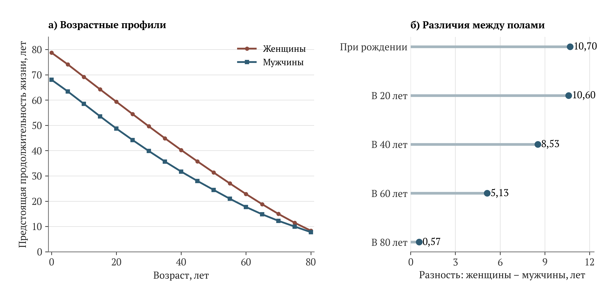

[B96; Caption] Рисунок 1 – Ожидаемая предстоящая продолжительность жизни и различия между мужчинами и женщинами в Российской Федерации, 2023 г.

[B97; ] Примечание. Возрастные значения характеризуют условное поколение при режиме смертности 2023 г. Разность рассчитана как значение для женщин минус значение для мужчин. На рисунке показаны возраста до 80 лет. [Сноски 14]

[B98; ] Разрыв при рождении составляет 10,70 года; среди доживших до 60 лет различие в предстоящей продолжительности жизни равно 5,13 года. Возрастные профили на рисунке 1 подчёркивают, что меры по увеличению длительности жизни должны охватывать весь жизненный путь. Сосредоточение оценки только на пожилом возрасте оставило бы за её пределами потери в более молодых возрастах. При этом уменьшение разрыва с возрастом нельзя трактовать как эффект медицинского вмешательства: сравниваются различные группы доживших до соответствующего возраста.

[B99; ] Раздельное наблюдение мужчин и женщин необходимо и на промежуточных этапах маршрута: обращение за помощью, участие в профилактических осмотрах, своевременность диагностики, начало лечения и завершение наблюдения. Равное число мероприятий не гарантирует одинаковую доступность для работающего населения, жителей удалённых территорий и людей с обязанностями по уходу. Поэтому единый общероссийский охват целесообразно сопровождать анализом групп, в которых сохраняются наиболее значимые потери.

[B100; ] В официальном статистическом сборнике по Волгоградской области приведена предварительная общероссийская оценка ожидаемой продолжительности жизни за 2024 г. – 72,84 года. Она используется здесь только как дополнение к исходному контексту. Подробные возрастно-половые данные за 2024 г. в сборнике «Здравоохранение в России. 2025» отмечены как временно не публикуемые. Отсутствие такой детализации в публикации не означает отсутствия расчёта показателя; оно ограничивает независимое воспроизведение демографического разложения. [Сноски 15]

[B101; ] Приведённые значения подтверждают необходимость различать исходную демографическую ситуацию, текущий мониторинг и результат программы. Достижение цели по продолжительности жизни следует оценивать совместно с возрастными и социальными различиями, а её изменение – разлагать по полу, возрасту и причинам смерти. Такой анализ позволяет определить, какие возрастно-половые группы и причины смерти формируют наблюдаемое изменение и где улучшение общего среднего сосуществует с сохраняющимся неблагополучием отдельных групп.

[B102; Heading1] Архитектура проекта и механизмы федеральных направлений

[B103; Heading2] Стратегическая архитектура и согласование направлений

[B104; ] Национальный проект «Продолжительная и активная жизнь» объединяет преобразование медицинской инфраструктуры, профилактику заболеваний, лечение, реабилитацию и ресурсное обеспечение здравоохранения. Целевой ориентир увеличения ожидаемой продолжительности жизни до 78 лет к 2030 году и до 81 года к 2036 году сопровождается требованием опережающего роста продолжительности здоровой жизни. Следовательно, предметом оценки выступает совместное изменение продолжительности жизни и состояния здоровья в течение прожитых лет. Рост числа медицинских услуг, ввод объектов и расширение цифрового доступа характеризуют промежуточные звенья соответствующего механизма. Их значимость определяется тем, насколько они увеличивают своевременность и результативность помощи для нуждающихся групп населения. [Сноски 16]

[B105; ] В составе проекта предусмотрены 11 федеральных проектов. Четыре направления посвящены конкретным заболеваниям: сердечно-сосудистым, онкологическим, сахарному диабету и гепатиту С. Первичное звено и проект «Здоровье для каждого» обеспечивают профилактику и первый контакт с системой здравоохранения. Экстренная помощь и медицинская реабилитация организуют реагирование на острые состояния и последующее восстановление. Медицинские кадры, цифровая платформа и развитие федеральных медицинских организаций создают условия для деятельности остальных направлений. Подобная структура позволяет охватить последовательные этапы помощи, однако требует согласования потребностей одних и тех же пациентов между несколькими исполнителями. [Сноски 17]

[B106; ] Стратегия развития здравоохранения до 2030 года, утверждённая Указом Президента Российской Федерации от 8 декабря 2025 года № 896, определяет повышение качества и доступности помощи, соблюдение прав граждан и обеспечение государственных гарантий в качестве целей развития отрасли. Среди предусмотренных направлений присутствуют профилактика факторов риска, здоровое старение, развитие реабилитации, кадрового обеспечения и цифровой инфраструктуры. В механизме реализации названы согласованные действия органов власти, медицинских, научных и образовательных организаций. Национальный проект следует рассматривать как конкретизацию части такой более широкой политики, финансовое и организационное содержание которой выходит за пределы его паспортов. [Сноски 18]

[B107; ] Программа государственных гарантий, государственная программа «Развитие здравоохранения» и национальный проект образуют пересекающиеся, но различающиеся основания организации помощи. Официальное описание государственной программы относит к её проектной части также направления национального проекта «Новые технологии сбережения здоровья» и федеральный проект «Охрана материнства и детства» национального проекта «Семья». Поэтому общая динамика здоровья населения не может быть полностью приписана расходам одного национального проекта. Для управленческого анализа необходимо установить, какое дополнительное изменение обеспечивается конкретной мерой на фоне текущего оказания помощи и одновременно реализуемых программ. [Сноски 19]

[B108; ] Содержательная целостность проекта зависит прежде всего от завершённости маршрута пациента. Выявление фактора риска должно сопровождаться подтверждением состояния, назначением подходящей помощи и возможностью продолжить наблюдение. Оборудованный кабинет требует специалистов, расходных материалов, действующего расписания и маршрутизации. После специализированного лечения возникает потребность в лекарственном обеспечении, реабилитации и возврате к повседневной активности. Если один переход остаётся недоступным, выполнение мероприятий на соседних этапах не гарантирует ожидаемого результата. В таблице 1 представлена функциональная группировка, позволяющая сформулировать предмет совместной ответственности нескольких федеральных проектов.

[B109; Caption] Таблица 1 – Согласование функций федеральных проектов в маршруте пациента

[TABLE 1; B110]
Функция | Федеральные проекты | Результат для совместного контроля
Выявление риска и первый контакт | Первичное звено, «Здоровье для каждого» | Достижение нуждающихся, подтверждение выявленного риска, начало наблюдения
Лечение хронического заболевания | Сердечно-сосудистые заболевания, онкология, диабет, гепатит С | Своевременность лечения, контроль состояния, предупреждение осложнений
Экстренное реагирование и восстановление | Экстренная помощь, медицинская реабилитация | Непрерывность перехода между этапами, функциональное восстановление
Ресурсное обеспечение маршрута | Медицинские кадры, цифровая платформа, федеральные медицинские организации и НМИЦ | Доступность квалифицированной помощи и завершённость передачи пациента

[B111; ] Примечание. Аналитическая группировка функций. Последний столбец содержит предлагаемые критерии совместного контроля и не подменяет утверждённые показатели. [Сноски 20]

[B112; ] Согласование целей предполагает также устойчивость их смыслового содержания. В нормативной стратегии 2025 года доля граждан, ведущих здоровый образ жизни, определена на уровне 13,6% к 2030 году. В публикации национального паспорта редакции 26.40 ориентир на 2030 год составляет 14,6%. Сопоставление факта с целью должно сопровождаться указанием применённого документа и редакции. Повышение планки следует отражать как отдельное управленческое решение, сохраняя возможность сравнения с первоначальным ориентиром. Изменение редакции не должно автоматически превращать ранее достигнутый результат в статистическое ухудшение или создавать видимость дополнительного эффекта. [Сноски 21]

[B113; Heading2] Первичная помощь и доступность медицинских услуг

[B114; ] Модернизация первичного звена предусматривает обновление зданий, оборудования и транспорта, использование мобильных подразделений и развитие дистанционного наблюдения. Предполагаемый механизм заключается в сокращении организационных и пространственных препятствий для своевременного обращения, выявления заболеваний и последующего ведения пациентов. Официальная система показателей включает характеристики доступности модернизированных подразделений, использования передвижных форм помощи, диспансерного наблюдения и удовлетворённости населения. [Сноски 22]

[B115; ] Самостоятельного внимания заслуживает соответствие мощностей структуре потребности. Новый объект может заменить изношенное подразделение, приблизить помощь к населению либо расширить набор доступных услуг. Перечисленные изменения имеют различную результативность и требуют разных способов наблюдения. Для замещающего объекта важны непрерывность оказания помощи и устранение технических ограничений. Для нового пункта обслуживания существенны охват ранее необслуживаемых жителей и время достижения врача. При расширении услуг следует оценивать сокращение направлений в удалённые учреждения и время завершения диагностики. Суммарное число введённых объектов не различает перечисленные механизмы.

[B116; ] Включение в мониторинг времени ожидания, реально доступных часов приёма и завершённости маршрута позволит связать строительные результаты с опытом пациента. Территориальные нормативы нуждаются в проверке на сети дорог и действующих маршрутах общественного транспорта. Расстояние по прямой и наличие здания в границах муниципального образования не описывают возможность получить помощь пожилому человеку или жителю отдалённого поселения. Для мобильных подразделений следует учитывать регулярность посещений и доступность повторного приёма после выявления заболевания.

[B117; ] Дистанционное наблюдение следует организовывать как часть клинического процесса. Передача измерения имеет значение при наличии ответственного специалиста, правила реагирования и доступного способа последующей помощи. Управленческий контроль должен охватывать долю сигналов, рассмотренных в установленный срок, и завершённость действий после выявления отклонения. Увеличение числа подключённых устройств без соответствующей кадровой и организационной готовности создаёт риск накопления необработанной информации.

[B118; Heading2] Профилактика и укрепление общественного здоровья

[B119; ] Федеральный проект «Здоровье для каждого» включает развитие центров здоровья, индивидуальное профилактическое консультирование, муниципальные и корпоративные программы, обследование работающих граждан и информационную деятельность. В его содержании объединены меры, адресованные отдельному человеку, организации и местному сообществу. Предполагается, что выявление факторов риска будет сопровождаться доступной поддержкой изменения поведения. [Сноски 23]

[B120; ] Результативность профилактики зависит от возможности граждан следовать рекомендациям в повседневной среде. Рацион питания, двигательная активность, употребление алкоголя и табака связаны с доходами, условиями труда, устройством населённого пункта и доступностью соответствующих услуг. Следовательно, консультирование требует согласования с действиями работодателей и органов местного самоуправления. Муниципальная программа приобретает аналитически проверяемое содержание, когда в ней определены конкретная группа населения, устраняемое препятствие, доступная услуга и срок наблюдения за изменениями.

[B121; ] Предлагается различать охват консультированием, фактическое участие в программе и устойчивое изменение поведения. Разработка индивидуальной программы сама по себе не показывает, начал ли гражданин её выполнять и какие препятствия возникли. Для повторного наблюдения пригодны согласованные периоды, сопоставимые вопросы и заранее определённые критерии удержания участников. Отказы и утрата контакта должны входить в оценку доступности программы. Исключение таких граждан из знаменателя способно завысить видимую успешность.

[B122; ] Корпоративные программы необходимо анализировать по категориям занятых, включая сменный труд, небольшие предприятия и работников с ограниченными возможностями участия в рабочее время. Преимущественный охват сотрудников крупных организаций может усиливать различия между группами населения. Наряду с общей долей приверженных здоровому образу жизни полезно представлять распределение отдельных факторов риска и результаты повторных наблюдений. Подобная детализация позволяет определить, какой компонент профилактической политики требует изменения.

[B123; Heading2] Борьба с сердечно-сосудистыми заболеваниями

[B124; ] Кардиологическое направление сочетает диспансерное ведение, диагностику прогрессирования заболевания, лекарственное обеспечение и совершенствование маршрутизации. Его содержание связывает предупреждение повторных событий с доступностью специализированного вмешательства при ухудшении состояния. Официальные показатели включают характеристики жизни без острых событий и отдельные результаты оказания помощи при острых состояниях. [Сноски 24]

[B125; ] Ключевое условие результативности заключается в преемственности между стационарным и амбулаторным этапами. Выписка должна сопровождаться действующим планом наблюдения, доступностью лекарств и возможностью получить консультацию при изменении состояния. Для оценки такой преемственности следует фиксировать дату выписки, первый последующий контакт, непрерывность назначения препаратов и причины прекращения наблюдения. Совместное рассмотрение указанных событий помогает установить, на каком переходе возникает риск повторного обращения за экстренной помощью.

[B126; ] Показатель числа пациентов, проживших год без острых сердечно-сосудистых событий, необходимо соотносить с численностью и составом наблюдаемой совокупности. Рост абсолютного числа может сопровождать расширение регистрации больных и улучшение полноты учёта. Для содержательной интерпретации полезны дополнительные характеристики исходного риска, возраста, тяжести состояния и длительности наблюдения. Региональные различия, полученные без такого сопоставления, могут отражать структуру пациентов и устройство регистрации.

[B127; ] При оценке госпитальных исходов требуется учитывать доступность доставки тяжёлых пациентов. Улучшение маршрутизации способно увеличить долю более сложных случаев в специализированной организации. Сравнение учреждений только по необработанной летальности создаёт стимул избегать наиболее тяжёлых пациентов. Управленческая оценка должна соединять своевременность помощи, полноту принятия нуждающихся и исходы, скорректированные с учётом клинического состава. Анализ следует проводить для всего маршрута, сохраняя возможность определить вклад отдельных этапов.

[B128; Heading2] Борьба с онкологическими заболеваниями

[B129; ] Онкологический проект предусматривает маршрутизацию, диспансерное наблюдение, развитие диагностических и лечебных возможностей, а также финансовое обеспечение специализированной помощи. Показатели охватывают раннее выявление, наблюдение после лечения, одногодичную летальность и долю пациентов, состоящих на учёте пять лет и более. Совокупность направлений позволяет оценивать несколько этапов, однако требует точного различения распространённости заболевания, результатов выявления и исходов лечения. [Сноски 25]

[B130; ] Доля пациентов, состоящих на учёте пять лет и более, должна сохраняться под собственным названием. Для оценки пятилетней выживаемости необходимо сформировать когорту впервые диагностированных пациентов, определить начало наблюдения, учитывать смерть и цензурирование, предварительно определить общую, опухолеспецифичную либо относительную выживаемость и соответствующие правила анализа. Подмена одного показателя другим создаёт ложную уверенность в доказанности клинического результата.

[B131; ] Расширение диагностики может увеличить регистрируемую заболеваемость и изменить структуру выявленных случаев. Краткосрочное увеличение числа диагнозов при таких обстоятельствах нельзя автоматически считать ухудшением профилактики. Анализу подлежат время между подозрением и подтверждением диагноза, доступность морфологической верификации, начало лечения и причины задержек. Изменения следует рассматривать отдельно для групп с различной исходной доступностью обследования.

[B132; ] Для онкологической помощи необходимо совместное наблюдение стадии выявления, сроков подтверждения диагноза, начала лечения, его завершения и последующего сопровождения. Увеличение доли ранних стадий является значимым изменением диагностики, но не позволяет автоматически оценить число предотвращённых смертей. Более ранний момент диагноза способен увеличить измеренную длительность жизни после его установления без изменения момента смерти; различия темпов роста опухолей также влияют на состав выявленных случаев. Эти эффекты опережения диагноза и длительности доклинической фазы требуют специального учёта в оценке скрининга. [Сноски 26]

[B133; ] Финансовая концентрация на онкологическом направлении требует оценки полного маршрута лечения. Оснащение и закупка дорогостоящих технологий должны сопровождаться проверкой загрузки, кадровой готовности, доступности расходных материалов и возможности своевременного направления пациента. Для совершенствования программы полезно выявлять ограничения, сохраняющиеся после завершения капитальных мероприятий. Отдельного контроля требуют потеря контакта после лечения и неравномерность доступа к наблюдению, поскольку формальное завершение курса не означает завершения потребности в помощи.

[B134; Heading2] Борьба с сахарным диабетом

[B135; ] Проект по сахарному диабету соединяет развитие профильных подразделений, обучение пациентов, диспансерное наблюдение и использование средств непрерывного мониторинга глюкозы. В официальном описании предусмотрены региональные программы и маршрутизация с учётом территориальных особенностей. Содержательный результат таких мер состоит в улучшении повседневного контроля состояния и предупреждении осложнений, требующих более интенсивной помощи. [Сноски 27]

[B136; ] Обучение пациента представляет собой повторяющееся взаимодействие, связанное с его возможностями самостоятельно управлять состоянием. Число прошедших школу необходимо дополнять сведениями о завершении программы, повторном обращении и применении полученных знаний. Доступность обучения зависит от расписания, транспорта, семейных обязанностей и состояния здоровья. Однократное посещение и устойчивое участие не должны учитываться как одинаковые результаты при оценке программы.

[B137; ] Использование медицинских изделий непрерывного мониторинга требует определения нуждающейся совокупности и контроля фактической непрерывности обеспечения. Выданное устройство не гарантирует длительного использования при нехватке расходных материалов или отсутствии поддержки. Для управленческой оценки существенны сроки обеспечения, продолжительность перерывов и причины прекращения применения. Особенности детского возраста и беременности предполагают различные организационные маршруты, которые следует сохранять в анализе.

[B138; ] Расширение диспансерного наблюдения должно сопровождаться проверкой доступности обследований, позволяющих своевременно обнаружить осложнения. Предлагается оценивать завершённость необходимого набора обследований и последующих назначений, а также повторные экстренные обращения. Сопоставление регионов следует проводить с учётом типа заболевания, возраста и длительности болезни. Совместное наблюдение образовательных, диагностических и клинических результатов позволит определить, связано ли улучшение с повышением доступности помощи или с изменением состава зарегистрированных пациентов.

[B139; Heading2] Борьба с гепатитом С

[B140; ] Федеральный проект по гепатиту С связывает скрининг, регистрацию, лекарственное обеспечение и подтверждение результата терапии. Официальное описание предусматривает амбулаторное лечение и помощь в дневном стационаре, ведение регистра вирусных гепатитов и установление устойчивого вирусологического ответа после завершения курса. Такая последовательность образует относительно ясно очерченный маршрут от выявления заболевания до оценки лечебного результата. [Сноски 28]

[B141; ] Принципиально различаются положительный результат исследования на антитела, подтверждённая активная инфекция, включение в наблюдение и завершённое лечение. Для каждого перехода необходимы собственная целевая совокупность и дата события. Результативность программы определяется также долей выявленных граждан, которые получили подтверждающее обследование и начали терапию. Расширение скрининга при ограниченной лечебной мощности может увеличить очередь и количество пациентов, потерянных до начала лечения.

[B142; ] Высокая доля излечения среди обеспеченных препаратами характеризует результат уже получившей доступ группы. Для оценки популяционного эффекта требуется соотнести её с числом нуждающихся, охватом выявлением и фактическим началом терапии. Расширение регистра способно временно уменьшить доли охвата при росте абсолютного числа получателей помощи. Подобная динамика требует разложения по изменениям числителя и знаменателя.

[B143; ] Организационное совершенствование проекта следует направить на сокращение потерь между этапами и проверку полноты контрольного обследования после лечения. В региональной отчётности полезны сроки ожидания, причины отказа или прерывания курса и доля пациентов с установленным результатом. Ответственность за закрытие маршрута должна быть определена даже при переходе между учреждениями. Оценку снижения передачи инфекции необходимо строить отдельно от оценки индивидуального лечебного ответа, поскольку соответствующие процессы имеют разные временные горизонты и информационные требования.

[B144; Heading2] Совершенствование экстренной медицинской помощи

[B145; ] Экстренная помощь включает преобразование приёмных отделений, их оснащение и использование санитарной авиации. Предполагается повышение доступности помощи при жизнеугрожающих состояниях и совершенствование организации потока пациентов. В официальном наборе показателей выделена доля поступлений на койки суточного пребывания приёмных отделений среди поступлений в круглосуточный стационар. [Сноски 29]

[B146; ] Указанная доля описывает организацию движения пациентов внутри системы. Её рост может свидетельствовать о распространении определённого формата работы приёмных отделений, однако сам по себе не измеряет своевременность оказания помощи и изменение риска смерти. Для оценки медицинского результата необходимы время от возникновения потребности до первого контакта, время доставки, сроки выполнения критически важных действий и исходы с учётом тяжести состояния. Транспортная доступность должна включать территории, из которых пациенты не поступили в обследуемые учреждения.

[B147; ] Инвестиции в приёмное отделение следует согласовывать с работой скорой помощи, доступностью профильных стационарных мощностей и кадровым обеспечением смен. Увеличение пропускной способности одного подразделения может переместить очередь на следующий этап. Поэтому проектирование мощностей требует наблюдения за временем прохождения всего маршрута, включая ожидание госпитализации и передачу между организациями. Для санитарной авиации следует учитывать возможность наземного доступа к точке эвакуации, погодные ограничения и готовность принимающей организации.

[B148; ] При распределении ресурсов целесообразно оценивать изменение доступности для конкретных населённых пунктов и групп пациентов. Количество эвакуированных отражает выполненную работу, но его повышение может быть связано как с улучшением доступности, так и с ростом потребности. Регулярный разбор задержек и незавершённых маршрутов позволит устанавливать, какие ограничения устраняются инфраструктурой, а какие требуют организационных решений. Оценка должна сохранять территориальный охват нуждающегося населения за пределами крупных медицинских центров.

[B149; Heading2] Медицинская реабилитация и восстановление активности

[B150; ] Федеральный проект медицинской реабилитации предусматривает оснащение региональных и федеральных организаций, оказание помощи за счёт обязательного медицинского страхования, региональные программы и информирование граждан. В официальных показателях представлены увеличение числа получивших помощь и охват информацией о доступных возможностях. Оба показателя характеризуют расширение использования системы, тогда как восстановление активности требует отдельного наблюдения. [Сноски 30]

[B151; ] Смысловая связь реабилитации с целью активной жизни особенно тесная. Увеличение доступности должно выражаться в восстановлении функций, самостоятельности и возможности участвовать в повседневной деятельности. Для наблюдения таких изменений необходимы исходное состояние, единый момент повторной оценки и соответствующий профилю инструмент измерения. Следует различать число пациентов и число случаев помощи, поскольку один человек может проходить несколько этапов или курсов.

[B152; ] Основной организационный риск возникает при переходе от лечения острого состояния к восстановительному этапу и затем к помощи по месту жительства. Недостаточная доступность последующего этапа способна ограничить результат уже выполненного лечения. Предлагается контролировать время до начала реабилитации, долю нуждающихся, фактически включённых в программу, завершённость назначенного маршрута и сохранение результата после выписки. Причины невключения позволяют установить, обусловлен ли разрыв транспортной недоступностью, очередью, кадровым ограничением или отсутствием информации.

[B153; ] Возвращение к работе применимо только к части пациентов. Для пожилых людей, детей и граждан с длительными ограничениями более содержательными результатами выступают самостоятельность, участие в обучении и снижение потребности в посторонней помощи. Общая оценка должна учитывать такие различия и избегать отождествления активной жизни исключительно с занятостью. Взаимодействие со службой социальной защиты необходимо включать в организационную модель, когда сохранение медицинского результата зависит от условий проживания и доступности повседневной поддержки.

[B154; Heading2] Медицинские кадры

[B155; ] Кадровый проект предусматривает развитие подготовки и повышения квалификации, трудоустройство ординаторов, региональные кадровые программы, поддержку работников и организационные механизмы привлечения специалистов. Официальные ориентиры отражают обеспеченность врачами и средним медицинским персоналом, а также сокращение дефицита. Перечисленные инструменты действуют на разных стадиях: от входа в профессию до закрепления на конкретном рабочем месте. [Сноски 31]

[B156; ] Обеспеченность населения медицинскими работниками требует интерпретации совместно с распределением по специальностям, учреждениям и территориям. Рост общего числа врачей может сопровождаться сохранением вакансий в первичном звене или в отдельных сменах. Для оценки доступности необходимы сведения о фактически занятых ставках, совместительстве, рабочем времени, текучести и продолжительности незакрытых вакансий. Среднерегиональный показатель способен скрывать концентрацию кадров в административном центре.

[B157; ] Поддержку жилья и иные меры закрепления следует оценивать по продолжительности работы после получения помощи и по соответствию места трудоустройства исходному кадровому дефициту. Временные выезды специалистов имеют самостоятельную ценность, но требуют преемственности с местной медицинской организацией. Наблюдение только за числом направленных врачей не показывает, сохранился ли доступ пациента к повторной консультации. Для образовательных мер существенна связь между освоением программы и возможностью применить компетенции на рабочем месте.

[B158; ] Расширение приёма на обучение даёт результат с временным лагом, который различается по профессиям и квалификационным траекториям. Планы кадрового обеспечения целесообразно сопоставлять с графиком ввода объектов, обновления оборудования и ожидаемым выбытием работников. Подготовка специалиста после запуска новой мощности создаёт период её неполного использования. Общая региональная модель кадровой потребности должна учитывать будущие изменения населения и структуры помощи, обеспечивая согласование решений об образовании, найме и условиях труда.

[B159; Heading2] Национальная цифровая платформа «Здоровье»

[B160; ] Цифровое направление предусматривает платформу управления здоровьем, защищённую передачу данных, развитие сервисов обязательного медицинского страхования и информационную безопасность. В числе официальных показателей присутствуют доступность проактивного мониторинга, использование гражданами цифровых услуг, телемедицинские консультации и применение электронных документов. Предполагаемый механизм состоит в улучшении обмена сведениями и организации своевременного взаимодействия между пациентом и системой помощи. [Сноски 32]

[B161; ] Доступность цифрового сервиса, его использование и медицинский результат образуют разные уровни оценки. Возможность подключения не означает регулярного участия, а регулярная передача сведений не подтверждает своевременного реагирования. Для проверки результата следует наблюдать завершённые действия: получение необходимых данных специалистом, принятие решения, контакт с пациентом и выполнение назначения. Число электронных сообщений и записей имеет вспомогательное значение.

[B162; ] Управленческий эффект цифровизации зависит от совместимости данных и распределения ответственности. Электронное направление должно позволять установить, принято ли оно другой организацией и когда пациент получил помощь. Согласование справочников, идентификации пациента и структуры медицинских событий обеспечивает возможность проследить маршрут. Одновременно требуется определённость прав доступа и способов исправления ошибочных записей. Накопление данных без устойчивых правил качества повышает риск неверных управленческих выводов.

[B163; ] Для оценки доступности цифровых решений следует выделять группы с ограниченными навыками, слабой связью или недостатком оборудования. Помощь должна оставаться достижимой при невозможности самостоятельного использования сервиса. Предлагается наблюдать долю завершённых обращений по каждому каналу и потребность в сопровождении. Экономию рабочего времени необходимо подтверждать измерением нагрузки, включая повторный ввод сведений и обработку уведомлений. Высвобождение времени считается результатом только тогда, когда оно сопровождается улучшением доступности или качества работы.

[B164; Heading2] Федеральные медицинские организации и экспертная поддержка регионов

[B165; ] Развитие федеральных медицинских организаций и сети национальных медицинских исследовательских центров включает модернизацию, экспертные консультации и организационно-методическую поддержку. Предполагается расширение доступа к сложной диагностике и лечению вне зависимости от места проживания. Официальные показатели отражают использование возможностей модернизированных организаций и отдельные формы взаимодействия с региональной сетью. [Сноски 33]

[B166; ] Результативность федерального центра зависит от того, насколько его возможности включены в маршруты нуждающихся пациентов. Количество консультаций необходимо соотносить со своевременностью направления, полнотой представленных данных и последующим решением. В части случаев экспертная консультация позволяет продолжить лечение по месту жительства, в других требуется госпитализация. Поэтому увеличение доли госпитализаций после консультации не является универсальным критерием улучшения. Интерпретация зависит от профиля, исходного состояния и цели обращения.

[B167; ] Методическое сопровождение регионов следует оценивать по изменениям практики, а также по устойчивости местных компетенций после завершения внешней поддержки. Разработанные рекомендации приобретают значение при наличии условий для их выполнения: специалистов, оборудования, лекарств и маршрутов. Полезно прослеживать внедрение согласованных решений, устранение повторяющихся организационных нарушений и результат повторного экспертного рассмотрения. Такой подход позволяет связать поддержку с наблюдаемым преобразованием региональной помощи.

[B168; ] Инвестиции в высокотехнологичные мощности целесообразно согласовывать с полной стоимостью их эксплуатации и территориальным распределением направлений. Концентрация сложной помощи может быть обоснована требованиями качества, однако требует компенсации транспортных и организационных препятствий для пациентов. В анализ необходимо включать время ожидания, незавершённые направления и причины отказа от госпитализации. Доступность определяется возможностью пройти необходимый маршрут, включая возвращение к последующему наблюдению по месту жительства.

[B169; Heading1] Статистические результаты и качество мониторинга

[B170; Heading2] Годовые результаты и сопоставимость с целевыми значениями

[B171; ] Статистические результаты национального проекта показывают сочетание положительных изменений в отдельных клинических и организационных показателях с сохраняющимися разрывами охвата, неодинаковой кадровой обеспеченностью и существенными различиями в способах измерения. Поэтому обоснованная оценка не сводится к подсчёту достигнутых контрольных значений. Необходимо установить, какая совокупность пациентов стоит за каждой долей, к какому периоду относится наблюдение и какой редакции проектного документа соответствует план. Статистические сведения анализируются по состоянию на 15 октября 2026 г., плановые значения – по публикациям паспортов от 16 октября 2026 г. Отчётный период каждого наблюдения указан отдельно. [Сноски 34]

[B172; ] В реестре ЕМИСС национальный и федеральный уровни частично повторяют одни и те же содержательные показатели. Поэтому число позиций каталога нельзя использовать как число независимых результатов проекта. В статистическом анализе выделены 42 самостоятельных числовых ряда; 34 из них представлены также в территориальном разрезе. Отсутствие отдельной таблицы у позиции верхнего уровня не доказывает отсутствия показателя в ведомственной системе: соответствующая информация может находиться у федерального проекта, в иной официальной публикации либо иметь другой режим предоставления. Аналогично отсутствие позднего значения в конкретном ряду не превращается в нулевой результат и не служит основанием для переноса последнего наблюдения на последующие месяцы. [Сноски 35]

[B173; ] Наиболее определённое сопоставление факта и плана возможно для десяти показателей, по которым опубликованы отдельные годовые значения за 2025 г. Они представлены в таблице 2. Годовые и декабрьские значения приведены раздельно, поскольку их сопоставление обнаруживает неодинаковые регламенты оперативного и годового наблюдения. Во всех десяти строках годовое значение располагается с благоприятной стороны указанного ориентира 2025 г.: ниже него для больничной летальности и выше для возрастающих показателей. Однако это результат сопоставления с опубликованной редакцией 2026 г. Он не заменяет документальную проверку исполнения первоначально утверждённого плана, поскольку в ходе реализации могли уточняться цели, состав наблюдаемой совокупности и методические определения. [Сноски 36]

[B174; Caption] Таблица 2 – Годовые результаты 2025 года и опубликованные плановые ориентиры

[TABLE 2; B175]
Показатель, % | Годовой факт 2025 | Декабрь 2025 | План 2025 | План 2030
Больничная летальность при инфаркте миокарда | 9,6 | 9,4 | 10,0 | 9,0
Больничная летальность при инсульте | 15,4 | 15,2 | 16,0 | 14,0
Реперфузия при инфаркте миокарда | 83,9 | 86,4 | 83,5 | 95,0
Тромбэкстракция при инфаркте мозга | 2,9 | 3,2 | 2,6 | 5,0
Лекарственное обеспечение сердечно-сосудистого риска | 95,6 | 97,4 | 95,5 | 98,0
Обеспечение непрерывным мониторингом глюкозы | 81,0 | 97,8 | 80,0 | 85,0
Обучение пациентов в школах диабета | 18,0 | 18,9 | 16,2 | 33,0
Полнота диспансерного наблюдения при диабете | 70,8 | 40,4 | 18,0 | 85,0
Увеличение числа получивших медицинскую реабилитацию | 8,2 | 7,3 | 4,0 | 26,5
Здоровый образ жизни среди обследованных взрослых | 11,8 | 11,5 | 10,5 | 14,6

[B176; ] Примечание. Российская Федерация. Годовой факт и декабрьская публикация – различные формы периода. План показан по опубликованным редакциям федеральных проектов от 16.10.2026; это аналитическое сопоставление, а не подтверждение формального исполнения первоначального плана 2025 г. В строке реабилитации воспроизведён опубликованный показатель увеличения, а не доля пациентов. [Сноски 37]

[B177; ] Годовая больничная летальность при инфаркте миокарда составила 9,6% при ориентире 10,0%, при инсульте – 15,4% при ориентире 16,0%. Для реперфузионной терапии опубликовано 83,9% при плане 83,5%, для тромбэкстракции при инфаркте мозга – 2,9% при плане 2,6%, для лекарственного обеспечения пациентов высокого сердечно-сосудистого риска – 95,6% при плане 95,5%. Эти превышения и снижения различаются по масштабу, клиническому смыслу и точности измерения. Например, разность 0,1 процентного пункта в лекарственном обеспечении является небольшим превышением порога и не позволяет утверждать, что все нуждающиеся получают препараты своевременно и непрерывно. [Сноски 38]

[B178; ] По диабетологическому направлению различия оперативной и годовой оценки гораздо существеннее. Полнота диспансерного наблюдения составляет 40,4% в декабрьской публикации и 70,8% в годовой; обеспечение непрерывным мониторингом глюкозы – соответственно 97,8 и 81,0%. Разности равны 30,4 и минус 16,8 процентного пункта. Оба значения каждой пары присутствуют в официальной таблице как самостоятельные наблюдения. Поэтому выбор удобной для положительного или отрицательного вывода цифры был бы методологически недопустим. На рисунке 2 показано, что расхождение затрагивает не только малые изменения и может существенно изменить представление о масштабе охвата. [Сноски 39]

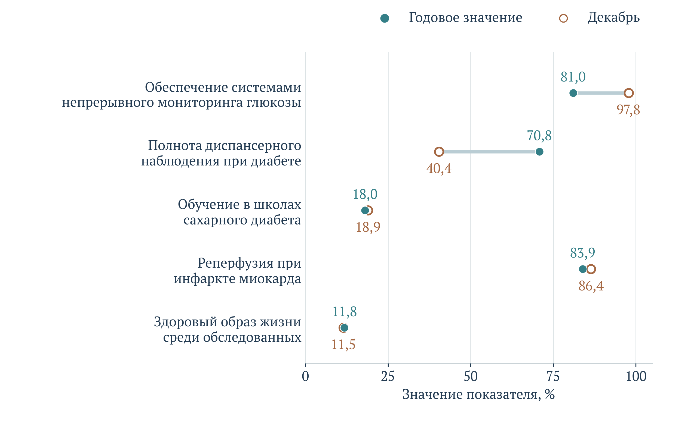

[B180; Caption] Рисунок 2 – Годовые и декабрьские значения отдельных показателей за 2025 год

[B181; ] Примечание. Российская Федерация. Для каждой пары использованы две отдельно опубликованные формы периода. Расхождение не трактуется как ошибка одного из значений; различия источников и регламентов расчёта требуют методического согласования. [Сноски 40]

[B182; ] Опубликованное описание показателя диспансерного наблюдения при диабете связывает годовой расчёт с федеральной статистической формой № 12, а ежемесячный – с административными сведениями, собираемыми в информационной системе. Аналогичное разделение предусмотрено для компонентов показателя непрерывного мониторинга глюкозы. Таким образом, различие источников подтверждается документально. При этом оно само по себе не объясняет, какая часть расхождения обусловлена уточнением числителя, пересмотром численности больных, изменением охвата организаций или другими процедурами. Для содержательной экспертизы необходима таблица согласования компонентов с указанием оснований пересмотра. До её получения корректно сохранять обе опубликованные оценки и ограничивать выводы рамками соответствующей формы наблюдения. [Сноски 41]

[B183; ] Имеется и самостоятельный вопрос согласованности определения непрерывного мониторинга глюкозы. В статистической методике ЕМИСС указаны нуждающиеся дети с диабетом первого типа и беременные женщины, имеющие право на обеспечение устройствами. В описании формулы опубликованного паспорта по-прежнему фигурируют дети. Это не даёт оснований самостоятельно исправлять одну из публикаций или объявлять другую ошибочной; требуется установить действующую редакцию методики и порядок её применения к конкретному периоду. Но до такой сверки показатель нельзя интерпретировать как охват всех пациентов с диабетом первого типа либо как доступность устройств для всех взрослых больных. Он относится к определённой правомочной совокупности. [Сноски 42]

[B184; ] Название показателя диспансерного наблюдения при диабете также уже его расчётного определения. В заголовке акцентированы подразделения, созданные и оснащённые в ходе федерального проекта, тогда как числитель описания включает и другие медицинские организации, осуществляющие наблюдение. Поэтому рост показателя характеризует расширение полного комплекса услуг в соответствующей совокупности, но не измеряет обособленный эффект введённых проектом подразделений. Для оценки этого эффекта нужны даты ввода объектов, территория их обслуживания, численность прикреплённых больных и сопоставление с организациями, где аналогичных изменений ещё не произошло. Без такой информации причинная атрибуция результата инвестициям проекта остаётся предположением. [Сноски 43]

[B185; ] Сопоставление с 2030 г. полезно как оценка направления требуемых изменений, но не как прогноз. Годовой охват школами диабета в 2025 г. равнялся 18,0% при ориентире 33,0% на 2030 г.; разность составляет 15,0 процентного пункта. Полнота наблюдения при диабете – 70,8% при ориентире 85,0%, то есть на 14,2 пункта ниже. Реперфузия – 83,9% при ориентире 95,0%, разность 11,1 пункта. Эти расстояния показывают, какие направления требуют расширения охвата. Они не определяют необходимый равномерный годовой прирост: численность нуждающихся, доступность персонала и последовательность организационных изменений могут изменяться нелинейно. [Сноски 44]

[B186; ] Особой редакционной согласованности требует целевой показатель здорового образа жизни. В информационных материалах Правительства указан ориентир 13,6%, тогда как в опубликованных редакциях национального и соответствующего федерального проекта от октября 2026 г. – 14,6%. Эти значения следует связывать с конкретными документами, а не представлять как взаимозаменяемые. Годовой факт 11,8% за 2025 г. сопоставлен здесь с октябрьской проектной редакцией. Само появление нового планового значения в представлении паспорта не означает автоматического изменения иных нормативных документов. Для управления необходим единый журнал редакций, позволяющий определить, какой порог применялся при принятии решения и какой используется при последующей оценке. [Сноски 45]

[B187; ] Практический вывод из годового сопоставления состоит в следующем: первый завершённый год содержит благоприятные сигналы по ряду измеряемых процессов и клинических исходов, однако качество подтверждения результата неодинаково. Приоритетом становится согласование годовой и оперативной отчётности, раскрытие знаменателей и привязка планов к их редакциям. Это позволяет сохранить ценность достигнутых изменений и одновременно исключить завышенные заявления о результативности. Удовлетворение формального порога, увеличение охвата и улучшение здоровья населения являются связанными, но различными объектами оценки; каждый требует своего доказательного основания.

[B188; Heading2] Клинические исходы, своевременность помощи и непрерывность наблюдения

[B189; ] Сравнение одинаковых месяцев 2025 и 2026 гг. показывает благоприятную динамику ряда показателей специализированной помощи. Больничная летальность при инфаркте миокарда снизилась с 9,4 до 8,9%, при инсульте – с 15,3 до 14,1%; одногодичная летальность при злокачественных новообразованиях – с 16,8 до 15,8%. Одновременно выросли доля реперфузии с 85,3 до 86,7% и доля тромбэкстракции с 3,0 до 3,8%. Сводные результаты представлены в таблице 3. Наблюдаемая направленность согласуется с задачей улучшения доступности и результатов лечения, однако не устанавливает величину эффекта национального проекта отдельно от предшествующих изменений медицинской системы. [Сноски 46]

[B190; Caption] Таблица 3 – Изменение клинических и организационных показателей за сопоставимые периоды

[TABLE 3; B191]
Показатель, % | Сентябрь 2025 | Сентябрь 2026 | Изменение, п. п.
Больничная летальность при инфаркте миокарда | 9,4 | 8,9 | −0,5
Больничная летальность при инсульте | 15,3 | 14,1 | −1,2
Одногодичная летальность при злокачественных новообразованиях | 16,8 | 15,8 | −1,0
Первая стадия среди визуальных локализаций рака | 54,2 | 55,8 | +1,6
Реперфузия при инфаркте миокарда | 85,3 | 86,7 | +1,4
Тромбэкстракция при инфаркте мозга | 3,0 | 3,8 | +0,8
Лекарственное обеспечение сердечно-сосудистого риска | 96,9 | 97,8 | +0,9
Полнота наблюдения хронических неинфекционных заболеваний | 51,11 | 46,60 | −4,51
Полнота наблюдения онкологических пациентов | 54,9 | 52,1 | −2,8
Полнота диспансерного наблюдения при диабете | 30,1 | 36,2 | +6,1
Обучение пациентов в школах диабета | 13,6 | 16,4 | +2,8

[B192; ] Примечание. Разности рассчитаны между опубликованными значениями за одинаковые месяцы. Показатели имеют разные совокупности наблюдения и не суммируются в общий эффект. Указанные изменения не являются оценками причинного эффекта национального проекта. [Сноски 47]

[B193; ] Динамика больничной летальности на рисунке 3 требует прежде всего правильного прочтения знаменателя. Методика включает взрослых пациентов, проходивших стационарное лечение по поводу соответствующего острого состояния. Это не коэффициент смертности населения от болезней системы кровообращения. Доля умерших среди госпитализированных может изменяться вместе с возрастом и тяжестью поступающих, долей переводов, правилами регистрации диагноза и доступностью госпитализации. Улучшение выявления тяжёлых случаев способно изменить состав больных даже при повышении качества помощи. Поэтому снижение показателя является значимым сигналом, но его оценку следует дополнить сопоставимыми данными о догоспитальном этапе и исходах после выписки. [Сноски 48]

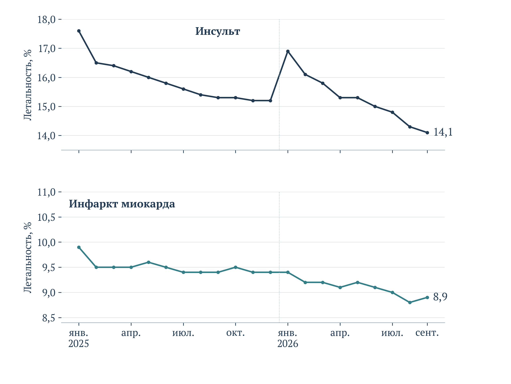

[B195; Caption] Рисунок 3 – Динамика больничной летальности при инфаркте миокарда и инсульте

[B196; ] Примечание. РФ; январь 2025 – сентябрь 2026 г., месячные публикации. Больничная летальность среди взрослых госпитализированных пациентов. Шкалы вертикальных осей различаются; годовые значения не заменяются декабрьскими. [Сноски 49]

[B197; ] Представленные на рисунке месячные публикации также не следует считать независимыми экспериментальными наблюдениями. Они входят в последовательный административный мониторинг; значения разных месяцев могут охватывать пересекающиеся совокупности пациентов и отражать внутригодовой порядок накопления сведений. Сопоставление сентября с сентябрём уменьшает искажение из-за различной длительности отчётного периода, но не устраняет изменения состава больных. Поэтому колебание между декабрём и январём не интерпретируется здесь как внезапное ухудшение медицинской помощи. Для оценки устойчивости тренда целесообразны отдельно сформированные месячные числители и знаменатели, сведения об уточнении данных и более продолжительный сопоставимый временной ряд.

[B198; ] Показатель реперфузии относится к пациентам с инфарктом миокарда, госпитализированным в первые сутки от начала заболевания. Его рост показывает расширение применения соответствующей терапии внутри этой группы. Однако поздно доставленные пациенты не входят в данный знаменатель. Следовательно, благоприятная доля реперфузии может сосуществовать с существенными задержками обращения или транспортировки. Для анализа всей цепочки помощи необходимы доля своевременных госпитализаций среди всех случаев, интервалы от появления симптомов до вызова и от первого медицинского контакта до лечения, а также распределение этих интервалов по территориям. Смысл дополнения заключается в проверке доступности клинической возможности до момента, когда начинается отсчёт действующего показателя. [Сноски 50]

[B199; ] Показатель тромбэкстракции относится ко всему учтённому стационарному контингенту взрослых пациентов с инфарктом мозга; в наименовании показателя уточнено: к выбывшим из стационара. Знаменатель не ограничивается пациентами с установленными показаниями к вмешательству. Значение 3,8% за сентябрь 2026 г. поэтому нельзя трактовать как долю выполнения процедуры среди пациентов с установленными показаниями к ней. Увеличение доли на 0,8 процентного пункта показывает изменение частоты применения вмешательства в наблюдаемой совокупности. Оценка достаточности требует числа клинически подходящих случаев, противопоказаний, времени доставки и территориальной доступности центров. Универсальное повышение доли без учёта показаний не является самостоятельной целью качества; управленческая задача состоит в своевременном лечении всех нуждающихся пациентов при обоснованном выборе технологии. [Сноски 51]

[B200; ] Лекарственное обеспечение пациентов высокого сердечно-сосудистого риска выросло с 96,9 до 97,8%. Высокий уровень важен, но относится к лицам, имеющим право на обеспечение в рамках конкретного мероприятия. Он не описывает автоматически весь контингент больных сердечно-сосудистыми заболеваниями. Кроме того, выдача препарата и непрерывное лечение – различные состояния. Для проверки результата следует учитывать длительность перерывов, своевременность повторного отпуска, отказ от получения, соблюдение назначений и последующие госпитализации. Такой набор дополнений позволяет исследовать, превращается ли административно подтверждённое обеспечение в устойчивое снижение риска, не возлагая на единственный процент функцию измерения всего лечебного процесса. [Сноски 52]

[B201; ] В онкологическом направлении особенно важно разграничить несколько показателей, близких по формулировке. Доля пациентов, состоящих под наблюдением и проживших пять и более лет после установления диагноза, равнялась 67,6% в мартовской публикации 2026 г.; более поздние числовые значения в рассматриваемом ряду отсутствуют. Этот показатель описывает состав текущего диспансерного контингента. Он не равен вероятности прожить пять лет для вновь выявленного пациента и не может именоваться пятилетней когортной выживаемостью. На его величину влияют поступление новых случаев в регистр, накопление длительно наблюдаемых пациентов, смертность и иные причины выбытия. Изменение любого из этих потоков способно сдвинуть долю при неизменной эффективности лечения. [Сноски 53]

[B202; ] Одногодичная летальность имеет другую конструкцию: число умерших в течение года соотносится с пациентами, впервые взятыми под наблюдение в предыдущем отчётном периоде. Это более определённая связь с когортой, однако она также зависит от полноты прослеживания, состава локализаций, стадии и возраста больных. Снижение с 16,8 до 15,8% является положительным наблюдением в рамках данной методики. Для оценки устойчивости желательно раздельное представление по основным локализациям и стадиям, с учётом возрастной структуры и правил установления причины смерти. Сопоставление только общей доли может скрывать противоположные изменения в крупных группах пациентов и не позволяет установить, какие организационные решения дали наибольший вклад. [Сноски 54]

[B203; ] Доля первой стадии среди визуальных локализаций злокачественных новообразований увеличилась с 54,2 до 55,8%. Это характеристика определённой группы опухолей, а не всех онкологических заболеваний. Более ранняя диагностика сама по себе удлиняет время от диагноза до смерти даже при неизменной продолжительности жизни; скрининг также чаще выявляет медленно растущие опухоли. Соответственно, для оценки пользы раннего выявления необходимо учитывать опережение момента диагноза и преимущественное выявление заболеваний с более благоприятным течением. Нельзя приписывать всё увеличение наблюдаемой выживаемости продлению жизни. Оценку следует связывать с стандартизованной по возрасту смертностью, тяжестью выявляемых случаев и результатами сопоставимых когорт. [Сноски 55]

[B204; ] На фоне благоприятной динамики отдельных клинических исходов показатели полноты диспансерного наблюдения изменяются неодинаково. По хроническим неинфекционным заболеваниям в первичном звене доля снизилась с 51,11 до 46,60%, по онкологическим пациентам – с 54,9 до 52,1%. При диабете она выросла с 30,1 до 36,2%, а охват школами диабета – с 13,6 до 16,4%. Рисунок 4 показывает эти изменения на общей шкале процентных пунктов. Такое расхождение не поддерживает представление об одинаково успешном расширении наблюдения по всем направлениям. Наиболее предметный управленческий вопрос – почему благоприятная динамика отдельных клинических показателей сочетается со снижением доли полного наблюдения в части контингентов. [Сноски 56]

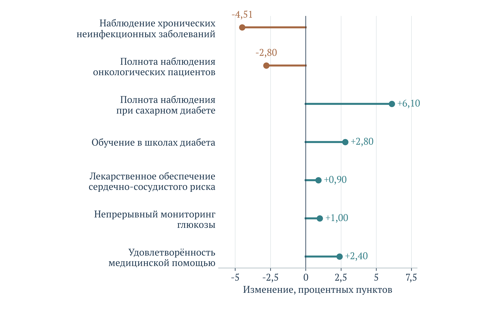

[B206; Caption] Рисунок 4 – Изменение показателей наблюдения и доступности медицинской помощи

[B207; ] Примечание. Российская Федерация; сентябрь 2026 г. к сентябрю 2025 г. Сопоставлены одинаковые месяцы. Разности выражены в процентных пунктах; рост доли не служит самостоятельным доказательством улучшения клинического исхода. [Сноски 57]

[B208; ] Снижение доли не позволяет без дополнительных компонентов выбрать одну причину. Возможны рост числа зарегистрированных больных, изменение состава обязательных услуг, неполное выполнение назначений, затруднения записи или уточнение отчётности. Эти объяснения требуют проверки. Для неё следует публиковать отдельно число лиц, подлежащих наблюдению, получивших хотя бы одну услугу и получивших весь предусмотренный комплекс, а также причины незавершения. Важно раздельно учитывать отказ пациента, противопоказание, перенос по клиническим основаниям и организационную недоступность. Такой разбор превращает общий процент в инструмент управления конкретными потерями непрерывности помощи.

[B209; ] По результатам клинического блока наиболее обоснован вывод о неоднородном продвижении. Снижение опубликованной летальности и расширение отдельных технологий сочетаются с неполным охватом длительным наблюдением и ограничениями интерпретации показателей. Для совершенствования проекта следует связать экстренную, специализированную и последующую амбулаторную помощь на уровне маршрута пациента. Успешно выполненное вмешательство не снимает задачи непрерывного наблюдения, а высокий охват учётной процедурой не заменяет подтверждения исхода. Оценка результата должна удерживать обе стороны этой связи, не превращая различия знаменателей в искусственное противоречие между показателями.

[B210; Heading2] Гепатит C, профилактическая работа и смысл измеряемого охвата

[B211; ] Блок борьбы с гепатитом C показывает особенно наглядное различие между полнотой регистрации, охватом лечением и результатом терапии. В сентябре 2026 г. доля внесения данных о зарегистрированных пациентах в федеральный регистр достигла 99,95% против 94,67% годом ранее. Доля устойчивого вирусологического ответа среди завершивших терапию составила 97,44% против 97,09%. Одновременно завершение лечения в амбулаторных условиях относительно зарегистрированного контингента увеличилось с 5,17 до 6,58%, а в дневном стационаре – с 3,66 до 8,73%. Доля обследованных на антитела к вирусу гепатита C среди населения в возрасте 25 лет и старше выросла с 7,94 до 13,17%. [Сноски 58]

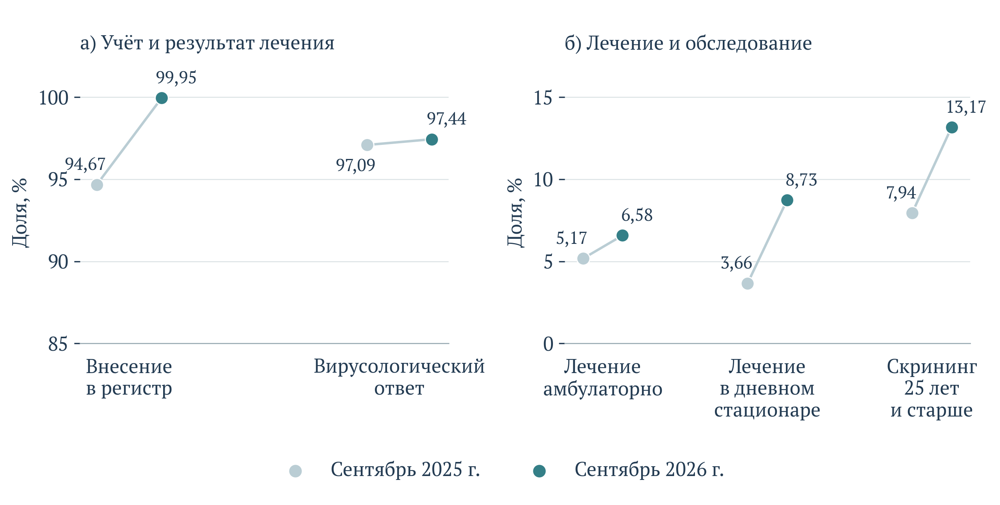

[B213; Caption] Рисунок 5 – Показатели регистрации, лечения и обследования при гепатите C

[B214; ] Примечание. Российская Федерация. Знаменатели различаются: регистр и завершённая терапия – относительно зарегистрированных больных; вирусологический ответ – среди завершивших лечение; скрининг – относительно населения 25 лет и старше. Значения не образуют единой когорты, не складываются и не перемножаются. Диапазоны осей панелей различаются. [Сноски 59]

[B215; ] Рисунок 5 разделяет показатели по диапазонам, поскольку высокий процент внутри одной совокупности не характеризует полноту всего маршрута помощи. Практически полное внесение сведений в регистр означает полноту учёта уже зарегистрированных случаев в пределах методики. Оно не показывает, какая доля всех инфицированных знает о диагнозе. Высокая доля вирусологического ответа описывает пациентов, завершивших лечение, и не распространяется на невыявленных, ожидающих назначения или прервавших терапию. Следовательно, наиболее высокая величина в этом блоке не может использоваться как самостоятельное доказательство решения задачи снижения популяционного бремени инфекции. [Сноски 60]

[B216; ] Также недопустимо складывать доли амбулаторного лечения и дневного стационара без проверки взаимной исключительности пациентов и единых правил времени. Методы опираются на зарегистрированный контингент, включающий состоявших под наблюдением на начало года и вновь взятых в течение года. Числители характеризуют завершение курса в соответствующих условиях. Возможность переходов между условиями лечения, различия дат завершения и обновление регистра должны быть проверены до построения единого каскада. Перемножение доли учтённых, доли леченных и доли вирусологического ответа также не даёт достоверной доли излеченных во всей популяции: для этого требуются вложенные, согласованные по времени когорты. [Сноски 61]

[B217; ] Содержательно результаты указывают на расширение лечения и обследования при уже высокой доле вирусологического ответа среди завершивших терапию пациентов. Поэтому дальнейшее совершенствование мониторинга целесообразно сосредоточить на переходах между этапами: первичное выявление, подтверждение активной инфекции, включение в наблюдение, назначение курса, его начало и завершение, контроль результата. Для каждого перехода необходимо знать число пациентов, длительность ожидания и причины потерь. В такой системе можно отделить ограничение финансовой доступности от организационной задержки, отказа пациента или отсутствия подтверждающего обследования. Предлагается именно такой способ оценки; численные размеры отдельных потерь по имеющимся агрегированным долям не устанавливаются.

[B218; ] Профилактическое направление требует не менее внимательного отношения к знаменателю. Показатель здорового образа жизни в используемой методике – это доля обследованных взрослых, у которых не выявлены четыре фактора риска: курение, нерациональное питание, низкая физическая активность и риск пагубного употребления алкоголя. Значение за сентябрь увеличилось с 11,5% в 2025 г. до 12,3% в 2026 г. Оно характеризует участников профилактических осмотров и диспансеризации. Поэтому его нельзя без дополнительных оснований именовать распространённостью здорового образа жизни во всём взрослом населении. Изменение возрастного состава обследованных или вовлечение прежде не посещавших медицинские организации людей способно повлиять на долю независимо от изменения индивидуального поведения. [Сноски 62]

[B219; ] Для оценки профилактических программ существенно, что успешное расширение профилактического охвата иногда может сопровождаться менее благоприятным средним профилем обследованных. Если в систему приходят ранее недообследованные группы с большим числом рисков, доля лиц без факторов риска может снизиться, хотя доступность профилактики повысилась. Обратное также возможно при преимущественном участии более благополучных групп. Поэтому динамику здорового образа жизни следует представлять совместно с охватом обследованиями и возрастно-половым составом участников. Для проверки популяционных изменений желательно независимое обследование населения с устойчивым дизайном и опубликованной неопределённостью. Это предложение не ставит под сомнение административный показатель, а уточняет область его применения.

[B220; ] Оперативная оценка потребления алкоголя имеет иную временную конструкцию. В сентябре 2026 г. опубликовано 7,47 л этанола на человека против 7,84 л в сентябре 2025 г., снижение на 0,37 л, или приблизительно на 4,7%. Но каждый месячный показатель характеризует последние двенадцать календарных месяцев, включая отчётный. Это не потребление за один месяц и не накопленный объём с января. Соседние наблюдения поэтому имеют значительную общую часть периода. Их нельзя суммировать в годовое потребление или рассматривать как независимые месячные измерения. При дальнейшем моделировании следует явно учитывать скользящее окно и сопоставимость исходных компонентов оценки. [Сноски 63]

[B221; ] Показатель временной нетрудоспособности тоже представляет отношение, а не буквальную величину сокращения. В сентябре 2026 г. он равнялся 85,1% против 89,0% годом ранее. Методика сопоставляет накопленные дни нетрудоспособности на 100 работающих с соответствующим периодом 2023 г. При сохранении сопоставимости величина 85,1 означает уровень на 14,9% ниже базового, а не сокращение на 85,1%. Для содержательной оценки здоровья работающих необходимо учитывать правила выдачи и регистрации листков нетрудоспособности, структуру занятых и причины отсутствия на работе. Сам по себе более низкий показатель не позволяет отделить улучшение здоровья от изменений обращения за медицинской помощью или учёта трудоспособного контингента. [Сноски 64]

[B222; ] Отдельного внимания заслуживает деятельность передвижных подразделений первичной помощи. В сентябре 2026 г. общероссийский показатель их использования составил 81,80% против 80,47% годом ранее. Его знаменатель – расчётная пропускная способность, поэтому значение свыше 100% математически допустимо. Среди 83 сопоставленных территорий в сентябре 2026 г. таких случаев 13; диапазон составляет от 24,9 до 203,9%, медиана – 78,9%. Превышение 100% не следует автоматически считать ошибкой или стопроцентным охватом населения. Оно может отражать интенсивность использования, особенности плановой мощности или необходимость уточнения нагрузки, а достаточность доступа требует самостоятельной проверки. [Сноски 65]

[B223; ] Общий вывод профилактического блока состоит в необходимости измерять доступность для нуждающихся людей и результат прохождения всего маршрута. Число обследований, полнота регистра и доля положительного исхода среди завершивших лечение решают разные аналитические задачи. Для территориального управления полезно сопоставлять их с расстоянием до места получения помощи, длительностью ожидания, повторными обращениями и составом контингента. Так можно обнаружить, где ограничением становится выявление, где назначение, а где завершение вмешательства. Агрегированные проценты дают важные сигналы для такой проверки, но не позволяют заранее приписать каждому разрыву единственную причину.

[B224; Heading2] Направления совершенствования статистического мониторинга и оценки результата

[B225; ] Проведённый анализ позволяет конкретизировать требования к мониторингу национального проекта. Первое требование – содержательная согласованность индикатора на всех уровнях управления. Для каждой цели необходимо фиксировать полное определение числителя, знаменателя, периода, единицы наблюдения и территориального охвата; сохранять дату введения и историю изменений. Практические основания этого требования уже обнаружены в диабетологическом блоке: разные определения правомочного контингента непрерывного мониторинга глюкозы и существенное расхождение оперативного и годового значения. Без согласования нельзя установить, отражает ли изменение процента реальное расширение помощи или изменение способа измерения. [Сноски 66]

[B226; ] Второе требование – раскрытие компонентов. Процент полезен для быстрого сопоставления, но недостаточен для объяснения изменения. Рост охвата может быть результатом увеличения числа получивших помощь, уменьшения учтённой потребности либо сочетания этих процессов. Поэтому рядом с целевой долей следует публиковать абсолютные числители и знаменатели, число организаций, представивших сведения, и объём последующих уточнений. Особенно это важно для небольших территорий и редких вмешательств, где несколько случаев могут заметно изменить процент. При отсутствии компонентов невозможно корректно оценить статистическую неопределённость или обоснованно признать различие между двумя близкими значениями существенным.

[B227; ] Третье требование – разграничение календарных конструкций. Годовой показатель, накопленное значение с начала года, скользящий двенадцатимесячный показатель и состояние контингента на дату решают разные задачи. Их следует показывать в отдельных рядах с одинаковыми названиями периодов. Для накопленных величин предпочтительны сопоставления одинаковых месяцев; для годового исполнения – только специально опубликованные годовые значения либо документально подтверждённая эквивалентность декабрьского итога. Для скользящих оценок необходимо раскрывать пересечение окон. Разграничение периодов позволяет корректно оценивать направление и скорость изменения результата. [Сноски 67]

[B228; ] Четвёртое требование – переход от регистрации выполненного действия к проверке последующего состояния пациента. Значительная часть показателей охватывает наличие услуги, устройства, записи в регистре или цифровой функции. Эти элементы необходимы, но ожидаемый общественный результат возникает только при последовательном прохождении маршрута. В таблице 4 предложены конкретные дополнения, связывающие действующие показатели с исходами и доступностью. Предложения не предполагают создания максимально большого числа форм отчётности. Напротив, задача состоит в выборе небольшого набора связующих показателей, для которых понятны клинический смысл, ответственный исполнитель и возможность управленческого воздействия.

[B229; Caption] Таблица 4 – Содержательное значение показателей и необходимые дополнения мониторинга

[TABLE 4; B230]
Показатель | Что измеряется | Что следует дополнительно наблюдать
Больничная летальность | Смерти среди госпитализированных взрослых пациентов соответствующего профиля | Догоспитальные исходы; смертность через 30 дней; возраст, тяжесть, переводы между стационарами
Наблюдение в онкологии ≥ 5 лет | Доля длительно живущих пациентов в текущем диспансерном контингенте | Когортная выживаемость; стадия, локализация, возраст; полнота наблюдения
Здоровый образ жизни | Отсутствие четырёх факторов риска у обследованных взрослых | Возрастно-половая структура обследованных; сопоставимость охвата; независимое популяционное обследование
Обеспеченность кадрами | Физические лица в охватываемых медицинских организациях на численность населения | Специальность, территория обслуживания, рабочее время, совместительство и сроки ожидания
Использование передвижных подразделений | Отношение приёма пациентов к расчётной пропускной способности | Повторные посещения, территория выездов, очередь, доступность для маломобильных граждан
Цифровые сервисы | Наличие цифровых функций, использование сервисов или дистанционное наблюдение | Завершённое обращение, время решения, клиническое действие и доступность очного канала

[B231; ] Примечание. Дополнительные показатели предложены в целях совершенствования оценки. Их значения не предполагаются установленными настоящей экспертизой.

[B232; ] Например, цифровой блок различает дистанционное наблюдение с передачей данных, доступность цифровых функций и использование электронных сервисов. В сентябре 2026 г. соответствующие опубликованные значения составляли 4,70, 8,64 и 47,41%. Их нельзя интерпретировать как последовательные ступени единой цифровой зрелости: они имеют разные совокупности и объекты измерения. Для оценки результата полезнее дополнительно установить, завершилось ли обращение необходимым клиническим действием, сократилось ли время решения вопроса и сохранён ли доступ для людей, которым цифровой канал неудобен. Увеличение числа пользователей само по себе не доказывает улучшения контроля заболевания или снижения организационной нагрузки на пациента. [Сноски 74]

[B233; ] Пятое требование – отдельная оценка территориального распределения результатов. Национальное выполнение порога может сосуществовать с выраженными различиями между территориями, что показано на кадровых данных. Поэтому целевые ориентиры следует дополнять характеристиками нижней части распределения и числом людей, для которых сохраняется ограничение доступа. При этом нельзя механически устанавливать одинаковое число работников или учреждений на душу населения без учёта расселения, возрастной структуры и межтерриториального обслуживания. Обоснованная дифференциация должна опираться на потребность и доступность; она требует прозрачного объяснения причин различия нормативов и одинаковых правил оценки результата.

[B234; ] Шестое требование – отделение мониторинга от причинной оценки. Одновременное улучшение показателя и реализация мероприятия не устанавливают, какая часть изменения вызвана именно этим мероприятием. Для оценки модернизации первичного звена, обучения пациентов или цифровых решений целесообразно использовать даты начала и интенсивность внедрения, сопоставимые территории или организации, динамику до вмешательства и клинически значимые исходы. Конкретный дизайн должен учитывать порядок отбора участников и возможность опережающих изменений. Если такие условия не обеспечены, корректно ограничиться описательной оценкой и перечнем проверяемых механизмов. Преждевременная причинная формулировка не усиливает доказательность отчёта, а затрудняет выбор реально работающих решений.

[B235; ] Наконец, оценка успешности проекта должна сохранять связь с его конечным общественным назначением. Благоприятные сигналы по летальности, технологии лечения, учёту и обеспечению ресурсами заслуживают признания в пределах их измерительного смысла. Одновременно выявленные ограничения – снижение полноты наблюдения в части контингентов, различия кадрового обеспечения, несогласованность отдельных определений и слабая сводимость показателей – задают конкретную повестку совершенствования. Наиболее продуктивна система, в которой каждое улучшение подтверждается проверяемыми компонентами, прослеживается до результата для пациента и оценивается с учётом территориальной доступности. Такая конструкция создаёт основу для обоснованной корректировки проекта по мере накопления сопоставимых результатов.

[B236; Heading1] Территориальные различия и кадровые ограничения

[B237; Heading2] Кадровая обеспеченность и территориальное неравенство возможностей

[B238; ] Кадровое обеспечение является условием реализации почти всех направлений проекта, однако национальный коэффициент не исчерпывает проблему доступности. В июле 2026 г. опубликовано 43,54 врача и 86,10 работника среднего медицинского персонала на 10 тыс. населения. В июле 2025 г. значения составляли соответственно 42,60 и 85,04; прирост – 0,94 и 1,06 на 10 тыс. населения. Методика учитывает физические лица в организациях, участвующих в программе государственных гарантий. Она не измеряет эквивалент полной занятости, распределение фактического рабочего времени и обеспеченность каждой специальностью. Поэтому положительное изменение коэффициента является важным ресурсным результатом, но ещё не подтверждением сокращения сроков ожидания медицинской помощи. [Сноски 75]

[B239; ] Территориальное сравнение выполнено на общей июльской дате. В официальных наблюдениях представлены 85 территориальных строк, но названия Архангельской и Тюменской областей не позволяют однозначно установить исключение автономных округов, для которых имеются отдельные строки. Во избежание возможного двойного территориального охвата две области исключены из распределений и классификации; автономные округа сохранены отдельно. Таким образом, сравнительная совокупность включает 83 территории. Это ограничение относится к определённости территориальной единицы в используемой публикации и не означает отсутствия кадровой статистики по указанным областям. Национальные значения взяты непосредственно из общероссийских строк и не пересчитаны как среднее по этой выборке. [Сноски 76]

[B240; Caption] Таблица 5 – Распределение кадровой обеспеченности в июле 2026 года

[TABLE 5; B241]
Характеристика | Врачи | Средний медицинский персонал
Российская Федерация, на 10 тыс. населения | 43,54 | 86,10
Медиана 83 территорий | 42,04 | 93,27
Нижний квартиль | 37,01 | 83,50
Верхний квартиль | 48,33 | 100,23
Минимальное значение | 28,04 (Псковская область) | 63,44 (Московская область)
Максимальное значение | 73,44 (Санкт-Петербург) | 145,61 (Ямало-Ненецкий АО)
Отношение максимума к минимуму, раз | 2,62 | 2,30
Территории ниже уровня РФ, число | 46 | 28

[B242; ] Примечание. Распределение рассчитано без весов населения, по физическим лицам в организациях – участниках программы государственных гарантий. Архангельская и Тюменская области исключены из территориальной выборки; автономные округа включены отдельно. Квартили рассчитаны линейной интерполяцией. Национальный коэффициент рассчитан в источнике и не является средним простым региональных коэффициентов. [Сноски 77]

[B243; ] По врачебной обеспеченности медиана 83 территорий равняется 42,04 на 10 тыс. населения, нижний квартиль – 37,01, верхний – 48,33. Минимальное значение опубликовано для Псковской области – 28,04, максимальное для Санкт-Петербурга – 73,44. Отношение крайних значений составляет 2,62 раза. По среднему медицинскому персоналу медиана достигает 93,27, межквартильный интервал – от 83,50 до 100,23; крайние значения – 63,44 в Московской области и 145,61 в Ямало-Ненецком автономном округе. Их отношение составляет 2,30 раза. Эти различия достаточно велики, чтобы национальная средняя величина не могла служить единственным основанием для оценки ресурсной доступности.

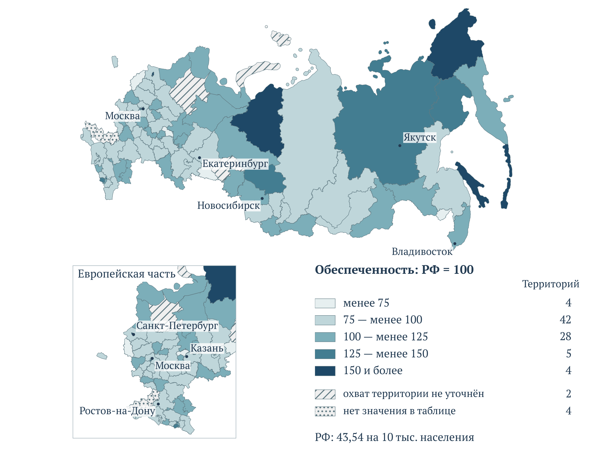

[B245; Caption] Рисунок 6 – Территориальные различия обеспеченности врачами

[B246; ] Примечание. Июль 2026 г.; РФ = 100, единая шкала карт. Физические лица в организациях – участниках программы государственных гарантий. Сопоставлены 83 территории; Архангельская и Тюменская области исключены из-за неуточнённого охвата автономных округов, округа показаны отдельно. В четырёх строках значения отсутствуют. Уровень РФ – описательный ориентир. [Сноски 78]

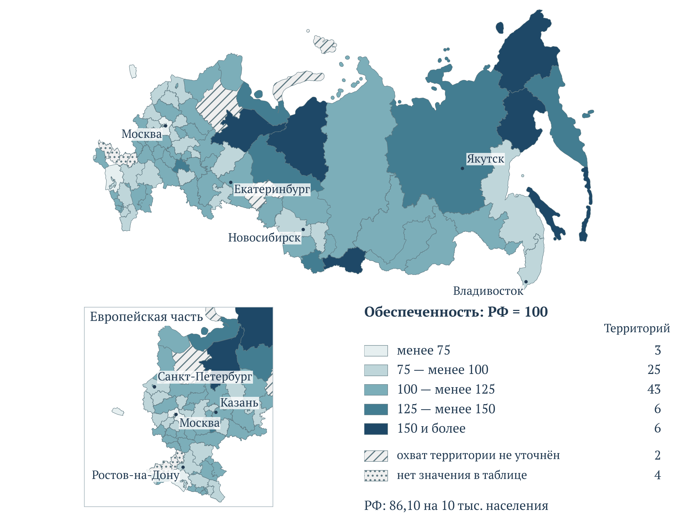

[B248; Caption] Рисунок 7 – Территориальные различия обеспеченности средним медицинским персоналом

[B249; ] Примечание. Июль 2026 г.; РФ = 100, единая шкала карт. Физические лица в организациях – участниках программы государственных гарантий. Сопоставлены 83 территории; Архангельская и Тюменская области исключены из-за неуточнённого охвата автономных округов, округа показаны отдельно. В четырёх строках значения отсутствуют. Уровень РФ – описательный ориентир. [Сноски 79]

[B250; ] На рисунках 6 и 7 используется одинаковая шкала: обеспеченность Российской Федерации принята за 100. Она позволяет сравнить пространственное размещение двух категорий персонала, не смешивая их абсолютные уровни. Среди 83 территорий врачебная обеспеченность ниже национальной в 46, обеспеченность средним персоналом – в 28. При этом уровень РФ является описательным ориентиром, а не клинически обоснованным нормативом достаточности. Территория может находиться выше средней и сохранять дефицит конкретных специалистов, а более низкий коэффициент требует анализа модели обслуживания, доступности соседних центров и потребностей населения. Цвет карты показывает положение относительно национального значения, а не итоговую оценку качества регионального здравоохранения.

[B251; ] Визуальное сравнение подчёркивает различие кадровых профилей. В 23 территориях оба коэффициента ниже общероссийских; ещё в 23 врачебная обеспеченность ниже, а обеспеченность средним персоналом не ниже национальной. В пяти территориях наблюдается обратное сочетание, в 32 оба значения достигают либо превышают уровень РФ. Эти группы определены прозрачным сопоставлением двух коэффициентов и не являются результатом скрытого интегрального рейтинга. Их практический смысл – различать направления последующей проверки. Одновременное отставание по двум ресурсам требует одного набора вопросов, несоответствие между врачебным и средним персоналом – другого. Решение о потребности в ставках должно приниматься после проверки специальностей и функций, а не только принадлежности к группе. [Сноски 80]

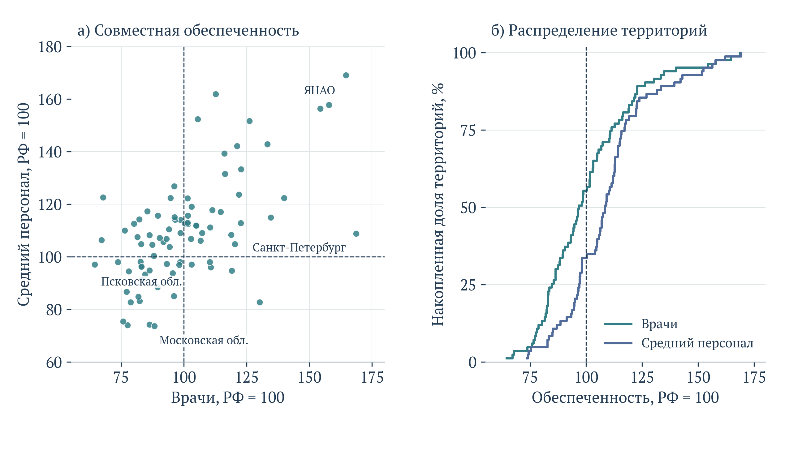

[B253; Caption] Рисунок 8 – Соотношение и распределение кадровой обеспеченности территорий

[B254; ] Примечание. Июль 2026 г., 83 сопоставленные территории. Каждая точка представляет одну территорию. В накопленном распределении территории имеют одинаковый вес; это распределение региональных коэффициентов, а не жителей. Пунктир соответствует уровню Российской Федерации; он не является нормативом кадровой достаточности. [Сноски 81]

[B255; ] Рисунок 8 дополняет картограммы распределением и совместным положением территорий. Ранговая корреляция двух коэффициентов составляет 0,556: более высокая обеспеченность одной категорией в среднем сочетается с более высокой обеспеченностью другой, однако связь далеко не полная. Это описательная характеристика территориальных данных, а не доказательство взаимозаменяемости работников. В накопленном распределении каждая территория имеет одинаковый вес. Оно отвечает на вопрос о разбросе региональных коэффициентов; долю жителей, проживающих при той или иной обеспеченности, можно оценивать только с весами населения и при согласованном охвате территорий. Подмена этих двух вопросов особенно существенно исказила бы интерпретацию малонаселённых территорий.

[B256; ] Высокие значения на отдельных пространственно обширных территориях также не следует автоматически принимать за избыточность персонала. При рассредоточенном расселении необходимы минимально укомплектованные учреждения и бригады даже при небольшом населении, а расстояния и время транспортировки могут оставаться значительными. В крупных медицинских центрах часть работников обслуживает пациентов из других территорий. Обе особенности означают, что число работников на постоянное население не полностью описывает нагрузку. Для более точного заключения нужны данные о фактическом потоке пациентов, территории обслуживания, доступности выездной помощи и распределении рабочего времени. Эти объяснения являются направлениями проверки, а не установленными причинами каждого регионального экстремума.

[B257; ] Отдельный кадровый показатель – «снижение дефицита врачей» – требует внимательного прочтения формулы. Его значение равно отношению текущего неудовлетворённого кадрового спроса к базовому дефициту, причём базовым выбирается год максимального положительного разрыва в предусмотренном методикой интервале 2023–2030 гг. Поэтому меньшая величина соответствует меньшему остаточному дефициту; 33,10% за сентябрь 2026 г. не означает сокращение дефицита на 33,10%. В сентябре 2025 г. опубликовано 22,06%, изменение составляет плюс 11,04 процентного пункта. Возможность уточнения потребности и базового разрыва требует раскрытия абсолютных компонентов. Рост обеспеченности физическими лицами и рост такого индекса не являются логическим противоречием: потребность и база сравнения могут изменяться. [Сноски 82]

[B258; ] В июле 2026 г. национальные коэффициенты уже находились выше указанных в опубликованном паспорте ориентиров 2030 г. – 43,46 врача и 85,12 работника среднего персонала на 10 тыс. населения. Это обстоятельство требует проверки актуальности порогов и устойчивости достигнутого уровня, но не доказывает решения кадровой проблемы. Различия территорий, специальностей, занятости и потребности сохраняют самостоятельное значение. При пересмотре целей целесообразно дополнить средний коэффициент показателями нижней части распределения, наличия необходимых специалистов на первичном уровне и соблюдения сроков ожидания. Тогда достижение национальной цели будет связано с улучшением положения территорий, где ограничение доступности наиболее существенно. [Сноски 83]

[B259; ] Для содержательной оценки кадровой политики следует различать привлечение нового работника, сохранение уже работающего, изменение места работы и перераспределение нагрузки. Одинаковый прирост физической численности может сопровождаться разным изменением доступности, если он сосредоточен в стационарах либо в первичном звене, в центрах либо в удалённых поселениях. Необходимы сведения о текучести, сроке закрепления после трудоустройства, длительности вакансии и фактической нагрузке. Такое дополнение позволяет оценивать не только выполнение целевого набора кадров, но и устойчивость организационного результата. Основной территориальный вывод экспертизы состоит в необходимости перехода от единой средней величины к профилю кадровых ограничений и потребностей населения.

[B260; Heading2] Устойчивость многомерной диагностики и границы интегральных оценок

[B261; ] Многомерный анализ использован для проверки того, образуют ли показатели проекта устойчивую общую структуру территориальных различий. В сопоставление за сентябрь 2026 г. включены 29 признаков по 83 территориям. Единицы измерения приведены к общей шкале вычитанием среднего и делением на стандартное отклонение. Пять отсутствующих значений, относящихся к Москве, заменены медианами соответствующих признаков; доля таких замен составляет 0,21% ячеек. Они применены только для исследовательской проверки структуры и не включены в таблицы фактических достижений. Состав территорий согласован с принятым исключением двух областных строк с неоднозначным охватом автономных округов. [Сноски 84]

[B262; ] Предварительная содержательная проверка показателей здесь принципиальна. Отношение работы передвижного подразделения к плановой пропускной способности может превышать 100%, поэтому такие наблюдения сохранены. Показатель увеличения числа получивших реабилитацию также не является обычной ограниченной долей: в публикациях встречаются как отрицательные, так и существенно превышающие 100 значения. Механическое применение единого диапазона допустимости исключило бы содержательно возможные наблюдения и изменило территориальный профиль. В то же время экстремум не должен автоматически восприниматься как выдающееся достижение: необходимо проверить базовую численность, правила периода и соответствие полного расчёта краткому методическому описанию. [Сноски 85]

[B263; ] Первая главная компонента объясняет 15,45% общей дисперсии стандартизированных признаков, вторая – 8,83%; вместе – 24,29%. Таким образом, две оси сохраняют менее четверти наблюдаемой вариации. Результат на рисунке 9 не подтверждает существования простого двумерного пространства, в котором можно без значительной потери информации расположить территории по общему качеству реализации проекта. Главные компоненты выбираются по статистической изменчивости, а не по общественной значимости исходов. Даже высокий вклад признака в компоненту не превращает его в наиболее важную цель политики. Поэтому проекцию нельзя без отдельного нормативного обоснования использовать как интегральный рейтинг результативности. [Сноски 86]

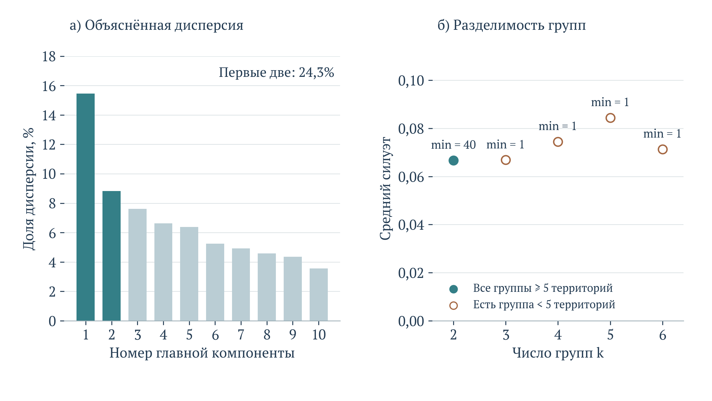

[B265; Caption] Рисунок 9 – Диагностика размерности показателей и разделимости территориальных групп

[B266; ] Примечание. Сентябрь 2026 г.: 83 территории и 29 показателей. Признаки стандартизированы, пять пропусков заменены медианами. k-means рассчитан в пространстве всех 29 признаков; 30 начальных инициализаций, фиксированное начальное состояние 42. min – число территорий в наименьшей группе. Показатель силуэта близок к нулю; результаты не обосновывают устойчивую региональную типологию или интегральный рейтинг. [Сноски 87]

[B267; ] Кластеризация методом k-средних выполнена в полном пространстве 29 стандартизированных признаков. При двух группах получены размеры 43 и 40 территорий, средний коэффициент силуэта – 0,0667. Близость этого коэффициента к нулю указывает на слабое отделение групп друг от друга. При числе групп от трёх до шести возникают группы из одной территории; такие разбиения не проходят принятое в данном анализе ограничение минимального размера в пять территорий. Само наличие численно оптимального разбиения не означает существования управленчески полезных типов. Здесь классификация оказалась значительно менее определённой, чем впечатление, которое могла бы создать раскрашенная по кластерам карта. [Сноски 88]

[B268; ] Проверка начальных состояний алгоритма показывает относительную вычислительную воспроизводимость двухгруппового разбиения: при десяти вариантах запуска скорректированный индекс Рэнда относительно базового результата изменяется приблизительно от 0,905 до 1,000. Однако устойчивость запуска не равна содержательной устойчивости типологии. При исключении Москвы, имеющей пропуски, и повторной стандартизации 82 полностью наблюдаемых территорий алгоритм выделяет одну Еврейскую автономную область в отдельную группу, оставляя 81 территорию в другой. Силуэт возрастает до 0,529, но такое повышение характеризует отделение единичного экстремального профиля. Оно не оправдывает двухтипную классификацию регионального здравоохранения. Увеличение числа инициализаций с 30 до 200 этот результат не меняет.

[B269; ] Особенности профиля Еврейской автономной области связаны прежде всего с опубликованным показателем увеличения числа получивших реабилитацию 1084,5, больничной летальностью при инфаркте миокарда 28,8%, долей устойчивого вирусологического ответа 89,23% и летальностью при инсульте 26,1%. Эти величины требуют предметного регионального анализа и проверки числителей, знаменателей и состава пациентов. Они не объявляются ошибками только из-за удаления от средних. Вместе с тем чувствительность классификации к сочетанию экстремальных значений и изменению состава совокупности показывает, почему ранжирование по единому баллу было бы недостаточно надёжным основанием для управленческих санкций или распределения ресурсов. [Сноски 89]

[B270; ] Исключение показателя реабилитации в отдельной проверке основной совокупности практически не меняет слабую разделимость: силуэт двух групп составляет 0,0685, совпадение групп с исходным разбиением полное. Следовательно, проблема не исчерпывается одним необычным признаком. Показатели описывают разные болезни, контингенты, ресурсы и организационные этапы; их неоднородность имеет содержательные основания. Низкая сводимость не является недостатком проекта сама по себе, но ограничивает допустимость единого индекса. Более полезен профиль конкретной территории с раздельной оценкой кадров, своевременности помощи, непрерывности наблюдения и клинических исходов, сопровождаемый проверкой масштаба и качества каждого наблюдения.

[B271; ] Результат многомерного исследования поэтому носит отрицательный, но практически значимый характер: надёжная универсальная типология территорий на данной совокупности показателей не подтверждена. Для последующей аналитики целесообразнее формировать тематически однородные модели и заранее определять их управленческую задачу. Модель кадровой доступности должна включать потребность и территорию обслуживания; модель исходов – состав пациентов и клинический риск; модель прохождения маршрута – последовательные этапы одной когорты.

[B272; Heading1] Финансовые приоритеты и условия реализации

[B273; Heading2] Масштаб и структура планового финансирования

[B274; ] Финансовое обеспечение в национальном паспорте редакции 26.40 составляет 4 136,48 млрд руб. за 2025–2030 годы по всем указанным источникам. Сумма одиннадцати федеральных паспортов за тот же период равна 4 066,23 млрд руб. Расчёты относятся к номинальным плановым объёмам в опубликованных редакциях с датой обновления 16 октября 2026 года. Показанные суммы не характеризуют кассовое исполнение и не представляют полного объёма расходов здравоохранения. В финансовых заголовках ряда федеральных проектов содержатся также годы 2031–2036, которые исключены из сопоставления с шестилетним национальным итогом. [Сноски 90]

[B275; ] Распределение между направлениями существенно неравномерно. На борьбу с онкологическими заболеваниями приходится 1 674,04 млрд руб., или 41,17% суммы федеральных паспортов. Модернизация первичного звена получает 1 513,85 млрд руб., или 37,23%. Вместе два направления формируют 78,40% рассматриваемого финансового объёма. На экстренную помощь приходится 5,13%, реабилитацию – 4,65%, развитие федеральных медицинских организаций – 4,27%. Полное распределение представлено в таблице 6 и на рисунке 10. [Сноски 91]

[B276; Caption] Таблица 6 – Плановое финансовое обеспечение федеральных проектов в 2025–2030 годах

[TABLE 6; B277]
Федеральный проект | Редакция | Млрд руб. | Доля, %
Борьба с онкологическими заболеваниями | 26.8 | 1 674,038 | 41,17
Модернизация первичного звена здравоохранения Российской Федерации | 26.24 | 1 513,848 | 37,23
Совершенствование экстренной медицинской помощи | 26.6 | 208,469 | 5,13
Оптимальная для восстановления здоровья медицинская реабилитация | 26.4 | 189,089 | 4,65
Развитие федеральных медицинских организаций, включая развитие сети национальных медицинских исследовательских центров | 26.19 | 173,689 | 4,27
Борьба с сахарным диабетом | 26.7 | 104,038 | 2,56
Борьба с сердечно-сосудистыми заболеваниями | 26.7 | 80,420 | 1,98
Борьба с гепатитом С и минимизация рисков распространения данного заболевания | 26.2 | 58,688 | 1,44
Национальная цифровая платформа «Здоровье» | 26.6 | 55,457 | 1,36
Здоровье для каждого | 26.21 | 4,381 | 0,11
Медицинские кадры | 26.12 | 4,114 | 0,10
Итого по 11 федеральным проектам |  | 4 066,231 | 100,00

[B278; ] Примечание. Доли рассчитаны от суммы 11 федеральных паспортов: 4 066,231 млрд руб. Номинальные планы по всем источникам. Полные суммы использованы в расчётах, в таблице показано округление.

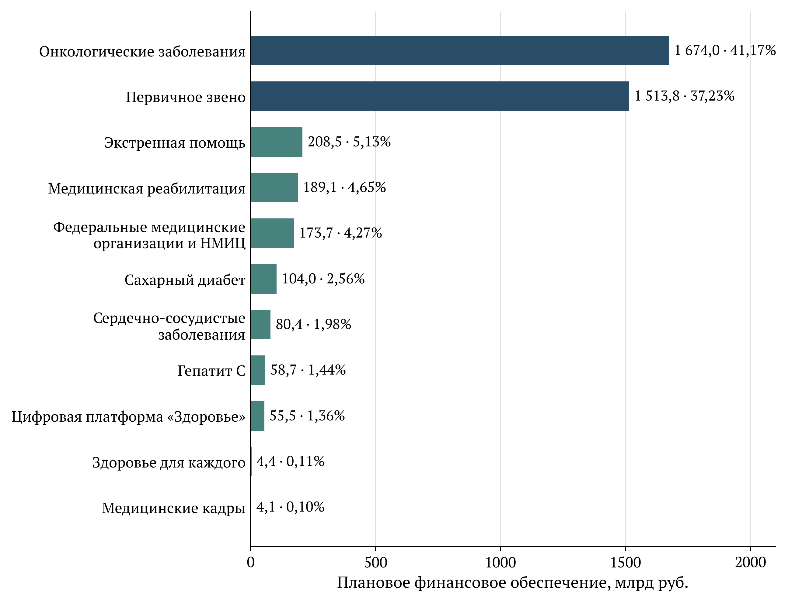

[B280; Caption] Рисунок 10 – Распределение плановых средств между федеральными проектами

[B281; ] Примечание. Период 2025–2030. Проценты рассчитаны от суммы федеральных паспортов. Источники, полные названия и редакции приведены в таблице 6. Доли отражают структуру проектного финансирования.

[B282; ] Индекс концентрации, рассчитанный как сумма квадратов долей федеральных проектов, равен 0,3162. Обратная величина составляет 3,16 и характеризует эквивалентное число одинаковых по размеру направлений. Показатель описывает распределение плановых средств. Его значение не свидетельствует об эффективности, избыточности или достаточности отдельных расходов. Интерпретация требует учитывать содержание финансируемых мероприятий, стоимость технологий и другие каналы оплаты соответствующей помощи.

[B283; ] (3)

[Формула] HHI = Σᵢ₌₁¹¹ sᵢ²; sᵢ = Bᵢ / Σⱼ₌₁¹¹ Bⱼ

$$
HHI=\sum_{i=1}^{11}s_i^2,\quad s_i=\frac{B_i}{\sum_{j=1}^{11}B_j}
$$

[B284; ] HHI – индекс концентрации; sᵢ – доля i-го федерального проекта в сумме 11 федеральных планов; Bᵢ – его плановый объём за 2025–2030 гг. Доли выражены числами от 0 до 1. Индекс характеризует структуру распределения, а не эффективность расходов.

[B285; ] Особенно осторожной должна быть оценка небольших долей проектов «Здоровье для каждого» и «Медицинские кадры»: соответственно 0,108 и 0,101%. Границы финансового паспорта не совпадают со всеми расходами на профилактику, оплату труда и подготовку медицинских работников. Низкая доля в проектной структуре сама по себе не доказывает недостаток общего ресурсного обеспечения данных функций. Одновременно кадровые и профилактические ограничения способны снижать отдачу от крупных капитальных и лечебных расходов. Их финансовую обеспеченность необходимо проверять на уровне полного маршрута и связанных источников средств. [Сноски 103]

[B286; ] По национальному паспорту федеральный бюджет обеспечивает 2 105,20 млрд руб., или 50,89%, консолидированные бюджеты субъектов Российской Федерации – 1 091,45 млрд руб., или 26,39%, государственные внебюджетные фонды – 939,83 млрд руб., или 22,72%. Сумма трёх категорий точно соответствует национальному итогу. Указанные доли характеризуют институциональное распределение планового финансирования. Для региональных решений существенны условия софинансирования и наличие средств на эксплуатацию объектов после завершения инвестиционной стадии. [Сноски 104]

[B287; Caption] Таблица 7 – Источники планового финансирования и разложение расхождения

[TABLE 7; B288]
Источник средств | Национальный итог, млрд руб. | Доля, % | Национальный итог минус сумма ФП, млрд руб.
Федеральный бюджет | 2 105,200 | 50,89 | 56,730
Консолидированные бюджеты субъектов РФ | 1 091,448 | 26,39 | 0,031
Государственные внебюджетные фонды | 939,832 | 22,72 | 13,488

[B289; ] Примечание. Период 2025–2030. Знаменатель долей – 4 136,480 млрд руб. Внебюджетные фонды обозначены отдельной категорией бюджетной системы. Источники федеральных итогов приведены в таблице 6. [Сноски 105]

[B290; Heading2] Календарная структура и согласованность финансовых агрегатов

[B291; ] Плановая годовая траектория неоднородна: 723,14 млрд руб. в 2025 году, 458,66 млрд руб. в 2026 году, 553,18 млрд руб. в 2027 году, 655,31 млрд руб. в 2028 году, 886,78 млрд руб. в 2029 году и 859,41 млрд руб. в 2030 году. На последние два года приходится 42,21% шестилетнего национального объёма. Годовая структура источников приведена на рисунке 11. Номинальный рост плановых сумм не следует непосредственно интерпретировать как увеличение физического объёма помощи без учёта цен, состава мероприятий и порядка отражения средств. [Сноски 106]

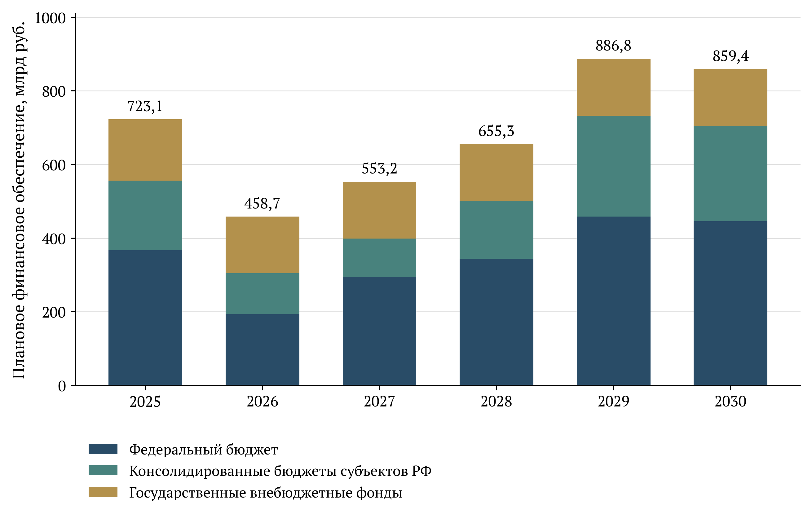

[B293; Caption] Рисунок 11 – Плановое финансирование национального проекта по годам и источникам

[B294; ] Примечание. Плановые суммы по национальному паспорту редакции 26.40. Показаны номинальные объёмы, включая 2025 год. Год в плане не свидетельствует о фактическом кассовом расходе. [Сноски 107]

[B295; ] Сосредоточение значительной части ресурсов в конце горизонта усиливает значение календарной согласованности. Инфраструктура, вводимая в 2029–2030 годах, располагает ограниченным временем для влияния на итоговые показатели того же периода. Для таких мероприятий необходимо заранее определить ожидаемые сроки выхода на рабочую мощность и временной лаг результата. Операционные показатели следует отслеживать после ввода, а оценку долговременного медицинского эффекта продолжать за пределами строительного графика. Общая дата завершения проекта не устраняет различий во времени возникновения эффекта.

[B296; ] Временная концентрация различается между направлениями. В модернизации первичного звена на 2029–2030 годы приходится 52,90% собственного шестилетнего плана, тогда как в онкологическом проекте – 36,47%. Следовательно, общий финансовый профиль в заметной степени связан с поздним размещением средств крупнейшего инфраструктурного направления. Из этих долей нельзя установить календарь ввода конкретных объектов, поскольку годовой финансовый агрегат объединяет различные мероприятия. Тем не менее они обосновывают приоритетную проверку сроков подготовки, запуска и кадрового обеспечения именно первичного звена. Для каждого крупного объекта следует сопоставить дату начала оказания помощи с периодом, за который ожидается вклад в итоговый показатель. [Сноски 108]

[B297; ] Последовательность решений целесообразно проверять также при перераспределении средств внутри финансового периода. Перенос капитальных мероприятий на последующие годы изменяет не только календарь платежей, но и срок появления доступной мощности. Ускорение закупки при неподготовленном помещении или отсутствии персонала может увеличить время нахождения оборудования вне действующего процесса оказания помощи. Поэтому контроль освоения средств следует дополнять согласованными датами готовности взаимозависимых компонентов. Для объектов, эффект которых ожидается после 2030 года, целесообразно заранее установить порядок последующего наблюдения и источник эксплуатационных расходов. Это позволит сохранить ответственность за результат после завершения текущего проектного горизонта.

[B298; ] Национальный финансовый итог превышает сумму федеральных итогов на 70,25 млрд руб., или на 1,70% национальной суммы. Разность наблюдается во всех шести годах. Для 2025 года она составляет 13,49 млрд руб., для 2026 года – 11,32 млрд руб., в последующие годы находится в интервале 11,35–11,41 млрд руб. Сопоставление выполнено за совпадающий период и по одинаковой категории всех источников финансирования. Масштаб различия не объясняется округлением представленных в отчёте сумм. [Сноски 109]

[B299; Caption] Таблица 8 – Сопоставление финансовых итогов национального и федеральных проектов

[TABLE 8; B300]
Год | Национальный паспорт, млрд руб. | Сумма 11 ФП, млрд руб. | Разность, млрд руб.
2025 | 723,135 | 709,647 | 13,488
2026 | 458,660 | 447,341 | 11,319
2027 | 553,184 | 541,839 | 11,345
2028 | 655,314 | 643,969 | 11,345
2029 | 886,780 | 875,374 | 11,406
2030 | 859,406 | 848,061 | 11,345
Итого | 4 136,480 | 4 066,231 | 70,249

[B301; ] Примечание. Разность рассчитана как национальный итог минус сумма федеральных итогов за один и тот же год. Расхождение публикаций не является оценкой исполнения бюджета. Источники федеральных итогов приведены в таблице 6. [Сноски 110]

[B302; ] Разложение по источникам уточняет предмет дальнейшей сверки. Из совокупного расхождения 56,73 млрд руб. относятся к федеральному бюджету, 13,49 млрд руб. – к государственным внебюджетным фондам, 30,94 млн руб. – к консолидированным бюджетам субъектов. Различие по внебюджетным фондам сосредоточено в 2025 году. Различие по федеральному бюджету возникает в 2026–2030 годах. Внутри каждой публикации сумма источников за соответствующий год сходится с её финансовым итогом. Следовательно, арифметическая согласованность отдельного паспорта сочетается с несогласованностью между уровнями агрегирования, представленной на рисунке 12.

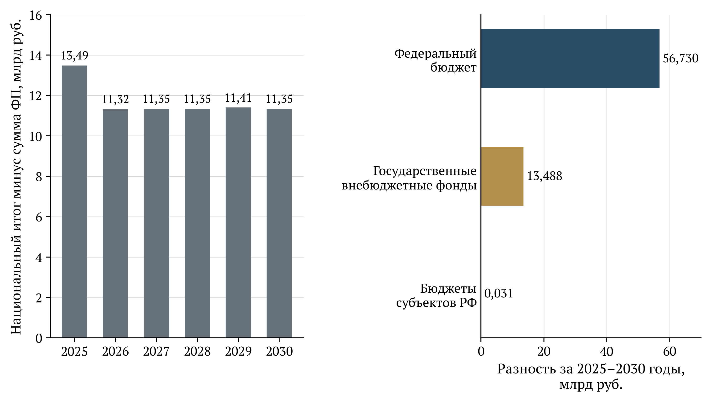

[B304; Caption] Рисунок 12 – Расхождение финансовых агрегатов по годам и источникам

[B305; ] Примечание. Сопоставлены одинаковые периоды 2025–2030. Совокупная разность 70,249 млрд руб. Отображено арифметическое расхождение опубликованных планов, причина которого требует документальной сверки. [Сноски 111]

[B306; ] Выявленное расхождение не является доказательством недофинансирования, избыточных расходов или нецелевого использования средств. Для установления причины необходима сверка состава учитываемых мероприятий, утверждённых изменений и правил отражения финансового обеспечения на национальном и федеральном уровнях. Номера редакций разных паспортов сами по себе не позволяют определить, какие изменения должны были одновременно попасть в каждый агрегат. Различие следует включить в предмет документального согласования, сохранив обе исходные суммы до получения объяснения.

[B307; ] Публикация сверочного баланса должна содержать национальный итог, включённые федеральные составляющие, дополнительные корректировки и дату действия каждого изменения. При изменении плана необходимо показывать основание, источник средств и затронутые годы. Такая форма позволит отличить изменение общего объёма от перераспределения между мероприятиями и от изменения способа представления. Для анализа исполнения дополнительно требуются данные о принятых обязательствах и произведённых расходах, увязанные с той же структурой результатов.

[B308; Heading2] Полная стоимость мероприятий и дополнительный результат

[B309; ] Финансовую результативность целесообразно оценивать в границах полного жизненного цикла мероприятия. Для медицинского объекта расходы включают подготовку и строительство, оснащение, кадровое обеспечение, обслуживание оборудования, расходные материалы и последующее обновление. Для цифрового сервиса необходимо учитывать интеграцию, поддержку, информационную безопасность и рабочее время специалистов. Программа обучения требует ресурсов на участие работников и использование полученных компетенций. Изолированное сопоставление первоначальной цены закупки с числом единиц не отражает стоимость устойчиво функционирующей помощи.

[B310; ] Единицей оценки должна выступать завершённая и клинически осмысленная последовательность действий. Для помощи при гепатите С она может включать подтверждённое выявление, начало и завершение терапии с установленным результатом. Для хронических заболеваний следует рассматривать ведение пациента в течение определённого периода, для реабилитации – прохождение этапов с повторной оценкой функций. Выбор единицы должен соответствовать управленческому вопросу. Стоимость посещения, случая лечения и дополнительного благоприятного исхода имеет различный смысл и не должна использоваться взаимозаменяемо.

[B311; ] Региональные расходы следует сопоставлять с учётом состава пациентов, транспортной доступности и качества помощи. Высокая стоимость в малонаселённых территориях может обеспечивать минимальную доступность. Экономия за счёт исключения сложных пациентов или незавершённых маршрутов не повышает результативность.

[B312; Heading1] Связи мероприятий с показателями и лингвистическая согласованность

[B313; Heading2] Логика проектирования и прослеживаемость результатов

[B314; ] Документальная архитектура национального проекта охватывает основные звенья медицинской помощи: первичное обращение, профилактику, диагностику, лечение заболеваний, экстренную помощь и реабилитацию. Отдельные федеральные проекты обеспечивают кадровые, информационные и организационные условия работы этой системы. Для экспертизы принципиально установить, какие изменения в положении пациента связывают создаваемые объекты, приобретаемые ресурсы и выполняемые процедуры с конечными результатами. Наличие мероприятий и показателей в одном паспорте устанавливает общую сферу ответственности, однако само по себе ещё не раскрывает последовательность переходов между ними. Содержательную оценку поэтому необходимо проводить одновременно на уровне отдельных проектов и на уровне маршрута человека через несколько медицинских организаций. [Сноски 112]

[B315; ] Структурное исследование охватывает национальный паспорт и паспорта всех 11 федеральных проектов в электронных редакциях, опубликованных по состоянию на 16 октября 2026 г. В федеральных паспортах выделены 78 карточек результатов и 43 карточки показателей. Национальный паспорт содержит ещё 10 карточек показателей. Суммарные 53 карточки нельзя считать 53 независимыми статистическими переменными. Одни содержательные показатели представлены на разных уровнях управления, а в паспорте первичного звена дважды встречается одинаково названный показатель сокращения продолжительности временной нетрудоспособности. При сопоставлении целей необходимо учитывать определение величины, единицу измерения, охватываемую совокупность и период, а также её место в иерархии управления. [Сноски 113]

[B316; ] Таблица 9 показывает распределение документальных элементов. Наибольшее число результатов предусмотрено в кадровом проекте и в модернизации первичного звена. Само количество карточек характеризует детализацию планирования. Сопоставлять по нему общественную значимость, сложность реализации или обеспеченность финансированием неправомерно: одна карточка может объединять несколько операций, тогда как в другом паспорте сходная деятельность разделена на самостоятельные результаты. Для содержательного анализа существеннее определить, существуют ли наблюдаемые промежуточные изменения, позволяющие оценивать качество выполнения каждой группы мероприятий.

[B317; Caption] Таблица 9 – Охват документальной структуры федеральных проектов

[TABLE 9; B318]
Код | Направление | Результаты | Карточки показателей | Пары через общую задачу
Д1 | Первичное звено | 12 | 7 | 84
Д2 | Сердечно-сосудистые заболевания | 4 | 6 | 24
Д3 | Онкологические заболевания | 5 | 4 | 20
Д4 | Сахарный диабет | 8 | 3 | 24
Д5 | Гепатит С | 6 | 5 | 30
Д6 | Экстренная помощь | 4 | 1 | 4
Д7 | Медицинская реабилитация | 5 | 2 | 10
Д8 | Цифровая платформа | 5 | 3 | 15
Д9 | Федеральные учреждения | 5 | 3 | 15
ДА | Здоровье для каждого | 11 | 6 | 31
ДБ | Медицинские кадры | 13 | 3 | 25
 | Всего | 78 | 43 | 282

[B319; ] Примечание. Карточки могут содержать совпадающие показатели. Пары через общую задачу обозначают структурные отношения, а не прямые паспортные связи или причинные эффекты. Коды Д1–ДБ обозначают соответствующие федеральные проекты. [Сноски 114]

[B320; ] Различаются три вида отношений между мероприятиями и показателями. Прямая документальная связь прямо закреплена в паспорте и имеет определённые начальную и конечную позиции, а при наличии весовой оценки также установленный вес. Структурная связь означает отнесение результата и показателя к общей задаче. Лексическая близость характеризует сходство употреблённых слов. Основания этих отношений различны. Их объединение в единую недифференцированную сеть привело бы к завышению степени обоснованности проектной логики. В настоящем анализе прямые связи рассматриваются отдельно от связей через задачу и от результатов количественного исследования языка документов.

[B321; ] В 11 федеральных паспортах все 78 результатов и все 43 карточки показателей отнесены к задачам. Через совпадение задачи образуются 282 пары «результат – показатель». Девять федеральных проектов объединяют результаты и показатели в пределах одной задачи, вследствие чего число таких пар равно произведению числа результатов на число показателей. Например, для первичного звена получаются 84 пары при 12 результатах и семи карточках показателей. Подобная полнота связей следует из структуры документа. Она не доказывает, что каждое мероприятие непосредственно и в одинаковой мере изменяет каждый показатель. У проектов «Здоровье для каждого» и «Медицинские кадры» задачи дифференцированы, поэтому формируются соответственно 31 и 25 структурных пар. [Сноски 115]

[B322; ] Прямые веса удалось предметно рассмотреть на примере федерального проекта по борьбе с сердечно-сосудистыми заболеваниями: опубликованный паспорт однозначно задаёт 24 отношения между четырьмя мероприятиями и шестью показателями. Такая проверка охватывает полный состав его весовой матрицы. Для остальных федеральных проектов полнота анализа означает охват целей, результатов, показателей и содержательных механизмов, но не наличие столь же подробных проверенных матриц весов. Для других направлений прямые веса не верифицированы. Неполнота такого сопоставления не свидетельствует об отсутствии связей в утверждённых документах. [Сноски 116]

[B323; ] Редакционная сопоставимость также имеет самостоятельное значение. Электронные паспорта отражают состояние октября 2026 г., а подробная матрица сердечно-сосудистого проекта опубликована в составе паспорта с планом реализации на 2025 г. Совпадение смыслового состава четырёх мероприятий и шести показателей позволяет исследовать логику этой матрицы. Приписывать её веса последующей редакции без подтверждения изменения или сохранения соответствующего приложения оснований нет. Официальные описания Минздрава используются для содержательной проверки инструментов, причём приведённые в них плановые значения не подменяют значения более поздних редакций паспортов. [Сноски 117]

[B324; ] Экспертная схема в таблице 10 распространяет анализ на все 11 федеральных проектов. Во второй колонке представлены инструменты, описанные в официальных материалах. Последующие колонки формулируют проверяемые промежуточные переходы и вопросы оценки. Предлагаемые переходы имеют статус аналитических гипотез и рекомендаций к мониторингу. Они не выдаются за дополнительно обнаруженные паспортные связи. Общая задача схемы состоит в том, чтобы сделать предметом управления прохождение пациента от доступного ресурса к фактически полученной помощи, а затем к изменению состояния здоровья.

[B325; Caption] Таблица 10 – Проверяемые переходы от инструментов федеральных проектов к изменениям медицинской помощи

[TABLE 10; B326]
ФП | Документированный инструмент | Промежуточное изменение для проверки | Рекомендуемый контроль
Д1 | Обновление первичного звена, мобильные бригады, дистанционное наблюдение | Пациент получает предусмотренную помощь в доступном месте и в необходимый срок | Работа введённого объекта, фактический охват целевой группы, завершённость диспансерного наблюдения
Д2 | Профилактика осложнений, диагностика, лекарственное обеспечение и маршрутизация | Пациент своевременно получает назначенную терапию и необходимое вмешательство | Непрерывность получения препаратов, соблюдение маршрута, время до помощи с учётом показаний
Д3 | Современное лечение, радиологическое оснащение, уточнение маршрутов | Сокращаются задержки диагностики и начала показанного лечения | Сроки этапов маршрута, получение полного курса, основания и частота его прерывания
Д4 | Оснащение специализированной помощи, школы для пациентов, наблюдение | Выявленный пациент включён в наблюдение и способен выполнять согласованный план лечения | Переход от выявления к наблюдению, освоение самоконтроля, завершение назначенных обследований
Д5 | Скрининг, регистр, противовирусная терапия и контроль результата | После выявления инфекции пациент получает терапию и проходит контроль её результата | Потери пациентов между обследованием, включением в регистр, началом курса и контрольным исследованием
Д6 | Приёмные отделения, оборудование, санитарная авиация | Пациент с неотложной потребностью своевременно получает доступную профильную помощь | Время этапов, обоснованность эвакуации, готовность принимающего подразделения
Д7 | Оснащение и оказание медицинской реабилитации | Пациент проходит необходимую реабилитацию с оценкой восстановления функций | Потребность и фактическое получение курса, своевременность начала, функциональный результат
Д8 | Цифровая платформа, защищённый обмен, цифровые сервисы | Сведения доступны исполнителю и вызывают своевременное клиническое действие | Фактическое использование, качество сведений, доля сигналов с завершённым медицинским действием
Д9 | Модернизация федеральных организаций, экспертные консультации, методическая поддержка | Региональный пациент получает необходимую специализированную помощь | Переход от консультации к обоснованному решению и его исполнению, доступность по территории проживания
ДА | Профилактические мероприятия и формирование здорового образа жизни | Выявленный риск сопровождается доступной поддержкой изменения поведения | Повторное наблюдение целевой группы, получение рекомендованной помощи, устойчивость изменений
ДБ | Подготовка, трудоустройство, социальная поддержка, региональные кадровые программы | Квалифицированный работник закрепляется в подразделении, испытывающем потребность | Потребность по специальности и территории, фактическая занятость, нагрузка и удержание кадров

[B327; ] Примечание. Инструменты обобщены по официальным описаниям Минздрава. Промежуточные изменения и контрольные вопросы предложены в настоящей экспертизе. Они не являются дополнительными утверждёнными паспортными показателями. Д9 соответствует направлению развития федеральных медицинских организаций и сети национальных медицинских исследовательских центров. [Сноски 118]

[B328; ] В инфраструктурных направлениях критическая граница проходит между вводом объекта и устойчивым предоставлением предусмотренной помощи. После оснащения кабинета должны быть обеспечены персонал, режим работы, расходные материалы, техническое обслуживание и поток пациентов. Для кадрового направления аналогичная граница разделяет подготовку специалиста, его трудоустройство и длительное закрепление на конкретной территории. Для цифрового направления следует различать техническую доступность сервиса, его фактическое использование и клиническое действие по полученному сигналу. Названные переходы позволяют обсуждать причины расхождения между формальным выполнением результата и сохранением неудовлетворённой потребности в помощи без предположения о заведомой неэффективности самого инструмента.

[B329; ] Межпроектные зависимости целесообразно закреплять через совместно определённые процессы. Например, дистанционное наблюдение соединяет первичное звено, цифровую платформу, профильное лечение и кадровое обеспечение. Одному проекту может принадлежать создание сервиса, другому – организация наблюдения, третьему – лечебная помощь. При этом целостность процесса требует согласованных правил включения пациента, передачи сигнала, срока ответа и завершения медицинского действия. Оценка каждого исполнителя только по собственному объёму работ оставляет промежуточные переходы без явного владельца. Предлагается назначать ответственного за переход между этапами и устанавливать правила разбора случаев, когда запланированное действие не состоялось.

[B330; ] Для практической прослеживаемости рекомендуется сопровождать каждую связь устойчивыми идентификаторами результата и показателя, определением охватываемой группы, указанием периода и ответственного исполнителя. Изменение формулировки должно сопровождаться пояснением, сохраняется ли прежний смысл показателя. Если меняются знаменатель, критерии включения пациентов или территория наблюдения, сопоставимость прежнего и нового значения требует отдельного решения. Общий реестр таких переходов позволит видеть, относится ли отклонение к объёму выполненных действий, к доступности следующего этапа или к достигаемому состоянию пациента. При этом детализация должна оставаться соразмерной управленческой задаче: обязательными являются сведения, которые позволяют проверить переход и принять решение по его нарушению. Увеличение количества отчётных полей само по себе не повышает объяснительную способность системы. Приоритет следует отдавать устранению неоднозначности адресатов влияния и согласованию уже собираемых сведений о ходе помощи.

[B331; Heading2] Прямая связь мероприятий и показателей: сердечно-сосудистое направление

[B332; ] Паспортная матрица сердечно-сосудистого направления позволяет провести более строгую проверку распределения ответственности. Её строки описывают профилактику осложнений у пациентов высокого риска, диагностику и предупреждение прогрессирования ишемической болезни сердца, маршрутизацию пациентов и реализацию региональных программ. В столбцах представлены число пациентов без острых сердечно-сосудистых событий за предыдущий год, лекарственное обеспечение, больничная летальность при инфаркте миокарда и остром нарушении мозгового кровообращения, а также охват тромбэкстракцией и реперфузионной терапией. Веса указаны в дополнительных и обосновывающих материалах паспорта, в разделе оценки влияния результатов на показатели. [Сноски 119]

[B333; ] Матрица на рисунке 13 сохраняет все исходные значения. Сумма весов в каждом столбце составляет 100%. Такой способ нормировки описывает распределение заявленного влияния мероприятий на отдельный показатель. Сумма по строке имеет иной смысл: она объединяет веса одного мероприятия в отношении шести разных показателей. Из этой особенности следует ограничение интерпретации. Ни отдельный вес, ни сумма весов не выражают число предотвращённых событий, долю причинно обусловленного изменения или величину экономической отдачи. Представленная оценка принадлежит системе проектного планирования и нуждается в самостоятельной эмпирической проверке.

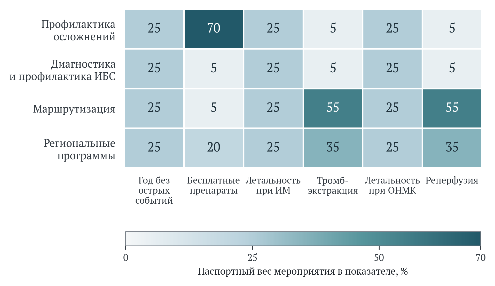

[B335; Caption] Рисунок 13 – Паспортные веса мероприятий по борьбе с сердечно-сосудистыми заболеваниями

[B336; ] Примечание. Сумма весов в каждом столбце равна 100%. ИБС – ишемическая болезнь сердца, ИМ – инфаркт миокарда, ОНМК – острое нарушение мозгового кровообращения. Веса отражают оценку, закреплённую в паспорте, и не являются измеренными причинными эффектами. [Сноски 120]

[B337; ] Наибольшая дифференциация предусмотрена для лекарственного обеспечения: профилактике осложнений присвоено 70%, региональным программам – 20%, диагностике и маршрутизации – по 5%. У охвата тромбэкстракцией и реперфузионной терапией распределения совпадают: 55% приходится на маршрутизацию, 35% – на региональные программы, по 5% – на два других мероприятия. Такое распределение выделяет организацию своевременного поступления пациента в профильное подразделение как важный элемент достижения технологических показателей. Однако совпадающие численные оценки двух разных видов вмешательств сами по себе не подтверждают одинаковые ограничения их применения и одинаковый ожидаемый эффект. [Сноски 121]

[B338; ] Для трёх показателей, описывающих отсутствие острых событий и больничную летальность при инфаркте миокарда и нарушениях мозгового кровообращения, установлено одинаковое распределение: по 25% каждому мероприятию. Равномерность делает эти столбцы слабо различающими функции мер. Изменение доступности лекарств, диагностики и маршрутизации может отражаться на разных стадиях заболевания, в разных группах пациентов и с неодинаковой задержкой. Поэтому одинаковый вес необходимо понимать как конвенцию планирования. Использовать его в качестве подтверждённой оценки вклада в клинический исход нельзя. Для управленческого применения желательно раскрыть обоснование равенства и обстоятельства, при которых веса подлежат пересмотру.

[B339; ] Граф на рисунке 14 показывает другую особенность документа: все четыре мероприятия связаны со всеми шестью показателями. Плотность такой двудольной сети равна единице. Невзвешенная степень каждого мероприятия составляет шесть, каждого показателя – четыре. Следовательно, центральность, основанная только на числе связей, здесь не различает мероприятия. Представление маршрутизации как наиболее значимого узла по одному лишь наличию многочисленных стрелок было бы ошибочным: различия задаются весами, а не топологией. Для обсуждения приоритетов пригодны содержание переходов, распределение весов и данные об ограничениях медицинской помощи.

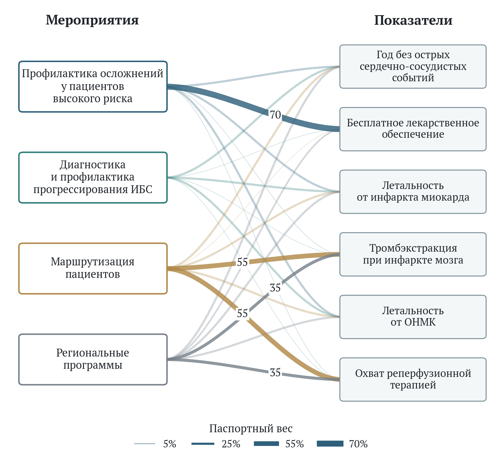

[B341; Caption] Рисунок 14 – Связи мероприятий и показателей в федеральном проекте по борьбе с сердечно-сосудистыми заболеваниями

[B342; ] Примечание. Показаны все 24 прямые документальные связи между четырьмя мероприятиями и шестью показателями. Толщина линии пропорциональна паспортному весу, цвет различает мероприятия. Подписаны веса от 35% и выше. Полная двудольная сеть не позволяет ранжировать мероприятия по невзвешенной степени. [Сноски 122]

[B343; ] Суммы по строкам составляют 155 для профилактики осложнений, 90 для диагностики и профилактики прогрессирования ишемической болезни сердца, 190 для маршрутизации и 165 для региональных программ. Сравнение 190 и 90 показывает различие суммарного паспортного веса. Оно не означает двукратной разницы в общественной полезности мероприятий. Шесть столбцов не обладают общей естественной единицей измерения. Более того, положительное направление желательного изменения различается: охват лечением должен увеличиваться, летальность – снижаться. Для любого сводного показателя исполнения необходимо заранее согласовать направление шкал и обосновать относительную значимость исходов. Даже после такой нормировки административный индекс будет характеризовать выполнение программы, а его использование для распределения ресурсов потребует дополнительных оснований.

[B344; ] Содержательная неоднородность строк ограничивает их рассмотрение как независимых воздействий. Региональная программа способна включать профилактику, обеспечение лекарствами, организацию маршрутов и повышение квалификации. В этом случае она выступает организационной формой реализации нескольких инструментов. Если одновременно приписывать улучшение исхода общей программе и включённым в неё мероприятиям, возникает риск повторного учёта вклада. Рекомендуется раскрывать вложенность действий: какие изменения являются самостоятельными инструментами, какие обеспечивают условия их выполнения, а какие объединяют их организационно. Такая декомпозиция полезнее механического увеличения числа связей в графе.

[B345; ] В отношении лекарственного обеспечения следует разделять предусмотренный охват, фактическое получение полного назначенного курса и непрерывность лечения. В отношении маршрутизации – наличие утверждённой схемы, фактическое следование ей и время до получения необходимой помощи. В отношении региональной программы – утверждение документа, выполнение предусмотренных действий и устранение выявленных препятствий. Данные различия не требуют отмены паспортных показателей. Они задают дополнительный уровень наблюдения, необходимый для объяснения, почему при формальном достижении результата ожидаемый эффект выражен слабо либо различается между территориями.

[B346; ] Практическое совершенствование матрицы предполагает описание основания каждого значимого веса и связанного с ним процесса. Для связи с лекарственным обеспечением таким основанием может служить доступность назначенной терапии для установленной группы пациентов. Для связи с технологическим вмешательством – своевременное поступление в организацию, которая располагает возможностью его выполнить. Предлагается указывать ожидаемую последовательность событий, используемые административные данные, допустимую задержку наблюдения и правило пересмотра оценки. При отсутствии эмпирического основания вес следует прямо обозначать как экспертный, сохраняя возможность его корректировки по результатам реализации.

[B347; ] Показатели летальности требуют отдельной осторожности при оценке работы маршрутов. Изменение состава госпитализированных пациентов, доли тяжёлых случаев и полноты регистрации может менять наблюдаемую величину независимо от качества конкретного мероприятия. Паспортная связь устанавливает предмет ответственности, но не устраняет такую неоднозначность. Поэтому улучшение управления целесообразно связывать с согласованным наблюдением этапов помощи и сопоставимых групп пациентов. При этом исследование документальной логики остаётся самостоятельным основанием для уточнения проекта даже до получения данных, достаточных для причинной оценки его результатов.

[B348; Heading2] Тематическая структура и содержательные акценты документов

[B349; ] Лингвистическое исследование направлено на выявление того, какие предметные области выражены в формулировках проекта и как они распределены между его составными частями. Анализируется специализированный административный язык целей, задач, результатов и показателей. Он не воспроизводит в полном объёме ни практику медицинской помощи, ни профессиональное обсуждение проблем, ни опыт пациентов. Поэтому заключение о достаточности внимания к определённой группе населения не может основываться только на числе употреблений соответствующего слова. Тематический анализ служит ориентиром для последующего чтения и сопоставления с системой мероприятий.

[B350; ] Для 12 паспортов выделены содержательные текстовые профили общим объёмом 9094 токена, то есть словесные единицы, учитываемые при подсчёте. Повторяющиеся формулировки внутри документа учитывались однократно. Организационные реквизиты, финансовые таблицы и повторяющиеся контрольные точки не включались, чтобы объём технического сопровождения не определял тематический результат. Национальный профиль содержит 446 токенов, профили федеральных проектов – от 442 до 1314. Различия объёма компенсируются расчётом числа словарных совпадений на 1000 токенов. Получаемые величины относятся к отобранным содержательным формулировкам и не характеризуют относительный объём всех страниц паспортов. [Сноски 123]

[B351; ] Словарная модель включает 18 тематических категорий. Каждая категория задаётся набором слов и устойчивых основ, относящихся к соответствующей области. Поиск учитывает границы слов, но некоторые основы охватывают несколько значений. Совпадения разных категорий могут пересекаться, поэтому частоты нельзя складывать как доли единого целого. Знаменатель включает все токены содержательного профиля, в том числе служебные слова. Общепроектная частота рассчитывается как сумма совпадений, делённая на суммарный объём 9094 токена, и умножается на 1000. Среднее арифметическое частот отдельных паспортов дало бы иной показатель и не использовалось для характеристики общего массива.

[B352; ] Медицинская тематика доминирует: обнаружено 615 совпадений, или 67,63 на 1000 токенов. Категория здоровья и ухода содержит 83 совпадения, или 9,13, цифровой среды и данных – 61, или 6,71, доступности и прав – 55, или 6,05. Управление и оценка представлены 50 совпадениями, занятость и квалификация – 49, образование и молодёжь – 45. Разница между медицинской и остальными категориями согласуется с отраслевым назначением проекта. Называть её доказательством избыточной медицинской ориентации без анализа распределения полномочий между национальными проектами было бы необоснованно.

[B353; ] Матрица на рисунке 15 показывает восемь тематик, наиболее полезных для сопоставления функций федеральных проектов. Насыщенность медицинской лексикой особенно высока в онкологическом направлении – 98,24 совпадения на 1000 токенов, в реабилитации – 97,33 и в развитии федеральных учреждений – 83,13. Цифровая тематика наиболее выражена в проекте «Национальная цифровая платформа “Здоровье”» – 59,78. Кадровая и квалификационная лексика сосредоточена в проекте «Медицинские кадры» – 29,68. У проекта «Здоровье для каждого» максимальна частота категории здоровья и ухода – 42,68. Подобная специализация подтверждает различимость функций на уровне текста.

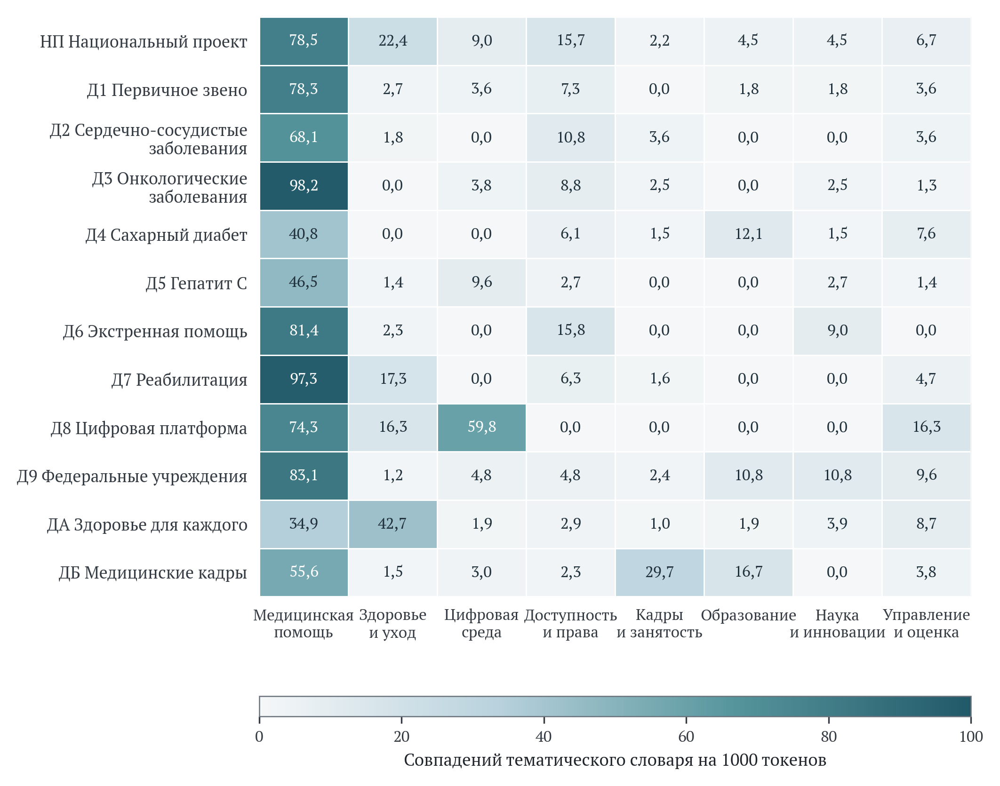

[B355; Caption] Рисунок 15 – Тематические акценты национального и федеральных паспортов

[B356; ] Примечание. Знаменатель – токены содержательных формулировок целей, задач, результатов и показателей. Показаны восемь из 18 тематик. Совпадения между тематиками могут пересекаться. Частоты не являются долями бюджета или оценкой результативности. Ноль означает отсутствие словарного совпадения. [Сноски 124]

[B357; ] Контекстная проверка существенно уточняет механическое прочтение частот. В категории демографии и семьи обнаружены лишь два совпадения, однако одно относится к семейной медицине, другое – к демографическим особенностям регионов. Они не означают двух мероприятий семейной политики. Аналогично слово «здоровье» входит в название цифровой платформы и в формулировки восстановления здоровья. Поэтому всю частоту категории здоровья и ухода нельзя приписывать профилактике или изменению образа жизни. Смысловая проверка характерных совпадений приведена в таблице 11. [Сноски 125]

[B358; Caption] Таблица 11 – Контекстные ограничения тематического словаря

[TABLE 11; B359]
Категория | Характерный контекст | Содержательное ограничение
Демография и семья | Семейная медицина в первичном звене, демографические особенности регионов в сердечно-сосудистом направлении | Совпадения не измеряют объём семейной политики
Здоровье и уход | Название платформы «Здоровье», восстановление здоровья в реабилитации | Частота включает несколько значений и не равна частоте мероприятий по здоровому образу жизни
Образование и молодёжь | Школы пациентов, обучение медицинских работников, образовательные организации с клиниками | Необходимо различать обучение пациентов, подготовку кадров и организационную принадлежность
Образование и молодёжь | Административно-территориальные образования | Совпадение основы слова не имеет образовательного содержания

[B360; ] Примечание. Примеры основаны на чтении контекстов совпадений. Числовые частоты на рисунке сохранены в исходном определении словаря и интерпретируются с учётом указанных ограничений. [Сноски 126]

[B361; ] Образовательная лексика также неоднородна. В диабетологическом направлении она связана, в частности, со школами для пациентов, в кадровом – с профессиональной подготовкой медицинских работников. Упоминание образовательных организаций в проекте федеральных учреждений может обозначать организационную принадлежность клиники. Наконец, совпадение по основе «образован» возможно в словосочетании «административно-территориальные образования». Поэтому объединённую категорию образования и молодёжи нельзя без дополнительного кодирования интерпретировать как направленность мероприятий на детей или молодёжь. Различение адресатов требует анализа конкретной формулировки, а при необходимости – отдельного специализированного словаря. [Сноски 127]

[B362; ] Нулевое значение у отдельной тематики означает отсутствие совпадений с принятым словарём в выбранном профиле. Оно не устанавливает отсутствия соответствующей деятельности во всей системе здравоохранения. Для категорий культуры или туризма нулевые значения в рассматриваемом массиве вообще не образуют самостоятельного содержательного недостатка проекта. Проверять пробелы следует по отношению к его цели и полномочиям. Если значимое условие результата относится к другому национальному проекту, предметом экспертизы становится согласование ответственности и взаимодействия. Изолированное требование повысить частоту определённых слов не улучшило бы механизм реализации.

[B363; ] Для дальнейшего мониторинга наиболее полезны тематические различия, которые указывают на необходимость проверки реального взаимодействия. Отдельно выраженные цифровая и кадровая функции должны поддерживать клинические направления, даже если их языковые профили существенно различаются. Преобладание медицинской лексики в реабилитации следует сопоставлять с тем, насколько показатели отражают восстановление функций и повседневной самостоятельности. Выраженность профилактической лексики у проекта «Здоровье для каждого» позволяет поставить вопрос о переходе от охвата информационными и диагностическими действиями к устойчивому изменению поведения. Ответы требуют содержательных и статистических данных, а частоты помогают обоснованно выбирать участки для такого исследования.

[B364; Heading2] Отличительные формулировки, межпроектная близость и устойчивость выводов

[B365; ] Метод TF-IDF выявляет формулировки, относительно характерные для документа в сравнении с другими текстами. Частое употребление внутри документа увеличивает вес термина, распространённость во всём корпусе уменьшает его отличительность. Термином в данном анализе является отдельное слово или пара последовательных слов. Подход позволяет совместно учитывать общие тематические слова и более конкретные сочетания. Его результат характеризует словоупотребление. Высокий вес не равнозначен большей общественной потребности, а низкий вес часто встречающегося медицинского термина не означает малой клинической важности обозначаемого явления. [Сноски 128]

[B366; ] Весовая модель построена на 137 документах: 86 электронных паспортах, четырёх электронных правовых публикациях, 43 документах PDF и четырёх архивных текстах по проекту «Семья». Различия жанров существенны для интерпретации. Общий корпус задаёт сравнительный словарь и частоты распространения терминов. Непосредственное сопоставление современных национальных проектов проводится по однотипным электронным паспортам. Тем самым длинные презентации и повторяющиеся страницы приложений не получают преимущества в проектных профилях за счёт своего объёма. Полностью устранить влияние состава сравнительного корпуса такая процедура не позволяет: при добавлении новых документов изменяются обратные документные частоты.

[B367; ] Текст приводится к нижнему регистру, «ё» и «е» рассматриваются одинаково, технические различия пробелов устраняются. Учитываются буквенные последовательности длиной не менее двух символов, включая слова с дефисом. Для TF-IDF исключается заданный набор служебных слов. Используются униграммы и биграммы, а итоговый словарь ограничен 20 000 признаками. Допускается термин, встречающийся хотя бы в одном документе, но исключаются термины, присутствующие более чем в 98% документов. В основной модели сохраняются словоформы. Наличие отдельных признаков «лечения» и «лечению» поэтому является свойством метода и учитывается при проверке устойчивости.

[B368; ] (4)

[Формула] wₜd = (1 + ln tfₜd) × [1 + ln((N + 1)/(dfₜ + 1))], tfₜd > 0; иначе wₜd = 0

$$
w_{td}=(1+\ln tf_{td})\left[1+\ln\frac{N+1}{df_t+1}\right],\quad tf_{td}>0
$$

[B369; ] Вес определён для термина, встречающегося в документе: tfₜd > 0. При отсутствии термина wₜd = 0. Состав обозначений и параметры модели раскрыты ниже.

[B370; ] В формуле tf(t,d) обозначает число употреблений термина t в документе d, df(t) – число документов с этим термином, N = 137. Логарифмическое преобразование частоты уменьшает преимущество многократно повторяющихся формулировок. Сглаживание обратной документной частоты добавлением единицы к числителю и знаменателю стабилизирует оценку редких терминов. При отсутствии термина в документе его вес принимается равным нулю. Затем вектор весов нормируется по евклидовой длине. [Сноски 129]

[B371; ] (5)

[Формула] v_d = w_d / ‖w_d‖₂

$$
v_d=\frac{w_d}{\lVert w_d\rVert_2}
$$

[B372; ] Нормировка ненулевого вектора весов по евклидовой длине.

[B373; ] Нормировка переводит каждый документ к единичной длине вектора. Поэтому сравнение преимущественно отражает соотношение терминов и не сводится к сравнению длины текстов. Для двух нормированных векторов косинусная близость равна сумме произведений весов соответствующих терминов. В используемом неотрицательном пространстве значение находится между нулём и единицей. Единица соответствует совпадению направления векторов, ноль – отсутствию общих признаков. Коэффициент не является процентом совпадающих смыслов или оценкой вероятности межведомственного взаимодействия. [Сноски 130]

[B374; ] (6)

[Формула] cos(d, e) = (v_d · v_e) / (‖v_d‖ × ‖v_e‖)

$$
\cos(d,e)=\frac{v_d\cdot v_e}{\lVert v_d\rVert\lVert v_e\rVert}
$$

[B375; ] Для векторов единичной длины знаменатель равен 1, а косинусная близость совпадает со скалярным произведением.

[B376; ] Пятнадцать наиболее весомых признаков национального паспорта представлены на рисунке 16. Ведущие позиции занимают «пациентов» – 0,0997, «медицинской» – 0,0876, «лечения» – 0,0848 и «лечению» – 0,0836. Далее следуют сочетание диагностики и лечения, упоминания сахарного диабета, здорового образа жизни и сердечно-сосудистых заболеваний. Сочетание лечебной и профилактической лексики выражено уже в национальном профиле. При этом его объём составляет 446 токенов, поэтому изменение нескольких содержательных формулировок способно заметно переставить близкие по весу признаки. Различия третьего десятичного знака не дают основания для содержательного ранжирования задач.

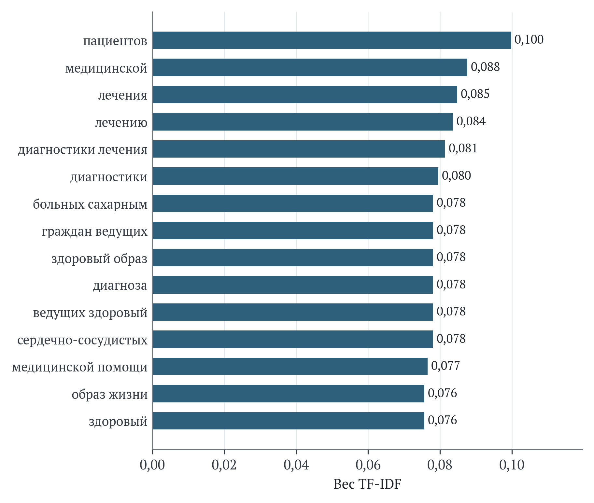

[B378; Caption] Рисунок 16 – Отличительные термины национального паспорта

[B379; ] Примечание. 15 ведущих униграмм и биграмм. Содержательный профиль национального паспорта включает 446 токенов, словарь TF-IDF построен по 137 документам. Вес отражает отличительность формулировки в корпусе и не измеряет приоритет общественной задачи. [Сноски 131]

[B380; ] Предметный акцент на пациенте согласуется с построением проекта вокруг доступности, диагностики и лечения. Однако один этот факт не доказывает, что система управления ориентирована на индивидуальный опыт получения помощи. Для такого вывода потребовались бы данные о непрерывности маршрута, понятности назначений, времени ожидания, функциональных результатах и оценках самих пациентов. Текстовый профиль фиксирует язык целей и инструментов. Он полезен для проверки согласованности терминологии и выявления смешения понятий, но не заменяет оценку качества взаимодействия медицинской организации с человеком.

[B381; ] Внутрипроектная матрица на рисунке 17 показывает наиболее высокую близость между сердечно-сосудистым и онкологическим направлениями – 0,375. Среди связей национального паспорта выделяется цифровая платформа – 0,310. Значения для онкологии и реабилитации составляют 0,283, для национального паспорта и диабетологического направления – 0,275. Эти результаты следует объяснять общими предметными и административными формулировками. Сходство клинических направлений не свидетельствует о дублировании их задач, поскольку адресаты помощи, заболевания и технологии существенно различаются. Невысокая близость с кадровым или профилактическим направлением также совместима с их необходимой дополняющей функцией.

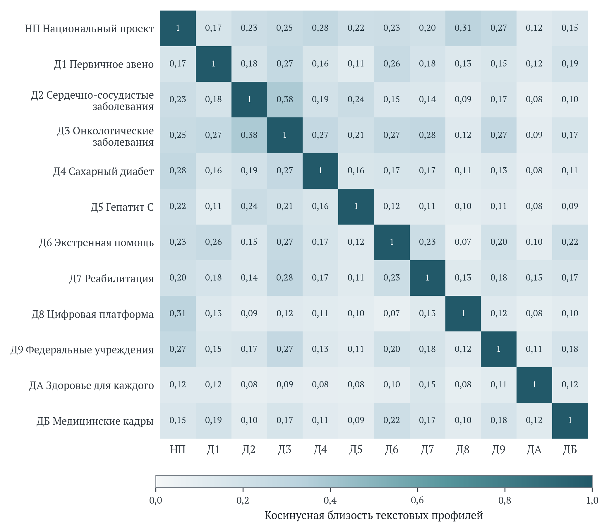

[B383; Caption] Рисунок 17 – Лексическая близость паспортов внутри национального проекта

[B384; ] Примечание. Косинусная близость рассчитана по униграммам и биграммам с весами TF-IDF. Значение 1 на диагонали означает совпадение документа с самим собой. Коэффициент не является долей общего содержания или оценкой координации исполнителей. [Сноски 132]

[B385; ] Отдельный проектный профиль формируется усреднением нормированных векторов его паспортов с последующей нормировкой полученного среднего. Такая процедура придаёт каждому паспорту одинаковый исходный вес, независимо от длины документа. Следовательно, результат выражает средний язык проектных компонентов. Он не взвешен по численности получателей, бюджетным расходам или ожидаемому вкладу в здоровье. Для межпроектного рисунка использованы девять сопоставимых проектов. Архивный профиль «Семьи» отличается по жанру исходного текста и потому исключён из этого сравнения. Его коэффициент нельзя включать в единый рейтинг без приведения документов к сопоставимому основанию.

[B386; ] В основной модели наибольшая близость к проекту «Продолжительная и активная жизнь» наблюдается у «Экономики данных и цифровой трансформации государства» – 0,201, «Молодёжи и детей» – 0,182, «Эффективной и конкурентной экономики» – 0,157. Далее следуют «Инфраструктура для жизни» – 0,152 и «Кадры» – 0,138. Подобный порядок отражает распределение лексики в выбранных профилях. Он не устанавливает порядок важности межпроектных связей для увеличения продолжительности жизни. Например, значение кадровой обеспеченности нельзя уменьшать на основании того, что словообразовательные и организационные формулировки двух проектов совпадают реже.

[B387; ] Проверка чувствительности выполнена с русским стеммингом Snowball. Стемминг объединяет часть форм слова посредством удаления изменяемых окончаний и суффиксов. Полноценного определения словарной формы и значения слова он не выполняет. Все остальные параметры TF-IDF и принцип формирования проектных профилей сохраняются. На рисунке 18 представлены результаты двух вариантов нормализации. После стемминга коэффициенты для трёх ближайших проектов возрастают соответственно до 0,236, 0,222 и 0,203. Состав и порядок тройки остаются прежними. Индекс Жаккара её состава равен единице: набор из трёх проектов совпадает полностью. [Сноски 133]

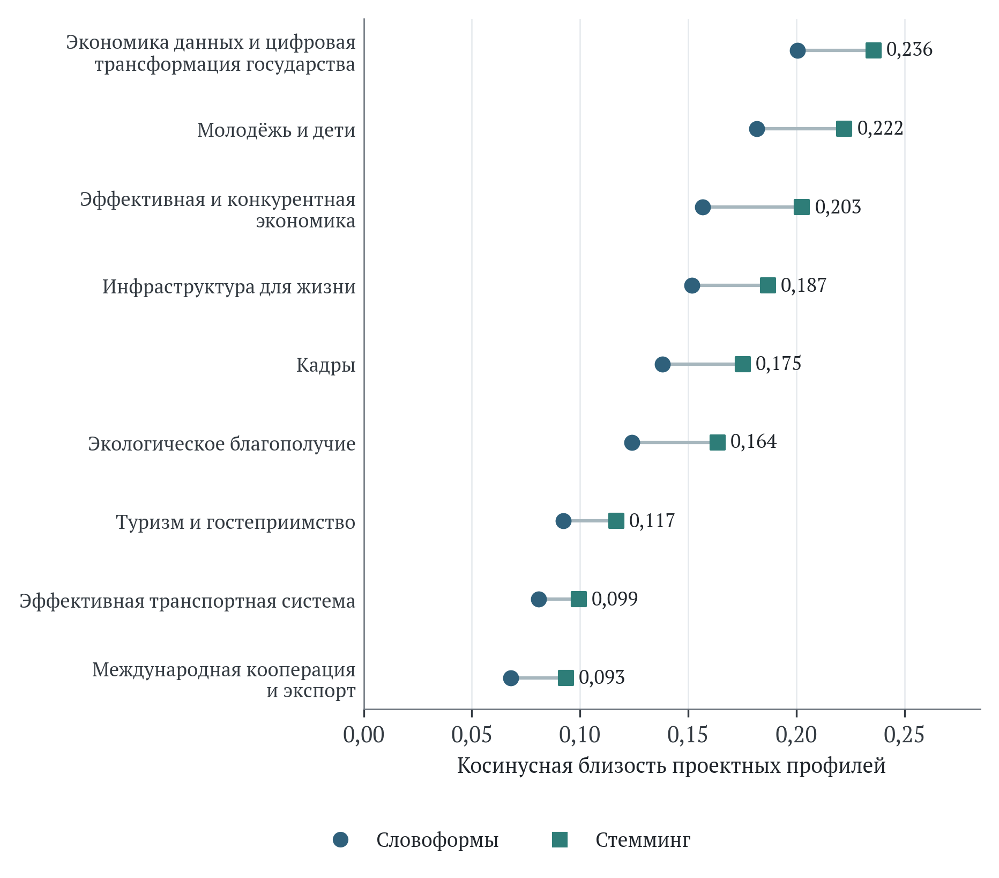

[B389; Caption] Рисунок 18 – Устойчивость межпроектной лексической близости к нормализации словоформ

[B390; ] Примечание. Сопоставлены девять других проектов с однотипными электронными паспортами. Профиль каждого проекта – средний нормированный вектор его паспортов. Архивный профиль «Семьи» исключён из рисунка ввиду отличия жанра. Тройка ближайших проектов сохраняется после русского стемминга. [Сноски 134]

[B391; ] Сохранение порядка девяти сопоставляемых проектов показывает устойчивость данного результата к одному конкретному преобразованию словоформ. Оно не проверяет устойчивость к смене жанров, редакций документов, тематического словаря или способа агрегирования. Увеличение коэффициентов после стемминга ожидаемо при объединении раздельно учитываемых форм и не означает улучшения содержательной координации. Для последующего наблюдения необходимо сохранять одинаковые правила сравнения, а при их изменении пересчитывать весь сопоставляемый массив. Иначе методическое изменение может быть ошибочно принято за содержательное сближение государственных программ.

[B392; ] Разложение косинусной близости по общим признакам помогает объяснить результат. При сравнении с цифровой экономикой заметный вклад дают слова, относящиеся к системам, технологиям, информации и данным. Одновременно участвуют общие административные формулировки об организациях, обеспечении и долях. В сравнении с проектом «Молодёжь и дети» среди ведущих общих признаков присутствуют организации, помощь, деятельность и регионы. Для проекта «Кадры» существенны граждане, население, потребность и региональная принадлежность. Поэтому лексический результат соединяет содержательное родство с общностью языка государственного планирования. Представлять его как автоматически установленную межотраслевую причинную зависимость нельзя.

[B393; ] Управленческая ценность проведённого анализа состоит в уточнении требований к согласованности проекта. Для каждого существенного мероприятия следует однозначно определить адресованный показатель, описать наблюдаемый промежуточный переход и обозначить границы ответственности смежных исполнителей. Для весовых матриц необходимо раскрывать основание дифференциации и отделять экспертные оценки от измеренных эффектов. Для содержательной проверки текстов полезно развивать словари конкретных пациентских потребностей, сохраняя обязательное чтение контекстов. Совместное применение этих подходов позволяет превратить формальную полноту паспортов в проверяемую логику достижения результатов, при которой причины отклонений становятся предметом содержательного разбора.

[B394; Heading1] Направления совершенствования и оценка дополнительного эффекта

[B395; Heading2] Согласование показателей и ответственности

[B396; ] Первое направление совершенствования – единая семантика показателей. Для каждого индикатора необходима публичная карточка с определением числителя и знаменателя, правилами включения пациента, периодом наблюдения, территориальной принадлежностью, источником, датой действия методики и правилами пересмотра. Такая карточка должна связывать годовую статистику, оперативную отчётность и паспортную цель. При изменении методики следует публиковать сопоставимый пересчёт либо явно отмечать разрыв ряда.

[B397; ] Наиболее срочная задача – согласование годового и оперативного наблюдения сахарного диабета. Различие значений не может быть устранено выбором наиболее благоприятного результата. Требуется проверить целевую совокупность, источник сведений, полноту регистрации и круг организаций. До завершения такой сверки корректно представлять оба вида наблюдения раздельно и воздерживаться от вывода о величине годового прироста по смешанному ряду.

[B398; ] Второе направление – согласование редакций целей. Нормативный ориентир, действующая редакция паспорта и ранее опубликованный план должны иметь видимый статус. Изменение цели может быть обоснованным управленческим решением, однако оценка достижения должна сохранять историю этого решения. Пересмотр плана после наблюдения результата без раскрытия основания затрудняет различение реального прогресса и изменения критерия оценки.

[B399; ] Третье направление – ответственность за переходы между этапами помощи. Заказчик результата должен быть определён не только для строительства, закупки и оказания отдельной услуги, но и для завершения маршрута. После выписки необходимо установить, кто подтверждает получение информации первичным звеном, обеспечивает последующее наблюдение и реагирует на пропущенное посещение. Для этого достаточно ограниченного числа контрольных событий, если они фиксируются единообразно и используются для организации помощи.

[B400; Caption] Таблица 12 – Приоритетные изменения системы управления и способы проверки

[TABLE 12; B401]
Установленная проблема | Предлагаемое решение | Критерий проверки
Различия годового и оперативного наблюдения | Согласовать определения, источники и правила перехода между периодами | Сопоставимые совокупности; опубликованная таблица перехода или объяснённый разрыв
Несогласованность национального и федеральных финансовых итогов в опубликованных паспортах | Публиковать сверочный баланс состава мероприятий, правил учёта и утверждённых изменений | Арифметическое согласование и открытая история изменений
Снижение охвата последующим наблюдением по отдельным направлениям | Установить ответственного за завершение маршрута после лечения | Доля завершённых маршрутов и причины потери контакта
Кадровая обеспеченность слабо отражает доступность конкретной помощи | Дополнить численность занятыми ставками, нагрузкой и временем ожидания | Улучшение доступности по дефицитным специальностям и территориям
Преобладание объёмов помощи в измерении восстановления | Ввести исходы самостоятельности и участия для определённых групп | Изменение функционального состояния с учётом исходной тяжести
Неясный вклад цифровизации и организационных мер | Связать внедрение с конкретной проблемой маршрута и сравнением | Сокращение задержек и потерь пациентов без роста нагрузки на персонал

[B402; ] Примечание. Экспертные предложения основаны на результатах документального, статистического и финансового анализа, представленных в соответствующих разделах отчёта.

[B403; ] Регулярное рассмотрение проекта должно различать несколько ситуаций. Выполнение мероприятий при отсутствии ожидаемого промежуточного изменения указывает на необходимость проверить механизм воздействия и соответствие целевой группе. Недостижение результата при неполной готовности ресурсов требует устранить установленное ограничение. Улучшение показателей при изменившемся составе учёта предполагает сначала оценить сопоставимость наблюдений. Различение этих случаев помогает выбирать между организационной доработкой, перераспределением ресурсов и пересмотром исходной гипотезы мероприятия. Универсальная реакция в виде увеличения объёма того же действия не обеспечивает содержательной корректировки.

[B404; ] Предлагаемые изменения не требуют механического наращивания числа обязательных показателей. Часть технических индикаторов может оставаться на уровне оперативного управления, тогда как публичная оценка должна концентрироваться на доступности, качестве, непрерывности и исходах. Приоритет имеет устранение неоднозначности уже действующих измерений. Сбор новых сведений целесообразен тогда, когда заранее определено решение, которое будет принято на их основе.

[B405; Heading2] Адресность ресурсов и территориальная справедливость

[B406; ] Картограммы кадровой обеспеченности обосновывают необходимость адресного решения, но не заменяют оценку потребности. Одинаковое число специалистов на десять тысяч жителей может сочетаться с различной возрастной структурой, расселением, транспортной доступностью, межрегиональными потоками и ролью федеральных центров. Поэтому федеральная поддержка должна учитывать сочетание дефицита ресурсов и неудовлетворённой потребности, а не одно место региона в ранжированном списке.

[B407; ] Для кадрового планирования предлагается согласованный набор сведений: физические лица, занятые ставки, совместительство, вакантные должности, фактическая нагрузка, распределение по специальностям и устойчивость закрепления. Рост общего числа работников при концентрации в крупных городах не обеспечивает доступность в малых поселениях. Отдельно требуется анализ среднего медицинского персонала: усиление врачебного звена при сохранении дефицита исполнителей последующего ухода может ограничить полезный эффект всей команды.

[B408; ] Для инфраструктуры исходной единицей планирования целесообразно считать зону доступности помощи. До капитальных вложений следует проверить потенциальный поток пациентов, транспортное время, кадровое обеспечение, обслуживание оборудования и действующие маршруты направления. Если основной барьер связан с доставкой пациента или графиком работы, дополнительное здание может оказаться менее результативным решением, чем организационное изменение. Выбор требует сравнения нескольких осуществимых вариантов с полной стоимостью эксплуатации.

[B409; ] Перераспределение ресурсов следует оценивать также по риску ухудшения доступа у других групп. Концентрация сложной помощи может повышать качество, одновременно увеличивая транспортные издержки и задержки. Управленческое решение должно учитывать оба эффекта и предусматривать компенсацию барьеров. Для удалённых территорий это означает согласование очной, выездной и дистанционной помощи с понятным порядком перехода к необходимому очному вмешательству.

[B410; ] Федеральные средние следует сопровождать распределениями по территориям и группам населения. В публичном мониторинге целесообразно показывать не только изменение среднего значения, но и нижней части распределения, разброса и различий по полу, возрасту и типу поселения. Такое представление позволяет проверить, становится ли помощь доступнее там, где исходное положение было неблагоприятным. Оно также снижает риск признать успешной программу, улучшение которой сосредоточено преимущественно в уже обеспеченных территориях.

[B411; Heading2] Независимая оценка дополнительного эффекта

[B412; ] Для следующего этапа оценки предлагается переход от общего сопоставления «до – после» к исследованиям отдельных мер. Единица вмешательства должна быть конкретной: изменение маршрута, внедрение технологии, расширение лекарственного обеспечения или усиление кадровой команды. Для каждой меры заранее определяются целевая группа, начало воздействия, сравниваемая практика, основной исход, срок наблюдения и предполагаемые альтернативные объяснения. Именно такая определённость делает результат пригодным для решения о продолжении или изменении меры.

[B413; ] При использовании административных данных целесообразно заранее описывать исследование как условное целевое испытание: критерии включения, сравниваемые стратегии, исходный момент, порядок наблюдения и анализ. Это помогает избежать ситуации, в которой участие в программе определяется после начала периода, используемого для оценки исходов. Подход не устраняет неизмеренное смешение автоматически, но делает предпосылки и потенциальные смещения явными. [Сноски 135]

[B414; ] (7)

[Формула] ATT = E[Y(1) − Y(0) | D = 1]

$$
ATT=E[Y(1)-Y(0)\mid D=1]
$$

[B415; ] ATT – средний дополнительный эффект для участников меры; Y(1) и Y(0) – потенциальные исходы при участии и при отсутствии участия; D = 1 обозначает участников. Для одного человека одновременно наблюдается только один из двух исходов. Формула задаёт предмет будущей оценки; численное значение ATT по имеющимся агрегатам не установлено.

[B416; ] Для поэтапного внедрения организационных решений возможно сравнение территорий или медицинских организаций, начавших изменение в разное время. Однако административный график не является случайным: первыми могут включаться наиболее готовые либо наиболее проблемные учреждения. Поэтому требуется анализ исходных различий и предшествующих траекторий, учёт отбора и проверка устойчивости результата. Для сравнения изменений необходимы обоснование сопоставимости предшествующих тенденций, отсутствие упреждающего воздействия и оценка возможного переноса эффекта на группу сравнения. При различном времени запуска следует избегать механического объединения уже получивших воздействие и ещё не включённых организаций без соответствующей модели.

[B417; ] Для мер с определённой датой запуска и достаточно длинной историей наблюдения применим прерванный временной ряд. Предварительно задаются ожидаемое изменение уровня или тенденции, лаг эффекта и возможные сопутствующие события. Анализ должен учитывать сезонность, автокорреляцию и изменения определения показателя; контрольный ряд помогает оценить альтернативные объяснения. В данном проекте такой дизайн следует применять к конкретному вмешательству и пригодному ряду, а не ко всем оперативным индикаторам одновременно. [Сноски 136]

[B418; ] Результаты должны представляться вместе с неопределённостью: доверительными интервалами, чувствительностью к допущениям, полнотой наблюдения и потерями пациентов. Статистическая значимость не заменяет содержательной важности. Небольшое улучшение при большом числе наблюдений может быть статистически убедительным, но недостаточным для оправдания дорогостоящего решения; существенное потенциальное улучшение при малой выборке может требовать дальнейшего исследования.

[B419; ] Экономическая оценка должна сопоставлять дополнительную стоимость и дополнительный результат относительно осуществимой альтернативы. В расходы включаются не только первоначальные вложения, но и персонал, расходные материалы, обслуживание, замена оборудования и связанные изменения объёма помощи. Горизонт анализа должен соответствовать длительности последствий. Рекомендации CHEERS 2022 полезны для прозрачного представления таких исследований; они не являются шкалой качества программы или автоматическим правилом принятия решения. [Сноски 137]

[B420; ] (8)

[Формула] ICER = (C₁ − C₀) / (E₁ − E₀)

$$
ICER=\frac{C_1-C_0}{E_1-E_0}
$$

[B421; ] ICER – отношение дополнительных затрат к дополнительному результату; C₁ и C₀ – затраты при новой и сравниваемой практике; E₁ и E₀ – соответствующие результаты. Единица результата задаётся содержательно. При нулевом или отрицательном знаменателе требуется раздельный анализ затрат и исходов. Порог приемлемости не устанавливается произвольно.

[B422; ] Плановый бюджет национального проекта нельзя делить на наблюдаемое изменение ожидаемой продолжительности жизни и называть полученное отношение стоимостью дополнительного года жизни. Это смешало бы расходы различного назначения, общий демографический результат и неустановленный причинный вклад. Экономическая оценка начинается с конкретной меры и корректного сравнения; агрегирование возможно после проверки совместимости эффектов и отсутствия двойного счёта.

[B423; Caption] Таблица 13 – Приоритетные направления самостоятельных исследований эффекта

[TABLE 13; B424]
Мера | Предмет сравнения | Основной результат и условия
Маршрутизация при острых сердечно-сосудистых событиях | Организации с различным временем введения согласованного маршрута | Время до необходимой помощи; исходы после события с учётом тяжести и полноты наблюдения
Сопровождение после онкологического лечения | Прежняя практика и активное приглашение с контролем завершения плана | Завершение наблюдения; задержки; последующие клинические исходы
Расширение помощи при сахарном диабете | Сопоставимые пациенты при одинаковых критериях включения | Устойчивость контроля и осложнения; согласованность годовой и оперативной регистрации
Реабилитационная программа | Осуществимые варианты организации помощи для сопоставимых групп | Функциональное восстановление и его сохранение; затраты полного цикла
Кадровые меры в дефицитных территориях | Территории с различным временем и интенсивностью поддержки | Удержание работников; время ожидания; доступность конкретных специальностей
Цифровое сопровождение маршрута | Сопоставимые подразделения до и после внедрения с контрольной группой | Потери пациентов между этапами; повторные действия; время персонала

[B425; ] Примечание. Предлагаемые дизайны требуют индивидуальных либо организационных данных и предварительной проверки условий идентификации. Таблица не содержит оценок уже доказанного эффекта.

[B426; Heading2] Последовательность совершенствования проекта

[B427; ] Первый этап целесообразно ограничить устранением препятствий для достоверной оценки: согласованием определений, периодов, редакций целей и финансовых агрегатов. Это позволяет получить надёжную основу управленческих решений без длительного ожидания новых клинических исходов. Одновременно следует выбрать несколько маршрутов, на которых сочетание динамики показателей указывает на возможные нарушения непрерывности сопровождения.

[B428; ] Практическим инструментом может служить матрица готовности крупных мероприятий. Для каждой планируемой мощности в ней фиксируются потребность населения, помещение, оборудование, штат, расходные материалы, разрешительные условия, источник оплаты помощи и возможность последующего направления. Ответственные подтверждают состояние каждого элемента к дате запуска. Отсутствие критически необходимого компонента становится основанием для корректировки плана, а не только предметом последующего объяснения низкой загрузки. Проверку следует повторять после начала эксплуатации, поскольку фактический объём помощи может отличаться от расчётной мощности.

[B429; ] Второй этап – апробация изменений в организациях и территориях с различными условиями. Набор участников должен включать крупные центры, малые города и удалённые районы, если мера предназначена для их обслуживания. Оценке подлежат не только результаты для пациента, но и выполнимость: трудозатраты персонала, устойчивость информационного обмена, доступность необходимых специалистов и расходы после окончания пилотной поддержки.

[B430; ] Третий этап – распространение тех решений, для которых подтверждены полезный эффект, приемлемая стоимость и воспроизводимость в других условиях. Решение о расширении должно учитывать возможность неблагоприятных последствий и предусматривать пересмотр. Такой порядок позволяет связать совершенствование паспорта с доказательствами, полученными в реальной системе помощи.

[B431; Caption] Таблица 14 – Предлагаемая последовательность управленческих решений

[TABLE 14; B432]
Этап | Основная работа | Условие перехода
Согласование измерения | Проверка методик, знаменателей, редакций целей и финансовых итогов; определение ответственных за маршруты | Подписанные межведомственные правила сопоставления и открытое описание изменений
Апробация | Ограниченный набор мер в различных территориальных условиях; заранее определённые исходы и сравнение | Достаточная полнота наблюдения; оценка выполнимости и дополнительных затрат
Расширение и пересмотр | Расширение результативных решений; адаптация финансирования и контроль устойчивости | Подтверждение результата после расширения; отсутствие ухудшения доступа у уязвимых групп

[B433; ] Примечание. Последовательность является экспертным предложением. Конкретные сроки и состав участников определяются после согласования полномочий, данных и ресурсов.

[B434; Heading1] Заключение

[B435; ] Экспертиза национального проекта «Продолжительная и активная жизнь» подтверждает содержательную значимость объединения профилактики, лечения, реабилитации и обеспечивающих функций в единую систему государственного воздействия. В паспортах представлены инструменты для основных этапов помощи, а система показателей содержит как характеристики объёма, так и отдельные клинические исходы. Дальнейшее развитие проекта следует связывать с тем, насколько согласованно эти инструменты действуют в отношении одних и тех же людей и территорий.

[B436; ] Наиболее существенный управленческий вывод относится к непрерывности помощи. Наблюдаемое улучшение отдельных показателей стационарного лечения сочетается с менее благоприятной динамикой последующего наблюдения. Эта ситуация требует самостоятельного разбора переходов после выписки и завершения лечения. Ответственность за приглашение пациента, обмен информацией, доступность назначений и подтверждение завершённого действия должна быть столь же определённой, как ответственность за создание объекта или выполнение отдельной услуги.

[B437; ] Второй вывод связан с содержанием активной и здоровой жизни. Продолжительность жизни, самооценка здоровья и функциональная самостоятельность описывают разные стороны общественного результата. Их согласованное наблюдение позволит оценивать, сопровождается ли увеличение длительности жизни сохранением возможностей человека. В реабилитации и сопровождении пациентов с высокой потребностью необходимо дополнить объём помощи исходами восстановления и устойчивости функций.

[B438; ] Третий вывод относится к качеству измерения. Различия знаменателей, годовой и оперативной отчётности, редакций целей и территориального охвата способны существенно менять управленческую интерпретацию одного и того же числа. Поэтому совершенствование мониторинга начинается с согласования уже существующих определений и раскрытия пересмотров. Установление сопоставимости имеет приоритет перед расширением набора индикаторов и построением сводных рейтингов.

[B439; ] Территориальный анализ показывает необходимость совместно рассматривать врачебное и сестринское звено, фактическую нагрузку, специальности и пространственную доступность. Общероссийские средние недостаточны для определения адресатов поддержки. Решения должны опираться на неудовлетворённую потребность и ограничения конкретного маршрута. Применённая многомерная диагностика одновременно показывает пределы механического объединения неоднородных показателей: формально полученные группы не обладают достаточной устойчивостью для распределения ресурсов.

[B440; ] Финансовая структура усиливает значение согласованности ресурсов. Крупные планы в инфраструктуре и специализированном лечении требуют своевременной подготовки кадров, текущего финансирования и условий эксплуатации. Значительная доля средств в конце горизонта означает, что часть долгосрочных результатов должна наблюдаться и после завершения инвестиционных мероприятий. Расхождение национального и федеральных финансовых агрегатов подлежит отдельной документальной сверке; по опубликованным планам нельзя установить его причину или делать вывод об исполнении средств.

[B441; ] Документальный и лингвистический анализ позволяет точнее сформулировать требования к проектной логике. Общая задача, одинаковая терминология и наличие весовой матрицы устанавливают способы описания взаимосвязей. Для решения о результативности необходимы наблюдаемый промежуточный переход, определённая группа получателей и эмпирическое подтверждение изменения. Совместное использование документального чтения, статистики и анализа языка полезно именно при сохранении этих различий.

[B442; ] Практическая перспектива совершенствования проекта заключается в переходе к проверяемым решениям по конкретным маршрутам и мерам. Для каждой значимой корректировки следует заранее определять результат, сравниваемую практику, срок наблюдения, дополнительные затраты и условия распространения. Оценка должна учитывать неопределённость, различия между группами населения и устойчивость достигнутого изменения. Это создаёт основания для последовательного повышения общественной отдачи национального проекта и для более точной связи его мероприятий с продолжительной и активной жизнью граждан.

# Сноски и источники

[1] Министерство здравоохранения Российской Федерации. Показатели сердечно-сосудистой и онкологической помощи // ЕМИСС. Государственная статистика : электронная база данных. Показатели № 62954, 62956, 62947, 62948, 62952, 62953. Режим доступа: https://www.fedstat.ru/indicator/62954; https://www.fedstat.ru/indicator/62956; https://www.fedstat.ru/indicator/62947; https://www.fedstat.ru/indicator/62948; https://www.fedstat.ru/indicator/62952; https://www.fedstat.ru/indicator/62953 (дата обращения: 15.10.2026).
Министерство здравоохранения Российской Федерации. Полнота диспансерного наблюдения, лекарственное обеспечение и удовлетворённость медицинской помощью // ЕМИСС. Государственная статистика : электронная база данных. Показатели № 62930, 62946, 62951, 62914. Режим доступа: https://www.fedstat.ru/indicator/62930; https://www.fedstat.ru/indicator/62946; https://www.fedstat.ru/indicator/62951; https://www.fedstat.ru/indicator/62914 (дата обращения: 15.10.2026).

[2] Министерство здравоохранения Российской Федерации. Методика расчёта показателя «Ожидаемая продолжительность здоровой жизни, лет» национального проекта «Продолжительная и активная жизнь» : утв. 21.02.2025. П. 3, 6, 10–13 // База НПА : публикация текста документа. Режим доступа: https://bazanpa.ru/minzdrav-rossii-metodika-ot21022025-h6680264/ (дата обращения: 28.10.2026).

[3] Министерство здравоохранения Российской Федерации. Обеспеченность населения средними медицинскими работниками, работающими в медицинских организациях, участвующих в реализации программы государственных гарантий бесплатного оказания гражданам медицинской помощи, на 10 тыс. населения // ЕМИСС. Государственная статистика : электронная база данных. Показатель № 62970. Значения и методические пояснения. Режим доступа: https://www.fedstat.ru/indicator/62970 (дата обращения: 15.10.2026).
Министерство здравоохранения Российской Федерации. Обеспеченность населения врачами, работающими в медицинских организациях, участвующих в реализации программы государственных гарантий бесплатного оказания гражданам медицинской помощи, на 10 тыс. населения // ЕМИСС. Государственная статистика : электронная база данных. Показатель № 62971. Значения и методические пояснения. Режим доступа: https://www.fedstat.ru/indicator/62971 (дата обращения: 15.10.2026).

[4] Продолжительная и активная жизнь : паспорт национального проекта. Редакция 26.40, публикация сведений от 16.10.2026 // DataBudget.ru. Раздел «Финансовое обеспечение», 2025–2030 гг. Режим доступа: https://databudget.ru/projects/np/17 (дата обращения: 19.10.2026).

[5] Паспорт федерального проекта «Борьба с сердечно-сосудистыми заболеваниями» [электронный ресурс]. 230 с. Дополнительные и обосновывающие материалы, разд. 1 «Оценка влияния мероприятия (результата) на достижение показателей федерального проекта», с. 1–2 (с. 182–183 электронной публикации) // НИИ кардиологии Томского НИМЦ. Режим доступа: https://www.cardio.ru/wp-content/uploads/pasport_fd_bssz.pdf (дата обращения: 28.10.2026).

[6] Donabedian A. The Quality of Care: How Can It Be Assessed? // JAMA. 1988. Vol. 260, no. 12. P. 1743–1748. DOI: 10.1001/jama.1988.03410120089033. Режим доступа: https://doi.org/10.1001/jama.1988.03410120089033 (дата обращения: 28.10.2026).

[7] Skivington K., Matthews L., Simpson S. A. et al. A new framework for developing and evaluating complex interventions: update of Medical Research Council guidance // BMJ. 2021. Vol. 374. Art. n2061. DOI: 10.1136/bmj.n2061. Режим доступа: https://www.bmj.com/content/374/bmj.n2061 (дата обращения: 28.10.2026).

[8] Министерство здравоохранения Российской Федерации. Методика расчёта показателя «Ожидаемая продолжительность жизни при рождении, лет» национального проекта «Продолжительная и активная жизнь» : утв. 21.02.2025. П. 10 // База НПА : публикация текста документа. Режим доступа: https://bazanpa.ru/minzdrav-rossii-metodika-ot21022025-h6680305/ (дата обращения: 28.10.2026).

[9] Министерство здравоохранения Российской Федерации. Методика расчёта показателя «Ожидаемая продолжительность здоровой жизни, лет» национального проекта «Продолжительная и активная жизнь» : утв. 21.02.2025. П. 3, 6, 10–13 // База НПА : публикация текста документа. Режим доступа: https://bazanpa.ru/minzdrav-rossii-metodika-ot21022025-h6680264/ (дата обращения: 28.10.2026).

[10] Министерство здравоохранения Российской Федерации. Методика расчёта показателя «Ожидаемая продолжительность здоровой жизни, лет» национального проекта «Продолжительная и активная жизнь» : утв. 21.02.2025. П. 3, 6, 10–13 // База НПА : публикация текста документа. Режим доступа: https://bazanpa.ru/minzdrav-rossii-metodika-ot21022025-h6680264/ (дата обращения: 28.10.2026).

[11] World Health Organization. Healthy life expectancy (HALE) at birth : indicator metadata // Global Health Observatory. Режим доступа: https://www.who.int/data/gho/data/indicators/indicator-details/GHO/gho-ghe-hale-healthy-life-expectancy (дата обращения: 28.10.2026).

[12] World Health Organization. Healthy ageing and functional ability : questions and answers. 26 October 2020. Режим доступа: https://www.who.int/news-room/questions-and-answers/item/healthy-ageing-and-functional-ability (дата обращения: 28.10.2026).

[13] Росстат. Здравоохранение в России. 2025 : статистический сборник. М., 2025. Табл. 1.1, 1.3. С. 15, 18. Режим доступа: https://rosstat.gov.ru/storage/mediabank/Zdravooxran_2025.pdf (дата обращения: 28.10.2026).

[14] Росстат. Здравоохранение в России. 2025 : статистический сборник. М., 2025. Табл. 1.1, 1.3. С. 15, 18. Режим доступа: https://rosstat.gov.ru/storage/mediabank/Zdravooxran_2025.pdf (дата обращения: 28.10.2026).

[15] Территориальный орган Федеральной службы государственной статистики по Волгоградской области. Волгоградская область в цифрах : статистический сборник. Волгоград, 2025. С. 31 : предварительная оценка ожидаемой продолжительности жизни по Российской Федерации за 2024 г. Режим доступа: https://34.rosstat.gov.ru/storage/mediabank/Волгоградская%20область%20в%20цифрах.pdf (дата обращения: 28.10.2026).
Росстат. Здравоохранение в России. 2025 : статистический сборник. М., 2025. Табл. 1.1, 1.3. С. 15, 18. Режим доступа: https://rosstat.gov.ru/storage/mediabank/Zdravooxran_2025.pdf (дата обращения: 28.10.2026).

[16] Правительство Российской Федерации. Основные показатели и мероприятия национального проекта «Продолжительная и активная жизнь». Режим доступа: https://government.ru/info/54305/ (дата обращения: 28.10.2026).

[17] Министерство здравоохранения Российской Федерации. Национальные проекты «Продолжительная и активная жизнь», «Новые технологии сбережения здоровья», «Семья» : информационный материал. Опубликовано: 04 июля 2025. Обновлено: 31 августа 2026. Режим доступа: https://minzdrav.gov.ru/poleznye-resursy/natsionalnye-proekty-rossii-prodolzhitelnaya-i-aktivnaya-zhizn-novye-tehnologii-sberezheniya-zdorovya (дата обращения: 28.10.2026).

[18] О Стратегии развития здравоохранения в Российской Федерации на период до 2030 года : Указ Президента Российской Федерации от 08.12.2025 № 896. Стратегия, пп. 13–17, 19–24. Режим доступа: https://storage.consultant.ru/site20/202512/09/pres_091225-896.pdf (дата обращения: 28.10.2026).

[19] Министерство здравоохранения Российской Федерации. Государственная программа Российской Федерации "Развитие здравоохранения" : информационный материал. Опубликовано: 02 июня 2014. Обновлено: 22 июня 2026. Режим доступа: https://minzdrav.gov.ru/special/ministry/programms/health/info (дата обращения: 28.10.2026).

[20] Министерство здравоохранения Российской Федерации. Национальные проекты «Продолжительная и активная жизнь», «Новые технологии сбережения здоровья», «Семья» : информационный материал. Опубликовано: 04 июля 2025. Обновлено: 31 августа 2026. Режим доступа: https://minzdrav.gov.ru/poleznye-resursy/natsionalnye-proekty-rossii-prodolzhitelnaya-i-aktivnaya-zhizn-novye-tehnologii-sberezheniya-zdorovya (дата обращения: 28.10.2026).
Министерство здравоохранения Российской Федерации. Государственная программа Российской Федерации "Развитие здравоохранения" : информационный материал. Опубликовано: 02 июня 2014. Обновлено: 22 июня 2026. Режим доступа: https://minzdrav.gov.ru/special/ministry/programms/health/info (дата обращения: 28.10.2026).

[21] О Стратегии развития здравоохранения в Российской Федерации на период до 2030 года : Указ Президента Российской Федерации от 08.12.2025 № 896. Стратегия, пп. 13–17, 19–24. Режим доступа: https://storage.consultant.ru/site20/202512/09/pres_091225-896.pdf (дата обращения: 28.10.2026).
Продолжительная и активная жизнь : паспорт национального проекта. Редакция 26.40, публикация сведений от 16.10.2026 // DataBudget.ru. Раздел «Показатели национального проекта», показатель «Доля граждан, ведущих здоровый образ жизни». Режим доступа: https://databudget.ru/projects/np/17 (дата обращения: 19.10.2026).

[22] Министерство здравоохранения Российской Федерации. Структура и ключевые мероприятия федерального проекта "Модернизация первичного звена здравоохранения Российской Федерации" : информационный материал. Опубликовано: 04 июля 2025. Обновлено: 25 июля 2025. Режим доступа: https://minzdrav.gov.ru/poleznye-resursy/natsionalnye-proekty-rossii-prodolzhitelnaya-i-aktivnaya-zhizn-novye-tehnologii-sberezheniya-zdorovya/struktura-i-klyuchevye-meropriyatiya-federalnogo-proekta-modernizatsiya-pervichnogo-zvena-zdravoohraneniya-rossiyskoy-federatsii (дата обращения: 28.10.2026).

[23] Министерство здравоохранения Российской Федерации. Структура и ключевые мероприятия федерального проекта «Здоровье для каждого» : информационный материал. Опубликовано: 08 августа 2025. Обновлено: 08 августа 2025. Режим доступа: https://minzdrav.gov.ru/poleznye-resursy/natsionalnye-proekty-rossii-prodolzhitelnaya-i-aktivnaya-zhizn-novye-tehnologii-sberezheniya-zdorovya/struktura-i-klyuchevye-meropriyatiya-federalnogo-proekta-zdorovie-dlya-kazhdogo (дата обращения: 28.10.2026).

[24] Министерство здравоохранения Российской Федерации. Структура и ключевые мероприятия федерального проекта «Борьба с сердечно-сосудистыми заболеваниями» : информационный материал. Опубликовано: 08 августа 2025. Обновлено: 08 августа 2025. Режим доступа: https://minzdrav.gov.ru/poleznye-resursy/natsionalnye-proekty-rossii-prodolzhitelnaya-i-aktivnaya-zhizn-novye-tehnologii-sberezheniya-zdorovya/struktura-i-klyuchevye-meropriyatiya-federalnogo-proekta-borba-s-serdechno-sosudistymi-zabolevaniyami (дата обращения: 28.10.2026).

[25] Министерство здравоохранения Российской Федерации. Структура и ключевые мероприятия федерального проекта «Борьба с онкологическими заболеваниями» : информационный материал. Опубликовано: 08 августа 2025. Обновлено: 08 августа 2025. Режим доступа: https://minzdrav.gov.ru/poleznye-resursy/natsionalnye-proekty-rossii-prodolzhitelnaya-i-aktivnaya-zhizn-novye-tehnologii-sberezheniya-zdorovya/struktura-i-klyuchevye-meropriyatiya-federalnogo-proekta-borba-s-onkologicheskimi-zabolevaniyami (дата обращения: 28.10.2026).

[26] Duffy S. W., Nagtegaal I. D., Wallis M. et al. Correcting for lead time and length bias in estimating the effect of screen detection on cancer survival // American Journal of Epidemiology. 2008. Vol. 168, no. 1. P. 98–104. DOI: 10.1093/aje/kwn120. Режим доступа: https://doi.org/10.1093/aje/kwn120 (дата обращения: 28.10.2026).

[27] Министерство здравоохранения Российской Федерации. Структура и ключевые мероприятия федерального проекта «Борьба с сахарным диабетом» : информационный материал. Опубликовано: 08 августа 2025. Обновлено: 08 августа 2025. Режим доступа: https://minzdrav.gov.ru/poleznye-resursy/natsionalnye-proekty-rossii-prodolzhitelnaya-i-aktivnaya-zhizn-novye-tehnologii-sberezheniya-zdorovya/struktura-i-klyuchevye-meropriyatiya-federalnogo-proekta-borba-s-saharnym-diabetom (дата обращения: 28.10.2026).

[28] Министерство здравоохранения Российской Федерации. Структура и ключевые мероприятия федерального проекта «Борьба с гепатитом С и минимизация рисков распространения данного заболевания» : информационный материал. Опубликовано: 04 июля 2025. Обновлено: 25 июля 2025. Режим доступа: https://minzdrav.gov.ru/poleznye-resursy/natsionalnye-proekty-rossii-prodolzhitelnaya-i-aktivnaya-zhizn-novye-tehnologii-sberezheniya-zdorovya/fp-borba-s-gepatitom-s-i-minimizatsiya-riskov-rasprostraneniya-dannogo-zabolevaniya (дата обращения: 28.10.2026).

[29] Министерство здравоохранения Российской Федерации. Структура и ключевые мероприятия федерального проекта «Совершенствование экстренной медицинской помощи» : информационный материал. Опубликовано: 08 августа 2025. Обновлено: 08 августа 2025. Режим доступа: https://minzdrav.gov.ru/poleznye-resursy/natsionalnye-proekty-rossii-prodolzhitelnaya-i-aktivnaya-zhizn-novye-tehnologii-sberezheniya-zdorovya/struktura-i-klyuchevye-meropriyatiya-federalnogo-proekta-sovershenstvovanie-ekstrennoy-meditsinskoy-pomoschi (дата обращения: 28.10.2026).

[30] Министерство здравоохранения Российской Федерации. Структура и ключевые мероприятия федерального проекта «Оптимальная для восстановления здоровья медицинская реабилитация» : информационный материал. Опубликовано: 08 августа 2025. Обновлено: 08 августа 2025. Режим доступа: https://minzdrav.gov.ru/poleznye-resursy/natsionalnye-proekty-rossii-prodolzhitelnaya-i-aktivnaya-zhizn-novye-tehnologii-sberezheniya-zdorovya/struktura-i-klyuchevye-meropriyatiya-federalnogo-proekta-optimalnaya-dlya-vosstanovleniya-zdorovya-meditsinskaya-reabilitatsiya (дата обращения: 28.10.2026).

[31] Министерство здравоохранения Российской Федерации. Структура и ключевые мероприятия федерального проекта «Медицинские кадры» : информационный материал. Опубликовано: 04 июля 2025. Обновлено: 25 июля 2025. Режим доступа: https://minzdrav.gov.ru/poleznye-resursy/natsionalnye-proekty-rossii-prodolzhitelnaya-i-aktivnaya-zhizn-novye-tehnologii-sberezheniya-zdorovya/fp-meditsinskie-kadry (дата обращения: 28.10.2026).

[32] Министерство здравоохранения Российской Федерации. Структура и ключевые мероприятия федерального проекта «Национальная платформа «Здоровье» : информационный материал. Опубликовано: 04 июля 2025. Обновлено: 22 июля 2025. Режим доступа: https://minzdrav.gov.ru/poleznye-resursy/natsionalnye-proekty-rossii-prodolzhitelnaya-i-aktivnaya-zhizn-novye-tehnologii-sberezheniya-zdorovya/fp-natsionalnaya-tsifrovaya-platforma-zdorovie (дата обращения: 28.10.2026).

[33] Министерство здравоохранения Российской Федерации. Структура и ключевые мероприятия федерального проекта «Развитие федеральных медицинских организаций, включая развитие национальных исследовательских центров» : информационный материал. Опубликовано: 04 июля 2025. Обновлено: 26 августа 2025. Режим доступа: https://minzdrav.gov.ru/poleznye-resursy/natsionalnye-proekty-rossii-prodolzhitelnaya-i-aktivnaya-zhizn-novye-tehnologii-sberezheniya-zdorovya/struktura-i-klyuchevye-meropriyatiya-federalnogo-proekta-razvitie-federalnyh-meditsinskih-organizatsiy-vklyuchaya-razvitie-natsionalnyh-issledovatelskih-tsentrov (дата обращения: 28.10.2026).

[34] Министерство здравоохранения Российской Федерации. Национальный проект «Продолжительная и активная жизнь» : каталог показателей // ЕМИСС. Государственная статистика. Значения по субъектам Российской Федерации за сентябрь 2026 г. Режим доступа: https://www.fedstat.ru/organizations/#group1854135 (дата обращения: 15.10.2026).
Паспорт национального проекта «Продолжительная и активная жизнь». Версия 26.40; опубликованная редакция от 16.10.2026 // DataBudget : представление сведений системы «Электронный бюджет». Раздел «Показатели». Режим доступа: https://databudget.ru/projects/np/17 (дата обращения: 19.10.2026).

[35] Министерство здравоохранения Российской Федерации. Национальный проект «Продолжительная и активная жизнь» : каталог показателей // ЕМИСС. Государственная статистика. Значения по субъектам Российской Федерации за сентябрь 2026 г. Режим доступа: https://www.fedstat.ru/organizations/#group1854135 (дата обращения: 15.10.2026).

[36] Министерство здравоохранения Российской Федерации. Годовые показатели сердечно-сосудистой помощи, медицинской реабилитации и здорового образа жизни // ЕМИСС. Государственная статистика : электронная база данных. Показатели № 62951, 62952, 62953, 62954, 62956, 62955, 62943. Режим доступа: https://www.fedstat.ru/indicator/62951; https://www.fedstat.ru/indicator/62952; https://www.fedstat.ru/indicator/62953; https://www.fedstat.ru/indicator/62954; https://www.fedstat.ru/indicator/62956; https://www.fedstat.ru/indicator/62955; https://www.fedstat.ru/indicator/62943 (дата обращения: 15.10.2026).
Министерство здравоохранения Российской Федерации. Показатели диспансерного наблюдения, обучения пациентов и непрерывного мониторинга глюкозы при сахарном диабете // ЕМИСС. Государственная статистика : электронная база данных. Показатели № 62957, 62958, 62959. Режим доступа: https://www.fedstat.ru/indicator/62957; https://www.fedstat.ru/indicator/62958; https://www.fedstat.ru/indicator/62959 (дата обращения: 15.10.2026).

[37] Министерство здравоохранения Российской Федерации. Годовые показатели сердечно-сосудистой помощи, медицинской реабилитации и здорового образа жизни // ЕМИСС. Государственная статистика : электронная база данных. Показатели № 62951, 62952, 62953, 62954, 62956, 62955, 62943. Режим доступа: https://www.fedstat.ru/indicator/62951; https://www.fedstat.ru/indicator/62952; https://www.fedstat.ru/indicator/62953; https://www.fedstat.ru/indicator/62954; https://www.fedstat.ru/indicator/62956; https://www.fedstat.ru/indicator/62955; https://www.fedstat.ru/indicator/62943 (дата обращения: 15.10.2026).
Министерство здравоохранения Российской Федерации. Показатели диспансерного наблюдения, обучения пациентов и непрерывного мониторинга глюкозы при сахарном диабете // ЕМИСС. Государственная статистика : электронная база данных. Показатели № 62957, 62958, 62959. Режим доступа: https://www.fedstat.ru/indicator/62957; https://www.fedstat.ru/indicator/62958; https://www.fedstat.ru/indicator/62959 (дата обращения: 15.10.2026).
Паспорт федерального проекта «Борьба с сердечно-сосудистыми заболеваниями». Версия 26.7; опубликованная редакция от 16.10.2026 // DataBudget : представление сведений системы «Электронный бюджет». Раздел «Показатели». Режим доступа: https://databudget.ru/projects/fp/280 (дата обращения: 19.10.2026).
Паспорт федерального проекта «Борьба с сахарным диабетом». Версия 26.7; опубликованная редакция от 16.10.2026 // DataBudget : представление сведений системы «Электронный бюджет». Раздел «Показатели». Режим доступа: https://databudget.ru/projects/fp/282 (дата обращения: 19.10.2026).
Паспорт федерального проекта «Оптимальная для восстановления здоровья медицинская реабилитация». Версия 26.4; опубликованная редакция от 16.10.2026 // DataBudget : представление сведений системы «Электронный бюджет». Раздел «Показатели». Режим доступа: https://databudget.ru/projects/fp/285 (дата обращения: 19.10.2026).
Паспорт федерального проекта «Здоровье для каждого». Версия 26.21; опубликованная редакция от 16.10.2026 // DataBudget : представление сведений системы «Электронный бюджет». Раздел «Показатели». Режим доступа: https://databudget.ru/projects/fp/300 (дата обращения: 19.10.2026).

[38] Министерство здравоохранения Российской Федерации. Годовые показатели сердечно-сосудистой помощи, медицинской реабилитации и здорового образа жизни // ЕМИСС. Государственная статистика : электронная база данных. Показатели № 62951, 62952, 62953, 62954, 62956, 62955, 62943. Режим доступа: https://www.fedstat.ru/indicator/62951; https://www.fedstat.ru/indicator/62952; https://www.fedstat.ru/indicator/62953; https://www.fedstat.ru/indicator/62954; https://www.fedstat.ru/indicator/62956; https://www.fedstat.ru/indicator/62955; https://www.fedstat.ru/indicator/62943 (дата обращения: 15.10.2026).
Паспорт федерального проекта «Борьба с сердечно-сосудистыми заболеваниями». Версия 26.7; опубликованная редакция от 16.10.2026 // DataBudget : представление сведений системы «Электронный бюджет». Раздел «Показатели». Режим доступа: https://databudget.ru/projects/fp/280 (дата обращения: 19.10.2026).

[39] Министерство здравоохранения Российской Федерации. Показатели диспансерного наблюдения, обучения пациентов и непрерывного мониторинга глюкозы при сахарном диабете // ЕМИСС. Государственная статистика : электронная база данных. Показатели № 62957, 62958, 62959. Режим доступа: https://www.fedstat.ru/indicator/62957; https://www.fedstat.ru/indicator/62958; https://www.fedstat.ru/indicator/62959 (дата обращения: 15.10.2026).

[40] Министерство здравоохранения Российской Федерации. Показатели диспансерного наблюдения, обучения пациентов и непрерывного мониторинга глюкозы при сахарном диабете // ЕМИСС. Государственная статистика : электронная база данных. Показатели № 62957, 62958, 62959. Режим доступа: https://www.fedstat.ru/indicator/62957; https://www.fedstat.ru/indicator/62958; https://www.fedstat.ru/indicator/62959 (дата обращения: 15.10.2026).
Министерство здравоохранения Российской Федерации. Годовые показатели сердечно-сосудистой помощи, медицинской реабилитации и здорового образа жизни // ЕМИСС. Государственная статистика : электронная база данных. Показатели № 62951, 62952, 62953, 62954, 62956, 62955, 62943. Режим доступа: https://www.fedstat.ru/indicator/62951; https://www.fedstat.ru/indicator/62952; https://www.fedstat.ru/indicator/62953; https://www.fedstat.ru/indicator/62954; https://www.fedstat.ru/indicator/62956; https://www.fedstat.ru/indicator/62955; https://www.fedstat.ru/indicator/62943 (дата обращения: 15.10.2026).

[41] Паспорт федерального проекта «Борьба с сахарным диабетом». Версия 26.7; опубликованная редакция от 16.10.2026 // DataBudget : представление сведений системы «Электронный бюджет». Раздел «Показатели». Режим доступа: https://databudget.ru/projects/fp/282 (дата обращения: 19.10.2026).

[42] Министерство здравоохранения Российской Федерации. Доля больных с сахарным диабетом 1 типа, находящихся под диспансерным наблюдением с использованием медицинских изделий непрерывного мониторинга глюкозы в крови, от числа нуждающихся // ЕМИСС. Государственная статистика : электронная база данных. Показатель № 62959. Значения и методические пояснения. Режим доступа: https://www.fedstat.ru/indicator/62959 (дата обращения: 15.10.2026).
Паспорт федерального проекта «Борьба с сахарным диабетом». Версия 26.7; опубликованная редакция от 16.10.2026 // DataBudget : представление сведений системы «Электронный бюджет». Раздел «Показатели». Режим доступа: https://databudget.ru/projects/fp/282 (дата обращения: 19.10.2026).

[43] Министерство здравоохранения Российской Федерации. Доля больных с сахарным диабетом 1 и 2 типов, находящихся под диспансерным наблюдением в созданных и оснащенных в ходе федерального проекта региональных медицинских подразделениях от числа лиц, подлежащих такому наблюдению // ЕМИСС. Государственная статистика : электронная база данных. Показатель № 62957. Значения и методические пояснения. Режим доступа: https://www.fedstat.ru/indicator/62957 (дата обращения: 15.10.2026).
Паспорт федерального проекта «Борьба с сахарным диабетом». Версия 26.7; опубликованная редакция от 16.10.2026 // DataBudget : представление сведений системы «Электронный бюджет». Раздел «Показатели». Режим доступа: https://databudget.ru/projects/fp/282 (дата обращения: 19.10.2026).

[44] Министерство здравоохранения Российской Федерации. Показатели диспансерного наблюдения, обучения пациентов и непрерывного мониторинга глюкозы при сахарном диабете // ЕМИСС. Государственная статистика : электронная база данных. Показатели № 62957, 62958, 62959. Режим доступа: https://www.fedstat.ru/indicator/62957; https://www.fedstat.ru/indicator/62958; https://www.fedstat.ru/indicator/62959 (дата обращения: 15.10.2026).
Паспорт федерального проекта «Борьба с сердечно-сосудистыми заболеваниями». Версия 26.7; опубликованная редакция от 16.10.2026 // DataBudget : представление сведений системы «Электронный бюджет». Раздел «Показатели». Режим доступа: https://databudget.ru/projects/fp/280 (дата обращения: 19.10.2026).

[45] Правительство Российской Федерации. Национальный проект «Продолжительная и активная жизнь» : информационные материалы. Режим доступа: https://government.ru/info/54305/ (дата обращения: 28.10.2026).
Паспорт федерального проекта «Здоровье для каждого». Версия 26.21; опубликованная редакция от 16.10.2026 // DataBudget : представление сведений системы «Электронный бюджет». Раздел «Показатели». Режим доступа: https://databudget.ru/projects/fp/300 (дата обращения: 19.10.2026).

[46] Министерство здравоохранения Российской Федерации. Показатели сердечно-сосудистой и онкологической помощи // ЕМИСС. Государственная статистика : электронная база данных. Показатели № 62954, 62956, 62947, 62948, 62952, 62953. Режим доступа: https://www.fedstat.ru/indicator/62954; https://www.fedstat.ru/indicator/62956; https://www.fedstat.ru/indicator/62947; https://www.fedstat.ru/indicator/62948; https://www.fedstat.ru/indicator/62952; https://www.fedstat.ru/indicator/62953 (дата обращения: 15.10.2026).

[47] Министерство здравоохранения Российской Федерации. Показатели сердечно-сосудистой и онкологической помощи // ЕМИСС. Государственная статистика : электронная база данных. Показатели № 62954, 62956, 62947, 62948, 62952, 62953. Режим доступа: https://www.fedstat.ru/indicator/62954; https://www.fedstat.ru/indicator/62956; https://www.fedstat.ru/indicator/62947; https://www.fedstat.ru/indicator/62948; https://www.fedstat.ru/indicator/62952; https://www.fedstat.ru/indicator/62953 (дата обращения: 15.10.2026).
Министерство здравоохранения Российской Федерации. Полнота диспансерного наблюдения, лекарственное обеспечение и удовлетворённость медицинской помощью // ЕМИСС. Государственная статистика : электронная база данных. Показатели № 62930, 62946, 62951, 62914. Режим доступа: https://www.fedstat.ru/indicator/62930; https://www.fedstat.ru/indicator/62946; https://www.fedstat.ru/indicator/62951; https://www.fedstat.ru/indicator/62914 (дата обращения: 15.10.2026).
Министерство здравоохранения Российской Федерации. Показатели диспансерного наблюдения, обучения пациентов и непрерывного мониторинга глюкозы при сахарном диабете // ЕМИСС. Государственная статистика : электронная база данных. Показатели № 62957, 62958, 62959. Режим доступа: https://www.fedstat.ru/indicator/62957; https://www.fedstat.ru/indicator/62958; https://www.fedstat.ru/indicator/62959 (дата обращения: 15.10.2026).

[48] Министерство здравоохранения Российской Федерации. Больничная летальность от острого нарушения мозгового кровообращения» федерального проекта «Борьба с сердечно-сосудистыми заболеваниями» национального проекта «Продолжительная и активная жизнь» // ЕМИСС. Государственная статистика : электронная база данных. Показатель № 62954. Значения и методические пояснения. Режим доступа: https://www.fedstat.ru/indicator/62954 (дата обращения: 15.10.2026).
Министерство здравоохранения Российской Федерации. Больничная летальность от инфаркта миокарда» федерального проекта «Борьба с сердечно-сосудистыми заболеваниями» национального проекта «Продолжительная и активная жизнь» // ЕМИСС. Государственная статистика : электронная база данных. Показатель № 62956. Значения и методические пояснения. Режим доступа: https://www.fedstat.ru/indicator/62956 (дата обращения: 15.10.2026).

[49] Министерство здравоохранения Российской Федерации. Больничная летальность от острого нарушения мозгового кровообращения» федерального проекта «Борьба с сердечно-сосудистыми заболеваниями» национального проекта «Продолжительная и активная жизнь» // ЕМИСС. Государственная статистика : электронная база данных. Показатель № 62954. Значения и методические пояснения. Режим доступа: https://www.fedstat.ru/indicator/62954 (дата обращения: 15.10.2026).
Министерство здравоохранения Российской Федерации. Больничная летальность от инфаркта миокарда» федерального проекта «Борьба с сердечно-сосудистыми заболеваниями» национального проекта «Продолжительная и активная жизнь» // ЕМИСС. Государственная статистика : электронная база данных. Показатель № 62956. Значения и методические пояснения. Режим доступа: https://www.fedstat.ru/indicator/62956 (дата обращения: 15.10.2026).

[50] Министерство здравоохранения Российской Федерации. Доля случаев выполнения тромболитической терапии и стентирования коронарных артерий пациентам с инфарктом миокарда от всех пациентов с инфарктом миокарда, госпитализированных в стационар в первые сутки от начала заболевания (охват реперфузионной терапией) // ЕМИСС. Государственная статистика : электронная база данных. Показатель № 62953. Значения и методические пояснения. Режим доступа: https://www.fedstat.ru/indicator/62953 (дата обращения: 15.10.2026).

[51] Министерство здравоохранения Российской Федерации. Доля пациентов с инфарктом мозга, которым выполнена тромбэкстракция, от всех пациентов с инфарктом мозга, выбывших из стационара // ЕМИСС. Государственная статистика : электронная база данных. Показатель № 62952. Значения и методические пояснения. Режим доступа: https://www.fedstat.ru/indicator/62952 (дата обращения: 15.10.2026).

[52] Министерство здравоохранения Российской Федерации. Доля лиц высокого риска сердечно-сосудистых осложнений и/или перенесших операции на сердце, обеспеченных бесплатными лекарственными препаратами // ЕМИСС. Государственная статистика : электронная база данных. Показатель № 62951. Значения и методические пояснения. Режим доступа: https://www.fedstat.ru/indicator/62951 (дата обращения: 15.10.2026).

[53] Министерство здравоохранения Российской Федерации. Доля лиц, живущих 5 и более лет с момента установления диагноза злокачественного новообразования // ЕМИСС. Государственная статистика : электронная база данных. Показатель № 62945. Значения и методические пояснения. Режим доступа: https://www.fedstat.ru/indicator/62945 (дата обращения: 15.10.2026).

[54] Министерство здравоохранения Российской Федерации. Одногодичная летальность больных со злокачественными новообразованиями (умерли в течении первого года с момента установления диагноза из числа больных, впервые взятых под диспансерное наблюдение в предыдущем году) // ЕМИСС. Государственная статистика : электронная база данных. Показатель № 62947. Значения и методические пояснения. Режим доступа: https://www.fedstat.ru/indicator/62947 (дата обращения: 15.10.2026).

[55] Министерство здравоохранения Российской Федерации. Доля злокачественных новообразований, выявленных на I стадии, от общего числа случаев злокачественных новообразований визуальных локализаций // ЕМИСС. Государственная статистика : электронная база данных. Показатель № 62948. Значения и методические пояснения. Режим доступа: https://www.fedstat.ru/indicator/62948 (дата обращения: 15.10.2026).
National Cancer Institute. What Cancer Screening Statistics Really Tell Us. Режим доступа: https://www.cancer.gov/about-cancer/screening/research/what-screening-statistics-mean (дата обращения: 28.10.2026).

[56] Министерство здравоохранения Российской Федерации. Полнота диспансерного наблюдения, лекарственное обеспечение и удовлетворённость медицинской помощью // ЕМИСС. Государственная статистика : электронная база данных. Показатели № 62930, 62946, 62951, 62914. Режим доступа: https://www.fedstat.ru/indicator/62930; https://www.fedstat.ru/indicator/62946; https://www.fedstat.ru/indicator/62951; https://www.fedstat.ru/indicator/62914 (дата обращения: 15.10.2026).
Министерство здравоохранения Российской Федерации. Показатели диспансерного наблюдения, обучения пациентов и непрерывного мониторинга глюкозы при сахарном диабете // ЕМИСС. Государственная статистика : электронная база данных. Показатели № 62957, 62958, 62959. Режим доступа: https://www.fedstat.ru/indicator/62957; https://www.fedstat.ru/indicator/62958; https://www.fedstat.ru/indicator/62959 (дата обращения: 15.10.2026).

[57] Министерство здравоохранения Российской Федерации. Полнота диспансерного наблюдения, лекарственное обеспечение и удовлетворённость медицинской помощью // ЕМИСС. Государственная статистика : электронная база данных. Показатели № 62930, 62946, 62951, 62914. Режим доступа: https://www.fedstat.ru/indicator/62930; https://www.fedstat.ru/indicator/62946; https://www.fedstat.ru/indicator/62951; https://www.fedstat.ru/indicator/62914 (дата обращения: 15.10.2026).
Министерство здравоохранения Российской Федерации. Показатели диспансерного наблюдения, обучения пациентов и непрерывного мониторинга глюкозы при сахарном диабете // ЕМИСС. Государственная статистика : электронная база данных. Показатели № 62957, 62958, 62959. Режим доступа: https://www.fedstat.ru/indicator/62957; https://www.fedstat.ru/indicator/62958; https://www.fedstat.ru/indicator/62959 (дата обращения: 15.10.2026).

[58] Министерство здравоохранения Российской Федерации. Показатели выявления, регистрационного учёта и лечения хронического вирусного гепатита C // ЕМИСС. Государственная статистика : электронная база данных. Показатели № 62938, 62939, 62940, 62941, 62942. Режим доступа: https://www.fedstat.ru/indicator/62938; https://www.fedstat.ru/indicator/62939; https://www.fedstat.ru/indicator/62940; https://www.fedstat.ru/indicator/62941; https://www.fedstat.ru/indicator/62942 (дата обращения: 15.10.2026).

[59] Министерство здравоохранения Российской Федерации. Показатели выявления, регистрационного учёта и лечения хронического вирусного гепатита C // ЕМИСС. Государственная статистика : электронная база данных. Показатели № 62938, 62939, 62940, 62941, 62942. Режим доступа: https://www.fedstat.ru/indicator/62938; https://www.fedstat.ru/indicator/62939; https://www.fedstat.ru/indicator/62940; https://www.fedstat.ru/indicator/62941; https://www.fedstat.ru/indicator/62942 (дата обращения: 15.10.2026).

[60] Министерство здравоохранения Российской Федерации. Доля пациентов, излечившихся от хронического вирусного гепатита С, от обеспеченных лекарственными препаратами // ЕМИСС. Государственная статистика : электронная база данных. Показатель № 62940. Значения и методические пояснения. Режим доступа: https://www.fedstat.ru/indicator/62940 (дата обращения: 15.10.2026).
Министерство здравоохранения Российской Федерации. Доля пациентов с хроническим вирусным гепатитом С, данные о которых внесены в Федеральный регистр вирусных гепатитов, из числа зарегистрированных пациентов с хроническим вирусным гепатитом С // ЕМИСС. Государственная статистика : электронная база данных. Показатель № 62941. Значения и методические пояснения. Режим доступа: https://www.fedstat.ru/indicator/62941 (дата обращения: 15.10.2026).

[61] Министерство здравоохранения Российской Федерации. Доля пациентов с хроническим вирусным гепатитом С, данные о которых внесены в Федеральный регистр вирусных гепатитов, обеспеченных лекарственными препаратами, в условиях дневного стационара в рамках обязательного медицинского страхования, от общего числа пациентов с хроническим вирусным гепатитом С, состоящих под диспансерным наблюдением // ЕМИСС. Государственная статистика : электронная база данных. Показатель № 62938. Значения и методические пояснения. Режим доступа: https://www.fedstat.ru/indicator/62938 (дата обращения: 15.10.2026).
Министерство здравоохранения Российской Федерации. Доля пациентов с хроническим вирусным гепатитом С, данные о которых внесены в Федеральный регистр вирусных гепатитов, обеспеченных лекарственными препаратами в амбулаторных условиях, от общего числа пациентов с хроническим вирусным гепатитом С, состоящих под диспансерным наблюдением // ЕМИСС. Государственная статистика : электронная база данных. Показатель № 62939. Значения и методические пояснения. Режим доступа: https://www.fedstat.ru/indicator/62939 (дата обращения: 15.10.2026).

[62] Министерство здравоохранения Российской Федерации. Доля граждан, ведущих здоровый образ жизни // ЕМИСС. Государственная статистика : электронная база данных. Показатель № 62943. Значения и методические пояснения. Режим доступа: https://www.fedstat.ru/indicator/62943 (дата обращения: 15.10.2026).

[63] Министерство здравоохранения Российской Федерации. Потребление алкогольной продукции на душу населения (в литрах этанола) // ЕМИСС. Государственная статистика : электронная база данных. Показатель № 63005. Значения и методические пояснения. Режим доступа: https://www.fedstat.ru/indicator/63005 (дата обращения: 15.10.2026).

[64] Министерство здравоохранения Российской Федерации. Снижение суммарной продолжительности временной нетрудоспособности по заболеванию работающих лиц // ЕМИСС. Государственная статистика : электронная база данных. Показатель № 63006. Значения и методические пояснения. Режим доступа: https://www.fedstat.ru/indicator/63006 (дата обращения: 15.10.2026).

[65] Министерство здравоохранения Российской Федерации. Доля лиц, принятых с целью оказания первичной медико-санитарной помощи одним передвижным подразделением в год, от расчетной пропускной способности одного передвижного подразделения // ЕМИСС. Государственная статистика : электронная база данных. Показатель № 62926. Значения и методические пояснения. Режим доступа: https://www.fedstat.ru/indicator/62926 (дата обращения: 15.10.2026).

[66] Министерство здравоохранения Российской Федерации. Показатели диспансерного наблюдения, обучения пациентов и непрерывного мониторинга глюкозы при сахарном диабете // ЕМИСС. Государственная статистика : электронная база данных. Показатели № 62957, 62958, 62959. Режим доступа: https://www.fedstat.ru/indicator/62957; https://www.fedstat.ru/indicator/62958; https://www.fedstat.ru/indicator/62959 (дата обращения: 15.10.2026).
Паспорт федерального проекта «Борьба с сахарным диабетом». Версия 26.7; опубликованная редакция от 16.10.2026 // DataBudget : представление сведений системы «Электронный бюджет». Раздел «Показатели». Режим доступа: https://databudget.ru/projects/fp/282 (дата обращения: 19.10.2026).

[67] Министерство здравоохранения Российской Федерации. Потребление алкогольной продукции на душу населения (в литрах этанола) // ЕМИСС. Государственная статистика : электронная база данных. Показатель № 63005. Значения и методические пояснения. Режим доступа: https://www.fedstat.ru/indicator/63005 (дата обращения: 15.10.2026).
Министерство здравоохранения Российской Федерации. Снижение суммарной продолжительности временной нетрудоспособности по заболеванию работающих лиц // ЕМИСС. Государственная статистика : электронная база данных. Показатель № 63006. Значения и методические пояснения. Режим доступа: https://www.fedstat.ru/indicator/63006 (дата обращения: 15.10.2026).

[68] Министерство здравоохранения Российской Федерации. Больничная летальность от острого нарушения мозгового кровообращения» федерального проекта «Борьба с сердечно-сосудистыми заболеваниями» национального проекта «Продолжительная и активная жизнь» // ЕМИСС. Государственная статистика : электронная база данных. Показатель № 62954. Значения и методические пояснения. Режим доступа: https://www.fedstat.ru/indicator/62954 (дата обращения: 15.10.2026).

[69] Министерство здравоохранения Российской Федерации. Доля лиц, живущих 5 и более лет с момента установления диагноза злокачественного новообразования // ЕМИСС. Государственная статистика : электронная база данных. Показатель № 62945. Значения и методические пояснения. Режим доступа: https://www.fedstat.ru/indicator/62945 (дата обращения: 15.10.2026).

[70] Министерство здравоохранения Российской Федерации. Доля граждан, ведущих здоровый образ жизни // ЕМИСС. Государственная статистика : электронная база данных. Показатель № 62943. Значения и методические пояснения. Режим доступа: https://www.fedstat.ru/indicator/62943 (дата обращения: 15.10.2026).

[71] Министерство здравоохранения Российской Федерации. Обеспеченность населения врачами, работающими в медицинских организациях, участвующих в реализации программы государственных гарантий бесплатного оказания гражданам медицинской помощи, на 10 тыс. населения // ЕМИСС. Государственная статистика : электронная база данных. Показатель № 62971. Значения и методические пояснения. Режим доступа: https://www.fedstat.ru/indicator/62971 (дата обращения: 15.10.2026).

[72] Министерство здравоохранения Российской Федерации. Доля лиц, принятых с целью оказания первичной медико-санитарной помощи одним передвижным подразделением в год, от расчетной пропускной способности одного передвижного подразделения // ЕМИСС. Государственная статистика : электронная база данных. Показатель № 62926. Значения и методические пояснения. Режим доступа: https://www.fedstat.ru/indicator/62926 (дата обращения: 15.10.2026).

[73] Министерство здравоохранения Российской Федерации. Показатели дистанционного наблюдения и цифровых медицинских сервисов // ЕМИСС. Государственная статистика : электронная база данных. Показатели № 63039, 63040, 63041. Режим доступа: https://www.fedstat.ru/indicator/63039; https://www.fedstat.ru/indicator/63040; https://www.fedstat.ru/indicator/63041 (дата обращения: 15.10.2026).

[74] Министерство здравоохранения Российской Федерации. Показатели дистанционного наблюдения и цифровых медицинских сервисов // ЕМИСС. Государственная статистика : электронная база данных. Показатели № 63039, 63040, 63041. Режим доступа: https://www.fedstat.ru/indicator/63039; https://www.fedstat.ru/indicator/63040; https://www.fedstat.ru/indicator/63041 (дата обращения: 15.10.2026).

[75] Министерство здравоохранения Российской Федерации. Обеспеченность населения средними медицинскими работниками, работающими в медицинских организациях, участвующих в реализации программы государственных гарантий бесплатного оказания гражданам медицинской помощи, на 10 тыс. населения // ЕМИСС. Государственная статистика : электронная база данных. Показатель № 62970. Значения и методические пояснения. Режим доступа: https://www.fedstat.ru/indicator/62970 (дата обращения: 15.10.2026).
Министерство здравоохранения Российской Федерации. Обеспеченность населения врачами, работающими в медицинских организациях, участвующих в реализации программы государственных гарантий бесплатного оказания гражданам медицинской помощи, на 10 тыс. населения // ЕМИСС. Государственная статистика : электронная база данных. Показатель № 62971. Значения и методические пояснения. Режим доступа: https://www.fedstat.ru/indicator/62971 (дата обращения: 15.10.2026).

[76] Министерство здравоохранения Российской Федерации. Обеспеченность населения средними медицинскими работниками, работающими в медицинских организациях, участвующих в реализации программы государственных гарантий бесплатного оказания гражданам медицинской помощи, на 10 тыс. населения // ЕМИСС. Государственная статистика : электронная база данных. Показатель № 62970. Значения и методические пояснения. Режим доступа: https://www.fedstat.ru/indicator/62970 (дата обращения: 15.10.2026).
Министерство здравоохранения Российской Федерации. Обеспеченность населения врачами, работающими в медицинских организациях, участвующих в реализации программы государственных гарантий бесплатного оказания гражданам медицинской помощи, на 10 тыс. населения // ЕМИСС. Государственная статистика : электронная база данных. Показатель № 62971. Значения и методические пояснения. Режим доступа: https://www.fedstat.ru/indicator/62971 (дата обращения: 15.10.2026).

[77] Министерство здравоохранения Российской Федерации. Обеспеченность населения средними медицинскими работниками, работающими в медицинских организациях, участвующих в реализации программы государственных гарантий бесплатного оказания гражданам медицинской помощи, на 10 тыс. населения // ЕМИСС. Государственная статистика : электронная база данных. Показатель № 62970. Значения и методические пояснения. Режим доступа: https://www.fedstat.ru/indicator/62970 (дата обращения: 15.10.2026).
Министерство здравоохранения Российской Федерации. Обеспеченность населения врачами, работающими в медицинских организациях, участвующих в реализации программы государственных гарантий бесплатного оказания гражданам медицинской помощи, на 10 тыс. населения // ЕМИСС. Государственная статистика : электронная база данных. Показатель № 62971. Значения и методические пояснения. Режим доступа: https://www.fedstat.ru/indicator/62971 (дата обращения: 15.10.2026).

[78] Министерство здравоохранения Российской Федерации. Обеспеченность населения врачами, работающими в медицинских организациях, участвующих в реализации программы государственных гарантий бесплатного оказания гражданам медицинской помощи, на 10 тыс. населения // ЕМИСС. Государственная статистика : электронная база данных. Показатель № 62971. Значения и методические пояснения. Режим доступа: https://www.fedstat.ru/indicator/62971 (дата обращения: 15.10.2026).

[79] Министерство здравоохранения Российской Федерации. Обеспеченность населения средними медицинскими работниками, работающими в медицинских организациях, участвующих в реализации программы государственных гарантий бесплатного оказания гражданам медицинской помощи, на 10 тыс. населения // ЕМИСС. Государственная статистика : электронная база данных. Показатель № 62970. Значения и методические пояснения. Режим доступа: https://www.fedstat.ru/indicator/62970 (дата обращения: 15.10.2026).

[80] Министерство здравоохранения Российской Федерации. Обеспеченность населения средними медицинскими работниками, работающими в медицинских организациях, участвующих в реализации программы государственных гарантий бесплатного оказания гражданам медицинской помощи, на 10 тыс. населения // ЕМИСС. Государственная статистика : электронная база данных. Показатель № 62970. Значения и методические пояснения. Режим доступа: https://www.fedstat.ru/indicator/62970 (дата обращения: 15.10.2026).
Министерство здравоохранения Российской Федерации. Обеспеченность населения врачами, работающими в медицинских организациях, участвующих в реализации программы государственных гарантий бесплатного оказания гражданам медицинской помощи, на 10 тыс. населения // ЕМИСС. Государственная статистика : электронная база данных. Показатель № 62971. Значения и методические пояснения. Режим доступа: https://www.fedstat.ru/indicator/62971 (дата обращения: 15.10.2026).

[81] Министерство здравоохранения Российской Федерации. Обеспеченность населения средними медицинскими работниками, работающими в медицинских организациях, участвующих в реализации программы государственных гарантий бесплатного оказания гражданам медицинской помощи, на 10 тыс. населения // ЕМИСС. Государственная статистика : электронная база данных. Показатель № 62970. Значения и методические пояснения. Режим доступа: https://www.fedstat.ru/indicator/62970 (дата обращения: 15.10.2026).
Министерство здравоохранения Российской Федерации. Обеспеченность населения врачами, работающими в медицинских организациях, участвующих в реализации программы государственных гарантий бесплатного оказания гражданам медицинской помощи, на 10 тыс. населения // ЕМИСС. Государственная статистика : электронная база данных. Показатель № 62971. Значения и методические пояснения. Режим доступа: https://www.fedstat.ru/indicator/62971 (дата обращения: 15.10.2026).

[82] Министерство здравоохранения Российской Федерации. Снижение дефицита врачей в государственных медицинских организациях субъектов Российской Федерации // ЕМИСС. Государственная статистика : электронная база данных. Показатель № 62972. Значения и методические пояснения. Режим доступа: https://www.fedstat.ru/indicator/62972 (дата обращения: 15.10.2026).

[83] Паспорт федерального проекта «Медицинские кадры». Версия 26.12; опубликованная редакция от 16.10.2026 // DataBudget : представление сведений системы «Электронный бюджет». Раздел «Показатели». Режим доступа: https://databudget.ru/projects/fp/302 (дата обращения: 19.10.2026).
Министерство здравоохранения Российской Федерации. Снижение дефицита врачей в государственных медицинских организациях субъектов Российской Федерации // ЕМИСС. Государственная статистика : электронная база данных. Показатель № 62972. Значения и методические пояснения. Режим доступа: https://www.fedstat.ru/indicator/62972 (дата обращения: 15.10.2026).

[84] Министерство здравоохранения Российской Федерации. Национальный проект «Продолжительная и активная жизнь» : каталог показателей // ЕМИСС. Государственная статистика. Значения по субъектам Российской Федерации за сентябрь 2026 г. Режим доступа: https://www.fedstat.ru/organizations/#group1854135 (дата обращения: 15.10.2026).

[85] Министерство здравоохранения Российской Федерации. Доля лиц, принятых с целью оказания первичной медико-санитарной помощи одним передвижным подразделением в год, от расчетной пропускной способности одного передвижного подразделения // ЕМИСС. Государственная статистика : электронная база данных. Показатель № 62926. Значения и методические пояснения. Режим доступа: https://www.fedstat.ru/indicator/62926 (дата обращения: 15.10.2026).
Министерство здравоохранения Российской Федерации. Увеличено число лиц, получивших медицинскую помощь по медицинской реабилитации // ЕМИСС. Государственная статистика : электронная база данных. Показатель № 62955. Значения и методические пояснения. Режим доступа: https://www.fedstat.ru/indicator/62955 (дата обращения: 15.10.2026).

[86] Jolliffe I. T., Cadima J. Principal component analysis: a review and recent developments // Philosophical Transactions of the Royal Society A. 2016. Vol. 374, no. 2065. Article 20150202. DOI: 10.1098/rsta.2015.0202. Режим доступа: https://doi.org/10.1098/rsta.2015.0202 (дата обращения: 28.10.2026).

[87] Министерство здравоохранения Российской Федерации. Национальный проект «Продолжительная и активная жизнь» : каталог показателей // ЕМИСС. Государственная статистика. Значения по субъектам Российской Федерации за сентябрь 2026 г. Режим доступа: https://www.fedstat.ru/organizations/#group1854135 (дата обращения: 15.10.2026).

[88] Rousseeuw P. J. Silhouettes: A graphical aid to the interpretation and validation of cluster analysis // Journal of Computational and Applied Mathematics. 1987. Vol. 20. P. 53–65. DOI: 10.1016/0377-0427(87)90125-7. Режим доступа: https://doi.org/10.1016/0377-0427(87)90125-7 (дата обращения: 28.10.2026).

[89] Министерство здравоохранения Российской Федерации. Увеличено число лиц, получивших медицинскую помощь по медицинской реабилитации // ЕМИСС. Государственная статистика : электронная база данных. Показатель № 62955. Значения и методические пояснения. Режим доступа: https://www.fedstat.ru/indicator/62955 (дата обращения: 15.10.2026).
Министерство здравоохранения Российской Федерации. Показатели сердечно-сосудистой и онкологической помощи // ЕМИСС. Государственная статистика : электронная база данных. Показатели № 62954, 62956, 62947, 62948, 62952, 62953. Режим доступа: https://www.fedstat.ru/indicator/62954; https://www.fedstat.ru/indicator/62956; https://www.fedstat.ru/indicator/62947; https://www.fedstat.ru/indicator/62948; https://www.fedstat.ru/indicator/62952; https://www.fedstat.ru/indicator/62953 (дата обращения: 15.10.2026).

[90] Продолжительная и активная жизнь : паспорт национального проекта. Редакция 26.40, публикация сведений от 16.10.2026 // DataBudget.ru. Раздел «Финансовое обеспечение», 2025–2030 гг. Режим доступа: https://databudget.ru/projects/np/17 (дата обращения: 19.10.2026).

[91] Борьба с онкологическими заболеваниями : паспорт федерального проекта. Редакция 26.8, публикация сведений от 16.10.2026 // DataBudget.ru. Раздел «Финансовое обеспечение», 2025–2030 гг. Режим доступа: https://databudget.ru/projects/fp/281 (дата обращения: 19.10.2026).
Модернизация первичного звена здравоохранения Российской Федерации : паспорт федерального проекта. Редакция 26.24, публикация сведений от 16.10.2026 // DataBudget.ru. Раздел «Финансовое обеспечение», 2025–2030 гг. Режим доступа: https://databudget.ru/projects/fp/279 (дата обращения: 19.10.2026).

[92] Борьба с онкологическими заболеваниями : паспорт федерального проекта. Редакция 26.8, публикация сведений от 16.10.2026 // DataBudget.ru. Раздел «Финансовое обеспечение», 2025–2030 гг. Режим доступа: https://databudget.ru/projects/fp/281 (дата обращения: 19.10.2026).

[93] Модернизация первичного звена здравоохранения Российской Федерации : паспорт федерального проекта. Редакция 26.24, публикация сведений от 16.10.2026 // DataBudget.ru. Раздел «Финансовое обеспечение», 2025–2030 гг. Режим доступа: https://databudget.ru/projects/fp/279 (дата обращения: 19.10.2026).

[94] Совершенствование экстренной медицинской помощи : паспорт федерального проекта. Редакция 26.6, публикация сведений от 16.10.2026 // DataBudget.ru. Раздел «Финансовое обеспечение», 2025–2030 гг. Режим доступа: https://databudget.ru/projects/fp/284 (дата обращения: 19.10.2026).

[95] Оптимальная для восстановления здоровья медицинская реабилитация : паспорт федерального проекта. Редакция 26.4, публикация сведений от 16.10.2026 // DataBudget.ru. Раздел «Финансовое обеспечение», 2025–2030 гг. Режим доступа: https://databudget.ru/projects/fp/285 (дата обращения: 19.10.2026).

[96] Развитие федеральных медицинских организаций, включая развитие сети национальных медицинских исследовательских центров : паспорт федерального проекта. Редакция 26.19, публикация сведений от 16.10.2026 // DataBudget.ru. Раздел «Финансовое обеспечение», 2025–2030 гг. Режим доступа: https://databudget.ru/projects/fp/290 (дата обращения: 19.10.2026).

[97] Борьба с сахарным диабетом : паспорт федерального проекта. Редакция 26.7, публикация сведений от 16.10.2026 // DataBudget.ru. Раздел «Финансовое обеспечение», 2025–2030 гг. Режим доступа: https://databudget.ru/projects/fp/282 (дата обращения: 19.10.2026).

[98] Борьба с сердечно-сосудистыми заболеваниями : паспорт федерального проекта. Редакция 26.7, публикация сведений от 16.10.2026 // DataBudget.ru. Раздел «Финансовое обеспечение», 2025–2030 гг. Режим доступа: https://databudget.ru/projects/fp/280 (дата обращения: 19.10.2026).

[99] Борьба с гепатитом С и минимизация рисков распространения данного заболевания : паспорт федерального проекта. Редакция 26.2, публикация сведений от 16.10.2026 // DataBudget.ru. Раздел «Финансовое обеспечение», 2025–2030 гг. Режим доступа: https://databudget.ru/projects/fp/283 (дата обращения: 19.10.2026).

[100] Национальная цифровая платформа «Здоровье» : паспорт федерального проекта. Редакция 26.6, публикация сведений от 16.10.2026 // DataBudget.ru. Раздел «Финансовое обеспечение», 2025–2030 гг. Режим доступа: https://databudget.ru/projects/fp/288 (дата обращения: 19.10.2026).

[101] Здоровье для каждого : паспорт федерального проекта. Редакция 26.21, публикация сведений от 16.10.2026 // DataBudget.ru. Раздел «Финансовое обеспечение», 2025–2030 гг. Режим доступа: https://databudget.ru/projects/fp/300 (дата обращения: 19.10.2026).

[102] Медицинские кадры : паспорт федерального проекта. Редакция 26.12, публикация сведений от 16.10.2026 // DataBudget.ru. Раздел «Финансовое обеспечение», 2025–2030 гг. Режим доступа: https://databudget.ru/projects/fp/302 (дата обращения: 19.10.2026).

[103] Здоровье для каждого : паспорт федерального проекта. Редакция 26.21, публикация сведений от 16.10.2026 // DataBudget.ru. Раздел «Финансовое обеспечение», 2025–2030 гг. Режим доступа: https://databudget.ru/projects/fp/300 (дата обращения: 19.10.2026).
Медицинские кадры : паспорт федерального проекта. Редакция 26.12, публикация сведений от 16.10.2026 // DataBudget.ru. Раздел «Финансовое обеспечение», 2025–2030 гг. Режим доступа: https://databudget.ru/projects/fp/302 (дата обращения: 19.10.2026).

[104] Продолжительная и активная жизнь : паспорт национального проекта. Редакция 26.40, публикация сведений от 16.10.2026 // DataBudget.ru. Раздел «Финансовое обеспечение», 2025–2030 гг. Режим доступа: https://databudget.ru/projects/np/17 (дата обращения: 19.10.2026).

[105] Продолжительная и активная жизнь : паспорт национального проекта. Редакция 26.40, публикация сведений от 16.10.2026 // DataBudget.ru. Раздел «Финансовое обеспечение», 2025–2030 гг. Режим доступа: https://databudget.ru/projects/np/17 (дата обращения: 19.10.2026).

[106] Продолжительная и активная жизнь : паспорт национального проекта. Редакция 26.40, публикация сведений от 16.10.2026 // DataBudget.ru. Раздел «Финансовое обеспечение», 2025–2030 гг. Режим доступа: https://databudget.ru/projects/np/17 (дата обращения: 19.10.2026).

[107] Продолжительная и активная жизнь : паспорт национального проекта. Редакция 26.40, публикация сведений от 16.10.2026 // DataBudget.ru. Раздел «Финансовое обеспечение», 2025–2030 гг. Режим доступа: https://databudget.ru/projects/np/17 (дата обращения: 19.10.2026).

[108] Модернизация первичного звена здравоохранения Российской Федерации : паспорт федерального проекта. Редакция 26.24, публикация сведений от 16.10.2026 // DataBudget.ru. Раздел «Финансовое обеспечение», 2025–2030 гг. Режим доступа: https://databudget.ru/projects/fp/279 (дата обращения: 19.10.2026).
Борьба с онкологическими заболеваниями : паспорт федерального проекта. Редакция 26.8, публикация сведений от 16.10.2026 // DataBudget.ru. Раздел «Финансовое обеспечение», 2025–2030 гг. Режим доступа: https://databudget.ru/projects/fp/281 (дата обращения: 19.10.2026).

[109] Продолжительная и активная жизнь : паспорт национального проекта. Редакция 26.40, публикация сведений от 16.10.2026 // DataBudget.ru. Раздел «Финансовое обеспечение», 2025–2030 гг. Режим доступа: https://databudget.ru/projects/np/17 (дата обращения: 19.10.2026).

[110] Продолжительная и активная жизнь : паспорт национального проекта. Редакция 26.40, публикация сведений от 16.10.2026 // DataBudget.ru. Раздел «Финансовое обеспечение», 2025–2030 гг. Режим доступа: https://databudget.ru/projects/np/17 (дата обращения: 19.10.2026).

[111] Продолжительная и активная жизнь : паспорт национального проекта. Редакция 26.40, публикация сведений от 16.10.2026 // DataBudget.ru. Раздел «Финансовое обеспечение», 2025–2030 гг. Режим доступа: https://databudget.ru/projects/np/17 (дата обращения: 19.10.2026).

[112] Министерство здравоохранения Российской Федерации. Национальные проекты России «Продолжительная и активная жизнь», «Новые технологии сбережения здоровья» [электронный ресурс]. Режим доступа: https://minzdrav.gov.ru/poleznye-resursy/natsionalnye-proekty-rossii-prodolzhitelnaya-i-aktivnaya-zhizn-novye-tehnologii-sberezheniya-zdorovya (дата обращения: 28.10.2026).

[113] Продолжительная и активная жизнь: паспорт национального проекта и паспорта входящих в него федеральных проектов Д1–ДБ, электронные редакции от 16.10.2026 // DataBudget. Разделы «Задачи», «Результаты», «Показатели». Режим доступа: https://databudget.ru/projects/np/17 (дата обращения: 19.10.2026).
Паспорт федерального проекта «Модернизация первичного звена здравоохранения Российской Федерации»: версия 26.24, публикация от 16.10.2026 // DataBudget. Режим доступа: https://databudget.ru/projects/fp/279 (дата обращения: 19.10.2026).

[114] Продолжительная и активная жизнь: паспорт национального проекта и паспорта входящих в него федеральных проектов Д1–ДБ, электронные редакции от 16.10.2026 // DataBudget. Разделы «Задачи», «Результаты», «Показатели». Режим доступа: https://databudget.ru/projects/np/17 (дата обращения: 19.10.2026).

[115] Продолжительная и активная жизнь: паспорт национального проекта и паспорта входящих в него федеральных проектов Д1–ДБ, электронные редакции от 16.10.2026 // DataBudget. Разделы «Задачи», «Результаты», «Показатели». Режим доступа: https://databudget.ru/projects/np/17 (дата обращения: 19.10.2026).

[116] Паспорт федерального проекта «Борьба с сердечно-сосудистыми заболеваниями» [электронный ресурс]. 230 с. Дополнительные и обосновывающие материалы, разд. 1 «Оценка влияния мероприятия (результата) на достижение показателей федерального проекта», с. 1–2 (с. 182–183 электронной публикации) // НИИ кардиологии Томского НИМЦ. Режим доступа: https://www.cardio.ru/wp-content/uploads/pasport_fd_bssz.pdf (дата обращения: 28.10.2026).
Продолжительная и активная жизнь: паспорт национального проекта и паспорта входящих в него федеральных проектов Д1–ДБ, электронные редакции от 16.10.2026 // DataBudget. Разделы «Задачи», «Результаты», «Показатели». Режим доступа: https://databudget.ru/projects/np/17 (дата обращения: 19.10.2026).

[117] Паспорт федерального проекта «Борьба с сердечно-сосудистыми заболеваниями» [электронный ресурс]. 230 с. Дополнительные и обосновывающие материалы, разд. 1 «Оценка влияния мероприятия (результата) на достижение показателей федерального проекта», с. 1–2 (с. 182–183 электронной публикации) // НИИ кардиологии Томского НИМЦ. Режим доступа: https://www.cardio.ru/wp-content/uploads/pasport_fd_bssz.pdf (дата обращения: 28.10.2026).
Паспорт федерального проекта «Борьба с сердечно-сосудистыми заболеваниями»: версия 26.7, публикация от 16.10.2026 // DataBudget. Режим доступа: https://databudget.ru/projects/fp/280 (дата обращения: 19.10.2026).
Министерство здравоохранения Российской Федерации. Национальные проекты России «Продолжительная и активная жизнь», «Новые технологии сбережения здоровья» [электронный ресурс]. Режим доступа: https://minzdrav.gov.ru/poleznye-resursy/natsionalnye-proekty-rossii-prodolzhitelnaya-i-aktivnaya-zhizn-novye-tehnologii-sberezheniya-zdorovya (дата обращения: 28.10.2026).

[118] Министерство здравоохранения Российской Федерации. Национальные проекты России «Продолжительная и активная жизнь», «Новые технологии сбережения здоровья» [электронный ресурс]. Режим доступа: https://minzdrav.gov.ru/poleznye-resursy/natsionalnye-proekty-rossii-prodolzhitelnaya-i-aktivnaya-zhizn-novye-tehnologii-sberezheniya-zdorovya (дата обращения: 28.10.2026).
Министерство здравоохранения Российской Федерации. Федеральный проект «Модернизация первичного звена здравоохранения российской федерации» [электронный ресурс]. Режим доступа: https://minzdrav.gov.ru/poleznye-resursy/natsionalnye-proekty-rossii-prodolzhitelnaya-i-aktivnaya-zhizn-novye-tehnologii-sberezheniya-zdorovya/struktura-i-klyuchevye-meropriyatiya-federalnogo-proekta-modernizatsiya-pervichnogo-zvena-zdravoohraneniya-rossiyskoy-federatsii (дата обращения: 28.10.2026).
Министерство здравоохранения Российской Федерации. Федеральный проект «Борьба с сердечно-сосудистыми заболеваниями» [электронный ресурс]. Режим доступа: https://minzdrav.gov.ru/poleznye-resursy/natsionalnye-proekty-rossii-prodolzhitelnaya-i-aktivnaya-zhizn-novye-tehnologii-sberezheniya-zdorovya/struktura-i-klyuchevye-meropriyatiya-federalnogo-proekta-borba-s-serdechno-sosudistymi-zabolevaniyami (дата обращения: 28.10.2026).
Министерство здравоохранения Российской Федерации. Федеральный проект «Борьба с онкологическими заболеваниями» [электронный ресурс]. Режим доступа: https://minzdrav.gov.ru/poleznye-resursy/natsionalnye-proekty-rossii-prodolzhitelnaya-i-aktivnaya-zhizn-novye-tehnologii-sberezheniya-zdorovya/struktura-i-klyuchevye-meropriyatiya-federalnogo-proekta-borba-s-onkologicheskimi-zabolevaniyami (дата обращения: 28.10.2026).
Министерство здравоохранения Российской Федерации. Федеральный проект «Борьба с сахарным диабетом» [электронный ресурс]. Режим доступа: https://minzdrav.gov.ru/poleznye-resursy/natsionalnye-proekty-rossii-prodolzhitelnaya-i-aktivnaya-zhizn-novye-tehnologii-sberezheniya-zdorovya/struktura-i-klyuchevye-meropriyatiya-federalnogo-proekta-borba-s-saharnym-diabetom (дата обращения: 28.10.2026).
Министерство здравоохранения Российской Федерации. Федеральный проект «Борьба с гепатитом С и минимизация рисков распространения данного заболевания» [электронный ресурс]. Режим доступа: https://minzdrav.gov.ru/poleznye-resursy/natsionalnye-proekty-rossii-prodolzhitelnaya-i-aktivnaya-zhizn-novye-tehnologii-sberezheniya-zdorovya/fp-borba-s-gepatitom-s-i-minimizatsiya-riskov-rasprostraneniya-dannogo-zabolevaniya (дата обращения: 28.10.2026).
Министерство здравоохранения Российской Федерации. Федеральный проект «Совершенствование ЭМП» [электронный ресурс]. Режим доступа: https://minzdrav.gov.ru/poleznye-resursy/natsionalnye-proekty-rossii-prodolzhitelnaya-i-aktivnaya-zhizn-novye-tehnologii-sberezheniya-zdorovya/struktura-i-klyuchevye-meropriyatiya-federalnogo-proekta-sovershenstvovanie-ekstrennoy-meditsinskoy-pomoschi (дата обращения: 28.10.2026).
Министерство здравоохранения Российской Федерации. Федеральный проект «Оптимальная для восстановления здоровья медицинская реабилитация» [электронный ресурс]. Режим доступа: https://minzdrav.gov.ru/poleznye-resursy/natsionalnye-proekty-rossii-prodolzhitelnaya-i-aktivnaya-zhizn-novye-tehnologii-sberezheniya-zdorovya/struktura-i-klyuchevye-meropriyatiya-federalnogo-proekta-optimalnaya-dlya-vosstanovleniya-zdorovya-meditsinskaya-reabilitatsiya (дата обращения: 28.10.2026).
Министерство здравоохранения Российской Федерации. Федеральный проект «Национальная цифровая платформа «здоровье» [электронный ресурс]. Режим доступа: https://minzdrav.gov.ru/poleznye-resursy/natsionalnye-proekty-rossii-prodolzhitelnaya-i-aktivnaya-zhizn-novye-tehnologii-sberezheniya-zdorovya/fp-natsionalnaya-tsifrovaya-platforma-zdorovie (дата обращения: 28.10.2026).
Министерство здравоохранения Российской Федерации. Федеральный проект «Развитие ФМО, включая развитие сети НМИЦ» [электронный ресурс]. Режим доступа: https://minzdrav.gov.ru/poleznye-resursy/natsionalnye-proekty-rossii-prodolzhitelnaya-i-aktivnaya-zhizn-novye-tehnologii-sberezheniya-zdorovya/struktura-i-klyuchevye-meropriyatiya-federalnogo-proekta-razvitie-federalnyh-meditsinskih-organizatsiy-vklyuchaya-razvitie-natsionalnyh-issledovatelskih-tsentrov (дата обращения: 28.10.2026).
Министерство здравоохранения Российской Федерации. Федеральный проект «Здоровье для каждого» [электронный ресурс]. Режим доступа: https://minzdrav.gov.ru/poleznye-resursy/natsionalnye-proekty-rossii-prodolzhitelnaya-i-aktivnaya-zhizn-novye-tehnologii-sberezheniya-zdorovya/struktura-i-klyuchevye-meropriyatiya-federalnogo-proekta-zdorovie-dlya-kazhdogo (дата обращения: 28.10.2026).
Министерство здравоохранения Российской Федерации. Федеральный проект «Медицинские кадры» [электронный ресурс]. Режим доступа: https://minzdrav.gov.ru/poleznye-resursy/natsionalnye-proekty-rossii-prodolzhitelnaya-i-aktivnaya-zhizn-novye-tehnologii-sberezheniya-zdorovya/fp-meditsinskie-kadry (дата обращения: 28.10.2026).

[119] Паспорт федерального проекта «Борьба с сердечно-сосудистыми заболеваниями» [электронный ресурс]. 230 с. Дополнительные и обосновывающие материалы, разд. 1 «Оценка влияния мероприятия (результата) на достижение показателей федерального проекта», с. 1–2 (с. 182–183 электронной публикации) // НИИ кардиологии Томского НИМЦ. Режим доступа: https://www.cardio.ru/wp-content/uploads/pasport_fd_bssz.pdf (дата обращения: 28.10.2026).

[120] Паспорт федерального проекта «Борьба с сердечно-сосудистыми заболеваниями» [электронный ресурс]. 230 с. Дополнительные и обосновывающие материалы, разд. 1 «Оценка влияния мероприятия (результата) на достижение показателей федерального проекта», с. 1–2 (с. 182–183 электронной публикации) // НИИ кардиологии Томского НИМЦ. Режим доступа: https://www.cardio.ru/wp-content/uploads/pasport_fd_bssz.pdf (дата обращения: 28.10.2026).

[121] Паспорт федерального проекта «Борьба с сердечно-сосудистыми заболеваниями» [электронный ресурс]. 230 с. Дополнительные и обосновывающие материалы, разд. 1 «Оценка влияния мероприятия (результата) на достижение показателей федерального проекта», с. 1–2 (с. 182–183 электронной публикации) // НИИ кардиологии Томского НИМЦ. Режим доступа: https://www.cardio.ru/wp-content/uploads/pasport_fd_bssz.pdf (дата обращения: 28.10.2026).

[122] Паспорт федерального проекта «Борьба с сердечно-сосудистыми заболеваниями» [электронный ресурс]. 230 с. Дополнительные и обосновывающие материалы, разд. 1 «Оценка влияния мероприятия (результата) на достижение показателей федерального проекта», с. 1–2 (с. 182–183 электронной публикации) // НИИ кардиологии Томского НИМЦ. Режим доступа: https://www.cardio.ru/wp-content/uploads/pasport_fd_bssz.pdf (дата обращения: 28.10.2026).

[123] Продолжительная и активная жизнь: паспорт национального проекта и паспорта входящих в него федеральных проектов Д1–ДБ, электронные редакции от 16.10.2026 // DataBudget. Разделы «Задачи», «Результаты», «Показатели». Режим доступа: https://databudget.ru/projects/np/17 (дата обращения: 19.10.2026).

[124] Паспорт национального проекта «Продолжительная и активная жизнь»: версия 26.40, публикация от 16.10.2026 // DataBudget. Режим доступа: https://databudget.ru/projects/np/17 (дата обращения: 19.10.2026).
Продолжительная и активная жизнь: паспорт национального проекта и паспорта входящих в него федеральных проектов Д1–ДБ, электронные редакции от 16.10.2026 // DataBudget. Разделы «Задачи», «Результаты», «Показатели». Режим доступа: https://databudget.ru/projects/np/17 (дата обращения: 19.10.2026).

[125] Паспорт федерального проекта «Модернизация первичного звена здравоохранения Российской Федерации»: версия 26.24, публикация от 16.10.2026 // DataBudget. Режим доступа: https://databudget.ru/projects/fp/279 (дата обращения: 19.10.2026).
Паспорт федерального проекта «Борьба с сердечно-сосудистыми заболеваниями»: версия 26.7, публикация от 16.10.2026 // DataBudget. Режим доступа: https://databudget.ru/projects/fp/280 (дата обращения: 19.10.2026).
Паспорт федерального проекта «Оптимальная для восстановления здоровья медицинская реабилитация»: версия 26.4, публикация от 16.10.2026 // DataBudget. Режим доступа: https://databudget.ru/projects/fp/285 (дата обращения: 19.10.2026).
Паспорт федерального проекта «Национальная цифровая платформа «Здоровье»»: версия 26.6, публикация от 16.10.2026 // DataBudget. Режим доступа: https://databudget.ru/projects/fp/288 (дата обращения: 19.10.2026).

[126] Паспорт федерального проекта «Модернизация первичного звена здравоохранения Российской Федерации»: версия 26.24, публикация от 16.10.2026 // DataBudget. Режим доступа: https://databudget.ru/projects/fp/279 (дата обращения: 19.10.2026).
Паспорт федерального проекта «Борьба с сердечно-сосудистыми заболеваниями»: версия 26.7, публикация от 16.10.2026 // DataBudget. Режим доступа: https://databudget.ru/projects/fp/280 (дата обращения: 19.10.2026).
Паспорт федерального проекта «Борьба с сахарным диабетом»: версия 26.7, публикация от 16.10.2026 // DataBudget. Режим доступа: https://databudget.ru/projects/fp/282 (дата обращения: 19.10.2026).
Паспорт федерального проекта «Оптимальная для восстановления здоровья медицинская реабилитация»: версия 26.4, публикация от 16.10.2026 // DataBudget. Режим доступа: https://databudget.ru/projects/fp/285 (дата обращения: 19.10.2026).
Паспорт федерального проекта «Национальная цифровая платформа «Здоровье»»: версия 26.6, публикация от 16.10.2026 // DataBudget. Режим доступа: https://databudget.ru/projects/fp/288 (дата обращения: 19.10.2026).
Паспорт федерального проекта «Развитие ФГУ»: версия 26.19, публикация от 16.10.2026 // DataBudget. Режим доступа: https://databudget.ru/projects/fp/290 (дата обращения: 19.10.2026).
Паспорт федерального проекта «Медицинские кадры»: версия 26.12, публикация от 16.10.2026 // DataBudget. Режим доступа: https://databudget.ru/projects/fp/302 (дата обращения: 19.10.2026).

[127] Паспорт федерального проекта «Модернизация первичного звена здравоохранения Российской Федерации»: версия 26.24, публикация от 16.10.2026 // DataBudget. Режим доступа: https://databudget.ru/projects/fp/279 (дата обращения: 19.10.2026).
Паспорт федерального проекта «Борьба с сахарным диабетом»: версия 26.7, публикация от 16.10.2026 // DataBudget. Режим доступа: https://databudget.ru/projects/fp/282 (дата обращения: 19.10.2026).
Паспорт федерального проекта «Развитие ФГУ»: версия 26.19, публикация от 16.10.2026 // DataBudget. Режим доступа: https://databudget.ru/projects/fp/290 (дата обращения: 19.10.2026).
Паспорт федерального проекта «Медицинские кадры»: версия 26.12, публикация от 16.10.2026 // DataBudget. Режим доступа: https://databudget.ru/projects/fp/302 (дата обращения: 19.10.2026).

[128] Manning C. D., Raghavan P., Schütze H. Introduction to Information Retrieval. Cambridge: Cambridge University Press, 2008. 506 p. Ch. 6. DOI: 10.1017/CBO9780511809071. Режим доступа: https://nlp.stanford.edu/IR-book/ (дата обращения: 28.10.2026).

[129] TfidfTransformer: документация метода // Scikit-learn. Режим доступа: https://scikit-learn.org/stable/modules/generated/sklearn.feature_extraction.text.TfidfTransformer.html (дата обращения: 28.10.2026).

[130] Manning C. D., Raghavan P., Schütze H. Introduction to Information Retrieval. Cambridge: Cambridge University Press, 2008. 506 p. Ch. 6. DOI: 10.1017/CBO9780511809071. Режим доступа: https://nlp.stanford.edu/IR-book/ (дата обращения: 28.10.2026).

[131] Паспорт национального проекта «Продолжительная и активная жизнь»: версия 26.40, публикация от 16.10.2026 // DataBudget. Режим доступа: https://databudget.ru/projects/np/17 (дата обращения: 19.10.2026).
Manning C. D., Raghavan P., Schütze H. Introduction to Information Retrieval. Cambridge: Cambridge University Press, 2008. 506 p. Ch. 6. DOI: 10.1017/CBO9780511809071. Режим доступа: https://nlp.stanford.edu/IR-book/ (дата обращения: 28.10.2026).

[132] Паспорт национального проекта «Продолжительная и активная жизнь»: версия 26.40, публикация от 16.10.2026 // DataBudget. Режим доступа: https://databudget.ru/projects/np/17 (дата обращения: 19.10.2026).
Продолжительная и активная жизнь: паспорт национального проекта и паспорта входящих в него федеральных проектов Д1–ДБ, электронные редакции от 16.10.2026 // DataBudget. Разделы «Задачи», «Результаты», «Показатели». Режим доступа: https://databudget.ru/projects/np/17 (дата обращения: 19.10.2026).
Manning C. D., Raghavan P., Schütze H. Introduction to Information Retrieval. Cambridge: Cambridge University Press, 2008. 506 p. Ch. 6. DOI: 10.1017/CBO9780511809071. Режим доступа: https://nlp.stanford.edu/IR-book/ (дата обращения: 28.10.2026).

[133] RussianStemmer: документация алгоритма // Natural Language Toolkit. Режим доступа: https://www.nltk.org/api/nltk.stem.snowball.html (дата обращения: 28.10.2026).

[134] Продолжительная и активная жизнь: паспорт национального проекта и паспорта входящих в него федеральных проектов Д1–ДБ, электронные редакции от 16.10.2026 // DataBudget. Разделы «Задачи», «Результаты», «Показатели». Режим доступа: https://databudget.ru/projects/np/17 (дата обращения: 19.10.2026).
Manning C. D., Raghavan P., Schütze H. Introduction to Information Retrieval. Cambridge: Cambridge University Press, 2008. 506 p. Ch. 6. DOI: 10.1017/CBO9780511809071. Режим доступа: https://nlp.stanford.edu/IR-book/ (дата обращения: 28.10.2026).

[135] Hernán M. A., Robins J. M. Using Big Data to Emulate a Target Trial When a Randomized Trial Is Not Available // American Journal of Epidemiology. 2016. Vol. 183, no. 8. P. 758–764. DOI: 10.1093/aje/kwv254. Режим доступа: https://doi.org/10.1093/aje/kwv254 (дата обращения: 28.10.2026).

[136] Lopez Bernal J., Cummins S., Gasparrini A. Interrupted time series regression for the evaluation of public health interventions: a tutorial // International Journal of Epidemiology. 2017. Vol. 46, no. 1. P. 348–355. DOI: 10.1093/ije/dyw098. Режим доступа: https://doi.org/10.1093/ije/dyw098 (дата обращения: 28.10.2026).

[137] Husereau D., Drummond M., Augustovski F. et al. Consolidated Health Economic Evaluation Reporting Standards 2022 (CHEERS 2022) statement: updated reporting guidance for health economic evaluations // BMJ. 2022. Vol. 376. Art. e067975. DOI: 10.1136/bmj-2021-067975. Режим доступа: https://www.bmj.com/content/376/bmj-2021-067975 (дата обращения: 28.10.2026).
