[B0; ] ФЕДЕРАЛЬНОЕ ГОСУДАРСТВЕННОЕ БЮДЖЕТНОЕ УЧРЕЖДЕНИЕ НАУКИ
ФЕДЕРАЛЬНЫЙ НАУЧНО-ИССЛЕДОВАТЕЛЬСКИЙ
СОЦИОЛОГИЧЕСКИЙ ЦЕНТР
РОССИЙСКОЙ АКАДЕМИИ НАУК

[B1; ] УТВЕРЖДАЮ

[B2; ] И. о. директора ФНИСЦ РАН

[B3; ] д. соц. н., проф.

[B4; ] ____________ Ю. А. Зубок

[B5; ] «___» ____________ 2026 г.

[B6; ] ОТЧЁТ
О НАУЧНО-ИССЛЕДОВАТЕЛЬСКОЙ РАБОТЕ

[B7; ] Тема

[B8; Title] ЭКСПЕРТИЗА НАЦИОНАЛЬНОГО ПРОЕКТА
«ТУРИЗМ И ГОСТЕПРИИМСТВО»

[B9; ] Москва
2026

[B11; ] СОДЕРЖАНИЕ

[B12; TOCEntry] Краткие результаты экспертизы	4

[B13; TOCEntry] 1 Предмет экспертизы и критерии оценки	8

[B14; TOCEntry] 1.1 Цели проекта и границы исследования	8

[B15; TOCEntry] 1.2 Источники и уровни доказательности	9

[B16; TOCEntry] 1.3 Экономический и социальный смысл результата	11

[B17; TOCEntry] 2 Архитектура проекта и механизмы формирования результата	13

[B18; TOCEntry] 2.1 Взаимодействие пяти федеральных направлений	13

[B19; TOCEntry] 2.2 Номерной фонд и обеспечивающая инфраструктура	15

[B20; TOCEntry] 2.3 Крупные курорты и отложенные результаты	16

[B21; TOCEntry] 2.4 Продвижение и наблюдение спроса	18

[B22; TOCEntry] 2.5 Кадровое и промышленное обеспечение	19

[B23; TOCEntry] 3 Методики расчёта и архитектура показателей	21

[B24; TOCEntry] 3.1 Архитектура показателей и границы нового проектного цикла	21

[B25; TOCEntry] 3.2 Поездки, туристский поток, размещения и ночёвки	24

[B26; TOCEntry] 3.3 Временная сопоставимость и версии туристической статистики	26

[B27; TOCEntry] 3.4 Номерной фонд и изменение реестрового охвата	28

[B28; TOCEntry] 3.5 Доля туризма и измерение экономического результата	29

[B29; TOCEntry] 3.6 Экспорт туристских услуг и иностранные размещения	31

[B30; TOCEntry] 3.7 Удовлетворённость туристов и цифровая посещаемость	33

[B31; TOCEntry] 3.8 Кадровые показатели и границы профессионального охвата	34

[B32; TOCEntry] 3.9 Промышленное обеспечение и результаты курортных проектов	35

[B33; TOCEntry] 3.10 Дополнительные измерения сезонности, доступности и результата	36

[B34; TOCEntry] 3.11 Статус наблюдений и условия доказательного вывода	37

[B35; TOCEntry] 4 Статистические результаты, региональные различия и доступность отдыха	39

[B36; TOCEntry] 4.1 Наблюдаемые результаты и границы статистической базы	39

[B37; TOCEntry] 4.2 Итоги 2025 года и допустимость сопоставления с целями	43

[B38; TOCEntry] 4.3 Оперативные сведения 2026 года и несогласованность версий	49

[B39; TOCEntry] 4.4 Территориальная концентрация приёма поездок	53

[B40; TOCEntry] 4.5 Сезонность: что можно увидеть без смешения оценок	57

[B41; TOCEntry] 4.6 Доступность путешествий и демографическое измерение	59

[B42; TOCEntry] 4.7 Курортные риски и интерпретация территориальных изменений	62

[B43; TOCEntry] 4.8 Что доказано и что необходимо для оценки воздействия	63

[B44; TOCEntry] 5 Финансовое обеспечение и стоимость дополнительных результатов	65

[B45; TOCEntry] 5.1 Периметр финансовой оценки	65

[B46; TOCEntry] 5.2 Межбюджетные трансферты и границы консолидации	66

[B47; TOCEntry] 5.3 Горизонты и структура опубликованных финансовых строк	68

[B48; TOCEntry] 5.4 Морские курорты и отложенный внебюджетный ресурс	75

[B49; TOCEntry] 5.5 Бюджетные предложения на 2027–2029 годы	77

[B50; TOCEntry] 5.6 Кассовое исполнение 2026 года	80

[B51; TOCEntry] 5.7 Льготное кредитование, инвестиции и дополнительность	81

[B52; TOCEntry] 5.8 Модульные гостиницы и единая субсидия	83

[B53; TOCEntry] 5.9 Стоимость кадровых, промышленных и информационных результатов	85

[B54; TOCEntry] 5.10 Финансовые условия доказуемой эффективности	88

[B55; TOCEntry] 6 Связи мероприятий с показателями и межпроектное взаимодействие	90

[B56; TOCEntry] 6.1 Единицы анализа и документированные связи	90

[B57; TOCEntry] 6.2 Методика лексического сопоставления	92

[B58; TOCEntry] 6.3 Внутренняя специализация федеральных проектов	94

[B59; TOCEntry] 6.4 Проверка связей между результатами и показателями	96

[B60; TOCEntry] 6.5 Межпроектные зависимости и чувствительность результатов	99

[B61; TOCEntry] 7 Предложения по повышению результативности и проверяемости проекта	102

[B62; TOCEntry] 7.1 Согласование показателей и статусов оценок	102

[B63; TOCEntry] 7.2 Работающий номерной фонд и сезонность	103

[B64; TOCEntry] 7.3 Полная стоимость и дополнительность государственной поддержки	104

[B65; TOCEntry] 7.4 Доступность отдыха и результаты для принимающих территорий	106

[B66; TOCEntry] 7.5 Дизайн оценки дополнительного эффекта	108

[B67; TOCEntry] 7.6 Последовательность внедрения предложений	110

[B68; TOCEntry] Заключение	112

[B69; TOCEntry] Приложение. Реестр показателей и границы наблюдения	114

[B70; Heading1] Краткие результаты экспертизы

[B71; ] Национальный проект «Туризм и гостеприимство» соединяет расширение средств размещения и обеспечивающей инфраструктуры, создание крупных курортов, продвижение туристического продукта, подготовку кадров и развитие отечественного оборудования. Такая конструкция охватывает основные условия роста предложения и спроса. Экспертиза выполнена по состоянию на 29 октября 2026 года и рассматривает прежде всего цикл 2025–2030 годов. Целевые ориентиры к 2030 году – 140 млн поездок и 5% доли туристской отрасли – требуют согласованного развития всех направлений, однако сами по себе не задают критериев доступности отдыха для разных групп населения. [Сноски 1]

[B72; ] Наблюдаемые результаты неоднородны. За 2025 год опубликовано 92,0428 млн поездок; это на 6,27% ниже цели 98,2 млн в выбранной редакции паспорта. Классифицированный номерной фонд, напротив, превышает соответствующий ориентир на 4,31%. Расхождение двух результатов обосновывает необходимость проверки работающей мощности, загрузки и территориального спроса. Оно не позволяет без дополнительных данных заключить, что создан избыточный фонд: реестровый запас зависит от изменения охвата и регистрации, а число поездок – от правил наблюдения и повторных размещений. Сопоставление с редакцией плана, опубликованной в октябре 2026 года, также не восстанавливает первоначальные обязательства начала 2025 года. [Сноски 2]

[B73; ] Ключевое методическое ограничение заключается в различии опубликованного числа и независимо измеренного результата. Для первой годовой оценки доли туризма и экспорта нормативные методики предусматривают использование плана; отдельные правила подстановки действуют и для других показателей. Наименование доли туризма содержит ВВП, тогда как расчётное отношение использует валовую добавленную стоимость туристской индустрии и всех отраслей в текущих основных ценах. Иностранные размещения являются предусмотренным методикой физическим прокси экспорта, но не измеряют денежные поступления. В отчёте эти величины рассматриваются в соответствии с их экономическим содержанием и стадией оценки. [Сноски 3]

[B74; ] Региональные значения поездок за 2025 год согласуются с общероссийским итогом. На десять крупнейших принимающих территорий приходится 52,71% поездок, на четыре крупнейшие – 38,60%. Такая концентрация требует наблюдать локальные нагрузки и различать место приёма туристов и возможности путешествовать у жителей. Число поездок не является числом уникальных граждан. По опросу ФОМ в июле 2026 года 23% взрослых сообщили о поездке на отдых в другой российский регион менее года назад; 29% никогда не совершали таких поездок. Эти сведения характеризуют отдельное социальное измерение и не подменяют паспортный индекс удовлетворённости. [Сноски 4]

[B75; ] Финансовая оценка требует консолидации, а также единого горизонта. Сумма раскрытых федеральных, региональных и внебюджетных строк на 2025–2030 годы составляет 1 787,964 млрд рублей. Она не признана в экспертизе консолидированным ресурсом: региональные строки включают федеральные трансферты, а полный сопоставимый вычет текущей редакции не восстановлен. Федеральная составляющая равна 438,073 млрд рублей; она характеризует паспортный план соответствующего периода. Для крупных курортов существенная часть внебюджетных вложений отнесена на 2028–2030 годы, что усиливает значение синхронизации инфраструктурной готовности, обязательств инвестора и реального спроса. [Сноски 5]

[B76; ] Бюджетные предложения на 2027–2029 годы и кассовое исполнение 2026 года рассмотрены отдельно от шестилетнего паспортного плана. В предложениях на 2027 год прирост четырёх раскрытых направлений процентной поддержки составляет 92,26% чистого увеличения федеральных ассигнований по национальному проекту относительно сентябрьской росписи 2026 года. Это изменение бюджетных расходов на финансовый механизм, а не объём новых кредитов или оценка будущего туристического эффекта. Для проверки эффективности нужны сведения о дополнительности поддержанных инвестиций и обязательствах за весь срок эксплуатации. [Сноски 6]

[B77; ] Паспортная архитектура обеспечивает содержательно объяснимые связи между мероприятиями и целями, однако открытые сведения не позволяют во всех случаях восстановить полную проверяемую цепочку воздействия. Лексический анализ используется для отбора пар, требующих экспертного рассмотрения, и не заменяет причинной оценки. Предлагаемые изменения мониторинга направлены на раскрытие статусов и пересмотров статистики, учёт работающего номерного фонда, измерение сезонности и доступности отдыха, консолидацию финансов и оценку дополнительных результатов государственной поддержки. Общая оценка проекта состоит в признании его содержательной целостности при необходимости существенно усилить проверяемость экономической и социальной отдачи.

[B78; Heading1] 1 Предмет экспертизы и критерии оценки

[B79; Heading2] 1.1 Цели проекта и границы исследования

[B80; ] Национальный проект «Туризм и гостеприимство» рассматривается как система мер, связывающих создание туристской инфраструктуры, развитие спроса, подготовку кадров и производство оборудования с экономическими результатами для страны и принимающих территорий. Паспорт предусматривает достижение к 2030 году 140 млн туристических поездок по России, увеличение доли туристской отрасли в валовом внутреннем продукте до 5% и рост экспорта туристских услуг втрое относительно 2023 года. Срок реализации проекта установлен с 1 января 2025 года по 31 декабря 2030 года. [Сноски 7]

[B81; ] Экспертиза оценивает содержательную согласованность этих целей, измеримость промежуточных результатов и достаточность доказательств для выводов об эффективности расходов. Основной вопрос состоит в том, при каких условиях расширение инфраструктуры и государственной поддержки обеспечивает дополнительные поездки, экономическую активность и доступность отдыха. Для ответа требуется проследить переход от предоставленных ресурсов к работающему объекту, его использованию и результату для населения и территории. Каждая стадия имеет собственную единицу наблюдения и временной горизонт.

[B82; ] Дата состояния исследования – 29 октября 2026 года. Структура мероприятий и плановые параметры изучены по опубликованным паспортам национального проекта и пяти федеральных проектов. Для сопоставления выбраны представления, обновлённые 16 октября 2026 года. Нормативные определения проверены с учётом доступных изменений методик 2025–2026 годов. Для статистических результатов указывается период конкретного наблюдения, поэтому годовые значения, накопительные оценки неполного года и административные состояния реестра рассматриваются раздельно.

[B83; ] Предыдущий национальный проект «Туризм и индустрия гостеприимства» и проект, реализуемый с 2025 года, имеют преемственные инструменты, однако различаются составом и временными границами. Долгосрочный кредит, инфраструктурный объект или программа обучения могут начаться до 2025 года и продолжиться в рассматриваемом периоде. При оценке текущего проекта необходимы дата возникновения обязательства, период бюджетной поддержки и дата появления результата. Общий итог нескольких лет не позволяет автоматически определить вклад мероприятий нового периода.

[B84; ] Экспертные предложения отделены от утверждённых показателей. Дополнительные измерения загрузки, доступности, местной занятости и стоимости эксплуатации предназначены для объяснения результата. Их включение в систему наблюдения требует согласования определений, источников и ответственности за публикацию. Числовые значения таких показателей приводятся лишь при наличии достаточных исходных данных.

[B85; Heading2] 1.2 Источники и уровни доказательности

[B86; ] Основу исследования составляют паспортные документы, нормативные методики, официальная статистика, бюджетные материалы и исследования поведения населения. Назначение каждого источника связано с определённым вопросом. Паспорт устанавливает плановую конструкцию. Методика определяет, что считается результатом. Статистическая публикация характеризует наблюдаемую динамику. Бюджетные документы отражают утверждённые ассигнования или предложения об их изменении в зависимости от статуса документа; принятые обязательства и кассовые расходы учитываются отдельно. Опрос позволяет исследовать участие населения и ограничения спроса.

[B87; Caption] Таблица 1 – Источники и допустимые выводы

[TABLE 1; B88]
Источник | Что устанавливает | Граница интерпретации
Паспорт НП и ФП | Цели, результаты, сроки, финансовый план | Плановая запись не подтверждает фактическое исполнение
Нормативная методика | Совокупность, единицы и порядок расчёта | Изменение определения может разрывать сопоставимость ряда
Официальная статистика | Наблюдаемую динамику установленной совокупности | Нужны период, охват, статус и дата пересмотра
Бюджетные документы | Ассигнования, предложения и исполнение соответствующей стадии | План, принятые обязательства и касса различаются; трансферты исключаются при консолидации
Опросы населения | Участие, удовлетворённость и барьеры поездок | Нужны выборка, формулировка вопроса и период воспоминания
Лексическое сопоставление | Близость документальных формулировок | Не устанавливает причинный эффект или экономическую отдачу

[B89; SourceNote] Систематизация автора. Для всех источников различаются дата документа, период наблюдения и статус оценки. [Сноски 8]

[B90; ] Опубликованные представления паспортов содержат подробную структуру результатов и финансовых строк, но требуют сверки с документами, отражающими правила бюджетного учёта. В частности, сумма федерального финансирования и консолидированных бюджетов субъектов может повторно включать межбюджетный трансферт. В финансовой главе сохранены различия между раскрытой арифметической суммой, консолидированным ресурсом и кассовым расходом. Для сравнения редакций также проверяется неизменность периода и состава учтённых источников.

[B91; ] Показатели рассматриваются вместе с метаданными. Существенны дата оценки, охват совокупности, статус предварительного или уточнённого значения, наличие расчётных компонентов и возможность использования плановой величины. При изменении определения требуется документировать, пересчитаны ли предыдущие периоды. Отсутствие опубликованной записи не заменяется нулём. Число, приведённое в паспорте как цель, сохраняет плановый статус до появления самостоятельного основания считать его фактическим результатом.

[B92; ] Официальное сообщение о развитии отрасли может использовать оперативную оценку на дату выступления, тогда как последующая статистическая таблица содержит обновлённые сведения. Расхождение между ними требует проверки источника и момента формирования. При невозможности полной сверки в отчёте сохраняются обе оценки с их периодами и статусами. Выбор более удобного значения для подтверждения достижения цели методологически недопустим.

[B93; Heading2] 1.3 Экономический и социальный смысл результата

[B94; ] Туризм охватывает разнообразные цели поездок. Международные рекомендации относят к посетителям лиц, совершающих поездку за пределы обычной среды на срок менее года, при условии, что основной целью не является работа по найму у резидента посещаемого места. В эту совокупность могут входить деловые, оздоровительные и другие личные поездки. Поэтому рост агрегированного туристического показателя требует отдельного рассмотрения досуговых поездок, если вывод касается доступности отдыха. [Сноски 9]

[B95; ] Экономический вклад также зависит от границы измерения. Международная система вспомогательного счёта туризма различает валовую добавленную стоимость туристских отраслей, прямую добавленную стоимость, связанную с потреблением посетителей, и прямой вклад в ВВП. Последний включает соответствующие чистые налоги на продукты. Косвенные и индуцированные эффекты требуют дополнительной модели. Сложение оборотов гостиниц, транспорта и поставщиков без согласованного счёта создаёт повторный учёт промежуточной продукции. [Сноски 10]

[B96; ] Для принимающей территории полезность туристического роста определяется тем, какие доходы и возможности остаются у местных жителей. Выручка размещённого в регионе объекта может распределяться между собственниками, работниками и поставщиками, находящимися в разных территориях. Инвестиционный проект следует оценивать с учётом устойчивости занятости, квалификации работников, местных закупок и расходов на инфраструктуру. Межрегиональное перераспределение спроса и дополнительные поездки в масштабах страны представляют разные результаты.

[B97; ] Социальная оценка предполагает наблюдение участия населения, стоимости поездки и барьеров доступности. Повторные поездки одной группы граждан способны увеличить агрегированный поток при неизменной доле путешествующих жителей. Высокая средняя удовлетворённость участников не описывает положение тех, кто отказался от поездки из-за цены, транспортных ограничений или состояния здоровья. Для демографической интерпретации необходимы распределения по возрасту, составу семьи, наличию детей, доходу и типу места проживания.

[B98; ] Рост потока должен соотноситься с нагрузкой на коммунальную инфраструктуру, природные территории и повседневную среду жителей. Международная статистическая рамка устойчивости туризма объединяет экономическое, экологическое и социальное измерения, позволяя рассматривать зависимости и последствия в общей системе наблюдения. В настоящей экспертизе предложено применять такой подход к проверке конкретных проектов и территорий с раскрытием исходных данных по каждому измерению. [Сноски 11]

[B99; Heading1] 2 Архитектура проекта и механизмы формирования результата

[B100; Heading2] 2.1 Взаимодействие пяти федеральных направлений

[B101; ] Пять федеральных проектов охватывают создание номерного фонда, развитие крупных курортов, туристическую привлекательность страны, кадры и отечественную промышленную продукцию. Совместный результат зависит от согласованности этих направлений. Для работающего туристического предложения необходимы размещение, транспортная доступность, инженерное обеспечение, персонал и понятный потребителю продукт. Продвижение влияет на спрос при наличии возможности совершить поездку и приобрести услугу приемлемого качества. [Сноски 12]

[B102; ] В аналитической модели выделяются четыре последовательных уровня: готовность инфраструктуры, фактическое использование, экономический результат и социальная доступность с учётом территориальных издержек. Между уровнями возможны задержки и ограничения. Завершение строительства предшествует формированию устойчивой загрузки, а увеличение числа размещений само по себе не определяет величину добавленной стоимости. Для оценки переходов нужны показатели сроков, качества и структуры пользователей.

[B103; ] Разделение федеральных направлений не устраняет необходимость согласования расходов на один объект. Гостиница может одновременно зависеть от льготного кредита, субсидирования модулей, региональной дороги и технологического присоединения. Отдельный учёт инструментов должен сопровождаться единой идентификацией объекта, чтобы можно было определить совокупную поддержку и завершённость всей инфраструктурной цепочки. Аналогичное требование относится к результатам: один номер или одна поездка не должны становиться несколькими дополнительными результатами при агрегировании разных программ.

[B104; Caption] Таблица 2 – Роль пяти федеральных направлений в формировании результата

[TABLE 2; B105]
Направление | Основные инструменты | Что необходимо проверить
П1. Номерной фонд | Модульные объекты, сети, кредиты, инвестиции, единая субсидия | Ввод, подключение и начало фактической работы
П2. Морские курорты | Обеспечивающая инфраструктура, кредитование и участие в проектах | Согласование инфраструктуры, финансирования и эксплуатации
П3. Привлекательность | Продвижение, информационные системы, обратная связь | Дополнительный спрос и изменение статистического охвата
П4. Кадры | Обучение специалистов и команд, производи­тельность труда | Применение навыков и результат работы предприятий
П5. Промышленное обеспечение | Компенсация скидок и подтверждение российского производства | Дополнительные поставки, качество и стоимость обслуживания

[B106; SourceNote] Авторская систематизация содержания паспортов; последний столбец содержит направления экспертной проверки. [Сноски 13]

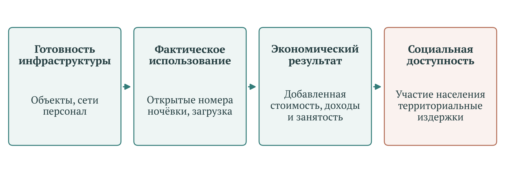

[B108; Caption] Рисунок 1 – Уровни наблюдения результативности национального проекта

[B109; SourceNote] Авторская аналитическая схема: готовность инфраструктуры, фактическое использование, экономический результат, социальная доступность и территориальные издержки. Стрелки задают проверяемую последовательность, а не установленную величину причинного эффекта. [Сноски 14]

[B110; Heading2] 2.2 Номерной фонд и обеспечивающая инфраструктура

[B111; ] Федеральный проект П1 «Создание номерного фонда, инфраструктуры и новых точек притяжения» объединяет модульные средства размещения, инженерную и транспортную инфраструктуру, льготное кредитование, инвестиционное участие и региональные мероприятия единой субсидии. Перечень результатов включает технологическое присоединение туристических кластеров, завершение инфраструктуры с длительным сроком окупаемости и развитие горнолыжных курортов. Разнообразие инструментов требует сопоставления по стадии готовности и назначению объекта. [Сноски 15]

[B112; ] Созданный номер становится источником туристической услуги при наличии необходимых сетей, оборудования, персонала и разрешённой эксплуатации. Срок строительной приёмки может отличаться от даты начала продаж. Для модульных объектов особенно существенны фактическая продолжительность сезона, техническая пригодность к зимней работе и доступность инженерных систем. Само обозначение объекта как круглогодичного необходимо подтверждать наблюдением работы в течение года.

[B113; ] Реестровая ёмкость и физическое расширение предложения требуют раздельного учёта. Рост числа учтённых номеров возможен вследствие строительства, изменения состава классифицируемых объектов и включения ранее действовавших средств размещения. Для оценки результатов П1 предлагается выделять строительный ввод, реконструкцию, изменение статуса и расширение статистического охвата. Декомпозиция позволит установить, какая часть прироста создаёт новую доступную мощность.

[B114; ] Обеспечивающая инфраструктура имеет более широкий круг пользователей, чем отдельная гостиница. Дорога, водоснабжение или очистные сооружения могут обслуживать местных жителей и несколько инвестиционных проектов. При оценке стоимости нужно установить границу объекта и распределение нагрузки. Полное отнесение такой инфраструктуры на одного получателя способно завысить стоимость его поддержки, а исключение общих сетей из расчёта – занизить общественные затраты.

[B115; Heading2] 2.3 Крупные курорты и отложенные результаты

[B116; ] П2 «Пять морей и озеро Байкал» предусматривает инженерную и транспортную инфраструктуру круглогодичных курортов, технологическое присоединение, инвестиционные инструменты и льготные кредиты. Отдельным результатом выделено создание инфраструктуры Каспийского прибрежного кластера в Республике Дагестан. Состав мер отражает длительный инвестиционный цикл, в котором бюджетные обязательства и реальные поездки возникают в разные годы. [Сноски 16]

[B117; ] В выбранной редакции паспорта целевые значения числа поездок в новые современные круглогодичные гостиничные комплексы раскрыты с 2028 года: 1,2 млн, затем 4,3 млн в 2029 году и 7,4 млн в 2030 году. Для 2025–2026 годов оценка должна опираться на предусмотренные стадии реализации. Отсутствие раннего значения потока не свидетельствует о невыполнении поздней целевой величины. Вместе с тем проектные и строительные этапы нуждаются в самостоятельной проверке сроков и содержания. [Сноски 17]

[B118; ] Для крупных курортов предлагается сопоставлять три календаря: бюджетное финансирование, завершение обеспечивающей инфраструктуры и начало коммерческой эксплуатации. Отклонение одного календаря способно повлиять на остальные. При задержке сетей готовый гостиничный корпус может не создавать услугу. При недостаточном спросе введённая инфраструктура может работать с низкой загрузкой и повышенной стоимостью обслуживания.

[B119; ] Территориальная оценка требует рассматривать курорт вместе с окружающими поселениями и транспортными узлами. Планирование рабочих мест следует сочетать с доступностью жилья для работников, ежедневной мобильностью, медицинской помощью и нагрузкой на коммунальные системы. Сезонный прирост временного населения отличается от увеличения численности постоянных жителей. Использование этих величин в расчёте инфраструктурной обеспеченности должно соответствовать конкретной задаче.

[B120; Heading2] 2.4 Продвижение и наблюдение спроса

[B121; ] П3 «Туристическая привлекательность страны» включает информационные системы, продвижение внутреннего и въездного туризма, обратную связь и отдельные меры поддержки организаций. В результатах присутствует стимулирование спроса в периоды его сезонного снижения. Одновременно развиваются системы Росаккредитации, поддерживающие сведения о средствах размещения. Поэтому показатели этого направления могут отражать как изменение спроса, так и улучшение регистрации предложения. [Сноски 18]

[B122; ] Для рекламных и информационных мероприятий следует прослеживать переход от контакта с материалом к бронированию и состоявшейся поездке. Посещение туристического портала представляет промежуточное действие. Его связь с выручкой и экспортом зависит от качества предложения, транспортных возможностей, условий въезда и поведения посетителя. Счётчики посещений требуют устранения повторных технических обращений и раскрытия методики учёта, прежде чем использоваться для оценки охвата людей.

[B123; ] Мероприятия по продвижению межсезонья целесообразно оценивать по дополнительным ночёвкам и загрузке именно в период пониженного спроса. Рост годового потока может сопровождаться сохранением концентрации в пиковые месяцы. Для курорта, работающего в несколько сезонов, важна также устойчивость занятости и дохода в течение года. Сопоставление рекламных расходов с общим числом поездок без временной и территориальной привязки не позволяет выделить дополнительный результат конкретной кампании.

[B124; Heading2] 2.5 Кадровое и промышленное обеспечение

[B125; ] П4 «Кадры для туризма» соединяет повышение квалификации, подготовку региональных команд и мероприятия по производительности труда. Паспорт содержит как долю обученных в занятости отрасли, так и число специалистов, прошедших подготовку в центрах. Дополнительные результаты связаны с практико-ориентированным обучением и распространением подходов к организации работы предприятий. [Сноски 19]

[B126; ] Результат обучения необходимо прослеживать на уровне участников и организаций. Для отрасли существенны дальнейшая работа по профилю, удержание кадров между сезонами, освоение конкретных навыков и качество обслуживания. Один человек может проходить несколько программ, поэтому численность уникальных участников и количество завершений обучения следует публиковать раздельно. Производительность труда требует измерения выпуска и затрат труда в сопоставимых условиях, включая изменение загрузки и состава услуг.

[B127; ] П5 «Производство отечественной продукции для туристской индустрии» предусматривает компенсацию части затрат производителям при предоставлении скидок покупателям и развитие требований к подтверждению производства оборудования в России. В этой конструкции важно отличать реализацию продукции, происхождение её компонентов и функциональную пригодность для туристического объекта. Доля отечественной продукции характеризует один аспект технологической обеспеченности. [Сноски 20]

[B128; ] Для получателя оборудования значимы срок поставки, обслуживание, наличие запасных частей, надёжность и полная стоимость эксплуатации. Увеличение продаж по субсидируемой цене может обеспечивать замену импорта, расширение мощностей или перенос покупки во времени. Проверка дополнительности поддержки должна устанавливать, какие изменения возникли вследствие программы и какие предприятия воспользовались бы аналогичным оборудованием без неё. Подробный дизайн такой оценки предложен в заключительной главе.

[B129; Heading1] 3 Методики расчёта и архитектура показателей

[B130; Heading2] 3.1 Архитектура показателей и границы нового проектного цикла

[B131; ] Система показателей национального проекта «Туризм и гостеприимство» соединяет несколько уровней результата: экономический масштаб туристской индустрии, интенсивность поездок, предложение размещения, подготовку работников, промышленное обеспечение и информационное взаимодействие с потребителем. Эти уровни связаны содержательно, но не образуют единой статистической величины. Увеличение числа номеров создаёт потенциальную ёмкость, посещение портала отражает информационную активность, обучение подтверждает образовательный результат, а добавленная стоимость характеризует производство. Между ними требуются самостоятельные проверки загрузки, качества и экономической отдачи.

[B132; ] Паспорт нового проекта устанавливает период с 1 января 2025 года по 31 декабря 2030 года. Поэтому показатели 2024 года следует использовать как исходные условия и результаты предыдущего проектного цикла, связанного с национальным проектом «Туризм и индустрия гостеприимства». Они не подтверждают эффект мероприятий, начавшихся в 2025 году. Возможная преемственность объектов и механизмов поддержки не отменяет необходимости разделять сроки финансирования, ввод объектов и период возникновения результата. В исследовании используется публичное представление паспорта версии 26.23 от 16 октября 2026 года; оно позволяет восстановить структуру и ориентиры, однако само по себе не удостоверяет юридическую процедуру их утверждения. [Сноски 21]

[B133; ] В составе проекта представлены пять федеральных проектов: П1 «Создание номерного фонда, инфраструктуры и новых точек притяжения», П2 «Пять морей и озеро Байкал», П3 «Туристическая привлекательность страны», П4 «Кадры для туризма», П5 «Производство отечественной продукции для туристской индустрии». Сокращённые названия «Создание номерного фонда», «Морские курорты», «Кадры» и «Промышленное обеспечение туризма» обозначают соответствующие проекты, а не дополнительные направления. Статистический каталог содержит десять кодовых позиций: три показателя национального проекта и семь показателей федеральных проектов. [Сноски 22]

[B134; ] На национальном уровне код 2.14.П.1 соответствует объёму экспорта туристских услуг, 2.14.П.2 – количеству туристических поездок по территории Российской Федерации, 2.14.П.3 – доле валовой добавленной стоимости туристской индустрии в валовом внутреннем продукте Российской Федерации. Федеральный уровень включает номерной фонд 2.14.П1.1, поездки в новые круглогодичные гостиничные комплексы 2.14.П2.1, иностранных граждан, размещённых в коллективных средствах размещения, 2.14.П3.1, индекс удовлетворённости 2.14.П3.2, посещения национального туристического портала 2.14.П3.3, долю прошедших обучение 2.14.П4.1 и обеспеченность отечественной промышленной продукцией 2.14.П5.1. Полное наименование кадрового показателя уточняет направление обучения – деятельность гостиниц и предприятий общественного питания. [Сноски 23]

[B135; ] Десять позиций каталога не исчерпывают актуальную паспортную систему. Приказ Минэкономразвития от 3 августа 2026 года № 550 дополнительно закрепляет число специалистов, прошедших переподготовку и повышение квалификации в центрах подготовки кадров для туристской индустрии, с идентификатором П04611-П4. Этот показатель уже присутствует в паспорте П4 и используется как месячный прокси для годовой доли обученных. Его следует включать в содержательную экспертизу с указанием отличия между паспортным идентификатором и кодом статистического каталога. [Сноски 24]

[B136; ] Нормативная преемственность также требует точной датировки. Приказ Минэкономразвития от 30 сентября 2025 года № 647 вступил в силу 1 октября 2025 года, отменив приказы от 28 декабря 2024 года № 854 и № 855 и от 10 апреля 2025 года № 224. Затем приказ от 9 февраля 2026 года № 87 заменил методику номерного фонда, приказ от 6 марта 2026 года № 169 изложил заново методику иностранных размещений, а приказ от 30 сентября 2026 года № 684 заменил методику туристических поездок. Указатель методик удобен для поиска, однако найденные в нём ссылки необходимо сверять с изменяющими актами: отдельные позиции продолжают указывать первоначальные документы. [Сноски 25]

[B137; Heading2] 3.2 Поездки, туристский поток, размещения и ночёвки

[B138; ] Название показателя не устанавливает единицу наблюдения. Туристическая поездка, отдельное размещение, ночёвка и уникальный человек отвечают на разные вопросы. Один человек может совершить несколько поездок; в пределах одной поездки он может остановиться в нескольких средствах размещения. Соответственно, сумма регистраций размещённых лиц не становится автоматически числом различных граждан, а число ночёвок характеризует продолжительность использования услуг. Для оценки охвата населения необходим отдельный показатель уникальных участников поездок за установленный период с воспроизводимым правилом устранения повторного счёта.

[B139; ] Методика оценки туристского потока, утверждённая приказом Росстата от 26 февраля 2021 года № 109, прямо разграничивает количество поездок и количество туристов. Её конструкция предусматривает коллективные и индивидуальные средства размещения, а для отдельных составляющих – сведения о въездных поездках, обследование населения по форме № 1-В и административную информацию. Поправки приказа от 1 марта 2022 года № 100 расширили временную детализацию отдельных оценок. Поэтому опубликованный Росстатом «туристский поток» нельзя без проверки подставлять вместо показателя нового нацпроекта с похожим названием. [Сноски 26]

[B140; ] Приказ № 684 определяет поездку через посещение места временного пребывания в предусмотренных туристских целях без получения дохода от источников в этом месте, продолжительностью от 24 часов до шести месяцев либо с хотя бы одной ночёвкой. Расчёт охватывает российских и иностранных граждан. При этом общее исключение индивидуального размещения сохраняется, но одновременно введён специальный учёт классифицированных гостевых домов. Следовательно, нельзя описывать актуальный показатель ни как полный учёт всех форм путешествий, ни как неизменную сумму гостиничных регистраций прежних лет. [Сноски 27]

[B141; ] В новом алгоритме отдельно присутствуют данные о размещённых в средствах размещения лицах, компоненты по круизным судам и разностный показатель по гостевым домам. Последний сопоставляет реестр Росаккредитации со статистикой Росстата и использует сведения о номерах и расчётную интенсивность размещения. Это расчётное расширение наблюдаемой совокупности. Оно повышает полноту охвата, одновременно создавая потребность в отдельном раскрытии величины досчёта. Для воспроизводимости полезно публиковать исходное наблюдение, поправку полного круга и корректировку по гостевым домам раздельно. [Сноски 28]

[B142; ] При интерпретации ночёвок необходимо сохранять единицу «человеко-ночь», не смешивая её с занятой комнатой за сутки. Два человека, прожившие в одном номере одну ночь, формируют две ночёвки и одну занятую номеро-ночь. Отношение ночёвок к числу размещений может характеризовать среднюю продолжительность пребывания в наблюдаемой совокупности, если числитель и знаменатель относятся к одинаковым объектам, периоду и правилам регистрации. Оно не даёт автоматически продолжительности всей поездки человека, который последовательно размещался в нескольких объектах.

[B143; Heading2] 3.3 Временная сопоставимость и версии туристической статистики

[B144; ] Туристические поездки по приказу № 684 рассчитываются ежемесячно нарастающим итогом с начала года и ежегодно; единица измерения – миллион единиц. Ранние месячные оценки используют предшествующие наблюдения, сезонные соотношения прошлых лет и поправочные коэффициенты. Уточнённые оценки имеют самостоятельную информационную базу. При отсутствии компонентов допускается использование данных прошлого периода. Поэтому последовательность значений, размещённых в месячных колонках, не обязательно представляет последовательность независимо измеренных месячных потоков. [Сноски 29]

[B145; ] Аналитическое вычитание соседних накопленных значений допустимо только после подтверждения единой редакции ряда. Если январь–ноябрь сохранились как ранние оценки, а декабрь уже отражает годовое уточнение, полученная разность за декабрь одновременно включает поездки месяца и пересмотр предыдущих периодов. Её нельзя использовать как доказательство сезонного обвала. Аналогично повторение значения может означать предусмотренный методикой перенос предыдущего наблюдения. Для каждого значения необходимы период, дата выпуска, стадия оценки и признак расчётной подстановки.

[B146; ] Статистика средств размещения также изменилась. На актуальной странице Росстата представлены приказ от 9 сентября 2025 года № 462 о формировании месячной и годовой информации о коллективных средствах размещения и приказ от 8 апреля 2026 года № 168 о месячных показателях по полному кругу хозяйствующих субъектов. Последний различает непосредственно обследуемые организации и досчитываемые микропредприятия. Смена охвата должна проверяться до расчёта межгодового роста, особенно при сопоставлении ранних ведомственных сообщений с поздней статистической выгрузкой. [Сноски 30]

[B147; ] В доступном полном тексте приказа № 684 обнаруживается календарная несогласованность: пункт 9 устанавливает срок годовой уточнённой оценки не позднее 16 апреля, тогда как пункт 37 предусматривает предоставление годовых компонентов Росстата не позднее 27 апреля. Это не основание самостоятельно изменять официальные даты. Практический вывод состоит в необходимости устанавливать статус уточнения по фактической публикации и её метаданным, а не по наступлению одной календарной даты. Сам приказ не содержит отдельного положения о ретроактивном применении ко всем ранним месяцам 2026 года. [Сноски 31]

[B148; ] Для сопоставления территорий необходимо фиксировать их состав. Методика поездок содержит специальное правило об исключении статистики четырёх новых субъектов до предусмотренного нормативным актом момента. Национальный итог и сумма доступных региональных строк могут поэтому относиться к разным контурам публикации. Пропуск, технический нуль, отсутствие утверждённого ориентира и измеренный нулевой результат следует хранить как разные состояния данных.

[B149; Heading2] 3.4 Номерной фонд и изменение реестрового охвата

[B150; ] Приказ № 87 распространяется на правоотношения с 1 января 2026 года и действует по 31 декабря 2027 года. Показатель номерного фонда формирует Росаккредитация по единому реестру объектов классификации. Это состояние на конец месяца, выраженное в тысячах номеров; месячные значения не суммируются. Годовое значение принимается равным декабрьскому. В состав включены комнаты классифицированных гостевых домов, а исключение прямо установлено для записей со статусами «прекращен» и «архивный». [Сноски 32]

[B151; ] Из этой конструкции следует различие между зарегистрированной ёмкостью и предложением, которым может воспользоваться турист. Формулировка исключений не перечисляет статус приостановления классификации. Кроме того, объект может иметь сезонный режим, ремонт, ограничения использования помещений либо временно закрытые номера. Поэтому реестровый показатель следует сопровождать числом номеров в действующих объектах и количеством фактически доступных номеро-суток. Такое дополнение позволяет оценивать предложение услуг, сохраняя официальный показатель в его установленном значении.

[B152; ] Реформа 2025–2026 годов изменяет саму наблюдаемую совокупность. Постановления Правительства от 27 декабря 2024 года № 1951 и № 1952 устанавливают положение о классификации, правила её проведения и ведения единого реестра. Федеральный закон от 7 июня 2025 года № 127-ФЗ вводит эксперимент по предоставлению услуг гостевых домов, а постановление от 30 августа 2025 года № 1345 регулирует их классификацию. Последний режим действует с 1 сентября 2025 года по 31 декабря 2027 года. Расширение учёта гостевых домов следует рассматривать отдельно от физического строительства нового фонда. [Сноски 33]

[B153; ] Для оценки прироста необходимо сформировать баланс изменений реестра: ввод новых зданий, расширение существующих объектов, включение ранее работавших средств размещения, изменение статуса, исправление сведений и прекращение деятельности. Одинаковый прирост общего числа номеров может быть получен при разном сочетании этих процессов. Рекомендуется сохранять стабильный идентификатор объекта и публиковать сопоставимый ряд по неизменной совокупности наряду с полным реестром. Для объектов поддержки следует дополнительно фиксировать фактическое открытие, дни работы, доступность бронирования и загрузку после ввода.

[B154; Heading2] 3.5 Доля туризма и измерение экономического результата

[B155; ] Показатель доли туризма требует чтения формулы, поскольку его краткое название недостаточно точно передаёт знаменатель. Приложение 3 к приказу № 647 определяет уточнённую оценку как отношение валовой добавленной стоимости туристской индустрии к валовой добавленной стоимости всех отраслей экономики в текущих основных ценах. Следовательно, самостоятельная проверка делением на ВВП в рыночных ценах даст другую конструкцию. В аналитических таблицах необходимо указывать фактическую базу отношения, сохраняя официальное наименование показателя. [Сноски 34]

[B156; ] (1)

[Формула] D = (Vтур / Vвсе) × 100%

$$
D=\frac{V_{\text{тур}}}{V_{\text{все}}}\times100\%
$$

[B157; ] Здесь D – доля туристской индустрии, Vтур – её валовая добавленная стоимость, Vвсе – валовая добавленная стоимость всех отраслей. Обе стоимостные величины относятся к одному году и выражены в текущих основных ценах.

[B158; ] Показатель является годовым; месячный прокси для него не установлен. Первая годовая оценка прямо приравнивается к плановому значению. Уточнение опирается на статистические компоненты Росстата. Поэтому совпадение ранней оценки с целью не представляет независимого свидетельства выполнения плана. Перед включением значения в итоговую оценку требуется установить, что использована статистическая уточнённая величина. Техническая месячная сетка публикации не превращает этот показатель в месячный ряд. [Сноски 35]

[B159; ] Приказ Росстата от 26 июня 2025 года № 310 заменил методологию, утверждённую приказом от 5 сентября 2024 года № 397, и предусмотрел расчёт за 2025 год с пересчётом 2017–2024 годов. ВДС туристской индустрии охватывает производство соответствующих экономических единиц независимо от того, предназначена ли вся их продукция посетителям. Поэтому её нельзя отождествлять с расходами туристов или с прямым вкладом туристского потребления. Сопоставлять исторические значения следует после проверки принадлежности к пересчитанному ряду. [Сноски 36]

[B160; ] Доля в текущих ценах может увеличиваться при опережающем росте цен туристских услуг либо при более слабой динамике остальных отраслей. Для оценки реального расширения деятельности её необходимо дополнять индексом физического объёма ВДС туристской индустрии, предусмотренным той же методологией. Для производительности предпочтительны реальная добавленная стоимость и трудозатраты, согласованные по кругу организаций. Выручка на размещение, доход на ночёвку и загрузка полезны как операционные характеристики, однако не заменяют добавленную стоимость и требуют отдельного контроля изменения цен.

[B161; Heading2] 3.6 Экспорт туристских услуг и иностранные размещения

[B162; ] Экспорт по приложению 4 к приказу № 647 рассчитывается в миллиардах долларов США, ежеквартально и ежегодно нарастающим итогом. Для ранних квартальных оценок используется прошлогодний средний чек, связанный с экспортом и числом иностранных размещений, и текущая оценка размещённых иностранных граждан. Уточнённая годовая величина опирается на данные Банка России об экспорте туристских услуг, формируемые в рамках статьи «Поездки» платёжного баланса. Методика отсылает к публикации «Экспорт отдельных видов услуг по субъектам Российской Федерации». Автоматически заменять этот компонент всей статьёй «Поездки» нельзя. [Сноски 37]

[B163; ] Стадии оценки имеют существенное значение. Первая годовая оценка равна плану; вторая опирается на первую оценку за четвёртый квартал; уточнённая годовая оценка формируется по отдельному алгоритму. Квартальные значения также не являются четырьмя независимыми годовыми частями, если представлены нарастающим итогом. Суммирование таких значений завышает результат. Для оценки роста к 2023 году требуется одновременно проверить редакцию базового значения, единицу валюты и стадию оценки сопоставляемых величин. [Сноски 38]

[B164; ] Долларовая величина измеряет стоимостный результат и сама по себе не является индексом физического объёма. На неё воздействуют число поездок, продолжительность пребывания, структура расходов, внутренние цены и валютные пересчёты. Для содержательного анализа следует отдельно показывать экспорт в установленной валюте, расходы на поездку и ночёвку, а также оценку расходов в сопоставимых ценах при явно названном дефляторе. Использование общего потребительского индекса требует оговорки о его отличии от структуры потребления иностранного посетителя.

[B165; ] Методика иностранных размещений изложена заново приказом № 169, применяемым к правоотношениям с 1 марта 2026 года. Она устанавливает месячные и годовые накопленные значения в миллионах человек, раннюю и уточнённую месячные оценки, а также несколько стадий годового расчёта. Индивидуальное размещение исключено. Этот показатель служит прокси экспорта, но не измеряет поступление денежных средств и не является числом уникальных иностранных туристов. Для совместного анализа с платёжным балансом необходимо также согласовать признаки гражданства и экономического резидентства. [Сноски 39]

[B166; Heading2] 3.7 Удовлетворённость туристов и цифровая посещаемость

[B167; ] Индекс удовлетворённости по приложению 6 к приказу № 647 основан на электронном опросе и взвешивании оценок планирования поездки, перевозки, проживания, дополнительных услуг и соотношения цены и качества. Оценки выставляются по десятибалльной шкале. Для перевозки и проживания установлены веса по 0,3, для цены и качества – 0,2, для остальных компонентов – по 0,1. Следовательно, итоговый процент является преобразованной оценкой, а не долей граждан, ответивших «доволен». [Сноски 40]

[B168; ] Методика предусматривает месячную и годовую агрегацию и допускает использование планового значения при непредставлении компонентов. Для проверки фактической удовлетворённости необходимо раскрывать число ответов, долю завершённых анкет, каналы приглашения, географию и тип поездки. Следует отдельно анализировать самостоятельные и организованные путешествия, транспортную доступность и ценовые группы размещения. Сравнение индекса во времени желательно проводить при постоянной структуре респондентов либо после её стандартизации. Оценка туристов, уже совершивших поездку, не охватывает людей, отказавшихся от путешествия из-за стоимости или иных ограничений.

[B169; ] Посещаемость национального портала по приложению 7 включает основной ресурс, субдомены и внешние ресурсы, на которые осуществляются переходы. Единицей выступает визит; по умолчанию он завершается после тридцати минут отсутствия активности. Показатель накапливается с начала года, годовой итог равен декабрьскому. Он не равен числу уникальных пользователей, бронирований или состоявшихся поездок. Полезные дополнения – доля содержательных переходов, конверсия в подтверждённое бронирование и поездку, исключение технического трафика и стабильность состава учитываемых ресурсов. [Сноски 41]

[B170; Heading2] 3.8 Кадровые показатели и границы профессионального охвата

[B171; ] Приказ № 550 заменяет приказ Минэкономразвития от 10 февраля 2025 года № 82. Годовая доля обученных рассчитывается нарастающим итогом, причём уточнённый числитель суммирует обучение начиная с 2024 года. Знаменатель представляет среднесписочную численность работников организаций по виду деятельности «Деятельность гостиниц и предприятий общественного питания». Это не численность всех занятых во всех видах деятельности, связанных с туризмом. Название отрасли в паспорте не должно приводить к расширительному толкованию знаменателя. [Сноски 42]

[B172; ] Накопление числителя при использовании текущего знаменателя создаёт риск интерпретации: обученные ранее могли сменить работодателя или отрасль, а один специалист мог пройти несколько программ. Без дополнительного подтверждения устранения повторного счёта показатель нельзя объявлять долей уникальных работников, сохраняющих соответствующие навыки в текущей занятости. Следует отдельно публиковать число завершений программ, число различных обученных лиц, охват действующего персонала и сохранение занятости через установленный интервал после обучения.

[B173; ] Месячный показатель числа специалистов относится к трём определённым федеральным ресурсным центрам и выражается в людях. Он накапливается в пределах отчётного года, начиная с нулевой исходной величины; годовое значение равно декабрьскому. При непредставлении данных методика допускает плановую подстановку. Поэтому отчётность центров должна сопровождаться признаком фактического подтверждения документа об обучении. Для оценки полезности программ рекомендуется связывать обучение с проверкой навыков, изменением качества обслуживания, текучестью и трудоустройством, сохраняя сопоставимость должностей и сезонного состава работников. [Сноски 43]

[B174; Heading2] 3.9 Промышленное обеспечение и результаты курортных проектов

[B175; ] Обеспеченность отечественной промышленной продукцией по приказу Минпромторга от 16 января 2025 года № 126 рассчитывается по определённой номенклатуре оборудования. Она включает туристические автобусы, ратраки, системы искусственного снегообразования, канатные дороги, аттракционы и суда. Сопоставляются взвешенные количества произведённой продукции и оценённой потребности; для разных категорий предусмотрены разные коэффициенты. Это не доля всех российских товаров в закупках гостиниц и не доля отечественного оборудования в уже установленном парке. [Сноски 44]

[B176; ] Для проверки динамики необходимо раскрывать производство и потребность по каждой категории. Рост сводного показателя может возникать при увеличении выпуска, снижении заявленной потребности либо изменении структуры категорий. Дополнительные данные должны показывать фактическую поставку, ввод оборудования в эксплуатацию, надёжность, стоимость обслуживания и доступность запасных частей. Применение таких характеристик позволяет связать промышленный выпуск с качеством туристских услуг, не приписывая производству результат, который ещё не возник у пользователя.

[B177; ] Для федерального проекта «Пять морей и озеро Байкал» паспорт устанавливает показатель поездок в новые современные круглогодичные гостиничные комплексы. В выбранной редакции числовые ориентиры начинаются с 2028 года. Отсутствие наблюдения за 2025–2026 годы поэтому нельзя трактовать как доказанный нулевой поток или невыполнение годового задания. Полный отдельный нормативный алгоритм этого показателя в доступных материалах не восстановлен; это ограничение проверки, а не утверждение об отсутствии методики. [Сноски 45]

[B178; ] При последующей оценке необходимо закрепить перечень учитываемых комплексов, момент начала учёта, правила регистрации повторных размещений и различие между поездкой в конкретный комплекс и дополнительной поездкой по стране. Посетитель нового курорта мог перенести туда поездку из другого региона. Для оценки чистого прироста нужны наблюдения по территории назначения и территориям возможного замещения, а также сопоставимые объекты без аналогичной поддержки. Круглогодичность следует подтверждать фактическими днями работы и использованием ёмкости в низкий сезон.

[B179; Heading2] 3.10 Дополнительные измерения сезонности, доступности и результата

[B180; ] Измерение сезонности рекомендуется строить по полному сопоставимому месячному ряду ночёвок и доступной ёмкости. Для каждого региона следует рассчитывать доли месяцев в годовом объёме, концентрацию этих долей, загрузку в заранее определённый низкий сезон и среднее число ночёвок на день месяца. Изменение количества календарных дней и дат праздничных периодов необходимо учитывать отдельно. Одновременно следует показывать загрузку открытого фонда и использование всей годовой ёмкости: закрытие объектов вне сезона может повысить первый коэффициент без улучшения круглогодичной работы.

[B181; ] Для ценовой доступности целесообразен индекс стоимости стандартизированной поездки с фиксированными продолжительностью, качеством размещения, составом транспортных и сопутствующих услуг. Его необходимо соотносить с доходом сопоставимой группы населения, а не только с общероссийской средней зарплатой. Сравнение по регионам отправления должно сохранять транспортную составляющую; сравнение во времени – постоянную структуру маршрутов. Дополнительное обследование домохозяйств должно фиксировать долю не путешествовавших и причины отказа. Это позволит отделить рост удовлетворённости действующих клиентов от расширения доступности отдыха.

[B182; ] Экономическая оценка требует совместного рассмотрения физического объёма услуг, добавленной стоимости, оплаты труда и эксплуатационных затрат. Для поддержанных объектов полезна наблюдаемая последовательность «ввод – открытие – доступная ёмкость – загрузка – доход – добавленная стоимость». Оценку воздействия следует проводить на сопоставимых объектах и территориях с учётом предшествующей динамики, сезонности, транспортных изменений и перераспределения спроса. Различия между участниками и неучастниками поддержки сами по себе не доказывают её результат, поскольку отбор проектов связан с исходной инвестиционной привлекательностью.

[B183; Heading2] 3.11 Статус наблюдений и условия доказательного вывода

[B184; ] Для практического мониторинга необходимо разделять утверждённую цель, расчётную подстановку, предварительную статистическую оценку и уточнённый факт. Особенно это относится к доле туризма, экспорту, удовлетворённости и подготовке специалистов, где проверенные методики содержат прямые правила использования плана либо предыдущих значений. Присутствие числа в информационной системе не определяет его доказательный статус. Метаданные должны позволять восстановить формулу, состав совокупности и редакцию исходных компонентов.

[B185; ] Паспорт устанавливает желаемый результат; нормативный акт определяет способ его измерения; организационный механизм описывает предполагаемую связь поддержки и результата. Причинный вывод возникает только после проверки этой связи на сопоставимых наблюдениях. Предлагаемая архитектура оценки сохраняет официальные показатели и дополняет их проверками охвата, времени, качества и реальной экономической отдачи. Это позволяет оценивать развитие туризма без смешения расширения регистрации, изменения методики и фактического улучшения условий поездок.

[B186; Heading1] 4 Статистические результаты, региональные различия и доступность отдыха

[B187; Heading2] 4.1 Наблюдаемые результаты и границы статистической базы

[B188; ] Статистика подтверждает значительный масштаб туристической деятельности, но пока не позволяет свести результаты национального проекта к единой оценке его эффективности. За 2025 год опубликовано 92,0428 млн туристических поездок. Региональные значения полностью согласуются с этим итогом, поэтому территориальная структура годового результата поддаётся проверке. Одновременно сохранившиеся оперативные значения за 2026 год расходятся с отдельными официальными сообщениями, а несколько показателей имеют предварительные оценки, повторяющиеся значения либо пока не обеспечены проверенным числовым результатом. Эти обстоятельства требуют различать состояние отрасли, выполнение выбранной редакции плана и самостоятельный эффект государственных мер. [Сноски 46]

[B189; ] Для анализа использованы шесть первичных статистических таблиц: поездки, классифицированный номерной фонд, доля туристской отрасли, экспорт туристских услуг, иностранные размещения и отечественная продукция для туризма. В сохранённой выгрузке содержится 1924 строки, полученные 15 октября 2026 года. Однако большое число строк не означает столь же большого числа независимых наблюдений. Региональный ряд поездок содержит 85 территорий и 21 накопительную месячную отметку; остальные таблицы преимущественно общероссийские. Дата получения выгрузки характеризует исследовательский снимок и сама по себе не удостоверяет дату обновления каждой исторической ячейки. [Сноски 47]

[B190; ] Дополнительное официальное сообщение Росстата характеризует масштаб размещения в 2025 году: 38,3 тыс. средств размещения, 3,5 млн мест и 395,4 млн ночёвок. Число объектов, мест и номеров описывает разные стороны предложения. Между ними нет постоянного коэффициента перевода, поэтому увеличение числа средств размещения нельзя автоматически считать таким же увеличением вместимости. Число ночёвок относится к использованию предложения и позволяет поставить вопрос о длительности пребывания, однако само по себе не показывает загрузку доступного фонда. Для неё нужен календарь работы объектов и число реально предлагаемых мест. [Сноски 48]

[B191; ] При анализе длинной динамики требуется также учитывать базу сравнения. Официальное сообщение сопоставляет часть итогов с 2020 годом. Такой временной интервал не совпадает с периодом нового национального проекта, начинающимся в 2025 году. Накопленное за несколько лет увеличение нельзя полностью приписать текущему проекту. Для оценки его самостоятельного вклада требуется отделить результат до начала программы, изменение правил учёта и последующие изменения. Денежные показатели услуг и инвестиций дополнительно нуждаются в разграничении текущих и сопоставимых цен: увеличение рублей оборота не задаёт автоматически темп роста физического объёма.

[B192; ] Содержательная единица туристической статистики принципиальна для социального вывода. Показатель поездок связан с учётом размещений и предусмотренными методикой дополнениями. Один человек может совершить несколько поездок и неоднократно учитываться при размещении. Общероссийское число поездок поэтому нельзя делить на население и объявлять полученное отношение долей граждан, которым доступен отдых. По той же причине название ряда иностранных граждан не означает, что установленное число представляет уникальных посетителей страны. Территория размещения характеризует принимающую сторону, тогда как доступность путешествий для жителей требует наблюдения по месту их проживания. [Сноски 49]

[B193; ] В текущей системе предусмотрены первая и уточнённая оценки. Методика поездок №684 от 30 сентября 2026 года включает дополнительные компоненты гостевых домов и круизных судов; распространять эти изменения на все прежние значения без сведений о версии расчёта нельзя. Отдельно Росстат утвердил методологию месячных показателей по полному кругу средств размещения с досчётом микропредприятий. Поэтому сходные названия таблиц ещё не обеспечивают тождество охвата. В данной главе сохранённые оценки, официальные сообщения и локальный пример месячной сезонности представлены с собственными периодами и ограничениями. [Сноски 50]

[B194; ] Такой подход оставляет часть вопросов открытой, но делает выводы проверяемыми. Число размещений помогает оценить нагрузку на принимающую инфраструктуру; число ночёвок добавляет длительность использования; номерной фонд описывает зарегистрированную вместимость; обследование населения показывает распространённость участия. Для оценки качества необходимы отдельные сведения о безопасности, удовлетворённости и доступности конкретного продукта. Замена этих измерений одним общим показателем способна скрыть ситуацию, когда оборот отрасли растёт преимущественно за счёт более частых поездок уже обеспеченных путешественников. Здесь это рассматривается как возможный механизм, а не как установленная структура роста.

[B195; Heading2] 4.2 Итоги 2025 года и допустимость сопоставления с целями

[B196; ] Целевые значения в таблице сопоставлений относятся к выбранным редакциям паспортов, опубликованным 16 октября 2026 года. Они показывают, как результат 2025 года соотносится с доступным на дату экспертизы плановым рядом. Это ретроспективное сопоставление не восстанавливает автоматически первоначальные обязательства, действовавшие в начале 2025 года. Изменение редакции цели и уточнение факта должны прослеживаться отдельно; иначе даже арифметически правильный процент исполнения может отвечать на другой управленческий вопрос. [Сноски 51]

[B197; ] Для поездок годовая оценка 92,0428 млн ниже ориентира 98,2 млн на 6,1572 млн, или на 6,27%. Это содержательно определённый разрыв с выбранной целью. Он не устанавливает причины отклонения: для их выяснения нужны сопоставимые изменения территориального спроса, транспортной доступности, цен, предложения и статистического охвата. Само наличие недовыполнения не позволяет распределить ответственность между федеральными мерами, региональными решениями и внешними обстоятельствами. При этом игнорировать разрыв также нельзя: увеличение числа инфраструктурных проектов ещё не гарантирует соответствующего годового объёма спроса. [Сноски 52]

[B198; ] Классифицированный номерной фонд в декабре 2025 года составлял 1003,769 тыс. номеров при цели 962,3 тыс. Разность равна 41,469 тыс., или 4,31%. Показатель характеризует запас учтённых номеров. Из него не следует, что в течение года физически построено столько же новых номеров: изменение классификации, включение ранее действующих объектов и исключение записей также способны менять реестр. Поэтому превышение ориентира вместимости необходимо сопоставлять с загрузкой, продолжительностью работы объектов и доступностью предложения по ценам. Совместное наблюдение превышения цели по фонду и отставания по поездкам является основанием для дополнительной проверки согласованности спроса и предложения, но ещё не доказательством избыточного строительства. [Сноски 53]

[B199; ] По доле туристской отрасли источники дают разные стадии оценки. В сохранённой декабрьской ячейке за 2025 год стоит 3,0%, тогда как в осеннем сообщении Росстата за этот год опубликовано 3,1%. При ориентире 3,0% обновлённое сообщение даёт превышение на 0,1 процентного пункта. Методика определяет отношение ВДС туристской индустрии к ВДС всех отраслей в текущих основных ценах, хотя в названии присутствует ВВП. Кроме того, первая годовая оценка по установленному порядку приравнивается к плану. Следовательно, совпадение ранней оценки с целью не является независимым доказательством достижения результата. [Сноски 54]

[B200; ] Для экспорта в декабрьской строке опубликовано 8,75 млрд долларов при выбранной цели 4,6 млрд. Арифметическая разность составляет 4,15 млрд долларов, однако стадия уточнения сохранённой оценки не установлена. Экспорт является квартальным накопительным показателем; его окончательные компоненты связаны с данными Банка России по экспорту туристских услуг. Промежуточное представление использует и физический прокси – иностранных граждан в средствах размещения. Поэтому связь таблицы 63347 с экспортным показателем нормативно обоснована, но число людей нельзя читать как долларовую стоимость. [Сноски 55]

[B201; ] Декабрьское значение иностранных размещений составляет 5,89 млн при цели 5,2 млн; разность 0,69 млн также показана условно, поскольку окончательность этой оценки не удостоверена. Для отечественной продукции опубликовано 30,3%, совпадающее с целью. Такое совпадение свидетельствует о состоянии опубликованной отчётности, но без исходных компонентов не позволяет независимо проверить структуру рынка. Нули в ранних ячейках соответствующих рядов не интерпретируются как отсутствие иностранных гостей, экспорта или российского производства. [Сноски 56]

[B202; Caption] Таблица 3 – Показатели за 2025 год и ориентиры выбранной редакции паспортов

[TABLE 3; B203]
Показатель | Единица | Значение | Цель | Разность | Статус сравнения
Туристические поездки | млн | 92,0428 | 98,2 | −6,1572 | Годовая оценка; −6,27% к выбранной цели
Классифицированные номера | тыс. | 1003,769 | 962,3 | +41,469 | Декабрьский запас; +4,31% к цели
Доля туристской отрасли | % | 3,1 | 3,0 | +0,1 п.п. | Обновлённое сообщение Росстата; в выгрузке 3,0
Экспорт туристских услуг | млрд долл. | 8,75 | 4,6 | +4,15* | Декабрьская оценка, стадия уточнения не установлена
Иностранцы в средствах размещения | млн | 5,89 | 5,2 | +0,69* | Декабрьская оценка, стадия уточнения не установлена
Отечественная продукция для туризма | % | 30,3 | 30,3 | 0 | Опубликованное значение; исходные компоненты не сверены

[B204; SourceNote] Цели воспроизводят редакции паспортов, опубликованные 16.10.2026; это не восстановление первоначального плана 2025 года. Разность рассчитана как значение минус цель. Звёздочкой отмечены условные арифметические сопоставления, не удостоверяющие окончательное исполнение. Для доли отрасли знаменатель по методике – ВДС всех отраслей в основных ценах. [Сноски 57]

[B205; ] Отдельно перечислены показатели без проверенной числовой оценки: индекс удовлетворённости граждан в сфере туризма и гостеприимства, посещения портала, доля обученных специалистов и поездки к новым морским курортам. У последних первая ненулевая паспортная цель относится к 2028 году, поэтому пустые ранние годы нельзя считать неисполнением. Дополнительная метрика количества подготовленных специалистов присутствует в паспорте, хотя отсутствует среди десяти кодов первоначального каталога. Её методика допускает использование плана при непредставлении сведений. Для этой строки особенно важно различать наличие опубликованного числа и наличие подтверждённого результата обучения. [Сноски 58]

[B206; Caption] Таблица 4 – Паспортные показатели без проверенной числовой оценки результата

[TABLE 4; B207]
Показатель | Цель 2025 | Цель 2026 | Что можно заключить
Индекс удовлетворённости граждан в сфере туризма и гостеприимства, % | 52,5 | 61,0 | Числовой результат в доступных связанных рядах не установлен
Посещения национального туристического портала, млн | 6,8 | 7,5 | Числовой результат не установлен; посещение не равно туристической поездке
Доля специалистов, прошедших обучение, % | 4,9 | 7,3 | Числовой результат не установлен; знаменатель требует проверки
Поездки к новым круглогодичным морским курортам, млн | Не задана | Не задана | Первая цель – 1,2 млн в 2028 году; ранние пропуски не равны нулевому исполнению
Подготовленные специалисты, человек | Не задана | 4193 | Дополнительная паспортная метрика вне десяти кодов каталога; отдельного ряда нет

[B208; SourceNote] Отсутствие результата относится к доступному набору и не доказывает отсутствия деятельности. Показатель подготовленных специалистов введён в паспорт и имеет отдельную методику №550 от 03.08.2026; её пункт 7 допускает использование плана при непредставлении сведений. [Сноски 59]

[B209; Heading2] 4.3 Оперативные сведения 2026 года и несогласованность версий

[B210; ] Официальное сообщение Министерства транспорта от 5 августа 2026 года, воспроизводящее данные Росстата и выступления руководителей Правительства и Минэкономразвития, сообщает о 43,2 млн поездок за январь–июнь и росте на 4,3% к соответствующему периоду предыдущего года. В нём также указаны более 2,5 млн въездных поездок иностранных граждан и рост на 20,1%. Эти величины относятся к полугодию и не должны предъявляться как годовой итог. Причинные объяснения, содержащиеся в официальном выступлении, рассматриваются как позиция органов управления, а не как результат отдельного исследования воздействия проекта. [Сноски 60]

[B211; ] Сохранённая таблица поездок показывает за июнь 2026 года 46,0857 млн нарастающим итогом, а за июнь 2025 года – 45,3285 млн. Их механическое отношение даёт рост лишь на 1,67%. Таким образом, одновременно различаются и уровень, и темп относительно официального сообщения. Эти расхождения нельзя устранить простым округлением. Возможные объяснения связаны с версиями оценки и охватом компонентов, но конкретный механизм доступными метаданными не доказан. В частности, нельзя задним числом приписать разность гостевым домам только потому, что новая методика предусматривает их учёт. [Сноски 61]

[B212; ] Из этого следует практическое ограничение: для описания опубликованного полугодового результата используется связная пара «43,2 млн и +4,3%» из одного сообщения. Каталожные величины сохраняются в таблице сверки, чтобы расхождение оставалось видимым. Разность между двумя версиями не названа экономическим приростом или потерями. Сентябрьская накопительная оценка 74,4464 млн также не используется для самостоятельного заключения об ухудшении конъюнктуры относительно сохранённой строки предыдущего года, пока не подтверждена сопоставимость обеих оценок. [Сноски 62]

[B213; Caption] Таблица 5 – Почему оперативные значения нельзя механически объединять

[TABLE 5; B214]
Показатель и период | Сохранённый ряд | Более позднее / отдельное сообщение | Вывод
Поездки, январь–июнь 2026 | 46,0857 млн; +1,67% к строке 2025 года | 43,2 млн; +4,3%, сообщение 05.08.2026 | Версии и охват не согласованы; не строить общий темп из разных публикаций
Доля туристской отрасли, 2025 | 3,0% в декабрьской строке | 3,1% в сообщении Росстата осенью 2026 года | Дата снимка не гарантирует наиболее позднюю оценку каждого периода
Экспорт, начало 2025 / 2026 | Нули в ранних месячных ячейках | Методикой установлен квартальный накопительный показатель | Нули не подтверждают отсутствие экспорта; месячные изменения не рассчитываются

[B215; SourceNote] Причины расхождений поездок требуют сверки компонентов и версий источника; принадлежность различий конкретной методической поправке не доказана. [Сноски 63]

[B216; ] Для номерного фонда возможно более однородное описание внутри 2026 года, когда действует методика №87. С января по сентябрь опубликованный запас увеличился с 1056,692 до 1114,916 тыс. номеров, или на 5,51%. В августе он достигал 1123,208 тыс., после чего снизился на 8,292 тыс. номеров. Рисунок показывает индекс к январю и не превращает это изменение в показатель ввода. Снижение реестрового запаса само по себе не доказывает закрытия действующих гостиниц: нужны сведения о движении объектов и основаниях изменения записей. [Сноски 64]

[B217; ] Для оперативного управления полезно публиковать одновременно дату оценки, период, перечень охваченных объектов и статус уточнения. Тогда обновление исторического значения можно отличить от нового наблюдения. Это особенно существенно при годовых целях: значение на конец сентября позволяет судить о текущем запасе, но не удостоверяет декабрьский результат. Прогноз достижения цели также должен учитывать возможные исключения из реестра, а не только добавления. На имеющейся базе надёжнее констатировать текущее положение, чем экстраполировать несколько месячных точек до конца года.

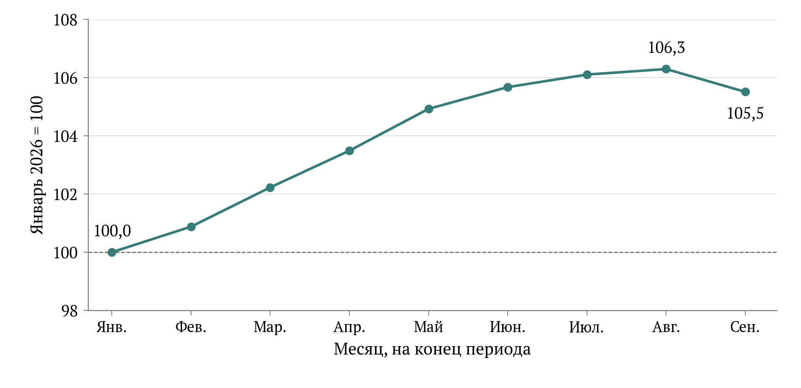

[B219; Caption] Рисунок 2 – Изменение зарегистрированного классифицированного номерного фонда в 2026 году

[B220; SourceNote] Индекс к январю 2026 года. Январь – 1056,692 тыс. номеров, август – 1123,208 тыс., сентябрь – 1114,916 тыс. Ось индекса ограничена диапазоном 98–108 для различимости месячных изменений. Показатель отражает запас учтённых номеров на конец месяца, а не физический ввод новых объектов; рост может включать изменение охвата реестра. [Сноски 65]

[B221; Heading2] 4.4 Территориальная концентрация приёма поездок

[B222; ] Региональный анализ 2025 года основан на 85 наблюдениях. Их сумма составляет 92,0428 млн и совпадает с общероссийской оценкой; повторного прибавления автономных округов при таком агрегировании не возникает. Нулевых значений нет. Для четырёх территорий картографической основы – Донецкой и Луганской народных республик, Запорожской и Херсонской областей – наблюдения отсутствуют. Они показаны серым, а не включены в расчёт как территории с нулевым туризмом. Названия пяти субъектов, представленные в таблице в развёрнутой форме, сопоставлены с их обычными региональными обозначениями. [Сноски 66]

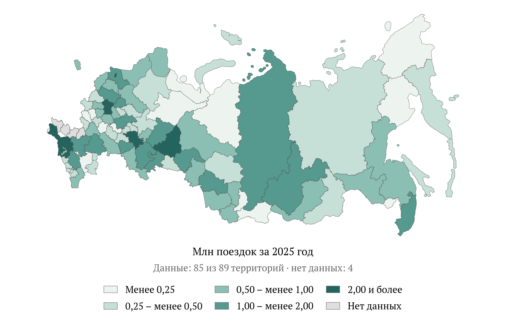

[B224; Caption] Рисунок 3 – Территориальное распределение туристических поездок, 2025 год

[B225; SourceNote] Млн поездок. Учтены 85 из 89 территорий картографической основы; значения отсутствуют для Донецкой и Луганской народных республик, Запорожской и Херсонской областей. Пропуски показаны серым, нулевые значения отсутствуют. Сумма по 85 территориям равна 92,0428 млн. Границы и территориальный состав воспроизводят предоставленную основу. Расчёт по ЕМИСС, снимок 15.10.2026. [Сноски 67]

[B226; ] Распределение выраженно концентрированное. Москва принимает 12,8746 млн поездок, Краснодарский край – 9,3062 млн, Санкт-Петербург – 6,9695 млн, Московская область – 6,3744 млн. На эти четыре территории приходится 38,60% совокупного числа поездок. Первая десятка аккумулирует 52,71%, тогда как 42 территории с наименьшими значениями – 13,33%. Медиана равна 0,5462 млн, межквартильный интервал составляет 0,3085–1,0057 млн. В 62 из 85 территорий показатель меньше миллиона поездок. Эти расчёты показывают масштаб асимметрии, не задавая нормативного требования к одинаковым объёмам приёма. [Сноски 68]

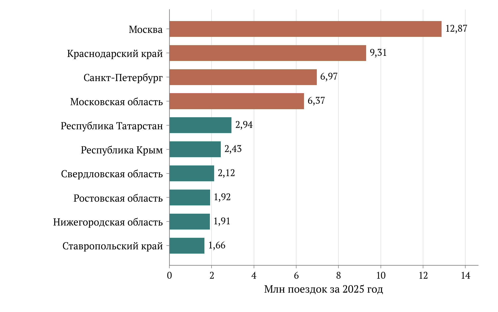

[B228; Caption] Рисунок 4 – Десять крупнейших территорий по числу принятых поездок в 2025 году

[B229; SourceNote] Десять территорий аккумулируют 52,71% учтённых поездок; первые четыре – 38,60%. Абсолютный объём приёма не является оценкой доступности путешествий для местных жителей или эффективности бюджетных расходов. Расчёты автора. [Сноски 69]

[B230; ] По федеральным округам выделяется Центральный округ с 27,9136 млн поездок; далее следуют Южный с 15,9613 млн, Северо-Западный с 12,8751 млн и Приволжский с 12,5676 млн. При этом положение округа существенно зависит от отдельных крупных центров. Сравнивать окружные суммы как показатели эффективности управления было бы некорректно: число субъектов, плотность расселения, размер принимающих городов и характер туристического продукта различаются. Таблица округов нужна для оценки пространственного распределения нагрузки, а не для присвоения мест в рейтинге качества государственной политики. [Сноски 70]

[B231; Caption] Таблица 6 – Распределение поездок 2025 года по федеральным округам

[TABLE 6; B232]
Федеральный округ | Территорий | Млн поездок | Доля, %
Центральный | 18 | 27,9136 | 30,33
Южный | 8 | 15,9613 | 17,34
Северо-Западный | 11 | 12,8751 | 13,99
Приволжский | 14 | 12,5676 | 13,65
Сибирский | 10 | 7,9768 | 8,67
Уральский | 6 | 6,2040 | 6,74
Дальневосточный | 11 | 4,9563 | 5,38
Северо-Кавказский | 7 | 3,5881 | 3,90
Всего по наблюдаемым территориям | 85 | 92,0428 | 100,00

[B233; SourceNote] Агрегирование 85 территориальных наблюдений. Сумма совпадает с общероссийским итогом без остатка и без повторного включения автономных округов. Неоценённые территории не добавлены как нулевые. Собственные расчёты по ЕМИСС. [Сноски 71]

[B234; ] Абсолютная концентрация имеет несколько аналитических следствий. Во-первых, изменение в нескольких крупнейших центрах способно заметно сдвинуть национальный итог, даже если большинство регионов сохраняет прежний масштаб. Во-вторых, сильное положение принимающей территории не свидетельствует об одинаковой доступности поездок для её жителей. В-третьих, одинаковое число прибытий может создавать различную нагрузку при разной длительности пребывания и сезонном распределении. Для оценки инфраструктурной обеспеченности полезнее сопоставлять ночёвки с доступной вместимостью по месяцам, а для оценки социальной доступности – поездки жителей с их доходами и жизненными обстоятельствами.

[B235; ] В настоящем наборе имеется только один достаточно полный сопоставимый региональный признак. Поэтому построение многомерной типологии, главных компонент или кластеров не имело бы содержательного основания. Разбиение субъектов по величине одного показателя лишь переименовало бы интервалы объёма приёма. Дополнение этого ряда случайными несинхронными переменными могло бы создать видимость более сложного анализа, но ухудшило бы интерпретацию. Обоснованный результат здесь – прозрачное распределение, концентрация и перечень недостающих измерений. Показатели на душу населения не рассчитаны: использование старой численности населения из картографической основы в качестве современного знаменателя создало бы ещё одну несопоставимость.

[B236; Heading2] 4.5 Сезонность: что можно увидеть без смешения оценок

[B237; ] Накопительные значения позволяют получить отдельный месяц вычитанием соседних итогов лишь при одинаковых правилах и согласованных версиях. В сохранённом ряду 2025 года декабрьский прирост формально составил бы всего 2,0879 млн поездок, поскольку годовой итог 92,0428 млн сопоставляется с ноябрьской оценкой 89,9549 млн. Превращать эту разность в доказательство резкого зимнего спада нельзя. Методика предусматривает оценочные процедуры и последующие уточнения; сохранение исторических месячных оценок рядом с более поздним годовым итогом способно искажать полученный остаток. Конкретный механизм такого расхождения в рассматриваемой выгрузке не установлен. [Сноски 72]

[B238; ] В качестве ограниченного примера использована единая месячная таблица Амурстата за 2025 год по коллективным средствам размещения без субъектов малого предпринимательства. В январе учтено 3165 размещённых лиц, в августе – 5125; максимум выше январского уровня в 1,62 раза. На июнь–август приходится 27,34% суммы месячных размещений. Ночёвки достигают максимума в августе – 24 415. При этом число отражённых объектов меняется от 30 до 35. Следовательно, рисунок показывает сезонный профиль опубликованной совокупности, а не чистое изменение спроса в неизменной панели гостиниц. [Сноски 73]

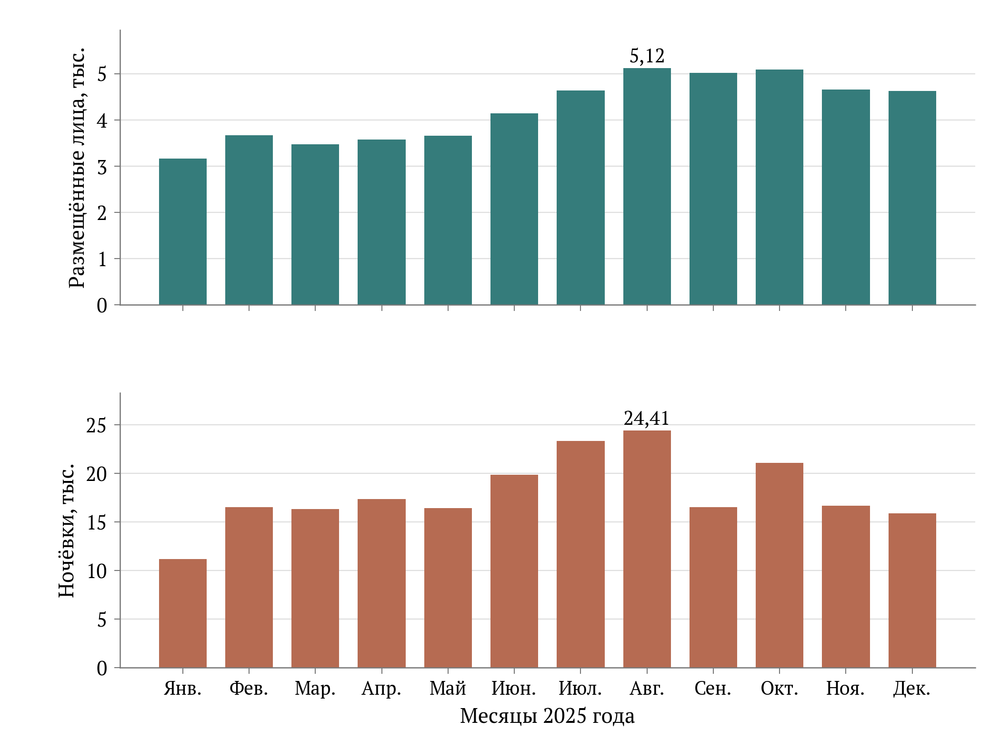

[B240; Caption] Рисунок 5 – Месячная сезонность размещений и ночёвок в Амурской области, 2025 год

[B241; SourceNote] Коллективные средства размещения, за исключением субъектов малого предпринимательства. Число отражённых средств размещения менялось от 30 до 35; это не постоянная панель. Показаны отдельные месяцы одного опубликованного ряда, без вычитания накопительных оценок. Пример не характеризует сезонность всей России. [Сноски 74]

[B242; ] Локальный пример полезен именно как проверка требований к данным. Рост прибытий не обязан сопровождаться пропорциональным ростом ночёвок, поскольку меняется продолжительность пребывания. Для гостиничного бизнеса и коммунальной инфраструктуры эти различия существенны: короткие заезды увеличивают число операций приёма, тогда как длинные – длительность использования мест. Однако из приведённого примера нельзя вывести сезонность России, всех средств размещения Амурской области или морских курортов. Малые объекты исключены, а география и структура путешествий ограничены одним субъектом.

[B243; ] Цель круглогодичного использования инфраструктуры требует нескольких лет месячных данных с устойчивым охватом. Её продвижение можно проверять по доле ночёвок вне пикового сезона, загрузке доступных мест и числу месяцев фактической работы объектов. Увеличение зимнего предложения без соответствующего спроса не тождественно росту круглогодичной устойчивости. Равным образом рост межсезонных прибытий может отражать короткие деловые поездки и не компенсировать потерю длительных летних размещений. Эти вопросы остаются проверяемыми гипотезами для последующего мониторинга, а не выводами из одного годового итога.

[B244; Heading2] 4.6 Доступность путешествий и демографическое измерение

[B245; ] Опрос ФОМ в июле 2026 года даёт отдельное представление об участии населения: 23% взрослых сообщили о поездке на отдых в другой регион России менее года назад, 47% – более года назад, 29% никогда таких поездок не совершали. Финансовые причины отсутствия поездок назвали 34% всех опрошенных. Вопрос о причинах задавался только соответствующей части выборки, однако опубликованный знаменатель – все респонденты. Опрос охватывает взрослых и межрегиональный отдых, поэтому его результат не измеряет все виды путешествий и не подменяет паспортный индекс удовлетворённости граждан в сфере туризма и гостеприимства. [Сноски 75]

[B246; ] Динамика опубликованных июльских волн показывает 20% недавних участников в 2022 году, 21% в 2023 и 2024 годах и 23% в 2026 году. В таблице источника нет волны 2025 года. Небольшую разность последних значений не следует объявлять статистически доказанным улучшением: заявленная максимальная погрешность опроса 2026 года составляет 3,6 процентного пункта, а полноценная проверка различий требует параметров каждой волны. Тем более эти значения не обеспечивают причинного вывода о воздействии проекта, начавшегося в 2025 году. [Сноски 76]

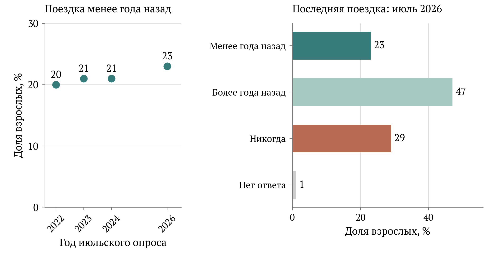

[B248; Caption] Рисунок 6 – Участие взрослых в межрегиональных поездках на отдых: опубликованные волны опроса ФОМ

[B249; SourceNote] Доли опрошенных 18 лет и старше. Поездки на отдых в другие регионы России. Опрос июля 2026 года: 1500 человек, максимальная заявленная погрешность 3,6 процентного пункта. Волна 2025 года отсутствует. Малые различия между волнами не доказывают статистически значимого изменения. [Сноски 77]

[B250; ] Демографический анализ требует аккуратного выбора знаменателя. В опросе ФОМ июня 2025 года 77% респондентов старше 60 лет сообщили, что не работают и не имеют отпуска как такового; среди людей 31–45 лет эта доля составляла 14%. Это различие описывает трудовой статус и институт оплачиваемого отпуска. Оно не означает, что 77% старших респондентов лишены возможности путешествовать. Показатель трудового отпуска нельзя применять ко всему населению как универсальный индикатор доступа к отдыху. [Сноски 78]

[B251; ] Для семей с детьми важны совместимость дат поездки с учебным календарём, общая стоимость нескольких билетов и наличие подходящего размещения. Для старших возрастов существенными могут быть состояние здоровья, удобство маршрута и сопровождение. Для сельских жителей и удалённых населённых пунктов доступ к отправлению может составлять самостоятельную часть путешествия. Эти положения задают направления проверки, но имеющиеся агрегаты не позволяют ранжировать группы по степени ограничений. Следовательно, рекомендации по субсидиям конкретным категориям должны опираться на обследование потребностей и фактического использования, а не на предположение о типичном туристе.

[B252; ] Доступность целесообразно оценивать через стоимость сопоставимой поездки относительно располагаемых ресурсов домохозяйства. В такую корзину должны входить дорога, размещение, питание и обязательные расходы, а период и состав путешественников необходимо фиксировать. Средняя стоимость проданных туров без поправки на длительность и качество продукта неоднозначна: она может вырасти вследствие удорожания одинаковой услуги либо выбора более дорогих поездок. Аналогично средняя цена номера не описывает полную стоимость семейного отдыха. В исследуемых рядах сопоставимой корзины нет, поэтому утверждение о снижении или повышении общей доступности по отраслевому обороту не делается.

[B253; ] Наблюдаемая доля никогда не ездивших в другие регионы также требует осторожного прочтения. В неё могут входить люди, предпочитающие отдых рядом с домом, имеющие ограничения здоровья, недостаток денег или иные обстоятельства. Сам вопрос не отделяет вынужденное исключение от свободного выбора. Для социальной оценки полезно наблюдать желание совершить поездку, причины отказа и возможность воспользоваться подходящим предложением. Тогда можно отличить расширение реальных возможностей от простого увеличения числа поездок у уже мобильной части населения. Такая система наблюдения дополнила бы показатели отраслевого объёма без механического смешения их единиц.

[B254; Heading2] 4.7 Курортные риски и интерпретация территориальных изменений

[B255; ] Результаты 2025–2026 годов формировались в условиях локальных рисков, которые общероссийский ряд способен сглаживать. В официальном сообщении августа 2026 года Минэкономразвития отмечено восстановление Анапы после спада предыдущего года. В сентябре агентство «Прайм», передавая сообщение Правительства, сообщило о разрешительных документах Роспотребнадзора для 115 пляжей Анапы в сезоне 2026 года после работ по ликвидации последствий крушения танкеров. Эти сведения подтверждают существенность санитарной и экологической доступности курорта, но не устанавливают величину потерь поездок или вклад конкретного инструмента национального проекта в восстановление. [Сноски 79]

[B256; ] Разрешение на эксплуатацию, фактическое открытие объекта и возвращение спроса представляют разные события. Даже при устранении ограничений могут сохраняться изменения ожиданий путешественников, сроков бронирования и выбора направления. Эти возможные каналы необходимо проверять на данных, а не считать установленными только по совпадению дат. Для курортной территории полезны месячные сведения о действующих объектах, отменах бронирований, длительности пребывания и ночёвках. Годовой показатель по всему Краснодарскому краю слишком широк, чтобы самостоятельно выделить эффект ситуации в одном муниципалитете.

[B257; ] Перераспределение путешественников между направлениями также требует особой интерпретации. Рост в принимающем регионе может сопровождаться потерями другого региона, не увеличивая общую доступность отдыха и совокупное число путешествующих людей. Для проектов новых точек притяжения необходимо различать дополнительный спрос и его территориальный перенос. Это не обесценивает региональное развитие: новая локальная занятость или разгрузка перегруженного курорта могут быть самостоятельными результатами. Однако их следует оценивать собственными показателями, а не автоматически относить каждую новую поездку к чистому приросту национального туризма.

[B258; Heading2] 4.8 Что доказано и что необходимо для оценки воздействия

[B259; ] Доступная база позволяет проверить годовой объём поездок, распределение приёма по 85 территориям, опубликованный запас классифицированных номеров и несколько условных сопоставлений с выбранной редакцией целей. Она также обнаруживает конкретные проблемы согласования версий и показывает, почему рост отраслевых объёмов недостаточен для вывода о всеобщем расширении возможностей путешествовать. Наиболее устойчивыми результатами анализа являются территориальная концентрация годового приёма и различие между физическими объёмами, зарегистрированным предложением и участием населения.

[B260; ] Для оценки воздействия национального проекта нужны сведения о получателях поддержки, сроках ввода и фактической эксплуатации объектов, величине помощи и сопоставимых территориях либо организациях без поддержки. Временная последовательность «мера – рост» сама по себе не определяет причинность. Программа может направлять ресурсы туда, где спрос уже рос, либо, наоборот, туда, где ожидался спад. Без учёта такого отбора простая корреляция финансирования и поездок будет неоднозначна. Наблюдение до начала поддержки и после неё, проверка предшествующих тенденций и прозрачное описание сравниваемых групп сделали бы оценку существенно убедительнее.

[B261; ] Приоритет ближайшего мониторинга – согласование версий факта, восстановление месячной сезонности в едином охвате и добавление измерений доступности по группам населения. Для инфраструктуры нужны работающая вместимость и использование по сезонам; для социальных результатов – участие уникальных людей и причины отказа от желаемой поездки; для территорий – различение приёма и путешествий местных жителей. Эти дополнения позволят перейти от проверки числа опубликованных результатов к объяснению того, какие государственные меры расширяют предложение, кому они помогают воспользоваться отдыхом и насколько устойчив полученный эффект.

[B262; Heading1] 5 Финансовое обеспечение и стоимость дополнительных результатов

[B263; Heading2] 5.1 Периметр финансовой оценки

[B264; ] Финансовая архитектура национального проекта «Туризм и гостеприимство» соединяет федеральные субсидии, региональные расходы, капитализацию институтов развития и предполагаемые внебюджетные вложения. Поэтому его стоимость нельзя определять единственным числом без указания состава источников и правил консолидации. В открытом представлении паспорта арифметическая сумма финансовых строк на 2025–2030 годы составляет 1 787,964 млрд рублей. Однако проверка первичного паспорта выявляет включение федеральных трансфертов в региональные бюджетные строки. Названная сумма характеризует опубликованную совокупность стоимостных записей; она не удостоверяет объём консолидированных расходов и тем более фактически осуществлённых инвестиций. [Сноски 80]

[B265; ] Оценка выполнена по состоянию на 29 октября 2026 года. Для структуры использованы представления паспорта НП версии 26.23 и пяти федеральных проектов, обновлённые 16 октября 2026 года. Дата обновления веб-представления не приравнивается к дате утверждения паспорта. Для бюджетной динамики использована пояснительная записка к законопроекту № 615-9: колонка 2026 года отражает сводную бюджетную роспись на 1 сентября, а колонки 2027–2029 годов – бюджетные предложения. Для исполнения применено предварительное сообщение Минфина на 1 октября 2026 года. Эти источники относятся к различным стадиям бюджетного процесса и не образуют взаимозаменяемые оценки одной величины. [Сноски 81]

[B266; ] Предмет экономической экспертизы шире проверки арифметики. Необходимо установить, какой дополнительный результат приобретается за государственные средства, как распределяются инвестиционные риски и какие обязательства сохраняются после ввода объектов. Бюджетная выплата, предоставленный банком кредит, вклад инвестора в проект и стоимость построенного имущества представляют разные операции. Их сложение без прослеживания движения средств создаёт повторный счёт. Аналогично перечисление субсидии подтверждает финансовую операцию, но само по себе не доказывает появление дополнительных ночёвок, рост производительности или увеличение добавленной стоимости туризма.

[B267; Heading2] 5.2 Межбюджетные трансферты и границы консолидации

[B268; ] Принцип исключения трансфертов непосредственно виден в первичном PDF паспорта, опубликованном Поволжским государственным университетом физической культуры, спорта и туризма. В этой ранней редакции по проекту создания номерного фонда указаны 308,8718541 млрд рублей федерального финансирования, 121,2519172 млрд региональных бюджетов и 162,8571426 млрд внебюджетных источников. Простая сумма равна 592,9809139 млрд. Опубликованный итог проекта составляет 475,2106768 млрд: разница 117,7702371 млрд точно соответствует межбюджетным трансфертам, выделенным внутри федеральной строки. Они обеспечивают региональные расходы и исключаются при переходе к консолидированному итогу. [Сноски 82]

[B269; ] Та же проверка воспроизводится на уровне всего национального проекта этой редакции. Федеральная строка равна 444,8534541 млрд рублей, региональная – 174,2519172 млрд, внебюджетная – 162,8571426 млрд. Арифметическая сумма 781,9625139 млрд превышает опубликованный итог 612,1922768 млрд на 169,7702371 млрд. Вычет складывается из 117,7702371 млрд трансфертов по номерному фонду и 52 млрд по морским курортам. Следовательно, региональную строку нельзя интерпретировать как собственное софинансирование субъектов Федерации. Для такого вывода требуется предварительно убрать поступающие из федерального бюджета средства. [Сноски 83]

[B270; ] Сопоставимый частный пример присутствует и в редакции 2026 года. По модульным средствам размещения на 2026 год раскрыты 5,6162505 млрд рублей консолидированных региональных бюджетов и 5,3499455 млрд в подстроке перечислений бюджетам субъектов. Остаток собственных региональных средств составляет 0,266305 млрд. Сложение первых двух сумм дало бы 10,966196 млрд и повторно включило бы федеральный трансферт. Корректная бюджетная стоимость данной раскрытой операции составляет 5,6162505 млрд; это не оценка всей стоимости инвестиционных проектов с учётом частных средств. [Сноски 84]

[B271; ] Указанный пример доказывает необходимость консолидации, но не позволяет автоматически вычислить чистый итог текущего национального проекта. Полная сопоставимая ведомость исключаемых трансфертов за 2025–2030 годы в открытом представлении не раскрыта. В частности, отдельные подстроки результатов содержат значения только для части лет, а в некоторых случаях их суммы не согласуются с соседними агрегатами. Вычитать из редакции 2026 года трансферты раннего PDF означало бы соединить разные бюджетные состояния. Поэтому текущий консолидированный итог здесь не оценивается, а все доли, рассчитанные от 1 787,964 млрд, прямо обозначаются как условная структура опубликованной арифметической суммы.

[B272; Caption] Таблица 7 – Исключение межбюджетных оборотов: два документально проверяемых примера

[TABLE 7; B273]
Операция, млрд руб. | НП, ранний PDF: 2025–2030 | Модульные гостиницы, версия 26.28: 2026
Федеральный бюджет | 444,8534541 | 5,3499455
Региональные бюджеты, включая трансферты | 174,2519172 | 5,6162505
Арифметическая сумма двух бюджетных строк | 619,1053713 | 10,9661960
Исключаемый межбюджетный трансферт | 169,7702371 | 5,3499455
Бюджетный ресурс после исключения оборота | 449,3351342 | 5,6162505
Внебюджетные источники | 162,8571426 | Не раскрыты за 2026 год
Опубликованный итог НП всех источников | 612,1922768 | Не применимо

[B274; SourceNote] Две колонки относятся к разным редакциям и объектам и не суммируются. В раннем PDF вычет 169,7702371 млрд состоит из 117,7702371 млрд по П1 и 52 млрд по П2. По модулям показано устранение одного подтверждённого оборота; общий консолидированный итог НП версии 26.23 не восстановлен. [Сноски 85]

[B275; Heading2] 5.3 Горизонты и структура опубликованных финансовых строк

[B276; ] После приведения к горизонту 2025–2030 годов раскрытая сумма по «Пяти морям и озеру Байкал» составляет 1 177,363 млрд рублей, по созданию номерного фонда – 581,378 млрд, по туристической привлекательности – 20,913 млрд, по кадрам – 4,272 млрд, по промышленному обеспечению – 4,038 млрд. Их сумма совпадает с агрегатом национального проекта. Условные доли первых двух направлений составляют 65,85% и 32,52%; вместе они занимают 98,37% этой стоимостной совокупности. Концентрация характеризует масштаб финансовых записей инфраструктурных направлений, но не является доказательством их доли в чистых бюджетных расходах или достигнутых эффектах. [Сноски 86]

[B277; ] Сравнение заголовочных сумм без проверки годовых строк создаёт дополнительную ошибку. Заголовок проекта номерного фонда содержит 730,838 млрд рублей, включая 149,460 млрд за 2031–2036 годы. В кадровом проекте за пределами 2030 года раскрыты ещё 0,060 млрд. Механическое сложение полных заголовков пяти проектов дало бы 1 937,484 млрд, завысив сопоставимую сумму на 149,520 млрд. При этом формальный срок реализации в карточках заканчивается 2030 годом. Финансовые строки последующих лет важны как указание на продолжение обязательств, но не должны включаться в структуру шестилетнего периода. [Сноски 87]

[B278; ] В промышленном проекте отдельная финансовая строка 2025 года отсутствует. Сумма раскрытых строк 2026–2030 годов равна его опубликованному полному итогу 4,038 млрд рублей. Для сопоставления используется именно этот явно указанный итог, а отсутствие строки 2025 года сохраняется как ограничение раскрытия. На уровне годовой проверки 2026–2030 годы полностью согласуются между НП и пятью ФП. В 2025 году сумма четырёх доступных строк также совпадает с агрегатом НП, однако такое арифметическое совпадение не превращает отсутствующее наблюдение в документально установленный ноль. [Сноски 88]

[B279; ] За 2025–2030 годы федеральный ряд национального проекта составляет 438,073 млрд рублей, региональный валовой ряд – 180,114 млрд, внебюджетный – 1 169,777 млрд. Отдельное изображение этих рядов показывает изменение финансовой модели без предположения об их аддитивности. Внебюджетный план возрастает со 104,120 млрд в 2026 году до 290,021 млрд в 2030 году. Региональные суммы отражают как собственное финансирование, так и расходование поступивших трансфертов. Для оценки бюджетной нагрузки субъектов требуется их разделение, а для оценки частного участия – проверка договоров, финансового закрытия и фактической оплаты работ. [Сноски 89]

[B280; Caption] Таблица 8 – Раскрытые источники финансового обеспечения НП на 2025⁠–⁠2030 годы

[TABLE 8; B281]
Год | Федеральный бюджет | Региональные бюджеты, валовой ряд | Внебюджетный план | Арифметическая сумма
2025 | 48,310 | 15,524 | 194,348 | 258,182
2026 | 65,312 | 23,435 | 104,120 | 192,867
2027 | 76,670 | 31,063 | 120,126 | 227,859
2028 | 84,300 | 40,309 | 219,300 | 343,909
2029 | 78,380 | 36,950 | 241,862 | 357,191
2030 | 85,102 | 32,832 | 290,021 | 407,956
2025–2030 | 438,073 | 180,114 | 1 169,777 | 1 787,964

[B282; SourceNote] Млрд рублей. Арифметическая сумма воспроизводит заголовок веб-представления; она не признана консолидированной стоимостью из-за включения федеральных трансфертов в региональные строки. Это финансовый план, а не кассовое исполнение. [Сноски 90]

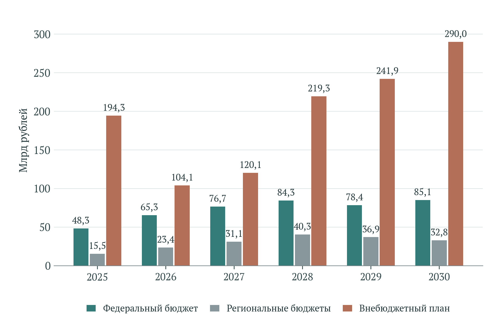

[B284; Caption] Рисунок 7 – Раскрытые финансовые ряды национального проекта по источникам в 2025⁠–⁠2030 годах

[B285; SourceNote] Млрд рублей. Региональные бюджетные строки могут включать федеральные трансферты; ряды показаны отдельно и не интерпретируются как независимые слагаемые консолидированного ресурса. Внебюджетные суммы являются плановыми. [Сноски 91]

[B286; Caption] Таблица 9 – Финансовые строки федеральных проектов на сопоставимом горизонте

[TABLE 9; B287]
Федеральный проект | 2025–2030, млрд руб. | Условная доля, % | Исключено за 2031–2036, млрд руб.
Создание номерного фонда, инфраструктуры и новых точек притяжения | 581,378 | 32,52 | 149,460
Пять морей и озеро Байкал | 1 177,363 | 65,85 | –
Туристическая привлекательность страны | 20,913 | 1,17 | –
Кадры для туризма | 4,272 | 0,24 | 0,060
Производство отечественной продукции для туристской индустрии | 4,038 | 0,23 | –
Итого | 1 787,964 | 100,00 | 149,520

[B288; SourceNote] Доли относятся к арифметической сумме раскрытых строк, не очищенной от межбюджетных оборотов. Знак «–» означает отсутствие раскрытых сумм после 2030 года. В П5 строка 2025 года отсутствует; показан полный опубликованный итог, равный сумме 2026–2030 годов. [Сноски 92]

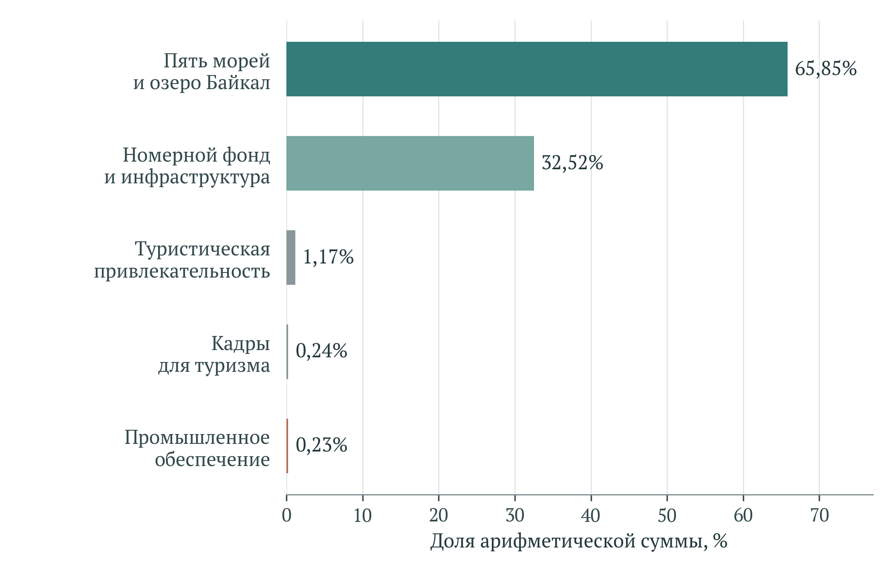

[B290; Caption] Рисунок 8 – Условная структура арифметической суммы раскрытых финансовых строк пяти федеральных проектов

[B291; SourceNote] Горизонт 2025–2030 годов. Доли рассчитаны от 1 787,964 млрд рублей и не являются долями чистых бюджетных расходов. Из П1 и П4 исключены строки после 2030 года; для П5 использован раскрытый полный итог при отсутствии отдельной строки 2025 года. [Сноски 93]

[B292; Heading2] 5.4 Морские курорты и отложенный внебюджетный ресурс

[B293; ] Финансовая конструкция «Пяти морей и озера Байкал» особенно зависит от будущих вложений. Из раскрытой суммы 1 177,363 млрд рублей на внебюджетные источники приходится 1 024,056 млрд, на федеральную строку – 99,736 млрд, на региональную валовую строку – 53,571 млрд. Внебюджетный компонент составляет 86,98% условного арифметического итога. Из него 751,183 млрд, или 73,35%, отнесено к 2028–2030 годам. Таким образом, основная масса предполагаемого негосударственного финансирования должна материализоваться после текущего бюджетного года, когда уже могут возникнуть обязательства по подготовительной и обеспечивающей инфраструктуре. [Сноски 94]

[B294; ] Эта структура создаёт риск несинхронного исполнения. Дорога, водоснабжение, очистные сооружения и электросети требуют вложений до появления устойчивого денежного потока гостиниц. Частный инвестор, напротив, заинтересован в подтверждении доступности инфраструктуры и спроса до окончательного принятия обязательств. Если бюджетная часть реализуется быстрее, чем частная, возникает риск недозагрузки созданных мощностей; если медленнее – стоимость задержки переносится на инвестора и может вызвать пересмотр проекта. Сам по себе высокий внебюджетный план не доказывает, что данный разрыв уже закрыт банковскими договорами и собственным капиталом участников.

[B295; ] Паспорт связывает внебюджетный ряд с результатом предоставления льготных кредитов и указывает 25,836 млрд рублей федерального финансирования соответствующего механизма на 2025–2030 годы. В годовых значениях результата предусмотрено по 40 единиц в 2026–2030 годах, всего 200. Такой счёт описывает поддерживаемые операции, а не объём освоенных инвестиций или число введённых гостиниц. Для оценки дополнительности необходимо знать величину и срок каждого кредита, график выдачи, долю рефинансирования, фактическое использование и состав объектов. Деление 1 024,056 млрд внебюджетного плана на число кредитов не даёт стоимости бюджетной поддержки, поскольку смешивает разные финансовые инструменты. [Сноски 95]

[B296; ] Дополнительное ограничение связано с описанием бюджетных инвестиций «Туризм.РФ». Финансовые строки результата дают 7,5 млрд рублей за 2027–2030 годы, итоговое значение и годовой ряд – 114 проектов к 2030 году. Однако текстовая характеристика говорит о 124 проектах и включает десять проектов 2026 года. До согласования этих элементов паспорт не предоставляет однозначный знаменатель для расчёта стоимости участия в одном проекте. Более того, один инвестиционный проект может включать несколько объектов, а участие корпорации не равно полной стоимости строительства. Экономическая оценка должна следовать за долей капитала, обязательствами сторон и результатом, полученным в обмен на государственное участие. [Сноски 96]

[B297; ] Для долгосрочных курортов обязательна оценка расходов после ввода. Капитальные вложения формируют актив, которому потребуются обслуживание, обновление, энергоснабжение, персонал и транспортное обеспечение. Эти затраты могут оплачивать инвестор, муниципалитет, регион или пользователь через тариф. Их отсутствие в одной строке НП не означает отсутствия для экономики. Обоснование круглогодичного режима должно подтверждаться распределением загрузки и доходов по сезонам: высокая посещаемость нескольких летних недель не гарантирует финансовой устойчивости объекта, рассчитанного на постоянную эксплуатацию.

[B298; Heading2] 5.5 Бюджетные предложения на 2027–2029 годы

[B299; ] В пояснительной записке к проекту федерального бюджета на 2027 год предусмотрено 87,9284 млрд рублей на национальный проект, на 2028 год – 88,1524 млрд, на 2029 год – 77,5814 млрд. Общая сумма трёхлетних предложений составляет 253,6622 млрд рублей. Для сравнения в той же таблице приведена роспись 2026 года на 1 сентября – 64,4531 млрд. Прирост 2027 года относительно этой базы составляет 23,4753 млрд рублей, или 36,42%. Это номинальное изменение федеральных ассигнований между разными годами, а не реальный прирост капитальных вложений отрасли. [Сноски 97]

[B300; ] Разложение изменения показывает его концентрацию. Проект создания номерного фонда получает увеличение с 45,7852 до 71,6363 млрд рублей, то есть на 25,8511 млрд. По морским курортам предусмотрено сокращение на 0,1900 млрд, по туристической привлекательности – на 4,4940 млрд. Кадровое направление увеличивается на 0,0565 млрд, промышленное – на 0,1701 млрд. Дополнительно появляются 2,0816 млрд зарезервированных ассигнований. Сумма всех изменений точно воспроизводит общий прирост. Резерв, согласно записке, предназначен для мероприятий по развитию национального маршрута «Золотое кольцо», но не является фактически произведённым расходом или завершённым объектом. [Сноски 98]

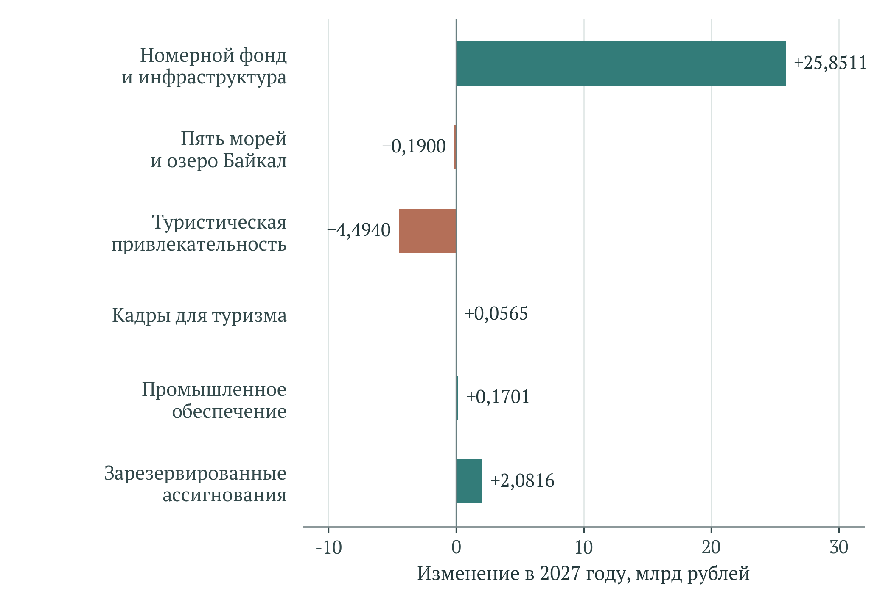

[B302; Caption] Рисунок 9 – Вклад федеральных проектов и резерва в изменение ассигнований между росписью 2026 года и проектом бюджета на 2027 год

[B303; SourceNote] Млрд рублей. База – сводная бюджетная роспись на 01.09.2026; сравнение – предложения на 2027 год. Сумма изменений составляет +23,4753 млрд рублей. [Сноски 99]

[B304; ] Сокращение туристической привлекательности требует содержательной расшифровки. В базе 2026 года присутствует 4,3701 млрд рублей по строке иных мероприятий структурного элемента; на 2027–2029 годы она равна нулю. Поэтому снижение всего ФП нельзя целиком трактовать как отказ от продвижения туризма. Поимённые направления продолжают включать внутреннее и зарубежное продвижение, экспертное сопровождение, обратную связь с отраслью и информационные системы. Для вывода об изменении конкретного инструмента нужны его собственная строка и неизменный состав мероприятий. [Сноски 100]

[B305; ] Особенно значима процентная поддержка. В 2027 году четыре раскрытые строки – общий механизм льготного кредитования туристической инфраструктуры, поддержка горнолыжных курортов, кредитование морских курортов и рефинансирование кредитов круглогодичных парков развлечений – в сумме составляют 50,4584 млрд рублей, или 57,39% федеральных предложений по НП. В росписи 2026 года их сумма равна 28,8001 млрд. Увеличение на 21,6583 млрд составляет 92,26% чистого прироста всего проекта. Такая пропорция характеризует вклад финансового механизма в изменение расходов; она не означает, что 92,26% будущего экономического результата обеспечивается кредитами. [Сноски 101]

[B306; ] Наконец, проект бюджета нельзя механически пристыковать к финансовым строкам паспорта. Федеральная строка НП на 2026 год составляет 65,3118514 млрд рублей, что отличается от сентябрьской росписи на 0,8587514 млрд. На 2027 год паспорт содержит 76,6695835 млрд, тогда как бюджетное предложение выше на 11,2588165 млрд. Для 2028 года расхождение составляет плюс 3,8524349 млрд, для 2029 года – минус 0,7981479 млрд. Это сопоставление редакций и бюджетных стадий. Оно не даёт основания заменять отдельные годы внутри паспортного шестилетнего итога и представлять полученную смешанную сумму как утверждённую стоимость проекта. [Сноски 102]

[B307; Caption] Таблица 10 – Федеральные ассигнования: роспись 2026 года и проект бюджета на 2027⁠–⁠2029 годы

[TABLE 10; B308]
Направление | 2026: роспись 01.09 | 2027: проект | 2028: проект | 2029: проект
Создание номерного фонда, инфраструктуры и новых точек притяжения | 45,7852 | 71,6363 | 60,1020 | 48,8570
Пять морей и озеро Байкал | 10,3458 | 10,1558 | 20,2000 | 21,7467
Туристическая привлекательность страны | 6,9637 | 2,4697 | 3,2290 | 2,1732
Кадры для туризма | 0,6729 | 0,7294 | 0,7771 | 0,8383
Производство отечественной продукции для туристской индустрии | 0,6855 | 0,8556 | 0,8324 | 0,8324
Зарезервированные ассигнования | 0,0000 | 2,0816 | 3,0119 | 3,1338
Всего | 64,4531 | 87,9284 | 88,1524 | 77,5814

[B309; SourceNote] Млрд рублей. Таблица 4.1.9 пояснительной записки к законопроекту № 615-9. Все строки пяти ФП и резерва точно согласуются с опубликованными годовыми итогами. Предложения не отождествляются с кассовыми расходами. [Сноски 103]

[B310; Heading2] 5.6 Кассовое исполнение 2026 года

[B311; ] По предварительным данным Минфина, исполнение федеральных расходов национального проекта на 1 октября 2026 года составляет 75,5% плановых бюджетных назначений. Сообщение датировано 8 октября. Указание в нём на исполнение 100% кассового плана относится к совокупности национальных проектов и не переносится автоматически на туризм. Абсолютная сумма кассы здесь не восстанавливается умножением 75,5% на паспортный показатель или сентябрьскую роспись: для такого вычисления нужен знаменатель именно той редакции, на основе которой опубликован процент исполнения. [Сноски 104]

[B312; ] Достаточно высокая доля перечисленных средств уменьшает неопределённость относительно прохождения бюджетных платежей, но оставляет открытым вопрос о результатах. Расходы могут включать авансирование строительства, перечисление межбюджетной субсидии, компенсацию банку процентной разницы или вклад в капитал института развития. Для каждого инструмента экономическое содержание кассы различается. Перечисленный трансферт необходимо проследить до расходов получателя; внесённый капитал – до использования проектной компанией; субсидию банку – до обслуживаемого кредитного портфеля. Повторно складывать эти последовательные движения нельзя.

[B313; ] Оценка исполнения должна поэтому объединять денежный и физический графики по одному объекту. Для строительства существенны принятые работы, готовность подключения и возможность эксплуатации; для обучения – завершение программы и подтверждённые компетенции; для продвижения – измеримый дополнительный спрос. Отставание платежей не всегда означает отставание результата, если действует оплата после приёмки. Быстрая касса также может предшествовать фактической готовности. Сопоставление имеет смысл только при учёте условий соглашения и календаря работ, а не через универсальное предположение о равномерном расходовании годового бюджета.

[B314; Heading2] 5.7 Льготное кредитование, инвестиции и дополнительность

[B315; ] Процентная субсидия оплачивает часть стоимости привлечения капитала. Её бюджетный объём зависит от поддерживаемого остатка долга, сроков, условий компенсации и динамики ставок. Увеличение этой строки может сопровождать расширение портфеля, удорожание обслуживания ранее предоставленных кредитов или изменение параметров поддержки. Поэтому рост расходов на субсидирование не тождественен пропорциональному росту новых гостиничных мощностей. Наличие в проекте бюджета отдельной строки рефинансирования парков развлечений особенно наглядно показывает, что поддержка может менять условия уже существующих обязательств. [Сноски 105]

[B316; ] Экономический вопрос состоит в том, какая часть инвестиций без субсидии не состоялась бы, была бы реализована позднее или имела бы меньший масштаб. Если получатель мог построить тот же объект на рыночных условиях, основным результатом поддержки становится перераспределение дохода в его пользу. Если субсидия снимает ограничение, препятствующее общественно полезному проекту, возникает дополнительный эффект. Различить ситуации можно через сопоставление близких проектов, получивших и не получивших поддержку, с учётом исходной готовности, качества обеспечения, расположения и спроса. Простое сравнение получателей со всей отраслью может быть смещено различиями в исходной готовности, спросе и условиях отбора; направление смещения требует проверки.

[B317; ] Финансовый анализ требует раздельного учёта бюджетной субсидии, банковского кредита и собственного капитала. Кредит представляет возвратное финансирование, а не безвозмездный бюджетный расход. Инвестиции описывают использование средств для создания актива; они могут финансироваться тем же кредитом. Если одновременно суммировать выданный кредит и оплаченные из него строительные работы, получится повторный счёт. Бюджетную цену поддержки следует сопоставлять с дополнительным результатом, тогда как полную инвестиционную стоимость – с будущим потоком услуг и эксплуатационными расходами. Эти расчёты отвечают на разные вопросы и не должны заменять друг друга.

[B318; ] Для участия институтов развития важны условия возврата средств и распределения убытков. Взнос в капитал создаёт финансовый актив государства или корпорации, но его экономическая стоимость зависит от перспектив возврата, стоимости последующего финансирования и принимаемого риска. Поддержание деятельности самой корпорации представляет отдельный расход: в паспорте номерного фонда на сопровождение проектов предусмотрено 2,670 млрд рублей, на бюджетные инвестиции – 3,894 млрд. Их нельзя интерпретировать как одинаковые по содержанию вложения в строительные объекты. Сопровождение должно оцениваться через подготовленные и реализованные проекты, сроки прохождения процедур и устранённые ограничения. [Сноски 106]

[B319; ] Долгие кредитные обязательства также объясняют, почему финансовая оценка не заканчивается формальным 2030 годом. Раскрытые строки номерного фонда продолжаются до 2036 года. В экономическом анализе они требуют внимания к стоимости поддержки за весь период, хотя для структуры 2025–2030 годов исключаются. Решение о новом объекте должно учитывать будущую нагрузку на бюджет, устойчивость заемщика к снижению загрузки и возможную потребность в реструктуризации. Иначе первоначально ограниченная субсидия способна сопровождаться дополнительными обязательствами, которые не видны из расходов года отбора. [Сноски 107]

[B320; Heading2] 5.8 Модульные гостиницы и единая субсидия

[B321; ] По модульным средствам размещения раскрыты 14,1027794 млрд рублей федеральных перечислений бюджетам субъектов за 2025–2027 годы. Региональная валовая сумма по тому же результату составляет 14,9408377 млрд; эти величины перекрываются. При этом количественные строки содержат 6 057 номеров в 2026 году и 4 014 в 2027 году, всего 10 071. Отдельное значение ввода за 2025 год в данном представлении отсутствует, хотя финансирование этого года присутствует. Поэтому деление всей трёхлетней федеральной суммы на 10 071 номер не признаётся надёжной оценкой стоимости номера: необходимо сначала связать платежи и ввод с одними инвестиционными проектами. [Сноски 108]

[B322; ] Более содержательный критерий – стоимость дополнительного доступного номерного фонда с учётом периода эксплуатации. Для него нужны не только количество модулей и размер субсидии, но и фактическое использование, сезон работы, подключение к инфраструктуре, обслуживание и срок службы. Быстрый ввод может быть полезен при локальном дефиците размещения, однако объект с низкой загрузкой создаёт меньший поток услуг при той же первоначальной поддержке. Сравнивать модульные и капитальные гостиницы следует по сопоставимому качеству, расположению и доступным место-суткам за жизненный цикл. Фактические ночёвки характеризуют использование этой мощности. Расходы необходимо привести к общему базовому году цен; при различающихся сроках службы требуется сопоставимый горизонт с учётом замены и остаточной стоимости либо расчёт эквивалентных годовых затрат.

[B323; ] Единая субсидия в бюджетных предложениях сохраняется на уровне 9 млрд рублей ежегодно в 2027–2029 годах. Она объединяет региональные мероприятия, для которых эффект может возникать через благоустройство, события, маршруты и иные элементы туристического предложения. Количество оплаченных мероприятий не обеспечивает сопоставимости их ценности: небольшая инвестиция, устраняющая конкретное ограничение, может иметь большую отдачу, чем более дорогой объект без подтверждённого спроса. Для оценки следует фиксировать исходное ограничение, ожидаемое изменение и фактический дополнительный поток посетителей, сохраняя отдельно затраты на дальнейшее содержание. [Сноски 109]

[B324; ] Особого контроля требует совпадение объекта поддержки по нескольким механизмам. Региональная субсидия, льготный кредит, средства корпорации и обеспечивающая инфраструктура могут обслуживать один комплекс. Совместное финансирование само по себе допустимо и может быть необходимым, но в сводной оценке объект и его результат должны учитываться один раз. Для этого нужен единый идентификатор инвестиционного проекта и связанный перечень источников, договоров, активов и обязательств. Тогда можно отличить финансовое участие нескольких сторон от повторного заявления одного и того же результата.

[B325; Heading2] 5.9 Стоимость кадровых, промышленных и информационных результатов

[B326; ] Кадровый проект предоставляет относительно ясный пример расчётной удельной стоимости. На результат завершения практико-ориентированных программ обучения предусмотрено 2,3 млрд рублей в 2025–2030 годах; сумма годовых значений составляет 52 150 слушателей и совпадает с итогом результата. Отношение даёт около 44,104 тыс. рублей планового федерального финансирования на одного завершившего обучение. Это среднее распределение бюджетной строки, включающей обеспечение образовательной деятельности, а не установленная цена обучения конкретного человека и не оценка достигнутого роста производительности. Для последнего нужны подтверждённые навыки, их применение на рабочем месте и изменение результата труда. [Сноски 110]

[B327; ] По промышленному обеспечению раскрыто 4,0384786 млрд рублей федерального финансирования и 11 420 единиц реализованной отечественной продукции к 2030 году. Формальное отношение составляет 353,632 тыс. рублей на единицу. Оно пригодно для арифметической диагностики, но слабо характеризует эффективность: единицы оборудования могут различаться по цене, мощности и назначению. Поддержка спроса также может перераспределять закупки между производителями или переносить их между годами. Поэтому необходимы данные о составе продукции, величине скидки, рыночной цене и объёме выпуска, который не возник бы без компенсации. [Сноски 111]

[B328; ] В туристической привлекательности на развитие и функционирование информационных систем Минэкономразвития раскрыто 4,126 млрд рублей за 2025–2030 годы. Итог в шесть единиц сопровождается ежегодными результатами и не должен автоматически трактоваться как шесть независимых новых систем. Финансирование объединяет развитие и поддержание функционирования. Его полезность проявляется в качестве данных, снижении административных затрат, доступности реестров и удобстве выполнения конкретных операций. Повторная оплата эксплуатации одной системы может быть обоснованной, однако ежегодное функционирование нельзя повторно представлять как создание нового актива. [Сноски 112]

[B329; ] Для продвижения туризма финансовая отдача должна оцениваться по дополнительным поездкам и расходам туристов, а не по охвату сообщений или числу мероприятий. Особенно важно различать привлечение нового спроса и его перераспределение между российскими направлениями. Рост посещаемости поддержанного региона может сочетаться с сокращением потока в другом регионе, не увеличивая общенациональный результат. Более убедительным объектом оценки становится привлечение иностранных посетителей, увеличение продолжительности пребывания или заполнение свободных мощностей в низкий сезон, если дополнительность подтверждается сопоставимыми данными.

[B330; Caption] Таблица 11 – Удельная стоимость результатов: допустимые расчёты и ограничения

[TABLE 11; B331]
Результат | Раскрытый план, млрд руб. | Количественная база | Экономическая интерпретация
Завершение практико-ориентированных программ обучения | 2,300000 | 52 150 слушателей | 44,104 тыс. руб. на слушателя; среднее распределение бюджетной строки, не доказанная отдача обучения
Компенсация скидок на отечественное оборудование | 4,038479 | 11 420 единиц продукции | 353,632 тыс. руб. на единицу; оборудование неоднородно, эффект дополнительного выпуска отдельно не установлен
Модульные средства размещения: федеральные трансферты | 14,102779 | 10 071 номер в 2026–2027 годах | Платежи охватывают 2025–2027 годы; стоимость номера не рассчитывается без согласования состава проектов
Бюджетные инвестиции «Туризм.РФ» в морские курорты | 7,500000 | 114 в итоговом поле; 124 в характеристике | Знаменатель противоречив; стоимость участия в одном проекте не рассчитывается
Развитие и функционирование информационных систем | 4,126013 | Шесть ежегодных результатов | Не шесть независимых новых систем; развитие и эксплуатация в финансовой строке не разделены

[B332; SourceNote] Основной горизонт – 2025–2030 годы; для модульных гостиниц платёжные годы 2025–2027, для бюджетных инвестиций в морские курорты 2027–2030. Все суммы плановые. Удельные величины являются авторскими расчётами; они не измеряют фактическую эффективность или дополнительность. [Сноски 113]

[B333; Heading2] 5.10 Финансовые условия доказуемой эффективности

[B334; ] Финансовая оценка проекта требует двух согласованных представлений. Первое описывает бюджетную нагрузку с исключением межбюджетных оборотов, выделением процентных субсидий, капитализации и текущих расходов. Второе описывает стоимость и результат конкретных инвестиционных проектов: полученные средства, созданные активы, эксплуатационные обязательства и дополнительные услуги. Переход между ними должен быть воспроизводимым. Без такого перехода крупный внебюджетный план легко принять за уже привлечённый капитал, а сумму финансовых записей – за консолидированную стоимость национального проекта.

[B335; ] Для морских курортов решающее значение имеют финансовое закрытие и согласование этапов. Бюджетное решение о следующей очереди следует связывать с готовностью земли и инфраструктуры, подтверждённым собственным капиталом, обязательствами кредиторов и проверяемым графиком эксплуатации. Для льготного кредитования нужны сведения о поддерживаемом портфеле и будущей стоимости субсидии. Для модульных гостиниц – соответствие платежей конкретным введённым номерам. Для кадровых и промышленных мер – проверка применения навыков и дополнительного выпуска. Такое различение позволяет оценивать каждую меру по результату, который она действительно способна обеспечить.

[B336; ] На срезе 29 октября 2026 года открытые данные подтверждают значительный масштаб финансовых планов, концентрацию предполагаемых вложений в инфраструктуре и существенное увеличение федеральной процентной поддержки в предложениях на 2027 год. Они не подтверждают равенство опубликованной суммы 1 787,964 млрд рублей чистому ресурсу проекта, фактическое привлечение всех заявленных внебюджетных средств или достижение соответствующего экономического эффекта. Обоснованная положительная оценка должна опираться на согласованные денежные и физические результаты, дополнительность вложений и устойчивость эксплуатации, а не на масштаб объявленного финансирования. [Сноски 114]

[B337; Heading1] 6 Связи мероприятий с показателями и межпроектное взаимодействие

[B338; Heading2] 6.1 Единицы анализа и документированные связи

[B339; ] В шести структурированных паспортах выделены 31 карточка результата, 20 карточек задач, 14 карточек показателей и шесть целей. Количество карточек отражает устройство документов. Три национальных показателя повторяются в федеральных проектах, поэтому 14 карточек соответствуют 11 различным наименованиям показателей. Статистический перечень из десяти кодов имеет другую границу: дополнительное число подготовленных специалистов предусмотрено паспортом кадрового направления и отдельной методикой, но отсутствует в рассматриваемом перечне кодов. Сопоставление количества показателей возможно только после согласования этих уровней. [Сноски 115]

[B340; ] Каждый из 31 результатов связан с задачей, указанной в документе. Через общую задачу устанавливаются 49 пар «результат – показатель», охватывающих все 31 результата и 11 карточек показателей федеральных проектов. Принадлежность общей задаче подтверждает организационную согласованность, но не определяет величину эффекта. Несколько мероприятий могут действовать одновременно, а изменение показателя может зависеть от условий, находящихся за пределами проекта.

[B341; Caption] Таблица 12 – Уровни документальных связей и пределы их доказательности

[TABLE 12; B342]
Уровень | Раскрытый объём | Допустимый вывод
Карточки документов | 31 результат; 20 задач; 14 показателей; 6 целей | Структура шести паспортов; число карточек не равно числу уникальных показателей
Различные наименования показателей | 11 наименований при 14 карточках | Три национальных показателя повторяются в ФП
Общая задача | 49 пар; 31 результат; 11 карточек показателей ФП | Структурная принадлежность, без количественной оценки эффекта
Записи о прямом влиянии | 73 записи с неоднозначными адресатами | Веса прямого влияния не используются
Лексические кандидаты | 20 пар; 13 результатов; 9 показателей | Кандидаты для содержательной проверки; порог 0,10 не является статистической значимостью
Результаты без кандидата | 18 из 31 | Отсутствие совпадающей лексики не доказывает разрыва механизма

[B343; SourceNote] Авторский разбор паспортов и текстовое сопоставление. Повторные наименования показателей объединены до отбора до трёх кандидатов на результат. [Сноски 116]

[B344; ] В открытом представлении присутствуют 73 записи о влиянии результатов на показатели, однако их адресаты не устанавливаются однозначно по доступным реквизитам. Поэтому количественные веса прямого влияния в экспертизе не используются. Такое ограничение относится к проверяемости опубликованного представления и не свидетельствует об отсутствии связей в ведомственной системе управления. Для внешнего анализа необходимы устойчивый идентификатор показателя, смысл веса и правило его определения. [Сноски 117]

[B345; ] Система связей должна позволять различать непосредственный результат и более отдалённое последствие. Для льготного кредита первым результатом выступает поддержанное обязательство, затем возникает введённый объект, далее – оказанная туристическая услуга. Для рекламной кампании последовательность включает контакт, изменение намерения, бронирование и состоявшуюся поездку. Связь с конечным показателем требует наблюдения этих переходов, особенно когда один результат соотнесён сразу с несколькими целями.

[B346; Heading2] 6.2 Методика лексического сопоставления

[B347; ] Лексическое сопоставление используется для поиска содержательно близких формулировок и проверки полноты экспертного рассмотрения. В основной профиль каждого паспорта включены цели, задачи, результаты с описаниями и показатели. Повторные формулировки внутри документа исключены. Организационные реквизиты и многочисленные контрольные точки не формируют основной смысловой профиль. Шесть профилей проекта содержат 2188 слов, причём объём национального паспорта существенно меньше совокупности федеральных документов.

[B348; ] Текст преобразован к нижнему регистру с унификацией «ё» и «е». Служебные слова исключены. Используются отдельные слова и последовательности из двух слов, а вес признака определяется методом TF–IDF. Редкая для корпуса формулировка получает больший вес при прочих равных условиях. При положительной частоте признака применяется логарифмическое преобразование частоты и сглаженная обратная документная частота. [Сноски 118]

[B349; ] (2)

[Формула] wₜ,d = (1 + ln fₜ,d) × [1 + ln((N + 1)/(dfₜ + 1))]

$$
w_{t,d}=(1+\ln f_{t,d})\left[1+\ln\frac{N+1}{df_t+1}\right]
$$

[B350; ] В формуле частота признака обозначает число его появлений в документе, число документов задаёт размер сравнительного корпуса, а документная частота показывает количество текстов, содержащих признак. Для отсутствующего признака вес равен нулю. Перед сопоставлением векторы нормируются по евклидовой длине. Сходство определяется косинусом угла между нормированными векторами.

[B351; ] (3)

[Формула] cos(d₁, d₂) = (w₁ · w₂)/(‖w₁‖ × ‖w₂‖)

$$
\cos(d_1,d_2)=\frac{w_1\cdot w_2}{\lVert w_1\rVert\lVert w_2\rVert}
$$

[B352; ] Словарь построен на 137 документах сравнительного корпуса с ограничением в 20 тысяч признаков. Признак допускается при наличии хотя бы в одном документе, но исключается, если встречается более чем в 98% документов. Для межпроектного сопоставления используются средние нормированные профили структурированных паспортов, повторно приведённые к единичной длине. Таким образом, длинный паспорт не получает вес, пропорциональный своему числу страниц.

[B353; ] Коэффициент характеризует близость выбранных текстовых представлений. Его нельзя интерпретировать как долю общего экономического содержания, вероятность реализации мероприятия или причинный вклад. Результат зависит от языка формулировок, состава корпуса и обработки словоформ. Эти ограничения проверяются содержательным разбором пар и сопоставлением с вариантом выделения основ слов.

[B354; Heading2] 6.3 Внутренняя специализация федеральных проектов

[B355; ] Наиболее близкие профили внутри проекта имеют П1 «Создание номерного фонда» и П2 «Морские курорты»: косинусное сходство составляет 0,627. Оба направления используют лексику строительства, инфраструктуры, инвестирования и технологического присоединения. Содержательная близость указывает на необходимость согласовывать границы объектов и инструментов финансирования. Сам по себе коэффициент не устанавливает дублирования расходов.

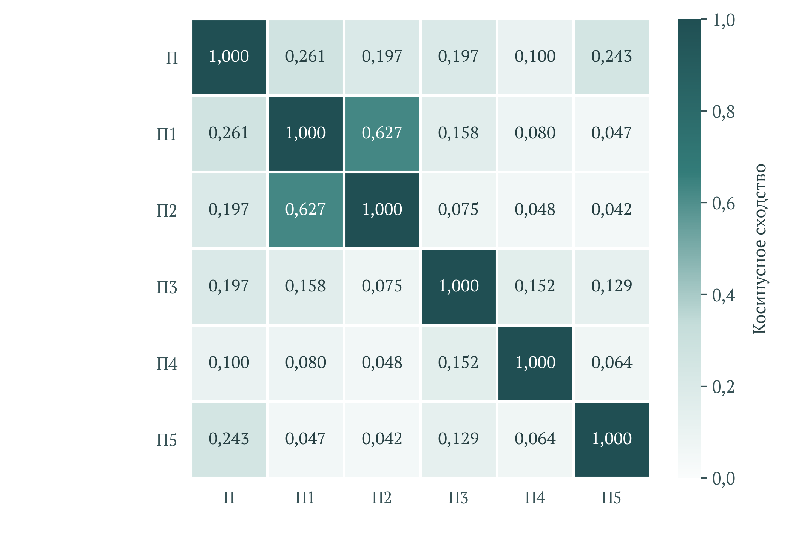

[B357; Caption] Рисунок 10 – Лексическое сходство смысловых профилей шести паспортов

[B358; SourceNote] Авторский расчёт TF–IDF и косинусного сходства. П – национальный проект; П1 – номерной фонд; П2 – морские курорты; П3 – привлекательность; П4 – кадры; П5 – промышленное обеспечение. Коэффициент не измеряет причинный вклад, дублирование расходов или бюджетную значимость. [Сноски 119]

[B359; ] Профиль национального паспорта ближе всего к П1, для которого коэффициент составляет 0,261, и к П5 «Промышленное обеспечение туризма» – 0,243. Такие соотношения зависят от краткости национального профиля и его словаря. Их нельзя переносить на бюджетную значимость направлений. Например, кадровая подготовка может быть необходимым условием работы гостиниц при сравнительно небольшом лексическом сходстве с национальной формулировкой цели.

[B360; ] Различия П1 и П2 следует проверять по географии, перечню объектов, стадиям инвестиционного цикла и составу источников. У направлений могут совпадать способы поддержки при разных получателях. Для контроля дополнительности требуется единый реестр объектов и инструментов, позволяющий проследить совокупную помощь и результаты каждого комплекса. Для оценки синергии необходимы сведения о фактическом использовании совместно созданных инфраструктурных элементов.

[B361; ] Низкое сходство П5 с инфраструктурными паспортами отражает иную лексику: подтверждение производства, реализация продукции и компенсация скидок. Связь этого направления с гостиницами проходит через оборудование, сроки поставок и стоимость эксплуатации. Для анализа такой зависимости нужны данные о поставках конкретным туристическим объектам, поскольку общие текстовые коэффициенты описывают её лишь частично.

[B362; Heading2] 6.4 Проверка связей между результатами и показателями

[B363; ] При отборе лексических кандидатов одинаковые наименования национальных и федеральных показателей объединены. Для каждого результата рассмотрены до трёх различных показателей с наибольшим сходством, если коэффициент не ниже 0,10. Получено 20 кандидатных пар, охватывающих 13 результатов и девять показателей. Для 18 результатов подходящего кандидата по этому правилу нет. Порог является техническим условием отбора и не имеет значения критерия статистической значимости.

[B364; Caption] Таблица 13 – Содержательная проверка выбранных лексических соответствий

[TABLE 13; B365]
Результат → показатель | Косинус | Интерпретация
Единая субсидия → туристические поездки | 0,391 | Нужны отдельные оценки разнородных региональных мероприятий
Модульные номера → классифицированный фонд | 0,357 | Физический ввод должен быть связан с регистрацией без повторного учёта
Продвижение въездного туризма → экспорт услуг | 0,324 | Нужны дополнительные поездки и расходы посетителей; цены и курс влияют отдельно
ИС Росаккредитации → классифицированный фонд | 0,316 | Расширение учёта может увеличивать показатель без строительства
Поддержка организаций Крыма и Севастополя → отечественная продукция | 0,310 | Общие слова об отрасли не подтверждают закупку оборудования

[B366; SourceNote] Коэффициенты рассчитаны по текстам. Содержательная интерпретация не является оценкой причинного эффекта. [Сноски 120]

[B367; ] Наиболее высокий коэффициент среди рассмотренных пар, 0,391, относится к мероприятиям единой региональной субсидии и количеству поездок. Он частично обусловлен описанием территории реализации и общей туристической лексикой. Для оценки эффекта единой субсидии требуется разделять типы мероприятий, поскольку благоустройство пляжа, навигация и событийное продвижение имеют разные механизмы и временные горизонты. Объединённый результат не задаёт единой функции воздействия на поток.

[B368; ] Связь ввода модульных номеров с классифицированным номерным фондом имеет коэффициент 0,357 и содержательно соответствует непосредственному расширению предложения. Однако значение определяется при соблюдении условий: объекты введены, включены в соответствующую совокупность и не учтены повторно в другом результате. Связь информационной системы Росаккредитации с тем же показателем, 0,316, имеет иной смысл. Улучшение регистрации может увеличить учтённый фонд без сопоставимого строительства. [Сноски 121]

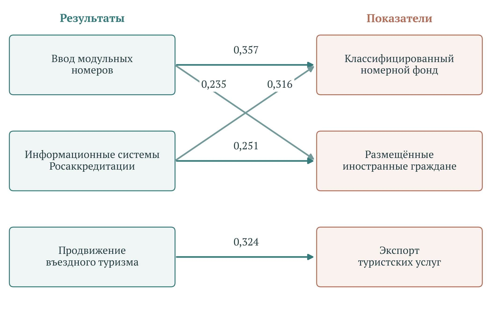

[B370; Caption] Рисунок 11 – Пять лексических соответствий между результатами и показателями

[B371; SourceNote] Показан выбранный фрагмент из трёх результатов и трёх показателей; числа на стрелках – косинусное сходство текстов. Направление стрелки обозначает сопоставление результата с показателем, а не доказанный причинный эффект. [Сноски 122]

[B372; ] Продвижение въездного туризма связано с экспортом услуг с коэффициентом 0,324. Для содержательной оценки нужно установить изменение спроса на целевых рынках, конверсию в состоявшиеся поездки и расходы посетителей. Общий рост денежного показателя зависит также от цен, валютных соотношений и транспортных условий. Поэтому эффект кампании требует отдельного сравнения территорий или рынков с разной интенсивностью воздействия.

[B373; ] Лексический метод выявляет и потенциально ложные соответствия. Поддержка организаций Республики Крым и города Севастополя сопоставлена с обеспеченностью отечественной промышленной продукцией с коэффициентом 0,310. Общие слова о туристской индустрии не подтверждают, что содержание поддержки связано с закупкой оборудования. Для такой связи требуется прямое условие программы или сведения о фактическом использовании средств. [Сноски 123]

[B374; ] Отсутствие кандидата также не доказывает разрыва механизма. Инженерная инфраструктура крупных курортов может быть необходима для появления новых поездок, даже если её формулировка содержит мало общих слов с названием показателя. Экспертная оценка должна учитывать обе ошибки лексического отбора: появление содержательно слабых пар и пропуск экономически значимых зависимостей. Окончательное решение требует обращения к описанию результата, его получателям и условиям реализации.

[B375; Heading2] 6.5 Межпроектные зависимости и чувствительность результатов

[B376; ] В сравнении со структурированными паспортами других национальных проектов наиболее близок профиль «Эффективной и конкурентной экономики» с коэффициентом 0,192. Далее следуют «Международная кооперация и экспорт» – 0,173, «Экономика данных и цифровая трансформация государства» – 0,166, «Инфраструктура для жизни» – 0,162 и «Молодёжь и дети» – 0,156. Сопоставление отражает общие механизмы поддержки предприятий, внешнего спроса, инфраструктуры и подготовки кадров.

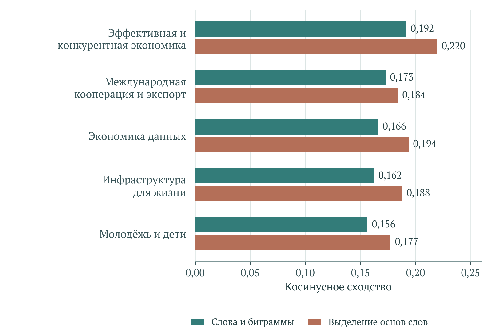

[B378; Caption] Рисунок 12 – Чувствительность межпроектного лексического сходства к обработке русских слов

[B379; SourceNote] Пять ближайших профилей по базовой модели сопоставлены с вариантом выделения основ слов. Шкала – косинусное сходство; более высокий коэффициент не доказывает более сильную экономическую зависимость. «Семья» не включена из-за различия жанра исходного документа. Авторские расчёты. [Сноски 124]

[B380; ] При обработке русских слов методом выделения основ первое место сохраняет «Эффективная и конкурентная экономика» с коэффициентом 0,220. Второе и третье места занимают «Экономика данных» и «Инфраструктура для жизни» с коэффициентами 0,194 и 0,188. В первой тройке двух вариантов совпадают два проекта. В первой тройке сохраняются два лексически близких профиля; точный порядок соседей чувствителен к обработке языка. Экономические зависимости требуют отдельной содержательной проверки.

[B381; ] Паспорт «Семьи» не включён в сопоставимую диаграмму, поскольку в сравнительном материале он представлен документом другого жанра. Его включение в единое ранжирование потребовало бы согласования состава текстовых полей. Такое ограничение не исключает содержательной связи семейной политики с доступностью отдыха, но предупреждает смешение методологических оснований.

[B382; ] Экономические зависимости могут быть существенными при умеренной текстовой близости. Для туризма транспортная доступность определяет возможность поездки, а качество городской и коммунальной среды влияет на пребывание. Экологическое состояние территорий связано с сохранением ресурса туристического спроса. Для совместной оценки предлагается проверять конкретные проекты на общей территории и в общем временном окне, фиксируя вклад каждой инфраструктурной системы.

[B383; ] Поэтому межпроектное взаимодействие следует описывать через согласованные результаты. Примером служит одновременная готовность дороги, коммунальных сетей и гостиницы, позволяющая открыть объект в установленный сезон. Для кадровых программ таким результатом является обеспечение работающего комплекса подготовленными сотрудниками. Для цифровых систем – сопоставимые сведения об объектах и завершённых услугах, пригодные для статистики и управленческой оценки.

[B384; Heading1] 7 Предложения по повышению результативности и проверяемости проекта

[B385; Heading2] 7.1 Согласование показателей и статусов оценок

[B386; ] Первым приоритетом предлагается сделать согласование паспортных целей, действующих методик и статистических публикаций. Для каждого показателя нужна единая карточка, содержащая определение совокупности, единицу измерения, период накопления, источники числителя и знаменателя, даты публикации и порядок пересмотра. Следует отдельно обозначать денежный результат, физический прокси, административную запись и величину, временно принятую равной плану.

[B387; ] История методик должна сопровождаться описанием разрывов ряда. При изменении охвата средств размещения требуется установить, пересчитаны ли прошлые периоды и каким образом новые категории влияют на уровень показателя. Если сопоставимость восстановлена только для части совокупности, полезно публиковать параллельный ряд постоянного охвата. Такой ряд даст возможность различать изменение деятельности и расширение наблюдения.

[B388; ] Для первой годовой оценки, основанной на плане, предлагается использовать отдельный визуальный и машинно-читаемый статус. При появлении статистического результата следует раскрывать заменённую величину, дату и размер пересмотра. Расчёт выполнения цели должен опираться на независимое наблюдение установленной совокупности. Автоматическое повторение предварительной величины в нескольких публикациях не увеличивает доказательность результата.

[B389; ] Особого внимания требует соответствие названия денежного показателя используемой формуле. Для доли туристской отрасли следует раскрывать экономический смысл обеих частей отношения и систему цен. При международном сравнении необходимо согласовать показатели туристских отраслей с показателями, относимыми к потреблению посетителей. Номинальную величину полезно дополнять динамикой в сопоставимых ценах, когда её можно рассчитать по официальным данным.

[B390; Heading2] 7.2 Работающий номерной фонд и сезонность

[B391; ] Мониторинг номерного фонда предлагается строить на трёх связанных состояниях: реестровая ёмкость, фонд, допущенный к работе, и фактически открытая мощность за период. Для каждого объекта должны быть различимы строительный ввод, начало обслуживания, временное прекращение работы, изменение категории и выбытие. Единый идентификатор позволит связать реестр, государственную поддержку и статистику размещения без повторного учёта.

[B392; ] Количество открытых номеро-суток отражает доступную мощность с учётом продолжительности работы. Коммерческая загрузка определяется отношением проданных номеро-суток к открытым. При использовании данных о местах и ночёвках нужен отдельный расчёт загрузки мест: номер может иметь несколько мест, поэтому смешивать эти знаменатели нельзя. Показатели следует строить для сопоставимых групп средств размещения с раскрытием охвата.

[B393; ] (4)

[Формула] Z = (Rпрод / Rоткр) × 100%

$$
Z=\frac{R_{\text{прод}}}{R_{\text{откр}}}\times100\%
$$

[B394; ] В формуле показатель коммерческой загрузки номеров выражается в процентах. Числитель – фактически проданные номеро-сутки, знаменатель – номеро-сутки, открытые для размещения в том же периоде. Для объекта, полностью закрытого в рассматриваемый период, отношение не рассчитывается. Нулевая загрузка и отсутствие доступной мощности имеют различный смысл. Для измерения физического использования числитель должен содержать фактически занятые номеро-сутки. Правила учёта оплаченных незаездов и бесплатного размещения следует раскрывать отдельно.

[B395; ] Для проверки круглогодичности необходим помесячный профиль, а не только годовой итог. В качестве прозрачного дополнительного измерения предлагается доля ночёвок, приходящихся на три месяца с наибольшим числом ночёвок. Выбор месяцев производится отдельно для каждого года и территории, поэтому показатель отражает концентрацию независимо от того, приходится ли пик на лето или зиму. Результат следует сопровождать самим месячным рядом.

[B396; ] (5)

[Формула] S₃ = ((N₍₁₎ + N₍₂₎ + N₍₃₎) / Nгод) × 100%

$$
S_3=\frac{N_{(1)}+N_{(2)}+N_{(3)}}{N_{\text{год}}}\times100\%
$$

[B397; ] В числителе суммируются ночёвки трёх месяцев с наибольшим числом ночёвок, в знаменателе – ночёвки всех двенадцати месяцев. При нулевом годовом числе ночёвок показатель не рассчитывается. При одинаковом потоке в каждом месяце доля составляет 25%. Более высокая величина характеризует концентрацию, но не устанавливает её причину. Для расчёта нужны действительные месячные наблюдения одной редакции и одинакового охвата. Разности накопительных публикаций с неодновременными пересмотрами могут быть непригодны для этой задачи.

[B398; ] Оценка круглогодичных курортов должна дополнительно показывать число месяцев работы, доступность услуг вне пика, годовой доход и устойчивость занятости. Снижение сезонности может сопровождаться ростом расходов на отопление и обслуживание. Поэтому равномерность загрузки следует рассматривать вместе с затратами и качеством, сохраняя возможность экономически обоснованной сезонной модели там, где круглогодичность не подтверждена спросом.

[B399; Heading2] 7.3 Полная стоимость и дополнительность государственной поддержки

[B400; ] Финансовый мониторинг предлагается вести по объекту, получателю и инструменту поддержки одновременно. Для каждого обязательства нужны сведения о бюджетном источнике, межбюджетном перечислении, конечном использовании, сроке и фактическом исполнении. Федеральный трансферт, включённый в региональные расходы, учитывается однократно при консолидации. Субсидирование процентов, основной долг кредита и инвестиции частного получателя имеют различную экономическую природу.

[B401; ] (6)

[Формула] Bконс = Bфед + Bрег − T

$$
B_{\text{конс}}=B_{\text{фед}}+B_{\text{рег}}-T
$$

[B402; ] В формуле федеральные и региональные расходы объединяются с исключением трансфертов между соответствующими бюджетами. При добавлении внебюджетных вложений необходимо проверить отсутствие их повторного отражения в других компонентах и подтвердить единство периода. Формула задаёт правило консолидации, но не заменяет проверку первичных строк. Для текущего проекта отсутствие полного сопоставимого вычета сохраняется как ограничение агрегированной финансовой оценки.

[B403; ] Стоимость инфраструктурного результата следует определять за жизненный цикл, включая подготовку, создание, подключение, эксплуатацию, капитальный ремонт и завершение использования. Для гостиничных комплексов бюджетная нагрузка может сохраняться после строительного ввода через процентные субсидии, обслуживание общих сетей и иные обязательства. Решение о продолжении поддержки должно опираться на подтверждённую готовность, использование и изменение полной стоимости услуги. Сопоставление требует общего базового года цен и согласованного приведения разновременных расходов; при различающихся сроках службы нужно учитывать замену и остаточную стоимость либо применять эквивалентные годовые затраты.

[B404; ] Удельные затраты полезны при согласованном знаменателе. Стоимость введённого номера, открытого номеро-дня и дополнительной ночёвки отвечают на разные вопросы. Дополнительный результат требует сравнения с обоснованным сценарием без поддержки. Простое деление всех расходов проекта на общий туристический поток включает поездки, которые могли бы состояться независимо от программы, и потому не даёт оценки эффективности конкретной меры.

[B405; ] Для кредитной поддержки предлагается отдельно раскрывать число новых обязательств, поддержку действующего портфеля и чувствительность будущих расходов к процентным условиям. Для прямых инвестиций существенны сроки ввода и распределение рисков между участниками. Для компенсации скидок производителям оборудования – дополнительные поставки, качество и стоимость обслуживания. Одинаковая денежная сумма разных инструментов не означает одинаковой бюджетной нагрузки или одинакового результата.

[B406; Heading2] 7.4 Доступность отдыха и результаты для принимающих территорий

[B407; ] Социальную оценку предлагается дополнить наблюдением доли жителей, совершивших хотя бы одну поездку с целью отдыха за год, и причин отказа от неё. Единицей счёта здесь выступает человек. Для семей необходимы показатели участия детей и совместных поездок, а также расходы на стандартную поездку для разного состава домохозяйства. Опросы должны сохранять сопоставимые вопросы и период воспоминания.

[B408; ] Стоимость отдыха целесообразно оценивать как совокупность транспортных расходов, размещения, питания и обязательных сопутствующих услуг. Сравнение одной гостиничной цены не описывает доступность для жителя удалённой территории. Для межрегионального анализа нужен фиксированный состав поездки и единое окно бронирования, дополненные вариантами по сезону. Отношение такой стоимости к располагаемому доходу следует показывать по группам населения, поскольку средняя величина скрывает распределение возможностей.

[B409; ] Физическая доступность включает всю последовательность перемещений и получения услуг: транспорт, размещение, санитарные условия, объекты показа и коммуникацию. Наличие отдельного адаптированного элемента не подтверждает возможность завершить поездку. Для людей с ограниченной мобильностью полезна проверка маршрута целиком с участием пользователей. Подобная оценка должна различать формальное наличие оборудования и фактическую пригодность услуги.

[B410; ] На принимающих территориях предлагается наблюдать постоянную и сезонную занятость, доходы работников, долю местных закупок и изменение нагрузки на инфраструктуру. Данные о созданных рабочих местах следует связывать с фактической занятостью и продолжительностью трудовых отношений. Участие работников из других территорий само по себе не является отрицательным результатом, но влияет на распределение доходов, потребность в жилье и ежедневные перемещения.

[B411; ] Для небольших поселений и крупных курортных узлов нужны разные масштабы наблюдения. Региональный средний показатель может скрывать локальную перегрузку. Предлагается формировать показатели по муниципалитетам и функциональным туристическим территориям, сохраняя возможность согласования с субъектовым итогом. Поток посетителей следует соотносить с сезонным присутствующим населением при планировании воды, отходов и транспортного обслуживания.

[B412; Caption] Таблица 14 – Дополнительные измерения использования, доступности и территориального результата

[TABLE 14; B413]
Измерение | Предлагаемый показатель | Условие корректного расчёта
Работающая мощность | Открытые номеро-сутки за период | Учитываются фактически доступные номера и дни работы
Коммерческая загрузка | Проданные / открытые номеро-сутки, % | Одинаковый период; при нулевом знаменателе не рассчитывается
Сезонность | Ночёвки трёх месяцев с наибольшим числом ночёвок / годовые ночёвки, % | Одинаковый охват; при годовом нуле не рассчитывается
Участие в отдыхе | Доля жителей хотя бы с одной поездкой с целью отдыха за год | Счёт людей, а не поездок; сопоставимая выборка
Ценовая доступность | Стоимость стандартной поездки / располагаемый доход | Фиксированные состав поездки, сезон и окно бронирования; группы дохода
Физическая доступность | Возможность завершить весь маршрут и получить услуги | Проверка пользователями, а не только наличие адаптированного элемента
Местный результат | Постоянная и сезонная занятость, доходы, местные закупки | Фактические получатели и длительность занятости
Нагрузка на среду | Вода, отходы и нагрузка на сети – всего и на ночёвку | Одинаковая территория; удельное снижение не исключает роста общей нагрузки

[B414; SourceNote] Авторские предложения, не утверждённые паспортные целевые значения. Физическое использование номеров требует данных о занятых номеро-сутках и отличается от коммерческой загрузки. [Сноски 125]

[B415; ] Показатели воздействия на среду должны рассчитываться как в абсолютных величинах, так и на единицу туристической услуги. Снижение расхода воды на одну ночёвку может сочетаться с увеличением общей нагрузки при быстром росте потока. Установление допустимой нагрузки требует территориального обследования, характеристик сетей и природных ограничений. Универсальный норматив, одинаковый для всех курортов, в настоящей экспертизе не предлагается.

[B416; Heading2] 7.5 Дизайн оценки дополнительного эффекта

[B417; ] Для проверки дополнительности отдельных инструментов предлагается формировать панель поддержанных объектов и сопоставимых объектов сравнения. До начала оценки необходимо определить измеряемый результат, дату воздействия и механизм отбора получателей. Для гостиниц интерес представляют ввод работающей мощности, загрузка, ночёвки и занятость. Для продвижения – дополнительный спрос на целевом рынке. Для обучения – применение навыков и дальнейшая занятость участников.

[B418; ] Разность изменений может использоваться как наглядная основа оценки при наличии сопоставимой динамики до воздействия. Она сравнивает изменение результата у получателей поддержки с изменением у группы сравнения. При различающихся сроках участия и неоднородных эффектах нужны оценки для соответствующих когорт и периодов. Современная методология разностей разностей позволяет сформулировать такие оценки при явно заданных предпосылках идентификации. [Сноски 126]

[B419; ] (7)

[Формула] τ = (Ȳ₁,после − Ȳ₁,до) − (Ȳ₀,после − Ȳ₀,до)

$$
\tau=(\overline{Y}_{1,\text{после}}-\overline{Y}_{1,\text{до}})-(\overline{Y}_{0,\text{после}}-\overline{Y}_{0,\text{до}})
$$

[B420; ] В выражении сопоставляются средние результаты получателей поддержки и группы сравнения до воздействия и после него. Формула иллюстрирует принцип и не является выполненной оценкой эффекта национального проекта. Для её применения нужны проверяемые данные об объектах, достаточная предыстория, совместимость измерений и анализ условий отбора.

[B421; ] В туризме особенно важно учитывать сезонный календарь, транспортные ограничения, изменение классификации и внешние события, неодинаково затрагивающие территории. Сравнивать разные месяцы до и после открытия гостиницы без сезонной корректировки недостаточно. Если поддержка распределяется в ответ на спад спроса, исходное положение получателей может существенно отличаться от других объектов. Для обоснованного сравнения следует исследовать предшествующую динамику и условия включения в программу.

[B422; ] Возможны пространственные эффекты: новый комплекс способен привлекать дополнительные поездки, перераспределять посетителей между соседними объектами или увеличивать спрос на сопутствующие услуги. Поэтому оценка на уровне получателя и оценка на уровне территории должны дополнять друг друга. Суммирование индивидуальных приростов без учёта вытеснения может завысить общий дополнительный результат.

[B423; ] Экспериментальные и квазиэкспериментальные процедуры целесообразно начинать с мер, для которых наблюдаемы дата воздействия и сопоставимая группа: отдельные программы обучения, продвижение на выбранных рынках, очереди подключений или волны инвестиционной поддержки. Решение о распространении инструмента должно зависеть от полученного эффекта, его стоимости и ограничений переноса в другие территории.

[B424; Heading2] 7.6 Последовательность внедрения предложений

[B425; ] Предлагаемые изменения можно реализовать поэтапно. Сначала необходимо устранить неоднозначность определения и статуса действующих показателей, согласовать финансовые потоки и идентификаторы объектов. Затем возможно расширение наблюдения использования инфраструктуры и доступности услуг. Оценка дополнительного эффекта требует накопления совместимых данных и подготовки групп сравнения, поэтому её следует планировать заранее.

[B426; Caption] Таблица 15 – Последовательность внедрения предложений

[TABLE 15; B427]
Этап | Основное действие | Проверяемый результат
Согласование определений | Единые карточки показателей, статусы оценок и история пересмотров | Сопоставимые определения, периоды и версии данных
Сверка финансов и объектов | Связать получателя, инструмент, объект и платёж; исключить трансферты | Реестр поддержки без повторного учёта финансовых потоков и результатов
Наблюдение использования | Связать реестр с работой объектов, загрузкой и доступностью услуг | Совместимые помесячные и распределительные данные
Подготовка оценки эффекта | Задать воздействие, предысторию, когорты и группу сравнения | Проверяемый дизайн дополнительности до интерпретации результата
Корректировка инструментов | Сопоставить дополнительный эффект с полной стоимостью и рисками | Обоснование сохранения, изменения или расширения поддержки

[B428; SourceNote] Предлагаемая автором последовательность, без установления новых нормативных сроков. Для полной стоимости нужны общий год цен, учёт разновременных расходов и сопоставимый срок службы. [Сноски 127]

[B429; ] Публикация показателей должна сопровождаться ответственностью за их содержательную интерпретацию. Для пересмотра числа поездок нужно раскрывать причину изменения и затронутые периоды. Для бюджетной поддержки – принадлежность расхода конкретному инструменту и объекту. Для результатов, основанных на реестре, – движение записей и статусы работы. Согласование этих элементов повысит пригодность данных для научной экспертизы и управленческих решений.

[B430; Heading1] Заключение

[B431; ] Национальный проект «Туризм и гостеприимство» объединяет инструменты развития предложения, спроса, кадров и промышленного обеспечения. Его результативность зависит от совместной готовности объектов и инфраструктуры, устойчивости использования и доступности услуг. Масштаб плановых ресурсов и изменение отраслевых показателей необходимо оценивать с учётом временных горизонтов, правил консолидации и действующих методик.

[B432; ] Проведённый анализ выявил несколько принципиальных условий корректной оценки. Паспортные и статистические показатели имеют разные уровни представления. Часть предварительных величин может формироваться с использованием плана, поэтому совпадение с целью требует проверки статуса. Обновление учёта средств размещения влияет на сопоставимость ряда. Федеральные трансферты должны исключаться при консолидации расходов, а внебюджетные намерения требуют подтверждения фактическими вложениями.

[B433; ] Региональная статистика позволяет исследовать концентрацию туристического потока, однако сама по себе не раскрывает участие населения, качество занятости и распределение доходов. Для анализа сезонности нужны самостоятельные месячные наблюдения постоянного охвата. Для социальной оценки существенны различия между количеством поездок и числом путешествующих людей, а также причины отказа от отдыха вне места проживания.

[B434; ] Документированная структура подтверждает наличие связей мероприятий с задачами, но недостаточна для количественной оценки причинного вклада. Лексическое сопоставление помогает находить содержательные пересечения и потенциально ложные соответствия. Дополнительный эффект требует самостоятельного исследовательского дизайна, учитывающего сроки участия, территориальную неоднородность и перераспределение спроса.

[B435; ] Приоритетом дальнейшего развития мониторинга предлагается сделать переход от регистрации ресурсов и технических результатов к совместному наблюдению работающей мощности, её использования, полной стоимости и результата для населения. Такая система позволит обоснованно сохранять эффективные инструменты поддержки, корректировать условия их применения и выявлять случаи, когда рост опубликованного показателя связан преимущественно с изменением учёта.

[B436; Heading1] Приложение. Реестр показателей и границы наблюдения

[B437; ] В приложении приведены десять статистических кодов раздела 2.14 каталога официальной статистической информации. Показатель количества подготовленных специалистов добавлен отдельно как паспортная метрика, которой в проверенном перечне не соответствует самостоятельный статистический код. Число карточек в паспортах, число различных наименований и число статистических кодов не совпадают: один показатель может повторяться на национальном и федеральном уровнях. [Сноски 128]

[B438; ] Отсутствие прямой ссылки в каталоге не всегда означает отсутствие содержательно соответствующей публикации. В частности, показатель иностранных размещений 63347 найден среди источников физического прокси экспорта; он рассматривается отдельно в соответствии с методикой и собственной единицей измерения. Отсутствующие числовые результаты не заменяются нулями. [Сноски 129]

[B439; Caption] Таблица 16 – Показатели национального проекта: статистические коды, наблюдения и ограничения

[TABLE 16; B440]
Код | Показатель | Проверенная публикация | Основное ограничение
2.14.П.1 | Объём экспорта туристских услуг | 62902; денежная оценка. 63347; физический прокси | Разные единицы; первая годовая оценка экспорта приравнивается к плану
2.14.П.2 | Количество туристических поездок по территории РФ | 62900; РФ и 85 территорий | Повторные поездки и размещения; накопление, пересмотры и изменение охвата
2.14.П.3 | Доля ВДС туристской индустрии в ВВП РФ | 62903; дополнено сообщением Росстата | В знаменателе ВДС всех отраслей; первая оценка равна плану
2.14.П1.1 | Количество номеров в классифицированных средствах размещения | 62159; месячный запас | Учтённая ёмкость не равна строительному вводу или открытой мощности
2.14.П2.1 | Число поездок в новые современные круглогодичные гостиничные комплексы | Проверенного числового результата нет | Паспортные цели начинаются с 2028 года; пустые ранние годы не означают невыполнение
2.14.П3.1 | Численность иностранных граждан, размещённых в коллективных средствах размещения | 63347; соответствующая физическая публикация | Не число уникальных иностранцев и не денежный экспорт; требуется проверка редакции охвата
2.14.П3.2 | Индекс удовлетворённости граждан в сфере туризма и гостеприимства | Проверенного числового результата нет | Взвешенный индекс оценок; не доля удовлетворённых и не доступность для непутешествующих
2.14.П3.3 | Число посещений Национального туристического портала | Проверенного числового результата нет | Визиты, а не уникальные пользователи, бронирования или поездки
2.14.П4.1 | Доля прошедших обучение по программам переподготовки и повышения квалификации по направлению «Деятельность гостиниц и предприятий общественного питания» в численности занятых в отрасли туризма | Проверенного числового результата нет | Накопление обучений с 2024 года; знаменатель ограничен работниками гостиниц и общественного питания
2.14.П5.1 | Обеспеченность туристской индустрии отечественной промышленной продукцией | 62780; сводная оценка | Взвешенное соотношение выпуска и потребности по определённой номенклатуре
П04611-П4 (паспорт) | Число специалистов, прошедших переподготовку и повышение квалификации по виду экономической деятельности «Деятельность гостиниц и предприятий общественного питания» в центрах подготовки кадров для туристской индустрии | Дополнительная паспортная метрика | Самостоятельный статистический код в проверенном каталоге не установлен; допускается плановая подстановка

[B441; SourceNote] Названия статистических строк сохранены по каталогу; различия с формулировками паспортов и актуальными методиками раскрыты в главе 3. Коды 62900, 62159, 62902, 62903, 63347 и 62780 обозначают таблицы ЕМИСС, а не дополнительные проектные показатели. [Сноски 130]

[B442; ] Для воспроизведения сопоставлений необходимо сохранять одновременно редакцию цели, методику, период наблюдения, дату получения, официальный статус оценки и сведения о пересмотре. Таблица фиксирует состояние проверенной источниковой базы, а не универсальное заключение о наличии или отсутствии данных во всех ведомственных системах. Содержательная оценка каждой строки приведена в главах 3 и 4.

# Сноски и источники

[1] DataBudget; опубликованное представление паспортов ГИИС «Электронный бюджет». Паспорт национального проекта «Туризм и гостеприимство». Версия 26.23. 16.10.2026. Выбранная редакция открытого представления; дата обновления представления не удостоверяет дату утверждения паспорта. Режим доступа: https://databudget.ru/projects/np/26 (дата обращения: 29.10.2026).

[2] Единая межведомственная информационно-статистическая система (ЕМИСС). Количество туристических поездок по территории Российской Федерации. Показатель 62900. Данные получены 15.10.2026. Первичная статистическая таблица: 21 месячная накопительная отметка за 2025–2026 годы, Российская Федерация и 85 территорий; единица – млн поездок. Региональный итог декабря 2025 года равен общероссийскому: 92,0428 млн. Дата получения данных не является датой официальной публикации каждого значения. Режим доступа: https://www.fedstat.ru/indicator/62900 (дата обращения: 29.10.2026).
Единая межведомственная информационно-статистическая система (ЕМИСС). Количество номеров в классифицированных средствах размещения. Показатель 62159. Данные получены 15.10.2026. Первичная статистическая таблица; единица – тыс. номеров. Использованы декабрь 2025 года и январь–сентябрь 2026 года. Дата получения данных не равна дате официальной публикации отдельных наблюдений. Режим доступа: https://www.fedstat.ru/indicator/62159 (дата обращения: 29.10.2026).
DataBudget. Открытое представление паспортов «Электронного бюджета». Паспорт национального проекта «Туризм и гостеприимство». Версия 26.23. Метка обновления 16.10.2026. Вторичное представление официального паспорта. Дата обновления страницы не устанавливает дату утверждения редакции. Цели 2025 года рассматриваются ретроспективно по выбранной редакции. Режим доступа: https://databudget.ru/projects/np/26 (дата обращения: 29.10.2026).
DataBudget. Открытое представление паспортов «Электронного бюджета». Федеральный проект "Создание номерного фонда, инфраструктуры и новых точек притяжения". Версия 26.28. Метка обновления 16.10.2026. Вторичное представление официального паспорта; цели относятся к выбранной редакции. Метка обновления страницы не равна дате утверждения паспорта. Режим доступа: https://databudget.ru/projects/fp/308 (дата обращения: 29.10.2026).

[3] Министерство экономического развития Российской Федерации. Методика расчета показателя «Доля туристской отрасли в валовом внутреннем продукте» федерального проекта «Создание номерного фонда, инфраструктуры и новых точек притяжения» национального проекта «Туризм и гостеприимство». 30.09.2025. Приложение № 3 к приказу Минэкономразвития России № 647. Пункты 7, 11–16: годовая периодичность, первая оценка по плану, знаменатель – ВДС всех отраслей в основных текущих ценах. Режим доступа: https://www.consultant.ru/document/cons_doc_LAW_524217/72e6a21264f98e77bd8dff7286dfbd437a3d616d/ (дата обращения: 29.10.2026).
Министерство экономического развития Российской Федерации. Методика расчета показателя «Объем экспорта туристских услуг» федерального проекта «Туристическая привлекательность страны» национального проекта «Туризм и гостеприимство». 30.09.2025. Приложение № 4 к приказу № 647. Пункты 7, 10, 12–25: квартальные и годовые накопленные значения; млрд долларов США; различие ранних и уточнённых оценок. Режим доступа: https://www.consultant.ru/document/cons_doc_LAW_524217/de041da94e4c64306af20c8fd09aba936e8a5cda/ (дата обращения: 29.10.2026).

[4] Единая межведомственная информационно-статистическая система (ЕМИСС). Количество туристических поездок по территории Российской Федерации. Показатель 62900. Данные получены 15.10.2026. Первичная статистическая таблица: 21 месячная накопительная отметка за 2025–2026 годы, Российская Федерация и 85 территорий; единица – млн поездок. Региональный итог декабря 2025 года равен общероссийскому: 92,0428 млн. Дата получения данных не является датой официальной публикации каждого значения. Режим доступа: https://www.fedstat.ru/indicator/62900 (дата обращения: 29.10.2026).
Фонд «Общественное мнение». Внутренний туризм: где отдыхают и чего ждут россияне. 21.07.2026. Первичная публикация ФОМнибуса. Определения вопросов и знаменатели сохранены при интерпретации. Режим доступа: https://fom.ru/Obraz-zhizni/15361 (дата обращения: 29.10.2026).

[5] DataBudget; опубликованное представление данных ГИИС «Электронный бюджет». Паспорт национального проекта «Туризм и гостеприимство». Версия 26.23. 16.10.2026. Дата обновления представления – 16.10.2026, 16:35; она не удостоверяет дату утверждения паспорта. Финансовое обеспечение, годовые строки и результаты. Режим доступа: https://databudget.ru/projects/np/26 (дата обращения: 29.10.2026).
DataBudget; опубликованное представление данных ГИИС «Электронный бюджет». Паспорт федерального проекта «Пять морей и озеро Байкал». Версия 26.20. 16.10.2026. Дата обновления представления – 16.10.2026, 16:35; она не удостоверяет дату утверждения паспорта. Финансовое обеспечение, годовые строки и результаты. Режим доступа: https://databudget.ru/projects/fp/303 (дата обращения: 29.10.2026).
Министерство экономического развития Российской Федерации. Паспорт национального проекта «Туризм и гостеприимство». б. д. Первичный PDF опубликован Поволжским государственным университетом физической культуры, спорта и туризма. Раздел 5 «Финансовое обеспечение национального проекта», с. 7–13. Ранняя редакция; дата утверждения в доступном документе не указана. Режим доступа: https://unifirst-files.storage.yandexcloud.net/media/files/2025-03/fayl-no1_0.pdf (дата обращения: 29.10.2026).

[6] Правительство Российской Федерации. Пояснительная записка к проекту федерального закона № 615-9 «О федеральном бюджете на 2027 год и на плановый период 2028 и 2029 годов». 30.09.2026. Таблица 4.1.9: национальный проект «Туризм и гостеприимство». 2026 год – сводная бюджетная роспись на 01.09.2026; 2027–2029 годы – предложения законопроекта. Текст правительственного документа воспроизведён в системе ГАРАНТ. Режим доступа: https://base.garant.ru/411685865/ (дата обращения: 29.10.2026).

[7] DataBudget; опубликованное представление паспортов ГИИС «Электронный бюджет». Паспорт национального проекта «Туризм и гостеприимство». Версия 26.23. 16.10.2026. Выбранная редакция открытого представления; дата обновления представления не удостоверяет дату утверждения паспорта. Режим доступа: https://databudget.ru/projects/np/26 (дата обращения: 29.10.2026).

[8] DataBudget; опубликованное представление паспортов ГИИС «Электронный бюджет». Паспорт национального проекта «Туризм и гостеприимство». Версия 26.23. 16.10.2026. Выбранная редакция открытого представления; дата обновления представления не удостоверяет дату утверждения паспорта. Режим доступа: https://databudget.ru/projects/np/26 (дата обращения: 29.10.2026).
scikit-learn developers. Feature extraction. TF–IDF term weighting. 2026. Официальная документация; сглаженная обратная частота документа, сублинейная частота термина и нормирование вектора. Режим доступа: https://scikit-learn.org/stable/modules/feature_extraction.html#tfidf-term-weighting (дата обращения: 29.10.2026).

[9] United Nations, Department of Economic and Social Affairs, Statistics Division. International Recommendations for Tourism Statistics 2008. New York, 2010. Statistical Papers, Series M, No. 83/Rev.1. Пункты 2.9, 2.29–2.30. Режим доступа: https://unstats.un.org/unsd/publication/seriesm/seriesm_83rev1e.pdf (дата обращения: 29.10.2026).

[10] United Nations; European Commission; Organisation for Economic Co-operation and Development; World Tourism Organization. Tourism Satellite Account: Recommended Methodological Framework 2008. Luxembourg; Madrid; New York; Paris, 2010. Studies in Methods, Series F, No. 80/Rev.1. Пункты 4.86–4.98. Режим доступа: https://unstats.un.org/unsd/publication/seriesf/seriesf_80rev1e.pdf (дата обращения: 29.10.2026).

[11] UN Tourism. Statistical Framework for Measuring the Sustainability of Tourism. 2025. Pre-edit version. Режим доступа: https://pre-webunwto.s3.eu-west-1.amazonaws.com/s3fs-public/2025-06/SF-MST_Pre_edit_VER_updated_01.pdf (дата обращения: 29.10.2026).

[12] DataBudget; опубликованное представление паспортов ГИИС «Электронный бюджет». Паспорт национального проекта «Туризм и гостеприимство». Версия 26.23. 16.10.2026. Выбранная редакция открытого представления; дата обновления представления не удостоверяет дату утверждения паспорта. Режим доступа: https://databudget.ru/projects/np/26 (дата обращения: 29.10.2026).

[13] DataBudget; опубликованное представление паспортов ГИИС «Электронный бюджет». Паспорт национального проекта «Туризм и гостеприимство». Версия 26.23. 16.10.2026. Выбранная редакция открытого представления; дата обновления представления не удостоверяет дату утверждения паспорта. Режим доступа: https://databudget.ru/projects/np/26 (дата обращения: 29.10.2026).
DataBudget; опубликованное представление паспортов ГИИС «Электронный бюджет». Паспорт федерального проекта «Создание номерного фонда, инфраструктуры и новых точек притяжения». Версия 26.28. 16.10.2026. Выбранная редакция открытого представления; дата обновления представления не удостоверяет дату утверждения паспорта. Режим доступа: https://databudget.ru/projects/fp/308 (дата обращения: 29.10.2026).
DataBudget; опубликованное представление паспортов ГИИС «Электронный бюджет». Паспорт федерального проекта «Пять морей и озеро Байкал». Версия 26.20. 16.10.2026. Выбранная редакция открытого представления; дата обновления представления не удостоверяет дату утверждения паспорта. Режим доступа: https://databudget.ru/projects/fp/303 (дата обращения: 29.10.2026).
DataBudget; опубликованное представление паспортов ГИИС «Электронный бюджет». Паспорт федерального проекта «Туристическая привлекательность страны». Версия 26.20. 16.10.2026. Выбранная редакция открытого представления; дата обновления представления не удостоверяет дату утверждения паспорта. Режим доступа: https://databudget.ru/projects/fp/301 (дата обращения: 29.10.2026).
DataBudget; опубликованное представление паспортов ГИИС «Электронный бюджет». Паспорт федерального проекта «Кадры для туризма». Версия 26.14. 16.10.2026. Выбранная редакция открытого представления; дата обновления представления не удостоверяет дату утверждения паспорта. Режим доступа: https://databudget.ru/projects/fp/309 (дата обращения: 29.10.2026).
DataBudget; опубликованное представление паспортов ГИИС «Электронный бюджет». Паспорт федерального проекта «Производство отечественной продукции для туристской индустрии». Версия 26.5. 16.10.2026. Выбранная редакция открытого представления; дата обновления представления не удостоверяет дату утверждения паспорта. Режим доступа: https://databudget.ru/projects/fp/310 (дата обращения: 29.10.2026).

[14] DataBudget; опубликованное представление паспортов ГИИС «Электронный бюджет». Паспорт национального проекта «Туризм и гостеприимство». Версия 26.23. 16.10.2026. Выбранная редакция открытого представления; дата обновления представления не удостоверяет дату утверждения паспорта. Режим доступа: https://databudget.ru/projects/np/26 (дата обращения: 29.10.2026).
DataBudget; опубликованное представление паспортов ГИИС «Электронный бюджет». Паспорт федерального проекта «Создание номерного фонда, инфраструктуры и новых точек притяжения». Версия 26.28. 16.10.2026. Выбранная редакция открытого представления; дата обновления представления не удостоверяет дату утверждения паспорта. Режим доступа: https://databudget.ru/projects/fp/308 (дата обращения: 29.10.2026).
DataBudget; опубликованное представление паспортов ГИИС «Электронный бюджет». Паспорт федерального проекта «Пять морей и озеро Байкал». Версия 26.20. 16.10.2026. Выбранная редакция открытого представления; дата обновления представления не удостоверяет дату утверждения паспорта. Режим доступа: https://databudget.ru/projects/fp/303 (дата обращения: 29.10.2026).
DataBudget; опубликованное представление паспортов ГИИС «Электронный бюджет». Паспорт федерального проекта «Туристическая привлекательность страны». Версия 26.20. 16.10.2026. Выбранная редакция открытого представления; дата обновления представления не удостоверяет дату утверждения паспорта. Режим доступа: https://databudget.ru/projects/fp/301 (дата обращения: 29.10.2026).
DataBudget; опубликованное представление паспортов ГИИС «Электронный бюджет». Паспорт федерального проекта «Кадры для туризма». Версия 26.14. 16.10.2026. Выбранная редакция открытого представления; дата обновления представления не удостоверяет дату утверждения паспорта. Режим доступа: https://databudget.ru/projects/fp/309 (дата обращения: 29.10.2026).
DataBudget; опубликованное представление паспортов ГИИС «Электронный бюджет». Паспорт федерального проекта «Производство отечественной продукции для туристской индустрии». Версия 26.5. 16.10.2026. Выбранная редакция открытого представления; дата обновления представления не удостоверяет дату утверждения паспорта. Режим доступа: https://databudget.ru/projects/fp/310 (дата обращения: 29.10.2026).

[15] DataBudget; опубликованное представление паспортов ГИИС «Электронный бюджет». Паспорт федерального проекта «Создание номерного фонда, инфраструктуры и новых точек притяжения». Версия 26.28. 16.10.2026. Выбранная редакция открытого представления; дата обновления представления не удостоверяет дату утверждения паспорта. Режим доступа: https://databudget.ru/projects/fp/308 (дата обращения: 29.10.2026).

[16] DataBudget; опубликованное представление паспортов ГИИС «Электронный бюджет». Паспорт федерального проекта «Пять морей и озеро Байкал». Версия 26.20. 16.10.2026. Выбранная редакция открытого представления; дата обновления представления не удостоверяет дату утверждения паспорта. Режим доступа: https://databudget.ru/projects/fp/303 (дата обращения: 29.10.2026).

[17] DataBudget; опубликованное представление паспортов ГИИС «Электронный бюджет». Паспорт федерального проекта «Пять морей и озеро Байкал». Версия 26.20. 16.10.2026. Выбранная редакция открытого представления; дата обновления представления не удостоверяет дату утверждения паспорта. Режим доступа: https://databudget.ru/projects/fp/303 (дата обращения: 29.10.2026).

[18] DataBudget; опубликованное представление паспортов ГИИС «Электронный бюджет». Паспорт федерального проекта «Туристическая привлекательность страны». Версия 26.20. 16.10.2026. Выбранная редакция открытого представления; дата обновления представления не удостоверяет дату утверждения паспорта. Режим доступа: https://databudget.ru/projects/fp/301 (дата обращения: 29.10.2026).

[19] DataBudget; опубликованное представление паспортов ГИИС «Электронный бюджет». Паспорт федерального проекта «Кадры для туризма». Версия 26.14. 16.10.2026. Выбранная редакция открытого представления; дата обновления представления не удостоверяет дату утверждения паспорта. Режим доступа: https://databudget.ru/projects/fp/309 (дата обращения: 29.10.2026).

[20] DataBudget; опубликованное представление паспортов ГИИС «Электронный бюджет». Паспорт федерального проекта «Производство отечественной продукции для туристской индустрии». Версия 26.5. 16.10.2026. Выбранная редакция открытого представления; дата обновления представления не удостоверяет дату утверждения паспорта. Режим доступа: https://databudget.ru/projects/fp/310 (дата обращения: 29.10.2026).

[21] Электронный бюджет; публичное представление DataBudget. Паспорт национального проекта «Туризм и гостеприимство». Версия 26.23. 16.10.2026. Период реализации: 01.01.2025–31.12.2030. Публичное представление паспортных сведений; не юридическое удостоверение процедуры утверждения. Режим доступа: https://databudget.ru/projects/np/26 (дата обращения: 29.10.2026).
Министерство экономического развития Российской Федерации. Приказ от 28.12.2024 № 855 «Об утверждении методик расчета показателей федерального проекта “Туристическая привлекательность страны” национального проекта “Туризм и гостеприимство”». 28.12.2024. Историческая методика начального этапа нового нацпроекта. Признаёт не подлежащими применению методики Ростуризма для предыдущего проекта; сам приказ № 855 утратил силу с 01.10.2025 согласно приказу № 647. Режим доступа: https://sudact.ru/law/prikaz-minekonomrazvitiia-rossii-ot-28122024-n-855/ (дата обращения: 29.10.2026).

[22] Электронный бюджет; публичное представление DataBudget. Паспорт национального проекта «Туризм и гостеприимство». Версия 26.23. 16.10.2026. Период реализации: 01.01.2025–31.12.2030. Публичное представление паспортных сведений; не юридическое удостоверение процедуры утверждения. Режим доступа: https://databudget.ru/projects/np/26 (дата обращения: 29.10.2026).
Единая межведомственная информационно-статистическая система (ЕМИСС). Каталог официальной статистической информации. Раздел 2.14 «Национальный проект “Туризм и гостеприимство”». б.д. Коды 2.14.П.1–2.14.П.3; 2.14.П1.1; 2.14.П2.1; 2.14.П3.1–2.14.П3.3; 2.14.П4.1; 2.14.П5.1. Режим доступа: https://www.fedstat.ru/organizations/ (дата обращения: 29.10.2026).

[23] Единая межведомственная информационно-статистическая система (ЕМИСС). Каталог официальной статистической информации. Раздел 2.14 «Национальный проект “Туризм и гостеприимство”». б.д. Коды 2.14.П.1–2.14.П.3; 2.14.П1.1; 2.14.П2.1; 2.14.П3.1–2.14.П3.3; 2.14.П4.1; 2.14.П5.1. Режим доступа: https://www.fedstat.ru/organizations/ (дата обращения: 29.10.2026).

[24] Министерство экономического развития Российской Федерации. Приказ от 03.08.2026 № 550 «Об утверждении методик расчета показателей федерального проекта “Кадры для туризма” национального проекта “Туризм и гостеприимство”». 03.08.2026. Полный текст. Приложения № 1 и № 2; отмена приказа № 82 от 10.02.2025. Официальный указатель: https://rosstat.gov.ru/storage/mediabank/FP1004_N.htm. Режим доступа: https://rulaws.ru/acts/Prikaz-Minekonomrazvitiya-Rossii-ot-03.08.2026-N-550/ (дата обращения: 29.10.2026).
Электронный бюджет; публичное представление DataBudget. Паспорт федерального проекта «Кадры для туризма» («Кадры»). Версия 26.14. 16.10.2026. Доля обученных и число специалистов, обученных в центрах подготовки кадров для туристской индустрии. Режим доступа: https://databudget.ru/projects/fp/309 (дата обращения: 29.10.2026).

[25] Министерство экономического развития Российской Федерации. Приказ от 30.09.2025 № 647 «Об утверждении методик расчета показателей федерального проекта “Создание номерного фонда, инфраструктуры и новых точек притяжения”, федерального проекта “Туристическая привлекательность страны” национального проекта “Туризм и гостеприимство”». 30.09.2025. Полный текст в правовой базе; редакция от 30.09.2026. Вступление в силу с 01.10.2025; отмена приказов № 854, № 855 и № 224. Изменяющие приказы № 87, № 169, № 684 проверены отдельно. Режим доступа: https://sudact.ru/law/prikaz-minekonomrazvitiia-rossii-ot-30092025-n-647/ (дата обращения: 29.10.2026).
Министерство экономического развития Российской Федерации. Приказ от 30.09.2026 № 684 «Об утверждении методики расчета показателя “Количество туристических поездок по территории Российской Федерации” федерального проекта “Создание номерного фонда, инфраструктуры и новых точек притяжения” национального проекта “Туризм и гостеприимство”». 30.09.2026. Полный текст приказа и методики в правовой базе. Официальный указатель: https://rosstat.gov.ru/storage/mediabank/NP10_N.htm. Пункты 3–10, 24–25, 29–40. Режим доступа: https://legalacts.ru/doc/prikaz-minekonomrazvitija-rossii-ot-30092026-n-684-ob-utverzhdenii/ (дата обращения: 29.10.2026).
Министерство экономического развития Российской Федерации. Приказ от 09.02.2026 № 87 «Об утверждении методики расчета показателя “Количество номеров в классифицированных средствах размещения” федерального проекта “Создание номерного фонда, инфраструктуры и новых точек притяжения” национального проекта “Туризм и гостеприимство”». 09.02.2026. Полный текст в правовой базе. Применяется к правоотношениям с 01.01.2026; действует по 31.12.2027. Методика: пункты 3–4, 7, 10–14. Режим доступа: https://bazanpa.ru/minekonomrazvitiia-rossii-prikaz-n87-ot09022026-h7014255/ (дата обращения: 29.10.2026).
Министерство экономического развития Российской Федерации. Приказ от 06.03.2026 № 169 «О внесении изменений в приказ Минэкономразвития России от 30 сентября 2025 г. № 647 “Об утверждении методик расчета показателей федерального проекта ‘Создание номерного фонда, инфраструктуры и новых точек притяжения’, федерального проекта ‘Туристическая привлекательность страны’ национального проекта ‘Туризм и гостеприимство’”». 06.03.2026. Полный текст. Новая редакция приложения № 5 – методики численности иностранных граждан, размещённых в КСР. Применяется с 01.03.2026. Официальный указатель: https://rosstat.gov.ru/storage/mediabank/FP1003_N.htm. Режим доступа: https://bazanpa.ru/minekonomrazvitiia-rossii-prikaz-n169-ot06032026-h7041689/ (дата обращения: 29.10.2026).

[26] Федеральная служба государственной статистики. Приказ от 26.02.2021 № 109 «Об утверждении методики оценки туристского потока». 26.02.2021. Первичная публикация методики на сайте территориального органа Росстата. Изменения от 01.03.2022 № 100 отражены в актуальном официальном указателе методологии туризма. Режим доступа: https://64.rosstat.gov.ru/storage/mediabank/met_tur_109-21.pdf (дата обращения: 29.10.2026).
Федеральная служба государственной статистики. Туризм. Методология: официальные статистические методологии формирования показателей. 2026. Указатель содержит приказы Росстата от 09.09.2025 № 462, от 08.04.2026 № 168 и от 20.07.2026 № 398, методику туристского потока № 109 и изменения № 100. Режим доступа: https://www.rosstat.gov.ru/statistics/turizm/methodology (дата обращения: 29.10.2026).

[27] Министерство экономического развития Российской Федерации. Приказ от 30.09.2026 № 684 «Об утверждении методики расчета показателя “Количество туристических поездок по территории Российской Федерации” федерального проекта “Создание номерного фонда, инфраструктуры и новых точек притяжения” национального проекта “Туризм и гостеприимство”». 30.09.2026. Полный текст приказа и методики в правовой базе. Официальный указатель: https://rosstat.gov.ru/storage/mediabank/NP10_N.htm. Пункты 3–10, 24–25, 29–40. Режим доступа: https://legalacts.ru/doc/prikaz-minekonomrazvitija-rossii-ot-30092026-n-684-ob-utverzhdenii/ (дата обращения: 29.10.2026).

[28] Министерство экономического развития Российской Федерации. Приказ от 30.09.2026 № 684 «Об утверждении методики расчета показателя “Количество туристических поездок по территории Российской Федерации” федерального проекта “Создание номерного фонда, инфраструктуры и новых точек притяжения” национального проекта “Туризм и гостеприимство”». 30.09.2026. Полный текст приказа и методики в правовой базе. Официальный указатель: https://rosstat.gov.ru/storage/mediabank/NP10_N.htm. Пункты 3–10, 24–25, 29–40. Режим доступа: https://legalacts.ru/doc/prikaz-minekonomrazvitija-rossii-ot-30092026-n-684-ob-utverzhdenii/ (дата обращения: 29.10.2026).

[29] Министерство экономического развития Российской Федерации. Приказ от 30.09.2026 № 684 «Об утверждении методики расчета показателя “Количество туристических поездок по территории Российской Федерации” федерального проекта “Создание номерного фонда, инфраструктуры и новых точек притяжения” национального проекта “Туризм и гостеприимство”». 30.09.2026. Полный текст приказа и методики в правовой базе. Официальный указатель: https://rosstat.gov.ru/storage/mediabank/NP10_N.htm. Пункты 3–10, 24–25, 29–40. Режим доступа: https://legalacts.ru/doc/prikaz-minekonomrazvitija-rossii-ot-30092026-n-684-ob-utverzhdenii/ (дата обращения: 29.10.2026).

[30] Федеральная служба государственной статистики. Туризм. Методология: официальные статистические методологии формирования показателей. 2026. Указатель содержит приказы Росстата от 09.09.2025 № 462, от 08.04.2026 № 168 и от 20.07.2026 № 398, методику туристского потока № 109 и изменения № 100. Режим доступа: https://www.rosstat.gov.ru/statistics/turizm/methodology (дата обращения: 29.10.2026).

[31] Министерство экономического развития Российской Федерации. Приказ от 30.09.2026 № 684 «Об утверждении методики расчета показателя “Количество туристических поездок по территории Российской Федерации” федерального проекта “Создание номерного фонда, инфраструктуры и новых точек притяжения” национального проекта “Туризм и гостеприимство”». 30.09.2026. Полный текст приказа и методики в правовой базе. Официальный указатель: https://rosstat.gov.ru/storage/mediabank/NP10_N.htm. Пункты 3–10, 24–25, 29–40. Режим доступа: https://legalacts.ru/doc/prikaz-minekonomrazvitija-rossii-ot-30092026-n-684-ob-utverzhdenii/ (дата обращения: 29.10.2026).

[32] Министерство экономического развития Российской Федерации. Приказ от 09.02.2026 № 87 «Об утверждении методики расчета показателя “Количество номеров в классифицированных средствах размещения” федерального проекта “Создание номерного фонда, инфраструктуры и новых точек притяжения” национального проекта “Туризм и гостеприимство”». 09.02.2026. Полный текст в правовой базе. Применяется к правоотношениям с 01.01.2026; действует по 31.12.2027. Методика: пункты 3–4, 7, 10–14. Режим доступа: https://bazanpa.ru/minekonomrazvitiia-rossii-prikaz-n87-ot09022026-h7014255/ (дата обращения: 29.10.2026).

[33] Правительство Российской Федерации. Постановление от 27.12.2024 № 1951 «Об утверждении Положения о классификации средств размещения». 27.12.2024. Официальное опубликование 31.12.2024, № 0001202412310014. Вступление в силу с 01.01.2025. Режим доступа: https://publication.pravo.gov.ru/document/0001202412310014 (дата обращения: 29.10.2026).
Правительство Российской Федерации. Постановление от 27.12.2024 № 1952 «Об утверждении Правил классификации средств размещения и Правил формирования и ведения единого реестра объектов классификации в сфере туристской индустрии». 27.12.2024. Текст нормативного акта в правовой базе. Правила классификации и формирования единого реестра; поэтапное вступление отдельных положений в силу. Режим доступа: https://base.garant.ru/411240743/ (дата обращения: 29.10.2026).
Российская Федерация. Федеральный закон от 07.06.2025 № 127-ФЗ «О проведении эксперимента по предоставлению услуг гостевых домов». 07.06.2025. Официальное опубликование 07.06.2025, № 0001202506070003. Эксперимент с 01.09.2025 по 31.12.2027. Текст также опубликован: https://base.garant.ru/412133560/. Режим доступа: https://publication.pravo.gov.ru/document/0001202506070003 (дата обращения: 29.10.2026).
Правительство Российской Федерации. Постановление от 30.08.2025 № 1345 «Об утверждении Положения о классификации гостевых домов». 30.08.2025. Официальное опубликование 01.09.2025, № 0001202509010018. Действует с 01.09.2025 по 31.12.2027. Текст также опубликован: https://base.garant.ru/412620479/. Режим доступа: https://publication.pravo.gov.ru/document/0001202509010018 (дата обращения: 29.10.2026).

[34] Министерство экономического развития Российской Федерации. Методика расчета показателя «Доля туристской отрасли в валовом внутреннем продукте» федерального проекта «Создание номерного фонда, инфраструктуры и новых точек притяжения» национального проекта «Туризм и гостеприимство». 30.09.2025. Приложение № 3 к приказу Минэкономразвития России № 647. Пункты 7, 11–16: годовая периодичность, первая оценка по плану, знаменатель – ВДС всех отраслей в основных текущих ценах. Режим доступа: https://www.consultant.ru/document/cons_doc_LAW_524217/72e6a21264f98e77bd8dff7286dfbd437a3d616d/ (дата обращения: 29.10.2026).

[35] Министерство экономического развития Российской Федерации. Методика расчета показателя «Доля туристской отрасли в валовом внутреннем продукте» федерального проекта «Создание номерного фонда, инфраструктуры и новых точек притяжения» национального проекта «Туризм и гостеприимство». 30.09.2025. Приложение № 3 к приказу Минэкономразвития России № 647. Пункты 7, 11–16: годовая периодичность, первая оценка по плану, знаменатель – ВДС всех отраслей в основных текущих ценах. Режим доступа: https://www.consultant.ru/document/cons_doc_LAW_524217/72e6a21264f98e77bd8dff7286dfbd437a3d616d/ (дата обращения: 29.10.2026).

[36] Федеральная служба государственной статистики. Приказ от 26.06.2025 № 310 «Об утверждении Официальной статистической методологии расчета показателей “Валовая добавленная стоимость туристской индустрии”, “Доля валовой добавленной стоимости туристской индустрии в валовом внутреннем продукте Российской Федерации” и “Индекс физического объема валовой добавленной стоимости туристской индустрии”». 26.06.2025. Официальный текст. Пункт 2.2 приказа: расчёт за 2025 год и пересчёт 2017–2024 годов; приказ № 397 от 05.09.2024 признан утратившим силу. Текст методологии также доступен: https://base.garant.ru/412278242/. Режим доступа: https://rosstat.gov.ru/storage/mediabank/met310-26062025.pdf (дата обращения: 29.10.2026).

[37] Министерство экономического развития Российской Федерации. Методика расчета показателя «Объем экспорта туристских услуг» федерального проекта «Туристическая привлекательность страны» национального проекта «Туризм и гостеприимство». 30.09.2025. Приложение № 4 к приказу № 647. Пункты 7, 10, 12–25: квартальные и годовые накопленные значения; млрд долларов США; различие ранних и уточнённых оценок. Режим доступа: https://www.consultant.ru/document/cons_doc_LAW_524217/de041da94e4c64306af20c8fd09aba936e8a5cda/ (дата обращения: 29.10.2026).

[38] Министерство экономического развития Российской Федерации. Методика расчета показателя «Объем экспорта туристских услуг» федерального проекта «Туристическая привлекательность страны» национального проекта «Туризм и гостеприимство». 30.09.2025. Приложение № 4 к приказу № 647. Пункты 7, 10, 12–25: квартальные и годовые накопленные значения; млрд долларов США; различие ранних и уточнённых оценок. Режим доступа: https://www.consultant.ru/document/cons_doc_LAW_524217/de041da94e4c64306af20c8fd09aba936e8a5cda/ (дата обращения: 29.10.2026).

[39] Министерство экономического развития Российской Федерации. Приказ от 06.03.2026 № 169 «О внесении изменений в приказ Минэкономразвития России от 30 сентября 2025 г. № 647 “Об утверждении методик расчета показателей федерального проекта ‘Создание номерного фонда, инфраструктуры и новых точек притяжения’, федерального проекта ‘Туристическая привлекательность страны’ национального проекта ‘Туризм и гостеприимство’”». 06.03.2026. Полный текст. Новая редакция приложения № 5 – методики численности иностранных граждан, размещённых в КСР. Применяется с 01.03.2026. Официальный указатель: https://rosstat.gov.ru/storage/mediabank/FP1003_N.htm. Режим доступа: https://bazanpa.ru/minekonomrazvitiia-rossii-prikaz-n169-ot06032026-h7041689/ (дата обращения: 29.10.2026).

[40] Министерство экономического развития Российской Федерации. Методика расчета показателя «Индекс удовлетворенности граждан в сфере туризма и гостеприимства» федерального проекта «Туристическая привлекательность страны» национального проекта «Туризм и гостеприимство». 30.09.2025. Приложение № 6 к приказу № 647 и приложение к методике о проведении опроса. Пункты 5, 10–16; веса оценок и правила подстановки плана. Режим доступа: https://www.consultant.ru/document/cons_doc_LAW_524217/4e5ee2eb4c638fc01e275f14aed63b3f5265abb4/ (дата обращения: 29.10.2026).

[41] Министерство экономического развития Российской Федерации. Методика расчета показателя «Число посещений Национального туристического портала» федерального проекта «Туристическая привлекательность страны» национального проекта «Туризм и гостеприимство». 30.09.2025. Приложение № 7 к приказу № 647. Пункты 3–4, 7, 11–15: визиты, субдомены и внешние ресурсы; накопление с начала года; годовое значение равно декабрьскому. Режим доступа: https://www.consultant.ru/document/cons_doc_LAW_524217/528f0c3df1b98e9eaccedc3730a6e40a87a07bae/ (дата обращения: 29.10.2026).

[42] Министерство экономического развития Российской Федерации. Приказ от 03.08.2026 № 550 «Об утверждении методик расчета показателей федерального проекта “Кадры для туризма” национального проекта “Туризм и гостеприимство”». 03.08.2026. Полный текст. Приложения № 1 и № 2; отмена приказа № 82 от 10.02.2025. Официальный указатель: https://rosstat.gov.ru/storage/mediabank/FP1004_N.htm. Режим доступа: https://rulaws.ru/acts/Prikaz-Minekonomrazvitiya-Rossii-ot-03.08.2026-N-550/ (дата обращения: 29.10.2026).

[43] Министерство экономического развития Российской Федерации. Приказ от 03.08.2026 № 550 «Об утверждении методик расчета показателей федерального проекта “Кадры для туризма” национального проекта “Туризм и гостеприимство”». 03.08.2026. Полный текст. Приложения № 1 и № 2; отмена приказа № 82 от 10.02.2025. Официальный указатель: https://rosstat.gov.ru/storage/mediabank/FP1004_N.htm. Режим доступа: https://rulaws.ru/acts/Prikaz-Minekonomrazvitiya-Rossii-ot-03.08.2026-N-550/ (дата обращения: 29.10.2026).

[44] Министерство промышленности и торговли Российской Федерации. Методика расчета показателя «Обеспеченность туристской индустрии отечественной промышленной продукцией». 16.01.2025. Приложение к приказу Минпромторга России от 16.01.2025 № 126. Пункты 5–12: периодичность, номенклатура, производство, потребность и весовые коэффициенты. Режим доступа: https://rosstat.gov.ru/storage/mediabank/MET_N_100501.pdf (дата обращения: 29.10.2026).

[45] Электронный бюджет; публичное представление DataBudget. Паспорт федерального проекта «Пять морей и озеро Байкал» («Морские курорты»). Версия 26.20. 16.10.2026. Показатель числа поездок в новые современные круглогодичные гостиничные комплексы: числовые ориентиры с 2028 года; исходное значение на 31.12.2023. Режим доступа: https://databudget.ru/projects/fp/303 (дата обращения: 29.10.2026).

[46] Единая межведомственная информационно-статистическая система (ЕМИСС). Количество туристических поездок по территории Российской Федерации. Показатель 62900. Данные получены 15.10.2026. Первичная статистическая таблица: 21 месячная накопительная отметка за 2025–2026 годы, Российская Федерация и 85 территорий; единица – млн поездок. Региональный итог декабря 2025 года равен общероссийскому: 92,0428 млн. Дата получения данных не является датой официальной публикации каждого значения. Режим доступа: https://www.fedstat.ru/indicator/62900 (дата обращения: 29.10.2026).
Министерство транспорта Российской Федерации. Дмитрий Чернышенко: Внутренний туризм в России вырос на 4,3%, въездной – на 20,1%. 05.08.2026. Официальное сообщение по данным Росстата за январь–июнь 2026 года: 43,2 млн поездок, рост 4,3%; въездные поездки – свыше 2,5 млн, рост 20,1%. Причинные заявления выступающих не рассматриваются как независимая оценка эффекта национального проекта. Режим доступа: https://mintrans.gov.ru/eye/press-center/branch-news/9327 (дата обращения: 29.10.2026).

[47] Единая межведомственная информационно-статистическая система (ЕМИСС). Количество туристических поездок по территории Российской Федерации. Показатель 62900. Данные получены 15.10.2026. Первичная статистическая таблица: 21 месячная накопительная отметка за 2025–2026 годы, Российская Федерация и 85 территорий; единица – млн поездок. Региональный итог декабря 2025 года равен общероссийскому: 92,0428 млн. Дата получения данных не является датой официальной публикации каждого значения. Режим доступа: https://www.fedstat.ru/indicator/62900 (дата обращения: 29.10.2026).
Единая межведомственная информационно-статистическая система (ЕМИСС). Количество номеров в классифицированных средствах размещения. Показатель 62159. Данные получены 15.10.2026. Первичная статистическая таблица; единица – тыс. номеров. Использованы декабрь 2025 года и январь–сентябрь 2026 года. Дата получения данных не равна дате официальной публикации отдельных наблюдений. Режим доступа: https://www.fedstat.ru/indicator/62159 (дата обращения: 29.10.2026).
Единая межведомственная информационно-статистическая система (ЕМИСС). Объём экспорта туристских услуг. Показатель 62902. Данные получены 15.10.2026. Первичная статистическая таблица; единица – млрд долларов США. Периодичность определяется методикой №647, а не числом месячных колонок. Стадия уточнения декабрьской оценки не установлена. Дата получения данных не равна дате официальной публикации отдельных наблюдений. Режим доступа: https://www.fedstat.ru/indicator/62902 (дата обращения: 29.10.2026).
Единая межведомственная информационно-статистическая система (ЕМИСС). Численность иностранных граждан, размещённых в средствах размещения. Показатель 63347. Данные получены 15.10.2026. Первичная статистическая таблица; единица – млн человек. Используется также как предусмотренный методикой месячный физический прокси экспорта; денежным экспортом не является. Стадия уточнения декабрьской оценки 2025 года не установлена. Дата получения данных не равна дате официальной публикации отдельных наблюдений. Режим доступа: https://www.fedstat.ru/indicator/63347 (дата обращения: 29.10.2026).
Единая межведомственная информационно-статистическая система (ЕМИСС). Доля отечественной продукции для туристской индустрии. Показатель 62780. Данные получены 15.10.2026. Первичная статистическая таблица. Значение с сентября 2025 года по сентябрь 2026 года – 30,3%; предшествующие нули не доказывают отсутствия отечественного производства. Дата получения данных не равна дате официальной публикации отдельных наблюдений. Режим доступа: https://www.fedstat.ru/indicator/62780 (дата обращения: 29.10.2026).
Единая межведомственная информационно-статистическая система (ЕМИСС). Доля туристской отрасли в валовом внутреннем продукте. Показатель 62903. Данные получены 15.10.2026. Первичная статистическая таблица. Январь–ноябрь 2025 года – 2,9%, декабрь – 3,0%; январская ячейка 2026 года содержит ноль. По методике показатель годовой, поэтому эти колонки не образуют самостоятельного месячного ряда. Дата получения данных не равна дате официальной публикации отдельных наблюдений. Режим доступа: https://www.fedstat.ru/indicator/62903 (дата обращения: 29.10.2026).

[48] Федеральная служба государственной статистики. Доля туризма в мировой экономике составила 9,8% в 2025 году. Сентябрь 2026. Официальное сообщение Росстата; точный день публикации не установлен. Подтверждает долю туризма в экономике России 3,1% за 2025 год и общероссийские итоги размещений и ночёвок. Режим доступа: https://www.rosstat.gov.ru/folder/313/document/291160?print=1 (дата обращения: 29.10.2026).

[49] Министерство экономического развития Российской Федерации. Приказ от 30.09.2025 №647 «Об утверждении методик расчёта показателей национального проекта “Туризм и гостеприимство”». 30.09.2025; доступная редакция 30.09.2026. Полный нормативный текст. Приложение 3: годовая доля ВДС, первая оценка равна плану. Приложение 4: квартальный накопительный экспорт, месячный физический прокси, последовательность уточнений и компоненты Банка России. Редакции не распространяются на прошлые периоды без отдельного основания. Режим доступа: https://sudact.ru/law/prikaz-minekonomrazvitiia-rossii-ot-30092025-n-647/ (дата обращения: 29.10.2026).
Министерство экономического развития Российской Федерации. Приказ от 30.09.2026 №684 об утверждении методики расчёта показателя «Количество туристических поездок по территории Российской Федерации». 30.09.2026. Полный нормативный текст; накопительный показатель, первая и уточнённая оценки, гостевые дома и круизные суда. Отдельное основание для автоматического распространения новой методики на ранние значения 2026 года не установлено. Режим доступа: https://legalacts.ru/doc/prikaz-minekonomrazvitija-rossii-ot-30092026-n-684-ob-utverzhdenii/ (дата обращения: 29.10.2026).
Министерство экономического развития Российской Федерации. Приказ от 06.03.2026 №169 о методике расчёта численности иностранных граждан, размещённых в средствах размещения. 06.03.2026. Полный нормативный текст; действует с 01.03.2026. Накопительный месячный показатель, отдельные годовые оценки и уточнение. Декабрьские данные 2025 года не переопределяются задним числом только на основании этого приказа. Режим доступа: https://bazanpa.ru/minekonomrazvitiia-rossii-prikaz-n169-ot06032026-h7041689/ (дата обращения: 29.10.2026).

[50] Министерство экономического развития Российской Федерации. Приказ от 30.09.2026 №684 об утверждении методики расчёта показателя «Количество туристических поездок по территории Российской Федерации». 30.09.2026. Полный нормативный текст; накопительный показатель, первая и уточнённая оценки, гостевые дома и круизные суда. Отдельное основание для автоматического распространения новой методики на ранние значения 2026 года не установлено. Режим доступа: https://legalacts.ru/doc/prikaz-minekonomrazvitija-rossii-ot-30092026-n-684-ob-utverzhdenii/ (дата обращения: 29.10.2026).
Федеральная служба государственной статистики. Туризм. Методология. Актуальный указатель на 29.10.2026. Официальный указатель, в том числе приказ Росстата от 08.04.2026 №168 о формировании месячных показателей по полному кругу средств размещения, от 09.09.2025 №462 и от 20.07.2026 №398. Наличие новой методологии не устанавливает её применение к каждому ранее опубликованному значению. Режим доступа: https://www.rosstat.gov.ru/statistics/turizm/methodology (дата обращения: 29.10.2026).

[51] DataBudget. Открытое представление паспортов «Электронного бюджета». Паспорт национального проекта «Туризм и гостеприимство». Версия 26.23. Метка обновления 16.10.2026. Вторичное представление официального паспорта. Дата обновления страницы не устанавливает дату утверждения редакции. Цели 2025 года рассматриваются ретроспективно по выбранной редакции. Режим доступа: https://databudget.ru/projects/np/26 (дата обращения: 29.10.2026).
DataBudget. Открытое представление паспортов «Электронного бюджета». Федеральный проект "Туристическая привлекательность страны". Версия 26.20. Метка обновления 16.10.2026. Вторичное представление официального паспорта; цели относятся к выбранной редакции. Метка обновления страницы не равна дате утверждения паспорта. Режим доступа: https://databudget.ru/projects/fp/301 (дата обращения: 29.10.2026).
DataBudget. Открытое представление паспортов «Электронного бюджета». Федеральный проект "Создание номерного фонда, инфраструктуры и новых точек притяжения". Версия 26.28. Метка обновления 16.10.2026. Вторичное представление официального паспорта; цели относятся к выбранной редакции. Метка обновления страницы не равна дате утверждения паспорта. Режим доступа: https://databudget.ru/projects/fp/308 (дата обращения: 29.10.2026).
DataBudget. Открытое представление паспортов «Электронного бюджета». Федеральный проект "Производство отечественной продукции для туристской индустрии". Версия 26.5. Метка обновления 16.10.2026. Вторичное представление официального паспорта; цели относятся к выбранной редакции. Метка обновления страницы не равна дате утверждения паспорта. Режим доступа: https://databudget.ru/projects/fp/310 (дата обращения: 29.10.2026).

[52] Единая межведомственная информационно-статистическая система (ЕМИСС). Количество туристических поездок по территории Российской Федерации. Показатель 62900. Данные получены 15.10.2026. Первичная статистическая таблица: 21 месячная накопительная отметка за 2025–2026 годы, Российская Федерация и 85 территорий; единица – млн поездок. Региональный итог декабря 2025 года равен общероссийскому: 92,0428 млн. Дата получения данных не является датой официальной публикации каждого значения. Режим доступа: https://www.fedstat.ru/indicator/62900 (дата обращения: 29.10.2026).
DataBudget. Открытое представление паспортов «Электронного бюджета». Паспорт национального проекта «Туризм и гостеприимство». Версия 26.23. Метка обновления 16.10.2026. Вторичное представление официального паспорта. Дата обновления страницы не устанавливает дату утверждения редакции. Цели 2025 года рассматриваются ретроспективно по выбранной редакции. Режим доступа: https://databudget.ru/projects/np/26 (дата обращения: 29.10.2026).

[53] Единая межведомственная информационно-статистическая система (ЕМИСС). Количество номеров в классифицированных средствах размещения. Показатель 62159. Данные получены 15.10.2026. Первичная статистическая таблица; единица – тыс. номеров. Использованы декабрь 2025 года и январь–сентябрь 2026 года. Дата получения данных не равна дате официальной публикации отдельных наблюдений. Режим доступа: https://www.fedstat.ru/indicator/62159 (дата обращения: 29.10.2026).
DataBudget. Открытое представление паспортов «Электронного бюджета». Федеральный проект "Создание номерного фонда, инфраструктуры и новых точек притяжения". Версия 26.28. Метка обновления 16.10.2026. Вторичное представление официального паспорта; цели относятся к выбранной редакции. Метка обновления страницы не равна дате утверждения паспорта. Режим доступа: https://databudget.ru/projects/fp/308 (дата обращения: 29.10.2026).

[54] Федеральная служба государственной статистики. Доля туризма в мировой экономике составила 9,8% в 2025 году. Сентябрь 2026. Официальное сообщение Росстата; точный день публикации не установлен. Подтверждает долю туризма в экономике России 3,1% за 2025 год и общероссийские итоги размещений и ночёвок. Режим доступа: https://www.rosstat.gov.ru/folder/313/document/291160?print=1 (дата обращения: 29.10.2026).
Министерство экономического развития Российской Федерации. Приказ от 30.09.2025 №647 «Об утверждении методик расчёта показателей национального проекта “Туризм и гостеприимство”». 30.09.2025; доступная редакция 30.09.2026. Полный нормативный текст. Приложение 3: годовая доля ВДС, первая оценка равна плану. Приложение 4: квартальный накопительный экспорт, месячный физический прокси, последовательность уточнений и компоненты Банка России. Редакции не распространяются на прошлые периоды без отдельного основания. Режим доступа: https://sudact.ru/law/prikaz-minekonomrazvitiia-rossii-ot-30092025-n-647/ (дата обращения: 29.10.2026).
Единая межведомственная информационно-статистическая система (ЕМИСС). Доля туристской отрасли в валовом внутреннем продукте. Показатель 62903. Данные получены 15.10.2026. Первичная статистическая таблица. Январь–ноябрь 2025 года – 2,9%, декабрь – 3,0%; январская ячейка 2026 года содержит ноль. По методике показатель годовой, поэтому эти колонки не образуют самостоятельного месячного ряда. Дата получения данных не равна дате официальной публикации отдельных наблюдений. Режим доступа: https://www.fedstat.ru/indicator/62903 (дата обращения: 29.10.2026).

[55] Единая межведомственная информационно-статистическая система (ЕМИСС). Объём экспорта туристских услуг. Показатель 62902. Данные получены 15.10.2026. Первичная статистическая таблица; единица – млрд долларов США. Периодичность определяется методикой №647, а не числом месячных колонок. Стадия уточнения декабрьской оценки не установлена. Дата получения данных не равна дате официальной публикации отдельных наблюдений. Режим доступа: https://www.fedstat.ru/indicator/62902 (дата обращения: 29.10.2026).
Единая межведомственная информационно-статистическая система (ЕМИСС). Численность иностранных граждан, размещённых в средствах размещения. Показатель 63347. Данные получены 15.10.2026. Первичная статистическая таблица; единица – млн человек. Используется также как предусмотренный методикой месячный физический прокси экспорта; денежным экспортом не является. Стадия уточнения декабрьской оценки 2025 года не установлена. Дата получения данных не равна дате официальной публикации отдельных наблюдений. Режим доступа: https://www.fedstat.ru/indicator/63347 (дата обращения: 29.10.2026).
Министерство экономического развития Российской Федерации. Приказ от 30.09.2025 №647 «Об утверждении методик расчёта показателей национального проекта “Туризм и гостеприимство”». 30.09.2025; доступная редакция 30.09.2026. Полный нормативный текст. Приложение 3: годовая доля ВДС, первая оценка равна плану. Приложение 4: квартальный накопительный экспорт, месячный физический прокси, последовательность уточнений и компоненты Банка России. Редакции не распространяются на прошлые периоды без отдельного основания. Режим доступа: https://sudact.ru/law/prikaz-minekonomrazvitiia-rossii-ot-30092025-n-647/ (дата обращения: 29.10.2026).

[56] Единая межведомственная информационно-статистическая система (ЕМИСС). Численность иностранных граждан, размещённых в средствах размещения. Показатель 63347. Данные получены 15.10.2026. Первичная статистическая таблица; единица – млн человек. Используется также как предусмотренный методикой месячный физический прокси экспорта; денежным экспортом не является. Стадия уточнения декабрьской оценки 2025 года не установлена. Дата получения данных не равна дате официальной публикации отдельных наблюдений. Режим доступа: https://www.fedstat.ru/indicator/63347 (дата обращения: 29.10.2026).
Единая межведомственная информационно-статистическая система (ЕМИСС). Доля отечественной продукции для туристской индустрии. Показатель 62780. Данные получены 15.10.2026. Первичная статистическая таблица. Значение с сентября 2025 года по сентябрь 2026 года – 30,3%; предшествующие нули не доказывают отсутствия отечественного производства. Дата получения данных не равна дате официальной публикации отдельных наблюдений. Режим доступа: https://www.fedstat.ru/indicator/62780 (дата обращения: 29.10.2026).
DataBudget. Открытое представление паспортов «Электронного бюджета». Федеральный проект "Туристическая привлекательность страны". Версия 26.20. Метка обновления 16.10.2026. Вторичное представление официального паспорта; цели относятся к выбранной редакции. Метка обновления страницы не равна дате утверждения паспорта. Режим доступа: https://databudget.ru/projects/fp/301 (дата обращения: 29.10.2026).
DataBudget. Открытое представление паспортов «Электронного бюджета». Федеральный проект "Производство отечественной продукции для туристской индустрии". Версия 26.5. Метка обновления 16.10.2026. Вторичное представление официального паспорта; цели относятся к выбранной редакции. Метка обновления страницы не равна дате утверждения паспорта. Режим доступа: https://databudget.ru/projects/fp/310 (дата обращения: 29.10.2026).

[57] Единая межведомственная информационно-статистическая система (ЕМИСС). Количество туристических поездок по территории Российской Федерации. Показатель 62900. Данные получены 15.10.2026. Первичная статистическая таблица: 21 месячная накопительная отметка за 2025–2026 годы, Российская Федерация и 85 территорий; единица – млн поездок. Региональный итог декабря 2025 года равен общероссийскому: 92,0428 млн. Дата получения данных не является датой официальной публикации каждого значения. Режим доступа: https://www.fedstat.ru/indicator/62900 (дата обращения: 29.10.2026).
DataBudget. Открытое представление паспортов «Электронного бюджета». Паспорт национального проекта «Туризм и гостеприимство». Версия 26.23. Метка обновления 16.10.2026. Вторичное представление официального паспорта. Дата обновления страницы не устанавливает дату утверждения редакции. Цели 2025 года рассматриваются ретроспективно по выбранной редакции. Режим доступа: https://databudget.ru/projects/np/26 (дата обращения: 29.10.2026).
Федеральная служба государственной статистики. Доля туризма в мировой экономике составила 9,8% в 2025 году. Сентябрь 2026. Официальное сообщение Росстата; точный день публикации не установлен. Подтверждает долю туризма в экономике России 3,1% за 2025 год и общероссийские итоги размещений и ночёвок. Режим доступа: https://www.rosstat.gov.ru/folder/313/document/291160?print=1 (дата обращения: 29.10.2026).
Единая межведомственная информационно-статистическая система (ЕМИСС). Количество номеров в классифицированных средствах размещения. Показатель 62159. Данные получены 15.10.2026. Первичная статистическая таблица; единица – тыс. номеров. Использованы декабрь 2025 года и январь–сентябрь 2026 года. Дата получения данных не равна дате официальной публикации отдельных наблюдений. Режим доступа: https://www.fedstat.ru/indicator/62159 (дата обращения: 29.10.2026).
Единая межведомственная информационно-статистическая система (ЕМИСС). Объём экспорта туристских услуг. Показатель 62902. Данные получены 15.10.2026. Первичная статистическая таблица; единица – млрд долларов США. Периодичность определяется методикой №647, а не числом месячных колонок. Стадия уточнения декабрьской оценки не установлена. Дата получения данных не равна дате официальной публикации отдельных наблюдений. Режим доступа: https://www.fedstat.ru/indicator/62902 (дата обращения: 29.10.2026).
Единая межведомственная информационно-статистическая система (ЕМИСС). Численность иностранных граждан, размещённых в средствах размещения. Показатель 63347. Данные получены 15.10.2026. Первичная статистическая таблица; единица – млн человек. Используется также как предусмотренный методикой месячный физический прокси экспорта; денежным экспортом не является. Стадия уточнения декабрьской оценки 2025 года не установлена. Дата получения данных не равна дате официальной публикации отдельных наблюдений. Режим доступа: https://www.fedstat.ru/indicator/63347 (дата обращения: 29.10.2026).
Министерство экономического развития Российской Федерации. Приказ от 30.09.2025 №647 «Об утверждении методик расчёта показателей национального проекта “Туризм и гостеприимство”». 30.09.2025; доступная редакция 30.09.2026. Полный нормативный текст. Приложение 3: годовая доля ВДС, первая оценка равна плану. Приложение 4: квартальный накопительный экспорт, месячный физический прокси, последовательность уточнений и компоненты Банка России. Редакции не распространяются на прошлые периоды без отдельного основания. Режим доступа: https://sudact.ru/law/prikaz-minekonomrazvitiia-rossii-ot-30092025-n-647/ (дата обращения: 29.10.2026).
Единая межведомственная информационно-статистическая система (ЕМИСС). Доля отечественной продукции для туристской индустрии. Показатель 62780. Данные получены 15.10.2026. Первичная статистическая таблица. Значение с сентября 2025 года по сентябрь 2026 года – 30,3%; предшествующие нули не доказывают отсутствия отечественного производства. Дата получения данных не равна дате официальной публикации отдельных наблюдений. Режим доступа: https://www.fedstat.ru/indicator/62780 (дата обращения: 29.10.2026).
DataBudget. Открытое представление паспортов «Электронного бюджета». Федеральный проект "Туристическая привлекательность страны". Версия 26.20. Метка обновления 16.10.2026. Вторичное представление официального паспорта; цели относятся к выбранной редакции. Метка обновления страницы не равна дате утверждения паспорта. Режим доступа: https://databudget.ru/projects/fp/301 (дата обращения: 29.10.2026).
DataBudget. Открытое представление паспортов «Электронного бюджета». Федеральный проект "Создание номерного фонда, инфраструктуры и новых точек притяжения". Версия 26.28. Метка обновления 16.10.2026. Вторичное представление официального паспорта; цели относятся к выбранной редакции. Метка обновления страницы не равна дате утверждения паспорта. Режим доступа: https://databudget.ru/projects/fp/308 (дата обращения: 29.10.2026).
DataBudget. Открытое представление паспортов «Электронного бюджета». Федеральный проект "Производство отечественной продукции для туристской индустрии". Версия 26.5. Метка обновления 16.10.2026. Вторичное представление официального паспорта; цели относятся к выбранной редакции. Метка обновления страницы не равна дате утверждения паспорта. Режим доступа: https://databudget.ru/projects/fp/310 (дата обращения: 29.10.2026).

[58] DataBudget. Открытое представление паспортов «Электронного бюджета». Федеральный проект "Туристическая привлекательность страны". Версия 26.20. Метка обновления 16.10.2026. Вторичное представление официального паспорта; цели относятся к выбранной редакции. Метка обновления страницы не равна дате утверждения паспорта. Режим доступа: https://databudget.ru/projects/fp/301 (дата обращения: 29.10.2026).
DataBudget. Открытое представление паспортов «Электронного бюджета». Федеральный проект "Кадры для туризма". Версия 26.14. Метка обновления 16.10.2026. Вторичное представление официального паспорта; цели относятся к выбранной редакции. Метка обновления страницы не равна дате утверждения паспорта. Режим доступа: https://databudget.ru/projects/fp/309 (дата обращения: 29.10.2026).
DataBudget. Открытое представление паспортов «Электронного бюджета». Федеральный проект "Пять морей и озеро Байкал". Версия 26.20. Метка обновления 16.10.2026. Вторичное представление официального паспорта; цели относятся к выбранной редакции. Метка обновления страницы не равна дате утверждения паспорта. Режим доступа: https://databudget.ru/projects/fp/303 (дата обращения: 29.10.2026).
Министерство экономического развития Российской Федерации; Федеральная служба государственной статистики. Методики расчёта показателей федерального проекта «Кадры для туризма»: приказ от 03.08.2026 №550, приложение 2. 03.08.2026. Официальный указатель методики дополнительного паспортного показателя численности подготовленных специалистов. Пункт 7 методики допускает использование планового значения при отсутствии сведений. Режим доступа: https://rosstat.gov.ru/storage/mediabank/FP1004_N.htm (дата обращения: 29.10.2026).

[59] DataBudget. Открытое представление паспортов «Электронного бюджета». Федеральный проект "Туристическая привлекательность страны". Версия 26.20. Метка обновления 16.10.2026. Вторичное представление официального паспорта; цели относятся к выбранной редакции. Метка обновления страницы не равна дате утверждения паспорта. Режим доступа: https://databudget.ru/projects/fp/301 (дата обращения: 29.10.2026).
DataBudget. Открытое представление паспортов «Электронного бюджета». Федеральный проект "Кадры для туризма". Версия 26.14. Метка обновления 16.10.2026. Вторичное представление официального паспорта; цели относятся к выбранной редакции. Метка обновления страницы не равна дате утверждения паспорта. Режим доступа: https://databudget.ru/projects/fp/309 (дата обращения: 29.10.2026).
DataBudget. Открытое представление паспортов «Электронного бюджета». Федеральный проект "Пять морей и озеро Байкал". Версия 26.20. Метка обновления 16.10.2026. Вторичное представление официального паспорта; цели относятся к выбранной редакции. Метка обновления страницы не равна дате утверждения паспорта. Режим доступа: https://databudget.ru/projects/fp/303 (дата обращения: 29.10.2026).
Министерство экономического развития Российской Федерации; Федеральная служба государственной статистики. Методики расчёта показателей федерального проекта «Кадры для туризма»: приказ от 03.08.2026 №550, приложение 2. 03.08.2026. Официальный указатель методики дополнительного паспортного показателя численности подготовленных специалистов. Пункт 7 методики допускает использование планового значения при отсутствии сведений. Режим доступа: https://rosstat.gov.ru/storage/mediabank/FP1004_N.htm (дата обращения: 29.10.2026).

[60] Министерство транспорта Российской Федерации. Дмитрий Чернышенко: Внутренний туризм в России вырос на 4,3%, въездной – на 20,1%. 05.08.2026. Официальное сообщение по данным Росстата за январь–июнь 2026 года: 43,2 млн поездок, рост 4,3%; въездные поездки – свыше 2,5 млн, рост 20,1%. Причинные заявления выступающих не рассматриваются как независимая оценка эффекта национального проекта. Режим доступа: https://mintrans.gov.ru/eye/press-center/branch-news/9327 (дата обращения: 29.10.2026).

[61] Единая межведомственная информационно-статистическая система (ЕМИСС). Количество туристических поездок по территории Российской Федерации. Показатель 62900. Данные получены 15.10.2026. Первичная статистическая таблица: 21 месячная накопительная отметка за 2025–2026 годы, Российская Федерация и 85 территорий; единица – млн поездок. Региональный итог декабря 2025 года равен общероссийскому: 92,0428 млн. Дата получения данных не является датой официальной публикации каждого значения. Режим доступа: https://www.fedstat.ru/indicator/62900 (дата обращения: 29.10.2026).
Министерство транспорта Российской Федерации. Дмитрий Чернышенко: Внутренний туризм в России вырос на 4,3%, въездной – на 20,1%. 05.08.2026. Официальное сообщение по данным Росстата за январь–июнь 2026 года: 43,2 млн поездок, рост 4,3%; въездные поездки – свыше 2,5 млн, рост 20,1%. Причинные заявления выступающих не рассматриваются как независимая оценка эффекта национального проекта. Режим доступа: https://mintrans.gov.ru/eye/press-center/branch-news/9327 (дата обращения: 29.10.2026).
Министерство экономического развития Российской Федерации. Приказ от 30.09.2026 №684 об утверждении методики расчёта показателя «Количество туристических поездок по территории Российской Федерации». 30.09.2026. Полный нормативный текст; накопительный показатель, первая и уточнённая оценки, гостевые дома и круизные суда. Отдельное основание для автоматического распространения новой методики на ранние значения 2026 года не установлено. Режим доступа: https://legalacts.ru/doc/prikaz-minekonomrazvitija-rossii-ot-30092026-n-684-ob-utverzhdenii/ (дата обращения: 29.10.2026).

[62] Единая межведомственная информационно-статистическая система (ЕМИСС). Количество туристических поездок по территории Российской Федерации. Показатель 62900. Данные получены 15.10.2026. Первичная статистическая таблица: 21 месячная накопительная отметка за 2025–2026 годы, Российская Федерация и 85 территорий; единица – млн поездок. Региональный итог декабря 2025 года равен общероссийскому: 92,0428 млн. Дата получения данных не является датой официальной публикации каждого значения. Режим доступа: https://www.fedstat.ru/indicator/62900 (дата обращения: 29.10.2026).

[63] Единая межведомственная информационно-статистическая система (ЕМИСС). Количество туристических поездок по территории Российской Федерации. Показатель 62900. Данные получены 15.10.2026. Первичная статистическая таблица: 21 месячная накопительная отметка за 2025–2026 годы, Российская Федерация и 85 территорий; единица – млн поездок. Региональный итог декабря 2025 года равен общероссийскому: 92,0428 млн. Дата получения данных не является датой официальной публикации каждого значения. Режим доступа: https://www.fedstat.ru/indicator/62900 (дата обращения: 29.10.2026).
Федеральная служба государственной статистики. Доля туризма в мировой экономике составила 9,8% в 2025 году. Сентябрь 2026. Официальное сообщение Росстата; точный день публикации не установлен. Подтверждает долю туризма в экономике России 3,1% за 2025 год и общероссийские итоги размещений и ночёвок. Режим доступа: https://www.rosstat.gov.ru/folder/313/document/291160?print=1 (дата обращения: 29.10.2026).
Единая межведомственная информационно-статистическая система (ЕМИСС). Объём экспорта туристских услуг. Показатель 62902. Данные получены 15.10.2026. Первичная статистическая таблица; единица – млрд долларов США. Периодичность определяется методикой №647, а не числом месячных колонок. Стадия уточнения декабрьской оценки не установлена. Дата получения данных не равна дате официальной публикации отдельных наблюдений. Режим доступа: https://www.fedstat.ru/indicator/62902 (дата обращения: 29.10.2026).
Министерство экономического развития Российской Федерации. Приказ от 30.09.2025 №647 «Об утверждении методик расчёта показателей национального проекта “Туризм и гостеприимство”». 30.09.2025; доступная редакция 30.09.2026. Полный нормативный текст. Приложение 3: годовая доля ВДС, первая оценка равна плану. Приложение 4: квартальный накопительный экспорт, месячный физический прокси, последовательность уточнений и компоненты Банка России. Редакции не распространяются на прошлые периоды без отдельного основания. Режим доступа: https://sudact.ru/law/prikaz-minekonomrazvitiia-rossii-ot-30092025-n-647/ (дата обращения: 29.10.2026).
Министерство транспорта Российской Федерации. Дмитрий Чернышенко: Внутренний туризм в России вырос на 4,3%, въездной – на 20,1%. 05.08.2026. Официальное сообщение по данным Росстата за январь–июнь 2026 года: 43,2 млн поездок, рост 4,3%; въездные поездки – свыше 2,5 млн, рост 20,1%. Причинные заявления выступающих не рассматриваются как независимая оценка эффекта национального проекта. Режим доступа: https://mintrans.gov.ru/eye/press-center/branch-news/9327 (дата обращения: 29.10.2026).
Единая межведомственная информационно-статистическая система (ЕМИСС). Доля туристской отрасли в валовом внутреннем продукте. Показатель 62903. Данные получены 15.10.2026. Первичная статистическая таблица. Январь–ноябрь 2025 года – 2,9%, декабрь – 3,0%; январская ячейка 2026 года содержит ноль. По методике показатель годовой, поэтому эти колонки не образуют самостоятельного месячного ряда. Дата получения данных не равна дате официальной публикации отдельных наблюдений. Режим доступа: https://www.fedstat.ru/indicator/62903 (дата обращения: 29.10.2026).

[64] Единая межведомственная информационно-статистическая система (ЕМИСС). Количество номеров в классифицированных средствах размещения. Показатель 62159. Данные получены 15.10.2026. Первичная статистическая таблица; единица – тыс. номеров. Использованы декабрь 2025 года и январь–сентябрь 2026 года. Дата получения данных не равна дате официальной публикации отдельных наблюдений. Режим доступа: https://www.fedstat.ru/indicator/62159 (дата обращения: 29.10.2026).
Министерство экономического развития Российской Федерации. Приказ от 09.02.2026 №87 об утверждении методики расчёта показателя «Количество номеров в классифицированных средствах размещения». 09.02.2026. Полный нормативный текст. Показатель на конец месяца, годовое значение соответствует декабрю; методика действует с 01.01.2026 по 31.12.2027. Режим доступа: https://bazanpa.ru/minekonomrazvitiia-rossii-prikaz-n87-ot09022026-h7014255/ (дата обращения: 29.10.2026).

[65] Единая межведомственная информационно-статистическая система (ЕМИСС). Количество номеров в классифицированных средствах размещения. Показатель 62159. Данные получены 15.10.2026. Первичная статистическая таблица; единица – тыс. номеров. Использованы декабрь 2025 года и январь–сентябрь 2026 года. Дата получения данных не равна дате официальной публикации отдельных наблюдений. Режим доступа: https://www.fedstat.ru/indicator/62159 (дата обращения: 29.10.2026).
Министерство экономического развития Российской Федерации. Приказ от 09.02.2026 №87 об утверждении методики расчёта показателя «Количество номеров в классифицированных средствах размещения». 09.02.2026. Полный нормативный текст. Показатель на конец месяца, годовое значение соответствует декабрю; методика действует с 01.01.2026 по 31.12.2027. Режим доступа: https://bazanpa.ru/minekonomrazvitiia-rossii-prikaz-n87-ot09022026-h7014255/ (дата обращения: 29.10.2026).

[66] Единая межведомственная информационно-статистическая система (ЕМИСС). Количество туристических поездок по территории Российской Федерации. Показатель 62900. Данные получены 15.10.2026. Первичная статистическая таблица: 21 месячная накопительная отметка за 2025–2026 годы, Российская Федерация и 85 территорий; единица – млн поездок. Региональный итог декабря 2025 года равен общероссийскому: 92,0428 млн. Дата получения данных не является датой официальной публикации каждого значения. Режим доступа: https://www.fedstat.ru/indicator/62900 (дата обращения: 29.10.2026).

[67] Единая межведомственная информационно-статистическая система (ЕМИСС). Количество туристических поездок по территории Российской Федерации. Показатель 62900. Данные получены 15.10.2026. Первичная статистическая таблица: 21 месячная накопительная отметка за 2025–2026 годы, Российская Федерация и 85 территорий; единица – млн поездок. Региональный итог декабря 2025 года равен общероссийскому: 92,0428 млн. Дата получения данных не является датой официальной публикации каждого значения. Режим доступа: https://www.fedstat.ru/indicator/62900 (дата обращения: 29.10.2026).

[68] Единая межведомственная информационно-статистическая система (ЕМИСС). Количество туристических поездок по территории Российской Федерации. Показатель 62900. Данные получены 15.10.2026. Первичная статистическая таблица: 21 месячная накопительная отметка за 2025–2026 годы, Российская Федерация и 85 территорий; единица – млн поездок. Региональный итог декабря 2025 года равен общероссийскому: 92,0428 млн. Дата получения данных не является датой официальной публикации каждого значения. Режим доступа: https://www.fedstat.ru/indicator/62900 (дата обращения: 29.10.2026).

[69] Единая межведомственная информационно-статистическая система (ЕМИСС). Количество туристических поездок по территории Российской Федерации. Показатель 62900. Данные получены 15.10.2026. Первичная статистическая таблица: 21 месячная накопительная отметка за 2025–2026 годы, Российская Федерация и 85 территорий; единица – млн поездок. Региональный итог декабря 2025 года равен общероссийскому: 92,0428 млн. Дата получения данных не является датой официальной публикации каждого значения. Режим доступа: https://www.fedstat.ru/indicator/62900 (дата обращения: 29.10.2026).

[70] Единая межведомственная информационно-статистическая система (ЕМИСС). Количество туристических поездок по территории Российской Федерации. Показатель 62900. Данные получены 15.10.2026. Первичная статистическая таблица: 21 месячная накопительная отметка за 2025–2026 годы, Российская Федерация и 85 территорий; единица – млн поездок. Региональный итог декабря 2025 года равен общероссийскому: 92,0428 млн. Дата получения данных не является датой официальной публикации каждого значения. Режим доступа: https://www.fedstat.ru/indicator/62900 (дата обращения: 29.10.2026).

[71] Единая межведомственная информационно-статистическая система (ЕМИСС). Количество туристических поездок по территории Российской Федерации. Показатель 62900. Данные получены 15.10.2026. Первичная статистическая таблица: 21 месячная накопительная отметка за 2025–2026 годы, Российская Федерация и 85 территорий; единица – млн поездок. Региональный итог декабря 2025 года равен общероссийскому: 92,0428 млн. Дата получения данных не является датой официальной публикации каждого значения. Режим доступа: https://www.fedstat.ru/indicator/62900 (дата обращения: 29.10.2026).

[72] Единая межведомственная информационно-статистическая система (ЕМИСС). Количество туристических поездок по территории Российской Федерации. Показатель 62900. Данные получены 15.10.2026. Первичная статистическая таблица: 21 месячная накопительная отметка за 2025–2026 годы, Российская Федерация и 85 территорий; единица – млн поездок. Региональный итог декабря 2025 года равен общероссийскому: 92,0428 млн. Дата получения данных не является датой официальной публикации каждого значения. Режим доступа: https://www.fedstat.ru/indicator/62900 (дата обращения: 29.10.2026).
Министерство экономического развития Российской Федерации. Приказ от 30.09.2026 №684 об утверждении методики расчёта показателя «Количество туристических поездок по территории Российской Федерации». 30.09.2026. Полный нормативный текст; накопительный показатель, первая и уточнённая оценки, гостевые дома и круизные суда. Отдельное основание для автоматического распространения новой методики на ранние значения 2026 года не установлено. Режим доступа: https://legalacts.ru/doc/prikaz-minekonomrazvitija-rossii-ot-30092026-n-684-ob-utverzhdenii/ (дата обращения: 29.10.2026).

[73] Территориальный орган Федеральной службы государственной статистики по Амурской области. Основные показатели деятельности коллективных средств размещения (за исключением субъектов малого предпринимательства), месяцы 2025 года. 2025; актуальная опубликованная таблица проверена 29.10.2026. Режим доступа: https://28.rosstat.gov.ru/storage/mediabank/23_2_3.htm (дата обращения: 29.10.2026).

[74] Территориальный орган Федеральной службы государственной статистики по Амурской области. Основные показатели деятельности коллективных средств размещения (за исключением субъектов малого предпринимательства), месяцы 2025 года. 2025; актуальная опубликованная таблица проверена 29.10.2026. Режим доступа: https://28.rosstat.gov.ru/storage/mediabank/23_2_3.htm (дата обращения: 29.10.2026).

[75] Фонд «Общественное мнение». Внутренний туризм: где отдыхают и чего ждут россияне. 21.07.2026. Первичная публикация ФОМнибуса. Определения вопросов и знаменатели сохранены при интерпретации. Режим доступа: https://fom.ru/Obraz-zhizni/15361 (дата обращения: 29.10.2026).

[76] Фонд «Общественное мнение». Внутренний туризм: где отдыхают и чего ждут россияне. 21.07.2026. Первичная публикация ФОМнибуса. Определения вопросов и знаменатели сохранены при интерпретации. Режим доступа: https://fom.ru/Obraz-zhizni/15361 (дата обращения: 29.10.2026).

[77] Фонд «Общественное мнение». Внутренний туризм: где отдыхают и чего ждут россияне. 21.07.2026. Первичная публикация ФОМнибуса. Определения вопросов и знаменатели сохранены при интерпретации. Режим доступа: https://fom.ru/Obraz-zhizni/15361 (дата обращения: 29.10.2026).

[78] Фонд «Общественное мнение». Отпуск в этом году. Как россияне планируют свой отдых. 15.07.2025. Режим доступа: https://fom.ru/Obraz-zhizni/15214 (дата обращения: 29.10.2026).

[79] Министерство транспорта Российской Федерации. Дмитрий Чернышенко: Внутренний туризм в России вырос на 4,3%, въездной – на 20,1%. 05.08.2026. Официальное сообщение по данным Росстата за январь–июнь 2026 года: 43,2 млн поездок, рост 4,3%; въездные поездки – свыше 2,5 млн, рост 20,1%. Причинные заявления выступающих не рассматриваются как независимая оценка эффекта национального проекта. Режим доступа: https://mintrans.gov.ru/eye/press-center/branch-news/9327 (дата обращения: 29.10.2026).
Агентство экономической информации «Прайм» со ссылкой на Правительство Российской Федерации. Разрешения Роспотребнадзора на открытие в сезоне 2026 года получили 115 пляжей Анапы. 25.09.2026. Вторичная агентская публикация сообщения Правительства о результатах заседания комиссии по ликвидации последствий крушения танкеров. Используется только для подтверждения разрешительного статуса пляжей, не для оценки потерь туризма или причинного эффекта национального проекта. Режим доступа: https://1prime.ru/20260925/rospotrebnadzor-873685382.html (дата обращения: 29.10.2026).

[80] DataBudget; опубликованное представление данных ГИИС «Электронный бюджет». Паспорт национального проекта «Туризм и гостеприимство». Версия 26.23. 16.10.2026. Дата обновления представления – 16.10.2026, 16:35; она не удостоверяет дату утверждения паспорта. Финансовое обеспечение, годовые строки и результаты. Режим доступа: https://databudget.ru/projects/np/26 (дата обращения: 29.10.2026).
Министерство экономического развития Российской Федерации. Паспорт национального проекта «Туризм и гостеприимство». б. д. Первичный PDF опубликован Поволжским государственным университетом физической культуры, спорта и туризма. Раздел 5 «Финансовое обеспечение национального проекта», с. 7–13. Ранняя редакция; дата утверждения в доступном документе не указана. Режим доступа: https://unifirst-files.storage.yandexcloud.net/media/files/2025-03/fayl-no1_0.pdf (дата обращения: 29.10.2026).

[81] DataBudget; опубликованное представление данных ГИИС «Электронный бюджет». Паспорт национального проекта «Туризм и гостеприимство». Версия 26.23. 16.10.2026. Дата обновления представления – 16.10.2026, 16:35; она не удостоверяет дату утверждения паспорта. Финансовое обеспечение, годовые строки и результаты. Режим доступа: https://databudget.ru/projects/np/26 (дата обращения: 29.10.2026).
Правительство Российской Федерации. Пояснительная записка к проекту федерального закона № 615-9 «О федеральном бюджете на 2027 год и на плановый период 2028 и 2029 годов». 30.09.2026. Таблица 4.1.9: национальный проект «Туризм и гостеприимство». 2026 год – сводная бюджетная роспись на 01.09.2026; 2027–2029 годы – предложения законопроекта. Текст правительственного документа воспроизведён в системе ГАРАНТ. Режим доступа: https://base.garant.ru/411685865/ (дата обращения: 29.10.2026).
Министерство финансов Российской Федерации. Исполнение расходов федерального бюджета на реализацию национальных проектов по состоянию на 1 октября 2026 года. 08.10.2026. Предварительные данные Минфина России. Воспроизведение сообщения со ссылкой на официальный источник: https://minfin.gov.ru/ru/press-center/?id_4=40672. По национальному проекту «Туризм и гостеприимство» – 75,5% плановых бюджетных назначений. Режим доступа: https://finrosa.ru/news-minfin/minfin-40672 (дата обращения: 29.10.2026).

[82] Министерство экономического развития Российской Федерации. Паспорт национального проекта «Туризм и гостеприимство». б. д. Первичный PDF опубликован Поволжским государственным университетом физической культуры, спорта и туризма. Раздел 5 «Финансовое обеспечение национального проекта», с. 7–13. Ранняя редакция; дата утверждения в доступном документе не указана. Режим доступа: https://unifirst-files.storage.yandexcloud.net/media/files/2025-03/fayl-no1_0.pdf (дата обращения: 29.10.2026).

[83] Министерство экономического развития Российской Федерации. Паспорт национального проекта «Туризм и гостеприимство». б. д. Первичный PDF опубликован Поволжским государственным университетом физической культуры, спорта и туризма. Раздел 5 «Финансовое обеспечение национального проекта», с. 7–13. Ранняя редакция; дата утверждения в доступном документе не указана. Режим доступа: https://unifirst-files.storage.yandexcloud.net/media/files/2025-03/fayl-no1_0.pdf (дата обращения: 29.10.2026).

[84] DataBudget; опубликованное представление данных ГИИС «Электронный бюджет». Паспорт федерального проекта «Создание номерного фонда, инфраструктуры и новых точек притяжения». Версия 26.28. 16.10.2026. Дата обновления представления – 16.10.2026, 16:35; она не удостоверяет дату утверждения паспорта. Финансовое обеспечение, годовые строки и результаты. Режим доступа: https://databudget.ru/projects/fp/308 (дата обращения: 29.10.2026).

[85] Министерство экономического развития Российской Федерации. Паспорт национального проекта «Туризм и гостеприимство». б. д. Первичный PDF опубликован Поволжским государственным университетом физической культуры, спорта и туризма. Раздел 5 «Финансовое обеспечение национального проекта», с. 7–13. Ранняя редакция; дата утверждения в доступном документе не указана. Режим доступа: https://unifirst-files.storage.yandexcloud.net/media/files/2025-03/fayl-no1_0.pdf (дата обращения: 29.10.2026).
DataBudget; опубликованное представление данных ГИИС «Электронный бюджет». Паспорт федерального проекта «Создание номерного фонда, инфраструктуры и новых точек притяжения». Версия 26.28. 16.10.2026. Дата обновления представления – 16.10.2026, 16:35; она не удостоверяет дату утверждения паспорта. Финансовое обеспечение, годовые строки и результаты. Режим доступа: https://databudget.ru/projects/fp/308 (дата обращения: 29.10.2026).

[86] DataBudget; опубликованное представление данных ГИИС «Электронный бюджет». Паспорт национального проекта «Туризм и гостеприимство». Версия 26.23. 16.10.2026. Дата обновления представления – 16.10.2026, 16:35; она не удостоверяет дату утверждения паспорта. Финансовое обеспечение, годовые строки и результаты. Режим доступа: https://databudget.ru/projects/np/26 (дата обращения: 29.10.2026).
DataBudget; опубликованное представление данных ГИИС «Электронный бюджет». Паспорт федерального проекта «Создание номерного фонда, инфраструктуры и новых точек притяжения». Версия 26.28. 16.10.2026. Дата обновления представления – 16.10.2026, 16:35; она не удостоверяет дату утверждения паспорта. Финансовое обеспечение, годовые строки и результаты. Режим доступа: https://databudget.ru/projects/fp/308 (дата обращения: 29.10.2026).
DataBudget; опубликованное представление данных ГИИС «Электронный бюджет». Паспорт федерального проекта «Пять морей и озеро Байкал». Версия 26.20. 16.10.2026. Дата обновления представления – 16.10.2026, 16:35; она не удостоверяет дату утверждения паспорта. Финансовое обеспечение, годовые строки и результаты. Режим доступа: https://databudget.ru/projects/fp/303 (дата обращения: 29.10.2026).
DataBudget; опубликованное представление данных ГИИС «Электронный бюджет». Паспорт федерального проекта «Туристическая привлекательность страны». Версия 26.20. 16.10.2026. Дата обновления представления – 16.10.2026, 16:35; она не удостоверяет дату утверждения паспорта. Финансовое обеспечение, годовые строки и результаты. Режим доступа: https://databudget.ru/projects/fp/301 (дата обращения: 29.10.2026).
DataBudget; опубликованное представление данных ГИИС «Электронный бюджет». Паспорт федерального проекта «Кадры для туризма». Версия 26.14. 16.10.2026. Дата обновления представления – 16.10.2026, 16:35; она не удостоверяет дату утверждения паспорта. Финансовое обеспечение, годовые строки и результаты. Режим доступа: https://databudget.ru/projects/fp/309 (дата обращения: 29.10.2026).
DataBudget; опубликованное представление данных ГИИС «Электронный бюджет». Паспорт федерального проекта «Производство отечественной продукции для туристской индустрии». Версия 26.5. 16.10.2026. Дата обновления представления – 16.10.2026, 16:35; она не удостоверяет дату утверждения паспорта. Финансовое обеспечение, годовые строки и результаты. Режим доступа: https://databudget.ru/projects/fp/310 (дата обращения: 29.10.2026).

[87] DataBudget; опубликованное представление данных ГИИС «Электронный бюджет». Паспорт федерального проекта «Создание номерного фонда, инфраструктуры и новых точек притяжения». Версия 26.28. 16.10.2026. Дата обновления представления – 16.10.2026, 16:35; она не удостоверяет дату утверждения паспорта. Финансовое обеспечение, годовые строки и результаты. Режим доступа: https://databudget.ru/projects/fp/308 (дата обращения: 29.10.2026).
DataBudget; опубликованное представление данных ГИИС «Электронный бюджет». Паспорт федерального проекта «Кадры для туризма». Версия 26.14. 16.10.2026. Дата обновления представления – 16.10.2026, 16:35; она не удостоверяет дату утверждения паспорта. Финансовое обеспечение, годовые строки и результаты. Режим доступа: https://databudget.ru/projects/fp/309 (дата обращения: 29.10.2026).

[88] DataBudget; опубликованное представление данных ГИИС «Электронный бюджет». Паспорт федерального проекта «Производство отечественной продукции для туристской индустрии». Версия 26.5. 16.10.2026. Дата обновления представления – 16.10.2026, 16:35; она не удостоверяет дату утверждения паспорта. Финансовое обеспечение, годовые строки и результаты. Режим доступа: https://databudget.ru/projects/fp/310 (дата обращения: 29.10.2026).
DataBudget; опубликованное представление данных ГИИС «Электронный бюджет». Паспорт национального проекта «Туризм и гостеприимство». Версия 26.23. 16.10.2026. Дата обновления представления – 16.10.2026, 16:35; она не удостоверяет дату утверждения паспорта. Финансовое обеспечение, годовые строки и результаты. Режим доступа: https://databudget.ru/projects/np/26 (дата обращения: 29.10.2026).

[89] DataBudget; опубликованное представление данных ГИИС «Электронный бюджет». Паспорт национального проекта «Туризм и гостеприимство». Версия 26.23. 16.10.2026. Дата обновления представления – 16.10.2026, 16:35; она не удостоверяет дату утверждения паспорта. Финансовое обеспечение, годовые строки и результаты. Режим доступа: https://databudget.ru/projects/np/26 (дата обращения: 29.10.2026).

[90] DataBudget; опубликованное представление данных ГИИС «Электронный бюджет». Паспорт национального проекта «Туризм и гостеприимство». Версия 26.23. 16.10.2026. Дата обновления представления – 16.10.2026, 16:35; она не удостоверяет дату утверждения паспорта. Финансовое обеспечение, годовые строки и результаты. Режим доступа: https://databudget.ru/projects/np/26 (дата обращения: 29.10.2026).
Министерство экономического развития Российской Федерации. Паспорт национального проекта «Туризм и гостеприимство». б. д. Первичный PDF опубликован Поволжским государственным университетом физической культуры, спорта и туризма. Раздел 5 «Финансовое обеспечение национального проекта», с. 7–13. Ранняя редакция; дата утверждения в доступном документе не указана. Режим доступа: https://unifirst-files.storage.yandexcloud.net/media/files/2025-03/fayl-no1_0.pdf (дата обращения: 29.10.2026).

[91] DataBudget; опубликованное представление данных ГИИС «Электронный бюджет». Паспорт национального проекта «Туризм и гостеприимство». Версия 26.23. 16.10.2026. Дата обновления представления – 16.10.2026, 16:35; она не удостоверяет дату утверждения паспорта. Финансовое обеспечение, годовые строки и результаты. Режим доступа: https://databudget.ru/projects/np/26 (дата обращения: 29.10.2026).
Министерство экономического развития Российской Федерации. Паспорт национального проекта «Туризм и гостеприимство». б. д. Первичный PDF опубликован Поволжским государственным университетом физической культуры, спорта и туризма. Раздел 5 «Финансовое обеспечение национального проекта», с. 7–13. Ранняя редакция; дата утверждения в доступном документе не указана. Режим доступа: https://unifirst-files.storage.yandexcloud.net/media/files/2025-03/fayl-no1_0.pdf (дата обращения: 29.10.2026).

[92] DataBudget; опубликованное представление данных ГИИС «Электронный бюджет». Паспорт федерального проекта «Создание номерного фонда, инфраструктуры и новых точек притяжения». Версия 26.28. 16.10.2026. Дата обновления представления – 16.10.2026, 16:35; она не удостоверяет дату утверждения паспорта. Финансовое обеспечение, годовые строки и результаты. Режим доступа: https://databudget.ru/projects/fp/308 (дата обращения: 29.10.2026).
DataBudget; опубликованное представление данных ГИИС «Электронный бюджет». Паспорт федерального проекта «Пять морей и озеро Байкал». Версия 26.20. 16.10.2026. Дата обновления представления – 16.10.2026, 16:35; она не удостоверяет дату утверждения паспорта. Финансовое обеспечение, годовые строки и результаты. Режим доступа: https://databudget.ru/projects/fp/303 (дата обращения: 29.10.2026).
DataBudget; опубликованное представление данных ГИИС «Электронный бюджет». Паспорт федерального проекта «Туристическая привлекательность страны». Версия 26.20. 16.10.2026. Дата обновления представления – 16.10.2026, 16:35; она не удостоверяет дату утверждения паспорта. Финансовое обеспечение, годовые строки и результаты. Режим доступа: https://databudget.ru/projects/fp/301 (дата обращения: 29.10.2026).
DataBudget; опубликованное представление данных ГИИС «Электронный бюджет». Паспорт федерального проекта «Кадры для туризма». Версия 26.14. 16.10.2026. Дата обновления представления – 16.10.2026, 16:35; она не удостоверяет дату утверждения паспорта. Финансовое обеспечение, годовые строки и результаты. Режим доступа: https://databudget.ru/projects/fp/309 (дата обращения: 29.10.2026).
DataBudget; опубликованное представление данных ГИИС «Электронный бюджет». Паспорт федерального проекта «Производство отечественной продукции для туристской индустрии». Версия 26.5. 16.10.2026. Дата обновления представления – 16.10.2026, 16:35; она не удостоверяет дату утверждения паспорта. Финансовое обеспечение, годовые строки и результаты. Режим доступа: https://databudget.ru/projects/fp/310 (дата обращения: 29.10.2026).

[93] DataBudget; опубликованное представление данных ГИИС «Электронный бюджет». Паспорт национального проекта «Туризм и гостеприимство». Версия 26.23. 16.10.2026. Дата обновления представления – 16.10.2026, 16:35; она не удостоверяет дату утверждения паспорта. Финансовое обеспечение, годовые строки и результаты. Режим доступа: https://databudget.ru/projects/np/26 (дата обращения: 29.10.2026).
DataBudget; опубликованное представление данных ГИИС «Электронный бюджет». Паспорт федерального проекта «Создание номерного фонда, инфраструктуры и новых точек притяжения». Версия 26.28. 16.10.2026. Дата обновления представления – 16.10.2026, 16:35; она не удостоверяет дату утверждения паспорта. Финансовое обеспечение, годовые строки и результаты. Режим доступа: https://databudget.ru/projects/fp/308 (дата обращения: 29.10.2026).
DataBudget; опубликованное представление данных ГИИС «Электронный бюджет». Паспорт федерального проекта «Пять морей и озеро Байкал». Версия 26.20. 16.10.2026. Дата обновления представления – 16.10.2026, 16:35; она не удостоверяет дату утверждения паспорта. Финансовое обеспечение, годовые строки и результаты. Режим доступа: https://databudget.ru/projects/fp/303 (дата обращения: 29.10.2026).
DataBudget; опубликованное представление данных ГИИС «Электронный бюджет». Паспорт федерального проекта «Туристическая привлекательность страны». Версия 26.20. 16.10.2026. Дата обновления представления – 16.10.2026, 16:35; она не удостоверяет дату утверждения паспорта. Финансовое обеспечение, годовые строки и результаты. Режим доступа: https://databudget.ru/projects/fp/301 (дата обращения: 29.10.2026).
DataBudget; опубликованное представление данных ГИИС «Электронный бюджет». Паспорт федерального проекта «Кадры для туризма». Версия 26.14. 16.10.2026. Дата обновления представления – 16.10.2026, 16:35; она не удостоверяет дату утверждения паспорта. Финансовое обеспечение, годовые строки и результаты. Режим доступа: https://databudget.ru/projects/fp/309 (дата обращения: 29.10.2026).
DataBudget; опубликованное представление данных ГИИС «Электронный бюджет». Паспорт федерального проекта «Производство отечественной продукции для туристской индустрии». Версия 26.5. 16.10.2026. Дата обновления представления – 16.10.2026, 16:35; она не удостоверяет дату утверждения паспорта. Финансовое обеспечение, годовые строки и результаты. Режим доступа: https://databudget.ru/projects/fp/310 (дата обращения: 29.10.2026).

[94] DataBudget; опубликованное представление данных ГИИС «Электронный бюджет». Паспорт федерального проекта «Пять морей и озеро Байкал». Версия 26.20. 16.10.2026. Дата обновления представления – 16.10.2026, 16:35; она не удостоверяет дату утверждения паспорта. Финансовое обеспечение, годовые строки и результаты. Режим доступа: https://databudget.ru/projects/fp/303 (дата обращения: 29.10.2026).

[95] DataBudget; опубликованное представление данных ГИИС «Электронный бюджет». Паспорт федерального проекта «Пять морей и озеро Байкал». Версия 26.20. 16.10.2026. Дата обновления представления – 16.10.2026, 16:35; она не удостоверяет дату утверждения паспорта. Финансовое обеспечение, годовые строки и результаты. Режим доступа: https://databudget.ru/projects/fp/303 (дата обращения: 29.10.2026).

[96] DataBudget; опубликованное представление данных ГИИС «Электронный бюджет». Паспорт федерального проекта «Пять морей и озеро Байкал». Версия 26.20. 16.10.2026. Дата обновления представления – 16.10.2026, 16:35; она не удостоверяет дату утверждения паспорта. Финансовое обеспечение, годовые строки и результаты. Режим доступа: https://databudget.ru/projects/fp/303 (дата обращения: 29.10.2026).

[97] Правительство Российской Федерации. Пояснительная записка к проекту федерального закона № 615-9 «О федеральном бюджете на 2027 год и на плановый период 2028 и 2029 годов». 30.09.2026. Таблица 4.1.9: национальный проект «Туризм и гостеприимство». 2026 год – сводная бюджетная роспись на 01.09.2026; 2027–2029 годы – предложения законопроекта. Текст правительственного документа воспроизведён в системе ГАРАНТ. Режим доступа: https://base.garant.ru/411685865/ (дата обращения: 29.10.2026).

[98] Правительство Российской Федерации. Пояснительная записка к проекту федерального закона № 615-9 «О федеральном бюджете на 2027 год и на плановый период 2028 и 2029 годов». 30.09.2026. Таблица 4.1.9: национальный проект «Туризм и гостеприимство». 2026 год – сводная бюджетная роспись на 01.09.2026; 2027–2029 годы – предложения законопроекта. Текст правительственного документа воспроизведён в системе ГАРАНТ. Режим доступа: https://base.garant.ru/411685865/ (дата обращения: 29.10.2026).

[99] Правительство Российской Федерации. Пояснительная записка к проекту федерального закона № 615-9 «О федеральном бюджете на 2027 год и на плановый период 2028 и 2029 годов». 30.09.2026. Таблица 4.1.9: национальный проект «Туризм и гостеприимство». 2026 год – сводная бюджетная роспись на 01.09.2026; 2027–2029 годы – предложения законопроекта. Текст правительственного документа воспроизведён в системе ГАРАНТ. Режим доступа: https://base.garant.ru/411685865/ (дата обращения: 29.10.2026).

[100] Правительство Российской Федерации. Пояснительная записка к проекту федерального закона № 615-9 «О федеральном бюджете на 2027 год и на плановый период 2028 и 2029 годов». 30.09.2026. Таблица 4.1.9: национальный проект «Туризм и гостеприимство». 2026 год – сводная бюджетная роспись на 01.09.2026; 2027–2029 годы – предложения законопроекта. Текст правительственного документа воспроизведён в системе ГАРАНТ. Режим доступа: https://base.garant.ru/411685865/ (дата обращения: 29.10.2026).

[101] Правительство Российской Федерации. Пояснительная записка к проекту федерального закона № 615-9 «О федеральном бюджете на 2027 год и на плановый период 2028 и 2029 годов». 30.09.2026. Таблица 4.1.9: национальный проект «Туризм и гостеприимство». 2026 год – сводная бюджетная роспись на 01.09.2026; 2027–2029 годы – предложения законопроекта. Текст правительственного документа воспроизведён в системе ГАРАНТ. Режим доступа: https://base.garant.ru/411685865/ (дата обращения: 29.10.2026).

[102] DataBudget; опубликованное представление данных ГИИС «Электронный бюджет». Паспорт национального проекта «Туризм и гостеприимство». Версия 26.23. 16.10.2026. Дата обновления представления – 16.10.2026, 16:35; она не удостоверяет дату утверждения паспорта. Финансовое обеспечение, годовые строки и результаты. Режим доступа: https://databudget.ru/projects/np/26 (дата обращения: 29.10.2026).
Правительство Российской Федерации. Пояснительная записка к проекту федерального закона № 615-9 «О федеральном бюджете на 2027 год и на плановый период 2028 и 2029 годов». 30.09.2026. Таблица 4.1.9: национальный проект «Туризм и гостеприимство». 2026 год – сводная бюджетная роспись на 01.09.2026; 2027–2029 годы – предложения законопроекта. Текст правительственного документа воспроизведён в системе ГАРАНТ. Режим доступа: https://base.garant.ru/411685865/ (дата обращения: 29.10.2026).

[103] Правительство Российской Федерации. Пояснительная записка к проекту федерального закона № 615-9 «О федеральном бюджете на 2027 год и на плановый период 2028 и 2029 годов». 30.09.2026. Таблица 4.1.9: национальный проект «Туризм и гостеприимство». 2026 год – сводная бюджетная роспись на 01.09.2026; 2027–2029 годы – предложения законопроекта. Текст правительственного документа воспроизведён в системе ГАРАНТ. Режим доступа: https://base.garant.ru/411685865/ (дата обращения: 29.10.2026).

[104] Министерство финансов Российской Федерации. Исполнение расходов федерального бюджета на реализацию национальных проектов по состоянию на 1 октября 2026 года. 08.10.2026. Предварительные данные Минфина России. Воспроизведение сообщения со ссылкой на официальный источник: https://minfin.gov.ru/ru/press-center/?id_4=40672. По национальному проекту «Туризм и гостеприимство» – 75,5% плановых бюджетных назначений. Режим доступа: https://finrosa.ru/news-minfin/minfin-40672 (дата обращения: 29.10.2026).

[105] Правительство Российской Федерации. Пояснительная записка к проекту федерального закона № 615-9 «О федеральном бюджете на 2027 год и на плановый период 2028 и 2029 годов». 30.09.2026. Таблица 4.1.9: национальный проект «Туризм и гостеприимство». 2026 год – сводная бюджетная роспись на 01.09.2026; 2027–2029 годы – предложения законопроекта. Текст правительственного документа воспроизведён в системе ГАРАНТ. Режим доступа: https://base.garant.ru/411685865/ (дата обращения: 29.10.2026).

[106] DataBudget; опубликованное представление данных ГИИС «Электронный бюджет». Паспорт федерального проекта «Создание номерного фонда, инфраструктуры и новых точек притяжения». Версия 26.28. 16.10.2026. Дата обновления представления – 16.10.2026, 16:35; она не удостоверяет дату утверждения паспорта. Финансовое обеспечение, годовые строки и результаты. Режим доступа: https://databudget.ru/projects/fp/308 (дата обращения: 29.10.2026).

[107] DataBudget; опубликованное представление данных ГИИС «Электронный бюджет». Паспорт федерального проекта «Создание номерного фонда, инфраструктуры и новых точек притяжения». Версия 26.28. 16.10.2026. Дата обновления представления – 16.10.2026, 16:35; она не удостоверяет дату утверждения паспорта. Финансовое обеспечение, годовые строки и результаты. Режим доступа: https://databudget.ru/projects/fp/308 (дата обращения: 29.10.2026).

[108] DataBudget; опубликованное представление данных ГИИС «Электронный бюджет». Паспорт федерального проекта «Создание номерного фонда, инфраструктуры и новых точек притяжения». Версия 26.28. 16.10.2026. Дата обновления представления – 16.10.2026, 16:35; она не удостоверяет дату утверждения паспорта. Финансовое обеспечение, годовые строки и результаты. Режим доступа: https://databudget.ru/projects/fp/308 (дата обращения: 29.10.2026).

[109] Правительство Российской Федерации. Пояснительная записка к проекту федерального закона № 615-9 «О федеральном бюджете на 2027 год и на плановый период 2028 и 2029 годов». 30.09.2026. Таблица 4.1.9: национальный проект «Туризм и гостеприимство». 2026 год – сводная бюджетная роспись на 01.09.2026; 2027–2029 годы – предложения законопроекта. Текст правительственного документа воспроизведён в системе ГАРАНТ. Режим доступа: https://base.garant.ru/411685865/ (дата обращения: 29.10.2026).

[110] DataBudget; опубликованное представление данных ГИИС «Электронный бюджет». Паспорт федерального проекта «Кадры для туризма». Версия 26.14. 16.10.2026. Дата обновления представления – 16.10.2026, 16:35; она не удостоверяет дату утверждения паспорта. Финансовое обеспечение, годовые строки и результаты. Режим доступа: https://databudget.ru/projects/fp/309 (дата обращения: 29.10.2026).

[111] DataBudget; опубликованное представление данных ГИИС «Электронный бюджет». Паспорт федерального проекта «Производство отечественной продукции для туристской индустрии». Версия 26.5. 16.10.2026. Дата обновления представления – 16.10.2026, 16:35; она не удостоверяет дату утверждения паспорта. Финансовое обеспечение, годовые строки и результаты. Режим доступа: https://databudget.ru/projects/fp/310 (дата обращения: 29.10.2026).

[112] DataBudget; опубликованное представление данных ГИИС «Электронный бюджет». Паспорт федерального проекта «Туристическая привлекательность страны». Версия 26.20. 16.10.2026. Дата обновления представления – 16.10.2026, 16:35; она не удостоверяет дату утверждения паспорта. Финансовое обеспечение, годовые строки и результаты. Режим доступа: https://databudget.ru/projects/fp/301 (дата обращения: 29.10.2026).

[113] DataBudget; опубликованное представление данных ГИИС «Электронный бюджет». Паспорт федерального проекта «Создание номерного фонда, инфраструктуры и новых точек притяжения». Версия 26.28. 16.10.2026. Дата обновления представления – 16.10.2026, 16:35; она не удостоверяет дату утверждения паспорта. Финансовое обеспечение, годовые строки и результаты. Режим доступа: https://databudget.ru/projects/fp/308 (дата обращения: 29.10.2026).
DataBudget; опубликованное представление данных ГИИС «Электронный бюджет». Паспорт федерального проекта «Пять морей и озеро Байкал». Версия 26.20. 16.10.2026. Дата обновления представления – 16.10.2026, 16:35; она не удостоверяет дату утверждения паспорта. Финансовое обеспечение, годовые строки и результаты. Режим доступа: https://databudget.ru/projects/fp/303 (дата обращения: 29.10.2026).
DataBudget; опубликованное представление данных ГИИС «Электронный бюджет». Паспорт федерального проекта «Туристическая привлекательность страны». Версия 26.20. 16.10.2026. Дата обновления представления – 16.10.2026, 16:35; она не удостоверяет дату утверждения паспорта. Финансовое обеспечение, годовые строки и результаты. Режим доступа: https://databudget.ru/projects/fp/301 (дата обращения: 29.10.2026).
DataBudget; опубликованное представление данных ГИИС «Электронный бюджет». Паспорт федерального проекта «Кадры для туризма». Версия 26.14. 16.10.2026. Дата обновления представления – 16.10.2026, 16:35; она не удостоверяет дату утверждения паспорта. Финансовое обеспечение, годовые строки и результаты. Режим доступа: https://databudget.ru/projects/fp/309 (дата обращения: 29.10.2026).
DataBudget; опубликованное представление данных ГИИС «Электронный бюджет». Паспорт федерального проекта «Производство отечественной продукции для туристской индустрии». Версия 26.5. 16.10.2026. Дата обновления представления – 16.10.2026, 16:35; она не удостоверяет дату утверждения паспорта. Финансовое обеспечение, годовые строки и результаты. Режим доступа: https://databudget.ru/projects/fp/310 (дата обращения: 29.10.2026).

[114] DataBudget; опубликованное представление данных ГИИС «Электронный бюджет». Паспорт национального проекта «Туризм и гостеприимство». Версия 26.23. 16.10.2026. Дата обновления представления – 16.10.2026, 16:35; она не удостоверяет дату утверждения паспорта. Финансовое обеспечение, годовые строки и результаты. Режим доступа: https://databudget.ru/projects/np/26 (дата обращения: 29.10.2026).
DataBudget; опубликованное представление данных ГИИС «Электронный бюджет». Паспорт федерального проекта «Пять морей и озеро Байкал». Версия 26.20. 16.10.2026. Дата обновления представления – 16.10.2026, 16:35; она не удостоверяет дату утверждения паспорта. Финансовое обеспечение, годовые строки и результаты. Режим доступа: https://databudget.ru/projects/fp/303 (дата обращения: 29.10.2026).
Правительство Российской Федерации. Пояснительная записка к проекту федерального закона № 615-9 «О федеральном бюджете на 2027 год и на плановый период 2028 и 2029 годов». 30.09.2026. Таблица 4.1.9: национальный проект «Туризм и гостеприимство». 2026 год – сводная бюджетная роспись на 01.09.2026; 2027–2029 годы – предложения законопроекта. Текст правительственного документа воспроизведён в системе ГАРАНТ. Режим доступа: https://base.garant.ru/411685865/ (дата обращения: 29.10.2026).

[115] DataBudget; опубликованное представление паспортов ГИИС «Электронный бюджет». Паспорт национального проекта «Туризм и гостеприимство». Версия 26.23. 16.10.2026. Выбранная редакция открытого представления; дата обновления представления не удостоверяет дату утверждения паспорта. Режим доступа: https://databudget.ru/projects/np/26 (дата обращения: 29.10.2026).

[116] DataBudget; опубликованное представление паспортов ГИИС «Электронный бюджет». Паспорт национального проекта «Туризм и гостеприимство». Версия 26.23. 16.10.2026. Выбранная редакция открытого представления; дата обновления представления не удостоверяет дату утверждения паспорта. Режим доступа: https://databudget.ru/projects/np/26 (дата обращения: 29.10.2026).
DataBudget; опубликованное представление паспортов ГИИС «Электронный бюджет». Паспорт федерального проекта «Создание номерного фонда, инфраструктуры и новых точек притяжения». Версия 26.28. 16.10.2026. Выбранная редакция открытого представления; дата обновления представления не удостоверяет дату утверждения паспорта. Режим доступа: https://databudget.ru/projects/fp/308 (дата обращения: 29.10.2026).
DataBudget; опубликованное представление паспортов ГИИС «Электронный бюджет». Паспорт федерального проекта «Пять морей и озеро Байкал». Версия 26.20. 16.10.2026. Выбранная редакция открытого представления; дата обновления представления не удостоверяет дату утверждения паспорта. Режим доступа: https://databudget.ru/projects/fp/303 (дата обращения: 29.10.2026).
DataBudget; опубликованное представление паспортов ГИИС «Электронный бюджет». Паспорт федерального проекта «Туристическая привлекательность страны». Версия 26.20. 16.10.2026. Выбранная редакция открытого представления; дата обновления представления не удостоверяет дату утверждения паспорта. Режим доступа: https://databudget.ru/projects/fp/301 (дата обращения: 29.10.2026).
DataBudget; опубликованное представление паспортов ГИИС «Электронный бюджет». Паспорт федерального проекта «Кадры для туризма». Версия 26.14. 16.10.2026. Выбранная редакция открытого представления; дата обновления представления не удостоверяет дату утверждения паспорта. Режим доступа: https://databudget.ru/projects/fp/309 (дата обращения: 29.10.2026).
DataBudget; опубликованное представление паспортов ГИИС «Электронный бюджет». Паспорт федерального проекта «Производство отечественной продукции для туристской индустрии». Версия 26.5. 16.10.2026. Выбранная редакция открытого представления; дата обновления представления не удостоверяет дату утверждения паспорта. Режим доступа: https://databudget.ru/projects/fp/310 (дата обращения: 29.10.2026).
scikit-learn developers. Feature extraction. TF–IDF term weighting. 2026. Официальная документация; сглаженная обратная частота документа, сублинейная частота термина и нормирование вектора. Режим доступа: https://scikit-learn.org/stable/modules/feature_extraction.html#tfidf-term-weighting (дата обращения: 29.10.2026).

[117] DataBudget; опубликованное представление паспортов ГИИС «Электронный бюджет». Паспорт федерального проекта «Создание номерного фонда, инфраструктуры и новых точек притяжения». Версия 26.28. 16.10.2026. Выбранная редакция открытого представления; дата обновления представления не удостоверяет дату утверждения паспорта. Режим доступа: https://databudget.ru/projects/fp/308 (дата обращения: 29.10.2026).
DataBudget; опубликованное представление паспортов ГИИС «Электронный бюджет». Паспорт федерального проекта «Пять морей и озеро Байкал». Версия 26.20. 16.10.2026. Выбранная редакция открытого представления; дата обновления представления не удостоверяет дату утверждения паспорта. Режим доступа: https://databudget.ru/projects/fp/303 (дата обращения: 29.10.2026).
DataBudget; опубликованное представление паспортов ГИИС «Электронный бюджет». Паспорт федерального проекта «Туристическая привлекательность страны». Версия 26.20. 16.10.2026. Выбранная редакция открытого представления; дата обновления представления не удостоверяет дату утверждения паспорта. Режим доступа: https://databudget.ru/projects/fp/301 (дата обращения: 29.10.2026).
DataBudget; опубликованное представление паспортов ГИИС «Электронный бюджет». Паспорт федерального проекта «Кадры для туризма». Версия 26.14. 16.10.2026. Выбранная редакция открытого представления; дата обновления представления не удостоверяет дату утверждения паспорта. Режим доступа: https://databudget.ru/projects/fp/309 (дата обращения: 29.10.2026).
DataBudget; опубликованное представление паспортов ГИИС «Электронный бюджет». Паспорт федерального проекта «Производство отечественной продукции для туристской индустрии». Версия 26.5. 16.10.2026. Выбранная редакция открытого представления; дата обновления представления не удостоверяет дату утверждения паспорта. Режим доступа: https://databudget.ru/projects/fp/310 (дата обращения: 29.10.2026).

[118] scikit-learn developers. Feature extraction. TF–IDF term weighting. 2026. Официальная документация; сглаженная обратная частота документа, сублинейная частота термина и нормирование вектора. Режим доступа: https://scikit-learn.org/stable/modules/feature_extraction.html#tfidf-term-weighting (дата обращения: 29.10.2026).

[119] DataBudget; опубликованное представление паспортов ГИИС «Электронный бюджет». Паспорт национального проекта «Туризм и гостеприимство». Версия 26.23. 16.10.2026. Выбранная редакция открытого представления; дата обновления представления не удостоверяет дату утверждения паспорта. Режим доступа: https://databudget.ru/projects/np/26 (дата обращения: 29.10.2026).
DataBudget; опубликованное представление паспортов ГИИС «Электронный бюджет». Паспорт федерального проекта «Создание номерного фонда, инфраструктуры и новых точек притяжения». Версия 26.28. 16.10.2026. Выбранная редакция открытого представления; дата обновления представления не удостоверяет дату утверждения паспорта. Режим доступа: https://databudget.ru/projects/fp/308 (дата обращения: 29.10.2026).
DataBudget; опубликованное представление паспортов ГИИС «Электронный бюджет». Паспорт федерального проекта «Пять морей и озеро Байкал». Версия 26.20. 16.10.2026. Выбранная редакция открытого представления; дата обновления представления не удостоверяет дату утверждения паспорта. Режим доступа: https://databudget.ru/projects/fp/303 (дата обращения: 29.10.2026).
DataBudget; опубликованное представление паспортов ГИИС «Электронный бюджет». Паспорт федерального проекта «Туристическая привлекательность страны». Версия 26.20. 16.10.2026. Выбранная редакция открытого представления; дата обновления представления не удостоверяет дату утверждения паспорта. Режим доступа: https://databudget.ru/projects/fp/301 (дата обращения: 29.10.2026).
DataBudget; опубликованное представление паспортов ГИИС «Электронный бюджет». Паспорт федерального проекта «Кадры для туризма». Версия 26.14. 16.10.2026. Выбранная редакция открытого представления; дата обновления представления не удостоверяет дату утверждения паспорта. Режим доступа: https://databudget.ru/projects/fp/309 (дата обращения: 29.10.2026).
DataBudget; опубликованное представление паспортов ГИИС «Электронный бюджет». Паспорт федерального проекта «Производство отечественной продукции для туристской индустрии». Версия 26.5. 16.10.2026. Выбранная редакция открытого представления; дата обновления представления не удостоверяет дату утверждения паспорта. Режим доступа: https://databudget.ru/projects/fp/310 (дата обращения: 29.10.2026).

[120] DataBudget; опубликованное представление паспортов ГИИС «Электронный бюджет». Паспорт федерального проекта «Создание номерного фонда, инфраструктуры и новых точек притяжения». Версия 26.28. 16.10.2026. Выбранная редакция открытого представления; дата обновления представления не удостоверяет дату утверждения паспорта. Режим доступа: https://databudget.ru/projects/fp/308 (дата обращения: 29.10.2026).
DataBudget; опубликованное представление паспортов ГИИС «Электронный бюджет». Паспорт федерального проекта «Туристическая привлекательность страны». Версия 26.20. 16.10.2026. Выбранная редакция открытого представления; дата обновления представления не удостоверяет дату утверждения паспорта. Режим доступа: https://databudget.ru/projects/fp/301 (дата обращения: 29.10.2026).
DataBudget; опубликованное представление паспортов ГИИС «Электронный бюджет». Паспорт федерального проекта «Производство отечественной продукции для туристской индустрии». Версия 26.5. 16.10.2026. Выбранная редакция открытого представления; дата обновления представления не удостоверяет дату утверждения паспорта. Режим доступа: https://databudget.ru/projects/fp/310 (дата обращения: 29.10.2026).
scikit-learn developers. Feature extraction. TF–IDF term weighting. 2026. Официальная документация; сглаженная обратная частота документа, сублинейная частота термина и нормирование вектора. Режим доступа: https://scikit-learn.org/stable/modules/feature_extraction.html#tfidf-term-weighting (дата обращения: 29.10.2026).

[121] DataBudget; опубликованное представление паспортов ГИИС «Электронный бюджет». Паспорт федерального проекта «Создание номерного фонда, инфраструктуры и новых точек притяжения». Версия 26.28. 16.10.2026. Выбранная редакция открытого представления; дата обновления представления не удостоверяет дату утверждения паспорта. Режим доступа: https://databudget.ru/projects/fp/308 (дата обращения: 29.10.2026).
DataBudget; опубликованное представление паспортов ГИИС «Электронный бюджет». Паспорт федерального проекта «Туристическая привлекательность страны». Версия 26.20. 16.10.2026. Выбранная редакция открытого представления; дата обновления представления не удостоверяет дату утверждения паспорта. Режим доступа: https://databudget.ru/projects/fp/301 (дата обращения: 29.10.2026).

[122] DataBudget; опубликованное представление паспортов ГИИС «Электронный бюджет». Паспорт федерального проекта «Создание номерного фонда, инфраструктуры и новых точек притяжения». Версия 26.28. 16.10.2026. Выбранная редакция открытого представления; дата обновления представления не удостоверяет дату утверждения паспорта. Режим доступа: https://databudget.ru/projects/fp/308 (дата обращения: 29.10.2026).
DataBudget; опубликованное представление паспортов ГИИС «Электронный бюджет». Паспорт федерального проекта «Туристическая привлекательность страны». Версия 26.20. 16.10.2026. Выбранная редакция открытого представления; дата обновления представления не удостоверяет дату утверждения паспорта. Режим доступа: https://databudget.ru/projects/fp/301 (дата обращения: 29.10.2026).
scikit-learn developers. Feature extraction. TF–IDF term weighting. 2026. Официальная документация; сглаженная обратная частота документа, сублинейная частота термина и нормирование вектора. Режим доступа: https://scikit-learn.org/stable/modules/feature_extraction.html#tfidf-term-weighting (дата обращения: 29.10.2026).

[123] DataBudget; опубликованное представление паспортов ГИИС «Электронный бюджет». Паспорт федерального проекта «Туристическая привлекательность страны». Версия 26.20. 16.10.2026. Выбранная редакция открытого представления; дата обновления представления не удостоверяет дату утверждения паспорта. Режим доступа: https://databudget.ru/projects/fp/301 (дата обращения: 29.10.2026).
DataBudget; опубликованное представление паспортов ГИИС «Электронный бюджет». Паспорт федерального проекта «Производство отечественной продукции для туристской индустрии». Версия 26.5. 16.10.2026. Выбранная редакция открытого представления; дата обновления представления не удостоверяет дату утверждения паспорта. Режим доступа: https://databudget.ru/projects/fp/310 (дата обращения: 29.10.2026).

[124] DataBudget; опубликованное представление паспортов ГИИС «Электронный бюджет». Паспорт национального проекта «Туризм и гостеприимство». Версия 26.23. 16.10.2026. Выбранная редакция открытого представления; дата обновления представления не удостоверяет дату утверждения паспорта. Режим доступа: https://databudget.ru/projects/np/26 (дата обращения: 29.10.2026).
scikit-learn developers. Feature extraction. TF–IDF term weighting. 2026. Официальная документация; сглаженная обратная частота документа, сублинейная частота термина и нормирование вектора. Режим доступа: https://scikit-learn.org/stable/modules/feature_extraction.html#tfidf-term-weighting (дата обращения: 29.10.2026).

[125] DataBudget; опубликованное представление паспортов ГИИС «Электронный бюджет». Паспорт национального проекта «Туризм и гостеприимство». Версия 26.23. 16.10.2026. Выбранная редакция открытого представления; дата обновления представления не удостоверяет дату утверждения паспорта. Режим доступа: https://databudget.ru/projects/np/26 (дата обращения: 29.10.2026).
DataBudget; опубликованное представление паспортов ГИИС «Электронный бюджет». Паспорт федерального проекта «Создание номерного фонда, инфраструктуры и новых точек притяжения». Версия 26.28. 16.10.2026. Выбранная редакция открытого представления; дата обновления представления не удостоверяет дату утверждения паспорта. Режим доступа: https://databudget.ru/projects/fp/308 (дата обращения: 29.10.2026).
DataBudget; опубликованное представление паспортов ГИИС «Электронный бюджет». Паспорт федерального проекта «Пять морей и озеро Байкал». Версия 26.20. 16.10.2026. Выбранная редакция открытого представления; дата обновления представления не удостоверяет дату утверждения паспорта. Режим доступа: https://databudget.ru/projects/fp/303 (дата обращения: 29.10.2026).
DataBudget; опубликованное представление паспортов ГИИС «Электронный бюджет». Паспорт федерального проекта «Кадры для туризма». Версия 26.14. 16.10.2026. Выбранная редакция открытого представления; дата обновления представления не удостоверяет дату утверждения паспорта. Режим доступа: https://databudget.ru/projects/fp/309 (дата обращения: 29.10.2026).

[126] Callaway B.; Sant’Anna P. H. C. Difference-in-Differences with Multiple Time Periods. 2020. arXiv:1803.09015, редакция от 01.12.2020. DOI: 10.48550/arXiv.1803.09015. Режим доступа: https://arxiv.org/abs/1803.09015 (дата обращения: 29.10.2026).

[127] DataBudget; опубликованное представление паспортов ГИИС «Электронный бюджет». Паспорт национального проекта «Туризм и гостеприимство». Версия 26.23. 16.10.2026. Выбранная редакция открытого представления; дата обновления представления не удостоверяет дату утверждения паспорта. Режим доступа: https://databudget.ru/projects/np/26 (дата обращения: 29.10.2026).

[128] Единая межведомственная информационно-статистическая система (ЕМИСС). Каталог официальной статистической информации. Раздел 2.14 «Национальный проект “Туризм и гостеприимство”». б.д. Коды 2.14.П.1–2.14.П.3; 2.14.П1.1; 2.14.П2.1; 2.14.П3.1–2.14.П3.3; 2.14.П4.1; 2.14.П5.1. Режим доступа: https://www.fedstat.ru/organizations/ (дата обращения: 29.10.2026).
Электронный бюджет; публичное представление DataBudget. Паспорт федерального проекта «Кадры для туризма» («Кадры»). Версия 26.14. 16.10.2026. Доля обученных и число специалистов, обученных в центрах подготовки кадров для туристской индустрии. Режим доступа: https://databudget.ru/projects/fp/309 (дата обращения: 29.10.2026).

[129] Министерство экономического развития Российской Федерации. Методика расчета показателя «Объем экспорта туристских услуг» федерального проекта «Туристическая привлекательность страны» национального проекта «Туризм и гостеприимство». 30.09.2025. Приложение № 4 к приказу № 647. Пункты 7, 10, 12–25: квартальные и годовые накопленные значения; млрд долларов США; различие ранних и уточнённых оценок. Режим доступа: https://www.consultant.ru/document/cons_doc_LAW_524217/de041da94e4c64306af20c8fd09aba936e8a5cda/ (дата обращения: 29.10.2026).
Министерство экономического развития Российской Федерации. Приказ от 06.03.2026 № 169 «О внесении изменений в приказ Минэкономразвития России от 30 сентября 2025 г. № 647 “Об утверждении методик расчета показателей федерального проекта ‘Создание номерного фонда, инфраструктуры и новых точек притяжения’, федерального проекта ‘Туристическая привлекательность страны’ национального проекта ‘Туризм и гостеприимство’”». 06.03.2026. Полный текст. Новая редакция приложения № 5 – методики численности иностранных граждан, размещённых в КСР. Применяется с 01.03.2026. Официальный указатель: https://rosstat.gov.ru/storage/mediabank/FP1003_N.htm. Режим доступа: https://bazanpa.ru/minekonomrazvitiia-rossii-prikaz-n169-ot06032026-h7041689/ (дата обращения: 29.10.2026).

[130] Единая межведомственная информационно-статистическая система (ЕМИСС). Каталог официальной статистической информации. Раздел 2.14 «Национальный проект “Туризм и гостеприимство”». б.д. Коды 2.14.П.1–2.14.П.3; 2.14.П1.1; 2.14.П2.1; 2.14.П3.1–2.14.П3.3; 2.14.П4.1; 2.14.П5.1. Режим доступа: https://www.fedstat.ru/organizations/ (дата обращения: 29.10.2026).
Министерство экономического развития Российской Федерации. Приказ от 03.08.2026 № 550 «Об утверждении методик расчета показателей федерального проекта “Кадры для туризма” национального проекта “Туризм и гостеприимство”». 03.08.2026. Полный текст. Приложения № 1 и № 2; отмена приказа № 82 от 10.02.2025. Официальный указатель: https://rosstat.gov.ru/storage/mediabank/FP1004_N.htm. Режим доступа: https://rulaws.ru/acts/Prikaz-Minekonomrazvitiya-Rossii-ot-03.08.2026-N-550/ (дата обращения: 29.10.2026).
